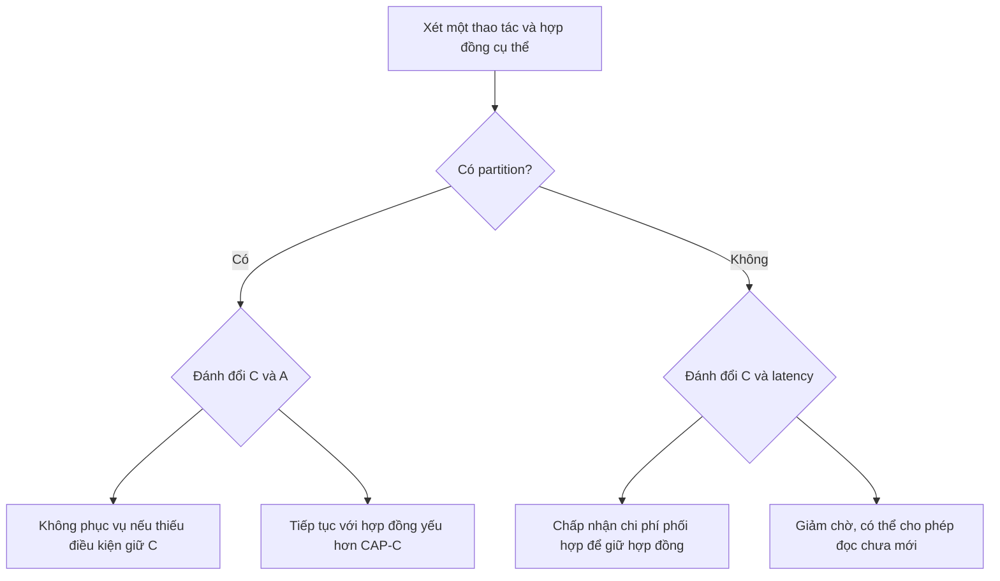
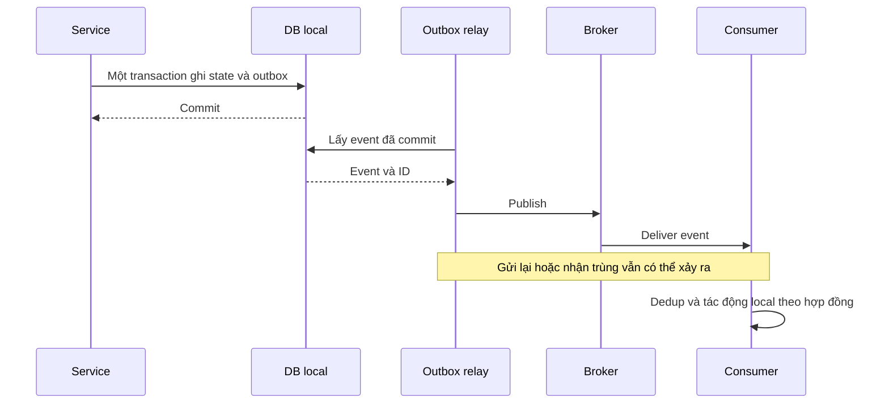

# CAP và PACELC: từ ví dụ dễ hiểu đến quyết định kiến trúc

**Bản dành cho junior — biên soạn ngày 20/10/2026; rà đối chiếu từng tiêu đề và bổ sung ngày 21/10/2026.**

Tài liệu này viết lại từ hai tệp anh Hiệu cung cấp: bài reconstruction về CAP trong system-design-primer và phần hỏi đáp Gemini. Mục tiêu là giữ toàn bộ các **chủ đề và chi tiết kỹ thuật có ý nghĩa**, thêm cầu nối kiến thức để người mới hiểu được, đồng thời sửa các phát biểu chưa chính xác. Những ý sai không được giữ nguyên như kiến thức đúng; chúng được ghi lại trong phần đối chiếu cuối tài liệu.

Đây là tài liệu giải thích và phản biện, không phải bản dịch nguyên văn của paper. Các ví dụ số học, dữ liệu và tình huống được ghi là **ví dụ giả định**; chúng không phải benchmark, số đo mạng hay mô tả sự cố thực tế của một công ty. Các mã [S01]… dẫn tới nguồn kiểm chứng ở cuối tài liệu. Việc một paper tồn tại không có nghĩa mọi suy diễn gắn tên paper trong bản cũ đều đúng.

## Cách đọc để không bị ngợp

Có thể đọc thành ba lượt, nhưng không cần bỏ phần nâng cao:

| Lượt | Đọc phần nào | Sau khi đọc cần làm được gì? |
|---|---|---|
| Nền tảng | §1–§4 | Kể lại vì sao mất liên lạc buộc đánh đổi; phân biệt CAP-C, ACID-C và Isolation |
| Cơ chế | §5–§10 | Giải thích quorum, Raft safety, RTT, PACELC, hội tụ và giới hạn đồng hồ |
| Thiết kế | §11–§16 | Đánh giá một API xuyên cache, DB và các service; đưa ra quyết định có điều kiện |

### Mục lục có liên kết

| Nhóm | Các phần |
|---|---|
| Nền tảng | [1. Dữ liệu phân tán](#phan-1) · [2. Định nghĩa CAP](#phan-2) · [3. Giới hạn C/A](#phan-3) · [4. Linearizability và ACID](#phan-4) |
| Cơ chế | [5. Quorum và Raft](#phan-5) · [6. Replication và RTT](#phan-6) · [7. PACELC](#phan-7) |
| Công nghệ và dữ liệu | [8. Cassandra/DynamoDB/Kafka/HDFS](#phan-8) · [9. Hội tụ và xung đột](#phan-9) · [10. Đồng hồ và mạng](#phan-10) |
| Kiến trúc | [11. Vòng đời sự cố](#phan-11) · [12. Toàn đường đi tới người dùng](#phan-12) · [13. Case study gọi xe](#phan-13) |
| Thực hành | [14. Kiểm chứng](#phan-14) · [15. Phiếu quyết định và câu hỏi](#phan-15) |
| Tra cứu | [16. Đính chính và độ bao phủ](#phan-16) · [17. Nguồn](#phan-17) · [18. Thuật ngữ](#phan-18) · [19. Bốn điều nên nhớ](#phan-19) · [20. Đối chiếu từng header](#phan-20) |

Trong mỗi phần, hãy đi theo thứ tự: **bài toán → chuỗi sự kiện → cơ chế → giới hạn → bài học**. Không cần thuộc tên mọi thuật toán ngay lần đầu.

<a id="phan-1"></a>

## 1. Trước CAP: ta đang phân tán cái gì?

<a id="muc-1-1"></a>

### 1.1. Node, replica và replication

Một **node** là một thành phần tính toán tham gia hệ thống; trong ví dụ DB, thường là một tiến trình DB trên một máy. Một máy có thể chạy nhiều tiến trình, nên node không luôn đồng nghĩa với máy vật lý.

Một **replica** là bản sao của cùng dữ liệu. **Replication** là quá trình đưa thay đổi giữa các bản sao.

Ví dụ giả định: hồ sơ khách hàng `customer-01` có số điện thoại `0900…`. DB lưu bản sao tại A và B. Người dùng sửa số điện thoại qua A. B chỉ biết số mới sau khi nhận và áp dụng thay đổi.

Câu hỏi khó xuất hiện: **A đã báo sửa thành công, nhưng B chưa nhận thay đổi. Đọc qua B lúc này phải trả gì?**

<a id="muc-1-2"></a>

### 1.2. Replication khác sharding

| Khái niệm | Hình dung | Mục đích chính |
|---|---|---|
| Replication | Hai cửa hàng giữ bản sao cùng một danh sách | Chịu lỗi, phục vụ đọc, đặt dữ liệu gần người dùng |
| Sharding | Mỗi cửa hàng giữ một phần danh sách khác nhau | Chia tải và dung lượng |
| Network partition | Các nhóm không trao đổi được thông điệp cần thiết | Đây là lỗi liên lạc, không phải cách chia dữ liệu |

Một shard có thể có nhiều replica. Một DB lớn thường gồm nhiều nhóm sao chép, mỗi nhóm chịu trách nhiệm một phần dữ liệu. Vì vậy “cluster còn quorum” phải hỏi tiếp: **quorum của nhóm dữ liệu nào?**

Từ `partition` trong Kafka topic là đơn vị chia dữ liệu của topic; từ `partition` trong CAP là sự chia cắt liên lạc. Hai nghĩa này không được đánh đồng.

<a id="muc-1-3"></a>

### 1.3. Invariant là gì?

**Invariant** là điều kiện nghiệp vụ cần luôn được giữ trong phạm vi đã cam kết. Ví dụ:

- Một mã đơn thanh toán chỉ được ghi nhận thu tiền một lần.
- Hai hồ sơ không được cùng chiếm một mã định danh duy nhất.
- Số lượng vé bán không được vượt số vé đã cấp quyền bán.

“Thông tin phải đúng” quá rộng để thiết kế. Phải nói rõ đúng điều gì, ở đâu, tại thời điểm nào, và có được tạm thời chờ xử lý hay không.

<a id="phan-2"></a>

## 2. Ba chữ CAP, định nghĩa đúng trước khi dùng nhãn

CAP thường được nhớ bằng câu “chọn hai trong ba”. Câu này dễ nhớ nhưng dễ khiến người học tưởng có thể bỏ partition bằng một nút cấu hình.

Phát biểu hữu ích hơn là: **với dữ liệu dùng chung được sao chép qua các node, khi liên lạc bị chia cắt, không thể bảo đảm đồng thời linearizability và việc mọi thao tác hợp lệ gửi tới node không hỏng đều hoàn tất.** Cần hiểu các giả định của mô hình, không áp câu này cho mọi loại hệ thống một cách máy móc. [S01][S02]

<a id="muc-2-1"></a>

### 2.1. C — Consistency: hệ thống trông như một đối tượng duy nhất

Trong CAP, C được hiểu là **atomic consistency / linearizability**.

Với một ô nhớ `x`, ta muốn toàn bộ các bản sao ứng xử như chỉ có một `x`. Nếu `write(x, 1)` đã báo hoàn tất, rồi mới bắt đầu `read(x)`, và không có ghi khác xen vào, lần đọc phải trả `1`.

Điều này không đòi mọi replica có cùng bit dữ liệu vào đúng mọi khoảnh khắc. Một replica có thể đang chậm, miễn nó không được phép trả kết quả vi phạm hợp đồng đọc. Hệ thống có thể định tuyến đọc, chờ, hoặc dùng cơ chế xác nhận phù hợp. [S03]

<a id="muc-2-2"></a>

### 2.2. A — Availability: hoàn tất thao tác, không chỉ gửi lại một gói HTTP

Trong mô hình CAP, yêu cầu là: **mọi request hợp lệ nhận bởi node không hỏng cuối cùng phải hoàn tất theo giao diện dữ liệu đang xét.**

Nếu `read(x)` cần một giá trị nhưng hệ thống chỉ trả “không thể đọc vì thiếu quorum”, thao tác chưa được phục vụ theo nghĩa này. Trả HTTP 503 thật nhanh không giúp đạt CAP-A. Nếu chỉ cần có một response bất kỳ, một server luôn trả lỗi sẽ vượt qua bài toán quá dễ dàng.

Tuy nhiên, đừng chuyển điều đó thành “mọi lỗi nghiệp vụ đều vi phạm CAP”. Nếu API hỗ trợ thao tác có điều kiện và kết quả hợp lệ là “version không còn khớp”, đó có thể là kết quả đúng của thao tác. Cần định nghĩa giao diện trước khi đánh giá A. CAP gốc dùng register đọc/ghi đơn giản, không phải toàn bộ ý nghĩa mã HTTP của một ứng dụng. [S01][S02]

<a id="muc-2-3"></a>

### 2.3. Hai điểm Availability rất dễ học sai

**Thứ nhất: non-failing không có nghĩa mọi thứ đều chạy nhanh.** Định lý phân biệt node hỏng với node không hỏng trong mô hình thực thi. Trong hệ bất đồng bộ, thông điệp và quá trình xử lý có thể chậm mà không có một cận thời gian cố định để ta kết luận chắc chắn bên kia đã chết.

**Thứ hai: “cuối cùng hoàn tất” không đồng nghĩa “hoàn tất dưới 200 ms”.** CAP-A gốc không cung cấp một deadline thực tế như SLO. Một response đến sau 30 giây có thể vẫn phù hợp với một yêu cầu tiến triển hình thức, nhưng đã vô ích với ứng dụng có deadline 2 giây. Đây là khoảng cách giữa mô hình định lý và đo lường dịch vụ. [S01][S02]

| Câu hỏi | CAP Availability | Availability/SLO vận hành |
|---|---|---|
| Đang kiểm tra gì? | Thuộc tính hoàn tất của các thao tác trong mô hình | Tỷ lệ request phục vụ được, thường có deadline |
| Có dùng mức 99,9%? | Không phải cách định nghĩa của định lý | Có thể, tùy cách đo và hợp đồng |
| Một node crash thì sao? | Không buộc node đã hỏng phải đáp ứng; các node không hỏng vẫn chịu nghĩa vụ tương ứng | Có ảnh hưởng người dùng hay không phụ thuộc failover, routing và tải |
| Trả lỗi vì không thể phục vụ dữ liệu? | Không đáp ứng thao tác đang yêu cầu | Thường được tính lỗi, tùy SLI |
| Response rất chậm? | Phải xét giả định tiến triển; không tự có deadline vài giây | Có thể vi phạm ngay khi vượt deadline |

Một hệ thống không thỏa CAP-A **không có nghĩa 0% request thực tế thành công**. Thuộc tính hình thức không còn được bảo đảm trên mọi trường hợp; một phần lớn khách hàng vẫn có thể được phục vụ.

Ví dụ số học thuần túy: với tháng giả định có 30 ngày và SLO đo theo thời gian, 99,9% tương ứng ngân sách khoảng `43,2 phút`, 99,99% khoảng `4,32 phút`. Các số `43,8` và `4,38` thường dùng tháng trung bình 365/12 ngày. Nếu SLO đo theo request thì phải dùng số request, không đổi trực tiếp thành phút.

<a id="muc-2-4"></a>

### 2.4. P — Partition tolerance: thiết kế cho khả năng mất liên lạc

**Network partition** là tình huống các nhóm node không trao đổi được những thông điệp cần thiết, dù các node trong mỗi nhóm vẫn có thể đang chạy và vẫn nhận request từ client.

Partition có thể không đối xứng: A gọi được B nhưng B không trả về được A; hoặc chỉ một số đường/loại lưu lượng bị chặn. Ví dụ hai nhóm tách rời hoàn toàn chỉ là hình minh họa đơn giản nhất.

P không có nghĩa “mọi tính năng đều tiếp tục hoàn hảo”. Nó là bối cảnh lỗi mà ta yêu cầu hệ thống xử lý. Có thể giữ an toàn bằng cách từ chối một phần thao tác, hoặc tiếp tục phục vụ với hợp đồng nhất quán yếu hơn.

Một DB một node không có bài toán đồng bộ giữa các replica, nhưng vẫn có thể crash, quá tải, mất dữ liệu hoặc bị client mất kết nối. Vì vậy “một node nghiễm nhiên có C và A hoàn hảo” là kết luận sai.

<a id="phan-3"></a>

## 3. Vì sao không thể vừa C vừa A khi partition?

<a id="muc-3-1"></a>

### 3.1. Ví dụ hai cuốn sổ, giữ trực giác nhưng bỏ điều gây nhiễu

Hãy hình dung hai nhân viên A và B cùng cung cấp dịch vụ ghi nhớ lịch bay. Mỗi người có một cuốn sổ riêng.

1. Cả hai ban đầu ghi lịch bay là `08:00`.
2. Hai người mất liên lạc với nhau nhưng vẫn nghe điện thoại khách hàng.
3. Khách gọi A đổi lịch thành `09:00`.
4. A xác nhận “đã cập nhật”.
5. Sau xác nhận đó, khách gọi B hỏi lịch bay.

B đang giữ `08:00`. B không thể biết chắc liệu A đã nhận cập nhật hay chưa.

- B trả `08:00`: đã phục vụ được câu hỏi, nhưng vi phạm linearizability của lịch bay này.
- B chờ A xác nhận hoặc từ chối trả lời: giữ được khả năng không trả sai, nhưng không bảo đảm mọi request ở B hoàn tất khi liên lạc không phục hồi.
- B đoán `09:00`: tình cờ đúng trong tình huống này, nhưng không bảo đảm đúng nếu khách chưa hề đổi lịch hoặc đổi thành `10:00`.

Vấn đề là **thiếu thông tin**, không phải lập trình viên chưa nghĩ ra câu `if` đủ thông minh. [S01]

<a id="muc-3-2"></a>

### 3.2. Hai lịch sử B không phân biệt được

| B quan sát được gì? | Lịch sử H1 | Lịch sử H2 |
|---|---|---|
| Trước partition | Lịch bay 08:00 | Lịch bay 08:00 |
| Sau partition, B không nhận thông điệp từ A | A đã xác nhận đổi sang 09:00 | Không có cập nhật nào |
| Có client hỏi B | Phải phản ánh cập nhật đã hoàn tất | Phải phản ánh giá trị vẫn là 08:00 |

Cùng thông tin tại B nhưng câu trả lời đúng khác nhau. Một thuật toán chỉ dùng thông tin tại B không thể luôn chọn đúng cả hai.

**Chi tiết quan trọng:** A cũng có quyền không xác nhận ghi khi chưa phối hợp được. Khi đó C có thể được giữ, nhưng đánh đổi A xảy ra ở phía ghi. CP không chỉ là “node B từ chối đọc”.

<a id="muc-3-3"></a>

### 3.3. CP và AP là cách mô tả hành vi, không phải dấu chất lượng

| Khi liên lạc không đủ | Hướng ưu tiên C | Hướng ưu tiên A |
|---|---|---|
| Đọc | Chỉ phục vụ khi chứng minh được đáp ứng hợp đồng; có thể chờ/lỗi | Có thể phục vụ bản cục bộ dù chưa mới toàn cục |
| Ghi | Có thể không xác nhận nếu chưa đạt điều kiện commit | Có thể nhận ghi độc lập và xử lý xung đột sau |
| Chi phí cần thiết kế | Gián đoạn, failover, thông báo pending, deadline | Version, hội tụ, xung đột, xử lý cập nhật đến muộn |
| Điều không tự có | Toàn bộ invariant nghiệp vụ, chống trùng, không mất dữ liệu trong mọi lỗi | Eventual consistency, không mất cập nhật, chất lượng dữ liệu tùy ý |

AP không có nghĩa hệ thống được phép trả dữ liệu rác tùy ý. Nó vẫn phải có một hợp đồng cụ thể, ví dụ eventual consistency hoặc causal consistency; chỉ không giữ được CAP-C đầy đủ cùng A trong bối cảnh partition.

“CA không tồn tại” cũng cần diễn đạt có phạm vi: có thể xét một mô hình loại trừ partition và đạt C+A trong mô hình đó. Điều không thể là hứa cả C+A cho mọi partition của mô hình CAP. Không nhất thiết mọi cách dùng chữ CA đều chỉ nói hệ một node. [S01][S02][S04]

<a id="muc-3-4"></a>

### 3.4. Delay-sensitivity: khi mạng chậm hơn, thao tác nào phải chậm theo?

Đây là một ý trong mục “Ranh giới CP/AP không nhị phân” của bản gốc nhưng bản giải thích trước đã bỏ sót phần giải nghĩa. Kleppmann đề xuất đổi câu hỏi “DB này CP hay AP?” thành câu hỏi cụ thể hơn: **latency của thao tác phụ thuộc độ trễ mạng nào, và phụ thuộc ra sao?** [S02]

**Ví dụ giả định:** đọc từ một replica local theo hợp đồng cho phép stale có thể không phải đợi đường liên Region. Một lệnh ghi phải xác nhận từ quorum ở xa sẽ chịu ảnh hưởng khi đường cần thiết ấy chậm. Nếu còn một quorum hợp lệ trên các đường nhanh, một replica xa chậm chưa chắc làm request chậm tương ứng.

| Thao tác giả định | Đường truyền nó cần chờ | Khi đường liên Region chậm |
|---|---|---|
| Đọc bản local được phép cũ | Không nhất thiết cần đường liên Region | Có thể vẫn trả nhanh, nhưng dữ liệu kém mới hơn |
| Ghi phải chờ xác nhận từ Region khác | Đường tới các replica bắt buộc | Latency có thể tăng hoặc request hết deadline |
| Ghi có nhiều lựa chọn quorum | Tập ACK đủ điều kiện theo protocol | Phải xem còn đủ các replica phản hồi nhanh hay không |

Đây là ví dụ phân tích dependency, không phải khẳng định mọi local read luôn nhanh. CPU, disk, lock và queue vẫn có thể làm nó chậm. Paper dùng mô hình/cận về độ nhạy theo network delay; không nên biến ký hiệu độ phức tạp thành công thức benchmark của một DB.

**Bài học:** vẽ đường cần chờ cho từng API, tách đọc/ghi và từng phạm vi mạng. Nhãn CP/AP chỉ là bước khởi đầu; biểu đồ dependency giúp tìm chỗ tối ưu hoặc chỗ phải chấp nhận latency.

<a id="phan-4"></a>

## 4. Linearizability, ACID và các loại thứ tự

<a id="muc-4-1"></a>

### 4.1. Linearization point: tưởng như thao tác có hiệu lực tại một điểm

Một thao tác thực tế có thời điểm gọi và thời điểm trả lời. Linearizability yêu cầu ta có thể tìm một thứ tự tuần tự hợp lệ, trong đó mỗi thao tác trông như có hiệu lực tại một điểm nằm trong khoảng đó.

Ví dụ giả định với `x = 0`:

| Thời điểm quan sát | Sự kiện |
|---|---|
| t1 | A bắt đầu `write(x, 1)` |
| t2 | A nhận xác nhận ghi thành công |
| t3, sau t2 | B bắt đầu `read(x)` |
| t4 | B nhận kết quả |

Nếu không có ghi khác xen vào, kết quả ở t4 phải là `1`. Nếu có thao tác ghi `2` hợp lệ xen vào, B có thể thấy `2`; không phải mọi lần đọc mãi mãi phải thấy `1`.

**Nếu đọc chồng lấn ghi:** B bắt đầu đọc trước khi A nhận xác nhận. Tùy thứ tự tuyến tính hợp lệ, B có thể nhận giá trị cũ hoặc mới. Kết quả phải khớp một lịch sử hợp lệ chung cho các thao tác, không phải từng request muốn trả gì cũng được. [S03]

<a id="muc-4-2"></a>

### 4.2. “Mới nhất” không phải timestamp lớn nhất

Máy A có thể chạy nhanh 5 phút, máy B có giờ đúng. Timestamp A lớn hơn không chứng minh thao tác A xảy ra sau trong thời gian thực.

Linearizability nói về **thứ tự các lần gọi và hoàn tất**, không yêu cầu đọc đồng hồ vật lý có độ chính xác tuyệt đối. Có thể hiện thực bằng giao thức trao đổi thông điệp. Đồng hồ như TrueTime/HLC là công cụ của một số thiết kế, không phải điều kiện định nghĩa.

Cũng không được thay “real-time order” bằng “causal order” rồi coi hai thứ giống nhau. Linearizability buộc bảo toàn thứ tự của cả những thao tác không chồng lấn giữa các client khác nhau, kể cả khi ứng dụng không truyền dependency nhân quả qua DB.

<a id="muc-4-3"></a>

### 4.3. ACID-C: dữ liệu có giữ luật nghiệp vụ không?

ACID-C liên quan tính hợp lệ của trạng thái và ràng buộc. Ví dụ transaction chuyển tiền phải ghi đủ các bút toán cần thiết, constraint/khóa ngoại phải được giữ.

DB chỉ thực thi được những ràng buộc và cơ chế đã khai báo/hiện thực. Nó không tự biết “không được thu tiền hai lần” nếu ứng dụng không có định danh giao dịch và quy tắc chống trùng phù hợp.

Một bản sao đọc chậm có thể vẫn chứa dữ liệu hợp lệ theo constraint của một trạng thái quá khứ. Vì vậy stale read và vi phạm constraint là hai vấn đề khác nhau.

<a id="muc-4-4"></a>

### 4.4. ACID-I: các transaction đồng thời ảnh hưởng nhau ra sao?

**Serializability** yêu cầu kết quả của các transaction đồng thời tương đương một thứ tự chạy tuần tự hợp lệ. Bản thân định nghĩa này không bắt thứ tự đó khớp tất cả quan hệ trước–sau của thời gian thực.

Ví dụ khái niệm: T1 ghi `x=1` rồi hoàn tất; sau đó T2 chỉ đọc `x` nhưng được phục vụ ở snapshot trước T1 và trả `0`. Lịch sử có thể tương đương `T2 → T1`, nên serializability thuần túy không tự loại bỏ trường hợp đó. Một sản phẩm cụ thể có thể cung cấp bảo đảm mạnh hơn định nghĩa tối thiểu; không được kết luận mọi DB ghi “Serializable” đều cho phép ví dụ này.

<a id="muc-4-5"></a>

### 4.5. Strict serializability: thứ tự transaction còn phải tôn trọng thời gian thực

**Strict serializability = serializability + yêu cầu thứ tự thời gian thực ở mức transaction.**

Đây là ý nghĩa cần hiểu của cách nhớ “serializability + linearizability”. Không phải cứ mỗi dòng đọc/ghi riêng lẻ linearizable rồi tự ghép nhiều dòng là có transaction strict serializable.

Ví dụ hai API `debit(A)` và `credit(B)` đều linearizable riêng lẻ. Nếu không có transaction bao chúng, một lần đọc tổng số dư có thể xen giữa debit và credit. Tính nguyên tử của cả chuyển khoản không tự xuất hiện.

Trong ngữ cảnh giao dịch của Spanner, **external consistency** thể hiện yêu cầu thứ tự transaction phù hợp quan sát bên ngoài/thời gian thực. [S05][S06]

| Khái niệm | Đơn vị đang xét | Bảo đảm chính | Không tự bảo đảm |
|---|---|---|---|
| ACID-C | Trạng thái và ràng buộc | Dữ liệu hợp lệ theo luật được thực thi | Mọi replica đều trả dữ liệu mới |
| Linearizability | Thao tác trên đối tượng với API xác định | Một thứ tự hợp lệ tôn trọng thời gian thực | Transaction nguyên tử xuyên nhiều đối tượng độc lập |
| Serializability | Transaction | Tương đương một lịch tuần tự hợp lệ | Mọi quan hệ thời gian thực ngoài DB |
| Strict serializability | Transaction | Lịch tuần tự hợp lệ và tôn trọng thời gian thực | Chống trùng request nghiệp vụ nếu gửi hai transaction hợp lệ |

<a id="muc-4-6"></a>

### 4.6. Tính hợp thành: đúng nhưng không được suy rộng

Herlihy và Wing chứng minh linearizability có tính địa phương/hợp thành: nếu từng đối tượng đáp ứng nó, các lịch sử đối tượng có thể hợp thành trong mô hình tương ứng. Định nghĩa này áp dụng được cho nhiều loại đối tượng, như queue, không chỉ một ô nhớ. [S03]

Điều đó **không** tạo atomicity cho một thao tác nghiệp vụ ghép qua nhiều đối tượng. Tương tự, hai DB serializable cục bộ chưa đủ bảo đảm một transaction trải cả hai DB serializable toàn cục. Cần giao thức và biên transaction phù hợp.

Đừng dùng “global deadlock” như từ đồng nghĩa với vi phạm serializability: deadlock là vấn đề tiến triển; một lịch thực thi có thể tránh deadlock mà vẫn sai về isolation, hoặc gặp deadlock nhưng được DB hủy một transaction để giữ tính đúng.

<a id="phan-5"></a>

## 5. Quorum, consensus và safety: hiểu cơ chế thay vì thuộc tên

<a id="muc-5-1"></a>

### 5.1. Consensus là thỏa thuận về quyết định, replication là truyền dữ liệu

Replication trả lời câu hỏi “đưa thay đổi sang bản sao thế nào?”. Consensus giải quyết việc các thành viên phải thống nhất một quyết định, hoặc một chuỗi lệnh đã được chấp nhận, trong mô hình lỗi đã nêu.

Một **replicated state machine** có thể hình dung là nhiều máy chạy cùng chuỗi lệnh xác định để tạo cùng trạng thái. Raft quản lý replicated log phục vụ mô hình này. Raft/Paxos không chỉ “hoạt động lúc mạng đứt”; chúng có vai trò ngay trong xử lý bình thường. [S07]

<a id="muc-5-2"></a>

### 5.2. Safety và liveness

| Thuộc tính | Cách nhớ | Ví dụ |
|---|---|---|
| Safety | Không xảy ra điều bị cấm | Không có hai lệnh khác nhau cùng được áp dụng tại một vị trí log đã quyết định |
| Liveness | Cuối cùng có tiến triển mong muốn | Khi điều kiện mạng và đa số phù hợp, hệ thống bầu được leader và hoàn tất ghi |

Linearizability là một thuộc tính safety. CAP Availability là một yêu cầu liveness/termination. Hội tụ eventual consistency cũng chứa yêu cầu tiến triển, nhưng là một cam kết khác với việc một request được trả lời.

Một hệ thống đứng im mãi có thể không tạo dữ liệu sai nhưng thất bại về liveness. Một hệ thống trả lời rất nhanh vẫn có thể sai về safety. Do đó cần kiểm tra cả hai.

<a id="muc-5-3"></a>

### 5.3. Majority quorum có nghĩa gì?

Với nhóm cố định N thành viên, đa số là:

`quorum = floor(N/2) + 1`

Nhóm 5 node cần 3. Mọi hai tập có ít nhất 3 phần tử trong tổng 5 phần tử đều có giao nhau. Tính giao nhau là nền tảng hữu ích để các vòng quyết định không dễ bỏ qua thông tin đã quyết định trước.

**Nhưng giao nhau chưa đủ thành thuật toán đúng.** Còn phải có luật bầu, term/ballot, log, điều kiện commit và cách xử lý dữ liệu cũ. Khi thay đổi thành viên, không được tự đổi N và tiếp tục dùng cùng phép tính; giao thức phải giữ các giao điểm cần thiết trong quá trình chuyển cấu hình. [S07]

<a id="muc-5-4"></a>

### 5.4. Ví dụ Raft 5 node bị chia thành 2–3

**Ví dụ giả định, các node không Byzantine, không mất stable storage, membership cố định.**

Ban đầu S1 là leader ở term 1. Mạng tách thành `{S1,S2}` và `{S3,S4,S5}`.

| Bước | Nhóm 2 node | Nhóm 3 node |
|---|---|---|
| Mất liên lạc | S1 có thể chưa biết có leader khác | Không nhận heartbeat cũ |
| Có request mới | S1 có thể append lệnh X vào log cục bộ | Sau election timeout, có thể bầu S3 ở term 2 |
| Điều kiện xác nhận | X chỉ có ở 2 node nên không đủ điều kiện commit theo ví dụ | S3 có thể replicate lệnh Y đủ đa số và commit theo luật Raft |
| Hành vi với client | Không được xác nhận X đã commit; client có thể timeout | Client có thể nhận xác nhận Y |
| Khi mạng nối lại | S1 thấy term cao hơn thì hạ vai trò; phần log chưa commit xung đột có thể bị thay | Lịch sử committed được giữ theo luật giao thức |

Trong ví dụ này, nếu Y thay X ở cùng vị trí log, X chưa commit bị loại bỏ. **Không được suy ra mọi request timeout chắc chắn bị loại bỏ**: ở tình huống khác, lệnh có thể đã commit nhưng ACK thất lạc. Client lúc đó chưa biết kết quả, cần idempotency/tra cứu.

<a id="muc-5-5"></a>

### 5.5. Năm thuộc tính safety thường được nhắc ở Raft

Các tên sau là của Raft; không nên gán nguyên danh sách này cho mọi biến thể Paxos:

| Thuộc tính | Hiểu đơn giản |
|---|---|
| Election Safety | Tối đa một leader được bầu trong một term |
| Leader Append-Only | Leader không tùy ý sửa/xóa log của chính nó trong vai trò leader |
| Log Matching | Cùng index và term thì entry và phần log đi trước khớp nhau |
| Leader Completeness | Entry đã commit được giữ trong log của các leader ở term sau |
| State Machine Safety | Không hai state machine áp dụng hai lệnh khác nhau tại cùng index |

Có thể đồng thời tồn tại **leader cũ ở term thấp và leader mới ở term cao mà leader cũ chưa biết**. Election Safety không có nghĩa “không bao giờ có hai tiến trình tự nghĩ mình là leader”. [S07]

Việc “đã nằm trên đa số” còn phải được đọc cùng luật commit của giao thức; Raft có quy tắc liên quan entry của current term. Không nên lấy một câu `if ack_count >= majority` thay cho toàn bộ proof.

<a id="muc-5-6"></a>

### 5.6. Nếu chia 5 node thành 2–2–1?

Không nhóm nào đạt 3. Các thao tác cần một quyết định mới của nhóm consensus không thể tiếp tục chỉ nhờ phần cứng còn sống.

Đó là sự mất khả năng tiến triển của **nhóm dữ liệu và loại thao tác ấy**. Không nhất thiết toàn bộ sản phẩm mất mọi khả năng đọc, mọi shard hoặc mọi endpoint. Có thể vẫn phục vụ đọc lịch sử/cục bộ nếu API cho phép, trong khi không thể nhận thêm ghi hoặc đọc tuyến tính cần xác nhận mới.

<a id="muc-5-7"></a>

### 5.7. Read path: leader cũ cũng có thể trả dữ liệu cũ

Leader cũ bị cô lập có thể còn nghĩ mình có quyền phục vụ. Nếu cứ đọc state cục bộ và trả về, nó có thể bỏ lỡ ghi đã commit qua leader mới.

Để đọc linearizable, implementation cần cách xác nhận quyền phục vụ và mốc dữ liệu đã apply, chẳng hạn trao đổi quorum/ReadIndex, hoặc lease với các giả định thời gian tương ứng. Không phải mọi cách đọc đều phải chạy một vòng quorum riêng cho từng request: có thể batching hoặc dùng kỹ thuật khác, nhưng phải giữ proof. [S07]

Hai ví dụ API cần phân biệt:

- **etcd:** `Range` mặc định linearizable; tùy chọn `serializable` cho đọc cục bộ có thể stale. Từ `serializable` tại API này không được hiểu thành lời hứa một transaction SQL strict serializable. [S08]
- **ZooKeeper:** đọc thông thường có thể stale. Tài liệu internals nói cả `sync()` trước đọc cũng không phải lời bảo đảm linearizability tuyệt đối trong mọi tình huống, vì `sync` không phải quorum operation. Không được dạy “gọi sync là luôn mới nhất” như định luật. [S09]

<a id="muc-5-8"></a>

### 5.8. Safety của Paxos: một quyết định không được có hai giá trị khác nhau

Tiêu đề Gemini nói “Raft / Paxos”, nhưng bản trước chủ yếu giải thích Raft. Với **một instance quyết định của Paxos**, cần phân biệt proposer đề xuất, acceptor chấp nhận proposal và learner biết giá trị đã được chọn. Một giá trị đã chosen không được bị một proposal sau thay bằng giá trị khác trong cùng instance. Nhiều proposal có số khác nhau có thể cùng được chọn nếu cùng giá trị. [S41]

**Ví dụ giả định:** giá trị X đã được một đa số acceptor chọn. Proposer mới muốn đưa Y vào cùng instance; nó phải thu thập thông tin qua phase prepare và tuân thủ luật chọn giá trị từ phản hồi, không được chỉ đếm một đa số mới rồi tự chọn Y. Giao điểm quorum kết hợp promise/accepted state và luật proposal mới giúp giữ quyết định cũ.

“Accepted bởi một acceptor” chưa đồng nghĩa “chosen”. Các tên như Election Safety và Leader Append-Only ở §5.5 là thuộc tính được trình bày cho Raft, không phải danh sách thuật ngữ áp nguyên xi cho Paxos. Đây là giải thích trực giác; không thay đặc tả đầy đủ của Paxos.

<a id="phan-6"></a>

## 6. Synchronous replication và RTT: tách thời gian mạng, thời gian đĩa và điều kiện ACK

<a id="muc-6-1"></a>

### 6.1. Các từ cần biết

| Từ | Nghĩa trong phần này |
|---|---|
| ACK | Tín hiệu xác nhận; phải đọc rõ xác nhận điều gì |
| RTT | Thời gian đi và về giữa hai đầu liên lạc |
| WAL/log | Nhật ký được ghi để hỗ trợ phục hồi và/hoặc sao chép |
| Durable | Tồn tại qua các lỗi nằm trong mô hình lưu trữ cam kết |
| Apply/replay | Áp dụng log để trạng thái đọc thực sự phản ánh thay đổi |
| Replication lag | Mức chậm của replica so với mốc tham chiếu |

**Nhận dữ liệu, ghi vào RAM, ghi log bền vững và apply cho truy vấn đọc là bốn mốc khác nhau.** Khi vendor nói “synchronous”, phải đọc xem ACK nằm ở mốc nào. PostgreSQL có các mode chờ khác nhau minh họa rất rõ sự phân biệt này. [S40]

<a id="muc-6-2"></a>

### 6.2. Đồng bộ nghĩa là request phải chờ một điều kiện xác nhận

Primary có thể chỉ báo hoàn tất sau khi một tập replica đáp ứng điều kiện cụ thể. Tập đó có thể là một replica đồng bộ, một quorum, hoặc toàn bộ các replica được chỉ định. **Strong consistency không mặc nhiên đòi tất cả replica ghi xong.** [S04][S07]

Ứng dụng dùng async I/O vẫn có thể chờ điều kiện đồng bộ ở cấp giao thức. Thread có thể được nhường trong lúc chờ; không cần bị block vật lý suốt thời gian đó. Vì vậy “synchronous replication = blocking I/O trên thread” là cách mô tả sai tầng.

<a id="muc-6-3"></a>

### 6.3. Bài tính 31 ms — toàn bộ con số là giả định

Giả sử để minh họa:

- Primary flush WAL mất 0,5 ms.
- Thời gian truyền một chiều tới replica là 15 ms.
- Replica flush WAL mất 0,5 ms.
- ACK quay về mất 15 ms.
- Bỏ qua đường client–primary, hàng đợi, serialization, xử lý khác và việc pipeline.

Với chuỗi tuần tự giả định này:

`T = 0,5 + 15 + 0,5 + 15 = 31 ms`

| Mốc | Chuyện gì xảy ra? | Primary đã được phép báo hoàn tất chưa? |
|---|---|---|
| 0,5 ms | Log local đã durable theo giả định | Chưa, nếu hợp đồng đòi ACK replica |
| 15,5 ms | Dữ liệu tới replica | Chưa |
| 16 ms | Replica hoàn thành flush | Chưa, primary chưa nhận ACK |
| 31 ms | Primary nhận ACK | Có, nếu các điều kiện khác đã thỏa |

Đây là **chi phí của mô hình ví dụ**, không phải latency thật của DB hay tuyến Hà Nội–TP.HCM. Nếu gửi các replica song song, latency phụ thuộc ACK cần thiết đến thứ mấy; chờ tất cả khác chờ quorum. Một giao thức nhiều vòng cũng có thể tốn hơn một RTT.

<a id="muc-6-4"></a>

### 6.4. Sao chép bất đồng bộ đổi điều gì?

Nếu chỉ chờ log local 0,5 ms trong mô hình trên, primary có thể báo hoàn tất sớm hơn. Replica xa sẽ chưa thấy thay đổi tại thời điểm 1 ms.

Nhưng cần giữ ba giới hạn:

1. **Không phải mọi đọc đều stale:** nếu chỉ đọc từ primary có cơ chế authority đúng, hợp đồng đọc có thể vẫn mạnh. Đường đọc và failover mới quyết định những gì client quan sát.
2. **Flush không đồng nghĩa apply:** dù replica đã ACK WAL, truy vấn đọc tại đó có thể cần đợi apply/replay.
3. **Primary mất điện không tự đồng nghĩa mất dữ liệu vĩnh viễn:** nếu log durable còn nguyên và primary phục hồi, dữ liệu có thể khôi phục. Rủi ro mất cập nhật đã ACK xuất hiện khi failover sang replica thiếu cập nhật, mất lưu trữ liên quan, hoặc quy tắc phục hồi bỏ lịch sử đó. RPO phụ thuộc cấu hình và kịch bản lỗi.

Vì thế “async nhanh hơn” là một hướng đánh đổi có điều kiện, không phải công thức thời gian của mọi DB.

<a id="muc-6-5"></a>

### 6.5. Giới hạn truyền tín hiệu

Có thể dùng tốc độ truyền trong sợi quang khoảng `200.000 km/s` làm xấp xỉ giáo khoa. Nếu **giả sử** đường sợi quang dài 1.700 km thì riêng thời gian lan truyền khứ hồi lý tưởng là khoảng:

`2 × 1.700 / 200.000 giây = 17 ms`

Đây không phải xác nhận tuyến cáp thực tế giữa hai thành phố. Cáp có thể đi vòng; router, hàng đợi và xử lý làm độ trễ cao hơn. Không có lý do để suy ra “RTT thực tế là 30 ms” nếu chưa đo.

<a id="phan-7"></a>

## 7. PACELC: thêm câu hỏi khi mạng đang bình thường

<a id="muc-7-1"></a>

### 7.1. Cách đọc sáu chữ

PACELC đặt hai câu hỏi:

- **P:** khi có partition, đánh đổi **A**vailability và **C**onsistency thế nào?
- **E**lse: khi không có partition, đánh đổi **L**atency và **C**onsistency thế nào?

Abadi nêu ý tưởng năm 2010 và trình bày trong IEEE Computer năm 2012. Golab công bố *Proving PACELC* năm 2018 với cách hình thức hóa và các giả định cụ thể. Các nhãn sản phẩm trong bài năm 2012 phản ánh thiết kế/cấu hình thời điểm đó, không phải bảng phân loại vĩnh viễn cho năm 2026. [S04][S10]



Sơ đồ là khung đặt câu hỏi. Nó không nói mọi DB đều có một nút chuyển mode, hoặc phần mềm phát hiện partition hoàn hảo.

<a id="muc-7-2"></a>

### 7.2. Hai chữ C không phải hai khái niệm hoàn toàn khác nhau

Bản nguồn và Gemini lập luận rằng C ở PC thuộc “logic consensus”, còn C ở EC thuộc “I/O replication”, nên hai C khác bản chất và hai cơ chế độc lập. **Cách giải thích này cần sửa.**

C vẫn nói tới tính nhất quán/hợp đồng quan sát. Nhánh P và E xét **hai điều kiện vận hành**. Consensus và replication cùng tham gia hiện thực hóa hợp đồng; quorum vừa có vai trò safety vừa tạo thời gian chờ ACK trong vận hành bình thường.

Ví dụ Raft: một lệnh ghi được xác nhận qua đa số ở ngày mạng khỏe; cũng chính điều kiện đó khiến phía thiểu số không commit được khi mạng tách. Không có chuyện safety chỉ “bật lên” sau partition.

Abadi còn ghi rõ quorum đơn thuần chưa đủ cho mức consistency của Gilbert–Lynch. Paper cũng bàn đọc qua master trong hệ replication async có thể vẫn giữ consistency, nhưng phải trả chi phí routing tới master. Vì vậy không được dùng `sync/async` thay cho toàn bộ phân tích C/L. [S04]

<a id="muc-7-3"></a>

### 7.3. Chi phí bất đối xứng, nhưng không tuyệt đối

Chọn từ chối một số thao tác khi partition nghĩa là chấp nhận chi phí availability trong các tình huống đó. Nó không hứa hệ CP chỉ có thể bị gián đoạn khi đứt mạng: crash, quá tải và lỗi vận hành vẫn tồn tại.

Cho phép stale read ở ngày thường nghĩa là hợp đồng vẫn cho phép độ trễ dữ liệu dù mạng khỏe. Nó không có nghĩa mọi request đều đọc sai, hoặc DB sinh “dữ liệu rác 24/7”.

Tần suất partition phải dựa môi trường và telemetry. Không có số liệu trong hai tệp nguồn để kết luận đa số sự cố cloud là OOM/IOPS, hoặc mọi local-first app phần lớn thời gian offline.

<a id="muc-7-4"></a>

### 7.4. Bốn tổ hợp: đọc hành vi trước, tên DB sau

| Nhãn | Khi partition | Khi bình thường | Cách dùng ví dụ an toàn |
|---|---|---|---|
| PA/EL | Tiếp tục thao tác với hợp đồng yếu hơn CAP-C | Ưu tiên latency, có thể chấp nhận stale read | Một thiết kế leaderless với cấu hình phù hợp; Dynamo là ví dụ lịch sử |
| PC/EC | Từ chối thao tác không đủ điều kiện giữ hợp đồng | Chấp nhận chi phí phối hợp/đường đọc để giữ consistency | Mô hình replicated register linearizable; Spanner có hợp đồng transaction mạnh hơn |
| PC/EL | Không nới thêm hợp đồng cơ sở để mở đường ghi độc lập | Đọc replica có thể chậm hơn master | PNUTS là ví dụ Abadi dùng, với lời giải thích rất quan trọng bên dưới |
| PA/EC | Khi lỗi có thể giảm mức bảo đảm để tiếp tục; ngày thường có cơ chế đồng bộ mạnh hơn | Chấp nhận chi phí đồng bộ ở chế độ bình thường | Nhãn thiết kế cần chỉ rõ thao tác và chuyển chế độ; không suy từ tên DB |

**Một phép thử lỗi không đủ chứng minh nhãn.** Nó chỉ minh họa một tình huống; còn phải kiểm tra các lịch sử, API và giả định khác.

<a id="muc-7-5"></a>

### 7.5. Vì sao PC/EL không phải “đứt mạng thì tốt hơn ngày thường”?

PNUTS dùng per-record master và cho phép replica đọc theo timeline/version của bản ghi, có thể chưa mới nhất. Khi không tới được nơi có quyền cập nhật, không tự cho mọi nơi sửa độc lập.

Abadi chủ động giải thích: **PC ở ví dụ này không có nghĩa mọi thao tác đạt CAP-C đầy đủ; nó có nghĩa không giảm consistency xuống thấp hơn baseline để đổi availability khi partition.** Đây là giới hạn của nhãn phân loại và việc dùng chung từ C ở các mức mô tả. [S04]

Nếu một endpoint cho phép stale read cả lúc bình thường và lúc partition, đừng nói endpoint đó bỗng linearizable chỉ vì đường ghi dùng consensus. Phải mô tả riêng đường đọc và ghi.

<a id="muc-7-6"></a>

### 7.6. Vì sao không giữ ví dụ “MongoDB = PA/EC” như Gemini?

`readPreference: secondary` chỉ nói nơi đọc. Nó không chứng minh ghi vẫn available ở mọi nhóm mạng; cũng không chứng minh ngày bình thường đọc luôn mới. `w:1` không yêu cầu ACK từ secondary.

Abadi năm 2012 có dùng MongoDB trong phân loại, đồng thời nêu ngoại lệ rằng nó không available theo nghĩa CAP ở phía thiểu số. Dùng nhãn lịch sử ấy cho MongoDB hiện nay mà không nói version, write concern, read concern và read preference là không đủ căn cứ. Bản này giữ **bài học phân loại**, bỏ khẳng định sản phẩm không được chứng minh.

Tương tự, Hazelcast có AP data structures, cơ chế backup và CP Subsystem khác nhau. Có synchronous backup không tự chứng minh linearizability toàn cục. Muốn phân loại một API cụ thể phải đọc đúng cấu trúc dữ liệu và bảo đảm của nó. [S11]

<a id="muc-7-7"></a>

### 7.7. PA/EL — theo dõi một lần ghi và một lần đọc

Các mục §7.7–§7.10 khôi phục cách giải thích theo từng tổ hợp như Gemini yêu cầu. Mỗi ví dụ là **mô hình minh họa có giả định**, không phải chứng nhận một sản phẩm đáp ứng mọi execution của CAP.

Giả sử A và B giữ bản sao `x=0`; giao diện đang cho phép ghi cục bộ và đọc có thể cũ.

1. **Khi bình thường:** A nhận `write(x,1)`, thỏa điều kiện local của mô hình rồi trả thành công; B chưa nhận cập nhật có thể đọc ra `0`.
2. **Khi A–B mất liên lạc:** mỗi bên vẫn tiếp nhận các thao tác local được hỗ trợ. Có thể xuất hiện hai phiên bản concurrent.
3. **Khi nối lại:** cần protocol truyền và hòa giải version; chỉ chọn ưu tiên A không tạo sẵn hội tụ.

Ta gọi hướng này PA/EL vì muốn tiếp tục phục vụ khi chia cắt và giảm chờ ở ngày thường, chấp nhận không giữ CAP-C cho toàn bộ đường đọc/ghi. Không suy rằng DynamoDB ghi một bản local, hoặc mọi coordinator Cassandra đều là replica; xem §8.1–§8.2. [S04][S12][S14]

<a id="muc-7-8"></a>

### 7.8. PC/EC — không xác nhận khi chưa thỏa điều kiện an toàn

Giả sử một replicated register có protocol linearizable, nhóm voting 5 node và read path đúng.

1. **Khi bình thường:** ghi chỉ được xác nhận sau khi protocol thỏa điều kiện commit; đọc phải phản ánh một lịch sử tuyến tính hợp lệ. Thời gian chờ ACK/quyền đọc là chi phí của hợp đồng.
2. **Khi tách 2–3:** phía 2 không xác nhận ghi mới nếu thiếu điều kiện commit; phía 3 có thể tiếp tục sau khi thỏa các bước election/commit cần thiết.
3. **Khi tách 2–2–1:** không phía nào tự tạo được majority cho quyết định mới.

Hướng này giữ consistency bằng cách chấp nhận không phục vụ được một số thao tác. Không có kết luận “mọi replica phải ghi xong”, “mọi đọc luôn thêm một RTT”, hay “cả sản phẩm chết hoàn toàn”. Các diễn biến Raft ở §5 làm rõ cơ chế, còn Spanner có thêm transaction/time protocol ở §10. [S07]

<a id="muc-7-9"></a>

### 7.9. PC/EL — PNUTS giữ baseline, không biến mọi đọc thành linearizable

Giả sử master của bản ghi nằm ở A; B có replica đọc được theo baseline của thiết kế.

1. **Khi bình thường:** ghi qua nơi có quyền tại A, truyền tới B bất đồng bộ. Đọc tại B có thể trả version trước, đổi lấy việc không luôn phải đi tới A.
2. **Khi A–B mất liên lạc:** B không được tự nhận quyền ghi độc lập để mở availability cho cập nhật bản ghi ấy.
3. **Điều được giữ:** không nới baseline để cho các nơi cùng ghi mâu thuẫn; không phải mọi read trước và sau lỗi đều đạt CAP-C.

Đây là sắc thái Abadi giải thích khi dùng nhãn PC/EL cho PNUTS. Việc mất thêm khả năng ghi không có nghĩa hệ thống đột nhiên nhất quán mạnh hơn ngày thường. [S04]

<a id="muc-7-10"></a>

### 7.10. PA/EC — giữ bài học của tổ hợp thứ tư, không giữ nhãn DB thiếu căn cứ

Ý tưởng phân loại là: ở chế độ bình thường chấp nhận phối hợp để giữ một mức consistency mạnh hơn; khi không thể phối hợp thì cho phép một số thao tác tiếp tục với hợp đồng yếu hơn. **Phải ghi rõ mức consistency, tập thao tác và điều kiện chuyển chế độ; riêng chữ “sync backup” chưa đủ chứng minh EC.**

**Tình huống minh họa:** ở chế độ khỏe, endpoint chỉ hoàn tất theo protocol sao chép/đọc mạnh đã định nghĩa. Khi mất đường phối hợp, sản phẩm có thể mở một chế độ đọc bản sao cũ hoặc nhận bản nháp local, và nói rõ mode đã thay đổi. Đọc cũ hay nhận bản nháp không tương đương hoàn tất API “đọc hiện tại/ghi cuối cùng” trước đó.

Vì vậy đây là ví dụ về lựa chọn thiết kế/degradation, không phải proof rằng cứ bật synchronous backup và cho fallback là đạt nhãn PA/EC hình thức cho một API cố định. Phát hiện lỗi có độ trễ; execution đang chuyển chế độ cũng cần được phân tích. Bài 2012 có phân loại MongoDB với caveat CAP-A ở phía thiểu số; không được bê nhãn lịch sử đó sang cấu hình MongoDB hiện tại như một bảo đảm. [S04]

<a id="muc-7-11"></a>

### 7.11. Tuning Guide — hai nhóm câu hỏi có liên hệ, không phải hai núm độc lập

| Nhóm cấu hình | Câu hỏi phải trả lời | Không được suy ra |
|---|---|---|
| Membership, election và authority | Ai được quyết định? Khi nghi ngờ leader, bầu/fencing thế nào? | Tự thay quorum cho dễ ghi mà không giữ proof |
| Heartbeat/election timeout | Ngưỡng nghi ngờ có phù hợp phân phối delay và pause không? | Timeout tạo ra giả định partially synchronous |
| Replication ACK/durability | ACK nghĩa nhận, flush hay apply? Cần những replica nào? | Synchronous đồng nghĩa chờ mọi replica |
| Read mode và routing | Đọc từ đâu, cần mốc/version nào, ai xác nhận quyền đọc? | Đọc leader hoặc dùng Raft là mọi request tự linearizable |
| Cache/session/fallback | Đường cuối cùng giữ hợp đồng nào khi đổi replica hoặc hết deadline? | Hạ read mode không cần thông báo vẫn giữ nguyên hợp đồng |

Consensus và replication có thể cùng nằm trên critical path. Tuning phải giữ các giả định safety, rồi đo tail latency và khả năng tiến triển trong các fault scenario; không tối ưu từng cột tách rời. [S07][S08][S15][S40]

<a id="phan-8"></a>

## 8. Đọc đúng các ví dụ công nghệ trong bản nguồn

<a id="muc-8-1"></a>

### 8.1. Cassandra: W + R > N bảo đảm giao nhau, chưa đủ linearizability

Đặt:

- `N`: số replica chịu trách nhiệm một dữ liệu, không phải tổng node toàn cluster.
- `W`: số replica cần xác nhận ghi.
- `R`: số replica được yêu cầu đáp ứng điều kiện đọc.

Với `N=3`, `W=2`, `R=2`, mọi tập ghi 2 và tập đọc 2 đều có ít nhất một replica chung. Ví dụ ghi vào `{A,B}`, đọc `{B,C}` thì B là giao điểm.

Điều này hữu ích để lần đọc tiếp theo có cơ hội quan sát cập nhật thành công, nhưng còn phải hiểu cách chọn version, timestamp, partial write, concurrent write và repair. **Công thức giao nhau không tự là proof của linearizability.** Cassandra có LWT/serial consistency để cung cấp CAS tuyến tính trong phạm vi và cách dùng tương ứng. Không được gọi ghi/đọc QUORUM thông thường “y hệt CP đầy đủ”. [S12]

| Cấu hình minh họa | Khi N=3 bị tách 2–1 | Phải nhớ thêm |
|---|---|---|
| Ghi ONE, đọc ONE | Các phía có replica phù hợp có thể tiếp tục phục vụ cục bộ | Có thể stale và xung đột; không bảo đảm available nếu request không tới replica cần thiết |
| Ghi QUORUM, đọc QUORUM | Phía có 2 replica có thể đủ điều kiện; phía 1 không đủ | Đã hy sinh availability của các thao tác phía thiếu replica; chưa chứng minh linearizability |
| LWT với serial consistency phù hợp | Cần giao thức đồng thuận và các điều kiện tương ứng | Không trộn tùy ý các thao tác thường rồi giả định mọi truy cập được bảo vệ như LWT |

Ba chi tiết triển khai tránh dạy sai:

1. **Coordinator không nhất thiết là replica của dữ liệu.** ONE không có nghĩa coordinator tự ghi chính nó rồi trả ngay; nó cần ACK từ replica phù hợp.
2. **ANY là mức cho ghi:** có thể chấp nhận qua hint trong điều kiện của Cassandra; không phải một read consistency level.
3. “Default” có thể khác theo driver, cấu hình và version. Nên nêu rõ mức đang xét thay vì nói “Cassandra mặc định chắc chắn ONE”.

<a id="muc-8-2"></a>

### 8.2. Dynamo khác dịch vụ DynamoDB

**Dynamo** trong paper SOSP 2007 là thiết kế nội bộ Amazon, nổi tiếng với version/vector clock, sloppy quorum, hinted handoff và reconciliation. **DynamoDB** là dịch vụ AWS hiện hành, có hợp đồng API và chế độ replication riêng. Không được mang toàn bộ cơ chế của paper Dynamo gán cho DynamoDB. [S19]

Ở DynamoDB, response ghi thành công có nghĩa dữ liệu đã được lưu bền vững theo cam kết của dịch vụ. Eventually consistent read không có nghĩa ghi chỉ nằm trên một node local mà thôi. Cần tách phạm vi trong một Region với sao chép giữa các Region. [S13]

Đối với global tables hiện hành:

| Chế độ | Cách sao chép liên Region | Hệ quả quan trọng |
|---|---|---|
| MREC | Bất đồng bộ giữa Region | Strong read ở một Region vẫn có thể chưa thấy ghi từ Region khác; xung đột dùng LWW theo timestamp nội bộ |
| MRSC | Ghi được sao chép đồng bộ sang ít nhất một Region khác trước khi trả thành công | Strong read có hợp đồng toàn cục mạnh hơn; trả giá bằng giao tiếp liên Region |

Conditional write của MREC đánh giá trạng thái tại Region thực hiện, không tạo CAS toàn cầu trên mọi Region. DynamoDB cũng không expose vector clock như giao diện version của Dynamo paper. [S14]

Do đó “DynamoDB = PA/EL” chỉ có ý nghĩa khi ghi rõ API, chế độ đọc, phạm vi Region và mode của global table. Không dùng nhãn đó cho mọi tính năng hiện tại.

<a id="muc-8-3"></a>

### 8.3. Kafka: `acks` chủ yếu điều khiển xác nhận và durability

| Cấu hình producer | Khi nào producer xem gửi đã hoàn tất theo cơ chế ACK? | Rủi ro/giới hạn |
|---|---|---|
| `acks=0` | Không chờ ACK broker | Có thể chưa biết broker đã nhận hay chưa |
| `acks=1` | Leader đã ghi vào log local và phản hồi | Có thể mất bản ghi đã ACK nếu leader thay đổi trước khi replica giữ được nó |
| `acks=all` | Tập in-sync replica cần thiết đã ACK theo giao thức | Phải xét thêm ISR, `min.insync.replicas`, election và các điều kiện lỗi |

**ISR** là tập replica được coi đang theo kịp theo quy tắc Kafka. `acks=all` không có nghĩa mọi replica đã cấu hình trên mọi broker đều phải ACK. `min.insync.replicas` đặt điều kiện số ISR tối thiểu cho ghi với `acks=all`; nếu không đủ, ghi có thể lỗi. [S15][S16]

Ví dụ giả định: replication factor 3, `min.insync.replicas=2`, producer `acks=all`. Nếu chỉ còn một ISR, ghi sẽ không được xác nhận thành công theo cấu hình đó. Nếu có ba ISR, không được diễn giải `min=2` là luôn chỉ chờ hai trong ba trong mọi phiên bản/giao thức.

Chuyển `acks=all` sang `acks=1` **không làm nhóm broker không có leader tự nhận ghi độc lập an toàn**. Nó cũng không xác định toàn bộ semantics của đọc, transaction, thứ tự hoặc consumer. Vì thế không phải nút chuyển “Kafka từ CP sang AP”.

Producer idempotence giải quyết một lớp duplicate do retry producer trong phạm vi cơ chế Kafka. Nó không tự ngăn một payment consumer gọi cổng thu tiền hai lần. [S15]

<a id="muc-8-4"></a>

### 8.4. Control plane và data plane: tách trách nhiệm hữu ích, không phải định luật CAP

| Phần | Nhiệm vụ ví dụ | Lỗi dễ ảnh hưởng gì? |
|---|---|---|
| Control plane | Metadata, ai là leader, cấu hình và topology | Định tuyến sai, quyết định authority mâu thuẫn, không failover được |
| Data plane | Ghi/đọc dữ liệu thật | Mất ghi, stale read, lag, hết tài nguyên |

Kafka KRaft dùng quorum metadata được quản lý riêng với đường dữ liệu topic. HDFS có NameNode quản lý metadata và DataNode chứa block; triển khai HA dùng active/standby, journal quorum và fencing theo cấu hình. [S17][S18]

Bài học đúng là **phải phân tích từng loại state và đường thao tác**. Không có quy luật mọi hệ scale-out luôn tách giống nhau, mọi control plane luôn “đúng tuyệt đối”, hoặc data plane luôn cho client chọn AP theo request.

Tách control plane cũng không tự giới hạn split-brain chỉ còn trong controller. Một thành phần dữ liệu hoặc hệ thống ngoài vẫn cần authority/fencing phù hợp. Fencing là cơ chế khiến một chủ sở hữu cũ không còn thực hiện được tác động khi đã mất quyền; chỉ nói “tôi là leader mới” chưa đủ nếu bên nhận vẫn chấp nhận lệnh từ leader cũ.

<a id="phan-9"></a>

## 9. Chọn AP xong còn phải thiết kế hội tụ và xử lý xung đột

<a id="muc-9-1"></a>

### 9.1. Available không tự đồng nghĩa eventually consistent

Hai replica A và B có thể tiếp tục nhận request khi mất liên lạc. Nếu sau đó không có cơ chế trao đổi và hòa giải thay đổi, chúng có thể giữ hai trạng thái khác nhau mãi.

**Eventual consistency** thường được diễn đạt: nếu không có thêm cập nhật và việc truyền/áp dụng thay đổi cuối cùng thành công theo các giả định của hệ thống, các replica sẽ hội tụ. Nó không tự cung cấp một cận cố định như “chậm nhất 2 giây”. [S20]

| Cơ chế | Cách hiểu | Giới hạn cần nhớ |
|---|---|---|
| Read repair | Khi đọc phát hiện các replica khác version thì sửa lệch | Dữ liệu ít đọc có thể không được sửa đủ; phải xem loại repair thực tế |
| Hinted handoff | Giữ thông tin ghi hộ một replica chưa nhận được | Không thay thế mọi nhu cầu repair/backup |
| Anti-entropy repair | Chủ động so và đồng bộ dữ liệu ở nền | Tốn I/O, CPU, mạng; phải có lịch và giới hạn tải |
| Merkle tree | Dùng cây hash để tìm phần dữ liệu khác nhau hiệu quả hơn | Giúp phát hiện vùng khác, không tự quyết nghĩa nghiệp vụ |
| Gossip | Lan truyền thông tin giữa các node theo giao thức | Nhiều hệ dùng cho membership/trạng thái; không nên nói gossip tự đồng bộ mọi dữ liệu người dùng |

Dynamo là một nguồn mô tả các kỹ thuật này, nhưng mỗi DB có cách kết hợp và bảo đảm riêng. [S19]

<a id="muc-9-2"></a>

### 9.2. LWW: thắng theo luật timestamp, chưa chắc theo thời gian thực

**Ví dụ giả định:**

| Ghi | Thời gian thực | Timestamp đính kèm | Giá trị |
|---|---|---|---|
| A | 10:00 | 10:05 vì đồng hồ nhanh | V1 |
| B | 10:01 | 10:01 | V2 |

Nếu chọn timestamp lớn nhất, V1 thắng dù B thực hiện muộn hơn. Đây là hành vi đúng theo luật LWW đã chọn, nhưng có thể sai với mong muốn nghiệp vụ.

Trong Cassandra, timestamp có thể đến từ client; nếu không cung cấp, coordinator có thể sinh. Reconciliation của dữ liệu thường theo mutation/cell chứ không nên luôn hình dung cả row là một khối nguyên tử. Cần quản lý nguồn timestamp, clock drift và quy tắc tie-break. [S12]

LWW là một lựa chọn arbitration: có thể bỏ thông tin của bên thua. “Đã hội tụ” không đồng nghĩa “không mất cập nhật có ý nghĩa”.

<a id="muc-9-3"></a>

### 9.3. Vector clock: phát hiện quan hệ phiên bản, không tự chọn ý nghĩa đúng

Hình dung mỗi node ghi lại số thay đổi mình biết từ từng nguồn. Nếu version A đã bao gồm mọi thành phần của version B và còn mới hơn, có thể xác định một quan hệ kế thừa. Nếu mỗi bên có một phần mới mà bên kia chưa thấy, chúng có thể là các phiên bản concurrent.

Điều hữu ích là biết **có xung đột chưa được quyết định**. Sau đó vẫn cần merge nghiệp vụ, trả nhiều sibling cho ứng dụng, hoặc một luật arbitration. Vector clock không tự biết hai cập nhật địa chỉ hay hai dòng giỏ hàng nên gộp ra sao. [S19]

<a id="muc-9-4"></a>

### 9.4. CRDT: thiết kế phép gộp có bảo đảm, không hứa giữ mọi ý định người dùng

CRDT là các kiểu dữ liệu có API và quy tắc để các replica hội tụ dưới những giả định truyền tin nhất định. Hai họ thường gặp là state-based và operation-based; điều kiện toán học và yêu cầu delivery không giống hệt nhau.

**Ví dụ bộ đếm tăng đơn giản:** mỗi replica giữ số lượt tăng do chính nó phát sinh. Khi merge, lấy phần tiến triển lớn nhất của mỗi replica rồi cộng. Không được chỉ cộng hai số tổng đã có, vì có thể đếm trùng cùng một cập nhật.

CRDT có thể hỗ trợ set có thêm/xóa, counter có tăng/giảm, register và nhiều cấu trúc khác. Do đó câu “CRDT chỉ xử lý thêm độc lập; xóa/trừ là bất khả thi” là sai. Một số CRDT như LWW register chủ động chọn một giá trị thắng, nên “CRDT không bao giờ mất thông tin” cũng sai nếu hiểu theo nghĩa giữ mọi ý định/sửa đổi. [S21]

Cần tách:

- **Hội tụ:** các bản sao cuối cùng cho cùng trạng thái.
- **Ngữ nghĩa:** thêm đồng thời xóa thì cái nào thắng? Hai người sửa cùng trường thì thế nào?
- **Invariant:** trạng thái hợp nhất có được âm tiền, trùng mã hoặc vượt hạn mức không?

<a id="muc-9-5"></a>

### 9.5. Bài toán rút tiền và ngoại lệ escrow

**Ví dụ giả định:** số dư 100; A và B bị chia cắt. Mỗi nơi thấy 100 và độc lập chấp nhận rút 80. Sau merge tổng rút 160, vượt khả năng chi trả.

Một counter hội tụ không tự bảo vệ điều kiện `số dư >= 0` nếu cả hai nơi cùng được tiêu toàn bộ 100.

Nhưng kết luận “mọi invariant toàn cục bắt buộc CP” quá mạnh. Có thể phân bổ trước **quyền sử dụng**: A được chi tối đa 60, B tối đa 40. Mỗi nơi tiêu trong quyền local thì tổng không vượt 100 ngay khi mất liên lạc. Khi cần thêm quyền, phải xin chuyển quyền hoặc từ chối/chờ.

Đó là trực giác **escrow/bounded counter**. Nó không vượt CAP: ta đã đổi mô hình quyền và sự sẵn sàng của các thao tác. A không thể luôn phục vụ mọi yêu cầu chi bất kỳ chỉ vì tổng tiền ở mọi nơi còn đủ. [S21][S23]

<a id="muc-9-6"></a>

### 9.6. CALM: đơn điệu logic không phải chỉ “số tăng”

CALM liên hệ khả năng có cài đặt phân tán coordination-free với tính **đơn điệu logic** trong mô hình của định lý: thêm tri thức không làm phải rút lại một kết luận đã xuất ra. Đây là phân tích chương trình và ngữ nghĩa, không chỉ nhìn tên phép CRUD. [S22]

Ví dụ trực giác:

- “Đã có ít nhất một xác nhận thanh toán hợp lệ” có thể kết luận khi thấy chứng cứ đủ; thêm chứng cứ không xóa chứng cứ đó.
- “Không có ai khác đăng ký email này trên toàn hệ thống” khó kết luận khi chưa biết các phía bị chia cắt có gì.

Tuy nhiên không được học quy tắc “DELETE là non-monotonic nên không có CRDT xóa”. Có thể biểu diễn thao tác xóa bằng thông tin bổ sung như tombstone; cần xét semantics, đầu ra nào là kết luận cuối cùng, và mô hình đầy đủ. Tương tự một phép trừ có thể làm local an toàn nếu quyền đã được chia trước.

Với các ràng buộc DB cụ thể, **invariant confluence** là khung giúp hỏi: các trạng thái hợp lệ tạo ra độc lập có còn hợp lệ khi gộp không? Cần xét cả tập thao tác và invariant. Không có một câu phân loại duy nhất thay được việc phân tích mô hình nghiệp vụ. [S23]

<a id="muc-9-7"></a>

### 9.7. OCC/CAS: kiểm tra version phải nguyên tử trong đúng phạm vi

**Ví dụ giả định, SQL minh họa:**

```sql
UPDATE wallets
SET balance = balance - :amount,
    version = version + 1
WHERE wallet_id = :id
  AND version = :expected_version
  AND balance >= :amount;
```

Ứng dụng phải kiểm tra số dòng bị tác động. Nếu bằng 0, cần phân biệt không tồn tại, version đã đổi hoặc không đủ tiền; không tự kết luận toàn bộ là lỗi hạ tầng.

Nếu A và B cùng đọc version 7, một nơi cập nhật nguyên tử thành công lên 8 thì nơi còn lại không được ghi đè bằng điều kiện version 7. Đây là cách chống lost update quen thuộc.

**Điều kiện quyết định:** storage phải kiểm tra điều kiện và cập nhật nguyên tử trong phạm vi authority chung. Nếu hai Region độc lập cùng kiểm tra version 7 trên bản local, cả hai vẫn có thể thành công rồi xung đột khi merge. DynamoDB MREC là một ngữ cảnh phải đặc biệt lưu ý. [S14][S39]

OCC không tự biến AP thành “CP cục bộ không cần coordination”. Nó dựa vào primitive nguyên tử của tầng dưới; primitive ấy có thể đã dùng consensus. Nó cũng không bảo vệ một invariant đa bản ghi nếu điều kiện chỉ kiểm tra một bản ghi.

<a id="muc-9-8"></a>

### 9.8. Byzantine: một trục lỗi bổ sung

Raft/Paxos thông thường chịu crash, mất/gặp trễ thông điệp và các lỗi theo mô hình; không có bảo đảm chịu thành viên tùy ý gửi thông tin sai như một Byzantine node.

PBFT là một thiết kế nổi tiếng cho mô hình Byzantine, với `3f+1` replica để chịu tới `f` lỗi Byzantine và các bước dùng quorum `2f+1` trong các điều kiện của giao thức. Đây không phải công thức thay thế vào Raft là xong. [S24]

Hai điều cần sửa trong bản nguồn:

- Không có bảo đảm với một node Byzantine **không đồng nghĩa** một lỗi sai bất kỳ chắc chắn làm cả cluster sụp ngay.
- CAP không trở nên vô nghĩa trên mạng Byzantine. Thêm loại lỗi khó hơn không xóa giới hạn đã có trong trường hợp đơn giản hơn; các yêu cầu C/A vẫn phải được phân tích cùng mô hình mới.

“Zero Trust” về xác thực/phân quyền cũng không tự đồng nghĩa phải dùng PBFT. Chọn mô hình Byzantine cần dựa những bên nào được phép sai theo cách nào.

<a id="phan-10"></a>

## 10. Đồng hồ, mạng và giới hạn vật lý

<a id="muc-10-1"></a>

### 10.1. Chậm, chết và mất liên lạc có thể nhìn giống nhau

Một node không phản hồi trong 3 giây có thể do:

- Đường mạng bị chia cắt.
- Tiến trình đang pause vì GC hoặc scheduler.
- Disk bị nghẽn, CPU quá tải.
- Process đã crash, hoặc pod bị dừng.

Từ việc “chưa có phản hồi” ta không suy ra chắc chắn nguyên nhân. Trong mô hình bất đồng bộ, không có cận trễ hữu hạn đã biết để phân biệt hoàn hảo chậm với hỏng chỉ bằng timeout. [S02][S07]

Nhưng chúng **không phải cùng một lỗi hình thức**: OOM-kill là process crash, GC pause là chậm thực thi, đứt mạng là communication failure. Không được gom thành “đều là P” rồi bỏ điều tra root cause.

<a id="muc-10-1a"></a>

### 10.1a. Gray/Grey failure — quan sát khác nhau, không chỉ “node chưa chết”

Gemini dùng cụm “Grey Failure” trong phần non-failing node; bản trước đã giải thích chậm/crash nhưng chưa giữ tên và khác biệt này. Nghiên cứu về gray failure nhấn mạnh **differential observability**: bộ phát hiện lỗi có thể thấy thành phần còn khỏe, trong khi request ứng dụng đã bị ảnh hưởng. [S42]

**Ví dụ giả định:** health check nhẹ vẫn trả được, nhưng đường đọc dữ liệu bị nghẽn disk khiến một nhóm khách hàng timeout. Hai quan sát “healthy” và “không phục vụ được” không mâu thuẫn nếu đang kiểm tra hai đường khác nhau.

Không phải mọi pause GC đều cần gọi gray failure. Cần chỉ ra ai quan sát được lỗi, ai bỏ sót và thao tác nào bị ảnh hưởng. Điều này bổ sung góc nhìn vận hành, không tự đổi một process crash thành network partition.

<a id="muc-10-2"></a>

### 10.2. Timeout không biến một hệ thành partially synchronous

Partially synchronous nói về giả định timing của môi trường, chẳng hạn sau một thời điểm chưa biết, độ trễ có cận. Đặt `timeout=1s` chỉ tạo ngưỡng nghi ngờ của implementation, không chứng minh môi trường đáp ứng giả định đó.

| Timeout | Điều có thể tốt hơn | Điều có thể xấu hơn |
|---|---|---|
| Ngắn | Phát hiện nghi ngờ/failover nhanh hơn | Báo động giả, election liên tục, retry storm |
| Dài | Ít phản ứng với dao động ngắn | Chờ lâu khi lỗi thật, phục hồi chậm hơn |

Raft dùng randomized election timeout và cần quan hệ timing phù hợp để vận hành ổn định. Nếu implementation đúng, nghi ngờ sai có thể làm giảm liveness; **không nên nói chỉ vì timeout ngắn là chắc chắn có hai phía cùng commit mâu thuẫn**. [S07]

<a id="muc-10-3"></a>

### 10.3. Spanner và TrueTime: biết khoảng bất định

TrueTime trả về một khoảng thời gian, có thể hình dung `TT.now() = [earliest, latest]`, với hợp đồng khoảng đó bao thời gian thực trong các giả định của implementation.

Spanner dùng timestamp, Paxos replication, concurrency control và giao thức transaction. **TrueTime là một mảnh quan trọng, không phải toàn bộ DB.** Paper OSDI 2012 đã mô tả Spanner; do đó câu “bài gốc 2013–2014 chưa thể biết Spanner vì nó ra sau” sai niên đại. [S06]

<a id="muc-10-4"></a>

### 10.4. Commit wait: đợi đủ để khẳng định thời điểm commit đã qua

**Ví dụ đơn giản hóa:** transaction được gán commit timestamp `s=100`. Nếu giới hạn sớm nhất của TrueTime vẫn là 99, ta chưa thể chắc thời gian thực đã qua 100. Chỉ khi `TT.after(s)` đúng mới thỏa điều kiện thời gian cần thiết để công bố commit theo giao thức.

Điều này giúp thứ tự commit phù hợp thời gian thực. Nó không rút ngắn thời gian truyền ACK qua đại dương. Commit wait có thể chồng lấn một phần công việc khác, nhưng không được kết luận mặc định “gần bằng 0” hoặc “không trả giá hiệu năng”.

Paper 2012 mô tả uncertainty thường dưới 10 ms trong triển khai được trình bày; không phải một cam kết phổ quát “luôn dưới 1 ms” cho mọi thời điểm và mọi phiên bản. [S06]

<a id="muc-10-5"></a>

### 10.5. Nếu khoảng TrueTime sai thì sao?

Nếu oracle thời gian vi phạm hợp đồng đã dùng trong proof, bảo đảm phụ thuộc nó có thể không còn được suy ra. Đây là **phân tích giả định**, không phải bằng chứng đã có sự cố GPS làm Spanner âm thầm sai dữ liệu như bản nguồn gợi tả.

GPS nhiễu hoặc một time master hỏng cũng không tự chứng minh bounds đã sai; hệ thống có cơ chế đa nguồn, kiểm tra và quản lý uncertainty. Khi uncertainty tăng mà vẫn đúng, một hệ quả dự kiến là phải chờ lâu hơn.

<a id="muc-10-6"></a>

### 10.6. Đọc cũng có thể phải chờ: safe time

Replica cần biết tới mốc nào nó chắc chắn đã có dữ liệu cần thiết. Trong Spanner paper, safe time bị ràng buộc bởi tiến độ Paxos và trạng thái transaction đang chuẩn bị.

Ví dụ khái niệm: replica chỉ an toàn đọc tới `t=90`, nhưng request muốn snapshot `t=100`. Nó chưa được tùy tiện trả dữ liệu local rồi gọi đó là snapshot ở 100. Có thể phải đợi trạng thái cần thiết tiến lên.

Đọc snapshot cũ phù hợp có thể nhanh và không cần khóa theo cơ chế read-only transaction; đọc yêu cầu hiện tại có thể đắt hơn. **Lock-free không đồng nghĩa wait-free hoặc không bao giờ phải chờ dữ liệu.** [S06]

<a id="muc-10-7"></a>

### 10.7. CockroachDB: HLC không phải TrueTime và không được đồng nhất mọi bảo đảm

CockroachDB dùng Hybrid Logical Clock: kết hợp phần gần thời gian vật lý với thành phần logic để xử lý thứ tự sự kiện và timestamps. Nó không dựa trên cùng hạ tầng GPS/atomic-clock của TrueTime.

Bài clock management của Cockroach Labs nêu max clock offset mặc định 500 ms và cơ chế node tự tắt khi phát hiện lệch vượt 80% ngưỡng so với các peer theo điều kiện giám sát. Đây là cấu hình/cơ chế của sản phẩm, phải đọc đúng version khi triển khai; không phải định nghĩa HLC hoặc hằng số của CAP. [S25]

**Đính chính quan trọng:** bài *CockroachDB’s consistency model* và *Living without atomic clocks* của chính Cockroach Labs phân biệt bảo đảm của họ với strict serializability, nêu trường hợp “causal reverse”. Vì vậy bản này không giữ câu “Spanner và CockroachDB mặc định đều strict serializable giống nhau”. Cần kiểm tra hợp đồng của phiên bản và mode đang dùng; một bài blog lịch sử cũng không đủ chứng minh mọi phiên bản tương lai giống hệt nó. [S26]

Không được lấy `max-offset=500ms` rồi suy ra mọi request CockroachDB đều chậm thêm đúng 500 ms. Uncertainty handling, restart, read path và các tối ưu có cơ chế riêng.

<a id="muc-10-8"></a>

### 10.8. Multi-region: đặt quorum ở đâu quyết định đường cần chờ

Nếu một thao tác bắt buộc chờ một replica ở xa, latency thấp nhất chịu giới hạn truyền tín hiệu và xử lý. TrueTime không làm cáp ngắn lại.

Nhưng **multi-region không có nghĩa mọi ghi luôn phải đi qua ba châu lục hoặc luôn trên 100 ms**. Có thể đặt leader và các voting replica theo locality, chia dữ liệu theo chủ sở hữu, hoặc chọn topology chịu một số loại lỗi cụ thể.

Ví dụ giả định ba voting replica A/B/C ở ba Region, một phiếu mỗi nơi: A bị cô lập thì B+C có thể còn majority, A không có. Nếu hai phiếu đặt ở A và một phiếu ở B, khả năng sống sót theo Region khác hẳn. Đó là quyết định về failure domain, không chỉ đếm máy.

Các lựa chọn có thể gồm strong consistency trong Region, async giữa Region; hoặc consistency mạnh cho một số dữ liệu xuyên Region; hoặc chia quyền cập nhật theo tenant. Không phải chỉ có hai thái cực “CP toàn cầu rất chậm” và “AP toàn bộ”.

<a id="muc-10-9"></a>

### 10.9. Local-first: thiết bị cũng có thể là replica

Nếu ứng dụng cho phép sửa dữ liệu offline trên laptop/điện thoại rồi đồng bộ, thiết bị là nơi giữ state và tham gia bài toán xung đột. IndexedDB/SQLite chỉ là chỗ lưu; chúng không tự cung cấp thuật toán merge liên thiết bị.

CRDT có thể hữu ích, nhưng local-first không bắt buộc mọi dữ liệu dùng CRDT. Các thao tác cần authority như cấp quyền thanh toán vẫn có thể cần online hoặc hạn mức phân bổ trước. Độ trễ local thường thấp hơn phải gọi mạng, nhưng không bằng 0 tuyệt đối. [S27]

Bản nguồn liệt kê Figma, Linear và Apple Notes như thể cùng một thiết kế và đều chủ yếu offline. Không có kiểm chứng kiến trúc từng sản phẩm trong đầu vào, nên bản này giữ khái niệm local-first và nguồn nghiên cứu, không suy diễn triển khai cụ thể.

<a id="muc-10-10"></a>

### 10.10. NewSQL / Distributed SQL — nhóm thiết kế, không phải phương án thoát CAP

Bản gốc có một mục riêng với tên này; bản trước giữ phần Spanner/CockroachDB nhưng chưa giải nghĩa tên nhóm.

Có thể hiểu trong phạm vi bài này: các thiết kế muốn kết hợp giao diện dữ liệu/transaction kiểu SQL với khả năng phân phối dữ liệu và xử lý trên nhiều node. **NewSQL** là nhãn lịch sử rộng; **distributed SQL** mô tả hướng phân phối SQL/transaction, không phải một mức consistency chuẩn. Không nên coi hai từ có một định nghĩa sản phẩm thống nhất tuyệt đối.

| Câu hỏi để phân biệt | Cần kiểm tra |
|---|---|
| SQL chạy ở đâu? | Nhiều execution node hay một gateway rồi dồn mọi việc về một primary? |
| State được chia ra sao? | Shard/range, replication group và locality |
| Transaction đi qua mấy nhóm? | Local transaction hay cần protocol phối hợp xuyên nhóm |
| Đọc/ghi hứa gì? | Isolation, real-time order, stale-read mode và điều kiện failover |

Spanner minh họa việc kết hợp SQL, sharding, replicated state machine và distributed transaction. Tên nhóm không làm network partition biến mất; vẫn phải trả chi phí coordination và chọn cách xử lý khi thiếu điều kiện tiến triển. Cũng không được gọi nó là “lựa chọn thứ ba” vượt CP/AP hoặc khẳng định nó chỉ xuất hiện sau các bài 2013–2014: paper Spanner đã có năm 2012. [S06]

<a id="phan-11"></a>

## 11. Sự cố có vòng đời: phát hiện, hoạt động khi chia cắt, phục hồi

Brewer nhấn mạnh thiết kế phải xử lý quá trình partition và recovery, không dừng ở nhãn CP/AP. [S28]

<a id="muc-11-1"></a>

### 11.1. Phát hiện: ta đang nghi ngờ, chưa có toàn tri

Timeout và mất heartbeat cung cấp dấu hiệu. Tại thời điểm đó ta thường chưa phân biệt chắc crash, mạng lỗi hay node chậm.

Các thành phần có thể phát hiện khác thời điểm. Vì vậy không được giả sử cả cluster đồng loạt biết “từ giây này đang ở nhánh P” rồi chuyển chế độ hoàn hảo. Quyền ghi, term, lease và fencing phải an toàn ngay trong giai đoạn chưa đồng thuận về lỗi.

<a id="muc-11-2"></a>

### 11.2. Trong partition: quyết định theo dữ liệu và thao tác

Có thể tiếp tục nhận bản nháp hồ sơ, nhưng chưa xác nhận phát hành; hiển thị vị trí gần nhất, nhưng chưa ghép tài xế; ghi ý định thanh toán, nhưng chưa báo đã thu tiền.

Các trạng thái này là lựa chọn thiết kế minh họa. Chỉ đúng nếu hợp đồng API và giao diện nói rõ đang nhận **ý định**, **bản nháp**, hay **kết quả cuối cùng**. Đổi tên trạng thái không làm thao tác cuối cùng tự available.

<a id="muc-11-3"></a>

### 11.3. Phục hồi: mạng thông chưa có nghĩa dữ liệu và tải đã ổn

Sau khi nối lại, có thể cần:

- Replica bắt kịp log đã commit.
- Repair dữ liệu phân kỳ và xử lý xung đột.
- Phát lại event/outbox, giải quyết backlog.
- Kiểm tra invariant và đối soát các kết quả chưa rõ.

Không nên lẫn log catch-up của một lịch sử đã thống nhất với merge hai lịch sử ghi độc lập; chúng là hai loại công việc khác nhau.

**Ví dụ giả định:** live traffic đang cần 70% băng thông khả dụng, tiến trình repair đòi thêm 60%. Tổng cầu vượt tài nguyên; latency foreground có thể tăng dù mạng đã trở lại.

Thiết kế có thể dùng admission control, giới hạn concurrency và băng thông nền, ưu tiên foreground, backoff và theo dõi backlog. Dynamo paper có mô tả cơ chế cân bằng công việc foreground/background. Đây là lý do recovery phải được capacity-plan. [S19]

Không phải mọi hệ thống luôn gặp spike, và không phải PACELC hứa latency tự giảm ngay sau P. PACELC không phải mô hình hiệu năng chi tiết cho quá trình phục hồi.

<a id="phan-12"></a>

## 12. Từ DB tới người dùng: kiểm tra toàn đường đi

<a id="muc-12-1"></a>

### 12.1. Driver timeout: không biết kết quả khác với DB làm sai

**Ví dụ giả định:**

| Mốc | Sự kiện |
|---|---|
| 0 s | Client gửi yêu cầu thu tiền |
| 2 s | Deadline client hết, client báo timeout |
| 3 s | Transaction DB commit thành công |
| Sau đó | Client retry vì tưởng chưa thu |

DB có thể giữ đúng linearizability/transaction semantics xuyên suốt. Nếu retry tạo transaction mới và thu thêm lần nữa, đó là lỗi hợp đồng idempotency/nghiệp vụ, **không tự chứng minh DB vi phạm CAP-C**.

Cần có định danh thao tác, cơ chế chống trùng nguyên tử cùng thay đổi local, trả lại kết quả cho retry theo hợp đồng và cách tra cứu/đối soát trạng thái chưa rõ. Với tác động sang bên ngoài, còn cần idempotency hoặc cơ chế truy vấn kết quả ở bên nhận; một bảng dedup riêng trong DB mình chưa đủ. [S31]

CAP không chỉ được phép xét “bên trong DB”; ta có thể chọn biên một dịch vụ phân tán để mô hình hóa. Nhưng khi mở biên phải định nghĩa lại thao tác và bảo đảm đang xét, không gom mọi lỗi UI, duplicate và nghiệp vụ thành một chữ C chung.

<a id="muc-12-2"></a>

### 12.2. Cache-aside: DB mạnh chưa đủ cho endpoint đọc mạnh

**Ví dụ giả định về race:**

1. Reader R cache-miss và đọc DB được `price=100`, chưa set cache.
2. Writer W commit `price=120` vào DB.
3. W xóa key cache.
4. R chậm hơn, set lại cache bằng giá trị cũ `100`.
5. Request mới đọc cache và thấy `100`.

DB không sai; endpoint ghép cache với DB đã không còn bảo đảm đọc mới theo thứ tự thời gian thực.

Paper *Scaling Memcache at Facebook* thảo luận stale sets và lease như một phần xử lý. Tùy yêu cầu, thiết kế có thể dùng version/generation, lease, kiểm tra mốc, bypass cache hoặc cách khác. Không có một cách invalidate đơn giản đúng cho mọi topology. [S30]

<a id="muc-12-3"></a>

### 12.3. CDC giúp chuyển thay đổi đáng tin cậy hơn, chưa khôi phục linearizability

CDC đọc thay đổi từ log để đưa vào stream có thể giảm vấn đề dual-write giữa update DB và phát thông báo. Tuy nhiên:

- Luôn có thể có độ trễ từ commit đến consumer invalidate.
- Consumer có thể dừng rồi replay.
- Cần xử lý thứ tự trong đúng key/phạm vi và chống áp dụng version cũ.
- Race điền lại cache vẫn phải giải quyết theo giao thức cache.

Vì vậy CDC là một công cụ triển khai, **không phải proof rằng mọi đọc sau commit lập tức thấy dữ liệu mới**.

Tương tự, cache-aside chưa chứng minh toàn hệ thống đạt AP theo CAP. Nó có thể vừa stale, vừa timeout, thậm chí không hội tụ nếu invalidation không được sửa. “Không linearizable” không đồng nghĩa “đã đạt A” hay “đã eventual”.

<a id="muc-12-4"></a>

### 12.4. Session guarantees: một người dùng cần thấy điều gì?

**Read-your-writes (RYW/RYOW):** sau khi người dùng đổi avatar và nhận xác nhận, lần đọc tiếp của phiên đó không nên quay lại avatar trước thay đổi của chính họ.

**Monotonic reads:** nếu phiên đã quan sát một mốc dữ liệu, những lần đọc tiếp không quay về trạng thái cũ hơn theo quan hệ version phù hợp.

Một cách thực hiện là mang token/version của mốc đã thấy. Replica chưa đạt mốc thì phải chờ, chuyển request tới nơi phù hợp hoặc báo không thể đáp ứng. Sticky routing về một replica là cách đơn giản trong một số tình huống, nhưng mất replica hoặc đổi thiết bị/session có thể phá giả định. [S29]

Hai session guarantee còn lại trong công trình gốc là **monotonic writes** và **writes-follow-reads**. Chúng giúp giữ thứ tự cập nhật/quan hệ đọc–ghi theo phiên; không tự tạo linearizability cho mọi client.

**Phản biện quan trọng:** nếu user bị đưa sang một replica cô lập chưa có version cần thiết, không thể vừa luôn trả lời ngay bằng dữ liệu local cũ vừa giữ RYW. Session guarantee có thể làm giảm availability cho phiên đó. Không được mô tả như lớp bọc miễn phí khiến backend “AP thuần” có UX luôn như CP.

<a id="muc-12-5"></a>

### 12.5. Yield và harvest: có thể trả kết quả chưa đầy đủ

Fox và Brewer dùng hai thước đo để thảo luận graceful degradation:

- **Yield:** tỷ lệ request được phục vụ thành công theo định nghĩa dịch vụ.
- **Harvest:** mức độ đầy đủ của dữ liệu/kết quả có được so với phần đáng lẽ phải có. [S35]

**Ví dụ giả định:** truy vấn 100 shard, 2 shard không trả kịp. Trả kết quả từ 98 shard có thể hữu ích với dashboard/search, nếu hợp đồng cho phép và UI nói rõ kết quả thiếu.

Nếu các shard đóng góp bằng nhau theo thước đo đang dùng, có thể minh họa harvest 98%. Không được luôn kết luận chất lượng kết quả là 98%: hai shard thiếu có thể giữ phần dữ liệu quan trọng nhất hoặc phần lớn bản ghi.

Trả partial results không vượt CAP. Ta đã thay đổi yêu cầu của API hoặc đầu ra. Với chuyển tiền, kết quả thiếu một nửa bút toán thường không phải một câu trả lời nghiệp vụ hợp lệ.

<a id="muc-12-6"></a>

### 12.6. Saga: transaction local không tự ghép thành transaction toàn luồng

Một luồng có thể gồm tính cước, giữ voucher, gọi payment gateway và ghi hóa đơn. Mỗi thành phần có thể có DB riêng.

**Saga** là chuỗi local transaction kèm cơ chế điều phối và các hành động bù khi cần. Ví dụ nếu đã giữ voucher nhưng không thể thanh toán sau xử lý cuối cùng, có thể giải phóng voucher theo quy tắc nghiệp vụ. [S32]

Các giới hạn phải giữ:

- Compensation là hành động nghiệp vụ mới, không phải rollback thời gian. Đã gửi email thì không làm người nhận “chưa từng đọc”. Refund cũng có thể lỗi và cần retry/đối soát.
- Các bước trung gian có thể lộ ra ngoài; cần kiểm soát state transition, concurrency và timeout.
- Gọi gateway timeout không đủ kết luận thu tiền thất bại. Cần tra cứu/idempotency trước khi quyết định retry hay refund.
- Distributed transaction/2PC không bất khả thi về nguyên lý. Khó khăn là support, coordination, latency và liveness; bên thứ ba có thể không tham gia giao thức. Saga là một lựa chọn có đánh đổi, không phải lựa chọn duy nhất được định lý bắt buộc.

Saga thường tạo trạng thái nghiệp vụ hội tụ theo thời gian, nhưng không tự bảo đảm CAP-A của mọi bước. Một bước bắt buộc chờ gateway vẫn có thể không available. **Eventual business consistency và CAP-AP không đồng nghĩa.**

<a id="muc-12-7"></a>

### 12.7. Transactional outbox: ghép ghi state và ý định phát event trong một local transaction

Luồng khái niệm:

1. Trong cùng transaction local, cập nhật dữ liệu nghiệp vụ và thêm một hàng outbox.
2. Sau commit, relay đọc outbox hoặc log để publish event.
3. Consumer xử lý event, có cơ chế chống trùng thích hợp.



Điều giải quyết là khoảng hở “DB đã commit nhưng process chết trước khi publish”. Relay vẫn có thể gửi trùng nếu đã publish nhưng chưa ghi nhận tiến độ. Vì vậy consumer phải idempotent hoặc có primitive xử lý nguyên tử phù hợp. [S33]

Outbox không tự cung cấp exactly-once end-to-end, không bao toàn bộ các DB của saga trong một transaction, cũng không bảo đảm bên thứ ba áp dụng tác động đúng một lần nếu họ không hỗ trợ.

<a id="muc-12-8"></a>

### 12.8. Stateless/serverless vẫn có state ở phía sau

Compute stateless có thể scale nhanh, nhưng DB, queue, idempotency store và connection pool vẫn có state và giới hạn.

**Ví dụ giả định:** tăng concurrency compute từ 100 lên 2.000, mỗi request giữ connection trong lúc chờ I/O. DB có thể cạn kết nối hoặc tài nguyên trước khi compute hết khả năng scale.

RDS Proxy/PgBouncer có thể gom và tái sử dụng kết nối trong các mode được hỗ trợ. AWS hướng dẫn dùng RDS Proxy với những workload Lambda tạo nhiều kết nối ngắn. Nhưng proxy không làm CPU/IOPS/lock của DB vô hạn; còn có pinning, giới hạn pool, queueing và failure handling. [S34]

Các lựa chọn bổ sung gồm giới hạn concurrency, backpressure, admission control, queue, retry có backoff/jitter và timeout budget. Không có ngưỡng phổ quát “DB chỉ chịu vài trăm connection”, cũng không thể chỉ vì proxy có state mà gắn nhãn “proxy thường là CP”.

<a id="muc-12-9"></a>

### 12.9. Đo consistency và correctness khi vận hành

HTTP 200 và latency thấp không đủ chứng minh dữ liệu đáp ứng hợp đồng. Tuy nhiên cũng không nên nói mất consistency luôn im lặng, còn mất availability luôn ồn ào: có hệ phát hiện lỗi checksum/version/constraint; có outage chỉ ảnh hưởng một vùng nhỏ nên alert bỏ sót.

**Gợi ý thiết kế đo lường, không phải metric mặc định của mọi DB:**

| Cần kiểm tra | Tín hiệu gợi ý | Giới hạn |
|---|---|---|
| Replica theo kịp không | Log/apply lag, thời gian backlog | Lag nhỏ chưa chứng minh linearizability |
| Read-after-write theo hợp đồng | Canary ghi có version rồi đọc qua đường cần kiểm tra | Phải kiểm soát concurrent writer và state của probe |
| Giao dịch có trùng không | Operation ID, payment reference, dedup hit, ledger audit | Đây là correctness nghiệp vụ, không chỉ CAP-C |
| Recovery có bóp foreground không | Tail latency, repair bandwidth, admission reject, backlog | Cần xem đồng thời tài nguyên và tải |
| Những kết quả chưa rõ | Số payment pending quá hạn, reconciliation mismatch | Không suy timeout thành thất bại |

Probe không chứng minh hệ thống đúng trong mọi execution. Nó cung cấp bằng chứng thực nghiệm cho một số đường và lịch sử được kiểm tra.

<a id="phan-13"></a>

## 13. Case study đầy đủ: ứng dụng gọi xe, sáu bước quyết định

Case này giữ trục phân tích của bản nguồn: vị trí tài xế và tính cước/thanh toán có nhu cầu khác nhau. Đây là **thiết kế minh họa**, không phải mô tả kiến trúc thực tế của một ứng dụng gọi xe cụ thể.

<a id="case-1"></a>

### Bước 1 — Liệt kê dữ liệu, thao tác và invariant

| Thành phần | Thao tác đang xét | Điều cần giữ |
|---|---|---|
| Vị trí tài xế trên bản đồ | Gửi tọa độ, đọc điểm gần nhất đã biết | Không để cập nhật cũ ghi đè cập nhật mới theo thứ tự nguồn; biết độ tuổi dữ liệu |
| Ghép chuyến | Giữ quyền nhận một chuyến | Không xác nhận hai chủ sở hữu không tương thích cho cùng một quyền |
| Tính cước | Chốt các đầu vào và phiên bản quy tắc giá | Có thể tái lập/giải trình số tiền đã tính |
| Thu tiền | Tạo và cập nhật giao dịch với gateway | Không thu trùng một operation; biết trạng thái cuối hoặc pending cần đối soát |
| Hóa đơn/đối soát | Tổng hợp trạng thái và bút toán | Không báo settled nếu dữ liệu chưa đủ xác nhận |

Bổ sung ranh giới “bản đồ khác ghép chuyến” là cần thiết: vị trí trễ không phải luôn vô hại. Dùng nó để hiển thị khác dùng để ra quyết định an toàn, phân công hoặc tính tiền.

<a id="case-2"></a>

### Bước 2 — So sánh hậu quả của chờ và của kết quả chưa mới

- **Bản đồ:** có thể hiển thị vị trí gần nhất kèm dấu hiệu dữ liệu cũ; sau ngưỡng tuổi dữ liệu nên đổi trạng thái như “mất kết nối”. Ngưỡng phải do sản phẩm và dữ liệu thực tế quyết định.
- **Ghép chuyến:** có thể ưu tiên từ chối/chờ xác nhận hơn là cho hai nơi cùng xác nhận quyền xung đột. Cần kiểm tra authority, conditional transition và thời hạn quyền.
- **Tính cước:** không chỉ cần đọc mới mà còn cần input đúng, phiên bản pricing và quy tắc xử lý điểm GPS thiếu. DB linearizable không tự sửa thuật toán tính sai.
- **Thu tiền:** ưu tiên operation ID, trạng thái, idempotency và đối soát. Pending là trạng thái hợp lệ khi kết quả ngoài chưa biết; không được đổi thành thành công chỉ để tránh thông báo lỗi.

Không chọn C chỉ vì “đây là ngân hàng”, hay chọn A chỉ vì “đây là app bán hàng”. Chọn dựa trên thao tác và chi phí sai cụ thể.

<a id="case-3"></a>

### Bước 3 — Áp PACELC cho ngày bình thường

| Đường xử lý | Định hướng latency/consistency | Câu hỏi phải đo |
|---|---|---|
| Tọa độ để hiển thị | Giảm chờ; chấp nhận một khoảng trễ dữ liệu đã định nghĩa | p95/p99 latency và độ tuổi điểm hiển thị là bao nhiêu? |
| Xác nhận quyền ghép chuyến | Có primitive nguyên tử/authority phù hợp | Có thể đồng thời cấp quyền trái nhau khi retry/failover không? |
| Chốt cước/ledger local | Transaction và isolation phù hợp | Invariant được kiểm tra trong transaction nào? |
| Gọi payment gateway | Deadline, idempotency, query-status và retry policy | Timeout để lại trạng thái nào, ai chịu trách nhiệm giải quyết? |

Không nhất thiết ép toàn bộ endpoint read/write về cùng một mode. Nhưng các mode phải được đặt tên và mô tả rõ, tránh fallback âm thầm từ strong read sang stale read.

<a id="case-4"></a>

### Bước 4 — Chọn công nghệ sau khi đã có hợp đồng

Với vị trí, có thể đánh giá store tối ưu cập nhật/đọc nhanh, TTL hoặc retention phù hợp. Cassandra/DynamoDB/Redis là các ứng viên cần kiểm tra cấu hình, không phải ba tên gọi tương đương PA/EL.

- Redis không tự hứa nhận ghi available tại mọi phía của partition chỉ vì có replication async.
- Cassandra phải chọn consistency level và data model phù hợp.
- DynamoDB phải chọn read mode và phạm vi replication đã nêu ở §8.

Với ledger hoặc giao dịch local, có thể dùng relational DB khi nhu cầu một vùng đáp ứng, hoặc đánh giá distributed SQL nếu cần replication/transaction theo địa lý. “PostgreSQL” một mình chưa xác định isolation, durability, sync replication, failover hoặc fencing.

Việc chọn Spanner hay sản phẩm khác không thay thế mô hình hóa operation ID và transaction boundary. Chi phí và độ phức tạp multi-region phải có yêu cầu cụ thể để biện minh.

<a id="case-5"></a>

### Bước 5 — Thiết kế thứ tự và conflict cho tọa độ

Bản nguồn đề xuất LWW theo timestamp GPS. Nó có thể dùng được với điều kiện nguồn thời gian và ý nghĩa “mới” đáng tin, nhưng không nên đưa thành mặc định an toàn cho mọi thiết bị.

Một **phương án minh họa** là gắn mỗi cập nhật với `(driver_id, session_epoch, sequence_number)`:

1. Trong một phiên nguồn được xác định, sequence tăng theo từng cập nhật.
2. Điểm sequence thấp hơn mốc đã nhận không được ghi đè điểm cao hơn trong cùng phiên.
3. Khi tài xế đăng nhập/khởi động lại hoặc đổi thiết bị, epoch cần cơ chế cấp và nhận diện phù hợp; không tùy ý dùng đồng hồ local làm bằng chứng thứ tự tuyệt đối.
4. Timestamp vẫn hữu ích để đánh giá độ tuổi, nhưng phải xét clock skew, dữ liệu tới muộn và độ tin cậy thiết bị.
5. Lưu/audit các sự kiện cần thiết nếu tọa độ còn dùng cho tính cước, tranh chấp hoặc mục đích khác.

Đây là gợi ý kiến trúc để phân tích thêm, không phải tuyên bố có một thuật toán hoàn chỉnh chỉ nhờ ba trường. Nếu nhiều nguồn có quyền phát đồng thời, phải giải quyết ownership và thứ tự giữa các nguồn đó.

<a id="case-6"></a>

### Bước 6 — Mở luồng thanh toán qua nhiều service

Ví dụ luồng:

| Bước nghiệp vụ | Cần ghi gì? | Khi chưa biết kết quả |
|---|---|---|
| Chốt cước | Input/version tính cước, amount, trip ID | Chưa đánh dấu đã thu |
| Tạo yêu cầu thanh toán | Operation ID, trạng thái pending, outbox | Relay có thể retry cùng định danh |
| Gọi gateway | Idempotency key nếu hỗ trợ, mã tham chiếu | Query status/đối soát; không tạo operation mới tùy tiện |
| Nhận kết quả | Dedup event và transition trạng thái nguyên tử local | Event đến muộn/trùng phải xử lý theo state machine |
| Hoàn tất/bù trừ | Bút toán, refund/release theo quy tắc | Compensation cũng có thể pending hoặc cần can thiệp |

Saga/outbox hỗ trợ tổ chức luồng này, nhưng cần nói rõ:

- Transaction trong một DB có thể mạnh, trong khi toàn luồng chưa hoàn tất tức thì.
- “Tính cước chính xác” và “thu tiền đúng một lần” là hai hợp đồng liên quan nhưng khác nhau.
- Chọn eventual business consistency không có nghĩa được phép phá mọi invariant; có những invariant giữ ngay cục bộ hoặc bằng quyền đã phân bổ.
- Một hệ thống nhiều service có thể chặn một số thao tác để bảo vệ dữ liệu; không tự trở thành AP chỉ vì dùng event.

**Sản phẩm review được** sau sáu bước nên là bảng hợp đồng theo endpoint, state machine, transaction boundary, failure scenarios và chỉ số kiểm chứng. Một nhãn CP/AP không đủ thay các đầu ra này.

<a id="phan-14"></a>

## 14. Kiểm chứng implementation: Jepsen, TLA+, P và giới hạn của từng cách

<a id="muc-14-1"></a>

### 14.1. Paper đúng không tự làm code đúng

Một thuật toán có proof vẫn có thể được hiện thực sai do race condition, recovery sai, mất stable storage, xử lý clock/lease sai hoặc cấu hình sai.

Jepsen là công cụ/phương pháp kiểm thử tạo workload đồng thời, gây lỗi trong các kịch bản và phân tích lịch sử quan sát theo mô hình consistency/correctness cụ thể. Nó không chỉ dùng cho cluster: báo cáo PostgreSQL 12.3 là ví dụ kiểm thử concurrency trên một node.

Hai ví dụ đã đối chiếu trực tiếp:

- Jepsen báo cáo vi phạm serializability ở **PostgreSQL 12.3** trong workload cụ thể.
- Báo cáo **CockroachDB beta-20160829** phân tích lỗi ở các bản beta lịch sử; không phải kết luận hiện trạng sản phẩm năm 2026. [S36]

Bản nguồn còn liệt kê MongoDB, Elasticsearch và Redis. Muốn dùng từng trường hợp làm bằng chứng lựa chọn công nghệ phải đọc đúng report, version, cấu hình và tình trạng sửa. Không suy từ danh sách tên rằng tất cả phiên bản hiện tại đều sai, hoặc mọi lỗi lịch sử đều là lỗi CAP.

<a id="muc-14-2"></a>

### 14.2. Test thành công là bằng chứng có phạm vi

Nếu kiểm thử hữu hạn không thấy vi phạm, ta biết các lịch sử đã kiểm tra chưa bộc lộ lỗi theo checker ấy. Ta không chứng minh mọi execution có thể đều đúng.

Cần ghi rõ workload, fault model, version, config, thời gian chạy, checker và các trường hợp chưa kiểm tra. Mô hình sai hoặc checker thiếu cũng có thể bỏ sót lỗi.

<a id="muc-14-3"></a>

### 14.3. TLA+: đặc tả và kiểm tra mô hình

TLA+ là ngôn ngữ đặc tả hành vi hệ thống. Model checking có thể khám phá các trạng thái/chuyển tiếp của **mô hình đã dựng trong phạm vi cấu hình kiểm tra** để tìm vi phạm invariant hoặc liveness.

Ví dụ khái niệm: đặc tả ba node, message có thể đến trễ, leader đổi term, thao tác ghi có ID. Đặt invariant rằng không có hai lệnh khác nhau cùng được quyết định cho một index. Checker tìm một chuỗi sự kiện làm invariant sai, nếu có trong không gian được xét.

AWS đã công bố việc dùng formal methods để tìm lỗi thiết kế trong các hệ quan trọng. Nhưng không được suy thành “đã quét mọi trạng thái production” hoặc “formal verification bảo đảm mọi dòng code không bug”. Mô hình, giả định và sự tương ứng với code đều là ranh giới cần kiểm tra. [S37]

<a id="muc-14-4"></a>

### 14.4. P và PObserve

P hỗ trợ đặc tả/kiểm tra hệ hướng sự kiện theo state machine. Tài liệu dự án mô tả việc dùng trong các nhóm AWS và PObserve để đối chiếu structured execution logs với specification. Đây là cách nối thêm bằng chứng giữa thiết kế và thực thi. [S38]

Bản nguồn gắn các mốc 2019 và 2023 cho từng bước áp dụng. Bản này không coi các mốc đó là chi tiết đã kiểm chứng đầy đủ chỉ từ trang case studies; trọng tâm giữ lại là **công cụ làm gì và giới hạn ở đâu**.

<a id="muc-14-5"></a>

### 14.5. Các cách bổ trợ nhau

| Cách | Mạnh ở đâu? | Khoảng trống |
|---|---|---|
| Review thiết kế/invariant | Làm rõ hợp đồng và các giả định | Con người bỏ sót tương tác hiếm |
| Model checking | Khám phá thứ tự sự kiện khó nghĩ tới trong mô hình | Mô hình hữu hạn/trừu tượng không tự bằng code thật |
| Fault/concurrency testing | Chạy implementation thật và quan sát tác động | Bao phủ hữu hạn, checker có phạm vi |
| Runtime probes/audit | Kiểm tra đường chạy thật và nghiệp vụ thực | Không quan sát được mọi execution/trạng thái |

Không có “công cụ cuối cùng” thay thế tất cả cách còn lại. Junior cần hiểu các ranh giới này trước khi tự xây một hệ consensus.

<a id="phan-15"></a>

## 15. Mẫu phân tích dùng trong công việc và phỏng vấn

<a id="muc-15-1"></a>

### 15.1. Bảy câu hỏi trước khi chọn DB hay cấu hình

1. **Đối tượng và thao tác:** đang xét một key, một transaction, một API hay toàn workflow?
2. **Invariant:** điều gì tuyệt đối không được xảy ra? Điều gì được phép pending hoặc cũ tới mức nào?
3. **Fault model:** chịu node crash, network partition, region failure, clock failure hay Byzantine?
4. **Đường ghi:** ai có quyền ghi, điều kiện ACK/commit là gì, failover có thể bỏ cập nhật nào?
5. **Đường đọc:** từ đâu, ở version/snapshot nào, có cache và fallback không?
6. **Recovery:** hội tụ/repair/đối soát ra sao, giữ tải foreground thế nào?
7. **Bằng chứng:** tài liệu đúng version, phép thử và telemetry nào chứng minh hành vi mong muốn?

<a id="muc-15-2"></a>

### 15.2. Phiếu quyết định có thể điền

| Trường | Nội dung cần điền |
|---|---|
| Endpoint/operation | Ví dụ `ConfirmPayment(operationId)` |
| Điểm được gọi là thành công | Đã nhận ý định, đã commit local, gateway đã thu, hay đã đối soát? |
| Dữ liệu nguồn chuẩn | Ledger nào, Region nào, ai có authority? |
| Consistency đọc | Linearizable, snapshot, RYW, bounded staleness hay eventual? |
| Ngưỡng latency | SLO p95/p99 và deadline, dựa số đo |
| Khi thiếu quorum/gateway | Reject, pending, queue hay phục vụ dữ liệu cũ? |
| Idempotency | Key, phạm vi dedup, thời gian giữ và kết quả trả khi retry |
| Conflict | Version, CAS, merge, LWW hoặc phân bổ quyền? |
| Failover/recovery | RPO/RTO mục tiêu, fencing, replay và đối soát |
| Bằng chứng | Link tài liệu, config, fault test, dashboard/audit |

<a id="muc-15-3"></a>

### 15.3. Mẫu trả lời ngắn nhưng đúng

“CAP nói rằng khi các replica bị chia cắt liên lạc, ta không thể đồng thời giữ linearizability và bảo đảm mọi thao tác hợp lệ ở node không hỏng đều hoàn tất. Tôi sẽ xác định thao tác và invariant trước. Với dữ liệu vị trí để hiển thị, có thể chấp nhận stale có giới hạn; với quyền nhận chuyến hoặc cập nhật số dư cần primitive nguyên tử và authority phù hợp. Tôi cũng kiểm tra đường đọc, cache, retry và failover. PACELC bổ sung chi phí latency để giữ hợp đồng khi mạng bình thường. Nhãn DB chưa đủ, phải xem API và cấu hình.”

Đây là câu trả lời định hướng. Nếu được hỏi sâu, phải đưa được execution cụ thể như ví dụ 2–3 node, read chồng lấn write, hoặc timeout sau commit.

<a id="muc-15-4"></a>

### 15.4. Tự kiểm tra và đáp án giải thích

| Câu hỏi | Đáp án cần hiểu |
|---|---|
| Node cô lập trả HTTP 503 trong 1 ms có đạt CAP-A cho `read(x)` không? | Không, nếu API cần trả giá trị mà lỗi chỉ thể hiện không phục vụ được thao tác |
| CP mất quorum có nghĩa mọi tính năng toàn sản phẩm đều chết? | Không; xét nhóm dữ liệu, loại thao tác và hợp đồng đọc |
| Đọc bắt đầu khi ghi còn đang chạy có được thấy giá trị cũ không? | Có thể, nếu toàn lịch sử có một thứ tự tuyến tính hợp lệ |
| W+R>N có chứng minh linearizability không? | Không; nó chứng minh giao nhau, còn cần version/protocol và các điều kiện khác |
| Replica đã flush WAL có nghĩa query thấy ngay cập nhật? | Không nhất thiết; phải xét apply và read contract |
| Raft chỉ dùng khi partition? | Không; giao thức đồng thuận/replicated log tham gia vận hành bình thường |
| `acks=1` có cho phép mọi Kafka broker cô lập tự nhận ghi? | Không; authority/leader và giao thức khác vẫn chi phối |
| AP tự eventual? | Không; cần delivery, repair và reconciliation đáp ứng giả định hội tụ |
| CRDT có kiểu xóa và giảm không? | Có; hội tụ không tự bảo đảm mọi invariant nghiệp vụ |
| CAS ở hai Region MREC có là CAS toàn cục? | Không tự có; phải xem scope nguyên tử và replication mode |
| Client timeout có chứng minh transaction rollback? | Không; kết quả có thể chưa biết hoặc đã commit |
| CDC có loại bỏ hoàn toàn cửa sổ stale cache? | Không; có lag và race, phải kiểm tra protocol end-to-end |
| HLC có làm CockroachDB mặc định giống hệt strict serializability của Spanner? | Không được suy như vậy; đọc bảo đảm cụ thể, xem §10.7 |
| Outbox có exactly-once tác động sang gateway không? | Không; cần hợp đồng idempotency và xử lý kết quả ngoài |
| Probe/Jepsen không thấy lỗi có phải proof mọi execution? | Không; chỉ có bằng chứng trong phạm vi kiểm tra |

<a id="phan-16"></a>

## 16. Đối chiếu và sửa các khẳng định trong hai bản nguồn

**Lưu ý sau lần rà 21/10/2026:** §16.2 dưới đây là bảng nhóm chủ đề của bản trước. Đối chiếu từng header và trạng thái trước/sau bổ sung nằm ở [§20](#phan-20); không dùng bảng nhóm chủ đề như bằng chứng mọi chi tiết đã được giữ.

Bảng này giúp giữ dấu vết chi tiết: ý nào được giữ, ý nào phải sửa điều kiện, ý nào chưa đủ bằng chứng. “Giữ chủ đề” không có nghĩa giữ nguyên một kết luận sai.

<a id="muc-16-1"></a>

### 16.1. Những đính chính có ảnh hưởng tới cách hiểu

| # | Khẳng định/cách diễn đạt trong bản nguồn hoặc Gemini | Cách viết lại và lý do | Xem |
|---|---|---|---|
| 1 | Chọn hai trong ba C/A/P như ba nút ngang nhau | Giải thích bất khả thi dưới partition và giả định mô hình; có thể có C+A trong các execution không partition | §2–3 |
| 2 | Một node mặc nhiên có cả consistency và availability | Một node không có replication partition nội bộ nhưng vẫn crash, chậm, sai concurrency hoặc bị client mất kết nối | §2.4 |
| 3 | CAP-A là luôn trả bất kỳ response nào | Phải hoàn tất thao tác theo semantics; lỗi vì không phục vụ được không phải cách đạt A | §2.2 |
| 4 | Mất CAP-A nghĩa là availability thực tế về 0% | Là không thỏa tính chất lượng từ “mọi”; một phần dịch vụ vẫn có thể chạy tốt | §2.3 |
| 5 | Non-failing chỉ có thể là node hoàn toàn khỏe/nhanh | Phải xét mô hình hỏng và tiến triển; node chậm không tự đồng nghĩa crash | §2.3, §10.1 |
| 6 | CAP không nói deadline nên mọi timeout đều chứng minh vi phạm hình thức | Phân biệt deadline vận hành, kết quả bị trả lỗi và tiến triển của thao tác trong execution được xét | §2.3 |
| 7 | Linearizability chỉ cần đúng causal order | Cần thứ tự thời gian thực của các thao tác không chồng lấn; causal order không tương đương | §4 |
| 8 | Linearizability chỉ áp dụng được cho register | Proof CAP dùng register; khái niệm linearizability áp dụng cả queue và API đối tượng khác | §4.6 |
| 9 | Per-key linearizability cộng serializable cục bộ là tự có strict serializability toàn workflow | Cần transaction boundary và thứ tự real-time ở mức transaction tương ứng | §4.5–4.6 |
| 10 | Hai C trong PACELC hoàn toàn khác nhau về khái niệm; consensus chỉ xử lý P | Hai nhánh vận hành không phải hai lớp consistency tách rời; consensus tham gia ngày thường và tạo chi phí replication | §5, §7.2 |
| 11 | Consistency buộc tất cả replica ghi xong | Có thể dùng một tập/quorum và read protocol; replica chậm không được tùy ý trả dữ liệu vi phạm hợp đồng | §6 |
| 12 | Synchronous replication bắt buộc block thread I/O | Phân biệt chờ ở cấp giao thức với cách lập trình async/blocking thread | §6.2 |
| 13 | PNUTS PC/EL có nghĩa khi lỗi nó tự nâng lên CAP-C tuyệt đối | Abadi nói giữ baseline, không nới thêm; đường đọc stale không bỗng thành linearizable | §7.5 |
| 14 | MongoDB đọc secondary, ghi w:1 là PA/EC | Hai cấu hình đó chưa chứng minh A toàn thao tác hoặc EC; không gắn nhãn sản phẩm thiếu version/concern | §7.6 |
| 15 | Cassandra W=R=QUORUM là y hệt CP/linearizable | Quorum intersection là một điều kiện; LWT/serial consistency và protocol khác phải xét riêng | §8.1 |
| 16 | ONE nghĩa coordinator chỉ ghi chính nó | Coordinator có thể không là replica; phải có ACK phù hợp từ replica | §8.1 |
| 17 | DynamoDB chỉ ghi local rồi mới replicate; luôn là PA/EL | Tách durable write trong Region với MREC/MRSC liên Region; đọc API đúng phạm vi | §8.2 |
| 18 | Kafka acks là nút CP/AP | Xác nhận/durability chỉ là một phần; còn leader, ISR, min ISR, election và read semantics | §8.3 |
| 19 | Control plane mọi hệ bắt buộc CP, split-brain chỉ còn ở controller | Đây là pattern phân trách nhiệm, không phải định luật; data plane và bên nhận vẫn cần authority/fencing | §8.4 |
| 20 | Mất quorum làm mọi API toàn hệ thống chết 100% | Xét từng consensus group, loại thao tác và contract; có thể còn đọc cục bộ/historical theo mode | §5.6 |
| 21 | ZooKeeper sync trước read luôn linearizable | Tài liệu internals nêu caveat sync không phải quorum operation | §5.7 |
| 22 | AP tự eventual; CAP-A là safety | Hội tụ cần cơ chế/giả định riêng; CAP-A là yêu cầu liveness/termination | §5.2, §9.1 |
| 23 | CRDT luôn không mất thông tin, không làm được xóa/trừ | Có nhiều semantics, có remove và decrement; LWW register có thể chọn bỏ giá trị concurrent | §9.4 |
| 24 | Mọi global invariant bắt buộc CP | Có các invariant/thao tác phối hợp được bằng thiết kế như escrow; phải phân tích quyền và I-confluence | §9.5–9.6 |
| 25 | CALM cho phép kết luận chỉ từ tên thao tác xóa/trừ | Xét chương trình, tri thức, semantics và mô hình; không dùng như bảng CRUD | §9.6 |
| 26 | CAS biến AP thành CP một record không cần coordination | Conditional update cần authority/atomicity thật của tầng dưới; CAS local không tự toàn cầu | §9.7 |
| 27 | Một Byzantine node chắc chắn làm Raft sụp ngay; CAP không áp dụng được nữa | Raft không có bảo đảm BFT; thêm loại lỗi không xóa giới hạn CAP; Zero Trust không đồng nhất PBFT | §9.8 |
| 28 | Spanner có sau bài 2013–2014; uncertainty luôn <1ms; commit wait gần bằng 0 | Paper OSDI 2012; giữ mô hình bounds và chờ, bỏ các số tuyệt đối không được chứng minh | §10.3–10.5 |
| 29 | GPS lỗi là bằng chứng Spanner âm thầm vi phạm strict serializability | Vi phạm hợp đồng oracle là phân tích điều kiện; không phải sự cố đã được nguồn chứng minh | §10.5 |
| 30 | Spanner và CockroachDB mặc định có strict serializability như nhau | Đối chiếu tài liệu Cockroach Labs có causal reverse; không đồng nhất bảo đảm theo tên/đồng hồ | §10.7 |
| 31 | Đặt timeout là thành partially synchronous; timeout ngắn tự gây commit split-brain | Timing là giả định môi trường; phát hiện nghi ngờ sai chủ yếu ảnh hưởng liveness nếu protocol đúng | §10.2 |
| 32 | Đa số sự cố cloud là node failure; local-first phần lớn thời gian offline | Chưa có số liệu/telemetry hỗ trợ kết luận tần suất trong đầu vào | §7.3, §10.9 |
| 33 | Multi-region CP luôn phải >100ms và chỉ có thể đổi sang AP toàn bộ | Phụ thuộc đường quorum, locality, failure domain và transaction span | §10.8 |
| 34 | Tắt primary ở t=2ms làm ghi async chắc chắn mất vĩnh viễn | Xét durable log, khả năng phục hồi và lịch sử được chọn khi failover | §6.4 |
| 35 | Hà Nội–TP.HCM dài 1700km và RTT thực tế 30ms | Chuyển thành ví dụ giả định; không gọi số tính toán là số đo tuyến mạng | §6.3–6.5 |
| 36 | DB CP nhưng retry trừ tiền hai lần là vi phạm CAP-C của DB | Có thể là hai transaction hợp lệ theo DB nhưng sai idempotency nghiệp vụ | §12.1 |
| 37 | Cache-aside khiến toàn hệ tự thành AP/eventual; CDC sửa được tất cả | Stale không chứng minh A hoặc eventual; CDC còn lag và race; cần protocol cache | §12.2–12.3 |
| 38 | Session guarantee tạo UX CP trên AP mà không trả giá availability | Phiên bị cô lập có thể phải chờ/đổi nơi hoặc lỗi để giữ mốc đã quan sát | §12.4 |
| 39 | Trả 98/100 shard đồng nghĩa chất lượng đầy đủ 98% | Phụ thuộc trọng số/dữ liệu và định nghĩa harvest; partial không vượt CAP | §12.5 |
| 40 | Không thể có transaction xuyên service; dùng Saga tức toàn hệ AP | 2PC có thể tồn tại nếu được hỗ trợ; saga là trade-off nghiệp vụ, không tự hứa CAP-A | §12.6–12.7 |
| 41 | Proxy DB thường là CP; mọi DB chịu vài trăm connection | Bỏ ngưỡng và nhãn không căn cứ; phân tích pool/tài nguyên/authority cụ thể | §12.8 |
| 42 | Availability luôn ồn; consistency luôn im; không có metric nào mặc định | Tính phát hiện phụ thuộc hệ thống; có lag/version/error metrics, nhưng không đủ proof toàn contract | §12.9 |
| 43 | LWW timestamp GPS luôn đủ cho vị trí và stale vị trí vô hại | Xét nguồn, epoch, sequence, tuổi dữ liệu và mục đích dùng vị trí | §13 |
| 44 | Model checking chứng minh mọi trạng thái production/code, là bước cuối cùng thay testing | Mô hình và code có khoảng cách; kiểm chứng bổ trợ nhau và có phạm vi | §14 |
| 45 | Gemini gán lời giải thích PC/EL cho một bài Marc Brooker đã xác minh | Bản này không xác minh được bài có đúng tên được nêu; dùng chính đoạn giải thích của Abadi làm bằng chứng | §7.5, [S04] |

<a id="muc-16-2"></a>

### 16.2. Bảng kiểm độ bao phủ chủ đề của bản gốc

| Nhóm chi tiết đầu vào | Nơi có giải thích đầy đủ trong bản này |
|---|---|
| Availability vs Consistency trong chuỗi trade-off system design | Mở đầu, §2–3, §7; tách giới hạn CAP khỏi đánh đổi hiệu năng ngày thường |
| Hai cuốn sổ, replica chưa cập nhật và mất liên lạc | §1–3 |
| Nguồn gốc Brewer 2000, proof Gilbert–Lynch 2002 | §2–3 và [S01][S28] |
| CAP-A, node không hỏng, lỗi response, khác SLA | §2.2–2.3 |
| Linearizability, real-time, ACID-C/I, strict serializability, external consistency | §4 |
| PACELC 2010/2012/2018, bốn tổ hợp, baseline PC/EL, phản biện nhãn DB | §7 |
| Safety, liveness, majority, 2–3 và 2–2–1, split-brain | §5 |
| Raft/Paxos, read path, leader cũ, etcd và ZooKeeper sync caveat | §5.1–5.7 |
| Replication sync/async, RTT, ACK, WAL/apply, ví dụ số | §6 |
| Cassandra tunable consistency, W/R/N, LWT, timestamp | §8.1, §9.2 |
| Control/data plane, Kafka KRaft/acks/ISR, HDFS | §8.3–8.4 |
| Byzantine/PBFT/Zero Trust | §9.8 |
| AP khác eventual, anti-entropy, repair/hints/gossip/Merkle | §9.1 |
| LWW, vector clock, CRDT, OCC/CAS | §9.2–9.7 |
| CALM, global invariant, ngoại lệ escrow | §9.5–9.6 |
| Dynamo khác DynamoDB, mode consistency hiện tại | §8.2 |
| TrueTime, uncertainty, commit wait, safe time, HLC và offset | §10.3–10.7 |
| Chậm khác chết, GC/CPU/IOPS/OOM, timeout và timing model | §10.1–10.2 |
| Giới hạn multi-region, tốc độ tín hiệu, quorum theo địa lý | §6.5, §10.8 |
| Local-first và thiết bị giữ state | §10.9 |
| Detect/partition/recovery, cân bằng foreground/background | §11 |
| Client/driver/gateway timeout, retry và idempotency | §12.1 |
| Session guarantees RYW/monotonic reads | §12.4 |
| Yield/harvest và kết quả thiếu | §12.5 |
| Cache-aside, stale set, CDC | §12.2–12.3 |
| Giám sát consistency/correctness, canary và lag | §12.9 |
| Stateless/serverless, connection storm và proxy | §12.8 |
| Saga, compensation, outbox và multi-service transaction | §12.6–12.7, §13 |
| Case gọi xe sáu bước | §13 |
| Jepsen, lỗi implementation, TLA+, P/PObserve và giới hạn proof | §14 |
| Câu hỏi Gemini: biểu hiện bốn tổ hợp, safety và RTT | §5–7 |
| Câu hỏi Gemini: Availability và Linearizability chi tiết | §2–4 |

**Ngữ cảnh biên tập được giữ có chọn lọc:** bản reconstruction mở đầu bằng mối liên hệ với các phần Performance vs Scalability, Latency vs Throughput và slide Jonas Bonér; liệt kê Greiner, Sathupadi, Robinson và video nhập môn. Đây là lịch sử tổng hợp của tệp người dùng cung cấp. Tài liệu này không lặp lại lời khẳng định “đã fetch toàn bộ” của bản cũ; các kết luận kỹ thuật được đối chiếu bằng các nguồn trực tiếp dưới đây. Đặc biệt không dùng nội dung video chưa đọc hoặc một trích dẫn vòng về chính reconstruction làm bằng chứng độc lập.

<a id="phan-17"></a>

## 17. Nguồn kiểm chứng và cách sử dụng

Các liên kết sau đã được truy xuất hoặc tìm thấy qua kết quả chính thức trong lần nghiên cứu này. Paper cũ được dùng để kiểm tra định nghĩa và thiết kế lịch sử; tài liệu sản phẩm cần kiểm tra lại version khi triển khai. Không dùng nhãn “cập nhật 2026” để suy ra mọi hành vi sản phẩm đã được thực nghiệm trên bản 2026.

### Nền tảng và mô hình

- **[S01] Gilbert & Lynch — *Brewer’s conjecture and the feasibility of consistent, available, partition-tolerant web services* (2002).** [Bản paper](https://users.ece.cmu.edu/~adrian/731-sp04/readings/GL-cap.pdf). Dùng cho mô hình CAP, atomic consistency, availability và partition. Có thể đối chiếu tên/niên đại qua references của [S04].
- **[S02] Martin Kleppmann — *A Critique of the CAP Theorem* (2015).** [arXiv](https://arxiv.org/abs/1509.05393). Dùng cho giới hạn cách dán nhãn CP/AP và phân tích độ trễ/mô hình lỗi.
- **[S03] Herlihy & Wing — *Linearizability: A Correctness Condition for Concurrent Objects* (1990).** [Paper từ trang tác giả](https://cs.brown.edu/~mph/HerlihyW90/p463-herlihy.pdf). Dùng cho linearization point, real-time order, đối tượng và locality/composability.
- **[S04] Daniel Abadi — *Consistency Tradeoffs in Modern Distributed Database System Design: CAP is Only Part of the Story* (2012).** [Paper từ trang tác giả](https://www.cs.umd.edu/~abadi/papers/abadi-pacelc.pdf). Dùng cho PACELC, replication/read path, giới hạn quorum và giải thích baseline của PNUTS PC/EL, đặc biệt trang cuối.
- **[S05] Peter Bailis — *Linearizability versus Serializability*.** [Bài của tác giả](https://www.bailis.org/blog/linearizability-versus-serializability/). Dùng để phân biệt scope và thứ tự của hai khái niệm.
- **[S06] Corbett và cộng sự, Google — *Spanner: Google’s Globally-Distributed Database*, OSDI 2012.** [USENIX paper](https://www.usenix.org/system/files/conference/osdi12/osdi12-final-16.pdf). Các phần đáng đọc: §3 TrueTime, §4 concurrency control, commit wait và safe time. Không xem số uncertainty trong paper là hằng số SLA hiện nay.
- **[S07] Ongaro & Ousterhout — *In Search of an Understandable Consensus Algorithm*, extended version (2014).** [Raft paper](https://raft.github.io/raft.pdf). Xem Figure 3, các phần leader election, log replication, timing/availability và client interaction.
- **[S10] Wojciech Golab — *Proving PACELC* (2018).** [Bản từ University of Waterloo](https://uwaterloo.ca/distributed-algorithms-systems-lab/sites/default/files/uploads/files/proving_pacelc.pdf). Dùng xác nhận bài hình thức hóa và nhắc phải đọc giả định khi áp dụng phát biểu định lý.
- **[S22] Hellerstein & Alvaro — *Keeping CALM: When Distributed Consistency is Easy*.** [Bản tác giả trên arXiv](https://arxiv.org/abs/1901.01930). Dùng cho monotonic logic và coordination; không diễn giải thành công thức phân loại CRUD.
- **[S23] Bailis và cộng sự — *Coordination Avoidance in Database Systems*.** [VLDB paper](https://www.vldb.org/pvldb/vol8/p185-bailis.pdf). Dùng cho invariant confluence, mối quan hệ giữa thao tác, merge và invariant.
- **[S24] Castro & Liskov — *Practical Byzantine Fault Tolerance*, OSDI 1999.** [USENIX](https://www.usenix.org/legacy/publications/library/proceedings/osdi99/full_papers/castro/castro_html/castro.html). Dùng cho mô hình PBFT, số replica và quorum trong điều kiện giao thức.
- **[S28] Eric Brewer — *CAP Twelve Years Later: How the “Rules” Have Changed* (2012).** [Bài do tác giả viết, đăng lại trên InfoQ](https://www.infoq.com/articles/cap-twelve-years-later-how-the-rules-have-changed/). Dùng cho cách nhìn theo operation/data và partition/recovery.

### API và hành vi sản phẩm

- **[S08] etcd API và API guarantees.** [API v3.6](https://etcd.io/docs/v3.6/learning/api/), [guarantees v3.5](https://etcd.io/docs/v3.5/learning/api_guarantees/). Dùng phân biệt Range linearizable và member-local/serializable read; chú ý version được dẫn.
- **[S09] Apache ZooKeeper — *ZooKeeper Internals*, v3.8.4.** [Consistency guarantees](https://zookeeper.apache.org/doc/r3.8.4/zookeeperInternals.html). Dùng cho stale read và caveat của `sync`; không thay bằng khẩu hiệu “CP nên mọi read đều linearizable”.
- **[S11] Hazelcast documentation.** [Replication algorithm v5.0](https://docs.hazelcast.com/hazelcast/5.0/consistency-and-replication/replication-algorithm), [Backups v5.6](https://docs.hazelcast.com/hazelcast/5.6/fault-tolerance/backups), [Architecture v5.2](https://docs.hazelcast.com/hazelcast/5.2/architecture/architecture). Dùng để phân biệt API AP, CP subsystem và synchronous backup, không gắn chung một nhãn tuyệt đối.
- **[S12] Apache Cassandra — architecture và guarantees.** [Dynamo architecture](https://cassandra.apache.org/doc/latest/cassandra/architecture/dynamo.html), [Guarantees](https://cassandra.apache.org/doc/latest/cassandra/architecture/guarantees.html). Dùng cho tunable consistency, coordinator/replica, timestamps, LWW, repair và linearizable CAS/LWT. `latest` là tài liệu có thể đổi.
- **[S13] AWS DynamoDB — *Read consistency*.** [Developer Guide](https://docs.aws.amazon.com/amazondynamodb/latest/developerguide/HowItWorks.ReadConsistency.html). Dùng cho durable successful write và các chế độ đọc/phạm vi index.
- **[S14] AWS DynamoDB — *How DynamoDB global tables work*.** [Developer Guide](https://docs.aws.amazon.com/amazondynamodb/latest/developerguide/V2globaltables_HowItWorks.html). Dùng cho MREC/MRSC, phạm vi conditional write và conflict resolution. Mode, Region support và giới hạn cần đọc theo thời điểm triển khai.
- **[S15] Apache Kafka — producer configuration, tài liệu 4.3.** [Producer configs](https://kafka.apache.org/43/generated/producer_config.html). Dùng cho `acks`, retry và idempotence, không coi cấu hình là proof CAP.
- **[S16] Apache Kafka — topic configuration, tài liệu 4.3.** [Topic configs](https://kafka.apache.org/43/generated/topic_config.html). Dùng cho `min.insync.replicas`; phải khớp phiên bản cluster thực tế.
- **[S17] Apache Kafka — KIP-500.** [Self-managed metadata quorum](https://cwiki.apache.org/confluence/spaces/KAFKA/pages/123898922/KIP-500+Replace+ZooKeeper+with+a+Self-Managed+Metadata+Quorum). Dùng cho thiết kế metadata/control plane; proposal không thay toàn bộ tài liệu vận hành của từng release.
- **[S18] Apache Hadoop — *HDFS High Availability Using the Quorum Journal Manager*.** [Tài liệu HDFS](https://hadoop.apache.org/docs/stable/hadoop-project-dist/hadoop-hdfs/HDFSHighAvailabilityWithQJM.html). Dùng cho NameNode HA, journal quorum và fencing. Trang `stable` có thể chuyển version.
- **[S25] Cockroach Labs — *Clock Management in CockroachDB: Good Timekeeping is Key*.** [Bài kỹ thuật](https://www.cockroachlabs.com/blog/clock-management-cockroachdb/). Dùng cho max-offset/clock monitor theo mô tả sản phẩm; không dùng số này làm latency cố định.
- **[S26] Cockroach Labs — consistency và clocks.** [Consistency model](https://www.cockroachlabs.com/blog/consistency-model/), [Living without atomic clocks](https://www.cockroachlabs.com/blog/living-without-atomic-clocks/). Dùng phản biện đồng nhất serializable với strict serializable; các bài lịch sử nêu causal reverse, cần đối chiếu phiên bản triển khai cụ thể.
- **[S39] AWS DynamoDB — concurrency control.** [Optimistic locking with version number](https://docs.aws.amazon.com/amazondynamodb/latest/developerguide/DynamoDBMapper.OptimisticLocking.html), [Best practices for concurrent updates](https://docs.aws.amazon.com/amazondynamodb/latest/developerguide/BestPractices_ImplementingVersionControl.html). Dùng cho version/conditional write và caveat global tables; đọc cùng mode MREC/MRSC ở [S14].
- **[S40] PostgreSQL — WAL configuration và `synchronous_commit`.** [Tài liệu](https://www.postgresql.org/docs/current/runtime-config-wal.html). Đối chiếu `remote_write`, `on`, `remote_apply` để thấy ACK nhận/flush/apply khác nhau; `current` có thể đổi version.

### Hội tụ, ứng dụng và vận hành

- **[S19] DeCandia và cộng sự, Amazon — *Dynamo: Amazon’s Highly Available Key-value Store*, SOSP 2007.** [Paper do Werner Vogels lưu](https://www.allthingsdistributed.com/files/amazon-dynamo-sosp2007.pdf). Dùng cho vector clock, reconciliation, hinted handoff, anti-entropy và cân bằng foreground/background; không đồng nhất dịch vụ DynamoDB.
- **[S20] Werner Vogels — *Eventually Consistent — Revisited* (2008).** [Bài của tác giả](https://www.allthingsdistributed.com/2008/12/eventually_consistent.html). Dùng cho định nghĩa và cửa sổ inconsistency; không tự hứa bounded staleness.
- **[S21] Nuno Preguiça — *Conflict-free Replicated Data Types: An Overview* (2018).** [Bản từ trang tác giả](https://asc.di.fct.unl.pt/~nmp/pubs/tr-arxiv-crdt-2018.pdf). Dùng cho semantics của register/counter/set, điều kiện hội tụ và bounded counter/escrow; bổ sung đối chiếu cho công trình CRDT 2011 được bản nguồn nhắc tới.
- **[S27] Kleppmann, Wiggins, van Hardenberg & McGranaghan — *Local-first software: You own your data, in spite of the cloud* (2019).** [Ink & Switch](https://www.inkandswitch.com/essay/local-first/). Dùng cho dữ liệu trên thiết bị, offline/collaboration và ownership; không phải bằng chứng mọi app được nêu trong bản cũ dùng cùng thiết kế.
- **[S29] Terry và cộng sự — *Session Guarantees for Weakly Consistent Replicated Data* (1994).** [Bản paper tại Cornell](https://www.cs.cornell.edu/courses/cs734/2000FA/cached%20papers/SessionGuaranteesPDIS_1.html). Dùng cho bốn session guarantees và đánh đổi availability khi không tìm được server phù hợp.
- **[S30] Nishtala và cộng sự, Facebook — *Scaling Memcache at Facebook*, NSDI 2013.** [USENIX paper](https://www.usenix.org/system/files/conference/nsdi13/nsdi13-final170_update.pdf). Dùng cho cache-aside, stale sets và lease; không coi paper chứng minh mọi CDC pipeline linearizable.
- **[S31] Malcolm Featonby, AWS Builders’ Library — *Making retries safe with idempotent APIs*.** [Bài kỹ thuật](https://aws.amazon.com/builders-library/making-retries-safe-with-idempotent-APIs/). Dùng cho identity của request, retry, side effect và semantic equivalence.
- **[S32] Chris Richardson — *Saga*.** [Pattern](https://microservices.io/patterns/data/saga.html). Dùng cho local transaction và compensation.
- **[S33] Chris Richardson — *Transactional outbox* và *Idempotent consumer*.** [Outbox](https://microservices.io/patterns/data/transactional-outbox.html), [Consumer](https://microservices.io/patterns/communication-style/idempotent-consumer.html). Dùng cho atomic local write/event intent và duplicate delivery.
- **[S34] AWS — *Using AWS Lambda with Amazon RDS*.** [Lambda Developer Guide](https://docs.aws.amazon.com/lambda/latest/dg/services-rds.html), [RDS Proxy GA announcement](https://aws.amazon.com/blogs/aws/amazon-rds-proxy-now-generally-available/). Dùng cho connection pooling/proxy và giới hạn tài nguyên của tầng stateful.
- **[S35] Fox & Brewer — *Harvest, Yield, and Scalable Tolerant Systems*, HotOS 1999.** [Bản từ trang tác giả](https://radlab.cs.berkeley.edu/people/fox/static/pubs/pdf/c18.pdf). Dùng cho graceful degradation và mức đầy đủ của kết quả.

### Kiểm thử và formal methods

- **[S36] Jepsen reports.** [PostgreSQL 12.3](https://jepsen.io/analyses/postgresql-12.3), [CockroachDB beta-20160829](https://jepsen.io/analyses/cockroachdb-beta-20160829). Đây là kết quả lịch sử trên phiên bản/workload nêu trong report, không phải đánh giá toàn bộ sản phẩm hiện hành.
- **[S37] Newcombe và cộng sự — *How Amazon Web Services Uses Formal Methods*, CACM 2015.** [Paper từ Amazon Science](https://cdn.amazon.science/67/f9/92733d574c11ba1a11bd08bfb8ae/how-amazon-web-services-uses-formal-methods.pdf). Dùng cho đặc tả/TLA+, model checking và giới hạn giữa thiết kế với implementation.
- **[S38] P project — Case studies.** [Tài liệu dự án](https://p-org.github.io/P/casestudies/). Dùng cho ứng dụng P ở AWS và mục đích PObserve đối chiếu structured logs với specification. Không dùng để chứng minh mọi release production hoàn toàn đúng.

- **[S41] Leslie Lamport — *Paxos Made Simple* (2001).** [Paper tác giả](https://lamport.azurewebsites.net/pubs/paxos-simple.pdf). Dùng cho các vai trò proposer/acceptor/learner, accepted khác chosen và safety của một consensus instance.
- **[S42] Huang và cộng sự — *Gray Failure: The Achilles’ Heel of Cloud-Scale Systems*, HotOS 2017.** [Microsoft Research](https://www.microsoft.com/en-us/research/publication/gray-failure-achilles-heel-cloud-scale-systems/). Dùng cho differential observability; không coi mọi node chậm là một gray failure đã được chứng minh.

<a id="phan-18"></a>

## 18. Bảng thuật ngữ tra nhanh

| Thuật ngữ | Cách hiểu ngắn |
|---|---|
| Atomic register | Đối tượng đọc/ghi có hành vi như một ô nhớ duy nhất theo mô hình tương ứng |
| Linearizability | Mỗi thao tác có vẻ hiệu lực tại một điểm giữa gọi và trả lời, tôn trọng thứ tự real-time |
| Serializability | Các transaction tương đương một thứ tự chạy tuần tự hợp lệ |
| Strict serializability | Serializability cộng thứ tự real-time ở mức transaction |
| Invariant | Điều kiện cần giữ trong trạng thái/nghiệp vụ đã xác định |
| Authority | Quyền quyết định/phục vụ một thao tác trong giao thức |
| Quorum | Tập thành viên đủ điều kiện tham gia quyết định theo giao thức |
| Term/ballot | Số định danh vòng/nhiệm kỳ giúp phân biệt các lần đề xuất/bầu và thông tin cũ |
| Split-brain | Những phía tách rời cùng hành xử như có quyền; hậu quả phụ thuộc giao thức và fencing |
| Fencing | Ngăn chủ sở hữu cũ tiếp tục tác động sau khi mất quyền |
| Safety | Không xuất hiện hành vi bị cấm |
| Liveness | Cuối cùng đạt tiến triển cần thiết trong các giả định đã nêu |
| RTT | Thời gian khứ hồi của một trao đổi mạng |
| WAL | Write-ahead log, nhật ký hỗ trợ lưu trữ/phục hồi |
| Replication lag | Khoảng chậm giữa tiến độ của replica và mốc tham chiếu |
| Eventual consistency | Hội tụ cuối cùng dưới điều kiện/giả định của hợp đồng |
| LWW | Chọn giá trị thắng bằng thứ tự timestamp/phiên bản đã định nghĩa |
| Vector clock | Metadata giúp mô tả quan hệ phiên bản và phát hiện concurrency |
| CRDT | Kiểu dữ liệu có quy tắc hội tụ cùng các giả định delivery cụ thể |
| OCC/CAS | Kiểm tra điều kiện/version và cập nhật nguyên tử trong scope được hỗ trợ |
| Escrow | Phân bổ trước quyền sử dụng tài nguyên để một số thao tác có thể an toàn cục bộ |
| TrueTime | API khoảng thời gian bất định dùng trong thiết kế Spanner |
| HLC | Đồng hồ kết hợp thời gian vật lý với thành phần logic |
| Commit wait | Chờ điều kiện thời gian cần thiết trước khi hoàn tất theo giao thức |
| Safe time | Mốc replica biết mình đủ điều kiện phục vụ dữ liệu tương ứng |
| RYW/RYOW | Đọc phản ánh các ghi trước của phiên theo hợp đồng |
| Saga | Chuỗi local transaction với điều phối và xử lý bù theo nghiệp vụ |
| Outbox | Ghi ý định phát event cùng transaction local với thay đổi nghiệp vụ |
| Idempotency | Cùng một thao tác được retry không tạo thêm tác động ngoài hợp đồng |
| CDC | Theo dõi/trích xuất thay đổi dữ liệu, thường từ log |
| Yield / harvest | Mức request được phục vụ / mức đầy đủ kết quả theo thước đo đã chọn |
| Delay-sensitivity | Mức latency thao tác phụ thuộc độ trễ của những đường mạng cần thiết |
| Gray/Grey failure | Lỗi/suy giảm mà các bên quan sát khác nhau, chẳng hạn detector chưa thấy nhưng ứng dụng đã bị ảnh hưởng |
| Distributed SQL | Hướng thiết kế phân phối dữ liệu/xử lý SQL và transaction; tên nhóm không tự xác định consistency |
| Paxos chosen | Giá trị đã được chọn theo điều kiện của instance consensus; không đồng nghĩa một acceptor vừa accepted |
| SLI / SLO / SLA | Chỉ số đo / mục tiêu dịch vụ / cam kết dịch vụ |
| RPO / RTO | Mục tiêu mất dữ liệu theo thời gian / mục tiêu thời gian khôi phục |

**Điều cần mang theo khi thiết kế:** định nghĩa thao tác và invariant, mô tả một execution có lỗi, rồi kiểm tra read path, write path, quyền quyết định, thời điểm ACK và cách phục hồi. CAP/PACELC giúp đặt câu hỏi; chúng không thay hợp đồng API hoặc bằng chứng implementation.


<a id="phan-19"></a>

## 19. Bốn điều nên nhớ về CAP — giữ nhóm kết luận của bản gốc

Phần này khôi phục một nhóm kết luận đã bị phân tán trong bản trước, với các điều kiện được sửa cho đúng.

1. **Partition tolerance không phải nút bật/tắt lỗi mạng.** Nếu môi trường có thể mất liên lạc giữa các nơi giữ state, phải thiết kế hành vi tương ứng; không thể chỉ tuyên bố bỏ P để tiếp tục hứa C+A trước mọi partition. Xem §2–§3.
2. **Đừng chỉ hình dung đứt cáp.** Node pause, quá tải và communication failure có thể cùng biểu hiện là chưa có phản hồi; nhưng chúng khác root cause và fault model. Xem §10.1–§10.2, gồm gray failure.
3. **Không hứa CA trên mọi partition của mô hình CAP.** Có thể xét C+A trong execution/mô hình không partition; cũng không nên giới hạn mọi cách dùng CA vào duy nhất một máy. Xem §3.3.
4. **PACELC bổ sung câu hỏi latency trong vận hành bình thường.** Không nên xếp hạng tuyệt đối “luôn quan trọng hơn CAP”: tùy workload, topology, mức gián đoạn và hậu quả consistency. Xem §7; delay-sensitivity ở §3.4 bổ sung cách phân tích từng thao tác.


<a id="phan-20"></a>

## 20. Kiểm toán từng tiêu đề của hai tệp nguồn — ngày 21/10/2026

### 20.1. Kết luận sau khi rà lại bản trước

Bảng §16.2 trước đây chỉ là đối chiếu **nhóm chủ đề**. Nó không đủ để kết luận rằng mọi header và độ sâu giải thích của nguồn đã được giữ. Lần rà này lấy bản đang lưu làm mốc, trích các header Markdown của nguồn, đọc các tiêu đề in đậm/tiêu đề ghép trong văn bản Gemini và đối chiếu đoạn thực tế trong bản giải thích.

Các thiếu hụt chính của bản trước: thiếu giải nghĩa delay-sensitivity; bốn tổ hợp PACELC quá ngắn, đặc biệt PA/EC; thiếu giải nghĩa tên nhóm NewSQL/Distributed SQL; thiếu mục tuning riêng; không giữ nhóm bốn điều nên nhớ; gray failure và safety riêng của Paxos chưa được giải thích tách bạch. Đã bổ sung ở vị trí tương ứng, không chỉ thêm tên vào bảng.

**Quy tắc đọc bảng:** cột “Trạng thái bản trước” phân biệt đã có nhưng gộp/đổi tên, thiếu giải thích, và nội dung cần sửa sai. Cột cuối trỏ trực tiếp đến phần sau bổ sung. Một mục nguồn sai được giữ như một câu hỏi/đối chiếu rồi đính chính, không được sao chép thành kết luận đúng. Tiêu đề lặp trong Gemini được nhận diện theo số lượt trả lời G1…G5; các nhãn “FACT/INFERENCE” là nhãn của nguồn, không phải chứng nhận của tài liệu này.

| Phạm vi kiểm | Số mục được đối chiếu |
|---|---|
| Header Markdown trong bài gốc | 8 |
| Tiêu đề đầu dòng in đậm trong bài gốc | 29 |
| Tiểu tiêu đề ngữ nghĩa in đậm nằm trong đoạn | 15 |
| Sáu bước case study | 6 |
| Nhóm kết luận, bốn lời nhắc, bảng CP/AP và nguồn | 7 |
| Tiêu đề/nhãn cấu trúc trong năm trả lời Gemini | 65 |

Đây là số **đơn vị đối chiếu được định nghĩa trong bảng**, không phải số khái niệm duy nhất: có mục cha/con và tiêu đề lặp. Các từ in đậm chỉ đóng vai trò thuật ngữ như “PC”, “RTT” không được tính thêm như header độc lập. Rà header cũng không chứng minh mọi câu, ví dụ hay citation nguồn được bảo toàn nguyên văn.

### 20.2. Header Markdown của bài gốc

| Mã | Header/tiểu mục nguồn | Trạng thái bản trước | Vị trí trong bản đã bổ sung |
|---|---|---|---|
| H01 | CAP Theorem: Availability vs Consistency (system-design-primer) | Đã có nội dung; đổi tên hoặc đổi cấu trúc so với nguồn | [§2](#phan-2); [§3](#phan-3) |
| H02 | Nội dung gốc | Đã có nội dung; đổi tên hoặc đổi cấu trúc so với nguồn | [§2](#phan-2); [§3](#phan-3) |
| H03 | Ví dụ dễ nhớ | Đã có nội dung; đổi tên hoặc đổi cấu trúc so với nguồn | [§3.1](#muc-3-1); [§3.2](#muc-3-2) |
| H04 | Phản biện 2026 | Đã có nội dung; đổi tên hoặc đổi cấu trúc so với nguồn | [§4](#phan-4); [§5](#phan-5); [§7](#phan-7); [§8](#phan-8); [§9](#phan-9); [§10](#phan-10); [§11](#phan-11); [§12](#phan-12); [§14](#phan-14) |
| H05 | Tầng 1 — Toán học & Cơ chế DB Engine | Đã có nội dung; đổi tên hoặc đổi cấu trúc so với nguồn | [§4](#phan-4); [§5](#phan-5); [§7](#phan-7); [§8](#phan-8); [§9](#phan-9); [§14](#phan-14) |
| H06 | Tầng 2 — Giới hạn Vật lý & Mạng | Đã có nội dung; đổi tên hoặc đổi cấu trúc so với nguồn | [§6](#phan-6); [§10](#phan-10) |
| H07 | Tầng 3 — Kiến trúc & Trải nghiệm Nghiệp vụ | Đã có nội dung; đổi tên hoặc đổi cấu trúc so với nguồn | [§12](#phan-12); [§13](#phan-13) |
| H08 | Case study: Solution Architect thật sự quyết định thế nào | Đã có nội dung; đổi tên hoặc đổi cấu trúc so với nguồn | [§13](#phan-13) |

### 20.3. Các tiêu đề chính in đậm của bài gốc

| Mã | Header/tiểu mục nguồn | Trạng thái bản trước | Vị trí trong bản đã bổ sung |
|---|---|---|---|
| B01 | Consistency | Đã có | [§2.1](#muc-2-1); [§4](#phan-4) |
| B02 | Availability | Đã có | [§2.2](#muc-2-2); [§2.3](#muc-2-3) |
| B03 | Partition Tolerance | Đã có | [§2.4](#muc-2-4) |
| B04 | CP | Đã có; sửa điều kiện | [§3.3](#muc-3-3); [§5](#phan-5) |
| B05 | AP | Đã có; sửa điều kiện | [§3.3](#muc-3-3); [§9](#phan-9) |
| B06 | PACELC | Có nền tảng; phần bốn tổ hợp bị rút ngắn | [§7.1](#muc-7-1); [§7.2](#muc-7-2); [§7.3](#muc-7-3); [§7.4](#muc-7-4); [§7.7](#muc-7-7); [§7.8](#muc-7-8); [§7.9](#muc-7-9); [§7.10](#muc-7-10) |
| B07 | Định nghĩa "Availability" chặt hơn cách hiểu thông thường. | Đã có | [§2.2](#muc-2-2); [§2.3](#muc-2-3) |
| B08 | Chữ "mới nhất" trong định nghĩa Consistency dễ gây hiểu nhầm — thuật ngữ chuẩn là Linearizability. | Đã có | [§4](#phan-4) |
| B09 | Ranh giới CP/AP không nhị phân như mô tả gốc. | Có tunable consistency; thiếu giải nghĩa delay-sensitivity | [§3.4](#muc-3-4); [§8.1](#muc-8-1) |
| B10 | Mở rộng cùng tinh thần "đừng dán nhãn cả khối": hệ scale-out thật sự luôn tách Control Plane khỏi Data Plane, và mỗi bên chọn CAP khác nhau. | Đã có; đính chính khẳng định tuyệt đối | [§8.3](#muc-8-3); [§8.4](#muc-8-4) |
| B11 | Hình dung "CP = chỉ node cô lập bị timeout, các node khác chạy bình thường" là quá đơn giản — thực tế tàn khốc hơn do bài toán Split-Brain. | Đã có; phân biệt phạm vi mất tiến triển | [§5.3](#muc-5-3); [§5.4](#muc-5-4); [§5.6](#muc-5-6) |
| B12 | Dán nhãn "CP" cho cả DB engine không tự động bảo vệ client khỏi stale read — phải gọi đúng API. | Đã có | [§5.7](#muc-5-7) |
| B13 | CAP ngầm định một mô hình lỗi hẹp hơn nhiều so với thực tế Zero-Trust — bỏ quên hoàn toàn Byzantine Faults. | Đã có; đính chính fault model | [§9.8](#muc-9-8) |
| B14 | Chính Brewer tự đính chính khung "chọn 2 trong 3" tĩnh — mười hai năm sau. | Đã có | [§11](#phan-11) |
| B15 | AP không tự động sinh ra Eventual Consistency — đây là bước nhảy logic hay bị mặc định. | Đã có | [§9.1](#muc-9-1) |
| B16 | Sau khi AP "làm hoà" thì sao? | Đã có; chia thành các mục nhỏ | [§9.2](#muc-9-2); [§9.3](#muc-9-3); [§9.4](#muc-9-4); [§9.5](#muc-9-5); [§9.6](#muc-9-6); [§9.7](#muc-9-7) |
| B17 | Cảnh báo thực tế: định lý trên giấy đúng tuyệt đối, nhưng code C++/Java hiện thực nó thì không. | Đã có | [§14](#phan-14) |
| B18 | NewSQL/Distributed SQL — lựa chọn thứ ba mà bản gốc (2013-2014) chưa biết tới. | Có Spanner/HLC; thiếu mục giải nghĩa tên nhóm NewSQL/Distributed SQL | [§10.3](#muc-10-3); [§10.4](#muc-10-4); [§10.5](#muc-10-5); [§10.6](#muc-10-6); [§10.7](#muc-10-7); [§10.10](#muc-10-10) |
| B19 | "Network partition" rộng hơn hình dung "đứt cáp quang". | Có nội dung lỗi/chậm; chưa giữ giải nghĩa gray failure | [§10.1](#muc-10-1); [§10.1a](#muc-10-1a); [§10.2](#muc-10-2) |
| B20 | Scale hệ CP ra Multi-Region đụng phải một bức tường không code nào vượt qua được: tốc độ ánh sáng. | Đã có; sửa điều kiện địa lý/quorum | [§6.5](#muc-6-5); [§10.8](#muc-10-8) |
| B21 | Mọi phân tích "partition hiếm" ở trên chỉ đúng cho bối cảnh Server-to-Server — Client-to-Server 2026 đảo ngược hoàn toàn giả định đó. | Đã có; bỏ kết luận tần suất không có số liệu | [§10.9](#muc-10-9) |
| B22 | C trong CAP không phải C trong ACID. | Đã có | [§4.3](#muc-4-3); [§4.4](#muc-4-4); [§4.5](#muc-4-5) |
| B23 | Điểm mù hay bị bỏ qua: CAP được đo trong nội bộ cụm DB (Node A ↔ Node B), nhưng biên giới thật nằm ở Client ↔ DB. | Đã có; phân biệt CAP-C và idempotency | [§12.1](#muc-12-1) |
| B24 | Một hướng kiến trúc khác: đẩy Consistency ra khỏi Server, xử lý ở tầng Client — Session Guarantees. | Đã có; bổ sung giới hạn availability theo phiên | [§12.4](#muc-12-4) |
| B25 | CAP gốc ngầm định request trả về "tất cả hoặc không gì" — thực chiến Search/AI-era còn một trục thứ ba: dữ liệu thiếu. | Đã có | [§12.5](#muc-12-5) |
| B26 | Bẫy thực chiến hay bị bỏ quên: bỏ hàng triệu USD mua DB Strict Serializable, rồi tự tay giáng cấp CAP xuống AP chỉ vì thêm một tầng Cache. | Đã có; sửa kết luận về CDC | [§12.2](#muc-12-2); [§12.3](#muc-12-3) |
| B27 | Điểm mù vận hành hay bị bỏ qua: mất Availability luôn ồn ào, mất Consistency luôn im lặng — và không có metric mặc định nào bắt được vế sau. | Đã có; sửa từ luôn/không có metric | [§12.9](#muc-12-9) |
| B28 | Ảo giác Serverless/Stateless "miễn nhiễm CAP" — thực ra chỉ dồn hết áp lực C/A xuống một điểm nghẽn duy nhất. | Đã có | [§12.8](#muc-12-8) |
| B29 | Saga Pattern / Transactional Outbox | Đã có | [§12.6](#muc-12-6); [§12.7](#muc-12-7); [§13, bước 6](#case-6) |

### 20.4. Tiểu tiêu đề nằm trong đoạn của bài gốc

| Mã | Header/tiểu mục nguồn | Trạng thái bản trước | Vị trí trong bản đã bổ sung |
|---|---|---|---|
| I01 | Phản biện quan trọng hay bị bỏ qua: chữ C trong PC và chữ C trong EC không cùng bản chất kỹ thuật, dù Abadi dùng chung một ký tự. | Có nội dung; gộp/đổi tiểu mục và sửa điều kiện khi cần | [§7.2](#muc-7-2) |
| I02 | Thêm một điều kiện hay bị bỏ sót: | Có nội dung; gộp/đổi tiểu mục và sửa điều kiện khi cần | [§2.3](#muc-2-3) |
| I03 | Mảnh ghép còn thiếu (theo khung Jepsen): | Có nội dung; gộp/đổi tiểu mục và sửa điều kiện khi cần | [§4.4](#muc-4-4); [§4.5](#muc-4-5) |
| I04 | Ví dụ cụ thể minh hoạ đúng luận điểm này: | Có nội dung; gộp/đổi tiểu mục và sửa điều kiện khi cần | [§8.1](#muc-8-1) |
| I05 | Bẫy hay bị bỏ sót: "ghi sau" theo đồng hồ của ai? | Có nội dung; gộp/đổi tiểu mục và sửa điều kiện khi cần | [§9.2](#muc-9-2) |
| I06 | Nhưng CRDT không phải phép thuật giải mọi bài toán conflict | Có nội dung; gộp/đổi tiểu mục và sửa điều kiện khi cần | [§9.4](#muc-9-4); [§9.5](#muc-9-5) |
| I07 | Khung lý thuyết định lượng chính xác ranh giới này: CALM Theorem | Có nội dung; gộp/đổi tiểu mục và sửa điều kiện khi cần | [§9.6](#muc-9-6) |
| I08 | Đính chính nhầm lẫn danh xưng hay gặp: | Có nội dung; gộp/đổi tiểu mục và sửa điều kiện khi cần | [§8.2](#muc-8-2) |
| I09 | Vũ khí phổ biến nhất giới industry lại chưa được nhắc: Optimistic Concurrency Control (OCC) / Compare-and-Swap (CAS). | Có nội dung; gộp/đổi tiểu mục và sửa điều kiện khi cần | [§9.7](#muc-9-7) |
| I10 | Nhưng Jepsen tự nó cũng có trần giới hạn — và Big Tech không dừng ở đó. | Có nội dung; gộp/đổi tiểu mục và sửa điều kiện khi cần | [§14.2](#muc-14-2); [§14.3](#muc-14-3); [§14.4](#muc-14-4) |
| I11 | Điểm mù vật lý ít ai nhắc: | Có nội dung; gộp/đổi tiểu mục và sửa điều kiện khi cần | [§10.5](#muc-10-5) |
| I12 | Lưu ý phía Đọc hay bị bỏ sót: | Có nội dung; gộp/đổi tiểu mục và sửa điều kiện khi cần | [§10.6](#muc-10-6) |
| I13 | Đính chính: | Có nội dung; gộp/đổi tiểu mục và sửa điều kiện khi cần | [§10.7](#muc-10-7) |
| I14 | Hệ quả vận hành trực tiếp của việc "chậm ≠ chết nhưng không phân biệt được": chọn con số timeout trở thành nghệ thuật cân bằng, không có đáp án đúng tuyệt đối. | Có nội dung; gộp/đổi tiểu mục và sửa điều kiện khi cần | [§10.2](#muc-10-2) |
| I15 | Bối cảnh Cloud 2026 làm rõ thêm luận điểm này: "đứt mạng" phần lớn là ảo ảnh. | Có nội dung; gộp/đổi tiểu mục và sửa điều kiện khi cần | [§10.1](#muc-10-1) |

### 20.5. Case study — sáu bước của bài gốc

| Mã | Header/tiểu mục nguồn | Trạng thái bản trước | Vị trí trong bản đã bổ sung |
|---|---|---|---|
| C01 | Bước 1 — Liệt kê thành phần và invariant nghiệp vụ từng cái | Đã có bước tương ứng trong case study | [§13, bước 1](#case-1) |
| C02 | Bước 2 — Với mỗi thành phần, hỏi: "mất Consistency đau hơn hay mất Availability đau hơn?" | Đã có bước tương ứng trong case study | [§13, bước 2](#case-2) |
| C03 | Bước 3 — Áp PACELC cho vận hành ngày thường (nhánh Else), không chỉ nghĩ lúc có partition. | Đã có bước tương ứng trong case study | [§13, bước 3](#case-3) |
| C04 | Bước 4 — Chọn công nghệ cụ thể khớp kết luận Bước 3 | Đã có bước tương ứng trong case study | [§13, bước 4](#case-4) |
| C05 | Bước 5 — Tính trước bài toán conflict resolution cho phần đã chọn AP. | Đã có bước tương ứng trong case study | [§13, bước 5](#case-5) |
| C06 | Bước 6 — Mở rộng thực chiến 2026: tính cước hiếm khi nằm gọn trong 1 DB. | Đã có bước tương ứng trong case study | [§13, bước 6](#case-6) |

### 20.6. Bảng và nhóm kết luận của bài gốc

| Mã | Header/tiểu mục nguồn | Trạng thái bản trước | Vị trí trong bản đã bổ sung |
|---|---|---|---|
| K01 | Partition tolerance không phải một lựa chọn | Ý có rải rác; không giữ thành nhóm kết luận riêng | [§19](#phan-19) |
| K02 | Đừng hiểu "partition" chỉ là đứt cáp mạng | Ý có rải rác; không giữ thành nhóm kết luận riêng | [§19](#phan-19) |
| K03 | CA thực ra không tồn tại cho hệ phân tán thật sự | Ý có rải rác; không giữ thành nhóm kết luận riêng | [§19](#phan-19) |
| K04 | PACELC quan trọng hơn CAP trong vận hành hàng ngày | Ý có rải rác; không giữ thành nhóm kết luận riêng | [§19](#phan-19) |
| K05 | Bốn điều nên nhớ về CAP | Thiếu nhóm tiêu đề/kết luận riêng | [§19](#phan-19) |
| K06 | Bảng so sánh CP và AP | Có bảng mới; thay nhãn DB thiếu điều kiện bằng hành vi | [§3.3](#muc-3-3); [§7.4](#muc-7-4) |
| K07 | Nguồn tham khảo | Có thư mục nguồn; không coi toàn bộ trích dẫn cũ là đã xác minh | [§17](#phan-17) |

### 20.7. Gemini lượt 1 — PACELC, phân tích ban đầu

| Mã | Header/tiểu mục nguồn | Trạng thái bản trước | Vị trí trong bản đã bổ sung |
|---|---|---|---|
| G1.01 | 1. Dữ kiện thực tế đã xác minh (FACT) | Có; kiểm lại nguồn và không kế thừa nhãn FACT máy móc | [§7.1](#muc-7-1); [§17](#phan-17) |
| G1.02 | 2. Phân tích kỹ thuật & Suy luận logic (INFERENCE) | Có; đổi cấu trúc | [§7](#phan-7) |
| G1.03 | Bổ khuyết khoảng trống của CAP | Đã có | [§7.1](#muc-7-1) |
| G1.04 | Tính chất bất đối xứng về chi phí đánh đổi | Đã có; sửa cách diễn đạt tuyệt đối | [§7.3](#muc-7-3) |
| G1.05 | Bóc tách bản chất hai chữ "C" trong PACELC | Đã phản biện và sửa khẳng định | [§7.2](#muc-7-2) |
| G1.06 | Vì sao tổ hợp $PC/EL$ tồn tại trong thực tế | Đã có nhưng cần ví dụ từng bước rõ hơn | [§7.5](#muc-7-5); [§7.9](#muc-7-9) |
| G1.07 | 3. Kết luận kỹ thuật | Có ý; thiếu bảng tuning riêng | [§7.2](#muc-7-2); [§7.11](#muc-7-11) |

### 20.8. Gemini lượt 2 — PACELC giải thích cho junior

| Mã | Header/tiểu mục nguồn | Trạng thái bản trước | Vị trí trong bản đã bổ sung |
|---|---|---|---|
| G2.01 | 1. Dữ kiện thực tế đã xác minh (FACT) | Có; kiểm lại nguồn | [§7.1](#muc-7-1); [§17](#phan-17) |
| G2.02 | 2. Giải thích cơ chế kỹ thuật chi tiết (Dành cho Junior) | Có; đổi cấu trúc | [§5](#phan-5); [§6](#phan-6); [§7](#phan-7) |
| G2.03 | A. Khoảng trống của CAP và sự bổ sung của PACELC | Đã có | [§7.1](#muc-7-1) |
| G2.04 | B. Tính chất bất đối xứng về chi phí (Asymmetry) | Đã có; sửa điều kiện | [§7.3](#muc-7-3) |
| G2.05 | C. Bóc tách bản chất: Hai chữ "C" hoàn toàn khác nhau | Đã phản biện; không giữ kết luận sai | [§7.2](#muc-7-2) |
| G2.06 | D. Vì sao tổ hợp $PC/EL$ tồn tại? | Có; ví dụ còn ngắn | [§7.5](#muc-7-5); [§7.9](#muc-7-9) |
| G2.07 | 3. Phản biện đa chiều & Các góc nhìn kỹ thuật chuyên sâu | Có; phân tán ở các phần liên quan | [§7.2](#muc-7-2); [§7.3](#muc-7-3); [§7.5](#muc-7-5); [§5.7](#muc-5-7) |
| G2.08 | Phản biện 1: "Hệ thống $PC/EL$ có phải là lúc có sự cố thì 'nhất quán hơn' ngày thường?" | Đã có; dùng lời giải thích trực tiếp của Abadi | [§7.5](#muc-7-5); [§7.9](#muc-7-9) |
| G2.09 | Phản biện 2: Giả định "Network Partition là sự kiện hiếm" có còn đúng ở kỷ nguyên Cloud? | Đã có; không khẳng định tần suất thiếu số liệu | [§7.3](#muc-7-3); [§10.1](#muc-10-1); [§10.9](#muc-10-9) |
| G2.10 | Phản biện 3: "Bật Raft là yên tâm toàn bộ về tính nhất quán"? | Đã có | [§5.7](#muc-5-7); [§7.2](#muc-7-2) |
| G2.11 | 4. Bài học áp dụng khi thiết kế hệ thống (Tuning Guide) | Có lời khuyên chung; thiếu mục tuning đối chiếu trực tiếp | [§7.11](#muc-7-11); [§15.1](#muc-15-1); [§15.2](#muc-15-2) |

### 20.9. Gemini lượt 3 — bốn tổ hợp, safety và RTT

| Mã | Header/tiểu mục nguồn | Trạng thái bản trước | Vị trí trong bản đã bổ sung |
|---|---|---|---|
| G3.01 | 1. Bản chất hành vi của 4 tổ hợp PACELC | Rút thành bảng; chưa giữ độ sâu từng tổ hợp | [§7.4](#muc-7-4); [§7.7](#muc-7-7); [§7.8](#muc-7-8); [§7.9](#muc-7-9); [§7.10](#muc-7-10) |
| G3.02 | Tổ hợp 1: $PA/EL$ (Mặc định ở Cassandra, DynamoDB) | Rút quá gọn; cần tách biểu hiện P/E và sửa nhãn sản phẩm | [§7.7](#muc-7-7); [§8.1](#muc-8-1); [§8.2](#muc-8-2) |
| G3.03 | Tổ hợp 2: $PC/EC$ (Google Cloud Spanner, CockroachDB) | Có cơ chế rải rác; thiếu mục ví dụ riêng theo tổ hợp | [§7.8](#muc-7-8); [§5.4](#muc-5-4); [§10.3](#muc-10-3); [§10.7](#muc-10-7) |
| G3.04 | Tổ hợp 3: $PC/EL$ (Yahoo! PNUTS) | Có baseline; ví dụ P/E còn ngắn | [§7.9](#muc-7-9); [§7.5](#muc-7-5) |
| G3.05 | Tổ hợp 4: $PA/EC$ (MongoDB cấu hình đặc thù, Hazelcast IMDG) | Chủ yếu đính chính nhãn; thiếu diễn giải riêng cho tổ hợp | [§7.10](#muc-7-10); [§7.6](#muc-7-6) |
| G3.06 | 2. Safety của Raft / Paxos: Khái niệm & Ví dụ | Giải thích Raft; Paxos chưa có ví dụ riêng | [§5.2](#muc-5-2); [§5.4](#muc-5-4); [§5.5](#muc-5-5); [§5.8](#muc-5-8) |
| G3.07 | Khái niệm (Concept) — Safety của Raft / Paxos | Có; bổ sung phân biệt safety Paxos | [§5.2](#muc-5-2); [§5.5](#muc-5-5); [§5.8](#muc-5-8) |
| G3.08 | Ví dụ minh họa Step-by-Step | Đã có timeline 2–3 | [§5.4](#muc-5-4) |
| G3.09 | 3. Synchronous Replication RTT: Khái niệm & Ví dụ | Đã có | [§6](#phan-6) |
| G3.10 | Khái niệm (Concept) — Synchronous Replication RTT | Đã có; tách giao thức và blocking thread | [§6.1](#muc-6-1); [§6.2](#muc-6-2) |
| G3.11 | Ví dụ định lượng cụ thể | Đã có; gắn nhãn số giả định | [§6.3](#muc-6-3); [§6.4](#muc-6-4); [§6.5](#muc-6-5) |
| G3.12 | 1. Tính toán giới hạn vật lý của RTT | Đã có | [§6.5](#muc-6-5) |
| G3.13 | 2. Đo lường độ trễ của Client trong 2 trường hợp PACELC | Đã có; sửa nghĩa đo lường thành phép tính minh họa | [§6.3](#muc-6-3); [§6.4](#muc-6-4) |
| G3.14 | Trường hợp A: Cấu hình $EC$ (Synchronous Replication - Ưu tiên Consistency) | Đã có; không đồng nhất sync với mọi đảm bảo EC | [§6.2](#muc-6-2); [§6.3](#muc-6-3) |
| G3.15 | Trường hợp B: Cấu hình $EL$ (Asynchronous Replication - Ưu tiên Latency) | Đã có; sửa kết luận mất dữ liệu chắc chắn | [§6.4](#muc-6-4) |
| G3.Q1P | Biểu hiện ở nhánh $P$ — tổ hợp $PA/EL$ | Đã gộp vào bảng; nay có chuỗi sự kiện riêng theo tổ hợp | [§7.7](#muc-7-7) |
| G3.Q1E | Biểu hiện ở nhánh $E$ — tổ hợp $PA/EL$ | Đã gộp vào bảng; nay có chuỗi sự kiện riêng theo tổ hợp | [§7.7](#muc-7-7) |
| G3.Q2P | Biểu hiện ở nhánh $P$ — tổ hợp $PC/EC$ | Đã gộp vào bảng; nay có chuỗi sự kiện riêng theo tổ hợp | [§7.8](#muc-7-8) |
| G3.Q2E | Biểu hiện ở nhánh $E$ — tổ hợp $PC/EC$ | Đã gộp vào bảng; nay có chuỗi sự kiện riêng theo tổ hợp | [§7.8](#muc-7-8) |
| G3.Q3P | Biểu hiện ở nhánh $P$ — tổ hợp $PC/EL$ | Đã gộp vào bảng; nay có chuỗi sự kiện riêng theo tổ hợp | [§7.9](#muc-7-9) |
| G3.Q3E | Biểu hiện ở nhánh $E$ — tổ hợp $PC/EL$ | Đã gộp vào bảng; nay có chuỗi sự kiện riêng theo tổ hợp | [§7.9](#muc-7-9) |
| G3.Q4P | Biểu hiện ở nhánh $P$ — tổ hợp $PA/EC$ | Đã gộp vào bảng; nay có chuỗi sự kiện riêng theo tổ hợp | [§7.10](#muc-7-10) |
| G3.Q4E | Biểu hiện ở nhánh $E$ — tổ hợp $PA/EC$ | Đã gộp vào bảng; nay có chuỗi sự kiện riêng theo tổ hợp | [§7.10](#muc-7-10) |
| G3.S1 | Election Safety | Đã có trong bảng thuộc tính Raft; không áp nguyên tên cho Paxos | [§5.5](#muc-5-5) |
| G3.S2 | Leader Append-Only | Đã có trong bảng thuộc tính Raft; không áp nguyên tên cho Paxos | [§5.5](#muc-5-5) |
| G3.S3 | Log Matching Property | Đã có trong bảng thuộc tính Raft; không áp nguyên tên cho Paxos | [§5.5](#muc-5-5) |
| G3.S4 | State Machine Safety | Đã có trong bảng thuộc tính Raft; không áp nguyên tên cho Paxos | [§5.5](#muc-5-5) |

### 20.10. Gemini lượt 4 — Availability

| Mã | Header/tiểu mục nguồn | Trạng thái bản trước | Vị trí trong bản đã bổ sung |
|---|---|---|---|
| G4.01 | 1. Dữ kiện thực tế đã xác minh (FACT) | Có; kiểm lại định nghĩa và nguồn | [§2](#phan-2); [§17](#phan-17) |
| G4.02 | 2. Giải thích chi tiết cho Junior (Giữ nguyên toàn bộ chi tiết kỹ thuật) | Có; đổi cấu trúc | [§2.2](#muc-2-2); [§2.3](#muc-2-3) |
| G4.03 | A. Nhầm lẫn giữa "Availability viết thường" (SLA / Vận hành) và "Availability viết hoa" (Định lý CAP) | Đã có | [§2.3](#muc-2-3) |
| G4.04 | B. Điều kiện tiên quyết: "Non-failing node" (Node không bị hỏng) | Đã có; sửa đồng nhất node không hỏng với node khỏe nhanh | [§2.3](#muc-2-3); [§10.1](#muc-10-1) |
| G4.05 | C. Tại sao "Trả về mã lỗi nhanh" vẫn bị coi là mất Availability? | Đã có | [§2.2](#muc-2-2) |
| G4.06 | 3. Phân biệt trực quan: CAP Availability vs SLA High Availability | Đã có bảng | [§2.3](#muc-2-3) |
| G4.07 | 4. Phản biện đa chiều & Phân tích góc cạnh (Counter-arguments) | Có; một góc nhìn chưa giải thích riêng | [§2.3](#muc-2-3); [§3.4](#muc-3-4); [§10.1a](#muc-10-1a) |
| G4.08 | Phản biện 1: "Nếu một cụm 5 node, 4 node bị cô lập trả lỗi, nhưng 1 node còn lại vẫn trả lời đúng, hệ thống có đạt CAP Availability?" | Có nguyên tắc mọi request; không giữ nguyên một cấu hình quorum thiếu điều kiện | [§2.3](#muc-2-3); [§3.3](#muc-3-3) |
| G4.09 | Phản biện 2: Giới hạn của mô hình Gilbert & Lynch trước bài toán thực tế (Critique của Martin Kleppmann) | Có giới hạn định nghĩa; thiếu delay-sensitivity | [§2.3](#muc-2-3); [§3.4](#muc-3-4) |
| G4.10 | Phản biện 3: Mô hình "Non-failing node" bất lực trước lỗi "Chậm / Nửa sống nửa chết" (Grey Failure) | Có chậm/crash; chưa giải nghĩa thuật ngữ gray failure | [§10.1](#muc-10-1); [§10.1a](#muc-10-1a); [§10.2](#muc-10-2) |
| G4.11 | 5. Kết luận cho kỹ sư thiết kế hệ thống | Có ý kết luận và hướng áp dụng | [§15.1](#muc-15-1); [§15.3](#muc-15-3); [§19](#phan-19) |

### 20.11. Gemini lượt 5 — Linearizability và ACID

| Mã | Header/tiểu mục nguồn | Trạng thái bản trước | Vị trí trong bản đã bổ sung |
|---|---|---|---|
| G5.01 | 1. Dữ kiện thực tế đã xác minh (FACT) | Có; kiểm lại thuật ngữ/nguồn | [§4](#phan-4); [§17](#phan-17) |
| G5.02 | 2. Giải thích chi tiết cho Junior (Giữ nguyên toàn bộ chi tiết) | Đã có | [§4](#phan-4) |
| G5.03 | A. Cạm bẫy của từ "Mới nhất" (Latest) và Sự ra đời của Linearizability | Đã có | [§4.1](#muc-4-1); [§4.2](#muc-4-2) |
| G5.04 | B. C trong CAP thực chất giao thoa với I trong ACID, không phải C trong ACID | Đã có | [§4.3](#muc-4-3); [§4.4](#muc-4-4); [§4.5](#muc-4-5) |
| G5.05 | C. Công thức hợp nhất: Strict Serializability (External Consistency) | Đã có; sửa cách ghép per-key và transaction | [§4.5](#muc-4-5) |
| G5.06 | 3. Phản biện đa chiều & Góc nhìn chuyên sâu | Có; đổi vị trí | [§4.6](#muc-4-6); [§10.3](#muc-10-3); [§10.4](#muc-10-4) |
| G5.07 | Phản biện 1: "Nếu Linearizability không cần đồng hồ vật lý, tại sao Google Spanner lại phải đầu tư đồng hồ nguyên tử (TrueTime)?" | Đã có; không giữ kết luận miễn phí hiệu năng | [§4.2](#muc-4-2); [§10.3](#muc-10-3); [§10.4](#muc-10-4) |
| G5.08 | Phản biện 2: Tính chất "Composable" (Tính hợp thành) — Khác biệt sống còn giữa Linearizability và Serializability | Đã có; tách khỏi atomicity và deadlock | [§4.6](#muc-4-6) |
| G5.09 | 4. Bảng tổng hợp đối chiếu nhanh | Đã có bảng | [§4.5](#muc-4-5) |
