## SECOND EDITION (TÁI BẢN LẦN THỨ HAI)

## SYSTEM DESIGN INTERVIEW (PHỎNG VẤN THIẾT KẾ HỆ THỐNG)


AN INSIDER'S GUIDE (CẨM NANG TỪ NGƯỜI TRONG CUỘC)


Alex Xu


# System Design Interview: An Insider's Guide (Phỏng vấn Thiết kế Hệ thống: Cẩm nang từ Người trong cuộc)

Bảo lưu mọi quyền. Cuốn sách này hoặc bất kỳ phần nào trong đó không được phép sao chép hay sử dụng dưới bất kỳ hình thức nào khi chưa có sự đồng ý bằng văn bản của nhà xuất bản, ngoại trừ các trích dẫn ngắn phục vụ mục đích điểm sách.

## About the author: (Về tác giả:)

Alex Xu là một kỹ sư phần mềm và doanh nhân giàu kinh nghiệm. Trước đây, anh từng làm việc tại Twitter, Apple, Zynga và Oracle. Anh nhận bằng Thạc sĩ Khoa học (M.S.) từ Đại học Carnegie Mellon. Anh có niềm đam mê sâu sắc với việc thiết kế và hiện thực hóa các hệ thống phức tạp. Vui lòng đăng ký danh sách nhận email nếu bạn muốn nhận thông báo khi có các chương mới: https://bit.ly/3dtIcsE. Để biết thêm thông tin chi tiết, vui lòng liên hệ: systemdesigninsider@gmail.com

Biên tập: Paul Solomon  
Mục lục (Table of Contents)  
System Design Interview: An Insider's Guide  
LỜI TỰA (FORWARD)

CHƯƠNG 1: MỞ RỘNG QUY MÔ TỪ KHÔNG LÊN HÀNG TRIỆU NGƯỜI DÙNG (SCALE FROM ZERO TO MILLIONS OF USERS)

CHƯƠNG 2: ƯỚC TÍNH SƠ BỘ (BACK-OF-THE-ENVELOPE ESTIMATION)

CHƯƠNG 3: KHUNG PHƯƠNG PHÁP LUẬN CHO PHỎNG VẤN THIẾT KẾ HỆ THỐNG (A FRAMEWORK FOR SYSTEM DESIGN INTERVIEWS)

CHƯƠNG 4: THIẾT KẾ BỘ GIỚI HẠN TẦN SUẤT TRUY CẬP (DESIGN A RATE LIMITER)

CHƯƠNG 5: THIẾT KẾ BĂM NHẤT QUÁN (DESIGN CONSISTENT HASHING)

CHƯƠNG 6: THIẾT KẾ KHO LƯU TRỮ KHÓA - GIÁ TRỊ (DESIGN A KEY-VALUE STORE)

CHƯƠNG 7: THIẾT KẾ BỘ TẠO ĐỊNH DANH DUY NHẤT TRONG HỆ THỐNG PHÂN TÁN (DESIGN A UNIQUE ID GENERATOR IN DISTRIBUTED SYSTEMS)

CHƯƠNG 8: THIẾT KẾ DỊCH VỤ RÚT GỌN URL (DESIGN A URL SHORTENER)

CHƯƠNG 9: THIẾT KẾ TRÌNH THU THẬP DỮ LIỆU WEB (DESIGN A WEB CRAWLER)

CHƯƠNG 10: THIẾT KẾ HỆ THỐNG THÔNG BÁO (DESIGN A NOTIFICATION SYSTEM)

CHƯƠNG 11: THIẾT KẾ HỆ THỐNG BẢNG TIN (DESIGN A NEWS FEED SYSTEM)

CHƯƠNG 12: THIẾT KẾ HỆ THỐNG TRÒ CHUYỆN (DESIGN A CHAT SYSTEM)

CHƯƠNG 13: THIẾT KẾ HỆ THỐNG TỰ ĐỘNG HOÀN THIỆN TÌM KIẾM (DESIGN A SEARCH AUTOCOMPLETE SYSTEM)

CHƯƠNG 14: THIẾT KẾ YOUTUBE (DESIGN YOUTUBE)

CHƯƠNG 15: THIẾT KẾ GOOGLE DRIVE (DESIGN GOOGLE DRIVE)

CHƯƠNG 16: HÀNH TRÌNH HỌC TẬP TIẾP DIỄN (THE LEARNING CONTINUES)

LỜI BẠT (AFTERWORD)

# FORWARD (LỜI TỰA)

Chúng tôi rất vui mừng khi bạn quyết định đồng hành cùng chúng tôi trên hành trình tìm hiểu các buổi phỏng vấn thiết kế hệ thống (system design interview). Các câu hỏi phỏng vấn thiết kế hệ thống luôn là thử thách hóc búa nhất trong số các vòng phỏng vấn kỹ thuật. Đề bài đòi hỏi ứng viên phải thiết kế một kiến trúc cho một hệ thống phần mềm hoàn chỉnh, chẳng hạn như bảng tin (news feed), công cụ tìm kiếm Google, hệ thống trò chuyện (chat system), v.v. Những câu hỏi này thường gây choáng ngợp bởi không có bất kỳ khuôn mẫu cố định nào để áp dụng. Phạm vi bài toán thường cực kỳ rộng và mơ hồ. Quá trình giải quyết mang tính mở, không có một đáp án chuẩn mực hay tuyệt đối đúng.

Các công ty công nghệ áp dụng rộng rãi hình thức phỏng vấn này vì kỹ năng giao tiếp và năng lực giải quyết vấn đề được đánh giá trong buổi phỏng vấn rất sát với công việc hằng ngày của một kỹ sư phần mềm. Ứng viên được đánh giá dựa trên cách cô ấy phân tích một bài toán mơ hồ và cách cô ấy giải quyết vấn đề theo từng bước. Năng lực được kiểm tra còn bao gồm cách cô ấy trình bày ý tưởng, thảo luận với mọi người, cũng như đánh giá và tối ưu hóa hệ thống. Trong tiếng Anh, việc sử dụng đại từ "she" mang lại cảm giác tự nhiên hơn so với cụm "he or she" hay việc hoán đổi liên tục giữa cả hai. Để tạo sự thuận tiện khi đọc, chúng tôi quy ước sử dụng đại từ giống cái xuyên suốt cuốn sách này, và điều này hoàn toàn không hàm ý thiếu tôn trọng đối với các kỹ sư nam giới.

Các câu hỏi thiết kế hệ thống mang tính mở. Tương tự như trong thế giới thực, một hệ thống luôn có vô vàn dị biệt và biến thể. Mục tiêu mong đợi là đưa ra được một kiến trúc đáp ứng tốt các mục tiêu thiết kế đề ra. Hướng thảo luận có thể diễn ra theo nhiều cách tùy thuộc vào người phỏng vấn. Một số người phỏng vấn có thể lựa chọn bao quát kiến trúc cấp cao (high-level architecture) để phủ hết mọi khía cạnh; trong khi số khác lại chọn tập trung đào sâu vào một hoặc vài khu vực cụ thể. Thông thường, các yêu cầu của hệ thống (system requirements), các ràng buộc (constraints) và các điểm nghẽn cổ chai (bottlenecks) cần được thấu hiểu tường tận nhằm định hình hướng đi chung cho cả người phỏng vấn lẫn ứng viên.

Mục tiêu của cuốn sách này là cung cấp một chiến lược đáng tin cậy để tiếp cận các câu hỏi phỏng vấn thiết kế hệ thống. Một chiến lược đúng đắn cùng nền tảng kiến thức vững chắc là yếu tố sống còn cho sự thành công của buổi phỏng vấn. Cuốn sách trang bị kiến thức nền tảng trong việc xây dựng một hệ thống có khả năng mở rộng (scalable system). Càng tích lũy nhiều kiến thức từ cuốn sách, bạn càng được chuẩn bị tốt hơn để giải quyết các bài toán thiết kế hệ thống. Cuốn sách cũng cung cấp một khung phương pháp luận (framework) từng bước về cách tiếp cận một câu hỏi thiết kế hệ thống. Rất nhiều ví dụ minh họa phương pháp tiếp cận có hệ thống đi kèm các bước chi tiết sẽ giúp bạn dễ dàng bám sát. Khi kiên trì rèn luyện, bạn sẽ được trang bị đầy đủ hành trang để tự tin đối đầu với các câu hỏi phỏng vấn thiết kế hệ thống.

# CHAPTER 1: SCALE FROM ZERO TO MILLIONS OF USERS (CHƯƠNG 1: MỞ RỘNG QUY MÔ TỪ KHÔNG LÊN HÀNG TRIỆU NGƯỜI DÙNG)

Thiết kế một hệ thống hỗ trợ hàng triệu người dùng là một thử thách lớn, đồng thời là một hành trình đòi hỏi sự tinh chỉnh liên tục và cải tiến không ngừng. Trong chương này, chúng ta sẽ bắt đầu xây dựng một hệ thống phục vụ một người dùng duy nhất và từng bước mở rộng quy mô để phục vụ hàng triệu người dùng. Sau khi đọc xong chương này, bạn sẽ nắm vững một bộ kỹ thuật quan trọng giúp bạn vượt qua các câu hỏi phỏng vấn thiết kế hệ thống.

# Single server setup (Thiết lập máy chủ đơn lẻ)

Hành trình vạn dặm bắt đầu từ một bước chân, và việc xây dựng một hệ thống phức tạp cũng không ngoại lệ. Để bắt đầu từ thứ đơn giản nhất, mọi thành phần đều sẽ chạy trên một máy chủ duy nhất. Hình 1-1 minh họa thiết lập máy chủ đơn lẻ, nơi toàn bộ thành phần đều hoạt động chung trên một máy chủ: ứng dụng web (web app), cơ sở dữ liệu (database), bộ nhớ đệm (cache - bộ lưu trữ tạm thời tốc độ cao), v.v.


Hình 1-1

Để hiểu rõ thiết lập này, việc khảo sát luồng xử lý yêu cầu (request flow) và nguồn lưu lượng (traffic source) là rất hữu ích. Trước tiên, hãy cùng xem xét luồng yêu cầu (Hình 1-2).

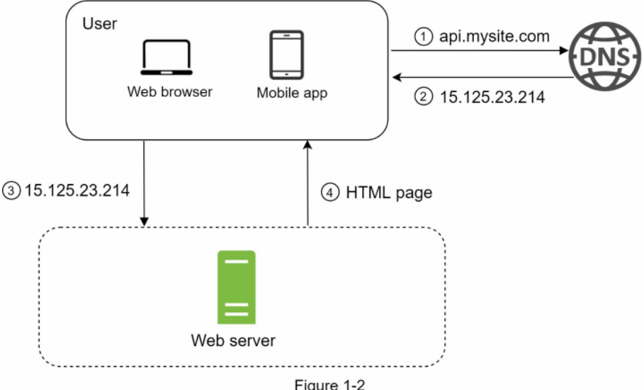

Hình 1-2

1. Người dùng truy cập các trang web thông qua tên miền (domain name), chẳng hạn như `api.mysite.com`. Thông thường, Hệ thống phân giải tên miền (DNS - Domain Name System) là một dịch vụ trả phí do bên thứ ba cung cấp và không do máy chủ của chúng ta tự lưu trữ (host).
2. Địa chỉ Giao thức Internet (IP - Internet Protocol) được trả về cho trình duyệt hoặc ứng dụng di động. Trong ví dụ này, địa chỉ IP nhận được là `15.125.23.214`.
3. Sau khi nhận được địa chỉ IP, các yêu cầu theo Giao thức truyền tải siêu văn bản (HTTP - Hypertext Transfer Protocol) [1] sẽ được gửi trực tiếp đến máy chủ web (web server) của bạn.
4. Web server trả về các trang HTML (Hypertext Markup Language - Ngôn ngữ đánh dấu siêu văn bản) hoặc phản hồi JSON để hiển thị giao diện (rendering).

Tiếp theo, hãy cùng xem xét nguồn lưu lượng. Lưu lượng truy cập vào web server của bạn đến từ hai nguồn chính: ứng dụng web và ứng dụng di động.

 * Ứng dụng web: kết hợp các ngôn ngữ phía máy chủ (Java, Python, v.v.) để xử lý logic nghiệp vụ, lưu trữ, v.v., cùng các ngôn ngữ phía máy khách (HTML và JavaScript) để hiển thị giao diện.
 * Ứng dụng di động: Giao thức HTTP là giao thức giao tiếp giữa ứng dụng di động và web server. JSON (JavaScript Object Notation - định dạng trao đổi dữ liệu dạng chuỗi ký tự) là định dạng phản hồi API (Application Programming Interface - Giao diện lập trình ứng dụng) phổ biến dùng để truyền dữ liệu nhờ tính đơn giản của nó. Một ví dụ về phản hồi API ở định dạng JSON được hiển thị dưới đây:

```
GET /users/12 - Lấy đối tượng user cho id = 12
{
  "id": 12,
  "firstName": "John",
  "lastName": "Smith",
  "address": {
    "streetAddress": "21 2nd Street",
    "city": "New York",
    "state": "NY",
    "postalCode": 10021
  },
  "phoneNumbers": [
    "212 555-1234",
    "646555-4567"
  ]
}
```

# Database (Cơ sở dữ liệu)

Cùng với sự gia tăng của lượng người dùng, một máy chủ sẽ không còn đủ sức gánh vác, và chúng ta cần nhiều máy chủ: một máy chủ dành cho lưu lượng web/di động, máy chủ còn lại dành cho cơ sở dữ liệu (Hình 1-3). Việc tách biệt máy chủ lưu lượng web/di động (tầng web - web tier) và máy chủ cơ sở dữ liệu (tầng dữ liệu - data tier) cho phép chúng có thể mở rộng quy mô một cách độc lập.

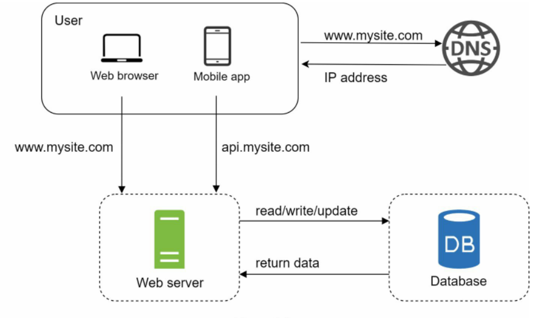

Hình 1-3

## Which databases to use? (Nên sử dụng cơ sở dữ liệu nào?)

Bạn có thể lựa chọn giữa cơ sở dữ liệu quan hệ truyền thống và cơ sở dữ liệu phi quan hệ. Hãy cùng phân tích sự khác biệt giữa chúng.

Cơ sở dữ liệu quan hệ còn được gọi là hệ quản trị cơ sở dữ liệu quan hệ (RDBMS - Relational Database Management System) hoặc cơ sở dữ liệu SQL. Những cái tên phổ biến nhất bao gồm MySQL, Oracle Database, PostgreSQL, v.v. Cơ sở dữ liệu quan hệ biểu diễn và lưu trữ dữ liệu dưới dạng các bảng (tables) và hàng (rows). Bạn có thể thực hiện các thao tác kết hợp dữ liệu (join operations) bằng SQL qua các bảng dữ liệu khác nhau.

Cơ sở dữ liệu phi quan hệ còn được gọi là cơ sở dữ liệu NoSQL. Những cái tên phổ biến bao gồm CouchDB, Neo4j, Cassandra, HBase, Amazon DynamoDB, v.v. [2]. Các cơ sở dữ liệu này được phân thành bốn nhóm: kho lưu trữ khóa - giá trị (key-value stores), kho lưu trữ đồ thị (graph stores), kho lưu trữ dạng cột (column stores), và kho lưu trữ tài liệu (document stores). Các thao tác join nhìn chung không được hỗ trợ trong cơ sở dữ liệu phi quan hệ.

Đối với phần lớn các lập trình viên, cơ sở dữ liệu quan hệ là lựa chọn tối ưu vì chúng đã tồn tại và phát triển hơn 40 năm qua, đồng thời đã chứng minh được hiệu quả vững chắc trong lịch sử. Tuy nhiên, nếu cơ sở dữ liệu quan hệ không phù hợp với các kịch bản sử dụng cụ thể của bạn, việc tìm hiểu và mở rộng sang cơ sở dữ liệu phi quan hệ là điều vô cùng cấp thiết. Cơ sở dữ liệu phi quan hệ có thể là sự lựa chọn đúng đắn nếu:
 * Ứng dụng của bạn đòi hỏi độ trễ cực thấp (super-low latency).
 * Dữ liệu của bạn là phi cấu trúc, hoặc bạn hoàn toàn không có dữ liệu mang tính quan hệ.
 * Bạn chỉ cần tuần tự hóa và giải tuần tự hóa dữ liệu (serialize và deserialize dữ liệu sang JSON, XML, YAML, v.v.).
 * Bạn cần lưu trữ một khối lượng dữ liệu khổng lồ.

# Vertical scaling vs horizontal scaling (Mở rộng theo chiều dọc so với Mở rộng theo chiều ngang)

Mở rộng theo chiều dọc (Vertical scaling), hay còn gọi là "scale up", là quá trình bổ sung thêm năng lực tính toán (CPU, RAM, v.v.) vào các máy chủ hiện tại của bạn. Mở rộng theo chiều ngang (Horizontal scaling), hay còn gọi là "scale-out", cho phép bạn mở rộng bằng cách bổ sung thêm nhiều máy chủ vào nhóm tài nguyên (resource pool) của mình.

Khi lưu lượng truy cập còn thấp, mở rộng theo chiều dọc là một lựa chọn tuyệt vời, và tính đơn giản chính là ưu điểm lớn nhất của nó. Đáng tiếc là giải pháp này lại đi kèm với những hạn chế nghiêm trọng.
 * Mở rộng theo chiều dọc có một giới hạn cứng (hard limit). Việc bổ sung CPU và bộ nhớ không giới hạn vào một máy chủ đơn lẻ là điều bất khả thi.
 * Mở rộng theo chiều dọc không có cơ chế chuyển đổi dự phòng khi gặp sự cố (failover) cũng như tính dự phòng (redundancy). Nếu một máy chủ bị sập, toàn bộ trang web/ứng dụng sẽ tê liệt hoàn toàn theo nó.

Mở rộng theo chiều ngang được ưu tiên hơn cho các ứng dụng quy mô lớn chính vì những hạn chế của mở rộng theo chiều dọc. Trong thiết kế trước đó, người dùng kết nối trực tiếp đến web server. Người dùng sẽ không thể truy cập trang web nếu web server ngoại tuyến. Trong một kịch bản khác, nếu có quá nhiều người dùng truy cập web server đồng thời và chạm tới giới hạn tải của máy chủ, người dùng thường sẽ gặp phải tình trạng phản hồi chậm hoặc không thể kết nối tới máy chủ. Bộ cân bằng tải (load balancer) chính là kỹ thuật tốt nhất để giải quyết các vấn đề này.

# Load balancer (Bộ cân bằng tải)

Một bộ cân bằng tải sẽ phân phối đồng đều lưu lượng truy cập đến các web server được định nghĩa trong một nhóm cân bằng tải (load-balanced set). Hình 1-4 minh họa cách thức hoạt động của một bộ cân bằng tải.

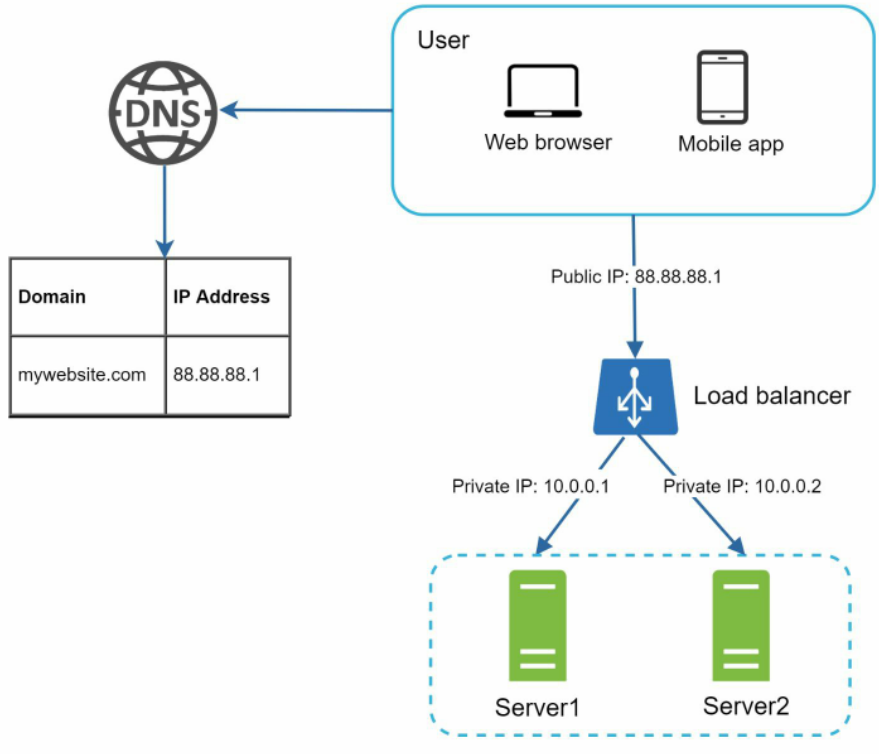

Hình 1-4

Như minh họa trong Hình 1-4, người dùng kết nối trực tiếp đến địa chỉ IP công khai (public IP) của bộ cân bằng tải. Với thiết lập này, các máy khách không còn khả năng tiếp cận trực tiếp vào các web server nữa. Để nâng cao tính bảo mật, các địa chỉ IP nội bộ (private IP) được sử dụng để giao tiếp giữa các máy chủ. Private IP là địa chỉ IP chỉ có thể liên lạc được giữa các máy chủ trong cùng một mạng nội bộ; tuy nhiên, các thiết bị ngoài internet hoàn toàn không thể tiếp cận được địa chỉ này. Bộ cân bằng tải giao tiếp với các web server thông qua các private IP.

Trong Hình 1-4, sau khi bổ sung bộ cân bằng tải và một web server thứ hai, chúng ta đã giải quyết thành công vấn đề thiếu hụt cơ chế failover, đồng thời nâng cao tính sẵn sàng (availability) cho tầng web. Chi tiết được giải thích như sau:
 * Nếu máy chủ 1 ngoại tuyến, toàn bộ lưu lượng sẽ được điều hướng sang máy chủ 2. Điều này ngăn chặn việc trang web bị sập. Chúng ta cũng sẽ bổ sung một web server mới khỏe mạnh vào nhóm máy chủ để cân bằng tải.
 * Nếu lưu lượng truy cập trang web tăng trưởng nhanh chóng và hai máy chủ không còn đủ sức xử lý, bộ cân bằng tải có thể xử lý vấn đề này một cách mượt mà. Bạn chỉ cần bổ sung thêm máy chủ vào nhóm web server, và bộ cân bằng tải sẽ tự động bắt đầu gửi các yêu cầu đến các máy chủ mới đó.

Hiện tại tầng web trông đã rất ổn, vậy còn tầng dữ liệu thì sao? Thiết kế hiện tại chỉ có một cơ sở dữ liệu duy nhất, do đó nó không hỗ trợ cơ chế failover và tính dự phòng. Nhân bản cơ sở dữ liệu (Database replication) là một kỹ thuật phổ biến để giải quyết các vấn đề này. Hãy cùng tìm hiểu.

# Database replication (Nhân bản cơ sở dữ liệu)

Trích dẫn từ Wikipedia: "Nhân bản cơ sở dữ liệu có thể được sử dụng trong nhiều hệ quản trị cơ sở dữ liệu, thường hoạt động theo mối quan hệ chính/phụ (master/slave) giữa bản gốc (master) và các bản sao (slaves)" [3].

Một cơ sở dữ liệu master thông thường chỉ hỗ trợ các thao tác ghi (write operations). Một cơ sở dữ liệu slave nhận các bản sao dữ liệu từ cơ sở dữ liệu master và chỉ hỗ trợ các thao tác đọc (read operations). Tất cả các câu lệnh làm biến đổi dữ liệu như chèn (insert), xóa (delete) hoặc cập nhật (update) bắt buộc phải được gửi đến cơ sở dữ liệu master. Phần lớn các ứng dụng đều có tỷ lệ đọc trên ghi (read-to-write ratio) cao hơn rất nhiều; do đó, số lượng cơ sở dữ liệu slave trong một hệ thống thường nhiều hơn số lượng cơ sở dữ liệu master. Hình 1-5 minh họa một cơ sở dữ liệu master đi kèm với nhiều cơ sở dữ liệu slave.

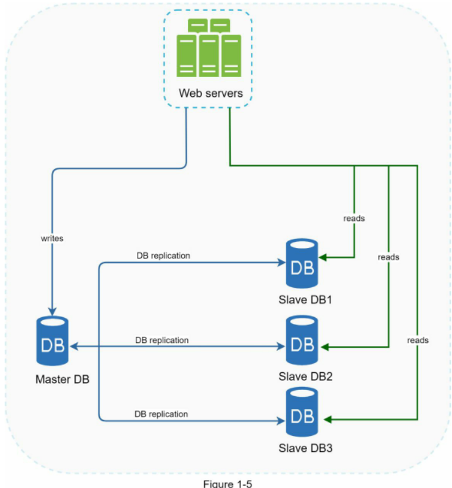

Hình 1-5

Các ưu điểm của nhân bản cơ sở dữ liệu:
 * Hiệu năng tốt hơn (Better performance): Trong mô hình master-slave, tất cả các lệnh ghi và cập nhật đều diễn ra tại các nút master; trong khi các thao tác đọc được phân phối đều cho các nút slave. Mô hình này cải thiện hiệu năng vì nó cho phép xử lý song song nhiều truy vấn hơn.
 * Độ tin cậy (Reliability): Nếu một trong các máy chủ cơ sở dữ liệu của bạn bị phá hủy bởi thiên tai, chẳng hạn như bão lớn hay động đất, dữ liệu vẫn được bảo tồn. Bạn không cần phải lo lắng về việc mất mát dữ liệu vì dữ liệu đã được sao chép qua nhiều vị trí địa lý khác nhau.
 * Tính sẵn sàng cao (High availability): Bằng cách nhân bản dữ liệu qua nhiều địa điểm khác nhau, trang web của bạn vẫn duy trì hoạt động ngay cả khi một cơ sở dữ liệu bị ngoại tuyến, bởi bạn hoàn toàn có thể truy cập dữ liệu được lưu trữ tại một máy chủ cơ sở dữ liệu khác.

Trong phần trước, chúng ta đã thảo luận về cách bộ cân bằng tải giúp cải thiện tính sẵn sàng của hệ thống. Ở đây chúng ta cũng đặt ra một câu hỏi tương tự: điều gì sẽ xảy ra nếu một trong các cơ sở dữ liệu bị ngoại tuyến? Thiết kế kiến trúc được thảo luận trong Hình 1-5 có thể xử lý trường hợp này:
 * Nếu chỉ có một cơ sở dữ liệu slave khả dụng và nó bị ngoại tuyến, các thao tác đọc sẽ tạm thời được chuyển hướng trực tiếp đến cơ sở dữ liệu master. Ngay khi sự cố được phát hiện, một cơ sở dữ liệu slave mới sẽ thay thế vị trí của nút cũ. Trong trường hợp có sẵn nhiều cơ sở dữ liệu slave, các thao tác đọc sẽ được chuyển hướng sang các slave khỏe mạnh khác. Một máy chủ cơ sở dữ liệu mới sẽ thay thế máy chủ cũ bị hỏng.
 * Nếu cơ sở dữ liệu master bị ngoại tuyến, một cơ sở dữ liệu slave sẽ được thăng cấp (promoted) trở thành master mới. Mọi thao tác cơ sở dữ liệu sẽ tạm thời được thực thi trên cơ sở dữ liệu master mới này. Một cơ sở dữ liệu slave mới sẽ lập tức thay thế vị trí của nút cũ để tiếp tục quá trình nhân bản dữ liệu. Trong các hệ thống production (môi trường vận hành thực tế), việc thăng cấp một master mới phức tạp hơn nhiều vì dữ liệu trên slave có thể chưa được cập nhật hoàn toàn tới thời điểm mới nhất. Dữ liệu thiếu hụt cần phải được đồng bộ lại bằng cách chạy các tập lệnh phục hồi dữ liệu (data recovery scripts). Mặc dù một số phương pháp nhân bản khác như đa master (multi-masters) và nhân bản vòng tròn (circular replication) có thể hỗ trợ, những thiết lập này phức tạp hơn đáng kể; và việc thảo luận về chúng nằm ngoài phạm vi của cuốn sách này. Độc giả quan tâm có thể tham khảo thêm các tài liệu được liệt kê [4] [5].

Hình 1-6 minh họa thiết kế hệ thống sau khi bổ sung bộ cân bằng tải và cơ chế nhân bản cơ sở dữ liệu.

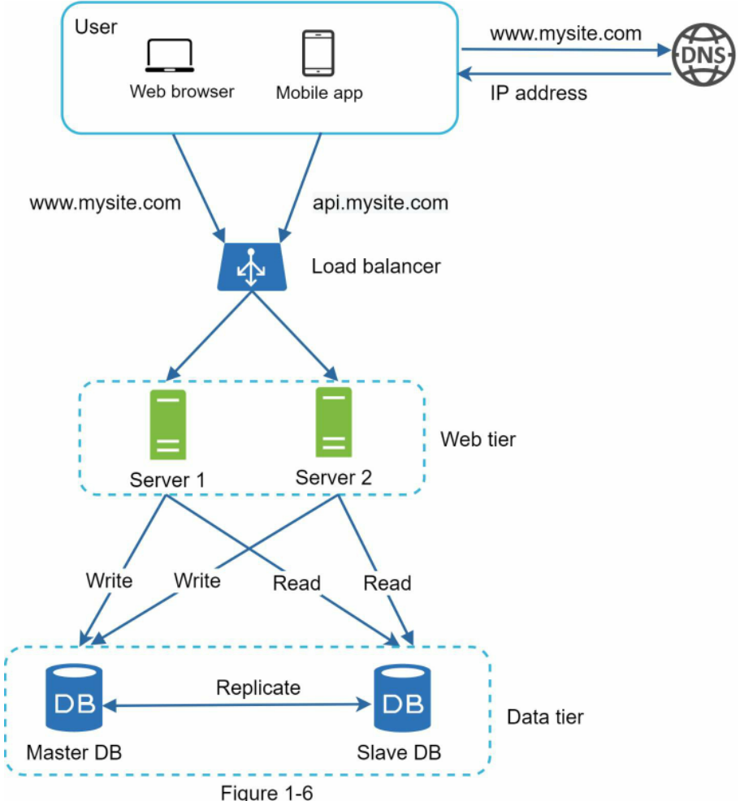

Hình 1-6

Hãy cùng điểm qua luồng hoạt động của thiết kế này:
 * Người dùng nhận địa chỉ IP của bộ cân bằng tải từ hệ thống DNS.
 * Người dùng kết nối với bộ cân bằng tải bằng địa chỉ IP này.
 * Yêu cầu HTTP được điều hướng đến Máy chủ 1 hoặc Máy chủ 2.
 * Web server đọc dữ liệu người dùng từ một cơ sở dữ liệu slave.
 * Web server định tuyến bất kỳ thao tác làm biến đổi dữ liệu nào đến cơ sở dữ liệu master. Điều này bao gồm các thao tác ghi, cập nhật và xóa.

Giờ đây, khi bạn đã có hiểu biết vững chắc về tầng web và tầng dữ liệu, đã đến lúc chúng ta cải thiện thời gian tải/phản hồi (load/response time). Điều này có thể đạt được bằng cách bổ sung một tầng bộ nhớ đệm (cache layer) và chuyển các nội dung tĩnh (tệp JavaScript/CSS/hình ảnh/video) sang mạng phân phối nội dung (CDN - Content Delivery Network).

# Cache (Bộ nhớ đệm)

Bộ nhớ đệm là một vùng lưu trữ tạm thời lưu giữ kết quả của các phản hồi tốn kém chi phí tính toán hoặc dữ liệu thường xuyên được truy cập ngay trong bộ nhớ (memory) để các yêu cầu tiếp theo được phục vụ nhanh hơn. Như minh họa trong Hình 1-6, mỗi khi một trang web mới được tải, một hoặc nhiều lệnh gọi cơ sở dữ liệu sẽ được thực thi để lấy dữ liệu. Hiệu năng ứng dụng bị ảnh hưởng nghiêm trọng do việc gọi cơ sở dữ liệu liên tục. Bộ nhớ đệm có thể giảm nhẹ vấn đề này.

## Cache tier (Tầng bộ nhớ đệm)

Tầng bộ nhớ đệm là một lớp lưu trữ dữ liệu tạm thời, có tốc độ nhanh hơn cơ sở dữ liệu rất nhiều. Những lợi ích của việc sở hữu một tầng bộ nhớ đệm riêng biệt bao gồm nâng cao hiệu năng hệ thống, khả năng giảm tải công việc cho cơ sở dữ liệu, và khả năng mở rộng quy mô tầng cache một cách độc lập. Hình 1-7 minh họa một thiết lập khả dĩ của máy chủ bộ nhớ đệm:

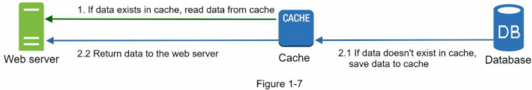

Sau khi nhận được yêu cầu, web server trước tiên sẽ kiểm tra xem cache có sẵn dữ liệu phản hồi hay không. Nếu có, nó gửi dữ liệu về cho client. Nếu không, nó sẽ truy vấn cơ sở dữ liệu, lưu phản hồi vào cache, và gửi lại cho client. Chiến lược lưu trữ đệm này được gọi là read-through cache (chiến lược đọc qua bộ nhớ đệm). Ngoài ra còn có các chiến lược caching khác tùy thuộc vào loại dữ liệu, kích thước và mô hình truy cập (access pattern). Một nghiên cứu trước đây đã giải thích chi tiết cách thức hoạt động của các chiến lược caching khác nhau [6].

Việc tương tác với các máy chủ cache rất đơn giản vì hầu hết các máy chủ cache đều cung cấp API cho các ngôn ngữ lập trình phổ biến. Đoạn mã dưới đây minh họa các API tiêu biểu của Memcached:


## Considerations for using cache (Những lưu ý khi sử dụng bộ nhớ đệm)

Dưới đây là một số cân nhắc khi sử dụng một hệ thống bộ nhớ đệm:

 * Quyết định thời điểm sử dụng cache. Cân nhắc sử dụng cache khi dữ liệu được đọc thường xuyên nhưng hiếm khi bị sửa đổi. Vì dữ liệu đệm được lưu trong bộ nhớ khả biến (volatile memory - bộ nhớ tạm thời mất dữ liệu khi mất nguồn điện), máy chủ cache không phải là nơi lý tưởng để lưu trữ dữ liệu bền vững (persist data). Ví dụ, nếu một máy chủ cache khởi động lại, toàn bộ dữ liệu trong bộ nhớ sẽ bị mất. Do đó, các dữ liệu quan trọng nên được lưu trong các kho dữ liệu bền vững (persistent data stores).
 * Chính sách hết hạn (Expiration policy). Việc triển khai một chính sách hết hạn là một thực hành tốt. Khi dữ liệu đệm hết hạn, nó sẽ bị xóa khỏi cache. Nếu không có chính sách hết hạn, dữ liệu đệm sẽ được lưu vĩnh viễn trong bộ nhớ. Bạn không nên đặt thời hạn quá ngắn vì điều này khiến hệ thống phải nạp lại dữ liệu từ cơ sở dữ liệu quá thường xuyên. Đồng thời, cũng không nên đặt thời hạn quá dài vì dữ liệu có thể trở nên lỗi thời (stale data).
 * Tính nhất quán (Consistency): Điều này liên quan đến việc giữ cho kho lưu trữ dữ liệu và bộ nhớ đệm luôn đồng bộ với nhau. Tình trạng không nhất quán có thể xảy ra do các thao tác làm biến đổi dữ liệu trên kho lưu trữ và trên cache không nằm trong cùng một giao dịch (single transaction). Khi mở rộng quy mô trên nhiều vùng địa lý (multi-region), việc duy trì tính nhất quán giữa kho dữ liệu và cache là một thách thức lớn. Để biết thêm chi tiết, hãy tham khảo bài báo khoa học có tiêu đề "Scaling Memcache at Facebook" do Facebook xuất bản [7].
 * Giảm thiểu lỗi (Mitigating failures): Một máy chủ cache đơn lẻ tiềm ẩn nguy cơ trở thành điểm lỗi đơn lẻ (SPOF - Single Point of Failure), được định nghĩa trên Wikipedia như sau: "Điểm lỗi đơn lẻ (SPOF) là một phần của hệ thống mà nếu nó gặp sự cố, toàn bộ hệ thống sẽ ngừng hoạt động" [8]. Do đó, việc sử dụng nhiều máy chủ cache trên các trung tâm dữ liệu khác nhau được khuyến nghị nhằm tránh SPOF. Một phương pháp được khuyến nghị khác là cấp phát dư dung lượng bộ nhớ yêu cầu theo một tỷ lệ phần trăm nhất định (overprovisioning). Điều này tạo ra một vùng đệm an toàn khi mức sử dụng bộ nhớ tăng lên.


Hình 1-8 (nguồn: https://bit.ly/3eGsnyH)

 * Chính sách giải phóng bộ nhớ (Eviction Policy): Một khi cache đã đầy, bất kỳ yêu cầu thêm phần tử mới nào vào cache cũng có thể khiến các phần tử hiện có bị loại bỏ. Quá trình này được gọi là giải phóng bộ nhớ đệm (cache eviction). Ít được sử dụng gần đây nhất (LRU - Least-recently-used) là chính sách giải phóng bộ nhớ đệm phổ biến nhất. Các chính sách khác, chẳng hạn như Ít được sử dụng nhất (LFU - Least Frequently Used) hoặc Vào trước ra trước (FIFO - First in First Out), có thể được áp dụng để đáp ứng các kịch bản sử dụng khác nhau.

# Content delivery network (CDN) (Mạng phân phối nội dung)

CDN là một mạng lưới gồm các máy chủ phân tán theo vị trí địa lý được sử dụng để phân phối nội dung tĩnh. Các máy chủ CDN lưu trữ đệm các nội dung tĩnh như hình ảnh, video, tệp CSS, JavaScript, v.v.

Lưu trữ đệm nội dung động (Dynamic content caching) là một khái niệm tương đối mới và nằm ngoài phạm vi cuốn sách này. Nó cho phép lưu cache các trang HTML dựa trên đường dẫn yêu cầu (request path), chuỗi truy vấn (query strings), cookie và tiêu đề yêu cầu (request headers). Tham khảo bài viết được đề cập trong tài liệu tham khảo [9] để biết thêm chi tiết. Cuốn sách này tập trung vào cách thức sử dụng CDN để lưu trữ đệm nội dung tĩnh.

Dưới đây là cách thức CDN hoạt động ở mức tổng quan: khi một người dùng truy cập trang web, một máy chủ CDN gần người dùng nhất về mặt địa lý sẽ phân phối nội dung tĩnh. Một cách trực quan, người dùng càng ở xa máy chủ CDN thì tốc độ tải trang web càng chậm. Ví dụ, nếu các máy chủ CDN đặt tại San Francisco, người dùng ở Los Angeles sẽ nhận được nội dung nhanh hơn người dùng ở châu Âu. Hình 1-9 là một ví dụ tuyệt vời minh họa cách CDN cải thiện thời gian tải trang.


Hình 1-9 (nguồn: https://bit.ly/2yv7DJK)

Hình 1-10 minh họa quy trình làm việc (workflow) của CDN.


Hình 1-10

1. Người dùng A cố gắng lấy tệp `image.png` bằng cách sử dụng một URL hình ảnh. Tên miền của URL do nhà cung cấp CDN phân bổ. Hai URL hình ảnh dưới đây là các mẫu được sử dụng để minh họa định dạng URL hình ảnh trên CDN của Amazon và Akamai:
 * https://mysite.cloudfront.net/logo.jpg
 * https://mysite.akamai.com/image-manager/img/logo.jpg
2. Nếu máy chủ CDN không có tệp `image.png` trong bộ nhớ đệm, máy chủ CDN sẽ yêu cầu tệp từ máy chủ gốc (origin), có thể là một web server hoặc dịch vụ lưu trữ trực tuyến như Amazon S3.
3. Máy chủ gốc trả về tệp `image.png` cho máy chủ CDN, trong đó có chứa tiêu đề HTTP tùy chọn Time-to-Live (TTL - Thời gian sống của dữ liệu) mô tả hình ảnh này được lưu cache trong bao lâu.
4. CDN lưu hình ảnh vào bộ nhớ đệm và trả lại cho Người dùng A. Hình ảnh vẫn được lưu cache trong CDN cho đến khi TTL hết hạn.
5. Người dùng B gửi yêu cầu lấy cùng hình ảnh đó.
6. Hình ảnh được trả về từ bộ nhớ đệm chừng nào TTL vẫn chưa hết hạn.

## Considerations of using a CDN (Những lưu ý khi sử dụng CDN)

 * Chi phí (Cost): CDN được vận hành bởi các nhà cung cấp bên thứ ba, và bạn sẽ bị tính phí cho việc truyền dữ liệu vào và ra khỏi CDN. Việc lưu cache các tài nguyên hiếm khi được truy cập không mang lại lợi ích rõ rệt, do đó bạn nên cân nhắc đưa chúng ra khỏi CDN.
 * Thiết lập thời hạn hết hạn cache phù hợp (Setting an appropriate cache expiry): Đối với các nội dung nhạy cảm về thời gian, việc thiết lập thời gian hết hạn cache là rất quan trọng. Thời gian hết hạn cache không nên quá dài cũng không nên quá ngắn. Nếu quá dài, nội dung có thể không còn tươi mới. Nếu quá ngắn, nó có thể gây ra việc phải nạp lại nội dung liên tục từ các máy chủ gốc sang CDN.
 * Cơ chế dự phòng sự cố CDN (CDN fallback): Bạn nên cân nhắc cách trang web/ứng dụng của mình đối phó khi hệ thống CDN gặp sự cố. Nếu xảy ra sự cố ngừng hoạt động tạm thời của CDN, các máy khách phải có khả năng phát hiện vấn đề và yêu cầu tài nguyên trực tiếp từ máy chủ gốc.
 * Hủy hiệu lực tệp (Invalidating files): Bạn có thể xóa một tệp khỏi CDN trước khi nó hết hạn bằng cách thực hiện một trong các thao tác sau:
 * Hủy hiệu lực đối tượng CDN bằng cách sử dụng các API do nhà cung cấp CDN cung cấp.
 * Sử dụng cơ chế tạo phiên bản đối tượng (object versioning) để phục vụ một phiên bản khác của đối tượng. Để tạo phiên bản cho một đối tượng, bạn có thể thêm một tham số vào URL, chẳng hạn như số phiên bản. Ví dụ: phiên bản số 2 được thêm vào chuỗi truy vấn: `image.png?v=2`.

Hình 1-11 minh họa thiết kế sau khi bổ sung thêm CDN và bộ nhớ đệm.

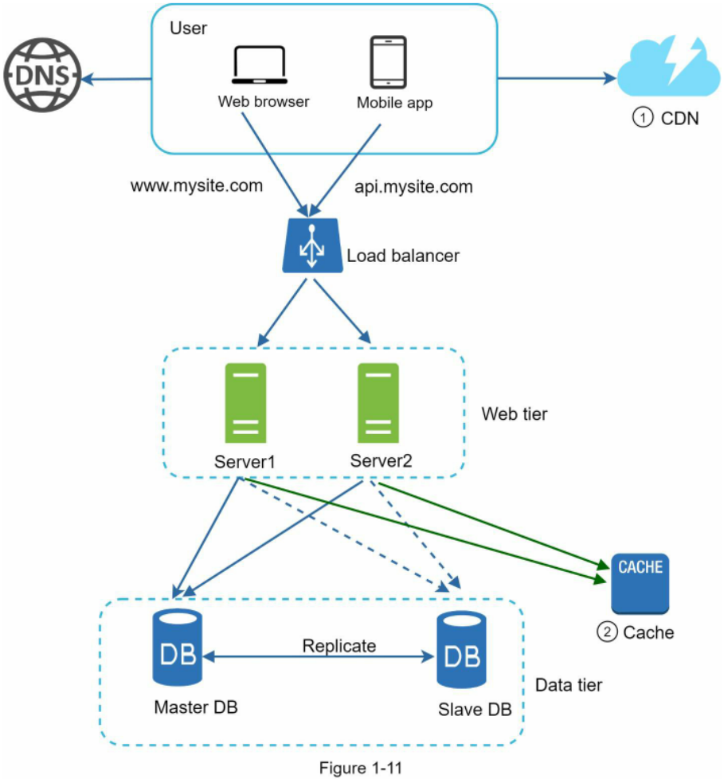

1. Các tài nguyên tĩnh (JS, CSS, hình ảnh, v.v.) không còn do web server phục vụ nữa. Chúng được lấy trực tiếp từ CDN để có hiệu năng tốt hơn.
2. Tải trên cơ sở dữ liệu được giảm nhẹ nhờ lưu trữ đệm dữ liệu.

# Stateless web tier (Tầng web phi trạng thái)

Bây giờ là lúc chúng ta cân nhắc việc mở rộng tầng web theo chiều ngang. Để làm được điều này, chúng ta cần đưa trạng thái (ví dụ như dữ liệu phiên làm việc của người dùng - user session data) ra khỏi tầng web. Một thực hành tốt là lưu trữ dữ liệu session trong các hệ thống lưu trữ bền vững như cơ sở dữ liệu quan hệ hoặc NoSQL. Mỗi máy chủ web trong cụm (cluster) đều có thể truy cập dữ liệu trạng thái từ các cơ sở dữ liệu. Đây được gọi là tầng web phi trạng thái (stateless web tier).

## Stateful architecture (Kiến trúc có lưu trạng thái)

Máy chủ có lưu trạng thái (stateful server) và máy chủ phi trạng thái (stateless server) có một số khác biệt cốt lõi. Một máy chủ stateful ghi nhớ dữ liệu của máy khách (trạng thái) từ yêu cầu này sang yêu cầu tiếp theo. Ngược lại, một máy chủ stateless không lưu giữ bất kỳ thông tin trạng thái nào.

Hình 1-12 minh họa một ví dụ về kiến trúc có lưu trạng thái.


Hình 1-12

Trong Hình 1-12, dữ liệu session và hình ảnh đại diện của Người dùng A được lưu tại Máy chủ 1. Để xác thực Người dùng A, các yêu cầu HTTP bắt buộc phải được điều hướng đến Máy chủ 1. Nếu một yêu cầu bị gửi sang các máy chủ khác như Máy chủ 2, quá trình xác thực sẽ thất bại vì Máy chủ 2 không chứa dữ liệu session của Người dùng A. Tương tự, tất cả các yêu cầu HTTP từ Người dùng B phải được định tuyến đến Máy chủ 2; tất cả các yêu cầu từ Người dùng C phải được gửi đến Máy chủ 3.

Vấn đề ở đây là mọi yêu cầu từ cùng một máy khách bắt buộc phải được định tuyến đến cùng một máy chủ. Điều này có thể được thực hiện thông qua cơ chế phiên dính (sticky sessions) trên hầu hết các bộ cân bằng tải [10]; tuy nhiên, điều này lại làm phát sinh thêm chi phí quản lý vận hành (overhead). Việc bổ sung thêm hoặc loại bỏ bớt các máy chủ trở nên khó khăn hơn rất nhiều với cách tiếp cận này. Việc xử lý các sự cố máy chủ cũng là một thách thức lớn.

## Stateless architecture (Kiến trúc phi trạng thái)

Hình 1-13 minh họa kiến trúc phi trạng thái.

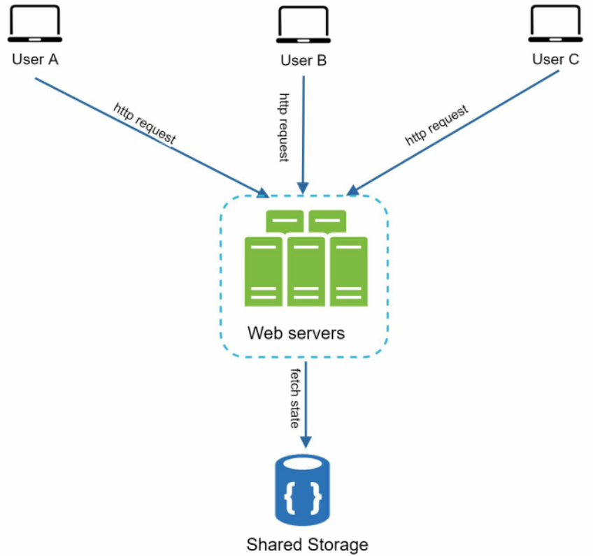

Hình 1-13

Trong kiến trúc phi trạng thái này, các yêu cầu HTTP từ người dùng có thể được gửi đến bất kỳ máy chủ web nào, và các máy chủ này sẽ lấy dữ liệu trạng thái từ một kho dữ liệu dùng chung (shared data store). Dữ liệu trạng thái được lưu trữ trong một kho dữ liệu dùng chung và được giữ tách biệt hoàn toàn khỏi các máy chủ web. Một hệ thống phi trạng thái sẽ đơn giản hơn, mạnh mẽ hơn và dễ mở rộng quy mô hơn.

Hình 1-14 minh họa thiết kế cập nhật với một tầng web phi trạng thái.

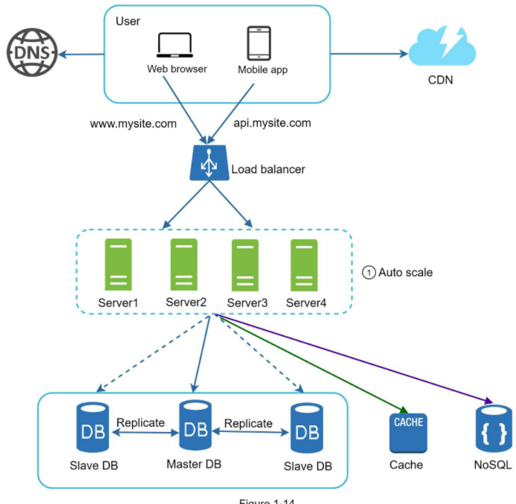

Hình 1-14

Trong Hình 1-14, chúng ta chuyển dữ liệu session ra khỏi tầng web và lưu trữ chúng trong kho dữ liệu bền vững. Kho dữ liệu dùng chung có thể là cơ sở dữ liệu quan hệ, Memcached/Redis, NoSQL, v.v. Kho lưu trữ NoSQL được lựa chọn vì nó rất dễ mở rộng quy mô. Cơ chế tự động co giãn (Autoscaling) có nghĩa là việc tự động bổ sung hoặc loại bỏ các máy chủ web dựa trên tải lưu lượng thực tế. Sau khi dữ liệu trạng thái được đưa ra khỏi các máy chủ web, việc tự động co giãn của tầng web có thể dễ dàng đạt được bằng cách bổ sung hoặc bớt máy chủ dựa trên lưu lượng truy cập.

Trang web của bạn tăng trưởng nhanh chóng và thu hút một lượng người dùng đáng kể trên quy mô quốc tế. Để cải thiện tính sẵn sàng và mang lại trải nghiệm người dùng tốt hơn trên các khu vực địa lý rộng lớn hơn, việc hỗ trợ nhiều trung tâm dữ liệu (data centers) là điều tối quan trọng.

# Data centers (Các trung tâm dữ liệu)

Hình 1-15 minh họa một ví dụ thiết lập với hai trung tâm dữ liệu. Trong điều kiện hoạt động bình thường, người dùng được định tuyến theo vị trí địa lý thông qua DNS (geoDNS-routed, hay còn gọi là geo-routed) tới trung tâm dữ liệu gần nhất, với tỷ lệ phân chia lưu lượng là x% tại US-East (Miền Đông nước Mỹ) và (100 - x)% tại US-West (Miền Tây nước Mỹ). geoDNS là một dịch vụ DNS cho phép phân giải tên miền thành các địa chỉ IP dựa trên vị trí địa lý của người dùng.


Hình 1-15

Trong trường hợp xảy ra sự cố nghiêm trọng khiến một trung tâm dữ liệu ngừng hoạt động, chúng ta sẽ điều hướng toàn bộ lưu lượng đến một trung tâm dữ liệu khỏe mạnh. Trong Hình 1-16, trung tâm dữ liệu 2 (US-West) bị ngoại tuyến, và 100% lưu lượng truy cập được định tuyến đến trung tâm dữ liệu 1 (US-East).


Hình 1-16

Một số thách thức kỹ thuật cần phải được giải quyết để hiện thực hóa thiết lập đa trung tâm dữ liệu:
 * Chuyển hướng lưu lượng (Traffic redirection): Cần có các công cụ hiệu quả để điều hướng lưu lượng đến đúng trung tâm dữ liệu. GeoDNS có thể được sử dụng để dẫn hướng lưu lượng tới trung tâm dữ liệu gần nhất tùy thuộc vào nơi người dùng đang ở.
 * Đồng bộ hóa dữ liệu (Data synchronization): Người dùng từ các khu vực khác nhau có thể sử dụng các cơ sở dữ liệu hoặc bộ nhớ đệm cục bộ khác nhau. Trong các trường hợp chuyển đổi dự phòng (failover), lưu lượng có thể bị định tuyến đến một trung tâm dữ liệu chưa có sẵn dữ liệu đó. Một chiến lược phổ biến là nhân bản dữ liệu qua nhiều trung tâm dữ liệu. Một nghiên cứu trước đây đã chỉ ra cách Netflix triển khai nhân bản bất đồng bộ giữa nhiều trung tâm dữ liệu [11].
 * Kiểm thử và triển khai (Test and deployment): Với thiết lập đa trung tâm dữ liệu, việc kiểm thử trang web/ứng dụng của bạn tại các vị trí địa lý khác nhau là rất quan trọng. Các công cụ triển khai tự động đóng vai trò sống còn để duy trì tính nhất quán của các dịch vụ xuyên suốt tất cả các trung tâm dữ liệu [11].

Để mở rộng quy mô hệ thống xa hơn nữa, chúng ta cần phân tách (decouple - khử ghép nối) các thành phần khác nhau của hệ thống để chúng có thể được mở rộng một cách độc lập. Hàng đợi thông điệp (Message queue) là một chiến lược then chốt được nhiều hệ thống phân tán trong thế giới thực sử dụng để giải quyết vấn đề này.

# Message queue (Hàng đợi thông điệp)

Một hàng đợi thông điệp là một thành phần có tính bền vững (durable), được lưu trữ trong bộ nhớ, hỗ trợ giao tiếp bất đồng bộ (asynchronous communication). Nó đóng vai trò như một bộ đệm và phân phối các yêu cầu bất đồng bộ. Kiến trúc cơ bản của một hàng đợi thông điệp rất đơn giản. Các dịch vụ đầu vào, được gọi là bên sản xuất/bên xuất bản (producers/publishers), tạo ra các thông điệp và gửi chúng vào một hàng đợi thông điệp. Các dịch vụ hoặc máy chủ khác, được gọi là bên tiêu thụ/bên đăng ký (consumers/subscribers), kết nối tới hàng đợi và thực hiện các hành động được định nghĩa bởi các thông điệp đó. Mô hình này được thể hiện trong Hình 1-17.


Hình 1-17

Việc khử ghép nối biến hàng đợi thông điệp thành một kiến trúc được ưu tiên lựa chọn để xây dựng một ứng dụng có khả năng mở rộng và độ tin cậy cao. Với hàng đợi thông điệp, producer có thể đẩy một thông điệp vào hàng đợi ngay cả khi consumer chưa sẵn sàng để xử lý nó. Consumer có thể đọc các thông điệp từ hàng đợi ngay cả khi producer đang ngoại tuyến.

Hãy xem xét kịch bản sau: ứng dụng của bạn hỗ trợ tính năng tùy chỉnh hình ảnh, bao gồm cắt xén (cropping), làm nét (sharpening), làm mờ (blurring), v.v. Những tác vụ tùy chỉnh này cần thời gian để hoàn thành. Trong Hình 1-18, các máy chủ web đẩy các công việc xử lý ảnh vào hàng đợi thông điệp. Các tiến trình xử lý ảnh (photo processing workers) nhận việc từ hàng đợi thông điệp và thực hiện các tác vụ chỉnh sửa ảnh một cách bất đồng bộ. Producer và consumer có thể được mở rộng quy mô hoàn toàn độc lập. Khi kích thước của hàng đợi tăng lên, nhiều worker hơn sẽ được bổ sung để rút ngắn thời gian xử lý. Tuy nhiên, nếu hàng đợi hầu như luôn trống, số lượng worker có thể được cắt giảm bớt.


# Logging, metrics, automation (Ghi log, chỉ số đo lường, tự động hóa)

Khi làm việc với một trang web quy mô nhỏ hoạt động trên một vài máy chủ, việc hỗ trợ ghi log, chỉ số đo lường và tự động hóa là những thực hành tốt nhưng chưa phải là điều bắt buộc. Tuy nhiên, giờ đây khi trang web của bạn đã phát triển để phục vụ một quy mô kinh doanh lớn, việc đầu tư vào các công cụ này là điều thiết yếu.

Ghi log (Logging): Việc theo dõi log lỗi là rất quan trọng vì nó giúp xác định các lỗi và sự cố trong hệ thống. Bạn có thể theo dõi log lỗi ở cấp độ từng máy chủ hoặc sử dụng các công cụ để tổng hợp chúng về một dịch vụ tập trung nhằm phục vụ việc tìm kiếm và xem xét dễ dàng.

Chỉ số đo lường (Metrics): Việc thu thập các loại chỉ số khác nhau giúp chúng ta có được cái nhìn sâu sắc về mặt kinh doanh và nắm bắt được trạng thái sức khỏe của hệ thống. Một số chỉ số sau đây rất hữu ích:
 * Các chỉ số cấp máy chủ (Host level metrics): CPU, Bộ nhớ, I/O đĩa (disk I/O), v.v.
 * Các chỉ số cấp tổng hợp (Aggregated level metrics): ví dụ: hiệu năng của toàn bộ tầng cơ sở dữ liệu, tầng bộ nhớ đệm, v.v.
 * Các chỉ số kinh doanh cốt lõi (Key business metrics): số người dùng hoạt động hàng ngày (daily active users), tỷ lệ giữ chân (retention), doanh thu, v.v.

Tự động hóa (Automation): Khi một hệ thống trở nên lớn và phức tạp, chúng ta cần xây dựng hoặc tận dụng các công cụ tự động hóa để nâng cao năng suất. Tích hợp liên tục (Continuous Integration - CI) là một thực hành tốt, trong đó mỗi lần bàn giao mã nguồn (code check-in) đều được kiểm tra thông qua tự động hóa, cho phép các nhóm phát hiện vấn đề từ sớm. Bên cạnh đó, việc tự động hóa quy trình xây dựng (build), kiểm thử (test), triển khai (deploy), v.v. có thể nâng cao đáng kể năng suất của lập trình viên.

## Adding message queues and different tools (Bổ sung hàng đợi thông điệp và các công cụ khác nhau)

Hình 1-19 minh họa thiết kế sau khi cập nhật. Do giới hạn về không gian hiển thị, chỉ có một trung tâm dữ liệu được trình bày trong hình.
1. Thiết kế bao gồm một hàng đợi thông điệp, giúp hệ thống trở nên lỏng lẻo hơn về mặt liên kết (loosely coupled) và có khả năng phục hồi lỗi cao hơn.
2. Các công cụ ghi log, giám sát, đo lường và tự động hóa đã được bổ sung đầy đủ.

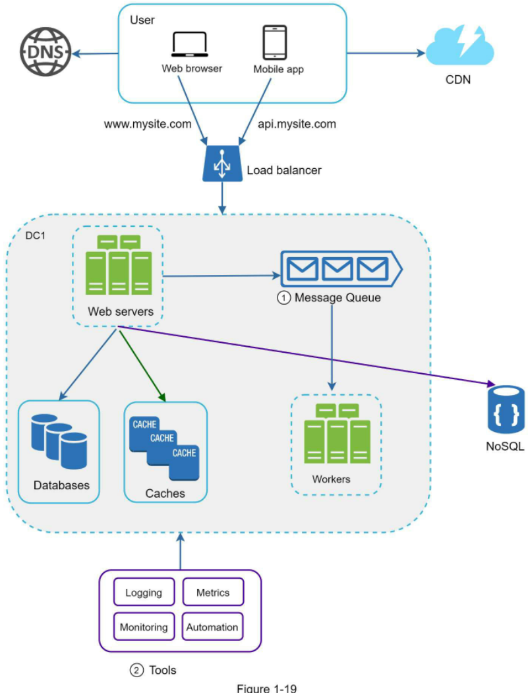

Hình 1-19

Khi dữ liệu tăng lên từng ngày, cơ sở dữ liệu của bạn sẽ ngày càng quá tải. Đã đến lúc chúng ta phải mở rộng tầng dữ liệu.

# Database scaling (Mở rộng quy mô cơ sở dữ liệu)

Có hai hướng tiếp cận rộng rãi để mở rộng quy mô cơ sở dữ liệu: mở rộng theo chiều dọc (vertical scaling) và mở rộng theo chiều ngang (horizontal scaling).

## Vertical scaling (Mở rộng theo chiều dọc)

Mở rộng theo chiều dọc, hay còn được gọi là scaling up, là việc mở rộng bằng cách bổ sung thêm sức mạnh phần cứng (CPU, RAM, ĐĨA, v.v.) cho một cỗ máy hiện có. Có những máy chủ cơ sở dữ liệu sở hữu cấu hình cực kỳ mạnh mẽ. Theo thông tin từ Dịch vụ Cơ sở dữ liệu Quan hệ của Amazon (Amazon RDS - Relational Database Service) [12], bạn có thể sở hữu một máy chủ cơ sở dữ liệu với 24 TB RAM. Loại máy chủ cơ sở dữ liệu mạnh mẽ này có thể lưu trữ và xử lý một khối lượng dữ liệu khổng lồ. Ví dụ, trang `stackoverflow.com` vào năm 2013 có hơn 10 triệu lượt khách truy cập duy nhất mỗi tháng, nhưng họ chỉ có 1 cơ sở dữ liệu master duy nhất [13]. Tuy nhiên, việc mở rộng theo chiều dọc đi kèm với một số nhược điểm nghiêm trọng:
 * Bạn có thể bổ sung thêm CPU, RAM, v.v. cho máy chủ cơ sở dữ liệu của mình, nhưng giới hạn phần cứng là có thật. Nếu bạn sở hữu một lượng người dùng lớn, một máy chủ đơn lẻ sẽ không bao giờ là đủ.
 * Nguy cơ cao hơn về các điểm lỗi đơn lẻ (single point of failures).
 * Tổng chi phí của việc mở rộng theo chiều dọc là rất tốn kém. Những cỗ máy chủ cấu hình mạnh có giá đắt hơn rất nhiều.

## Horizontal scaling (Mở rộng theo chiều ngang)

Mở rộng theo chiều ngang, hay còn được gọi là phân mảnh dữ liệu (sharding), là việc bổ sung thêm nhiều máy chủ hơn. Hình 1-20 so sánh giữa mở rộng theo chiều dọc và mở rộng theo chiều ngang.


Hình 1-20

Sharding chia tách các cơ sở dữ liệu lớn thành các phần nhỏ hơn, dễ quản lý hơn gọi là các mảnh (shards). Mỗi shard dùng chung một cấu trúc lược đồ (schema), mặc dù dữ liệu thực tế trên mỗi shard là duy nhất đối với shard đó.

Hình 1-21 minh họa một ví dụ về các cơ sở dữ liệu được phân mảnh. Dữ liệu người dùng được phân bổ vào một máy chủ cơ sở dữ liệu dựa trên mã định danh người dùng (user IDs). Bất cứ khi nào bạn truy cập dữ liệu, một hàm băm (hash function) sẽ được sử dụng để tìm ra shard tương ứng. Trong ví dụ của chúng ta, phép toán `user_id % 4` được sử dụng làm hàm băm. Nếu kết quả bằng 0, shard 0 được sử dụng để lưu trữ và truy xuất dữ liệu. Nếu kết quả bằng 1, shard 1 sẽ được sử dụng. Logic tương tự được áp dụng cho các shard còn lại.


Hình 1-21

Hình 1-22 minh họa cấu trúc bảng người dùng trong các cơ sở dữ liệu đã được phân mảnh.

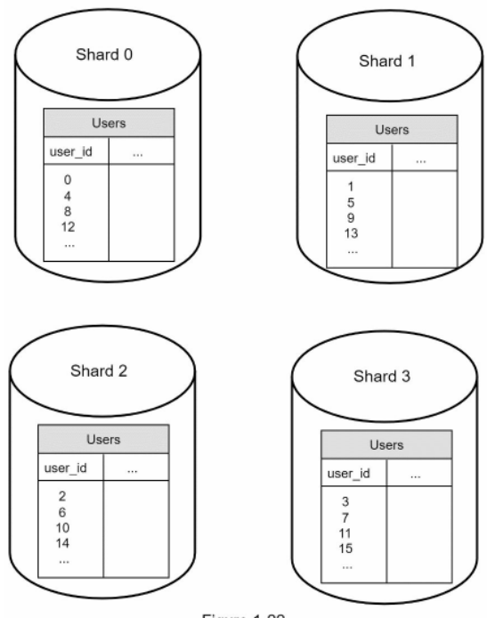

Hình 1-22

Yếu tố quan trọng nhất cần cân nhắc khi triển khai chiến lược sharding là việc lựa chọn khóa phân mảnh (sharding key). Khóa phân mảnh (được gọi là khóa phân vùng - partition key) bao gồm một hoặc nhiều cột xác định cách thức dữ liệu được phân bổ. Như minh họa trong Hình 1-22, "user_id" chính là sharding key. Một sharding key cho phép bạn truy xuất và sửa đổi dữ liệu một cách hiệu quả bằng cách định tuyến các truy vấn cơ sở dữ liệu đến chính xác cơ sở dữ liệu đích. Khi lựa chọn một sharding key, một trong những tiêu chí quan trọng nhất là chọn một khóa có khả năng phân bổ dữ liệu một cách đồng đều.

Sharding là một kỹ thuật tuyệt vời để mở rộng cơ sở dữ liệu nhưng nó còn lâu mới là một giải pháp hoàn hảo. Nó mang lại sự phức tạp và những thách thức mới cho hệ thống:

Tái phân mảnh dữ liệu (Resharding data): Việc tái phân mảnh dữ liệu là cần thiết khi: 1) một shard đơn lẻ không còn khả năng chứa thêm dữ liệu do sự tăng trưởng quá nhanh; 2) Một số shard nhất định có thể bị cạn kiệt dung lượng nhanh hơn các shard khác do sự phân bổ dữ liệu không đồng đều. Khi hiện tượng cạn kiệt shard xảy ra, nó đòi hỏi phải cập nhật lại hàm phân mảnh và di chuyển dữ liệu qua lại. Kỹ thuật băm nhất quán (Consistent hashing), sẽ được thảo luận chi tiết trong Chương 5, là một kỹ thuật thường được sử dụng để giải quyết vấn đề này.

Vấn đề người nổi tiếng (Celebrity problem): Vấn đề này còn được gọi là bài toán khóa điểm nóng (hotspot key problem). Việc truy cập quá mức vào một shard cụ thể có thể khiến máy chủ đó bị quá tải. Hãy tưởng tượng dữ liệu của Katy Perry, Justin Bieber và Lady Gaga đều nằm trên cùng một shard. Đối với các ứng dụng mạng xã hội, shard đó sẽ bị quá tải hoàn toàn bởi các thao tác đọc. Để giải quyết vấn đề này, chúng ta có thể phải phân bổ một shard riêng cho từng người nổi tiếng. Mỗi shard thậm chí có thể đòi hỏi phải tiếp tục chia nhỏ hơn nữa.

> 💡 **Giải thích thêm:** "Celebrity problem" (vấn đề người nổi tiếng) hay "Hotspot key problem" (bài toán khóa điểm nóng) là hiện tượng một khóa dữ liệu có mức độ phổ biến quá cao (ví dụ: tài khoản mạng xã hội của người nổi tiếng) dẫn đến lưu lượng truy cập (đặc biệt là thao tác đọc) tập trung áp đảo vào một shard duy nhất. Điều này phá vỡ giả định phân bổ tải đồng đều của hệ thống sharding, gây nghẽn cổ chai cục bộ và có thể làm sập nút lưu trữ đó.  
> Nguồn tham khảo: (Không có nguồn trích dẫn xác thực — cần tự kiểm chứng thêm)

Thao tác Join và bỏ chuẩn hóa (Join and de-normalization): Một khi cơ sở dữ liệu đã được phân mảnh trên nhiều máy chủ, rất khó để thực hiện các thao tác kết hợp dữ liệu (join) giữa các shard của cơ sở dữ liệu. Một cách giải quyết phổ biến là bỏ chuẩn hóa cơ sở dữ liệu (denormalize) để các truy vấn có thể được thực hiện chỉ trong một bảng duy nhất.

Trong Hình 1-23, chúng ta phân mảnh các cơ sở dữ liệu để hỗ trợ lưu lượng dữ liệu đang gia tăng nhanh chóng. Đồng thời, một số chức năng phi quan hệ được chuyển sang kho lưu trữ dữ liệu NoSQL để giảm tải cho cơ sở dữ liệu. Dưới đây là một bài viết đề cập đến nhiều trường hợp sử dụng của NoSQL [14].

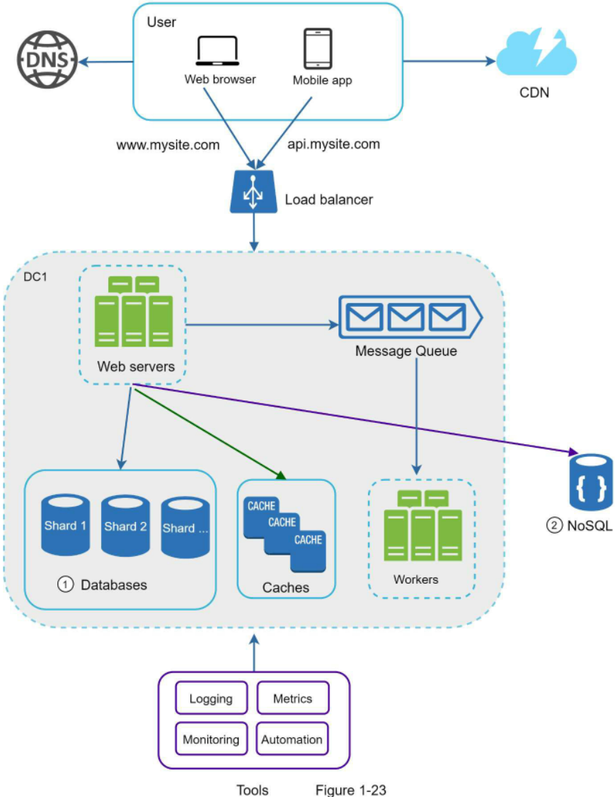

# Millions of users and beyond (Hàng triệu người dùng và xa hơn nữa)

Mở rộng quy mô hệ thống là một quá trình lặp đi lặp lại. Việc áp dụng liên tục những gì chúng ta đã học trong chương này có thể đưa chúng ta tiến rất xa. Chúng ta sẽ cần thêm nhiều sự tinh chỉnh và các chiến lược mới để mở rộng quy mô vượt xa hàng triệu người dùng. Ví dụ, bạn có thể cần tối ưu hóa hệ thống và phân tách hệ thống thành các dịch vụ thậm chí còn nhỏ hơn nữa. Tất cả các kỹ thuật được học trong chương này sẽ cung cấp một nền tảng tốt để bạn giải quyết những thách thức mới. Để kết thúc chương này, chúng tôi cung cấp bản tóm tắt về cách chúng ta mở rộng hệ thống để hỗ trợ hàng triệu người dùng:
 * Giữ cho tầng web luôn phi trạng thái (stateless)
 * Xây dựng tính dự phòng (redundancy) ở mọi tầng
 * Lưu trữ bộ nhớ đệm (cache) dữ liệu nhiều nhất có thể
 * Hỗ trợ đa trung tâm dữ liệu
 * Lưu trữ các tài nguyên tĩnh trên CDN
 * Mở rộng quy mô tầng dữ liệu bằng kỹ thuật phân mảnh (sharding)
 * Chia tách các tầng thành các dịch vụ riêng lẻ
 * Giám sát hệ thống của bạn và sử dụng các công cụ tự động hóa

Xin chúc mừng bạn đã đi được một chặng đường dài đến đây! Bây giờ hãy tự thưởng cho bản thân một cái vỗ vai khích lệ. Bạn đã làm rất tốt!

# Reference materials (Tài liệu tham khảo)

[1] Hypertext Transfer Protocol: https://en.wikipedia.org/wiki/Hypertext_Transfer_Protocol  
[2] Should you go Beyond Relational Databases?: https://blog.teamtreehouse.com/should-you-go-beyond-relational-databases  
[3] Replication: https://en.wikipedia.org/wiki/Replication_(computing)  
[4] Multi-master replication: https://en.wikipedia.org/wiki/Multi-master_replication  
[5] NDB Cluster Replication: Multi-Master and Circular Replication: https://dev.mysql.com/doc/refman/5.7/en/mysql-cluster-replication-multi-master.html  
[6] Caching Strategies and How to Choose the Right One: https://codeahoy.com/2017/08/11/caching-strategies-and-how-to-choose-the-right-one/  
[7] R. Nishtala, "Facebook, Scaling Memcache at," 10th USENIX Symposium on Networked Systems Design and Implementation (NSDI '13).  
[8] Single point of failure: https://en.wikipedia.org/wiki/Single_point_of_failure  
[9] Amazon CloudFront Dynamic Content Delivery: https://aws.amazon.com/cloudfront/dynamic-content/  
[10] Configure Sticky Sessions for Your Classic Load Balancer: https://docs.aws.amazon.com/elasticloadbalancing/latest/classic/elb-sticky-sessions.html  
[11] Active-Active for Multi-Regional Resiliency: https://netflixtechblog.com/active-active-for-multi-regional-resiliency-c47719f6685b  
[12] Amazon EC2 High Memory Instances: https://aws.amazon.com/ec2/instance-types/high-memory/  
[13] What it takes to run Stack Overflow: http://nickcraver.com/blog/2013/11/22/what-it-takes-to-run-stack-overflow  
[14] What The Heck Are You Actually Using NoSQL For: http://highscalability.com/blog/2010/12/6/what-the-heck-are-you-actually-using-nosql-for.html

# CHAPTER 2: BACK-OF-THE-ENVELOPE ESTIMATION (CHƯƠNG 2: ƯỚC TÍNH SƠ BỘ)

Trong một buổi phỏng vấn thiết kế hệ thống, đôi khi bạn được yêu cầu ước tính dung lượng hệ thống hoặc các yêu cầu về hiệu năng bằng cách sử dụng phương pháp ước tính sơ bộ (back-of-the-envelope estimation). Theo Jeff Dean, Google Senior Fellow (Chuyên viên nghiên cứu cao cấp tại Google): "Các phép tính nháp trên phong bì là những ước tính bạn tạo ra bằng cách kết hợp giữa các thí nghiệm tưởng tượng và các con số hiệu năng thông dụng để có được cảm nhận rõ ràng về phương án thiết kế nào sẽ đáp ứng được các yêu cầu của bạn" [1].

> 💡 **Giải thích thêm:** "Back-of-the-envelope estimation" (ước tính trên phong bì thư) là một thành ngữ tiếng Anh chỉ việc thực hiện các phép tính toán nhanh, phác thảo sơ bộ bằng các con số làm tròn và những giả định hợp lý (như thể ghi nhanh trên mặt sau của chiếc phong bì thư) nhằm đánh giá nhanh tính khả thi trước khi đào sâu vào thiết kế chi tiết.  
> Nguồn tham khảo: https://en.wikipedia.org/wiki/Back-of-the-envelope_calculation

Bạn cần có cảm nhận tốt về các nguyên lý cơ bản của khả năng mở rộng để thực hiện ước tính sơ bộ một cách hiệu quả. Những khái niệm sau đây cần phải được hiểu thật rõ: lũy thừa của 2 [2], các con số về độ trễ mà mọi lập trình viên nên biết, và các con số về tính sẵn sàng.

# Power of two (Lũy thừa của 2)

Mặc dù khối lượng dữ liệu có thể trở nên khổng lồ khi xử lý các hệ thống phân tán, mọi phép tính toán suy cho cùng đều bắt nguồn từ những điều cơ bản nhất. Để có được các phép tính chính xác, điều cốt lõi là bạn phải nắm rõ đơn vị dung lượng dữ liệu bằng cách sử dụng lũy thừa của 2. Một byte là một chuỗi gồm 8 bit. Một ký tự ASCII sử dụng một byte bộ nhớ (8 bit). Dưới đây là bảng giải thích đơn vị dung lượng dữ liệu (Bảng 2-1).

Table 2-1

| Power (Lũy thừa) | Approximate value (Giá trị xấp xỉ) | Full name (Tên đầy đủ) | Short name (Tên viết tắt) |
| ---------------- | ---------------------------------- | ---------------------- | ------------------------- |
| 10               | 1 Thousand (1 Nghìn)               | 1 Kilobyte             | 1KB                       |
| 20               | 1 Million (1 Triệu)                | 1 Megabyte             | 1 MB                      |
| 30               | 1 Billion (1 Tỷ)                   | 1 Gigabyte             | 1 GB                      |
| 40               | 1 Trillion (1 Nghìn tỷ)            | 1 Terabyte             | 1 TB                      |
| 50               | 1 Quadrillion (1 Triệu tỷ)         | 1 Petabyte             | 1 PB                      |

# Latency numbers every programmer should know (Các con số độ trễ mà mọi lập trình viên nên biết)

Tiến sĩ Dean từ Google đã công bố thời lượng của các thao tác máy tính điển hình vào năm 2010 [1]. Một số con số hiện đã cũ do máy tính ngày càng trở nên nhanh hơn và mạnh mẽ hơn. Tuy nhiên, những con số đó vẫn có thể cho chúng ta một khái niệm về tốc độ nhanh và chậm của các thao tác máy tính khác nhau.

| Tên thao tác (Operation name)                                                    | Thời gian (Time)        |
| -------------------------------------------------------------------------------- | ----------------------- |
| Truy xuất L1 cache (L1 cache reference)                                          | 0.5 ns                  |
| Đoán sai nhánh (Branch mispredict)                                               | 5 ns                    |
| Truy xuất L2 cache (L2 cache reference)                                          | 7 ns                    |
| Khóa/mở khóa Mutex (Mutex lock/unlock)                                           | 100 ns                  |
| Truy xuất bộ nhớ chính (Main memory reference)                                   | 100 ns                  |
| Nén 1K bytes bằng Zippy (Compress 1K bytes with Zippy)                           | 10,000 ns = 10 μs       |
| Gửi 2K bytes qua mạng 1 Gbps (Send 2K bytes over1 Gbps network)                  | 20,000 ns = 20 μs       |
| Đọc 1 MB tuần tự từ bộ nhớ (Read 1 MB sequentially from memory)                  | 250,000 ns = 250 μs     |
| Khứ hồi trong cùng một trung tâm dữ liệu (Round trip within the same datacenter) | 500,000 ns = 500 μs     |
| Tìm kiếm vị trí trên đĩa (Disk seek)                                             | 10,000,000 ns = 10 ms   |
| Đọc 1 MB tuần tự từ mạng (Read 1 MB sequentially from the network)               | 10,000,000 ns = 10 ms   |
| Đọc 1 MB tuần tự từ đĩa (Read 1 MB sequentiallyfrom disk)                        | 30,000,000 ns = 30 ms   |
| Gửi gói tin CA (California) -> Hà Lan -> CA                                      | 150,000,000 ns = 150 ms |

Table 2-2

Ghi chú ----------- ns = nanosecond (nano-giây), µs = microsecond (micro-giây), ms = millisecond (mili-giây)  
1 ns = 10^-9 giây  
1 µs = 10^-6 giây = 1,000 ns  
1 ms = 10^-3 giây = 1,000 µs = 1,000,000 ns  

Một kỹ sư phần mềm của Google đã xây dựng một công cụ để trực quan hóa các con số của Tiến sĩ Dean. Công cụ này cũng đưa yếu tố thời gian vào tính toán. Hình 2-1 thể hiện các con số độ trễ được trực quan hóa tính đến năm 2020 (nguồn của các hình: tài liệu tham khảo [3]).

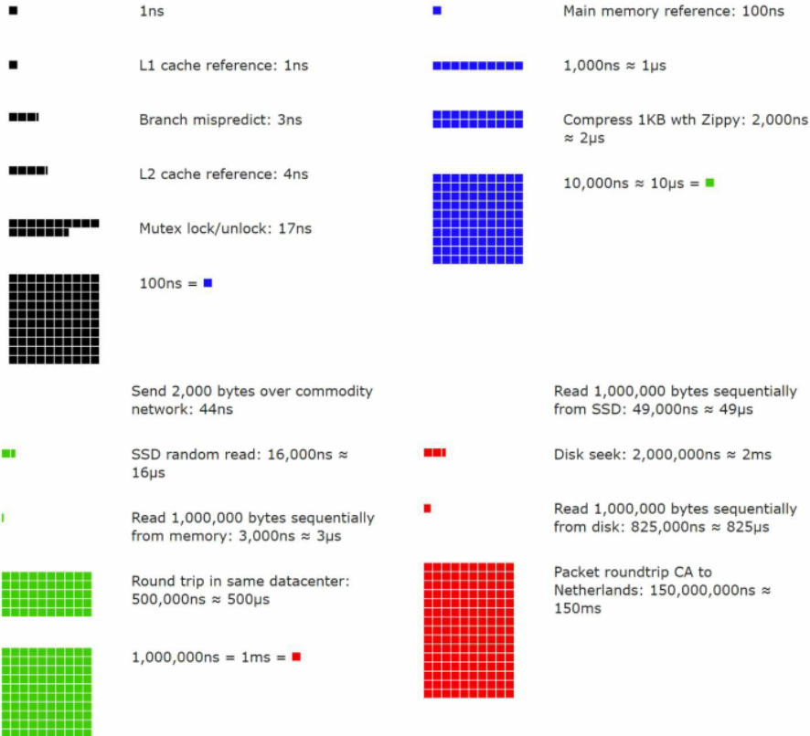

Hình 2-1

Thông qua việc phân tích các con số trong Hình 2-1, chúng ta rút ra được các kết luận sau:
 * Bộ nhớ (RAM) thì nhanh nhưng đĩa cứng thì chậm.
 * Tránh các thao tác tìm kiếm trên đĩa (disk seeks) nếu có thể.
 * Các thuật toán nén đơn giản thường chạy rất nhanh.
 * Nén dữ liệu trước khi gửi qua internet nếu có thể.
 * Các trung tâm dữ liệu thường nằm ở các khu vực khác nhau, và việc truyền dữ liệu giữa chúng luôn mất thời gian.

# Availability numbers (Các con số về tính sẵn sàng)

Tính sẵn sàng cao (High availability) là khả năng của một hệ thống có thể hoạt động liên tục trong một khoảng thời gian dài mong muốn. Tính sẵn sàng cao được đo bằng tỷ lệ phần trăm, với 100% đồng nghĩa với một dịch vụ có thời gian chết (downtime) bằng 0. Hầu hết các dịch vụ nằm trong khoảng từ 99% đến 100%. Thỏa thuận mức dịch vụ (SLA - Service Level Agreement) là một thuật ngữ thường dùng cho các nhà cung cấp dịch vụ. Đây là một thỏa thuận giữa bạn (nhà cung cấp dịch vụ) và khách hàng của bạn, và thỏa thuận này xác định một cách chính thức mức độ thời gian hoạt động (uptime) mà dịch vụ của bạn sẽ cung cấp. Các nhà cung cấp dịch vụ đám mây như Amazon [4], Google [5] và Microsoft [6] đặt mức SLA của họ từ 99.9% trở lên. Thời gian hoạt động theo truyền thống được đo bằng "các chữ số 9" (nines). Càng nhiều số 9 thì càng tốt. Như minh họa trong Bảng 2-3, số lượng các chữ số 9 tương ứng trực tiếp với thời gian gián đoạn dự kiến của hệ thống.

> 💡 **Giải thích thêm:** Khái niệm "đo bằng các chữ số 9" (nines) là thang đo chuẩn trong kỹ thuật hệ thống để định lượng tính sẵn sàng. Ví dụ: "three nines" (3 số 9 - 99.9%) cho phép hệ thống ngừng hoạt động tối đa 8.77 giờ/năm; "five nines" (5 số 9 - 99.999%) chỉ cho phép hệ thống gián đoạn tối đa khoảng 5.26 phút trong suốt cả một năm.  
> Nguồn tham khảo: https://en.wikipedia.org/wiki/High_availability

| Availability % (Độ sẵn sàng %)                                          | Downtime per day (Thời gian gián đoạn mỗi ngày) | Downtime per year (Thời gian gián đoạn mỗi năm) |
| ----------------------------------------------------------------------- | ----------------------------------------------- | ----------------------------------------------- |
| %66 [CẦN KIỂM CHỨNG: câu gốc ghi %66, nhiều khả năng là lỗi in của 99%] | 14.40minutes (14.40 phút)                       | 3.65 days (3.65 ngày)                           |
| 99.9%                                                                   | 1.44 minutes (1.44 phút)                        | 8.77 hours (8.77 giờ)                           |
| 99.99%                                                                  | 8.64 seconds (8.64 giây)                        | 52.60minutes (52.60 phút)                       |
| 99.999%                                                                 | 864.00 milliseconds (864.00 mili-giây)          | 5.26 minutes (5.26 phút)                        |
| 99.9999%                                                                | 86.40 milliseconds (86.40 mili-giây)            | 31.56 seconds (31.56 giây)                      |

Table 2-3

# Example: Estimate Twitter QPS and storage requirements (Ví dụ: Ước tính QPS và nhu cầu lưu trữ của Twitter)

Xin lưu ý rằng các con số dưới đây chỉ phục vụ cho bài tập thực hành này và không phải là số liệu thực tế từ Twitter.

Giả định:
 * 300 triệu người dùng hoạt động hàng tháng (MAU - Monthly Active Users).
 * 50% người dùng sử dụng Twitter hàng ngày.
 * Người dùng đăng trung bình 2 tweet mỗi ngày.
 * 10% tweet có chứa phương tiện truyền thông (media: ảnh, video).
 * Dữ liệu được lưu trữ trong 5 năm.

Ước tính:

Ước tính số truy vấn mỗi giây (QPS - Query Per Second):
 * Người dùng hoạt động hàng ngày (DAU - Daily Active Users) = 300 triệu * 50% = 150 triệu
 * QPS đăng tweet = 150 triệu * 2 tweet / 24 giờ / 3600 giây = ~3500
 * QPS thời điểm đỉnh điểm (Peak QPS) = 2 * QPS = ~7000

Ở đây chúng ta sẽ chỉ ước tính dung lượng lưu trữ cho tệp đa phương tiện:
 * Kích thước tweet trung bình:
 * `tweet_id`: 64 bytes
 * văn bản (text): 140 bytes
 * tệp đa phương tiện (media): 1 MB
 * Dung lượng lưu trữ phương tiện truyền thông: 150 triệu * 2 * 10% * 1 MB = 30 TB mỗi ngày
 * Dung lượng lưu trữ phương tiện truyền thông trong 5 năm: 30 TB * 365 * 5 = ~55 PB

# Tips (Mẹo hữu ích)

Ước tính sơ bộ cốt lõi nằm ở quy trình thực hiện. Việc giải quyết vấn đề quan trọng hơn nhiều so với việc chỉ đạt được kết quả con số. Người phỏng vấn muốn kiểm tra kỹ năng giải quyết vấn đề của bạn. Dưới đây là một số mẹo cần lưu ý:
 * Làm tròn và Xấp xỉ (Rounding and Approximation). Rất khó để thực hiện các phép toán phức tạp trong buổi phỏng vấn. Ví dụ, kết quả của "99987 / 9.1" là bao nhiêu? Không cần thiết phải lãng phí thời gian quý báu để giải các bài toán phức tạp. Độ chính xác tuyệt đối không phải là điều người ta mong đợi. Hãy tận dụng các con số làm tròn và phép tính xấp xỉ để tạo lợi thế cho mình. Phép toán chia trên có thể được đơn giản hóa như sau: "100,000 / 10".
 * Ghi lại các giả định của bạn. Việc ghi lại các giả định lên bảng để tham chiếu lại sau này là một ý kiến hay.
 * Gắn nhãn các đơn vị của bạn. Khi bạn viết "5", con số đó có nghĩa là 5 KB hay 5 MB? Bạn có thể tự làm mình bối rối với điều này. Hãy viết rõ các đơn vị vì "5 MB" giúp loại bỏ sự mơ hồ.
 * Các bài toán ước tính sơ bộ thường gặp: QPS, QPS đỉnh điểm, dung lượng lưu trữ, bộ nhớ đệm, số lượng máy chủ, v.v. Bạn có thể luyện tập các phép tính này khi chuẩn bị cho một cuộc phỏng vấn. Rèn luyện tạo nên sự hoàn hảo.

Xin chúc mừng bạn đã đi được một chặng đường dài đến đây! Bây giờ hãy tự thưởng cho bản thân một cái vỗ vai khích lệ. Bạn đã làm rất tốt!

# Reference materials (Tài liệu tham khảo)

[1] J. Dean.Google Pro Tip: Use Back-Of-The-Envelope-Calculations To Choose The Best Design: http://highscalability.com/blog/2011/1/26/google-pro-tip-use-back-of-the-envelopecalculations-to-choo.html  
[2] System design primer: https://github.com/donnemartin/system-design-primer  
[3] Latency Numbers Every Programmer Should Know: https://colin-scott.github.io/personal_website/research/interactive_latency.html  
[4] Amazon Compute Service Level Agreement: https://aws.amazon.com/compute/sla/  
[5] Compute Engine Service Level Agreement (SLA): https://cloud.google.com/compute/sla  
[6] SLA summary for Azure services: https://azure.microsoft.com/enus/support/legal/sla/summary/

# CHAPTER 3: A FRAMEWORK FOR SYSTEM DESIGN INTERVIEWS (CHƯƠNG 3: KHUNG PHƯƠNG PHÁP LUẬN CHO PHỎNG VẤN THIẾT KẾ HỆ THỐNG)

Bạn vừa nhận được lời mời phỏng vấn trực tiếp (on-site) mà bấy lâu hằng mơ ước tại công ty mục tiêu. Người điều phối tuyển dụng gửi cho bạn lịch trình của ngày hôm đó. Đọc lướt qua danh sách, bạn cảm thấy khá ổn cho đến khi mắt bạn dừng lại ở phiên phỏng vấn này - Phỏng vấn Thiết kế Hệ thống (System Design Interview).

Các buổi phỏng vấn thiết kế hệ thống thường gây cảm giác e ngại. Đề bài có thể rất mơ hồ kiểu như "hãy thiết kế một sản phẩm X nổi tiếng nào đó?". Các câu hỏi thường không rõ ràng và có phạm vi rộng đến mức vô lý. Nỗi lo lắng của bạn là hoàn toàn dễ hiểu. Rốt cuộc, làm sao một người có thể thiết kế chỉ trong vòng một giờ một sản phẩm nổi tiếng mà ngoài đời thực phải mất hàng trăm, thậm chí hàng nghìn kỹ sư xây dựng nên?

Tin tốt là không ai kỳ vọng bạn phải làm được điều đó. Thiết kế hệ thống trong thế giới thực vô cùng phức tạp. Ví dụ, công cụ tìm kiếm của Google thoạt nhìn có vẻ đơn giản đến bất ngờ; tuy nhiên, khối lượng công nghệ làm nền tảng cho sự đơn giản đó thực sự đáng kinh ngạc. Nếu không ai kỳ vọng bạn phải thiết kế một hệ thống thực tế trong vòng một giờ, vậy mục đích của buổi phỏng vấn thiết kế hệ thống là gì?

Phỏng vấn thiết kế hệ thống mô phỏng lại quá trình giải quyết vấn đề trong đời thực, nơi hai người đồng nghiệp cùng cộng tác trên một bài toán còn mơ hồ và cùng đưa ra một giải pháp đáp ứng các mục tiêu đề ra. Vấn đề mang tính mở, và không có một câu trả lời hoàn hảo duy nhất. Thiết kế cuối cùng ít quan trọng hơn so với nỗ lực và quá trình bạn đầu tư vào việc thiết kế. Điều này cho phép bạn thể hiện kỹ năng thiết kế của mình, bảo vệ các lựa chọn thiết kế, và phản hồi lại các ý kiến đóng góp một cách mang tính xây dựng.

Hãy đảo ngược góc nhìn và xem điều gì đang diễn ra trong đầu người phỏng vấn khi cô ấy bước vào phòng họp để gặp bạn. Mục tiêu hàng đầu của người phỏng vấn là đánh giá chính xác năng lực của bạn. Điều cuối cùng mà cô ấy mong muốn là phải đưa ra một đánh giá không dứt khoát vì buổi phỏng vấn diễn ra mờ nhạt và không thu thập đủ các tín hiệu đánh giá.

Người phỏng vấn tìm kiếm điều gì trong một buổi phỏng vấn thiết kế hệ thống? Nhiều người nghĩ rằng phỏng vấn thiết kế hệ thống chỉ đơn thuần là về kỹ năng thiết kế kỹ thuật của một cá nhân. Nó bao hàm nhiều hơn thế rất nhiều. Một buổi phỏng vấn thiết kế hệ thống hiệu quả sẽ cung cấp những tín hiệu mạnh mẽ về khả năng cộng tác, khả năng làm việc dưới áp lực, và năng lực giải quyết sự mơ hồ một cách mang tính xây dựng. Khả năng đặt câu hỏi hay cũng là một kỹ năng thiết yếu, và nhiều người phỏng vấn đặc biệt tìm kiếm kỹ năng này.

Một người phỏng vấn giỏi cũng sẽ chú ý tìm kiếm các dấu hiệu cảnh báo (red flags). Thiết kế quá mức cần thiết (Over-engineering) là một "căn bệnh" thực sự của nhiều kỹ sư khi họ say mê sự hoàn hảo thuần túy trong thiết kế mà bỏ qua các đánh đổi thực tế (tradeoffs). Họ thường không nhận thức được chi phí cộng dồn khổng lồ của các hệ thống bị thiết kế quá phức tạp, và nhiều công ty đã phải trả giá đắt cho sự thiếu hiểu biết đó. Bạn chắc chắn không muốn thể hiện xu hướng này trong một buổi phỏng vấn thiết kế hệ thống. Các dấu hiệu cảnh báo khác bao gồm tư duy hạn hẹp, bảo thủ, v.v.

Trong chương này, chúng ta sẽ điểm qua một số mẹo hữu ích và giới thiệu một khung phương pháp luận đơn giản nhưng hiệu quả để giải quyết các bài toán phỏng vấn thiết kế hệ thống.

# A 4-step process for effective system design interview (Quy trình 4 bước cho buổi phỏng vấn thiết kế hệ thống hiệu quả)

Mỗi buổi phỏng vấn thiết kế hệ thống đều có sự khác biệt. Một buổi phỏng vấn thiết kế hệ thống hay luôn có tính chất mở và không có một giải pháp khuôn mẫu duy nhất nào phù hợp cho mọi trường hợp. Tuy nhiên, luôn có những bước đi và những điểm cốt lõi chung cần phải bao quát trong mọi buổi phỏng vấn thiết kế hệ thống.

## Step 1 - Understand the problem and establish design scope (Bước 1 - Thấu hiểu vấn đề và xác lập phạm vi thiết kế)

"Tại sao con hổ lại gầm?" Một cánh tay giơ lên ở cuối lớp học. "Ừ, Jimmy?", cô giáo gọi. "Thưa cô, vì nó ĐÓI ạ". "Rất tốt Jimmy." Suốt thời thơ ấu, Jimmy luôn là người đầu tiên trả lời các câu hỏi trong lớp. Bất cứ khi nào giáo viên đặt câu hỏi, trong lớp luôn có một đứa trẻ thích xông xáo thử sức với câu hỏi đó, bất kể cậu bé có biết câu trả lời hay không. Đó chính là Jimmy. Jimmy là một học sinh xuất sắc. Cậu bé tự hào vì luôn biết tất cả các câu trả lời một cách nhanh chóng. Trong các kỳ thi, cậu thường là người đầu tiên hoàn thành bài thi. Cậu là lựa chọn hàng đầu của giáo viên cho mọi cuộc thi học thuật.

ĐỪNG giống như Jimmy. Trong một buổi phỏng vấn thiết kế hệ thống, việc vội vàng đưa ra câu trả lời ngay lập tức mà không suy nghĩ sẽ không mang lại cho bạn bất kỳ điểm cộng nào. Trả lời khi chưa hiểu thấu đáo các yêu cầu là một dấu hiệu cảnh báo tiêu cực lớn vì buổi phỏng vấn không phải là một cuộc thi đố vui nhanh. Ở đây không có một đáp án duy nhất đúng.

Vì vậy, đừng vội vàng lao ngay vào việc đưa ra giải pháp. Hãy chậm lại. Suy nghĩ thật sâu và đặt các câu hỏi để làm rõ các yêu cầu và các giả định. Điều này cực kỳ quan trọng. Là kỹ sư, chúng ta thường thích giải quyết các bài toán khó và muốn nhảy ngay vào bản thiết kế cuối cùng; tuy nhiên, cách tiếp cận này rất dễ khiến bạn thiết kế sai hệ thống. Một trong những kỹ năng quan trọng nhất của một kỹ sư là biết đặt câu hỏi đúng, đưa ra các giả định hợp lý, và thu thập tất cả các thông tin cần thiết để xây dựng một hệ thống. Vì vậy, đừng ngại đặt câu hỏi.

Khi bạn đặt câu hỏi, người phỏng vấn sẽ trả lời trực tiếp câu hỏi của bạn hoặc yêu cầu bạn tự đưa ra các giả định. Nếu rơi vào trường hợp sau, hãy viết các giả định của bạn lên bảng trắng hoặc giấy nháp. Bạn có thể sẽ cần đến chúng sau này.

Nên đặt những loại câu hỏi nào? Hãy hỏi các câu hỏi giúp thấu hiểu chính xác các yêu cầu. Dưới đây là danh sách các câu hỏi giúp bạn bắt đầu:
 * Chúng ta sẽ xây dựng những tính năng cụ thể nào?
 * Sản phẩm có bao nhiêu người dùng?
 * Công ty dự kiến tốc độ mở rộng quy mô nhanh đến mức nào? Quy mô dự kiến trong 3 tháng, 6 tháng, và 1 năm tới là bao nhiêu?
 * Ngăn xếp công nghệ (technology stack) hiện tại của công ty là gì? Chúng ta có thể tận dụng những dịch vụ sẵn có nào để đơn giản hóa thiết kế?

Ví dụ (Example)

Nếu bạn được yêu cầu thiết kế một hệ thống bảng tin (news feed system), bạn sẽ muốn hỏi những câu hỏi giúp làm rõ các yêu cầu. Cuộc hội thoại giữa bạn và người phỏng vấn có thể diễn ra như sau:

Ứng viên: Đây là ứng dụng di động, ứng dụng web, hay cả hai?  
Người phỏng vấn: Cả hai.  
Ứng viên: Các tính năng quan trọng nhất của sản phẩm là gì?  
Người phỏng vấn: Khả năng đăng bài viết và xem bảng tin của bạn bè.  
Ứng viên: Bảng tin được sắp xếp theo thứ tự thời gian đảo ngược (mới nhất lên đầu) hay theo một thứ tự đặc biệt? Thứ tự đặc biệt ở đây có nghĩa là mỗi bài viết được gán một trọng số khác nhau. Chẳng hạn, bài viết từ bạn thân sẽ quan trọng hơn bài viết từ một nhóm.  
Người phỏng vấn: Để giữ cho mọi thứ đơn giản, chúng ta giả định bảng tin được sắp xếp theo thứ tự thời gian đảo ngược.  
Ứng viên: Một người dùng có thể có tối đa bao nhiêu bạn bè?  
Người phỏng vấn: 5000.  
Ứng viên: Khối lượng lưu lượng truy cập là bao nhiêu?  
Người phỏng vấn: 10 triệu người dùng hoạt động hàng ngày (DAU).  
Ứng viên: Bảng tin có thể chứa hình ảnh, video, hay chỉ có văn bản thuần túy?  
Người phỏng vấn: Nó có thể chứa các tệp đa phương tiện, bao gồm cả hình ảnh và video.

Trên đây là một số câu hỏi mẫu mà bạn có thể hỏi người phỏng vấn. Việc thấu hiểu các yêu cầu và làm sáng tỏ các điểm mơ hồ là vô cùng quan trọng.

## Step 2 - Propose high-level design and get buy-in (Bước 2 - Đề xuất thiết kế cấp cao và đạt được sự đồng thuận)

Trong bước này, mục tiêu của chúng ta là phát triển một bản thiết kế cấp cao và đạt được sự đồng thuận với người phỏng vấn về thiết kế đó. Việc cộng tác chặt chẽ với người phỏng vấn trong suốt quá trình này là một ý tưởng tuyệt vời.
 * Đưa ra một bản thiết kế phác thảo ban đầu (blueprint). Lắng nghe phản hồi. Hãy coi người phỏng vấn như một đồng đội và làm việc cùng nhau. Nhiều người phỏng vấn giỏi rất thích trò chuyện và tham gia vào quá trình này.
 * Vẽ các sơ đồ khối với các thành phần chính lên bảng trắng hoặc giấy. Sơ đồ này có thể bao gồm các máy khách (di động/web), các API, máy chủ web, kho lưu trữ dữ liệu, bộ nhớ đệm, CDN, hàng đợi thông điệp, v.v.
 * Thực hiện các phép tính nhẩm sơ bộ để đánh giá xem bản thiết kế phác thảo của bạn có phù hợp với các ràng buộc về quy mô hay không. Hãy suy nghĩ thành tiếng (think out loud). Hãy trao đổi với người phỏng vấn xem việc tính toán sơ bộ có cần thiết hay không trước khi đi sâu vào tính toán.

Nếu có thể, hãy đi qua một vài kịch bản sử dụng (use cases) cụ thể. Điều này sẽ giúp bạn định hình bản thiết kế cấp cao rõ ràng hơn. Các kịch bản sử dụng cũng rất có thể sẽ giúp bạn phát hiện ra các trường hợp biên (edge cases) mà bạn chưa từng nghĩ tới.

Chúng ta có nên đưa các điểm cuối API (API endpoints) và lược đồ cơ sở dữ liệu (database schema) vào đây không? Điều này phụ thuộc vào bài toán. Đối với các bài toán thiết kế quy mô lớn như "Thiết kế công cụ tìm kiếm Google", việc này có phần đi quá sâu vào chi tiết cấp thấp. Đối với một bài toán như thiết kế backend cho một trò chơi poker nhiều người chơi, đây lại là một chủ đề hoàn toàn phù hợp để thảo luận. Hãy trao đổi trực tiếp với người phỏng vấn của bạn.

### Example (Ví dụ)

Hãy sử dụng bài toán "Thiết kế hệ thống bảng tin" để minh họa cách tiếp cận bản thiết kế cấp cao. Ở đây bạn chưa cần phải hiểu sâu về cách hệ thống thực sự vận hành bên dưới. Tất cả các chi tiết sẽ được giải thích trong Chương 11.

Ở mức độ cấp cao, thiết kế được chia thành hai luồng chính: đăng bảng tin (feed publishing) và xây dựng bảng tin (news feed building).
 * Đăng bảng tin: khi một người dùng đăng một bài viết, dữ liệu tương ứng sẽ được ghi vào bộ nhớ đệm/cơ sở dữ liệu, và bài viết đó sẽ được phân phối vào bảng tin của bạn bè.
 * Xây dựng bảng tin: bảng tin được xây dựng bằng cách tổng hợp các bài viết của bạn bè theo thứ tự thời gian đảo ngược.

Hình 3-1 và Hình 3-2 lần lượt trình bày các bản thiết kế cấp cao cho luồng đăng bài và luồng xây dựng bảng tin.


Hình 3-1

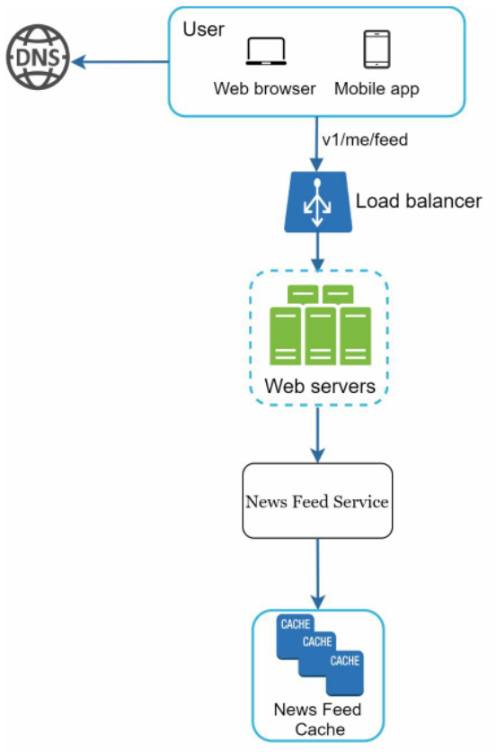

Hình 3-2

## Step 3 - Design deep dive (Bước 3 - Đào sâu vào chi tiết thiết kế)

Tại bước này, bạn và người phỏng vấn đáng lẽ đã phải đạt được các mục tiêu sau:
 * Thống nhất về các mục tiêu tổng thể và phạm vi tính năng
 * Phác thảo ra một bản thiết kế cấp cao cho toàn bộ hệ thống
 * Nhận được phản hồi từ người phỏng vấn về bản thiết kế cấp cao
 * Có được một số ý tưởng ban đầu về các khu vực cần tập trung đào sâu dựa trên phản hồi của cô ấy

Bạn cần làm việc cùng với người phỏng vấn để xác định và ưu tiên các thành phần trong kiến trúc. Cần nhấn mạnh rằng mỗi cuộc phỏng vấn đều có sự khác biệt. Đôi khi, người phỏng vấn có thể gợi ý rằng cô ấy thích tập trung vào thiết kế cấp cao. Đôi khi, đối với một cuộc phỏng vấn ứng viên cấp cao (senior), cuộc thảo luận có thể xoay quanh các đặc tính hiệu năng của hệ thống, nhiều khả năng tập trung vào các điểm nghẽn cổ chai và ước tính tài nguyên. Trong hầu hết các trường hợp, người phỏng vấn có thể muốn bạn đào sâu vào chi tiết của một số thành phần hệ thống.

Đối với dịch vụ rút gọn URL, việc đào sâu vào thiết kế hàm băm để chuyển đổi một URL dài thành một URL ngắn là một chủ đề rất thú vị. Đối với một hệ thống trò chuyện, làm thế nào để giảm độ trễ và làm thế nào để hỗ trợ trạng thái trực tuyến/ngoại tuyến là hai chủ đề hấp dẫn. Quản lý thời gian là điều thiết yếu vì bạn rất dễ bị cuốn vào những chi tiết vụn vặt không thể hiện được năng lực của mình. Bạn phải luôn chuẩn bị sẵn các tín hiệu rõ ràng để chứng minh cho người phỏng vấn thấy. Cố gắng đừng đi vào các chi tiết không cần thiết. Ví dụ, việc nói chi tiết về thuật toán EdgeRank dùng để xếp hạng bảng tin của Facebook là không lý tưởng trong một buổi phỏng vấn thiết kế hệ thống, vì điều này tiêu tốn rất nhiều thời gian quý báu mà lại không chứng minh được khả năng thiết kế một hệ thống có khả năng mở rộng của bạn.

### Example (Ví dụ)

Đến thời điểm này, chúng ta đã thảo luận xong bản thiết kế cấp cao cho hệ thống bảng tin, và người phỏng vấn cảm thấy hài lòng với đề xuất của bạn. Tiếp theo, chúng ta sẽ khảo sát hai trong số các kịch bản sử dụng quan trọng nhất:

1. Đăng bài viết lên bảng tin (Feed publishing)
2. Truy xuất bảng tin (News feed retrieval)

Hình 3-3 và Hình 3-4 thể hiện bản thiết kế chi tiết cho hai trường hợp sử dụng này, và chúng sẽ được giải thích cặn kẽ trong Chương 11.


Hình 3-3


## Step 4 - Wrap up (Bước 4 - Tổng kết)

Trong bước cuối cùng này, người phỏng vấn có thể hỏi bạn một vài câu hỏi tiếp nối hoặc cho bạn sự tự do để thảo luận về các điểm bổ sung khác. Dưới đây là một vài hướng đi cần theo dõi:
 * Người phỏng vấn có thể muốn bạn chỉ ra các điểm nghẽn cổ chai của hệ thống và thảo luận về các cải tiến tiềm năng. Đừng bao giờ nói rằng thiết kế của bạn đã hoàn hảo và không còn gì để cải thiện. Luôn luôn có điều gì đó có thể làm tốt hơn. Đây là một cơ hội tuyệt vời để thể hiện tư duy phản biện của bạn và để lại ấn tượng tốt đẹp cuối cùng.
 * Việc tóm tắt lại bản thiết kế cho người phỏng vấn có thể rất hữu ích. Điều này đặc biệt quan trọng nếu bạn đã đề xuất nhiều giải pháp khác nhau. Việc làm mới lại trí nhớ của người phỏng vấn sẽ rất có giá trị sau một phiên làm việc dài căng thẳng.
 * Các trường hợp lỗi (sự cố máy chủ, mất kết nối mạng, v.v.) là những chủ đề thú vị để bàn luận.
 * Các vấn đề vận hành là điều rất đáng đề cập. Bạn giám sát các chỉ số đo lường và log lỗi như thế nào? Làm thế nào để triển khai hệ thống ra thực tế?
 * Làm thế nào để xử lý đường cong tăng trưởng quy mô tiếp theo cũng là một chủ đề hấp dẫn. Ví dụ, nếu thiết kế hiện tại của bạn hỗ trợ 1 triệu người dùng, bạn cần thực hiện những thay đổi gì để hỗ trợ 10 triệu người dùng?
 * Đề xuất các tinh chỉnh khác mà bạn sẽ thực hiện nếu bạn có thêm thời gian.

Để tổng kết, chúng tôi tóm tắt lại danh sách những điều Nên làm (Dos) và Không nên làm (Don'ts).

### Dos (Những điều nên làm)

 * Luôn luôn yêu cầu làm rõ vấn đề. Đừng vội mặc định rằng giả định của bạn là đúng.
 * Thấu hiểu tường tận các yêu cầu của bài toán.
 * Không có câu trả lời đúng duy nhất cũng như không có câu trả lời tốt nhất tuyệt đối. Một giải pháp được thiết kế để giải quyết bài toán của một công ty khởi nghiệp non trẻ sẽ khác hoàn toàn với giải pháp của một công ty đã thành danh với hàng triệu người dùng. Hãy chắc chắn rằng bạn hiểu rõ các yêu cầu.
 * Cho người phỏng vấn biết bạn đang suy nghĩ điều gì. Luôn giao tiếp với người phỏng vấn.
 * Đề xuất nhiều hướng tiếp cận khác nhau nếu có thể.
 * Một khi bạn đã đạt được sự đồng thuận với người phỏng vấn về bản thiết kế phác thảo, hãy đi sâu vào chi tiết của từng thành phần. Thiết kế các thành phần quan trọng nhất trước tiên.
 * Trao đổi và thử nghiệm ý tưởng với người phỏng vấn. Một người phỏng vấn tốt sẽ làm việc cùng bạn như một người đồng đội.
 * Không bao giờ bỏ cuộc.

### Don'ts (Những điều không nên làm)

 * Đừng bước vào phỏng vấn mà không chuẩn bị trước cho các dạng câu hỏi phỏng vấn điển hình.
 * Đừng vội vàng lao vào đưa ra giải pháp khi chưa làm rõ các yêu cầu và các giả định.
 * Đừng đi quá sâu vào chi tiết của một thành phần đơn lẻ ngay từ đầu. Hãy đưa ra thiết kế cấp cao trước rồi mới đào sâu chi tiết.
 * Nếu bạn bị tắc ý tưởng, đừng ngần ngại yêu cầu gợi ý.
 * Một lần nữa, hãy luôn giao tiếp. Đừng suy nghĩ trong im lặng.
 * Đừng nghĩ rằng buổi phỏng vấn đã kết thúc một khi bạn đưa ra bản thiết kế. Buổi phỏng vấn chưa kết thúc cho đến khi người phỏng vấn tuyên bố kết thúc. Hãy xin phản hồi sớm và thường xuyên.

## Time allocation on each step (Phân bổ thời gian cho từng bước)

Các câu hỏi phỏng vấn thiết kế hệ thống thường rất rộng, và 45 phút hoặc một giờ là không đủ để bao quát toàn bộ thiết kế. Quản lý thời gian là điều tối quan trọng. Bạn nên dành bao nhiêu thời gian cho mỗi bước? Dưới đây là hướng dẫn mang tính ước lượng sơ bộ về cách phân bổ thời gian của bạn trong một buổi phỏng vấn kéo dài 45 phút. Xin lưu ý rằng đây chỉ là ước tính sơ lược, và việc phân bổ thời gian thực tế sẽ phụ thuộc vào phạm vi của bài toán cũng như các yêu cầu từ phía người phỏng vấn.

Bước 1 Thấu hiểu vấn đề và xác lập phạm vi thiết kế: 3 - 10 phút  
Bước 2 Đề xuất thiết kế cấp cao và đạt được sự đồng thuận: 10 - 15 phút  
Bước 3 Đào sâu vào chi tiết thiết kế: 10 - 25 phút  
Bước 4 Tổng kết: 3 - 5 phút

# CHAPTER 4: DESIGN A RATE LIMITER (CHƯƠNG 4: THIẾT KẾ BỘ GIỚI HẠN TẦN SUẤT TRUY CẬP)

Trong một hệ thống mạng, bộ giới hạn tần suất truy cập (rate limiter) được sử dụng để kiểm soát tốc độ lưu lượng truy cập được gửi bởi một máy khách hoặc một dịch vụ. Trong thế giới HTTP, một rate limiter sẽ giới hạn số lượng yêu cầu của máy khách được phép gửi trong một khoảng thời gian xác định. Nếu số lượng yêu cầu API vượt quá ngưỡng được định nghĩa bởi rate limiter, tất cả các lệnh gọi vượt ngưỡng sẽ bị chặn lại. Dưới đây là một vài ví dụ:
 * Một người dùng không thể viết quá 2 bài đăng mỗi giây.
 * Bạn có thể tạo tối đa 10 tài khoản mỗi ngày từ cùng một địa chỉ IP.
 * Bạn không thể nhận phần thưởng quá 5 lần mỗi tuần từ cùng một thiết bị.

Trong chương này, bạn được yêu cầu thiết kế một rate limiter. Trước khi bắt đầu thiết kế, trước tiên chúng ta cùng xem xét những lợi ích của việc sử dụng một API rate limiter:
 * Ngăn chặn tình trạng cạn kiệt tài nguyên do các cuộc tấn công Từ chối Dịch vụ (DoS - Denial of Service) [1]. Hầu như tất cả các API do các công ty công nghệ lớn phát hành đều áp dụng một hình thức giới hạn tần suất nào đó. Ví dụ, Twitter giới hạn số lượng tweet ở mức 300 tweet trong mỗi 3 giờ [2]. Google Docs API áp dụng mức giới hạn mặc định sau: 300 yêu cầu đọc cho mỗi người dùng trong mỗi 60 giây [3]. Một rate limiter ngăn chặn các cuộc tấn công DoS, dù là cố ý hay vô tình, bằng cách chặn các lệnh gọi vượt quá giới hạn.
 * Giảm thiểu chi phí. Việc giới hạn các yêu cầu dư thừa đồng nghĩa với việc cần ít máy chủ hơn và phân bổ được nhiều tài nguyên hơn cho các API có mức độ ưu tiên cao. Giới hạn tần suất truy cập là cực kỳ quan trọng đối với các công ty sử dụng các API trả phí của bên thứ ba. Ví dụ, bạn bị tính phí trên từng lượt gọi đối với các API bên ngoài sau: kiểm tra tín dụng, thực hiện thanh toán, truy xuất hồ sơ sức khỏe, v.v. Việc giới hạn số lượng cuộc gọi là điều thiết yếu để cắt giảm chi phí.
 * Ngăn chặn máy chủ bị quá tải. Để giảm tải cho máy chủ, một rate limiter được sử dụng để lọc bỏ các yêu cầu vượt ngưỡng gây ra bởi bot hoặc hành vi sai lệch của người dùng.

# Step 1 - Understand the problem and establish design scope (Bước 1 - Thấu hiểu vấn đề và xác lập phạm vi thiết kế)

Giới hạn tần suất truy cập có thể được triển khai bằng các thuật toán khác nhau, mỗi thuật toán đều có những ưu và nhược điểm riêng. Các tương tác giữa người phỏng vấn và ứng viên sẽ giúp làm rõ loại rate limiter mà chúng ta đang hướng tới xây dựng.

Ứng viên: Chúng ta sẽ thiết kế loại rate limiter nào? Đó là rate limiter phía máy khách (client-side) hay API rate limiter phía máy chủ (server-side)?  
Người phỏng vấn: Câu hỏi rất hay. Chúng ta tập trung vào API rate limiter phía máy chủ.  
Ứng viên: Rate limiter có điều tiết các yêu cầu API dựa trên IP, ID người dùng, hay các thuộc tính khác không?  
Người phỏng vấn: Rate limiter cần phải đủ linh hoạt để hỗ trợ các bộ quy tắc điều tiết khác nhau.  
Ứng viên: Quy mô của hệ thống là bao nhiêu? Hệ thống này được xây dựng cho một công ty khởi nghiệp hay một tập đoàn lớn với lượng người dùng khổng lồ?  
Người phỏng vấn: Hệ thống phải có khả năng xử lý một lượng lớn các yêu cầu.  
Ứng viên: Hệ thống có hoạt động trong môi trường phân tán không?  
Người phỏng vấn: Có.  
Ứng viên: Rate limiter là một dịch vụ độc lập hay nó nên được triển khai ngay bên trong mã nguồn ứng dụng?  
Người phỏng vấn: Đó là một quyết định thiết kế tùy thuộc vào bạn.  
Ứng viên: Chúng ta có cần thông báo cho những người dùng bị điều tiết giới hạn không?  
Người phỏng vấn: Có.

Dưới đây là bản tóm tắt các yêu cầu đối với hệ thống:
 * Giới hạn chính xác các yêu cầu vượt ngưỡng.
 * Độ trễ thấp. Rate limiter không được làm chậm thời gian phản hồi HTTP.
 * Sử dụng càng ít bộ nhớ càng tốt.
 * Giới hạn tần suất phân tán (Distributed rate limiting). Rate limiter có thể được chia sẻ qua nhiều máy chủ hoặc tiến trình khác nhau.
 * Xử lý ngoại lệ. Hiển thị các thông báo ngoại lệ rõ ràng cho người dùng khi các yêu cầu của họ bị điều tiết chặn lại.
 * Khả năng chịu lỗi cao. Nếu có bất kỳ sự cố nào xảy ra với rate limiter (ví dụ: một máy chủ cache bị ngoại tuyến), điều đó không được làm ảnh hưởng đến toàn bộ hệ thống.

# Step 2 - Propose high-level design and get buy-in (Bước 2 - Đề xuất thiết kế cấp cao và đạt được sự đồng thuận)

Hãy giữ cho mọi thứ đơn giản và sử dụng mô hình giao tiếp máy khách - máy chủ (client-server) cơ bản.

## Where to put the rate limiter? (Nên đặt rate limiter ở đâu?)

Một cách trực quan, bạn có thể triển khai rate limiter ở phía máy khách hoặc phía máy chủ.

 * Triển khai phía máy khách (Client-side implementation). Nhìn chung, máy khách là một nơi không đáng tin cậy để thực thi giới hạn tần suất vì các yêu cầu từ máy khách có thể dễ dàng bị giả mạo bởi các tác nhân độc hại. Hơn nữa, chúng ta có thể không có quyền kiểm soát đối với việc triển khai ứng dụng phía máy khách.
 * Triển khai phía máy chủ (Server-side implementation). Hình 4-1 minh họa một rate limiter được đặt ở phía máy chủ.


Hình 4-1

Bên cạnh cách triển khai phía máy khách và phía máy chủ, còn có một cách tiếp cận thay thế. Thay vì đặt rate limiter tại các máy chủ API, chúng ta tạo ra một phần mềm trung gian giới hạn tần suất (rate limiter middleware), có chức năng điều tiết các yêu cầu gửi đến API của bạn như được minh họa trong Hình 4-2.

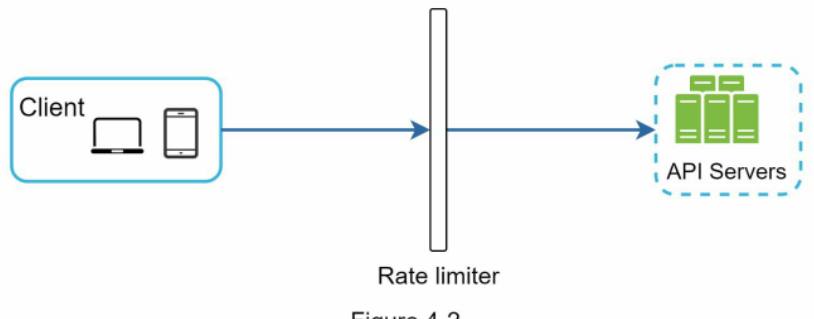

Hình 4-2

<!-- ⚠️ CẢNH BÁO chunk 1: số ảnh/heading/code-block KHÔNG khớp bản gốc (gốc={'images': 36, 'headings': 52, 'fences': 2}, dịch={'images': 36, 'headings': 51, 'fences': 2}). Xem lại đoạn này bằng tay. -->

Hãy lấy ví dụ trong Hình 4-3 để minh họa cách thức hoạt động của rate limiting (giới hạn tốc độ truy cập) trong thiết kế này. Giả sử API (giao diện lập trình ứng dụng) của chúng ta cho phép 2 request (yêu cầu) mỗi giây và một client (máy khách) gửi 3 request đến máy chủ trong vòng một giây. Hai request đầu tiên được định tuyến đến các API server (máy chủ API). Tuy nhiên, rate limiter middleware (phần mềm trung gian giới hạn tốc độ truy cập) sẽ throttle (điều tiết / chặn bớt) request thứ ba và trả về HTTP status code 429 (mã trạng thái HTTP 429). Mã trạng thái phản hồi HTTP 429 biểu thị rằng người dùng đã gửi quá nhiều request.

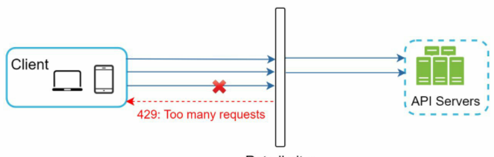

Hình 4-3

Rate limiter

Kiến trúc cloud microservices (vi dịch vụ đám mây) [4] đã trở nên vô cùng phổ biến và rate limiting thường được triển khai bên trong một thành phần gọi là API gateway (cổng API). API gateway là một dịch vụ được quản trị toàn diện (fully managed service) hỗ trợ rate limiting, SSL termination (chấm dứt kết nối SSL / giải mã SSL tại gateway), authentication (xác thực), IP whitelisting (thiết lập danh sách trắng địa chỉ IP), phục vụ static content (nội dung tĩnh), v.v. Tạm thời, chúng ta chỉ cần hiểu rằng API gateway là một middleware hỗ trợ rate limiting. Khi thiết kế một rate limiter, câu hỏi quan trọng cần tự đặt ra là: nên triển khai rate limiter ở đâu, ở phía server-side (phía máy chủ) hay trong gateway? Không có câu trả lời tuyệt đối. Điều này phụ thuộc vào technology stack (ngăn xếp công nghệ) hiện tại của công ty bạn, nguồn lực kỹ thuật, các mức độ ưu tiên, mục tiêu, v.v. Dưới đây là một vài chỉ dẫn chung:
 * Đánh giá technology stack hiện tại của bạn, chẳng hạn như ngôn ngữ lập trình, dịch vụ cache (bộ nhớ đệm), v.v. Hãy đảm bảo ngôn ngữ lập trình hiện tại đủ hiệu quả để triển khai rate limiting ở phía server-side.
 * Xác định thuật toán rate limiting phù hợp với nhu cầu nghiệp vụ của bạn. Khi tự triển khai toàn bộ ở phía server-side, bạn nắm toàn quyền kiểm soát thuật toán. Tuy nhiên, các lựa chọn có thể bị hạn chế nếu bạn dùng gateway của bên thứ ba.
 * Nếu bạn đã áp dụng kiến trúc microservice và đưa API gateway vào thiết kế để thực hiện authentication, IP whitelisting, v.v., bạn có thể tích hợp thêm rate limiter vào API gateway.
 * Tự xây dựng dịch vụ rate limiting riêng sẽ tốn thời gian. Nếu bạn không có đủ nguồn lực kỹ thuật để tự triển khai rate limiter, thì việc lựa chọn một commercial API gateway (API gateway thương mại) sẽ là một giải pháp tối ưu hơn.

## Algorithms for rate limiting (Các thuật toán rate limiting)

Rate limiting có thể được triển khai bằng nhiều thuật toán khác nhau, và mỗi thuật toán đều có những ưu, nhược điểm riêng biệt. Mặc dù chương này không đi sâu vào chi tiết thuật toán, nhưng việc hiểu chúng ở mức tổng quan (high-level) sẽ giúp ta chọn đúng thuật toán hoặc kết hợp các thuật toán sao cho phù hợp với từng use case (trường hợp sử dụng cụ thể). Dưới đây là danh sách các thuật toán phổ biến:

 * Token bucket
 * Leaking bucket
 * Fixed window counter
 * Sliding window log
 * Sliding window counter

### Token bucket algorithm (Thuật toán Token bucket)

Thuật toán token bucket (thùng thẻ bài) được sử dụng rất rộng rãi cho rate limiting. Thuật toán này đơn giản, dễ hiểu và được áp dụng phổ biến tại các công ty internet. Cả Amazon [5] lẫn Stripe [6] đều sử dụng thuật toán này để throttle các API request.

Thuật toán token bucket hoạt động như sau:

 * Một token bucket là một thùng chứa có dung lượng định trước (capacity). Các token được nạp vào bucket định kỳ theo các tốc độ đặt trước. Khi bucket đã đầy, sẽ không có thêm token nào được bổ sung. Như minh họa trong Hình 4-4, dung lượng của token bucket là 4. Bộ nạp (refiller) đưa 2 token vào bucket mỗi giây. Một khi bucket đầy, các token dư thừa sẽ bị tràn ra ngoài (overflow).
 * Mỗi request sẽ tiêu thụ một token. Khi một request đến, hệ thống sẽ kiểm tra xem trong bucket có đủ token hay không. Hình 4-5 giải thích quy trình hoạt động này.
 * Nếu có đủ token, chúng ta lấy ra một token cho mỗi request và request đó sẽ được xử lý bình thường (go through).
 * Nếu không có đủ token, request sẽ bị loại bỏ (dropped).
 * Bắt đầu với 4 token
 * Bắt đầu với 3 token
 * Request sẽ được xử lý
 * Cả ba request đều sẽ được xử lý
 * 1 token bị tiêu thụ
 * 3 token bị tiêu thụ


Hình 4-4

Hình 4-6 minh họa cách thức hoạt động của quá trình tiêu thụ token, nạp lại token (refill) và logic của rate limiting. Trong ví dụ này, kích thước của token bucket là 4 và tốc độ nạp lại là 4 token mỗi 1 phút.

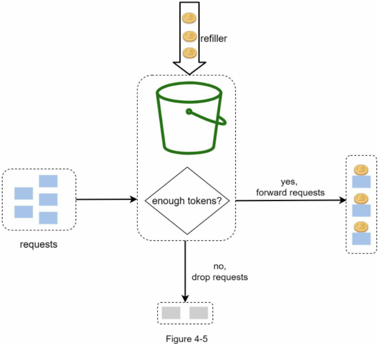

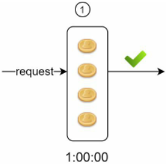

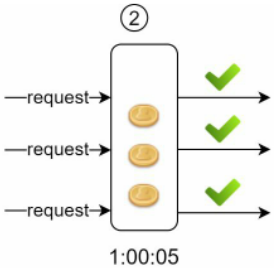

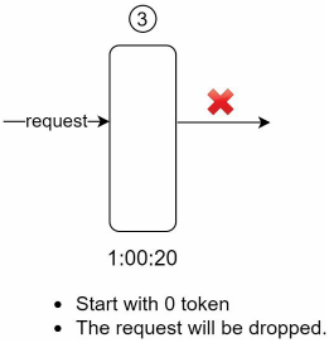


Hình 4-6

Thuật toán token bucket tiếp nhận hai tham số:
 * Bucket size (kích thước thùng): số lượng token tối đa được phép chứa trong bucket
 * Refill rate (tốc độ nạp): số lượng token được đưa vào bucket mỗi giây. Chúng ta cần bao nhiêu bucket? Điều này thay đổi linh hoạt tùy thuộc vào các quy tắc rate limiting. Dưới đây là một vài ví dụ:
 * Thường cần duy trì các bucket khác nhau cho từng API endpoint (điểm cuối API). Chẳng hạn, nếu một người dùng được phép đăng 1 bài viết mỗi giây, thêm 150 bạn bè mỗi ngày và like 5 bài viết mỗi giây, thì cần 3 bucket cho mỗi người dùng.
 * Nếu cần throttle request dựa trên địa chỉ IP, mỗi địa chỉ IP sẽ cần một bucket riêng.
 * Nếu hệ thống cho phép tối đa 10.000 request mỗi giây, việc sử dụng một global bucket (thùng dùng chung toàn cục) cho tất cả request là phương án hợp lý.

**Ưu điểm (Pros):**
 * Thuật toán dễ triển khai.
 * Tiết kiệm bộ nhớ (memory efficient).
 * Token bucket cho phép xử lý một đợt tăng vọt lưu lượng truy cập (burst of traffic) trong các khoảng thời gian ngắn. Một request có thể được thông qua miễn là trong bucket vẫn còn token.

**Nhược điểm (Cons):**

 * Hai tham số trong thuật toán là bucket size và tốc độ refill token. Tuy nhiên, việc cân chỉnh (tune) chúng một cách chuẩn xác có thể gặp nhiều khó khăn.

### Leaking bucket algorithm (Thuật toán Leaking bucket)

Thuật toán leaking bucket (thùng rò rỉ) tương tự như token bucket, ngoại trừ việc các request được xử lý với tốc độ cố định. Thuật toán này thường được triển khai bằng hàng đợi FIFO (first-in-first-out - vào trước ra trước). Cơ chế hoạt động như sau:

 * Khi một request đến, hệ thống kiểm tra xem queue (hàng đợi) đã đầy chưa. Nếu chưa đầy, request sẽ được thêm vào queue.
 * Ngược lại, request sẽ bị loại bỏ.
 * Các request được lấy ra khỏi queue và xử lý theo các khoảng thời gian đều đặn.

Hình 4-7 giải thích cách thức hoạt động của thuật toán.

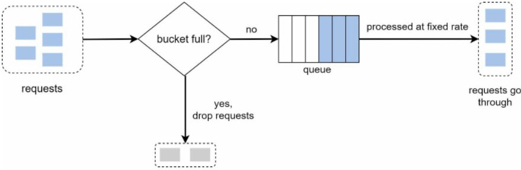

Hình 4-7

Thuật toán leaking bucket tiếp nhận hai tham số sau:

 * Bucket size: bằng với kích thước hàng đợi. Hàng đợi lưu giữ các request chờ được xử lý ở tốc độ cố định.
 * Outflow rate (tốc độ xử lý đầu ra): xác định số lượng request có thể được xử lý ở tốc độ cố định, thường tính theo đơn vị giây.

Shopify, một nền tảng thương mại điện tử, sử dụng leaky bucket cho rate limiting [7].

**Ưu điểm (Pros):**

 * Tiết kiệm bộ nhớ nhờ kích thước queue giới hạn.
 * Các request được xử lý ở tốc độ cố định, do đó thuật toán rất phù hợp cho các use case đòi hỏi tốc độ đầu ra (outflow rate) ổn định.

**Nhược điểm (Cons):**

 * Một đợt burst traffic có thể làm đầy queue bằng các request cũ; nếu chúng không được xử lý kịp thời, các request mới gửi đến sau sẽ bị rate limit.
 * Thuật toán có hai tham số, và việc điều chỉnh chúng một cách tối ưu có thể không hề đơn giản.

### Fixed window counter algorithm (Thuật toán Fixed window counter)

Thuật toán fixed window counter (bộ đếm cửa sổ cố định) hoạt động như sau:

 * Thuật toán chia dòng thời gian thành các time window (cửa sổ thời gian) có kích thước cố định và gán một counter (bộ đếm) cho mỗi window.
 * Mỗi request đến sẽ tăng counter lên một đơn vị.
 * Khi counter đạt đến ngưỡng (threshold) định trước, các request mới sẽ bị loại bỏ cho đến khi một time window mới bắt đầu.

Hãy xem một ví dụ cụ thể để hiểu cách thức hoạt động. Trong Hình 4-8, đơn vị thời gian là 1 giây và hệ thống cho phép tối đa 3 request mỗi giây. Trong mỗi window 1 giây, nếu nhận nhiều hơn 3 request, các request vượt mức sẽ bị loại bỏ như trong Hình 4-8.

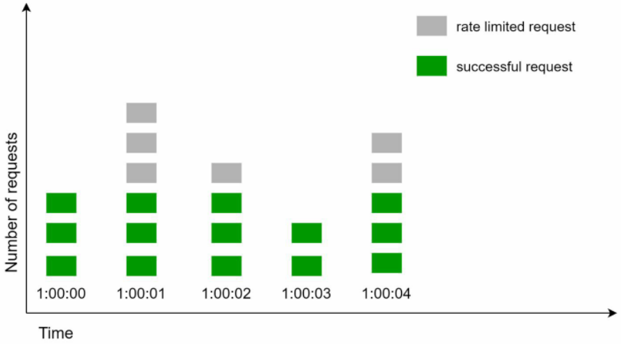

Hình 4-8

Một vấn đề lớn của thuật toán này là lưu lượng truy cập tăng vọt tại các ranh giới (edges) giữa các time window có thể khiến số lượng request vượt qua hạn ngạch (quota) cho phép. Hãy xem xét trường hợp sau:

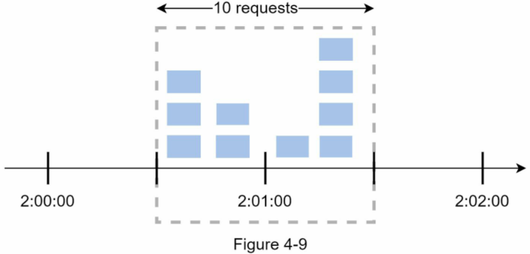

Trong Hình 4-9, hệ thống cho phép tối đa 5 request mỗi phút, và hạn ngạch khả dụng sẽ được đặt lại (reset) vào đầu mỗi phút chẵn theo đồng hồ. Như có thể thấy, có 5 request trong khoảng từ 2:00:00 đến 2:01:00 và thêm 5 request nữa trong khoảng từ 2:01:00 đến 2:02:00. Trong khoảng thời gian 1 phút nằm giữa 2:00:30 và 2:01:30, đã có tới 10 request được thông qua. Con số này cao gấp đôi so với lượng request được phép.

**Ưu điểm (Pros):**

 * Tiết kiệm bộ nhớ.
 * Dễ hiểu.
 * Việc đặt lại hạn ngạch khả dụng vào cuối mỗi đơn vị time window rất phù hợp với một số use case nhất định.

**Nhược điểm (Cons):**
 * Đột biến lưu lượng truy cập (spike in traffic) tại ranh giới của các window có thể khiến số lượng request vượt quá hạn ngạch cho phép.

### Sliding window log algorithm (Thuật toán Sliding window log)

Như đã phân tích trước đó, thuật toán fixed window counter gặp phải một lỗi nghiêm trọng: nó cho phép lượng request vượt quá hạn ngạch lọt qua tại các ranh giới của window. Thuật toán sliding window log (nhật ký cửa sổ trượt) giải quyết triệt để vấn đề này. Thuật toán hoạt động như sau:

 * Thuật toán theo dõi timestamp (dấu thời gian) của các request. Dữ liệu timestamp thường được lưu trong cache, chẳng hạn như cấu trúc sorted sets (tập hợp được sắp xếp) của Redis [8].
 * Khi một request mới đến, thuật toán xóa toàn bộ các timestamp đã lỗi thời (outdated). Timestamp lỗi thời được định nghĩa là những mốc thời gian diễn ra trước thời điểm bắt đầu của time window hiện tại.
 * Thêm timestamp của request mới vào log (nhật ký).
 * Nếu kích thước của log nhỏ hơn hoặc bằng số lượng cho phép, request sẽ được chấp nhận. Ngược lại, request sẽ bị từ chối.

Chúng ta sẽ giải thích thuật toán bằng ví dụ thể hiện trong Hình 4-10.

Cho phép 2 request mỗi phút (Allow 2 requests per minute)


Hình 4-10

Trong ví dụ này, rate limiter cho phép 2 request mỗi phút. Thông thường, các Linux timestamp (dấu thời gian Unix/Linux) sẽ được lưu trữ trong log. Tuy nhiên, định dạng thời gian trực quan cho con người được sử dụng trong ví dụ này nhằm giúp người đọc dễ theo dõi hơn.

 * Log đang trống khi một request mới đến vào lúc 1:00:01. Do đó, request được cho phép.
 * Một request mới đến vào lúc 1:00:30, timestamp 1:00:30 được chèn vào log. Sau khi chèn, kích thước log là 2, không vượt quá số lượng cho phép. Vì vậy, request được chấp nhận.
 * Một request mới đến vào lúc 1:00:50, và timestamp được chèn vào log. Sau khi chèn, kích thước log là 3, lớn hơn kích thước cho phép là 2. Do đó, request này bị từ chối mặc dù timestamp của nó vẫn được ghi lại trong log.
 * Một request mới đến vào lúc 1:01:40. Các request trong khoảng [1:00:40, 1:01:40) nằm trong khung thời gian gần nhất, nhưng các request gửi trước 1:00:40 đã bị lỗi thời. Hai timestamp lỗi thời, 1:00:01 và 1:00:30, được xóa khỏi log. Sau thao tác xóa, kích thước log trở thành 2; do đó, request được chấp nhận.

**Ưu điểm (Pros):**

 * Rate limiting triển khai bằng thuật toán này có độ chính xác rất cao. Trong bất kỳ rolling window (cửa sổ trượt / cuốn chiếu) nào, số lượng request cũng không vượt quá giới hạn tốc độ.

**Nhược điểm (Cons):**

 * Thuật toán tiêu tốn rất nhiều bộ nhớ vì ngay cả khi một request bị từ chối, timestamp của nó vẫn có thể được giữ lại trong bộ nhớ.

### Sliding window counter algorithm (Thuật toán Sliding window counter)

Thuật toán sliding window counter (bộ đếm cửa sổ trượt) là một phương pháp tiếp cận lai (hybrid) kết hợp giữa fixed window counter và sliding window log. Thuật toán có thể được triển khai theo hai phương pháp khác nhau. Chúng tôi sẽ giải thích một cách triển khai trong phần này và cung cấp tài liệu tham khảo cho cách triển khai còn lại ở cuối phần. Hình 4-11 minh họa cơ chế hoạt động của thuật toán này.

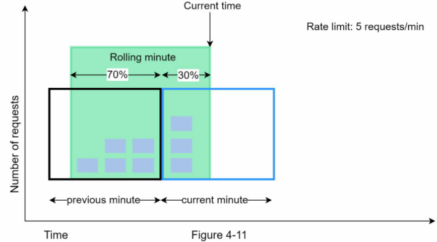

Giả sử rate limiter cho phép tối đa 7 request mỗi phút, và có 5 request trong phút trước đó cùng 3 request trong phút hiện tại. Đối với một request mới đến tại vị trí 30% của phút hiện tại, số lượng request trong rolling window được tính toán theo công thức sau:

 * Số request trong window hiện tại + số request trong window trước đó * phần trăm chồng lấn (overlap percentage) của rolling window với window trước đó

 * Áp dụng công thức này, ta có 3 + 5 * 70% = 6,5 request (nguyên văn: 3 + 5 * 0.7% = 6.5 request). Tùy thuộc vào use case, con số này có thể được làm tròn lên hoặc làm tròn xuống. Trong ví dụ này, nó được làm tròn xuống thành 6. Vì rate limiter cho phép tối đa 7 request mỗi phút, request hiện tại có thể được thông qua. Tuy nhiên, giới hạn sẽ chạm ngưỡng ngay sau khi nhận thêm một request nữa. Do giới hạn về độ dài, chúng tôi sẽ không thảo luận về cách triển khai còn lại ở đây. Bạn đọc quan tâm có thể tham khảo tài liệu [9]. Thuật toán này không hoàn hảo, nó có cả ưu và nhược điểm.

**Ưu điểm (Pros):**
 * Làm mượt các đợt tăng vọt lưu lượng (spikes in traffic) vì tốc độ dựa trên tốc độ trung bình của window trước đó.
 * Tiết kiệm bộ nhớ.

**Nhược điểm (Cons):**
 * Chỉ hoạt động hiệu quả với look back window (cửa sổ xem xét ngược) không quá khắt khe. Đây là một giá trị xấp xỉ của tốc độ thực tế vì nó giả định rằng các request trong window trước đó được phân bổ đồng đều. Tuy nhiên, vấn đề này có thể không nghiêm trọng như chúng ta tưởng. Theo các thử nghiệm do Cloudflare [10] thực hiện, chỉ có 0,003% request bị cho phép sai hoặc bị rate limit nhầm trong số 400 triệu request.

## High-level architecture (Kiến trúc mức cao)

Ý tưởng cơ bản của các thuật toán rate limiting rất đơn giản. Ở mức tổng quan (high-level), chúng ta cần một counter để theo dõi số lượng request được gửi từ cùng một người dùng, địa chỉ IP, v.v. Nếu counter lớn hơn giới hạn, request sẽ bị từ chối. Chúng ta nên lưu trữ các counter ở đâu? Sử dụng database (cơ sở dữ liệu) không phải là ý tưởng hay do tốc độ truy xuất đĩa cứng chậm chạp. In-memory cache (bộ nhớ đệm trong RAM) được lựa chọn vì nó có tốc độ cao và hỗ trợ cơ chế hết hạn theo thời gian (time-based expiration strategy). Chẳng hạn, Redis [11] là một lựa chọn phổ biến để triển khai rate limiting. Đây là một in-memory store cung cấp hai lệnh chính: INCR và EXPIRE.
 * INCR: Tăng giá trị counter được lưu trữ lên 1.
 * EXPIRE: Thiết lập thời gian timeout cho counter. Khi hết thời gian timeout, counter sẽ tự động bị xóa.

Hình 4-12 thể hiện kiến trúc tổng quan cho rate limiting, và quy trình hoạt động như sau:

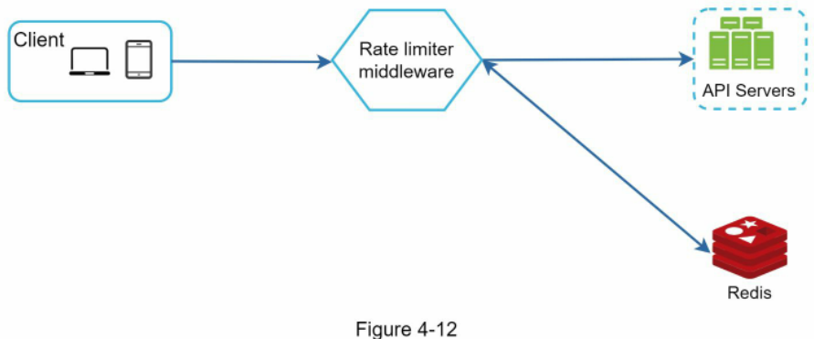

Hình 4-12

 * Client gửi request đến rate limiting middleware.
 * Rate limiting middleware lấy counter từ bucket tương ứng trong Redis và kiểm tra xem đã chạm giới hạn hay chưa.
 * Nếu đã đạt giới hạn, request sẽ bị từ chối.

 * Nếu chưa đạt giới hạn, request sẽ được gửi tiếp tới các API server. Đồng thời, hệ thống tăng counter lên 1 và lưu ngược lại vào Redis.

# Step 3 - Design deep dive (Bước 3 - Đi sâu vào thiết kế)

Thiết kế mức cao trong Hình 4-12 chưa giải đáp được các câu hỏi sau:
 * Các quy tắc rate limiting được tạo ra như thế nào? Chúng được lưu trữ ở đâu?
 * Xử lý các request bị rate limit như thế nào? Trong phần này, trước tiên chúng ta sẽ trả lời các câu hỏi liên quan đến quy tắc rate limiting, sau đó điểm qua các chiến lược xử lý request bị rate limit. Cuối cùng, chúng ta sẽ thảo luận về rate limiting trong môi trường phân tán (distributed environment), một thiết kế chi tiết, tối ưu hóa hiệu năng (performance optimization) và việc giám sát (monitoring).

## Rate limiting rules (Quy tắc rate limiting)

Lyft đã mở mã nguồn thành phần rate limiting của họ [12]. Chúng ta sẽ cùng xem xét bên trong thành phần này qua một vài ví dụ về quy tắc rate limiting:

```yaml
domain: messaging
descriptors:
  - key: message_type
    Value: marketing
    rate_limit:
      unit: day
      requests_per_unit: 5
```

Trong ví dụ trên, hệ thống được cấu hình để cho phép tối đa 5 tin nhắn marketing mỗi ngày. Dưới đây là một ví dụ khác:

```yaml
domain: auth
descriptors:
  - key: auth_type
    Value: login
    rate_limit:
      unit: minute
      requests_per_unit: 5
```

Quy tắc này chỉ ra rằng các client không được phép đăng nhập quá 5 lần trong 1 phút. Các quy tắc thường được viết trong các configuration file (tệp cấu hình) và lưu trữ trên đĩa cứng.

## Exceeding the rate limit (Vượt quá giới hạn tốc độ)

Trong trường hợp một request bị rate limit, các API sẽ trả về HTTP response code 429 (too many requests - quá nhiều yêu cầu) cho client. Tùy thuộc vào từng use case, chúng ta có thể đưa các request bị rate limit vào hàng đợi (enqueue) để xử lý sau. Ví dụ, nếu một số đơn hàng bị rate limit do hệ thống quá tải, chúng ta có thể giữ các đơn hàng đó lại để xử lý sau.

### Rate limiter headers (Tiêu đề của rate limiter)

Làm thế nào để một client biết được liệu nó có đang bị throttle hay không? Và làm sao để client biết được số lượng request còn lại được phép gửi trước khi bị throttle? Câu trả lời nằm ở các HTTP response header (tiêu đề phản hồi HTTP). Rate limiter trả về các HTTP header sau cho client:

```
X-Ratelimit-Remaining: Số lượng request còn lại được phép gửi trong window.
X-Ratelimit-Limit: Cho biết số lượng lệnh gọi (calls) mà client có thể thực hiện trên mỗi time window.
X-Ratelimit-Retry-After: Số giây cần chờ cho đến khi bạn có thể gửi lại request mà không bị throttle.
```

Khi người dùng gửi quá nhiều request, lỗi 429 too many requests kèm theo header X-Ratelimit-Retry-After sẽ được trả về cho client.

## Detailed design (Thiết kế chi tiết)

Hình 4-13 trình bày thiết kế chi tiết của hệ thống.

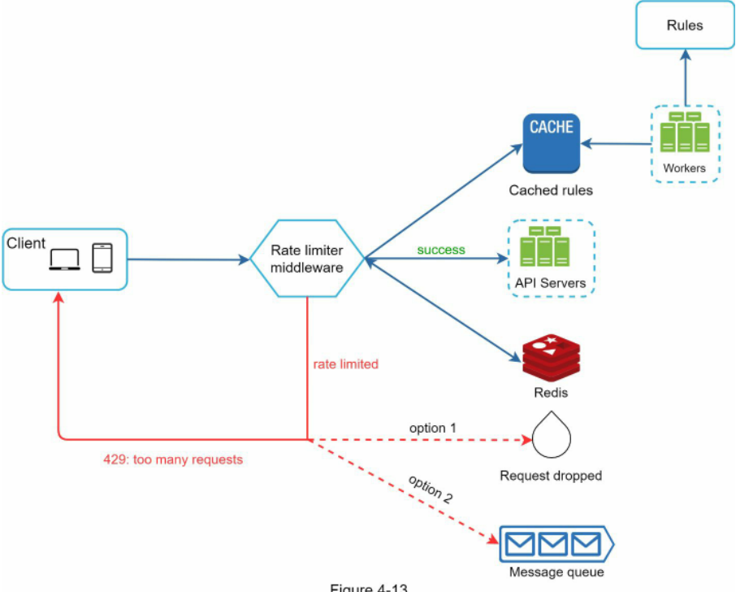

Hình 4-13

 * Các quy tắc được lưu trữ trên đĩa. Các worker (tiến trình nền) thường xuyên kéo các quy tắc từ đĩa và lưu chúng vào cache.
 * Khi client gửi một request đến máy chủ, request đó sẽ được gửi tới rate limiter middleware trước tiên.
 * Rate limiter middleware nạp các quy tắc từ cache. Nó lấy các counter và timestamp của request gần nhất từ Redis cache. Dựa trên phản hồi, rate limiter quyết định:
 * nếu request không bị rate limit, nó sẽ được chuyển tiếp tới các API server.
 * nếu request bị rate limit, rate limiter sẽ trả về lỗi 429 too many requests cho client. Đồng thời, request đó sẽ bị loại bỏ hoặc được chuyển tiếp vào queue.

## Rate limiter in a distributed environment (Rate limiter trong môi trường phân tán)

Xây dựng một rate limiter hoạt động trong môi trường một máy chủ đơn lẻ (single server) không phải là điều phức tạp. Tuy nhiên, việc mở rộng hệ thống (scaling) để hỗ trợ nhiều máy chủ và các luồng đồng thời (concurrent threads) lại là một câu chuyện hoàn toàn khác.

Có hai thách thức lớn:
 * Tình trạng tương tranh (Race condition)
 * Vấn đề đồng bộ hóa (Synchronization issue)

### Race condition (Tình trạng tương tranh)

Như đã đề cập trước đó, ở mức tổng quan (high-level), một rate limiter (bộ giới hạn tốc độ truy cập) sẽ vận hành theo các bước cơ bản:
 * Đọc giá trị của counter (bộ đếm) hiện tại từ Redis.
 * Kiểm tra xem giá trị `counter + 1` có vượt qua ngưỡng quy định hay không.
 * Nếu chưa vượt ngưỡng, tăng giá trị counter thêm 1 và ghi lại vào Redis.

Tình trạng race condition (tương tranh dữ liệu giữa các luồng xử lý đồng thời) hoàn toàn có thể xảy ra trong môi trường có lưu lượng đồng thời cao, như minh họa tại Hình 4-14.

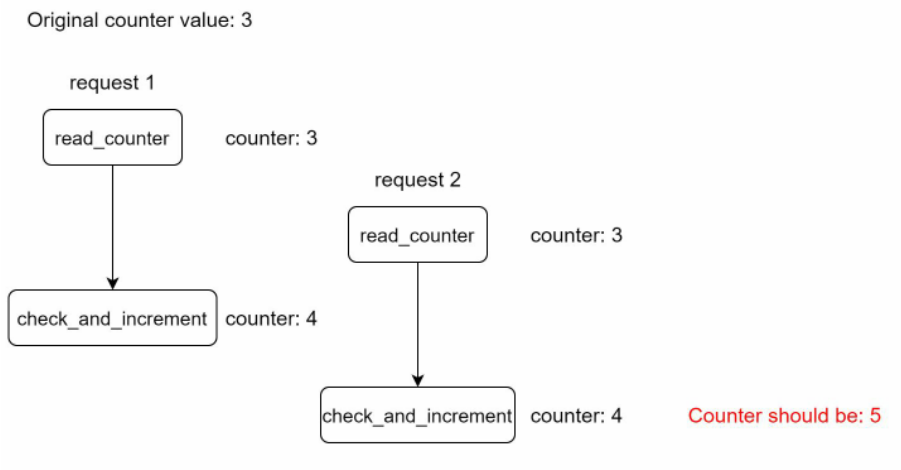

Hình 4-14

Giả sử giá trị counter hiện tại trong Redis là 3. Nếu hai request đồng thời đọc giá trị counter trước khi một trong hai kịp ghi đè giá trị mới, mỗi bên sẽ tự tăng giá trị lên thêm 1 rồi ghi lại vào Redis mà không hề hay biết về tiến trình còn lại. Cả hai request (hoặc thread - luồng xử lý) đều nhận định rằng giá trị counter của mình là 4, trong khi giá trị đúng thực tế phải là 5. Sử dụng lock (khóa đồng bộ) là giải pháp hiển nhiên nhất để xử lý race condition; tuy nhiên, lock sẽ làm suy giảm nghiêm trọng hiệu năng của hệ thống. Thay vào đó, hai chiến lược phổ biến thường được áp dụng là: dùng Lua script (kịch bản viết bằng ngôn ngữ Lua) [13] hoặc tận dụng cấu trúc dữ liệu sorted sets (tập hợp có thứ tự) của Redis [8]. Bạn đọc quan tâm đến các kỹ thuật này có thể tham khảo thêm tài liệu tương ứng [8] [13].

### Synchronization issue (Vấn đề đồng bộ hóa)

Đồng bộ hóa (synchronization) là một yếu tố trọng yếu khác cần cân nhắc trong môi trường phân tán (distributed environment). Nhằm phục vụ hàng triệu người dùng, một máy chủ rate limiter đơn lẻ khó có thể đáp ứng nổi toàn bộ lưu lượng. Khi triển khai cụm nhiều máy chủ rate limiter, việc đồng bộ dữ liệu giữa chúng là bắt buộc. Lấy ví dụ ở nửa bên trái của Hình 4-15, client 1 gửi request đến rate limiter 1, còn client 2 gửi request đến rate limiter 2. Do tầng web hoạt động theo cơ chế stateless (phi trạng thái - không lưu phiên làm việc cục bộ), client hoàn toàn có thể chuyển hướng gửi request tiếp theo sang một máy chủ rate limiter khác như minh họa ở nửa bên phải Hình 4-15. Nếu không có cơ chế đồng bộ, rate limiter 1 sẽ không nắm được bất kỳ dữ liệu nào về client 2, dẫn đến việc kiểm soát tốc độ bị sai lệch.

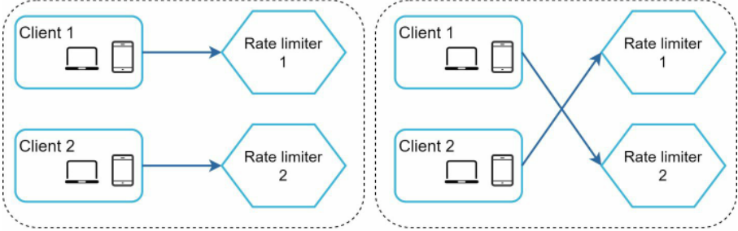

Hình 4-15

Một hướng giải quyết là áp dụng sticky sessions (phiên làm việc cố định - ràng buộc client luôn kết nối tới duy nhất một máy chủ cụ thể). Tuy nhiên, phương án này không được khuyến khích vì thiếu tính linh hoạt và rất khó mở rộng quy mô (scale). Hướng tiếp cận tối ưu hơn là dùng một centralized data store (kho lưu trữ dữ liệu tập trung) như Redis. Kiến trúc này được mô tả chi tiết trong Hình 4-16.

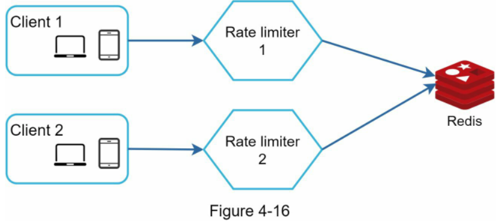

## Performance optimization (Tối ưu hóa hiệu năng)

Tối ưu hóa hiệu năng là chủ đề rất quen thuộc trong các buổi phỏng vấn thiết kế hệ thống (system design). Chúng ta sẽ xem xét hai khía cạnh chính để cải thiện. Thứ nhất, thiết lập cụm máy chủ trên nhiều trung tâm dữ liệu (multi-data center) là yếu tố sống còn đối với rate limiter, bởi người dùng ở khoảng cách địa lý xa trung tâm dữ liệu sẽ phải chịu latency (độ trễ mạng) rất lớn. Hầu hết các nhà cung cấp dịch vụ đám mây đều triển khai mạng lưới edge server (máy chủ biên đặt gần người dùng) trên toàn cầu. Đơn cử, tính đến ngày 20/05/2020, Cloudflare đã sở hữu 194 cụm edge server phân bố khắp thế giới [14]. Lưu lượng truy cập sẽ tự động được điều hướng đến edge server gần nhất nhằm giảm thiểu tối đa độ trễ.


Hình 4-17 (nguồn: [10])

Thứ hai, thực hiện đồng bộ hóa dữ liệu thông qua mô hình eventual consistency (nhất quán cuối cùng - đảm bảo sau một khoảng thời gian nhất định, mọi bản sao dữ liệu sẽ đồng nhất). Nếu bạn chưa rõ về mô hình này, vui lòng xem mục "Tính nhất quán" (Consistency) trong "Chương 6: Thiết kế kho lưu trữ Key-Value."

## Monitoring (Giám sát)

Khi rate limiter đã đi vào vận hành, việc thu thập dữ liệu phân tích (analytics) để đánh giá tính hiệu quả là vô cùng cần thiết. Trọng tâm cốt lõi là kiểm chứng:
 * Thuật toán rate limiting có đang hoạt động hiệu quả hay không.
 * Các quy tắc (rules) giới hạn tốc độ có thực sự tối ưu hay không.

Chẳng hạn, nếu quy tắc rate limiting thiết lập quá khắt khe, nhiều request hợp lệ sẽ bị chặn nhầm; khi đó ta cần nới lỏng các giới hạn. Mặt khác, nếu nhận thấy rate limiter bị quá tải hoặc hoạt động kém trước các đợt tăng vọt lưu lượng đột ngột (như sự kiện flash sale), hệ thống có thể cân nhắc chuyển đổi sang thuật toán hỗ trợ tốt lưu lượng đột biến (burst traffic) — trong đó token bucket là một lựa chọn lý tưởng.

# Step 4 - Wrap up (Bước 4 - Tổng kết)

Trong chương này, chúng ta đã nghiên cứu các thuật toán rate limiting khác nhau kèm ưu, nhược điểm của từng loại. Các thuật toán bao gồm:
 * Token bucket
 * Leaking bucket
 * Fixed window
 * Sliding window log
 * Sliding window counter Tiếp đó, chúng ta đã đi sâu vào kiến trúc tổng thể của hệ thống, bài toán rate limiter trong môi trường phân tán, các giải pháp tối ưu hóa hiệu năng cũng như công tác giám sát. Tương tự như bất kỳ câu hỏi phỏng vấn thiết kế hệ thống nào, bạn có thể chủ động mở rộng thêm các khía cạnh chuyên sâu nếu còn thời gian:
 * Hard rate limiting (giới hạn cứng - chặn tuyệt đối mọi request vượt ngưỡng) so với Soft rate limiting (giới hạn mềm - cho phép vượt ngưỡng tạm thời trong một khoảng ngắn).
 * Giới hạn tốc độ ở các tầng khác nhau trong mô hình mạng: Chương này tập trung vào tầng ứng dụng (Application layer - HTTP tầng 7). Tuy nhiên, bạn hoàn toàn có thể áp dụng rate limiting ở các tầng thấp hơn, ví dụ như lọc theo địa chỉ IP thông qua Iptables [15] (tầng mạng IP - tầng 3). Lưu ý: Mô hình kết nối các hệ thống mở OSI (Open Systems Interconnection model) gồm 7 tầng [16]: Tầng 1: Vật lý (Physical layer), Tầng 2: Liên kết dữ liệu (Data link layer), Tầng 3: Mạng (Network layer), Tầng 4: Giao vận (Transport layer), Tầng 5: Phiên (Session layer), Tầng 6: Trình diễn (Presentation layer), Tầng 7: Ứng dụng (Application layer).
 * Các best practice (thực tiễn tối ưu) phía client để hạn chế bị rate limit:
 * Triển khai bộ nhớ đệm (client cache) để tránh gọi API với tần suất quá dày.
 * Nắm rõ hạn mức của hệ thống và tránh dồn quá nhiều request trong thời gian ngắn.
 * Xây dựng cơ chế bắt ngoại lệ (catch exceptions/errors) để ứng dụng phục hồi mượt mà khi gặp lỗi.
 * Thiết lập khoảng thời gian chờ tăng dần (exponential backoff) trong logic gửi lại yêu cầu (retry).

Chúc mừng bạn đã hoàn thành trọn vẹn chương này! Hãy tự dành cho mình một lời khen ngợi. Bạn đã làm rất tốt!

# Reference materials (Tài liệu tham khảo)

[1] Rate-limiting strategies and techniques: https://cloud.google.com/solutions/rate-limitingstrategies-techniques [2] Twitter rate limits: https://developer.twitter.com/en/docs/basics/rate-limits [3] Google docs usage limits: https://developers.google.com/docs/api/limits [4] IBM microservices: https://www.ibm.com/cloud/learn/microservices [5] Throttle API requests for better throughput: https://docs.aws.amazon.com/apigateway/latest/developerguide/api-gateway-requestthrottling.html [6] Stripe rate limiters: https://stripe.com/blog/rate-limiters [7] Shopify REST Admin API rate limits: https://help.shopify.com/en/api/reference/restadmin-api-rate-limits [8] Better Rate Limiting With Redis Sorted Sets: https://engineering.classdojo.com/blog/2015/02/06/rolling-rate-limiter/ [9] System Design - Rate limiter and Data modelling: https://medium.com/@saisandeepmopuri/system-design-rate-limiter-and-data-modelling9304b0d18250 [10] How we built rate limiting capable of scaling to millions of domains: https://blog.cloudflare.com/counting-things-a-lot-of-different-things/ [11] Redis website: https://redis.io/ [12] Lyft rate limiting: https://github.com/lyft/ratelimit [13] Scaling your API with rate limiters: https://gist.github.com/ptarjan/e38f45f2dfe601419ca3af937fff574d#request-rate-limiter [14] What is edge computing: https://www.cloudflare.com/learning/serverless/glossary/whatis-edge-computing/ [15] Rate Limit Requests with Iptables: https://blog.programster.org/rate-limit-requests-withiptables [16] OSI model: https://en.wikipedia.org/wiki/OSI\_model#Layer\_architecture

# CHAPTER 5: DESIGN CONSISTENT HASHING (CHƯƠNG 5: THIẾT KẾ BĂM NHẤT QUÁN)

Để đạt được khả năng mở rộng theo chiều ngang (horizontal scaling), việc phân phối các request/dữ liệu một cách hiệu quả và đồng đều trên các máy chủ là điều tối quan trọng. Consistent hashing (băm nhất quán) là một giải thuật kinh điển được ứng dụng rộng rãi nhằm đạt được mục tiêu này. Trước hết, hãy cùng xem xét kỹ lưỡng nguồn gốc của vấn đề.

# The rehashing problem (Vấn đề băm lại)

Nếu sở hữu n máy chủ bộ nhớ đệm (cache server), cách cân bằng tải phổ biến là sử dụng hàm băm lấy modulo như sau:

```
serverIndex = hash(key) % N
```

trong đó N là tổng số lượng máy chủ trong nhóm (server pool). Hãy quan sát ví dụ dưới đây để nắm được cơ chế. Bảng 5-1 mô tả 4 máy chủ cùng 8 chuỗi key và giá trị hash tương ứng của chúng.

| key  | hash     | hash % 4 |
| ---- | -------- | -------- |
| key0 | 18358617 | 1        |
| key1 | 26143584 | 0        |
| key2 | 18131146 | 2        |
| key3 | 35863496 | 0        |
| key4 | 34085809 | 1        |
| key5 | 27581703 | 3        |
| key6 | 38164978 | 2        |
| key7 | 22530351 | 3        |

Bảng 5-1

Để xác định máy chủ đang lưu trữ key, chúng ta thực hiện phép toán modulo `f(key) % 4`. Chẳng hạn, `hash(key0) % 4 = 1` đồng nghĩa với việc client phải kết nối đến máy chủ 1 (server 1) để lấy dữ liệu cache. Hình 5-1 minh họa sự phân bổ của các key dựa trên Bảng 5-1.

serverIndex hash % 4


Hình 5-1

Phương pháp này vận hành rất tốt khi số lượng máy chủ cố định và dữ liệu được phân bố đồng đều. Tuy nhiên, rắc rối sẽ nảy sinh khi bổ sung thêm máy chủ mới hoặc khi có máy chủ hiện có bị gỡ bỏ/gặp sự cố. Giả sử máy chủ 1 bị mất kết nối (offline), quy mô của cụm máy chủ giảm xuống còn 3. Khi áp dụng cùng một hàm hash, giá trị băm của key không đổi, nhưng kết quả phép toán modulo sẽ hoàn toàn lệch do mẫu số N đã giảm đi 1 đơn vị. Kết quả tính toán với `hash % 3` được thể hiện trong Bảng 5-2:

Bảng 5-2 (Table 5-2)

| key  | Hash     | hash % 3 |
| ---- | -------- | -------- |
| key0 | 18358617 | 0        |
| key1 | 26143584 | 0        |
| key2 | 18131146 | 1        |
| key3 | 35863496 | 2        |
| key4 | 34085809 | 1        |
| key5 | 27581703 | 0        |
| key6 | 38164978 | 1        |
| key7 | 22530351 | 0        |

Hình 5-2 minh họa sự tái phân bổ của các key dựa theo Bảng 5-2.

serverIndex hash 1% = 3

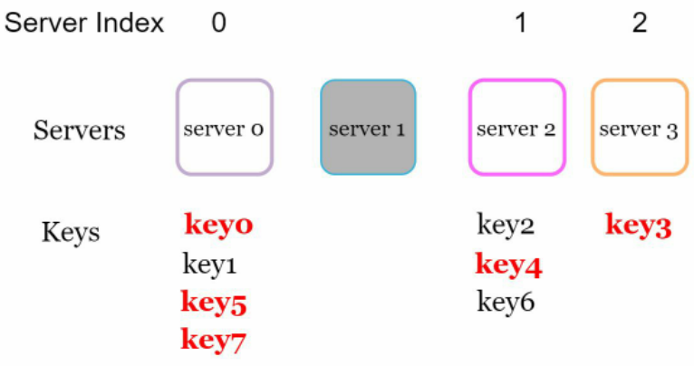

Hình 5-2

Như có thể thấy ở Hình 5-2, phần lớn các key đều bị phân bổ lại vị trí, chứ không riêng gì các key ban đầu thuộc về máy chủ bị hỏng (server 1). Điều này dẫn đến hậu quả: khi server 1 ngừng hoạt động, hầu hết các cache client sẽ truy xuất nhầm máy chủ, gây ra tình trạng storm of cache misses (cơn bão trượt bộ nhớ đệm). Consistent hashing chính là giải pháp hữu hiệu để khắc phục triệt để vấn đề này.

> 💡 **Giải thích thêm:** "Storm of cache misses" (thường gọi là cache stampede) là hiện tượng khi một lượng lớn request đồng thời không tìm thấy dữ liệu trong cache (do cache bị lỗi hoặc key bị chuyển hướng sai server), dẫn đến việc toàn bộ các request này đổ dồn về cơ sở dữ liệu gốc phía sau, có thể làm sập hệ thống cơ sở dữ liệu.
> Nguồn tham khảo: https://en.wikipedia.org/wiki/Cache_stampede

# Consistent hashing (Băm nhất quán)

Trích dẫn từ Wikipedia: "Băm nhất quán (consistent hashing) là một dạng thuật toán băm đặc thù, trong đó khi bảng băm thay đổi kích thước, trung bình chỉ có $k/n$ key cần phải ánh xạ lại vị trí, với $k$ là số lượng key và $n$ là số lượng vị trí (slot). Ngược lại, ở hầu hết các bảng băm truyền thống, việc thay đổi số lượng vị trí trong mảng sẽ khiến gần như toàn bộ các key đều bị ánh xạ lại [1]".

# Hash space and hash ring (Không gian băm và vòng băm)

Sau khi đã nắm vững định nghĩa, hãy cùng tìm hiểu nguyên lý hoạt động của thuật toán. Giả sử hàm băm SHA-1 được sử dụng làm hàm băm $f$, với miền giá trị đầu ra lần lượt là: $x_0, x_1, x_2, x_3, \dots, x_n$. Trong mật mã học, không gian băm của SHA-1 trải dài từ $0$ đến $2^{160} - 1$. Điều đó có nghĩa là $x_0$ tương ứng với $0$, $x_n$ tương ứng với $2^{160} - 1$, và toàn bộ các giá trị băm còn lại sẽ nằm xen giữa dải giá trị này. Hình 5-3 mô tả không gian băm nói trên.


Hình 5-3

Bằng cách uốn cong và nối liền hai đầu mút lại với nhau, chúng ta thu được một hash ring (vòng băm) như trong Hình 5-4:

xn XO

Hình 5-4

# Hash servers (Băm máy chủ lên vòng)

Sử dụng cùng một hàm băm $f$, chúng ta ánh xạ các máy chủ lên vòng băm dựa theo địa chỉ IP hoặc hostname (tên máy chủ). Hình 5-5 minh họa 4 máy chủ đã được định vị trên vòng băm.

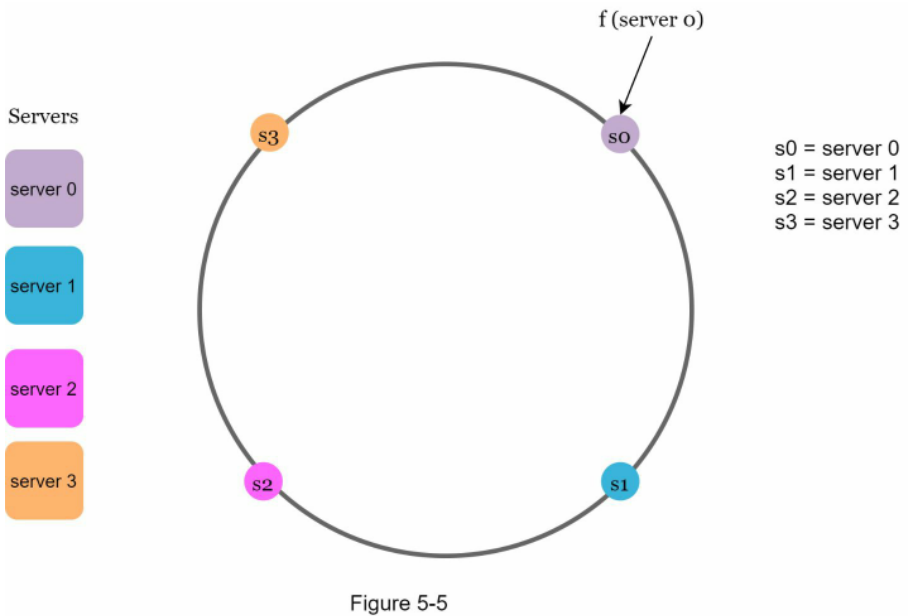

# Hash keys (Băm các khóa)

Điểm quan trọng cần lưu ý là hàm băm sử dụng ở đây hoàn toàn khác với hàm băm dùng trong "Vấn đề băm lại" và tuyệt đối không dùng phép toán modulo. Như biểu diễn trong Hình 5-6, 4 khóa bộ nhớ đệm (key0, key1, key2 và key3) được băm trực tiếp lên vòng băm.

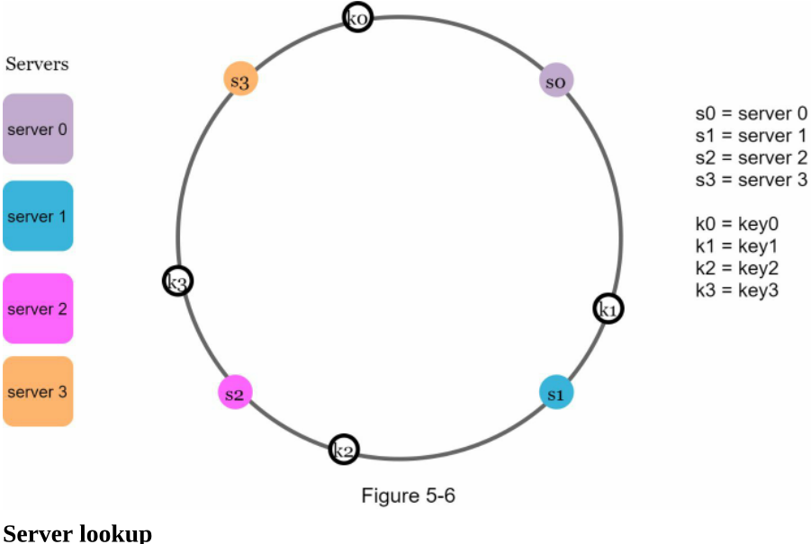

# Server lookup

Để xác định máy chủ nào lưu giữ một key nhất định, ta duyệt theo chiều kim đồng hồ bắt đầu từ vị trí của key đó trên vòng cho đến khi gặp máy chủ đầu tiên. Hình 5-7 diễn giải quy trình này: Đi theo chiều kim đồng hồ, key0 thuộc về server 0; key1 thuộc về server 1; key2 thuộc về server 2 và key3 thuộc về server 3.


# Add a server (Thêm máy chủ)

Áp dụng quy tắc nêu trên, việc bổ sung thêm một máy chủ mới sẽ chỉ đòi hỏi tái phân bổ lại một lượng nhỏ các key. Trong Hình 5-8, sau khi thêm server 4, chỉ duy nhất key0 cần được chuyển giao vị trí; các key k1, k2 và k3 vẫn nằm nguyên vẹn trên các máy chủ cũ. Hãy phân tích chi tiết logic: Trước khi có server 4, key0 được lưu trữ ở server 0. Sau khi thêm server 4, key0 sẽ chuyển sang server 4 vì khi di chuyển theo chiều kim đồng hồ từ vị trí của key0, server 4 là máy chủ đầu tiên xuất hiện. Toàn bộ các key còn lại không bị phân bổ lại vị trí.

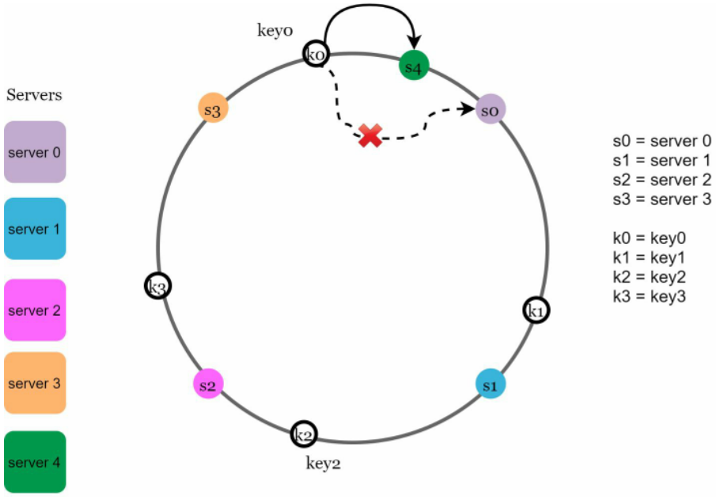

Hình 5-8

# Remove a server (Gỡ bỏ máy chủ)

Tương tự, khi một máy chủ bị gỡ bỏ, chỉ một tỷ lệ nhỏ key cần phải tái phân bổ. Ở Hình 5-9, khi server 1 bị loại bỏ, chỉ có key1 cần phải chuyển sang server 2. Toàn bộ các key còn lại không hề bị ảnh hưởng.

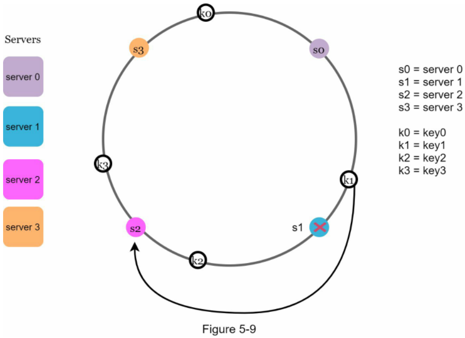

# Two issues in the basic approach (Hai vấn đề tồn tại trong phương pháp cơ bản)

Thuật toán consistent hashing nguyên bản được đề xuất bởi Karger cùng các cộng sự tại MIT [1]. Các bước cơ bản gồm:
 * Ánh xạ máy chủ và các key lên vòng băm bằng một hàm băm phân phối đều.
 * Để tìm máy chủ lưu trữ key, duyệt theo chiều kim đồng hồ từ vị trí của key cho đến khi gặp máy chủ đầu tiên trên vòng băm.

Hai nhược điểm lớn được chỉ ra đối với phương pháp này. Thứ nhất, rất khó duy trì kích thước các partition (phân vùng - khoảng không gian băm giữa hai máy chủ liền kề) đồng đều nhau khi các máy chủ liên tục được thêm vào hoặc loại bỏ. Kích thước phân vùng giao cho mỗi máy chủ có thể trở nên cực kỳ nhỏ hoặc quá lớn. Ở Hình 5-10, nếu s1 bị gỡ bỏ, phân vùng của s2 (khoanh vùng bằng mũi tên hai chiều) sẽ có kích thước gấp đôi phân vùng của s0 và s3.

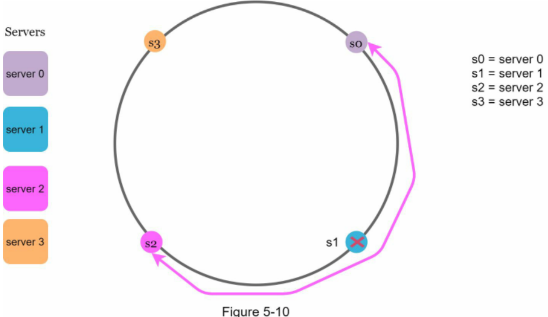

Thứ hai, việc phân bố key trên vòng băm có thể bị mất cân bằng nghiêm trọng (non-uniform key distribution). Chẳng hạn, nếu các máy chủ được ánh xạ vào các vị trí như trong Hình 5-11, hầu hết dữ liệu key sẽ dồn hết về server 2, trong khi server 1 và server 3 hầu như không chứa dữ liệu.

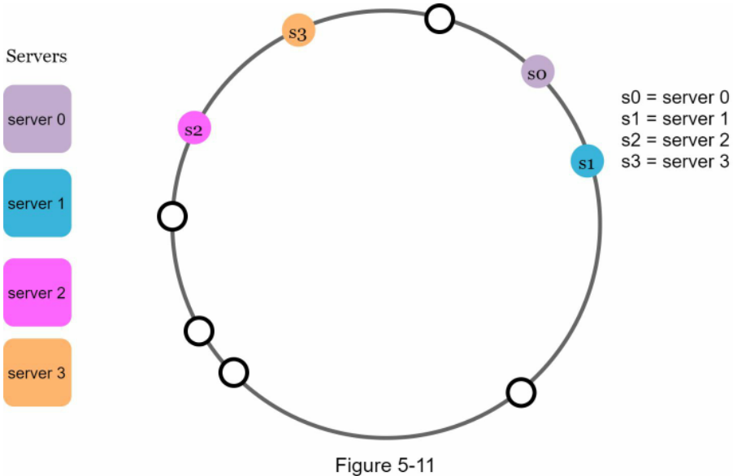

Kỹ thuật sử dụng virtual nodes (nút ảo) hay replicas (bản sao đại diện) được đưa ra để khắc phục triệt để các hạn chế này.

# Virtual nodes (Nút ảo)

Một nút ảo (virtual node) đại diện cho một nút thực tế, và mỗi máy chủ vật lý sẽ được biểu diễn bởi nhiều nút ảo rải rác trên vòng băm. Trong Hình 5-12, cả server 0 và server 1 đều sở hữu 3 nút ảo. Con số 3 ở đây chỉ mang tính chất minh họa; trong các hệ thống thực tế, số lượng nút ảo lớn hơn rất nhiều. Thay vì chỉ dùng nhãn s0 duy nhất, ta dùng s0_0, s0_1 và s0_2 để đại diện cho server 0 trên vòng băm. Tương tự, s1_0, s1_1 và s1_2 đại diện cho server 1. Nhờ các nút ảo, mỗi máy chủ thực tế sẽ phụ trách quản lý nhiều phân vùng khác nhau. Các phân vùng có nhãn s0 do server 0 quản lý, trong khi các phân vùng có nhãn s1 do server 1 quản lý.

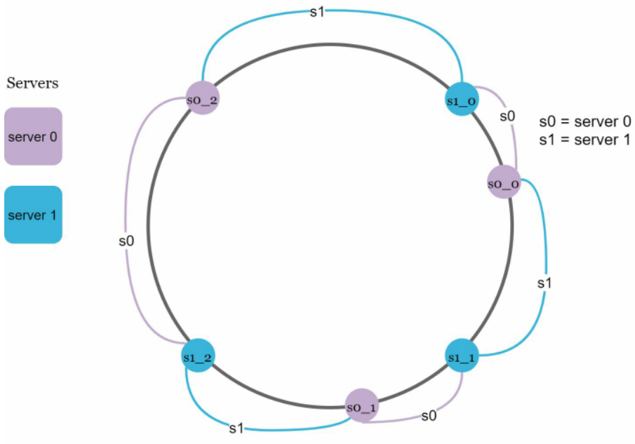

Hình 5-12

Để tìm máy chủ lưu trữ cho một key, chúng ta duyệt theo chiều kim đồng hồ từ vị trí của key và chọn nút ảo đầu tiên bắt gặp trên vòng băm. Trong Hình 5-13, để xác định nơi lưu k0, ta duyệt theo chiều kim đồng hồ từ vị trí của k0 và gặp nút ảo s1_1, vốn là đại diện của server 1.


Khi gia tăng số lượng nút ảo, sự phân bổ dữ liệu giữa các key sẽ ngày càng trở nên đồng đều và cân bằng hơn. Điều này bắt nguồn từ việc độ lệch chuẩn (standard deviation - thước đo mức độ phân tán của dữ liệu) sẽ thu hẹp lại khi có nhiều nút ảo hơn. Kết quả từ một nghiên cứu thực nghiệm trực tuyến [2] chứng minh rằng: với 100 đến 200 nút ảo, độ lệch chuẩn chỉ còn dao động trong khoảng từ 5% (với 200 nút ảo) đến 10% (với 100 nút ảo) so với giá trị trung bình (mean). Độ lệch chuẩn sẽ tiếp tục giảm nếu ta tiếp tục tăng số lượng nút ảo. Tuy nhiên, cái giá phải trả (trade-off) là hệ thống sẽ tốn thêm dung lượng bộ nhớ để lưu trữ thông tin metadata của các nút ảo này. Chúng ta có thể cân chỉnh số lượng nút ảo sao cho phù hợp với yêu cầu thực tế của từng hệ thống.

## Find affected keys (Xác định các khóa bị ảnh hưởng)

Mỗi khi một máy chủ được thêm vào hoặc loại bỏ, một phần dữ liệu cần được phân bổ lại. Làm thế nào để xác định chính xác phạm vi bị ảnh hưởng để di dời các key? Trong Hình 5-14, server 4 được bổ sung vào vòng băm. Phạm vi chịu ảnh hưởng sẽ bắt đầu từ s4 (nút mới thêm) và di chuyển ngược chiều kim đồng hồ dọc theo vòng băm cho đến khi chạm vào máy chủ đầu tiên (s3). Theo đó, toàn bộ các key nằm trong đoạn giữa s3 và s4 sẽ cần được chuyển sang cho s4 quản lý.

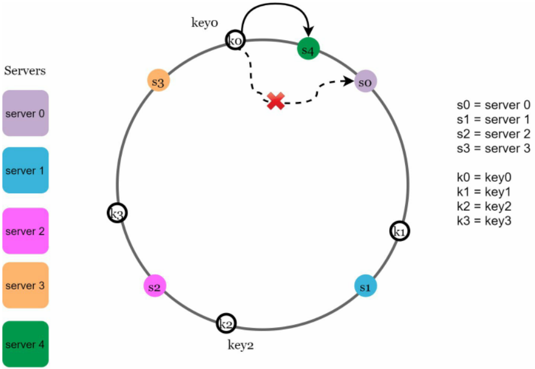

Hình 5-14

Khi một máy chủ (s1) bị gỡ bỏ như trong Hình 5-15, phạm vi ảnh hưởng sẽ tính từ s1 (nút bị loại bỏ) và duyệt ngược chiều kim đồng hồ cho đến khi gặp máy chủ tiếp theo (s0). Do đó, các key nằm giữa s0 và s1 bắt buộc phải được chuyển giao sang cho s2.


# Wrap up (Tổng kết)

Trong chương này, chúng ta đã thảo luận chuyên sâu về thuật toán consistent hashing, lý do vì sao cần sử dụng và cách thức hoạt động của nó. Những lợi ích cốt lõi của consistent hashing bao gồm:
 * Giảm thiểu tối đa số lượng key phải di dời khi máy chủ được thêm mới hoặc gỡ bỏ.
 * Dễ dàng mở rộng hệ thống theo chiều ngang nhờ dữ liệu được phân bố đồng đều.
 * Giảm thiểu vấn đề hotspot key (khóa điểm nóng chịu lượng tải quá lớn). Lượng truy cập đột biến đổ vào một shard (phân mảnh dữ liệu) nhất định có thể gây quá tải máy chủ. Hãy tưởng tượng nếu dữ liệu của những người nổi tiếng như Katy Perry, Justin Bieber và Lady Gaga đều cùng rơi vào một shard. Consistent hashing sẽ hạn chế tình trạng này nhờ cơ chế phân tán dữ liệu đồng đều hơn. Consistent hashing được ứng dụng rộng rãi trong các hệ thống quy mô lớn thực tế, tiêu biểu gồm:
 * Thành phần phân vùng dữ liệu của cơ sở dữ liệu Dynamo từ Amazon [3]
 * Cơ chế phân vùng dữ liệu trên toàn cụm trong Apache Cassandra [4]
 * Ứng dụng chat của Discord [5]
 * Mạng phân phối nội dung Akamai CDN [6]
 * Bộ cân bằng tải mạng Maglev [7]

> 💡 **Giải thích thêm:** "Hotspot key" xảy ra khi một khóa nhận được lưu lượng đọc/ghi vượt trội so với các khóa khác (ví dụ tài khoản mạng xã hội của người nổi tiếng). Khi tất cả request truy cập vào cùng một shard/máy chủ chứa khóa đó, máy chủ này sẽ bị quá tải trong khi các máy chủ khác vẫn rỗi.
> Nguồn tham khảo: https://aws.amazon.com/blogs/database/choosing-the-right-dynamodb-partition-key/

Chúc mừng bạn đã hoàn thành nội dung này! Bạn đã làm rất tốt!

# Reference materials (Tài liệu tham khảo)

[1] Consistent hashing: https://en.wikipedia.org/wiki/Consistent\_hashing [2] Consistent Hashing: https://tom-e-white.com/2007/11/consistent-hashing.html [3] Dynamo: Amazon's Highly Available Key-value Store: https://www.allthingsdistributed.com/files/amazon-dynamo-sosp2007.pdf [4] Cassandra - A Decentralized Structured Storage System: http://www.cs.cornell.edu/Projects/ladis2009/papers/Lakshman-ladis2009.PDF [5] How Discord Scaled Elixir to 5,000,000 Concurrent Users: https://blog.discord.com/scaling-elixir-f9b8e1e7c29b [6] CS168: The Modern Algorithmic Toolbox Lecture #1: Introduction and Consistent Hashing: http://theory.stanford.edu/~tim/s16/l/l1.pdf [7] Maglev: A Fast and Reliable Software Network Load Balancer:

[https://static.googleusercontent.com/media/research.google.com/en//pubs/archive/44824.pdf](https://static.googleusercontent.com/media/research.google.com/en//pubs/archive/44824.pdf)

# CHAPTER 6: DESIGN A KEY-VALUE STORE (CHƯƠNG 6: THIẾT KẾ CƠ SỞ DỮ LIỆU KEY-VALUE)

Một key-value store (kho lưu trữ khóa - giá trị), hay còn gọi là cơ sở dữ liệu key-value, là một loại cơ sở dữ liệu phi quan hệ (non-relational database). Mỗi định danh duy nhất (unique identifier) được lưu dưới dạng một "khóa" (key) gắn liền với "giá trị" (value) tương ứng của nó. Cặp dữ liệu này được gọi là một cặp "key-value". Trong một cặp key-value, khóa bắt buộc phải là duy nhất, và giá trị liên kết với khóa có thể được truy xuất thông qua chính khóa đó. Khóa có thể ở dạng chuỗi văn bản thuần (plain text) hoặc giá trị băm (hashed value). Xét về mặt hiệu năng, sử dụng khóa ngắn sẽ mang lại tốc độ xử lý tốt hơn. Vậy cấu trúc của một khóa trông như thế nào? Dưới đây là một vài ví dụ:
 * Khóa dạng văn bản thuần: "last_logged_in_at"
 * Khóa dạng băm: 253DDEC4

Giá trị trong cặp key-value có thể là chuỗi ký tự, danh sách (list), đối tượng (object), v.v. Thông thường, giá trị được xử lý như một opaque object (đối tượng dữ liệu không trong suốt - hệ thống lưu trữ dưới dạng chuỗi byte nhị phân mà không phân tích sâu vào cấu trúc bên trong) trong các hệ thống lưu trữ key-value như Amazon Dynamo [1], Memcached [2], Redis [3], v.v.

Dưới đây là một đoạn trích dữ liệu mẫu trong một key-value store:

| Key | value |
| --- | ----- |
| 145 | john  |
| 147 | bob   |
| 160 | Julia |

Bảng 6-1

Trong chương này, bạn được yêu cầu thiết kế một key-value store (hệ thống lưu trữ khóa - giá trị) hỗ trợ các thao tác sau:
 * put(key, value) // chèn "value" gắn liền với "key"
 * get(key) // lấy "value" gắn liền với "key"

# Understand the problem and establish design scope (Hiểu bài toán và xác định phạm vi thiết kế)

Không có thiết kế nào là hoàn hảo tuyệt đối. Mỗi thiết kế đều phải đạt được một sự cân bằng cụ thể giữa các tradeoff (sự đánh đổi) về thao tác read (đọc), write (ghi) và mức độ sử dụng memory (bộ nhớ trong). Một sự đánh đổi quan trọng khác cần cân nhắc là giữa consistency (tính nhất quán) và availability (tính sẵn sàng). Trong chương này, chúng ta sẽ thiết kế một key-value store đáp ứng các đặc điểm sau:
 * Kích thước của mỗi cặp key-value nhỏ: dưới 10 KB.
 * Khả năng lưu trữ dữ liệu lớn (big data).
 * High availability (Độ sẵn sàng cao): Hệ thống phản hồi nhanh chóng, ngay cả khi xảy ra sự cố.
 * High scalability (Khả năng mở rộng cao): Hệ thống có thể mở rộng quy mô để hỗ trợ các tập dữ liệu khổng lồ.
 * Automatic scaling (Tự động mở rộng quy mô): Việc thêm/bớt máy chủ diễn ra hoàn toàn tự động dựa trên lưu lượng truy cập.
 * Tunable consistency (Tính nhất quán có thể tùy chỉnh cấu hình).
 * Low latency (Độ trễ thấp).

# Single server key-value store (Key-value store trên một máy chủ đơn lẻ)

Việc phát triển một key-value store vận hành trên một máy chủ đơn lẻ là tương đối dễ dàng. Một cách tiếp cận trực quan là lưu trữ các cặp key-value trong một hash table (bảng băm), vốn lưu giữ toàn bộ dữ liệu trong bộ nhớ. Mặc dù tốc độ truy cập bộ nhớ rất nhanh, nhưng việc nạp toàn bộ dữ liệu vào bộ nhớ có thể là bất khả thi do giới hạn về không gian lưu trữ. Hai phương pháp tối ưu hóa có thể thực hiện để chứa được nhiều dữ liệu hơn trên một máy chủ đơn lẻ bao gồm:
 * Data compression (Nén dữ liệu).
 * Chỉ lưu trữ dữ liệu thường xuyên truy cập trong bộ nhớ, phần còn lại lưu trên disk (ổ đĩa cứng).

Dù đã áp dụng những phương pháp tối ưu hóa này, một máy chủ đơn lẻ vẫn có thể chạm ngưỡng dung lượng rất nhanh chóng. Do đó, một distributed key-value store (hệ thống lưu trữ key-value phân tán) là yêu cầu bắt buộc để hỗ trợ dữ liệu quy mô lớn.

# Distributed key-value store (Hệ thống lưu trữ key-value phân tán)

Hệ thống lưu trữ key-value phân tán còn được gọi là distributed hash table (bảng băm phân tán), có nhiệm vụ phân phối các cặp key-value trên nhiều máy chủ khác nhau. Khi thiết kế một hệ thống phân tán, việc nắm vững định lý CAP (Consistency - Tính nhất quán, Availability - Tính sẵn sàng, Partition Tolerance - Khả năng chịu lỗi phân vùng mạng) là điều tối quan trọng.

## CAP theorem (Định lý CAP)

Định lý CAP khẳng định rằng một hệ thống phân tán không thể đồng thời đảm bảo nhiều hơn hai trong ba yếu tố sau: consistency, availability và partition tolerance. Trước tiên, chúng ta hãy cùng thiết lập một vài định nghĩa:

Consistency (Tính nhất quán): nghĩa là tất cả các client (máy khách) đều nhìn thấy cùng một dữ liệu tại cùng một thời điểm, bất kể họ kết nối tới node (nút mạng / máy chủ) nào.

Availability (Tính sẵn sàng): nghĩa là bất kỳ client nào yêu cầu dữ liệu đều nhận được phản hồi, ngay cả khi một số node trong hệ thống bị sập.

Partition Tolerance (Khả năng chịu lỗi phân vùng mạng): một "partition" biểu thị sự gián đoạn kết nối giao tiếp giữa hai node. Partition tolerance nghĩa là hệ thống vẫn tiếp tục vận hành bình thường bất chấp sự cố network partition (phân vùng mạng / đứt gãy kết nối mạng).

Định lý CAP chỉ ra rằng bắt buộc phải hy sinh một trong ba đặc tính để hỗ trợ 2 đặc tính còn lại, như minh họa trong Hình 6-1.

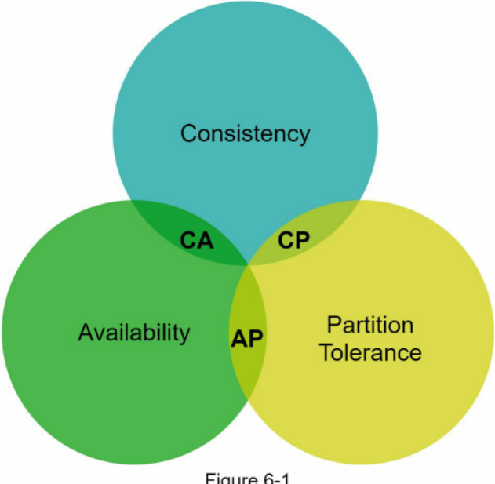

Hình 6-1

Ngày nay, các key-value store thường được phân loại dựa trên hai đặc tính CAP mà chúng hỗ trợ:

Hệ thống CP (Consistency và Partition Tolerance): một key-value store chuẩn CP hỗ trợ tính nhất quán và khả năng chịu lỗi phân vùng mạng, nhưng hy sinh tính sẵn sàng.

Hệ thống AP (Availability và Partition Tolerance): một key-value store chuẩn AP hỗ trợ tính sẵn sàng và khả năng chịu lỗi phân vùng mạng, nhưng hy sinh tính nhất quán.

Hệ thống CA (Consistency và Availability): một key-value store chuẩn CA hỗ trợ tính nhất quán và tính sẵn sàng, nhưng hy sinh khả năng chịu lỗi phân vùng mạng. Vì sự cố mạng là điều không thể tránh khỏi trong thực tế, nên mọi hệ thống phân tán bắt buộc phải có khả năng chịu đựng phân vùng mạng. Do đó, một hệ thống CA thuần túy không thể tồn tại trong các ứng dụng thế giới thực.

Những nội dung trên phần lớn là các định nghĩa lý thuyết. Để dễ hiểu hơn, chúng ta hãy cùng xem xét một số ví dụ cụ thể. Trong hệ thống phân tán, dữ liệu thường được replicated (sao chép / nhân bản) nhiều lần. Giả sử dữ liệu được sao chép trên ba replica nodes (các nút bản sao) là n1, n2 và n3 như minh họa trong Hình 6-2.

### Ideal situation (Tình huống lý tưởng)

Trong thế giới lý tưởng, sự cố phân vùng mạng không bao giờ xảy ra. Dữ liệu khi được ghi vào n1 sẽ tự động được sao chép sang n2 và n3. Cả tính nhất quán lẫn tính sẵn sàng đều đạt được trọn vẹn.


### Real-world distributed systems (Hệ thống phân tán trong thực tế)

Trong một hệ thống phân tán thực tế, hiện tượng phân vùng mạng là không thể tránh khỏi, và khi phân vùng xảy ra, chúng ta buộc phải lựa chọn giữa tính nhất quán hoặc tính sẵn sàng. Trong Hình 6-3, node n3 bị sập và không thể liên lạc với n1 và n2. Nếu client ghi dữ liệu vào n1 hoặc n2, dữ liệu đó không thể được propagated (lan truyền / đồng bộ) sang n3. Ngược lại, nếu dữ liệu được ghi vào n3 nhưng chưa kịp lan truyền sang n1 và n2, thì n1 và n2 sẽ chứa stale data (dữ liệu cũ / lỗi thời).

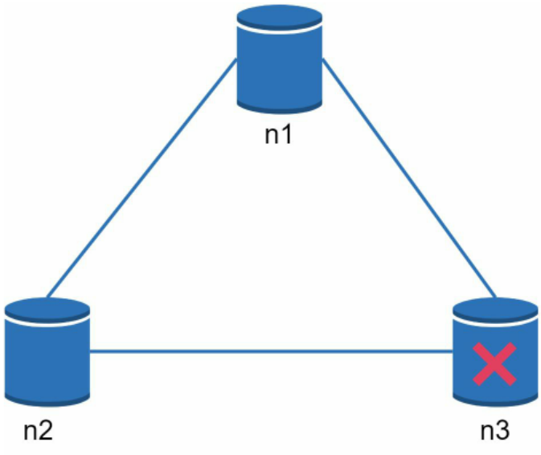

Hình 6-3

Nếu chúng ta chọn tính nhất quán thay vì tính sẵn sàng (hệ thống CP), chúng ta phải chặn toàn bộ các thao tác ghi tới n1 và n2 nhằm tránh tình trạng bất nhất dữ liệu giữa ba máy chủ này, điều này sẽ khiến hệ thống mất đi tính sẵn sàng (unavailable). Các hệ thống ngân hàng thường có yêu cầu cực kỳ khắt khe về tính nhất quán. Ví dụ, đối với hệ thống ngân hàng, việc hiển thị thông tin số dư tài khoản mới nhất là yếu tố mang tính sống còn. Nếu xảy ra tình trạng bất nhất do phân vùng mạng, hệ thống ngân hàng sẽ trả về lỗi cho đến khi vấn đề bất nhất được giải quyết triệt để.

Tuy nhiên, nếu chúng ta chọn tính sẵn sàng thay vì tính nhất quán (hệ thống AP), hệ thống vẫn tiếp tục chấp nhận các thao tác đọc, cho dù nó có thể trả về dữ liệu cũ. Đối với thao tác ghi, n1 và n2 vẫn tiếp tục tiếp nhận ghi, và dữ liệu sẽ được đồng bộ hóa sang n3 sau khi sự cố phân vùng mạng được khắc phục.

Việc lựa chọn đúng các bảo đảm CAP phù hợp với từng bài toán sử dụng là một bước vô cùng quan trọng khi xây dựng một distributed key-value store. Bạn có thể thảo luận trực tiếp vấn đề này với người phỏng vấn để đưa ra thiết kế hệ thống tương ứng.

# System components (Các thành phần hệ thống)

Trong phần này, chúng ta sẽ thảo luận về các thành phần cốt lõi và kỹ thuật được sử dụng để xây dựng một key-value store:

 * Data partition (Phân vùng dữ liệu)
 * Data replication (Sao chép dữ liệu)
 * Consistency (Tính nhất quán)
 * Inconsistency resolution (Giải quyết bất nhất dữ liệu)
 * Handling failures (Xử lý sự cố)
 * System architecture diagram (Sơ đồ kiến trúc hệ thống)
 * Write path (Luồng xử lý ghi dữ liệu)
 * Read path (Luồng xử lý đọc dữ liệu)

Nội dung dưới đây phần lớn dựa trên ba hệ thống key-value store phổ biến: Dynamo [4], Cassandra [5], và BigTable [6].

## Data partition (Phân vùng dữ liệu)

Đối với các ứng dụng quy mô lớn, việc lưu trữ toàn bộ tập dữ liệu trên một máy chủ duy nhất là điều bất khả thi. Cách đơn giản nhất để thực hiện điều này là chia nhỏ dữ liệu thành các phân vùng (partition) nhỏ hơn và lưu trữ chúng trên nhiều máy chủ. Quá trình phân vùng dữ liệu đặt ra hai thách thức:
 * Phân phối dữ liệu đồng đều giữa nhiều máy chủ.
 * Giảm thiểu việc dịch chuyển dữ liệu khi các node được thêm vào hoặc loại bỏ.

Consistent hashing (băm nhất quán) đã được thảo luận ở Chương 5 là một kỹ thuật tuyệt vời để giải quyết các vấn đề này. Hãy cùng điểm lại cách thức hoạt động tổng quan của consistent hashing:
 * Đầu tiên, các máy chủ được đặt lên một hash ring (vòng băm). Trong Hình 6-4, tám máy chủ, đại diện bởi s0, s1, …, s7, được sắp xếp trên vòng băm.
 * Tiếp theo, một khóa (key) được băm lên cùng vòng băm đó, và nó sẽ được lưu trữ trên máy chủ đầu tiên bắt gặp khi di chuyển theo chiều kim đồng hồ. Ví dụ, theo logic này, key0 sẽ được lưu trữ tại máy chủ s1.

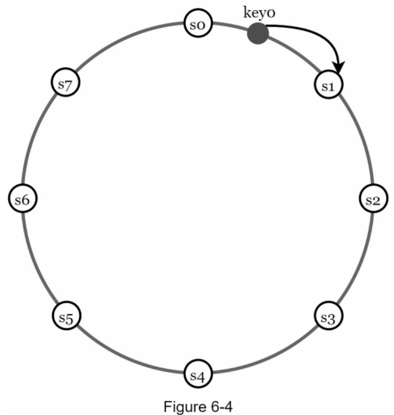

Việc sử dụng consistent hashing để phân vùng dữ liệu mang lại các lợi thế sau:

Automatic scaling (Tự động mở rộng quy mô): các máy chủ có thể được thêm vào hoặc loại bỏ một cách tự động tùy thuộc vào tải hệ thống.

Heterogeneity (Tính không đồng nhất): số lượng virtual nodes (nút ảo) của một máy chủ sẽ tỷ lệ thuận với năng lực phần cứng của máy chủ đó. Ví dụ, các máy chủ có cấu hình mạnh hơn sẽ được phân bổ nhiều nút ảo hơn.

## Data replication (Sao chép dữ liệu)

Để đạt được độ sẵn sàng và độ tin cậy cao, dữ liệu phải được sao chép bất đồng bộ qua N máy chủ, trong đó N là một tham số có thể cấu hình. N máy chủ này được lựa chọn theo logic sau: sau khi một key được ánh xạ vào một vị trí trên hash ring, ta duyệt theo chiều kim đồng hồ từ vị trí đó và chọn N máy chủ đầu tiên trên vòng băm để lưu trữ các bản sao dữ liệu. Trong Hình 6-5 (với N = 3), key0 được sao chép tại s1, s2 và s3.


Khi sử dụng virtual nodes, N nút đầu tiên trên vòng băm có thể thuộc về ít hơn N máy chủ vật lý thực tế. Để tránh tình trạng này, chúng ta chỉ chọn các máy chủ vật lý duy nhất trong quá trình duyệt theo chiều kim đồng hồ. Bên cạnh đó, các node nằm trong cùng một data center (trung tâm dữ liệu) thường có nguy cơ gặp sự cố đồng thời do mất điện, lỗi mạng, thiên tai, v.v. Để nâng cao độ tin cậy, các bản sao nên được đặt tại các data center riêng biệt, và các data center này được kết nối với nhau thông qua mạng tốc độ cao.

## Consistency (Tính nhất quán)

Vì dữ liệu được sao chép trên nhiều node, nó bắt buộc phải được đồng bộ hóa giữa các bản sao. Quorum consensus (cơ chế đồng thuận túc số / quorum) có thể đảm bảo tính nhất quán cho cả thao tác đọc và ghi. Trước hết, hãy cùng thiết lập một số định nghĩa:

N = Số lượng node bản sao.

W = Một write quorum (túc số ghi) có kích thước W. Để một thao tác ghi được coi là thành công, thao tác ghi đó phải nhận được xác nhận (acknowledged) từ ít nhất W bản sao.

R = Một read quorum (túc số đọc) có kích thước R. Để một thao tác đọc được coi là thành công, thao tác đọc đó phải chờ phản hồi từ ít nhất R bản sao.

Hãy xem xét ví dụ minh họa trong Hình 6-6 với N = 3.


Hình 6-6 (ACK = acknowledgement / xác nhận)

W = 1 không có nghĩa là dữ liệu chỉ được ghi trên một máy chủ duy nhất. Ví dụ, với cấu hình trong Hình 6-6, dữ liệu vẫn được sao chép trên cả s0, s1 và s2. W = 1 có nghĩa là coordinator (nút điều phối) phải nhận được ít nhất một xác nhận thành công trước khi thao tác ghi được coi là hoàn tất. Chẳng hạn, nếu chúng ta nhận được xác nhận từ s1, chúng ta không cần phải tiếp tục chờ đợi xác nhận từ s0 và s2 nữa. Một coordinator đóng vai trò như một proxy (máy chủ ủy nhiệm) trung gian giữa client và các node lưu trữ.

Cấu hình của W, R và N là một sự đánh đổi kinh điển giữa độ trễ (latency) và tính nhất quán (consistency). Nếu W = 1 hoặc R = 1, thao tác sẽ trả về kết quả rất nhanh chóng vì coordinator chỉ cần đợi phản hồi từ bất kỳ một bản sao nào. Nếu W hoặc R > 1, hệ thống sẽ đảm bảo tính nhất quán tốt hơn; tuy nhiên, truy vấn sẽ phản hồi chậm hơn vì coordinator phải đợi phản hồi từ bản sao chậm nhất. Nếu W + R > N, tính nhất quán mạnh (strong consistency) được đảm bảo tuyệt đối vì chắc chắn có ít nhất một node giao thoa nắm giữ dữ liệu mới nhất.

Làm thế nào để cấu hình N, W và R phù hợp với bài toán của chúng ta? Dưới đây là một số cấu hình khả dĩ:

Nếu R = 1 và W = N: hệ thống được tối ưu hóa cho thao tác đọc nhanh.

Nếu W = 1 và R = N: hệ thống được tối ưu hóa cho thao tác ghi nhanh.

Nếu W + R > N: tính nhất quán mạnh được đảm bảo (thông thường chọn N = 3, W = R = 2).

Nếu W + R <= N: tính nhất quán mạnh không được đảm bảo.

Tùy thuộc vào yêu cầu, chúng ta có thể tinh chỉnh các giá trị W, R, N để đạt được mức độ nhất quán mong muốn.

> 💡 **Giải thích thêm:** **Nguyên lý Quorum Consensus (Túc số đồng thuận):** Điều kiện $W + R > N$ xuất phát từ nguyên lý Dirichlet (nguyên lý chuồng bồ câu). Khi tổng số node xác nhận ghi ($W$) và số node đọc ($R$) lớn hơn tổng số node bản sao ($N$), tập hợp các node ghi và tập hợp các node đọc bắt buộc phải giao nhau ở ít nhất một node. Node giao nhau này chắc chắn nắm giữ dữ liệu ghi mới nhất, nhờ đó client luôn nhận diện và đọc được phiên bản cập nhật nhất.
> Nguồn tham khảo: https://en.wikipedia.org/wiki/Quorum_(distributed_computing)

## Consistency models (Mô hình nhất quán)

Mô hình nhất quán (consistency model) là một yếu tố quan trọng khác cần cân nhắc khi thiết kế một key-value store. Một mô hình nhất quán sẽ định nghĩa mức độ nhất quán của dữ liệu, và tồn tại một dải rộng các mô hình nhất quán khác nhau:
 * Strong consistency (Tính nhất quán mạnh): bất kỳ thao tác đọc nào cũng đều trả về giá trị tương ứng với kết quả của thao tác ghi dữ liệu mới nhất. Client không bao giờ nhìn thấy dữ liệu lỗi thời.
 * Weak consistency (Tính nhất quán yếu): các thao tác đọc tiếp theo có thể không nhìn thấy giá trị mới nhất.
 * Eventual consistency (Tính nhất quán cuối cùng): đây là một dạng đặc thù của tính nhất quán yếu. Nếu có đủ thời gian, tất cả các cập nhật sẽ được lan truyền đầy đủ và mọi bản sao đều sẽ đạt trạng thái nhất quán.

Tính nhất quán mạnh thường đạt được bằng cách buộc một bản sao không được tiếp nhận các thao tác đọc/ghi mới cho đến khi tất cả các bản sao đều đã đồng thuận về thao tác ghi hiện tại. Cách tiếp cận này không lý tưởng cho các hệ thống đòi hỏi độ sẵn sàng cao vì nó có thể làm nghẽn (block) các thao tác mới. Dynamo và Cassandra áp dụng eventual consistency, và đây cũng là mô hình nhất quán được khuyến nghị cho key-value store của chúng ta. Khi có các thao tác ghi đồng thời (concurrent writes), eventual consistency cho phép các giá trị không nhất quán tạm thời đi vào hệ thống và buộc client phải đọc các giá trị này để tiến hành reconcile (hòa giải / giải quyết xung đột). Phần tiếp theo sẽ giải thích cách cơ chế hòa giải xung đột hoạt động kết hợp với versioning.

## Inconsistency resolution: versioning (Giải quyết bất nhất dữ liệu: versioning)

Cơ chế sao chép (replication) mang lại độ sẵn sàng cao nhưng lại gây ra tình trạng bất nhất giữa các bản sao. Versioning (đánh số phiên bản) và vector clock (đồng hồ vector [nguyên văn ghi nhầm: vector locks]) được sử dụng để giải quyết các vấn đề bất nhất này. Versioning có nghĩa là xem mỗi lần sửa đổi dữ liệu như một phiên bản bất biến (immutable version) mới của dữ liệu đó. Trước khi thảo luận sâu về versioning, hãy cùng xem một ví dụ để giải thích cách tình trạng bất nhất diễn ra:

Như thể hiện trong Hình 6-7, cả hai replica node n1 và n2 đều đang chứa cùng một giá trị. Hãy gọi giá trị này là giá trị ban đầu. Server 1 và Server 2 nhận được cùng một giá trị khi thực hiện thao tác get("name").


Tiếp theo, Server 1 đổi tên thành "johnSanFrancisco", còn Server 2 đổi tên thành "johnNewYork" như mô tả trong Hình 6-8. Hai thay đổi này được thực hiện đồng thời. Giờ đây, chúng ta có các giá trị xung đột nhau, gọi là phiên bản v1 và v2.


Hình 6-8

Trong ví dụ này, giá trị ban đầu có thể bỏ qua vì các sửa đổi đều dựa trên nó. Tuy nhiên, không có cách nào rõ ràng để tự động giải quyết xung đột giữa hai phiên bản cuối cùng này. Để xử lý vấn đề, chúng ta cần một hệ thống versioning có khả năng phát hiện xung đột và hòa giải xung đột. Vector clock là một kỹ thuật phổ biến để giải quyết bài toán này. Hãy cùng kiểm tra cách hoạt động của vector clock.

Một vector clock là một cặp [server, version] gắn liền với một mục dữ liệu. Nó có thể được sử dụng để kiểm tra xem một phiên bản là tiền nhiệm (precedes), kế nhiệm (succeeds), hay đang xung đột (in conflict) với các phiên bản khác. Giả sử một vector clock được biểu diễn bởi $D([S_1, v_1], [S_2, v_2], \dots, [S_n, v_n])$, trong đó $D$ là mục dữ liệu, $v_1$ là bộ đếm phiên bản, và $S_1$ là định danh máy chủ, v.v. Nếu mục dữ liệu $D$ được ghi vào máy chủ $S_i$, hệ thống phải thực hiện một trong các tác vụ sau:
 * Tăng $v_i$ lên 1 nếu $[S_i, v_i]$ đã tồn tại.
 * Nếu chưa tồn tại, tạo một mục mới $[S_i, 1]$.

Logic trừu tượng trên được giải thích bằng một ví dụ cụ thể như minh họa trong Hình 6-9.


Hình 6-9 (nguồn: [4])

1. Một client ghi mục dữ liệu D1 vào hệ thống, và thao tác ghi được xử lý bởi máy chủ Sx; máy chủ này hiện có vector clock là D1[(Sx, 1)].
2. Một client khác đọc D1 mới nhất, cập nhật thành D2 và ghi ngược lại. D2 kế thừa từ D1 nên nó sẽ ghi đè D1. Giả sử thao tác ghi được xử lý bởi cùng máy chủ Sx, khi đó máy chủ này có vector clock là D2([Sx, 2]).
3. Một client khác đọc D2 mới nhất, cập nhật thành D3 và ghi lại. Giả sử thao tác ghi được xử lý bởi máy chủ Sy, khi đó máy chủ này có vector clock là D3([Sx, 2], [Sy, 1]).
4. Một client khác đọc D2 mới nhất, cập nhật thành D4 và ghi lại. Giả sử thao tác ghi được xử lý bởi máy chủ Sz, khi đó máy chủ này có D4([Sx, 2], [Sz, 1]).
5. Khi một client khác đọc D3 và D4, nó phát hiện ra một xung đột, vốn gây ra bởi việc mục dữ liệu D2 bị sửa đổi đồng thời bởi cả Sy và Sz. Xung đột này được hòa giải bởi phía client và dữ liệu đã cập nhật được gửi lại máy chủ. Giả sử thao tác ghi được xử lý bởi Sx, máy chủ này hiện có D5([Sx, 3], [Sy, 1], [Sz, 1]). Chúng ta sẽ giải thích cách phát hiện xung đột ngay sau đây.

Khi sử dụng vector clock, rất dễ để xác định một phiên bản X có phải là tổ tiên (ancestor - tức không có xung đột) của phiên bản Y hay không: nếu các bộ đếm phiên bản cho từng bên tham gia trong vector clock của Y đều lớn hơn hoặc bằng các bộ đếm tương ứng trong phiên bản X. Ví dụ, vector clock D([s0, 1], [s1, 1]) là tổ tiên của D([s0, 1], [s1, 2]). Do đó, không có xung đột nào được ghi nhận.

Tương tự, bạn có thể nhận biết phiên bản X là phiên bản song song / anh em (sibling - tức tồn tại xung đột) với Y nếu có bất kỳ bên tham gia nào trong vector clock của Y có bộ đếm nhỏ hơn bộ đếm tương ứng trong X. Ví dụ, hai vector clock sau đây thể hiện sự xung đột: D([s0, 1], [s1, 2]) và D([s0, 2], [s1, 1]).

Mặc dù vector clock có thể giải quyết xung đột, nhưng nó tồn tại hai nhược điểm đáng lưu ý. Thứ nhất, vector clock làm tăng độ phức tạp cho phía client vì nó đòi hỏi client phải tự triển khai logic giải quyết xung đột. Thứ hai, các cặp [server: version] trong vector clock có thể tăng trưởng rất nhanh chóng. Để khắc phục vấn đề này, chúng ta đặt ra một ngưỡng giới hạn độ dài, và nếu vượt quá giới hạn, các cặp cũ nhất sẽ bị xóa bỏ. Điều này có thể dẫn đến việc giảm hiệu quả trong quá trình hòa giải vì mối quan hệ kế thừa không thể xác định chính xác tuyệt đối. Tuy nhiên, theo bài báo khoa học về Dynamo [4], Amazon chưa từng gặp phải vấn đề này trong môi trường production thực tế; do đó, đây có lẽ là một giải pháp hoàn toàn chấp nhận được đối với đa số các công ty.

> 💡 **Giải thích thêm:** **Vector Clock (Đồng hồ vector):** Trong hệ thống phân tán không có đồng hồ vật lý tập trung (do hiện tượng lệch đồng hồ vật lý - clock drift), vector clock đóng vai trò như một bộ tem thời gian logic (logical timestamp) theo dõi mối quan hệ nhân quả (causality). Mỗi node tự quản lý một mảng các bộ đếm phiên bản. Khi hai bản ghi diễn ra độc lập mà không biết về nhau, vector clock của chúng sẽ không thể so sánh thứ tự lớn hơn/nhỏ hơn một cách trực tiếp (không vector nào bao trùm vector kia), báo hiệu hệ thống đã xuất hiện nhánh phân kỳ (fork) và cần client thực hiện ghép (merge/reconcile).
> Nguồn tham khảo: https://en.wikipedia.org/wiki/Vector_clock

# Handling failures (Xử lý sự cố)

Cũng như bất kỳ hệ thống quy mô lớn nào, các sự cố không chỉ là điều khó tránh khỏi mà còn xảy ra rất thường xuyên. Việc xử lý các kịch bản sự cố là vô cùng quan trọng. Trong phần này, trước tiên chúng ta sẽ giới thiệu các kỹ thuật phát hiện sự cố. Sau đó, chúng ta sẽ xem xét các chiến lược giải quyết sự cố phổ biến.

## Failure detection (Phát hiện sự cố)

Trong một hệ thống phân tán, việc chỉ tin rằng một máy chủ bị sập vì một máy chủ khác tuyên bố như vậy là chưa đủ tin cậy. Thông thường, hệ thống yêu cầu ít nhất hai nguồn thông tin độc lập để đánh dấu một máy chủ là đã sập. Như minh họa trong Hình 6-10, giải pháp all-to-all multicasting (truyền thông đa hướng toàn thể / tất cả-đến-tất cả) là một cách tiếp cận trực tiếp. Tuy nhiên, phương pháp này trở nên kém hiệu quả khi có nhiều máy chủ trong hệ thống.

Mã thành viên (Member ID)

Danh sách thành viên của s0 (s0's membership list)

Bộ đếm nhịp tim (Heartbeat counter) Thời gian (Time)

0

10232

12:00:01

1

10224

12:00:10

2

9908

11:58:02

3

10237

12:00:20

4

10234

12:00:34

Hình 6-11

Như thể hiện trong Hình 6-11:

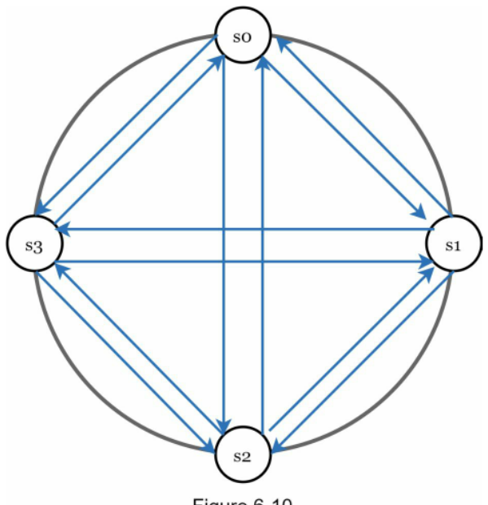

Hình 6-10

Một giải pháp tốt hơn là sử dụng các phương pháp phát hiện sự cố phi tập trung như gossip protocol (giao thức đồn đại / gossip). Gossip protocol hoạt động như sau:
 * Mỗi node duy trì một node membership list (danh sách thành viên node), bao gồm mã thành viên (member ID) và heartbeat counter (bộ đếm nhịp tim / tín hiệu báo sống).
 * Mỗi node định kỳ tăng bộ đếm heartbeat của chính mình.
 * Mỗi node định kỳ gửi các heartbeat tới một tập hợp các node ngẫu nhiên, các node này sau đó lại tiếp tục lan truyền tới một tập hợp các node ngẫu nhiên khác.
 * Khi các node nhận được heartbeat, danh sách thành viên sẽ được cập nhật thông tin mới nhất.
 * Nếu heartbeat của một node không tăng trong khoảng thời gian dài hơn ngưỡng quy định sẵn, thành viên đó sẽ bị coi là đã ngoại tuyến (offline).

s0 phát hiện s2 đã sập s1

s5

s2

X

s4

s3

 * Node s0 duy trì một danh sách thành viên node được hiển thị ở phía bên trái.
 * Node s0 nhận thấy bộ đếm heartbeat của node s2 (member ID = 2) đã không tăng trong một thời gian dài.
 * Node s0 gửi các heartbeat chứa thông tin của s2 tới một nhóm các node ngẫu nhiên. Khi các node khác xác nhận rằng bộ đếm heartbeat của s2 đã lâu không được cập nhật, node s2 sẽ chính thức bị đánh dấu là đã sập, và thông tin này được lan truyền rộng rãi tới các node khác.

> 💡 **Giải thích thêm:** **Gossip Protocol (Giao thức truyền tin kiểu tin đồn):** Lấy cảm hứng từ cách thức tin đồn lan truyền trong xã hội. Thay vì dồn tải lên một node trung tâm hoặc bắt mọi node phải liên tục ping lẫn nhau (gây tắc nghẽn mạng $O(N^2)$), mỗi node chỉ cần định kỳ bắt liên lạc ngẫu nhiên với một vài node xung quanh để trao đổi trạng thái. Nhờ cơ chế lan truyền theo hàm mũ, thông tin về lỗi node sẽ bao phủ toàn bộ cụm máy chủ cực kỳ nhanh chóng ($O(\log N)$) mà tốn rất ít băng thông mạng.
> Nguồn tham khảo: https://en.wikipedia.org/wiki/Gossip_protocol

## Handling temporary failures (Xử lý sự cố tạm thời)

Sau khi các sự cố được phát hiện thông qua gossip protocol (giao thức lan truyền thông tin kiểu tin đồn giữa các node), hệ thống cần triển khai một số cơ chế nhất định để đảm bảo tính sẵn sàng (availability). Với phương pháp strict quorum (túc số nghiêm ngặt), các thao tác đọc và ghi có thể bị chặn như đã được minh họa trong phần đồng thuận theo túc số (quorum consensus). Một kỹ thuật được gọi là "sloppy quorum" (túc số lỏng lẻo - cơ chế nới lỏng điều kiện túc số) [4] được sử dụng để cải thiện tính sẵn sàng. Thay vì bắt buộc tuân thủ nghiêm ngặt điều kiện túc số, hệ thống sẽ chọn ra W máy chủ hoạt động bình thường đầu tiên cho thao tác ghi và R máy chủ hoạt động bình thường đầu tiên cho thao tác đọc trên hash ring (vòng băm phân tán). Các máy chủ ngoại tuyến (offline) sẽ bị bỏ qua. Nếu một máy chủ không thể truy cập do sự cố mạng hoặc lỗi máy chủ, một máy chủ khác sẽ tạm thời xử lý các yêu cầu thay thế. Khi máy chủ gặp sự cố hoạt động trở lại, các thay đổi sẽ được đẩy ngược về máy chủ này để đạt được tính nhất quán dữ liệu (data consistency). Quy trình này được gọi là hinted handoff (cơ chế bàn giao kèm gợi ý / chuyển giao dữ liệu tạm thời). Do s2 không khả dụng trong Hình 6-12 (trong nguyên bản ghi là Figure 612), các thao tác đọc và ghi sẽ tạm thời do s3 xử lý. Khi s2 trực tuyến trở lại, s3 sẽ bàn giao lại dữ liệu cho s2.

> 💡 **Giải thích thêm:** **Sloppy Quorum** và **Hinted Handoff** là hai kỹ thuật giúp hệ thống ưu tiên tính sẵn sàng (Availability) thay vì tính nhất quán nghiêm ngặt (Consistency), bám sát định lý CAP. Thay vì từ chối yêu cầu của người dùng khi một node gặp sự cố khiến không đủ số lượng phản hồi tối thiểu (strict quorum), hệ thống mượn tạm node kế tiếp còn sống trên vòng băm để nhận dữ liệu và lưu kèm một "gợi ý" (hint). Khi node chính phục hồi, dữ liệu tạm này sẽ được bàn giao trả lại.
> Nguồn tham khảo: https://www.allthingsdistributed.com/files/amazon-dynamo-sosp2007.pdf

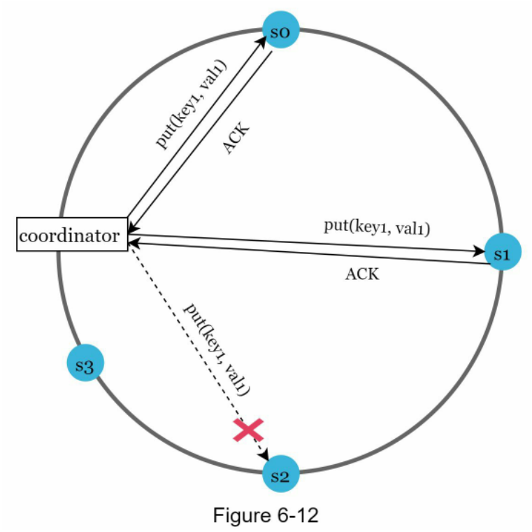

## Handling permanent failures (Xử lý sự cố vĩnh viễn)

Hinted handoff được sử dụng để xử lý các sự cố tạm thời. Vậy điều gì sẽ xảy ra nếu một replica (bản sao dữ liệu) bị ngừng hoạt động vĩnh viễn? Để xử lý tình huống như vậy, chúng ta triển khai một anti-entropy protocol (giao thức chống phân rã nhằm phát hiện sai lệch dữ liệu) để giữ cho các bản sao luôn đồng bộ với nhau. Anti-entropy bao gồm việc so sánh từng phần dữ liệu trên các bản sao và cập nhật từng bản sao lên phiên bản mới nhất. Merkle tree (cây Merkle hay cây băm) được sử dụng để phát hiện sự không nhất quán và giảm thiểu tối đa lượng dữ liệu phải truyền tải qua mạng. Trích dẫn từ Wikipedia [7]: "Cây băm hay cây Merkle là một cây mà trong đó mỗi node không phải lá (non-leaf node) được gắn nhãn bằng mã băm (hash) của các nhãn hoặc giá trị (trong trường hợp là node lá) từ các node con của nó. Cây băm cho phép xác minh nội dung của các cấu trúc dữ liệu lớn một cách hiệu quả và an toàn". Giả sử không gian khóa (key space) có giá trị từ 1 đến 12, các bước sau đây sẽ minh họa cách xây dựng một cây Merkle. Các ô được làm nổi bật thể hiện sự không nhất quán. Bước 1: Chia không gian khóa thành các bucket (nhóm/ngăn chứa phân vùng dữ liệu - gồm 4 bucket trong ví dụ của chúng ta) như hiển thị trong Hình 6-13. Một bucket được sử dụng làm node cấp gốc (root-level node) cho cây con để giới hạn độ sâu của cây.

> 💡 **Giải thích thêm:** **Merkle Tree** giải quyết bài toán so sánh lượng dữ liệu khổng lồ giữa hai máy chủ mà không cần truyền toàn bộ dữ liệu qua đường truyền mạng. Bằng cách so sánh từ mã băm gốc (root hash) đi xuống: nếu root hash trùng khớp, hai bản sao giống hệt nhau 100%; nếu root hash khác nhau, hệ thống chỉ cần duyệt theo các nhánh con có hash khác biệt để khoanh vùng chính xác bucket bị sai lệch và chỉ đồng bộ duy nhất phần đó.
> Nguồn tham khảo: https://en.wikipedia.org/wiki/Merkle_tree

server1 server 2

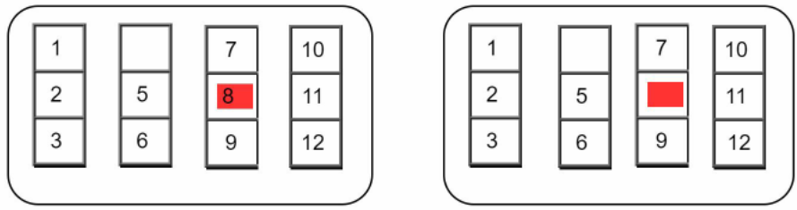

Hình 6-13

Bước 2: Sau khi các bucket được tạo, tiến hành băm từng khóa trong một bucket bằng phương pháp băm đồng nhất (uniform hashing) (Hình 6-14).

server1


Hình 6-14

Bước 3: Tạo một node băm đơn lẻ cho mỗi bucket (Hình 6-15).

server 1

server 2


Bước 4: Xây dựng cây hướng lên trên cho đến node gốc bằng cách tính toán các mã băm của các node con (Hình 6-16). Hình 6-15 (Figure 6-15)


Để so sánh hai cây Merkle, bắt đầu bằng việc so sánh các mã băm gốc. Nếu các mã băm gốc khớp nhau, cả hai máy chủ đều có cùng dữ liệu. Nếu các mã băm gốc không khớp, mã băm của node con bên trái sẽ được so sánh, tiếp theo là so sánh mã băm của các node con bên phải. Bạn có thể duyệt cây để tìm ra chính xác những bucket nào chưa được đồng bộ và chỉ đồng bộ riêng các bucket đó. Nhờ sử dụng cây Merkle, lượng dữ liệu cần đồng bộ sẽ tỷ lệ thuận với sự khác biệt giữa hai bản sao, chứ không phụ thuộc vào tổng lượng dữ liệu mà chúng đang chứa. Trong các hệ thống thực tế, kích thước bucket thường khá lớn. Ví dụ, một cấu hình khả thi là 1 triệu bucket cho mỗi 1 tỷ khóa, như vậy mỗi bucket chỉ chứa 1.000 khóa. Hình 6-16 (Figure 6-16)

## Handling data center outage (Xử lý sự cố ngừng hoạt động của trung tâm dữ liệu)

Sự cố ngừng hoạt động của trung tâm dữ liệu (data center outage) có thể xảy ra do mất điện, mất kết nối mạng, thiên tai, v.v. Để xây dựng một hệ thống có khả năng xử lý sự cố ngừng hoạt động của trung tâm dữ liệu, việc nhân bản (replicate) dữ liệu trên nhiều trung tâm dữ liệu là vô cùng quan trọng. Ngay cả khi một trung tâm dữ liệu hoàn toàn ngoại tuyến, người dùng vẫn có thể truy cập dữ liệu thông qua các trung tâm dữ liệu khác.

# System architecture diagram (Sơ đồ kiến trúc hệ thống)

Sau khi đã thảo luận về các cân nhắc kỹ thuật khác nhau trong việc thiết kế kho lưu trữ khóa-giá trị (key-value store), chúng ta có thể chuyển sự chú ý sang sơ đồ kiến trúc được minh họa trong Hình 6-17.


Các đặc điểm chính của kiến trúc được liệt kê như sau:
 * Client (phía máy khách) giao tiếp với key-value store thông qua các API đơn giản: `get(key)` và `put(key, value)`.
 * Coordinator (node điều phối) là một node đóng vai trò như một proxy (máy chủ ủy quyền/đại diện) giữa client và key-value store.
 * Các node được phân bổ trên một vòng tròn bằng cách sử dụng consistent hashing (kỹ thuật băm nhất quán).
 * Hệ thống hoàn toàn phi tập trung (decentralized), do đó việc thêm mới và di chuyển các node có thể diễn ra tự động.
 * Dữ liệu được nhân bản tại nhiều node.
 * Không có single point of failure (SPOF - điểm lỗi đơn lẻ có thể làm sập toàn bộ hệ thống) vì mỗi node đều đảm nhiệm cùng một tập hợp các trách nhiệm như nhau.

Do thiết kế mang tính phi tập trung, mỗi node sẽ thực hiện nhiều tác vụ như được trình bày trong Hình 6-18.

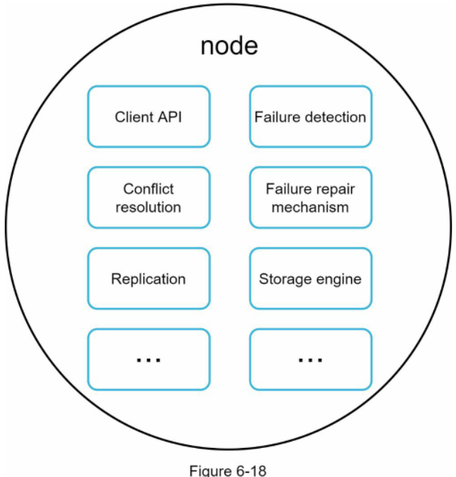

Hình 6-18

## Write path (Luồng ghi)

Hình 6-19 giải thích những gì diễn ra sau khi một yêu cầu ghi được chuyển hướng đến một node cụ thể. Xin lưu ý rằng các thiết kế được đề xuất cho luồng ghi/đọc chủ yếu dựa trên kiến trúc của Cassandra [8].


Hình 6-19

1. Yêu cầu ghi được lưu kiên cố (persist) vào một tệp commit log (nhật ký ghi lại thao tác trước khi lưu để phục hồi sự cố).
2. Dữ liệu được lưu vào memory cache (bộ nhớ đệm trên RAM).

3. Khi memory cache bị đầy hoặc đạt đến một ngưỡng định trước, dữ liệu sẽ được đẩy (flush) xuống SSTable (Sorted String Table - bảng chuỗi đã sắp xếp lưu trữ cặp khóa-giá trị trên đĩa) [9] trên đĩa cứng. Lưu ý: Sorted String Table (SSTable) là một danh sách đã được sắp xếp của các cặp <key, value>. Dành cho những độc giả quan tâm muốn tìm hiểu thêm về SSTable, hãy tham khảo tài liệu tham khảo [9].

## Read path (Luồng đọc)

Sau khi một yêu cầu đọc được chuyển hướng đến một node cụ thể, trước tiên hệ thống sẽ kiểm tra xem dữ liệu có nằm trong memory cache hay không. Nếu có, dữ liệu sẽ được trả về ngay cho client như hiển thị trong Hình 6-20.

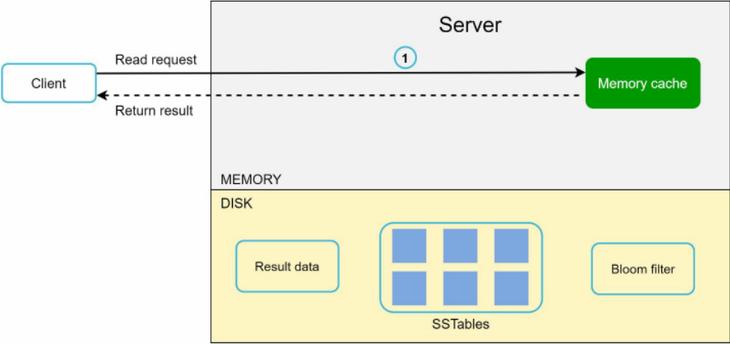

Hình 6-20

Nếu dữ liệu không có trong bộ nhớ, nó sẽ được truy xuất từ đĩa thay thế. Chúng ta cần một phương pháp hiệu quả để tìm ra SSTable nào đang chứa khóa cần tìm. Bloom filter (bộ lọc Bloom - cấu trúc dữ liệu xác suất kiểm tra nhanh một phần tử có chắc chắn không tồn tại trong tập hợp hay không) [10] thường được dùng để giải quyết bài toán này. Luồng đọc khi dữ liệu không có trong bộ nhớ được mô tả trong Hình 6-21.

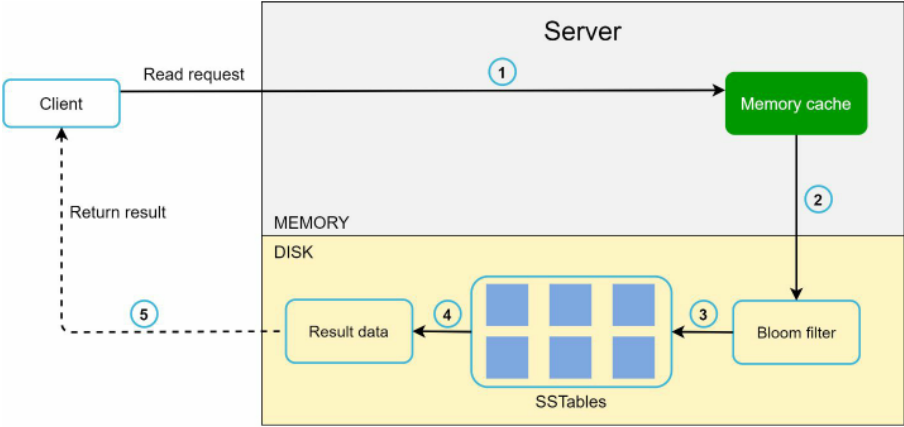

Hình 6-21

1. Đầu tiên, hệ thống kiểm tra xem dữ liệu có nằm trong bộ nhớ hay không. Nếu không, chuyển sang bước 2.
2. Nếu dữ liệu không có trong bộ nhớ, hệ thống sẽ kiểm tra Bloom filter.
3. Bloom filter được sử dụng để xác định những SSTable nào có thể chứa khóa đó.
4. Các SSTable trả về kết quả của tập dữ liệu.
5. Kết quả của tập dữ liệu được trả về cho client.

# Summary (Tóm tắt)

Chương này đã bao quát rất nhiều khái niệm và kỹ thuật. Để giúp bạn ôn lại kiến thức, bảng sau đây tóm tắt các tính năng cùng những kỹ thuật tương ứng được sử dụng cho một distributed key-value store (kho lưu trữ khóa-giá trị phân tán).

Bảng 6-2 (Table 6-2)

| Mục tiêu / Vấn đề (Goal/Problems)                                           | Kỹ thuật (Technique)                                                                                  |
| --------------------------------------------------------------------------- | ----------------------------------------------------------------------------------------------------- |
| Khả năng lưu trữ dữ liệu lớn (Ability to store big data)                    | Sử dụng consistent hashing để phân bổ tải đồng đều trên các máy chủ                                   |
| Thao tác đọc có độ sẵn sàng cao (High availability reads)                   | Nhân bản dữ liệu (Data replication), Thiết lập trên nhiều trung tâm dữ liệu (Multi-data center setup) |
| Thao tác ghi có độ sẵn sàng cao (Highly available writes)                   | Quản lý phiên bản và giải quyết xung đột bằng vector clocks (đồng hồ vector)                          |
| Phân vùng tập dữ liệu (Dataset partition)                                   | Consistent Hashing                                                                                    |
| Khả năng mở rộng gia tăng (Incremental scalability)                         | Consistent Hashing                                                                                    |
| Tính dị thể phần cứng (Heterogeneity)                                       | Consistent Hashing                                                                                    |
| Tính nhất quán có thể tinh chỉnh (Tunable consistency)                      | Quorum consensus                                                                                      |
| Xử lý sự cố tạm thời (Handling temporary failures)                          | Sloppy quorum và hinted handoff                                                                       |
| Xử lý sự cố vĩnh viễn (Handling permanent failures)                         | Merkle tree                                                                                           |
| Xử lý sự cố ngừng hoạt động trung tâm dữ liệu (Handling data center outage) | Nhân bản chéo giữa các trung tâm dữ liệu (Cross-data center replication)                              |

# Reference materials (Tài liệu tham khảo)

[1] Amazon DynamoDB: https://aws.amazon.com/dynamodb/  
[2] memcached: https://memcached.org/  
[3] Redis: https://redis.io/  
[4] Dynamo: Amazon's Highly Available Key-value Store: https://www.allthingsdistributed.com/files/amazon-dynamo-sosp2007.pdf  
[5] Cassandra: https://cassandra.apache.org/  
[6] Bigtable: A Distributed Storage System for Structured Data: https://static.googleusercontent.com/media/research.google.com/en//archive/bigtableosdi06.pdf  
[7] Merkle tree: https://en.wikipedia.org/wiki/Merkle_tree  
[8] Cassandra architecture: https://cassandra.apache.org/doc/latest/architecture/  
[9] SStable: https://www.igvita.com/2012/02/06/sstable-and-log-structured-storage-leveldb/  
[10] Bloom filter: https://en.wikipedia.org/wiki/Bloom_filter  

# CHAPTER 7: DESIGN A UNIQUE ID GENERATOR IN DISTRIBUTED SYSTEMS (CHƯƠNG 7: THIẾT KẾ BỘ TẠO ID DUY NHẤT TRONG HỆ THỐNG PHÂN TÁN)

Trong chương này, bạn được yêu cầu thiết kế một unique ID generator (bộ tạo định danh duy nhất) trong các hệ thống phân tán. Suy nghĩ đầu tiên của bạn có thể là sử dụng một khóa chính (primary key) với thuộc tính `auto_increment` (tự động tăng giá trị) trong cơ sở dữ liệu truyền thống. Tuy nhiên, `auto_increment` không hoạt động hiệu quả trong môi trường phân tán vì một máy chủ cơ sở dữ liệu đơn lẻ không đủ lớn và việc tạo ra các ID duy nhất trên nhiều cơ sở dữ liệu với độ trễ tối thiểu là một thách thức rất lớn. Dưới đây là một số ví dụ về các ID duy nhất:

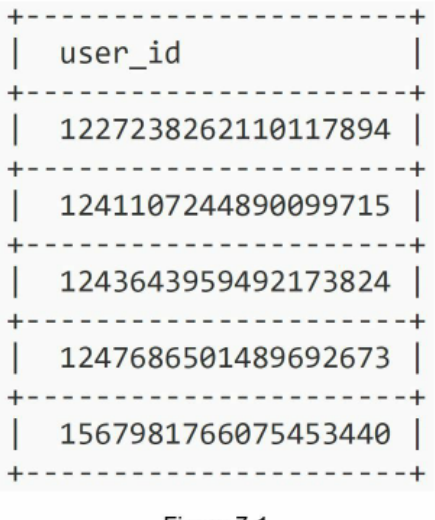

Hình 7-1

# Step 1 - Understand the problem and establish design scope (Bước 1 - Hiểu rõ bài toán và xác định phạm vi thiết kế)

<!-- ⚠️ CẢNH BÁO chunk 2: số ảnh/heading/code-block KHÔNG khớp bản gốc (gốc={'images': 53, 'headings': 63, 'fences': 0}, dịch={'images': 53, 'headings': 58, 'fences': 8}). Xem lại đoạn này bằng tay. -->

Đặt các câu hỏi làm rõ là bước đầu tiên để tiếp cận bất kỳ bài toán phỏng vấn thiết kế hệ thống nào. Dưới đây là một cuộc hội thoại mẫu giữa ứng viên và người phỏng vấn:

**Ứng viên:** Các đặc điểm của unique ID (mã định danh duy nhất) này là gì?  
**Người phỏng vấn:** ID phải là duy nhất và có thể sắp xếp theo thứ tự (sortable).  
**Ứng viên:** Với mỗi bản ghi mới, ID có tự động tăng thêm 1 không?  
**Người phỏng vấn:** ID tăng dần theo thời gian, nhưng không nhất thiết chỉ tăng đúng 1 đơn vị. Các ID được tạo vào buổi tối sẽ lớn hơn các ID được tạo vào buổi sáng trong cùng một ngày.  
**Ứng viên:** ID có chỉ chứa các giá trị số không?  
**Người phỏng vấn:** Đúng vậy.  
**Ứng viên:** Yêu cầu về độ dài của ID là bao nhiêu?  
**Người phỏng vấn:** ID phải nằm vừa trong 64-bit.  
**Ứng viên:** Quy mô của hệ thống cần đạt mức nào?  
**Người phỏng vấn:** Hệ thống phải có khả năng tạo ra 10.000 ID mỗi giây.  

Trên đây là một số câu hỏi mẫu mà bạn có thể đặt cho người phỏng vấn. Việc thấu hiểu trọn vẹn yêu cầu và làm sáng tỏ những điểm mơ hồ là điều tối quan trọng. Đối với bài toán phỏng vấn này, các yêu cầu kỹ thuật được tóm tắt như sau:
 * ID phải là duy nhất.
 * ID chỉ bao gồm các giá trị số.
 * ID có độ dài tối đa 64-bit.
 * ID được sắp xếp theo thời gian tạo.
 * Hệ thống có khả năng tạo hơn 10.000 unique ID mỗi giây.

# Step 2 - Propose high-level design and get buy-in (Bước 2 - Đề xuất thiết kế tổng quan và thống nhất phương án)

Có nhiều phương án khác nhau để tạo unique ID trong distributed systems (hệ thống phân tán). Các giải pháp được chúng tôi cân nhắc gồm có:
 * Multi-master replication (sao chép đa máy chủ chính)
 * UUID (Universally Unique Identifier - mã định danh duy nhất toàn cầu)
 * Ticket server (máy chủ cấp vé chuyên dụng)
 * Phương pháp Snowflake của Twitter (Twitter snowflake approach)

Hãy cùng xem xét chi tiết từng phương án, cơ chế hoạt động, cũng như ưu và nhược điểm của chúng.

## Multi-master replication

Như minh họa trong Hình 7-2, hướng tiếp cận đầu tiên là multi-master replication.


Hình 7-2

Cách tiếp cận này tận dụng tính năng auto_increment sẵn có của cơ sở dữ liệu. Thay vì tăng ID tiếp theo thêm 1 đơn vị, chúng ta tăng nó thêm $k$ đơn vị, trong đó $k$ là số lượng máy chủ cơ sở dữ liệu đang hoạt động. Như minh họa ở Hình 7-2, ID tiếp theo được tạo trên cùng một máy chủ sẽ bằng ID trước đó cộng thêm 2. Giải pháp này xử lý được một phần bài toán scalability (khả năng mở rộng) vì năng lực sinh ID tăng theo số lượng máy chủ cơ sở dữ liệu. Tuy nhiên, chiến lược này tồn tại một số nhược điểm lớn:
 * Khó mở rộng trên nhiều data center (trung tâm dữ liệu).
 * Giá trị ID không tăng đều đặn theo thời gian khi xét trên toàn bộ hệ thống nhiều máy chủ.
 * Khó mở rộng linh hoạt khi thêm mới hoặc gỡ bỏ một máy chủ.

## UUID

UUID là một giải pháp đơn giản khác để thu được các unique ID. UUID là một số 128-bit dùng để định danh thông tin trong các hệ thống máy tính. Khả năng xảy ra xung đột (collision) của UUID là cực kỳ thấp. Trích dẫn từ Wikipedia: "sau khi tạo 1 tỷ UUID mỗi giây liên tục trong khoảng 100 năm, xác suất tạo ra một bản trùng lặp duy nhất mới chạm mốc 50%" [1]. Dưới đây là một ví dụ về chuỗi UUID: `09c93e62-50b4-468d-bf8a-c07e1040bfb2`. UUID có thể được tạo độc lập tại từng máy chủ mà không cần cơ chế điều phối trung gian. Hình 7-3 trình bày thiết kế kiến trúc tạo UUID.


Hình 7-3

Trong thiết kế này, mỗi web server tích hợp sẵn một bộ sinh ID và chịu trách nhiệm tạo ID hoàn toàn độc lập.

**Ưu điểm:**
 * Tạo UUID rất đơn giản. Không cần điều phối giữa các máy chủ, do đó triệt tiêu hoàn toàn các vấn đề về đồng bộ hóa.
 * Hệ thống mở rộng rất dễ dàng vì mỗi web server tự sinh ID phục vụ cho chính nó. Bộ sinh ID mở rộng tuyến tính theo số lượng web server.

**Nhược điểm:**
 * ID dài 128 bits, trong khi yêu cầu đặt ra là 64 bits.
 * ID không tăng tịnh tiến theo thời gian.
 * ID có chứa ký tự chữ (hệ thập lục phân), không thuần số.

## Ticket Server

Ticket server là một giải pháp thú vị khác để tạo unique ID. Flickr đã phát triển ticket server nhằm sinh distributed primary keys (khóa chính phân tán) [2]. Cơ chế vận hành của hệ thống này rất đáng để nghiên cứu.

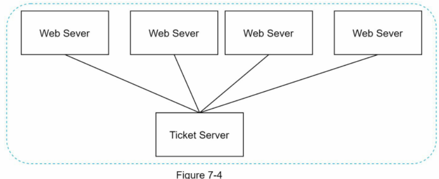

Hình 7-4

Ý tưởng cốt lõi là sử dụng tính năng auto_increment tập trung trên một máy chủ cơ sở dữ liệu duy nhất (Ticket Server). Để tìm hiểu sâu hơn, bạn có thể tham khảo bài viết trên blog kỹ thuật của Flickr [2].

**Ưu điểm:**
 * Sinh ra các ID thuần số.
 * Dễ triển khai và vận hành hiệu quả đối với các ứng dụng quy mô vừa và nhỏ.

**Nhược điểm:**
 * SPOF (Single Point of Failure - điểm lỗi đơn lẻ). Chỉ có duy nhất một ticket server đồng nghĩa với việc nếu máy chủ này gặp sự cố, toàn bộ các hệ thống phụ thuộc sẽ ngưng trệ. Để triệt tiêu SPOF, chúng ta có thể dựng nhiều ticket server song song, nhưng điều này sẽ kéo theo bài toán phức tạp mới về đồng bộ dữ liệu.

## Twitter snowflake approach (Phương pháp Snowflake của Twitter)

Những giải pháp nêu trên đã phác họa cơ chế hoạt động của các hệ thống sinh ID khác nhau. Tuy nhiên, chưa có phương án nào đáp ứng trọn vẹn các yêu cầu kỹ thuật đã đặt ra; vì vậy, chúng ta cần một hướng đi khác. Hệ thống sinh unique ID mang tên "Snowflake" của Twitter [3] là một mô hình xuất sắc và hoàn toàn thỏa mãn các tiêu chí này.

Chiến lược chia để trị (divide and conquer) là chìa khóa ở đây. Thay vì tạo trực tiếp một chuỗi ID nguyên khối, chúng ta chia cấu trúc ID thành nhiều phần khác nhau. Hình 7-5 minh họa bố cục cấu tạo của một ID 64-bit.

1 bit | 41 bits | 5 bits | 5 bits | 12 bits

| 0   | timestamp | datacenter ID | machine ID | sequence number |
| --- | --------- | ------------- | ---------- | --------------- |

Hình 7-5

Ý nghĩa của từng phần được giải thích chi tiết dưới đây:
 * **Sign bit (bit dấu):** 1 bit. Luôn được cố định là 0, dành riêng cho các mục đích mở rộng trong tương lai (ví dụ: phân biệt giữa số có dấu và không dấu).
 * **Timestamp (dấu thời gian):** 41 bits. Lưu số mili-giây trôi qua kể từ mốc thời gian gốc (epoch) mặc định hoặc epoch tùy chỉnh. Chúng tôi sử dụng epoch mặc định của Twitter Snowflake là 1288834974657, tương đương với ngày 04/11/2010 lúc 01:42:54 UTC.
 * **Datacenter ID (mã trung tâm dữ liệu):** 5 bits, tương ứng với $2^5 = 32$ data center.
 * **Machine ID (mã máy chủ):** 5 bits, tương ứng với $2^5 = 32$ máy chủ trên mỗi data center.
 * **Sequence number (số thứ tự):** 12 bits. Với mỗi ID được sinh ra trên máy chủ/tiến trình đó, số thứ tự sẽ tự động tăng thêm 1. Giá trị này được reset về 0 sau mỗi mili-giây.

# Step 3 - Design deep dive (Bước 3 - Đi sâu vào chi tiết thiết kế)

Trong phần thiết kế tổng quan, chúng ta đã thảo luận nhiều phương án thiết kế bộ sinh unique ID trong hệ thống phân tán. Chúng ta quyết định chọn phương án xây dựng dựa trên kiến trúc Snowflake của Twitter. Bây giờ, hãy đi sâu vào chi tiết kỹ thuật. Để tiện theo dõi, sơ đồ thiết kế được trình bày lại dưới đây:

Hình 7-6

| 1 bit | 41 bits   | 5 bits        | 5 bits     | 12 bits         |
| ----- | --------- | ------------- | ---------- | --------------- |
| 0     | timestamp | datacenter ID | machine ID | sequence number |

Datacenter ID và machine ID được cấu hình tĩnh khi khởi động dịch vụ, thường sẽ cố định trong suốt quá trình hệ thống vận hành. Bất kỳ sự thay đổi nào đối với datacenter ID và machine ID đều phải được kiểm soát nghiêm ngặt, vì việc cấu hình sai lệch có thể dẫn đến xung đột ID giữa các node. Trong khi đó, timestamp và sequence number được sinh động trong quá trình bộ sinh ID hoạt động.

## Timestamp

41 bits quan trọng nhất tạo nên phần timestamp. Khi timestamp tịnh tiến theo dòng thời gian, các ID sẽ tự nhiên có khả năng sắp xếp theo thời gian. Hình 7-7 minh họa ví dụ về cách chuyển đổi giá trị nhị phân sang định dạng giờ chuẩn UTC. Bạn cũng có thể chuyển đổi ngược lại từ UTC sang biểu diễn nhị phân bằng phương pháp tương tự.


Hình 7-7

Giá trị timestamp tối đa có thể biểu diễn trong 41 bits là $2^{41} - 1 = 2.199.023.255.551$ mili-giây (ms), tương đương:

$$\sim 69\text{ năm} = \frac{2.199.023.255.551\text{ ms}}{1000\text{ giây} \times 365\text{ ngày} \times 24\text{ giờ} \times 3600\text{ giây}}$$

Điều này có nghĩa là bộ sinh ID sẽ hoạt động trơn tru trong vòng 69 năm; việc chọn epoch tùy chỉnh gần với thời điểm hiện tại sẽ giúp trì hoãn thời điểm bị tràn số (overflow). Sau 69 năm, chúng ta sẽ cần đặt lại một mốc epoch mới hoặc áp dụng các kỹ thuật chuyển đổi ID khác.

## Sequence number

Sequence number có độ dài 12 bits, cung cấp $2^{12} = 4096$ tổ hợp giá trị. Trường này luôn bằng 0 trừ khi có nhiều hơn 1 ID được sinh ra trong cùng một mili-giây trên cùng một máy chủ. Về mặt lý thuyết, một máy chủ có thể đáp ứng tối đa 4.096 ID mới mỗi mili-giây.

# Step 4 - Wrap up (Bước 4 - Tổng kết)

Trong chương này, chúng ta đã thảo luận các hướng tiếp cận khác nhau để thiết kế bộ sinh unique ID: multi-master replication, UUID, ticket server, và bộ sinh ID theo mô hình Snowflake của Twitter. Chúng ta lựa chọn Snowflake vì nó đáp ứng đầy đủ mọi trường hợp nghiệp vụ và có khả năng mở rộng tuyệt vời trong môi trường phân tán.

Nếu còn thời gian vào cuối buổi phỏng vấn, dưới đây là một số chủ đề mở rộng bạn có thể thảo luận thêm:
 * **Đồng bộ hóa đồng hồ (Clock synchronization):** Trong thiết kế trên, chúng ta giả định các máy chủ sinh ID đều có đồng hồ thời gian hoàn toàn đồng nhất. Giả định này có thể không đúng khi máy chủ chạy trên kiến trúc đa lõi hoặc trên nhiều máy chủ vật lý khác nhau. Giải pháp cho bài toán đồng bộ đồng hồ nằm ngoài phạm vi cuốn sách này; tuy nhiên, việc nhận thức được sự tồn tại của vấn đề là vô cùng quan trọng. NTP (Network Time Protocol - giao thức đồng bộ thời gian mạng) là giải pháp phổ biến nhất hiện nay [4].
 * **Tinh chỉnh độ dài từng phần (Section length tuning):** Ví dụ, phân bổ ít bit hơn cho sequence number và dành nhiều bit hơn cho timestamp sẽ rất hiệu quả đối với các ứng dụng có độ tương tranh thấp nhưng cần vòng đời hoạt động lâu dài.
 * **High availability (tính sẵn sàng cao):** Bộ sinh ID là hệ thống mission-critical (tối quan trọng), do đó nó bắt buộc phải đạt độ sẵn sàng cao nhất.

Chúc mừng bạn đã hoàn thành phần nội dung này! Hãy tự hào về nỗ lực của mình. Làm tốt lắm!

# Reference materials (Tài liệu tham khảo)

[1] Universally unique identifier: https://en.wikipedia.org/wiki/Universally_unique_identifier  
[2] Ticket Servers: Distributed Unique Primary Keys on the Cheap: https://code.flickr.net/2010/02/08/ticket-servers-distributed-unique-primary-keys-on-thecheap/  
[3] Announcing Snowflake: https://blog.twitter.com/engineering/en_us/a/2010/announcingsnowflake.html  
[4] Network time protocol: https://en.wikipedia.org/wiki/Network_Time_Protocol  

# CHAPTER 8: DESIGN A URL SHORTENER (CHƯƠNG 8: THIẾT KẾ DỊCH VỤ RÚT GỌN URL)

Trong chương này, chúng ta sẽ cùng giải quyết một bài toán thiết kế hệ thống kinh điển và rất thú vị: thiết kế dịch vụ rút gọn URL tương tự như TinyURL.

# Step 1 - Understand the problem and establish design scope (Bước 1 - Hiểu rõ bài toán và xác định phạm vi thiết kế)

Các câu hỏi phỏng vấn thiết kế hệ thống thường cố ý được để mở. Để đưa ra một thiết kế chuẩn xác, việc đặt các câu hỏi làm rõ là yếu tố then chốt.

**Ứng viên:** Người phỏng vấn có thể cho một ví dụ về cách dịch vụ rút gọn URL hoạt động được không?  
**Người phỏng vấn:** Giả sử URL `https://www.systeminterview.com/q=chatsystem&c=loggedin&v=v3&l=long` là URL gốc. Dịch vụ của bạn sẽ tạo ra một bí danh (alias) ngắn hơn: `https://tinyurl.com/y7keocwj`. Khi nhấp vào bí danh này, người dùng sẽ được chuyển hướng về URL gốc.  
**Ứng viên:** Lưu lượng truy cập dự kiến là bao nhiêu?  
**Người phỏng vấn:** Có 100 triệu URL được tạo ra mỗi ngày.  
**Ứng viên:** Độ dài của URL rút gọn cần ngắn như thế nào?  
**Người phỏng vấn:** Càng ngắn càng tốt.  
**Ứng viên:** Những ký tự nào được phép xuất hiện trong URL rút gọn?  
**Người phỏng vấn:** URL rút gọn có thể là sự kết hợp của chữ số (0-9) và chữ cái (a-z, A-Z).  
**Ứng viên:** URL rút gọn có thể bị xóa hoặc cập nhật không?  
**Người phỏng vấn:** Để đơn giản hóa bài toán, hãy giả định rằng URL rút gọn không thể bị xóa hay cập nhật.  

Dưới đây là các ca sử dụng (use case) cơ bản:
1. Rút gọn URL: nhận vào một URL dài => trả về một URL ngắn hơn nhiều.
2. Chuyển hướng URL: nhận vào một URL ngắn => chuyển hướng về URL gốc.
3. Đảm bảo các tiêu chí về tính sẵn sàng cao, khả năng mở rộng và chịu lỗi (fault tolerance).

# Back of the envelope estimation

> 💡 **Giải thích thêm:** "Back of the envelope estimation" là thuật ngữ kỹ thuật chỉ việc ước tính nhanh độ lớn (scale), dung lượng lưu trữ, băng thông mạng bằng các phép tính nhẩm hoặc tính toán cơ bản dựa trên một số giả định sơ bộ, thường được thực hiện ngay trên một mảnh giấy nhỏ hoặc mặt sau của phong bì thư trong các buổi phỏng vấn thiết kế hệ thống.  
> Nguồn tham khảo: https://en.wikipedia.org/wiki/Back-of-the-envelope_calculation

 * **Tác vụ ghi (Write operation):** 100 triệu URL được tạo mỗi ngày.
 * **Số tác vụ ghi mỗi giây:** $100.000.000 / 24 / 3600 = 1160$
 * **Tác vụ đọc (Read operation):** Giả định tỷ lệ giữa tác vụ đọc và tác vụ ghi là 10:1, số tác vụ đọc mỗi giây là: $1160 \times 10 = 11.600$
 * Giả sử dịch vụ rút gọn URL sẽ hoạt động trong 10 năm, điều này đồng nghĩa chúng ta phải lưu trữ: $100.000.000 \times 365 \times 10 = 365\text{ tỷ bản ghi}$.
 * Giả định độ dài trung bình của mỗi URL là 100 ký tự (100 bytes).
 * **Dung lượng lưu trữ yêu cầu trong 10 năm:** $365\text{ tỷ} \times 100\text{ bytes} \times 10\text{ năm} = 365\text{ TB}$.

Điều quan trọng là bạn phải trình bày rõ ràng các giả định và phép tính này với người phỏng vấn để cả hai bên đều thống nhất về số liệu.

# Step 2 - Propose high-level design and get buy-in (Bước 2 - Đề xuất thiết kế tổng quan và thống nhất phương án)

Trong phần này, chúng ta sẽ thảo luận về các API endpoint (điểm cuối API), luồng chuyển hướng URL và luồng rút gọn URL.

## API Endpoints

Các API endpoint tạo điều kiện thuận lợi cho việc giao tiếp giữa client và server. Chúng ta sẽ thiết kế các API theo phong cách RESTful (kiến trúc dịch vụ web dựa trên REST). Nếu bạn chưa quen thuộc với RESTful API, bạn có thể tham khảo thêm các tài liệu bên ngoài như nguồn [1]. Một dịch vụ rút gọn URL về cơ bản cần hai API endpoint chính:

1. Rút gọn URL. Để tạo một URL ngắn mới, client gửi một HTTP POST request chứa một tham số duy nhất: URL dài ban đầu. API có cấu trúc như sau:

```
POST api/v1/data/shorten
```

 * Tham số request: `{longUrl: longURLString}`
 * Dữ liệu trả về: `shortURL`

2. Chuyển hướng URL. Để chuyển hướng một URL ngắn về URL dài tương ứng, client gửi một HTTP GET request. API có cấu trúc như sau:

```
GET api/v1/shortUrl
```

 * Trả về: `longURL` để thực hiện HTTP redirection (chuyển hướng HTTP).

## URL redirecting

Hình 8-1 minh họa điều gì sẽ xảy ra khi bạn nhập một URL rút gọn vào trình duyệt. Khi server nhận được request chứa URL rút gọn, nó sẽ chuyển đổi URL ngắn thành URL dài thông qua mã chuyển hướng 301 redirect.


Hình 8-1

Chi tiết quy trình trao đổi dữ liệu giữa client và server được thể hiện trong Hình 8-2.


Hình 8-2

Một điểm rất đáng bàn ở đây là sự khác biệt giữa 301 redirect và 302 redirect:
 * **301 redirect:** Mã 301 biểu thị rằng URL yêu cầu đã được chuyển hướng "vĩnh viễn" (permanently moved) sang URL dài. Vì là chuyển hướng vĩnh viễn, trình duyệt sẽ lưu cache phản hồi này, và các request tiếp theo tới cùng URL ngắn sẽ không được gửi tới dịch vụ rút gọn URL nữa. Thay vào đó, request sẽ được trình duyệt tự động chuyển thẳng tới server của URL dài.
 * **302 redirect:** Mã 302 biểu thị rằng URL được di chuyển "tạm thời" (temporarily moved) sang URL dài, nghĩa là các request tiếp theo cho cùng URL ngắn vẫn sẽ được gửi tới dịch vụ rút gọn URL trước, sau đó server mới thực hiện chuyển hướng tới server của URL dài.

Mỗi phương thức chuyển hướng đều có ưu và nhược điểm riêng. Nếu ưu tiên hàng đầu là giảm tải cho server, việc sử dụng 301 redirect là tối ưu vì chỉ có request đầu tiên được gửi tới máy chủ rút gọn URL. Tuy nhiên, nếu nghiệp vụ phân tích dữ liệu (analytics) là trọng tâm, 302 redirect lại là lựa chọn tốt hơn vì nó cho phép theo dõi tỷ lệ nhấp chuột (click-through rate) và nguồn gốc truy cập một cách chính xác.

Cách trực quan nhất để hiện thực hóa tính năng chuyển hướng URL là sử dụng hash table (bảng băm). Giả sử hash table lưu trữ các cặp `<shortURL, longURL>`, logic chuyển hướng có thể được thực hiện như sau:
 * Lấy URL dài: `longURL = hashTable.get(shortURL)`
 * Khi đã có `longURL`, tiến hành chuyển hướng trình duyệt.

## URL shortening

Giả sử URL ngắn có cấu trúc như sau: `www.tinyurl.com/{hashValue}`. Để đáp ứng tính năng rút gọn URL, chúng ta phải tìm một hash function (hàm băm) $f(x)$ ánh xạ một URL dài thành một `hashValue`, như mô tả trong Hình 8-3.

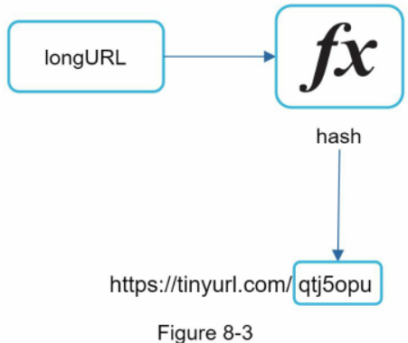

Hàm băm này phải thỏa mãn các yêu cầu bắt buộc sau:
 * Mỗi `longURL` phải được băm thành đúng một `hashValue`.
 * Mỗi `hashValue` phải có khả năng ánh xạ ngược lại chính xác `longURL` ban đầu.

Chi tiết thiết kế cho hàm băm sẽ được trình bày sâu hơn ở phần tiếp theo.

# Step 3 - Design deep dive (Bước 3 - Đi sâu vào chi tiết thiết kế)

Cho đến lúc này, chúng ta đã thảo luận về thiết kế tổng quan của việc rút gọn và chuyển hướng URL. Trong phần này, chúng ta sẽ đi sâu vào: mô hình dữ liệu (data model), hàm băm, cũng như luồng thực thi chi tiết của việc rút gọn và chuyển hướng URL.

## Data model

Trong bản thiết kế sơ bộ, mọi thứ được lưu trữ trong một hash table. Đây là điểm khởi đầu tốt; tuy nhiên, phương án này bất khả thi với các hệ thống thực tế vì tài nguyên bộ nhớ RAM có hạn và chi phí rất đắt đỏ. Lựa chọn khả dĩ hơn là lưu trữ bảng ánh xạ `<shortURL, longURL>` trong một relational database (cơ sở dữ liệu quan hệ). Hình 8-4 minh họa thiết kế bảng cơ sở dữ liệu đơn giản gồm 3 cột: `id`, `shortURL`, `longURL`.


## Hash function

Hàm băm được sử dụng để chuyển đổi một URL dài thành một URL ngắn, còn gọi là `hashValue`.

### Hash value length (Độ dài của hash value)

Giá trị `hashValue` bao gồm các ký tự thuộc tập hợp `[0-9, a-z, A-Z]`, tổng cộng có $10 + 26 + 26 = 62$ ký tự khả dụng. Để xác định độ dài của `hashValue`, chúng ta cần tìm số nguyên dương $n$ nhỏ nhất sao cho $62^n \ge 365\text{ tỷ}$. Hệ thống phải hỗ trợ tới 365 tỷ URL theo phép ước tính sơ bộ ban đầu. Bảng 8-1 thể hiện độ dài của `hashValue` và số lượng URL tối đa tương ứng mà nó có thể đại diện:

| N   | Số lượng URL tối đa có thể hỗ trợ                      |
| --- | ------------------------------------------------------ |
| 1   | $62^1 = 62$                                            |
| 2   | $62^2 = 3.844$                                         |
| 3   | $62^3 = 238.328$                                       |
| 4   | $62^4 = 14.776.336$                                    |
| 5   | $62^5 = 916.132.832$                                   |
| 6   | $62^6 = 56.800.235.584$                                |
| 7   | $62^7 = 3.521.614.606.208 \approx 3,5\text{ nghìn tỷ}$ |

Bảng 8-1

Khi $n = 7$, $62^7 \approx 3,5\text{ nghìn tỷ}$. Con số 3,5 nghìn tỷ là quá đủ để chứa 365 tỷ URL, vì vậy độ dài của `hashValue` sẽ là 7 ký tự.

Chúng ta sẽ tìm hiểu hai phương pháp xây dựng hàm băm cho dịch vụ rút gọn URL: phương pháp thứ nhất là "băm kết hợp xử lý xung đột" (hash + collision resolution), và phương pháp thứ hai là "chuyển đổi cơ số 62" (base 62 conversion). Hãy cùng phân tích từng giải pháp.

### Hash + collision resolution (Băm kết hợp xử lý xung đột)

Để rút gọn một URL dài, chúng ta cần triển khai một hàm băm có khả năng băm URL dài thành một chuỗi 7 ký tự. Giải pháp trực diện là sử dụng các thuật toán băm nổi tiếng như CRC32, MD5 hoặc SHA-1. Bảng dưới đây so sánh kết quả băm sau khi áp dụng các hàm băm khác nhau lên URL: `https://en.wikipedia.org/wiki/Systems_design`.

| Hàm băm | Giá trị băm (Thập lục phân - Hexadecimal) |
| ------- | ----------------------------------------- |
| CRC32   | 5cb54054                                  |
| MD5     | 5a62509a84df9ee03fe1230b9df8b84e          |
| SHA-1   | 0eeae7916c06853901d9ccbefbfcaf4de57ed85b  |

Bảng 8-2

Như thể hiện trong Bảng 8-2, ngay cả giá trị băm ngắn nhất (từ CRC32) cũng quá dài (nhiều hơn 7 ký tự). Làm thế nào để làm cho nó ngắn hơn?

Cách tiếp cận đầu tiên là cắt lấy 7 ký tự đầu tiên của chuỗi băm; tuy nhiên, phương pháp này rất dễ dẫn đến hiện tượng hash collision (xung đột giá trị băm). Để giải quyết xung đột băm, chúng ta có thể nối thêm vào URL gốc một chuỗi tiền định (predefined string) rồi băm lại một cách đệ quy cho đến khi không còn xung đột. Quy trình này được mô tả trong Hình 8-5.

Phương pháp này có thể loại trừ xung đột; tuy nhiên, việc phải liên tục truy vấn cơ sở dữ liệu để kiểm tra xem `shortURL` đã tồn tại hay chưa cho mỗi request là một thao tác rất tốn kém chi phí. Một kỹ thuật gọi là bloom filter (bộ lọc Bloom - cấu trúc dữ liệu xác suất kiểm tra phần tử có thuộc tập hợp hay không) [2] có thể cải thiện đáng kể hiệu năng. Bloom filter là một giải pháp xác suất cực kỳ tối ưu về bộ nhớ. Hãy tham khảo thêm tài liệu [2] để biết chi tiết.


Hình 8-5

### Base 62 conversion (Chuyển đổi cơ số 62)

Chuyển đổi cơ số là một hướng tiếp cận phổ biến khác đối với các dịch vụ rút gọn URL. Việc chuyển đổi cơ số giúp biểu diễn cùng một con số nguyên dưới các hệ thống chữ số khác nhau. Hệ cơ số 62 được lựa chọn vì có đúng 62 ký tự hợp lệ để tạo nên `hashValue`.

Hãy xem xét một ví dụ để hiểu rõ cách chuyển đổi: chuyển đổi số $11157_{10}$ sang hệ cơ số 62 ($11157_{10}$ biểu thị số 11157 trong hệ thập phân):
 * Đúng như tên gọi, hệ cơ số 62 sử dụng 62 ký tự để mã hóa. Bảng ánh xạ quy ước như sau: `0-0, ..., 9-9, 10-a, 11-b, ..., 35-z, 36-A, ..., 61-Z`, trong đó `'a'` đại diện cho 10, `'Z'` đại diện cho 61.
 * Phân tích: $11157_{10} = 2 \times 62^2 + 55 \times 62^1 + 59 \times 62^0 = [2, 55, 59] \rightarrow [2, T, X]$ trong hệ cơ số 62. Hình 8-6 thể hiện các bước tính toán.

Hình 8-6

| Phép chia    | Thương số | Số dư | Biểu diễn trong hệ cơ số 62 |
| ------------ | --------- | ----- | --------------------------- |
| $11157 / 62$ | 179       | 59    | X                           |
| $179 / 62$   | 2         | 55    | T                           |
| $2 / 62$     | 0         | 2     | 2                           |

 * Như vậy, URL rút gọn tương ứng sẽ là: `https://tinyurl.com/2TX`

### Comparison of the two approaches (So sánh hai phương pháp)

Bảng 8-3 tóm tắt các điểm khác biệt giữa hai phương pháp:

Bảng 8-3

| Băm kết hợp xử lý xung đột (Hash + collision resolution)                                      | Chuyển đổi cơ số 62 (Base 62 conversion)                                                                                     |
| --------------------------------------------------------------------------------------------- | ---------------------------------------------------------------------------------------------------------------------------- |
| Độ dài URL rút gọn được cố định.                                                              | Độ dài URL rút gọn không cố định mà tăng dần theo giá trị của ID.                                                            |
| Không bắt buộc phải có bộ sinh unique ID tập trung.                                           | Phụ thuộc hoàn toàn vào một bộ sinh unique ID.                                                                               |
| Có khả năng xảy ra xung đột và bắt buộc phải có cơ chế xử lý xung đột.                        | Hoàn toàn không xảy ra xung đột vì ID sinh ra luôn là duy nhất.                                                              |
| Không thể đoán biết được URL rút gọn khả dụng tiếp theo vì nó không phụ thuộc vào ID tuần tự. | Rất dễ đoán biết được URL rút gọn tiếp theo nếu ID tăng dần 1 đơn vị cho mỗi bản ghi mới. Đây có thể là một lỗ hổng bảo mật. |

# URL shortening deep dive (Đi sâu vào luồng rút gọn URL)

Là một trong những thành phần trọng tâm của hệ thống, chúng ta mong muốn luồng rút gọn URL phải có logic rõ ràng và hoạt động ổn định. Cơ chế chuyển đổi cơ số 62 được lựa chọn trong thiết kế này. Chúng tôi xây dựng sơ đồ sau (Hình 8-7) để minh họa toàn bộ luồng xử lý:


Hình 8-7

1. `longURL` là dữ liệu đầu vào.
2. Hệ thống kiểm tra xem `longURL` đã tồn tại trong cơ sở dữ liệu chưa.
3. Nếu đã tồn tại, điều đó có nghĩa là `longURL` này đã từng được rút gọn trước đây. Khi đó, hệ thống chỉ cần lấy `shortURL` tương ứng từ cơ sở dữ liệu và trả về cho client.
4. Nếu chưa tồn tại, đây là một `longURL` mới. Một unique ID mới (đóng vai trò khóa chính) sẽ được tạo ra bởi bộ sinh unique ID.
5. Chuyển đổi ID này thành `shortURL` bằng thuật toán chuyển đổi cơ số 62.
6. Thêm một bản ghi mới vào cơ sở dữ liệu với các thông tin: ID, `shortURL` và `longURL`.

Để luồng xử lý dễ hình dung hơn, hãy xem một ví dụ thực tế:
 * Giả sử `longURL` đầu vào là: `https://en.wikipedia.org/wiki/Systems_design`
 * Bộ sinh unique ID tạo ra ID: `2009215674938`.
 * Chuyển đổi ID sang `shortURL` bằng thuật toán cơ số 62: ID `2009215674938` được chuyển thành chuỗi `"zn9edcu"`.
 * Lưu trữ ID, `shortURL`, và `longURL` vào cơ sở dữ liệu như trình bày trong Bảng 8-4.

Bảng 8-4

| id            | shortURL | longURL                                      |
| ------------- | -------- | -------------------------------------------- |
| 2009215674938 | zn9edcu  | https://en.wikipedia.org/wiki/Systems_design |

Bộ sinh distributed unique ID đóng vai trò rất quan trọng. Chức năng chính của nó là cung cấp các ID duy nhất trên quy mô toàn cục (globally unique IDs) để làm nguyên liệu tạo URL rút gọn. Trong môi trường phân tán cao độ, việc hiện thực hóa bộ sinh unique ID là bài toán không hề đơn giản. May mắn thay, chúng ta đã thảo luận chi tiết các giải pháp trong "Chương 7: Thiết kế bộ sinh unique ID trong hệ thống phân tán". Bạn có thể tham khảo lại chương này để nắm vững kiến thức.

# URL redirecting deep dive (Đi sâu vào luồng chuyển hướng URL)

Hình 8-8 thể hiện thiết kế chi tiết của quy trình chuyển hướng URL. Vì lượng truy vấn đọc (read) luôn áp đảo lượng truy vấn ghi (write), bảng ánh xạ `<shortURL, longURL>` được lưu trong cache để tăng tốc độ phản hồi.


Hình 8-8

Luồng chuyển hướng URL được tóm lược qua các bước sau:
1. Người dùng nhấp vào một liên kết URL ngắn: `https://tinyurl.com/zn9edcu`
2. Load balancer (bộ cân bằng tải) điều phối request tới các web server.
3. Nếu `shortURL` đã có sẵn trong cache, trả về trực tiếp `longURL`.
4. Nếu `shortURL` chưa có trong cache, server sẽ truy vấn `longURL` từ cơ sở dữ liệu. Nếu không tìm thấy trong cơ sở dữ liệu, rất có thể người dùng đã nhập một URL rút gọn không hợp lệ.
5. `longURL` hợp lệ được trả về để trình duyệt tiến hành chuyển hướng người dùng.

# Step 4 - Wrap up (Bước 4 - Tổng kết)

Trong chương này, chúng ta đã nghiên cứu về thiết kế API, mô hình dữ liệu, hàm băm, luồng rút gọn URL và luồng chuyển hướng URL. Nếu vẫn còn thời gian vào cuối buổi phỏng vấn, dưới đây là một số chủ đề mở rộng bạn có thể đề cập:
 * **Rate limiter (bộ giới hạn tần suất truy cập):** Một rủi ro bảo mật tiềm ẩn là kẻ tấn công có thể gửi ồ ạt các yêu cầu rút gọn URL nhằm làm tê liệt hệ thống. Bộ giới hạn tần suất giúp sàng lọc và chặn các request dựa trên địa chỉ IP hoặc các bộ lọc tùy biến. Để ôn lại kiến thức này, hãy xem lại "Chương 4: Thiết kế bộ giới hạn tần suất".
 * **Mở rộng tầng Web (Web server scaling):** Vì tầng web là stateless (không lưu trạng thái), việc mở rộng quy mô rất dễ dàng bằng cách thêm hoặc bớt các web server.
 * **Mở rộng cơ sở dữ liệu (Database scaling):** Kỹ thuật database replication (nhân bản cơ sở dữ liệu) và sharding (phân mảnh dữ liệu) là những phương pháp phổ biến.
 * **Phân tích dữ liệu (Analytics):** Dữ liệu là yếu tố then chốt cho sự thành công của doanh nghiệp. Tích hợp giải pháp phân tích dữ liệu vào dịch vụ rút gọn URL sẽ giúp trả lời các câu hỏi quan trọng như: Có bao nhiêu người nhấp vào liên kết? Họ nhấp vào thời điểm nào? Nguồn truy cập từ đâu?
 * **Tính sẵn sàng, tính nhất quán và độ tin cậy (Availability, consistency, and reliability):** Đây là những nguyên lý cốt lõi quyết định sự thành bại của bất kỳ hệ thống lớn nào. Chúng ta đã bàn kỹ về chúng trong Chương 1, hãy xem lại để củng cố nền tảng.

Chúc mừng bạn đã hoàn thành chương này! Bạn đã làm rất tốt!

# Reference materials (Tài liệu tham khảo)

[1] A RESTful Tutorial: https://www.restapitutorial.com/index.html  
[2] Bloom filter: https://en.wikipedia.org/wiki/Bloom_filter  

# CHAPTER 9: DESIGN A WEB CRAWLER (CHƯƠNG 9: THIẾT KẾ TRÌNH THU THẬP DỮ LIỆU WEB)

Trong chương này, chúng ta sẽ tập trung vào việc thiết kế một web crawler (trình thu thập dữ liệu web): một câu hỏi phỏng vấn thiết kế hệ thống kinh điển và vô cùng hấp dẫn.

Web crawler còn được gọi là robot hoặc spider. Nó được các công cụ tìm kiếm sử dụng rộng rãi để phát hiện các nội dung mới hoặc nội dung vừa được cập nhật trên internet. Nội dung ở đây có thể là trang web, hình ảnh, video, tệp PDF, v.v. Một crawler bắt đầu bằng việc tải về một vài trang web khởi đầu, sau đó lần theo các siêu liên kết (hyperlinks) trên các trang đó để tiếp tục thu thập nội dung mới. Hình 9-1 minh họa trực quan quy trình thu thập dữ liệu này.


Crawler được sử dụng cho nhiều mục đích đa dạng:
 * **Đánh chỉ mục cho công cụ tìm kiếm (Search engine indexing):** Đây là trường hợp sử dụng phổ biến nhất. Crawler thu thập các trang web để xây dựng kho chỉ mục cục bộ phục vụ việc tìm kiếm. Ví dụ, Googlebot chính là trình thu thập dữ liệu đứng sau công cụ tìm kiếm Google.
 * **Lưu trữ dữ liệu web (Web archiving):** Đây là quá trình thu thập thông tin từ web nhằm mục đích bảo tồn dữ liệu cho tương lai. Chẳng hạn, nhiều thư viện quốc gia vận hành các crawler để lưu trữ các trang web. Các ví dụ tiêu biểu gồm Thư viện Quốc hội Hoa Kỳ [1] và Kho lưu trữ web của Liên minh Châu Âu [2].
 * **Khai phá dữ liệu web (Web mining):** Sự bùng nổ của web mở ra cơ hội chưa từng có cho việc khai phá dữ liệu (data mining), giúp khám phá các tri thức hữu ích từ internet. Ví dụ, các tổ chức tài chính hàng đầu sử dụng crawler để tải về biên bản họp cổ đông và báo cáo thường niên nhằm nắm bắt các chiến lược kinh doanh trọng yếu của doanh nghiệp.
 * **Giám sát web (Web monitoring):** Crawler giúp theo dõi các hành vi vi phạm bản quyền và thương hiệu trên internet. Điển hình như Digimarc [3] sử dụng crawler để phát hiện các nội dung và báo cáo bị sao chép trái phép.

Độ phức tạp khi phát triển một web crawler hoàn toàn phụ thuộc vào quy mô mà hệ thống hướng tới. Nó có thể chỉ là một bài tập nhỏ ở trường đại học tốn vài giờ để hoàn thành, nhưng cũng có thể là một đại dự án đòi hỏi sự cải tiến liên tục từ một đội ngũ kỹ sư chuyên trách. Vì vậy, chúng ta sẽ cùng khảo sát quy mô và các tính năng cần đáp ứng dưới đây.

# Step 1 - Understand the problem and establish design scope (Bước 1 - Hiểu rõ bài toán và xác định phạm vi thiết kế)

Thuật toán cơ bản của một web crawler rất mạch lạc:
1. Cho trước một danh sách URL, tải về tất cả các trang web ứng với các URL đó.
2. Trích xuất các liên kết (URLs) nằm bên trong những trang web vừa tải.
3. Thêm các URL mới trích xuất được vào danh sách các URL cần tải tiếp. Lặp lại 3 bước này.

Liệu một crawler trong thực tế có thực sự vận hành đơn giản như thuật toán cơ bản trên? Chắc chắn là không. Thiết kế một hệ thống crawler có khả năng mở rộng quy mô cực lớn là một bài toán cực kỳ phức tạp. Không ai có thể thiết kế trọn vẹn một hệ thống crawler khổng lồ trong thời lượng của một buổi phỏng vấn. Do đó, trước khi bắt tay vào thiết kế, việc đặt câu hỏi để nắm rõ yêu cầu và khoanh vùng phạm vi là bắt buộc:

**Ứng viên:** Mục đích chính của crawler là gì? Dùng để đánh chỉ mục công cụ tìm kiếm, khai phá dữ liệu hay cho mục đích nào khác?  
**Người phỏng vấn:** Phục vụ đánh chỉ mục cho công cụ tìm kiếm.  
**Ứng viên:** Trình thu thập dữ liệu cần thu thập bao nhiêu trang web mỗi tháng?  
**Người phỏng vấn:** 1 tỷ trang web.  
**Ứng viên:** Hệ thống cần xử lý những định dạng nội dung nào? Chỉ trang HTML hay cả các định dạng khác như PDF và hình ảnh?  
**Người phỏng vấn:** Chỉ các trang HTML.  
**Ứng viên:** Chúng ta có cần quan tâm đến các trang web mới được thêm vào hoặc vừa chỉnh sửa không?  
**Người phỏng vấn:** Có, chúng ta cần cập nhật các trang web mới hoặc vừa được chỉnh sửa.  
**Ứng viên:** Chúng ta có cần lưu trữ các trang HTML đã thu thập từ web không?  
**Người phỏng vấn:** Có, thời gian lưu trữ tối đa lên tới 5 năm.  
**Ứng viên:** Chúng ta xử lý các trang web có nội dung trùng lặp như thế nào?  
**Người phỏng vấn:** Những trang có nội dung trùng lặp cần được bỏ qua.  

Trên đây là các câu hỏi mẫu bạn có thể trao đổi với người phỏng vấn. Nắm bắt chính xác yêu cầu và làm sáng tỏ các điểm mù là tối quan trọng. Ngay cả khi được yêu cầu thiết kế một sản phẩm quen thuộc như crawler, các giả định của bạn và người phỏng vấn có thể hoàn toàn khác nhau.

Bên cạnh các tính năng nghiệp vụ, một web crawler đạt chuẩn cần đảm bảo các đặc tính kỹ thuật sau:
 * **Scalability (Khả năng mở rộng):** Internet vô cùng rộng lớn với hàng tỷ trang web. Quá trình thu thập phải đạt hiệu suất cực cao thông qua cơ chế xử lý song song (parallelization).
 * **Robustness (Tính bền vững):** Môi trường web chứa đầy cạm bẫy: mã HTML lỗi, máy chủ không phản hồi, sự cố sập kết nối, liên kết độc hại, v.v. Crawler phải xử lý linh hoạt mọi tình huống ngoại lệ này.
 * **Politeness (Tính lịch sự):** Crawler không được gửi quá nhiều yêu cầu dồn dập đến cùng một website trong khoảng thời gian ngắn để tránh làm sập máy chủ của họ.
 * **Extensibility (Khả năng mở rộng linh hoạt):** Hệ thống cần linh hoạt để có thể hỗ trợ các định dạng nội dung mới mà chỉ cần sửa đổi tối thiểu. Ví dụ: nếu sau này cần thu thập thêm hình ảnh, chúng ta không cần phải đập đi xây lại toàn bộ hệ thống.

## Back of the envelope estimation

Các phép tính ước lượng dưới đây dựa trên một số giả định, và điều quan trọng là phải trao đổi trực tiếp với người phỏng vấn để thống nhất:
 * Giả sử có 1 tỷ trang web được tải về mỗi tháng.
 * **QPS (Queries Per Second - số lượt truy vấn mỗi giây):**

$$1.000.000.000 / 30\text{ ngày} / 24\text{ giờ} / 3600\text{ giây} \approx 400\text{ trang/giây}.$$
 * **Peak QPS (QPS lúc cao điểm):** $2 \times \text{QPS} = 800\text{ trang/giây}$.
 * Giả định kích thước trung bình của một trang web là 500 KB.
 * Dung lượng lưu trữ mỗi tháng: $1\text{ tỷ trang} \times 500\text{ KB} = 500\text{ TB/tháng}$.
 * Giả sử dữ liệu được lưu trữ trong 5 năm:

$$500\text{ TB} \times 12\text{ tháng} \times 5\text{ năm} = 30\text{ PB}.$$

Chúng ta cần một hệ thống lưu trữ có dung lượng 30 PB để chứa nội dung thu thập trong 5 năm.

# Step 2 - Propose high-level design and get buy-in (Bước 2 - Đề xuất thiết kế tổng quan và thống nhất phương án)

Sau khi các yêu cầu đã rõ ràng, chúng ta tiến hành thiết kế kiến trúc tổng quan. Kế thừa từ các nghiên cứu kinh điển về web crawler [4] [5], chúng tôi đề xuất thiết kế tổng quan như trong Hình 9-2.


Hình 9-2

Trước hết, chúng ta sẽ tìm hiểu chức năng của từng thành phần trong thiết kế, sau đó sẽ đi qua từng bước trong luồng xử lý của crawler.

## Seed URLs

Web crawler sử dụng các seed URLs (URL hạt giống / điểm xuất phát) làm điểm khởi đầu cho toàn bộ tiến trình thu thập. Chẳng hạn, để thu thập toàn bộ các trang của một trường đại học, cách trực quan nhất là chọn tên miền chính của trường đó làm seed URL.

Để thu thập toàn bộ mạng internet, chúng ta cần sáng tạo trong việc chọn seed URLs. Một seed URL tốt đóng vai trò như điểm xuất phát thuận lợi để crawler có thể duyệt qua càng nhiều liên kết càng tốt. Chiến lược thông thường là phân chia không gian URL thành các tập nhỏ hơn. Cách thứ nhất là chia theo vị trí địa lý, vì mỗi quốc gia lại có các trang web phổ biến riêng biệt. Cách khác là phân loại seed URLs theo chủ đề: mua sắm, thể thao, y tế, v.v. Việc lựa chọn seed URL là một câu hỏi mở, người phỏng vấn không kỳ vọng một câu trả lời hoàn hảo tuyệt đối, mà muốn thấy tư duy phân tích của bạn.

## URL Frontier

Hầu hết các web crawler hiện đại đều chia trạng thái thu thập thành hai nhóm: các URL chờ tải và các URL đã tải xong. Thành phần lưu trữ các URL chờ tải được gọi là URL Frontier (hàng đợi URL cần thu thập). Bạn có thể hình dung đây là một hàng đợi FIFO queue (First-In-First-Out - vào trước ra trước). Chi tiết về URL Frontier sẽ được bàn sâu trong phần deep dive.

## HTML Downloader

HTML Downloader chịu trách nhiệm tải các trang web từ internet dựa trên danh sách URL do URL Frontier cung cấp.

## DNS Resolver

Để tải một trang web, URL bắt buộc phải được chuyển đổi thành địa chỉ IP. HTML Downloader sẽ gọi DNS Resolver (hệ thống phân giải tên miền) để lấy địa chỉ IP tương ứng. Ví dụ: URL `www.wikipedia.org` được phân giải thành địa chỉ IP `198.35.26.96` (số liệu ghi nhận ngày 05/03/2019).

## Content Parser

Sau khi một trang web được tải về, nó phải được phân tích cú pháp (parse) và kiểm tra tính hợp lệ, bởi vì các trang web bị lỗi cấu trúc có thể gây ra sự cố và làm lãng phí không gian lưu trữ. Nếu nhúng bộ phân tích cú pháp trực tiếp vào máy chủ crawler, tốc độ thu thập sẽ bị kéo chậm đáng kể. Vì vậy, Content Parser được tách thành một thành phần độc lập.

## Content Seen?

Nghiên cứu trực tuyến [6] chỉ ra rằng có tới 29% trang web chứa nội dung trùng lặp, điều này dễ dẫn đến việc một nội dung bị lưu lại nhiều lần. Chúng tôi đưa vào cấu trúc dữ liệu "Content Seen?" để loại bỏ dữ liệu dư thừa và rút ngắn thời gian xử lý. Nó giúp phát hiện xem nội dung mới thu thập đã từng được lưu trữ trong hệ thống trước đó hay chưa.

Để so sánh hai tài liệu HTML, chúng ta có thể so sánh từng ký tự một. Tuy nhiên, cách này cực kỳ chậm và tốn kém thời gian, nhất là khi phải đối chiếu giữa hàng tỷ trang web. Một giải pháp tối ưu hơn nhiều là so sánh giá trị băm (hash values) của hai trang web đó [7].

## Content Storage

Đây là hệ thống lưu trữ nội dung HTML. Việc lựa chọn công nghệ lưu trữ phụ thuộc vào nhiều yếu tố: định dạng dữ liệu, kích thước dữ liệu, tần suất truy cập, vòng đời lưu trữ, v.v. Cả ổ cứng (disk) và bộ nhớ RAM (memory) đều được sử dụng:
 * Phần lớn nội dung được lưu trữ trên disk vì dung lượng tập dữ liệu quá lớn, không thể chứa hết trong memory.
 * Các nội dung phổ biến, truy cập thường xuyên sẽ được cache trong memory để giảm độ trễ (latency).

## URL Extractor

URL Extractor có nhiệm vụ phân tích và trích xuất các siêu liên kết từ các trang HTML. Hình 9-3 minh họa ví dụ về quy trình trích xuất liên kết. Các đường dẫn tương đối (relative paths) sẽ được chuyển đổi thành URL tuyệt đối (absolute URLs) bằng cách thêm tiền tố `"https://en.wikipedia.org"`.


Hình 9-3

## URL Filter

URL Filter đóng vai trò lọc và loại bỏ các định dạng nội dung không mong muốn, các phần mở rộng tệp không cần thiết, các liên kết lỗi, và các URL nằm trong danh sách đen (blacklist).

## URL Seen?

"URL Seen?" là cấu trúc dữ liệu giúp theo dõi các URL đã được thu thập trước đó hoặc hiện đã nằm sẵn trong Frontier. "URL Seen?" giúp tránh việc thêm cùng một URL nhiều lần, ngăn chặn việc gia tăng tải không cần thiết lên máy chủ và loại trừ nguy cơ rơi vào vòng lặp vô tận.

Bloom filter và hash table là hai kỹ thuật phổ biến nhất để hiện thực hóa thành phần "URL Seen?". Chi tiết triển khai bloom filter và hash table sẽ không đi sâu tại đây; bạn có thể tham khảo thêm các tài liệu [4] [8].

## URL Storage

URL Storage là nơi lưu trữ thông tin về các URL đã được xử lý xong.

Chúng ta đã điểm qua toàn bộ các khối chức năng. Bây giờ, hãy ghép chúng lại với nhau để giải thích luồng hoạt động tổng thể.

## Web crawler workflow (Luồng hoạt động của Web Crawler)

Để giải thích rõ quy trình từng bước, các con số thứ tự đã được đánh dấu trực tiếp trên sơ đồ thiết kế trong Hình 9-4.


Hình 9-4

 * **Bước 1:** Đưa các Seed URLs vào URL Frontier.
 * **Bước 2:** HTML Downloader lấy danh sách các URL từ URL Frontier.
 * **Bước 3:** HTML Downloader gửi yêu cầu tới DNS Resolver để lấy địa chỉ IP của các URL và bắt đầu tải nội dung trang web.
 * **Bước 4:** Content Parser phân tích cú pháp các trang HTML và xác thực tính hợp lệ của trang.
 * **Bước 5:** Sau khi nội dung được phân tích và xác thực, nó được chuyển tiếp tới thành phần "Content Seen?".
 * **Bước 6:** Thành phần "Content Seen?" kiểm tra xem nội dung trang HTML này đã tồn tại trong bộ lưu trữ chưa:
    * Nếu đã có trong bộ lưu trữ, nghĩa là nội dung tương tự (dù từ URL khác) đã được xử lý; trang HTML này sẽ bị hủy bỏ.  
    * Nếu chưa có, nội dung này là hoàn toàn mới; nó được chuyển tới Link Extractor.  
 * **Bước 7:** Link Extractor trích xuất các liên kết tiềm năng từ trang HTML.
 * **Bước 8:** Các liên kết được trích xuất sẽ được chuyển qua URL Filter.
 * **Bước 9:** Sau khi được lọc sạch, các URL được chuyển tiếp tới thành phần "URL Seen?".
 * **Bước 10:** Thành phần "URL Seen?" kiểm tra xem URL đã từng được xử lý hay chưa. Nếu đã có, hệ thống sẽ bỏ qua.
 * **Bước 11:** Nếu URL chưa từng được xử lý, nó sẽ được ghi danh vào URL Frontier để chờ tải.

# Step 3 - Design deep dive (Bước 3 - Đi sâu vào chi tiết thiết kế)

Cho đến lúc này, chúng ta đã nắm bắt được bức tranh kiến trúc tổng quan. Tiếp theo, chúng ta sẽ đi sâu vào các thành phần cấu tạo và các kỹ thuật trọng yếu nhất:
 * DFS (Depth-First Search - tìm kiếm theo chiều sâu) so với BFS (Breadth-First Search - tìm kiếm theo chiều rộng)
 * URL Frontier
 * HTML Downloader
 * Robustness (Tính bền vững)
 * Extensibility (Khả năng mở rộng)
 * Phát hiện và ngăn chặn nội dung có vấn đề

## DFS vs BFS (DFS so với BFS)

Bạn có thể hình dung mạng internet như một directed graph (đồ thị có hướng), trong đó các trang web là các đỉnh (nodes) và các hyperlink (URLs) là các cạnh (edges). Quá trình thu thập dữ liệu web thực chất là việc duyệt trên đồ thị có hướng từ trang web này sang trang web khác.

Hai thuật toán duyệt đồ thị phổ biến nhất là DFS và BFS. Tuy nhiên, DFS thường không phải là lựa chọn thích hợp vì độ sâu của đồ thị web có thể là vô hạn. BFS là thuật toán được sử dụng chủ đạo bởi các web crawler, thường được cài đặt thông qua một FIFO queue. Trong hàng đợi FIFO, các URL được lấy ra theo đúng thứ tự mà chúng được đưa vào. Dẫu vậy, cách triển khai BFS cơ bản gặp phải hai vấn đề lớn:

 * Phần lớn các liên kết trong cùng một trang web thường trỏ ngược lại chính domain (host) đó. Trong Hình 9-5, hầu hết liên kết trên trang `wikipedia.com` đều là internal links (liên kết nội bộ), khiến crawler liên tục gửi yêu cầu dồn dập đến cùng một máy chủ `wikipedia.com`. Khi crawler tải các trang web này song song, máy chủ của Wikipedia sẽ bị quá tải request. Hành vi này bị coi là "impolite" (bất lịch sự / thiếu văn minh).


Hình 9-5

 * Thuật toán BFS tiêu chuẩn không tính đến độ ưu tiên (priority) của các URL. Không gian mạng vô cùng rộng lớn và không phải trang web nào cũng có chất lượng cũng như tầm quan trọng như nhau. Do đó, chúng ta cần phân loại và ưu tiên các URL dựa trên PageRank, lưu lượng truy cập (traffic), tần suất cập nhật, v.v.

## URL frontier

URL frontier giúp giải quyết triệt để những vấn đề này. URL frontier là cấu trúc dữ liệu lưu trữ các URL chờ được tải. Đây là thành phần mang tính quyết định để bảo đảm tính lịch sự (politeness), độ ưu tiên của URL (URL prioritization), và độ tươi mới của dữ liệu (freshness). Một số bài báo khoa học giá trị về URL frontier được dẫn tại tài liệu tham khảo [5] [9]. Các đúc kết chính gồm có:

### Politeness (Tính lịch sự)

Nhìn chung, một web crawler cần tránh gửi quá nhiều yêu cầu tới cùng một máy chủ lưu trữ trong khoảng thời gian ngắn. Việc dội quá nhiều request có thể bị xem là hành vi bất lịch sự, thậm chí bị hệ thống tường lửa coi như một cuộc tấn công từ chối dịch vụ (DoS - Denial of Service). Ví dụ, nếu không có cơ chế hãm, crawler có thể bắn hàng nghìn request mỗi giây tới cùng một website, đánh sập hoàn toàn web server đó.

Ý tưởng cốt lõi để đảm bảo tính lịch sự là: **chỉ tải từng trang một từ cùng một host tại một thời điểm**. Một khoảng thời gian chờ (delay) có thể được chèn vào giữa hai tác vụ tải liên tiếp. Ràng buộc lịch sự này được thực thi bằng cách duy trì bảng ánh xạ từ hostname của website tới các downloader thread (luồng xử lý tải dữ liệu). Mỗi worker thread sẽ sở hữu một FIFO queue riêng biệt và chỉ lấy URL từ chính hàng đợi đó để tải. Hình 9-6 minh họa thiết kế quản lý tính lịch sự.


 * **Queue router (bộ định tuyến hàng đợi):** Đảm bảo mỗi hàng đợi ($b_1, b_2, \dots, b_n$) chỉ chứa các URL đến từ cùng một host duy nhất.
 * **Mapping table (bảng ánh xạ):** Ánh xạ mỗi host vào một hàng đợi tương ứng.

| Host          | Queue |
| ------------- | ----- |
| wikipedia.com | b1    |
| apple.com     | b2    |
| nike.com      | bn    |

Bảng 9-1

 * **FIFO queues $b_1, b_2$ đến $b_n$:** Mỗi hàng đợi chỉ chứa các URL xuất phát từ cùng một host.
 * **Queue selector (bộ chọn hàng đợi):** Mỗi worker thread được gán với một FIFO queue cố định và chỉ lấy URL từ hàng đợi đó. Logic chọn hàng đợi do Queue selector điều phối.
 * **Worker thread 1 đến N:** Mỗi worker thread tải tuần tự từng trang web từ cùng một host. Có thể chèn khoảng trễ giữa các lần tải.

### Priority (Độ ưu tiên)

Một bài đăng ngẫu nhiên trên diễn đàn thảo luận về sản phẩm Apple có giá trị thông tin rất khác biệt so với một bài viết trên trang chủ của Apple. Dù cả hai đều chứa từ khóa "Apple", việc crawler ưu tiên quét trang chủ Apple trước là điều hoàn toàn hợp lý.

Chúng ta phân cấp ưu tiên các URL dựa trên mức độ hữu ích, có thể đo lường qua PageRank [10], lưu lượng truy cập website, tần suất cập nhật nội dung, v.v. Thành phần "Prioritizer" sẽ đảm nhiệm việc tính toán và phân loại độ ưu tiên cho các URL. Vui lòng xem tài liệu [5] [10] để tìm hiểu sâu hơn. Hình 9-7 minh họa kiến trúc quản lý độ ưu tiên của URL.


 * **Prioritizer:** Nhận đầu vào là các URL và tính toán độ ưu tiên tương ứng.
 * **Queue $f_1$ đến $f_n$:** Mỗi hàng đợi đại diện cho một mức độ ưu tiên xác định. Các hàng đợi có độ ưu tiên cao sẽ có xác suất được chọn lớn hơn.
 * **Queue selector:** Lựa chọn ngẫu nhiên một hàng đợi, với trọng số thiên vị về phía các hàng đợi có độ ưu tiên cao hơn.

Hình 9-8 biểu diễn thiết kế hoàn chỉnh của URL frontier, tích hợp cả hai module:
 * **Front queues:** Điều phối và quản lý mức độ ưu tiên.
 * **Back queues:** Quản lý và đảm bảo tính lịch sự.

### Freshness (Độ tươi mới của dữ liệu)

Các trang web liên tục được bổ sung, xóa bỏ hoặc chỉnh sửa nội dung. Một web crawler bắt buộc phải định kỳ thu thập lại (recrawl) các trang đã tải để giữ cho tập dữ liệu luôn được cập nhật mới nhất. Tuy nhiên, việc thu thập lại toàn bộ tất cả URL là điều bất khả thi, cực kỳ tốn thời gian và lãng phí tài nguyên.

Dưới đây là một số chiến lược tối ưu hóa độ tươi mới của dữ liệu:


 * Thu thập lại dựa trên lịch sử cập nhật của từng trang web cụ thể.
 * Phân loại độ ưu tiên của URL và tiến hành thu thập lại các trang quan trọng trước với tần suất dày đặc hơn.

### Storage for URL Frontier (Lưu trữ cho URL Frontier)

Trong các hệ thống tìm kiếm thực tế, số lượng URL nằm trong frontier có thể lên đến hàng trăm triệu bản ghi [4]. Việc giữ toàn bộ trong bộ nhớ RAM là phương án không bền vững và không thể mở rộng. Ngược lại, lưu toàn bộ xuống ổ đĩa cũng không khả thi vì tốc độ đọc/ghi của ổ đĩa rất chậm, sẽ nhanh chóng trở thành điểm nghẽn cổ chai (bottleneck) cho toàn bộ tiến trình crawl.

Chúng tôi áp dụng giải pháp lai (hybrid approach). Phần lớn URL được lưu trên ổ đĩa để đảm bảo dung lượng lưu trữ không bao giờ là rào cản. Đồng thời, để giảm thiểu chi phí đọc/ghi ổ đĩa, chúng tôi duy trì các bộ đệm (buffers) trong bộ nhớ RAM cho các thao tác enqueue/dequeue. Dữ liệu trong bộ đệm sẽ được ghi đồng bộ định kỳ xuống ổ cứng.

## HTML Downloader

HTML Downloader tải các trang web từ internet thông qua giao thức HTTP. Trước khi tìm hiểu chi tiết về HTML Downloader, chúng ta cần nắm rõ giao thức Robots Exclusion Protocol.

### Robots.txt

Tệp `robots.txt`, hay còn gọi là Robots Exclusion Protocol (giao thức loại trừ robot), là chuẩn giao tiếp chung được các website sử dụng để tương tác với các crawler. Tệp này quy định rõ những trang hoặc thư mục nào crawler được phép hoặc không được phép tải về. Trước khi tiến hành quét một website, crawler phải kiểm tra tệp `robots.txt` tương ứng và tuân thủ các quy tắc trong đó.

Để tránh việc phải tải lại tệp `robots.txt` lặp đi lặp lại nhiều lần, chúng tôi lưu cache nội dung của tệp này. Tệp sẽ được định kỳ tải về và cập nhật vào cache. Dưới đây là một đoạn trích từ tệp `robots.txt` của `https://www.amazon.com/robots.txt`. Có thể thấy một số thư mục như `creatorhub` bị cấm đối với Googlebot:

```
User-agent: Googlebot
Disallow: /creatorhub/*
Disallow: /rss/people/*/reviews
Disallow: /gp/pdp/rss/*/reviews
Disallow: /gp/cdp/member-reviews/
Disallow: /gp/aw/cr/
```

Bên cạnh `robots.txt`, tối ưu hóa hiệu năng là một khía cạnh quan trọng khác cần được xử lý đối với HTML downloader.

### Performance optimization (Tối ưu hóa hiệu năng)

Dưới đây là danh sách các kỹ thuật tối ưu hóa hiệu năng cho HTML downloader:

**1. Distributed crawl (Thu thập dữ liệu phân tán)**

Để đạt hiệu năng vượt trội, các tác vụ thu thập được phân bổ đồng thời trên nhiều máy chủ, và mỗi máy chủ lại vận hành nhiều luồng (threads) song song. Không gian URL được phân chia thành nhiều phần nhỏ; mỗi downloader sẽ chịu trách nhiệm xử lý một tập con URL nhất định. Hình 9-9 mô tả ví dụ về mô hình thu thập phân tán.


**2. Cache DNS Resolver (Lưu cache DNS Resolver)**

DNS Resolver là một điểm nghẽn lớn đối với các crawler vì việc phân giải DNS thường tốn thời gian do tính chất đồng bộ (synchronous) của nhiều giao diện DNS. Thời gian phản hồi DNS dao động từ 10ms đến 200ms. Khi một luồng của crawler thực hiện request tới DNS, các luồng khác có thể bị chặn (blocked) cho tới khi request đầu tiên hoàn tất. Việc duy trì một bộ đệm DNS cache cục bộ để tránh truy vấn DNS liên tục là kỹ thuật tối ưu hóa tốc độ cực kỳ hiệu quả. DNS cache của chúng tôi lưu trữ bảng ánh xạ từ domain name sang địa chỉ IP và được cập nhật định kỳ thông qua các cron job.

**3. Locality (Tính cục bộ theo địa lý)**

Phân bổ các máy chủ crawl theo từng khu vực địa lý. Khi các crawl server đặt gần với máy chủ lưu trữ website mục tiêu hơn, crawler sẽ đạt tốc độ tải trang nhanh hơn đáng kể. Nguyên lý phân bổ cục bộ này áp dụng cho hầu hết các thành phần trong hệ thống: crawl servers, cache, queue, storage, v.v.

**4. Short timeout (Thiết lập thời gian chờ ngắn)**

Một số web server phản hồi rất chậm chạp hoặc thậm chí treo hoàn toàn. Để tránh việc crawler phải chờ đợi vô ích, chúng ta thiết lập một ngưỡng thời gian chờ tối đa (maximal wait time). Nếu máy chủ đích không phản hồi trong khoảng thời gian định trước này, crawler sẽ lập tức hủy bỏ tác vụ và chuyển sang thu thập các trang khác.

## Robustness (Tính bền vững)

Ngoài tối ưu hóa hiệu năng, tính bền vững cũng là yếu tố sống còn. Chúng tôi đề xuất một số giải pháp để nâng cao tính bền vững cho hệ thống:
 * **Consistent hashing (băm nhất quán):** Giúp cân bằng tải đồng đều giữa các downloader. Việc thêm mới hoặc loại bỏ một máy chủ download có thể được thực hiện trơn tru bằng thuật toán consistent hashing. Xem chi tiết tại "Chương 5: Thiết kế băm nhất quán".
 * **Lưu trữ trạng thái và dữ liệu thu thập:** Để phòng ngừa sự cố sập nguồn hay lỗi phần cứng, trạng thái tiến trình và dữ liệu thu thập được ghi liên tục vào hệ thống lưu trữ. Khi có sự cố xảy ra, tiến trình thu thập bị gián đoạn có thể dễ dàng phục hồi bằng cách tải lại các trạng thái đã lưu.
 * **Exception handling (xử lý ngoại lệ):** Lỗi là điều không thể tránh khỏi và diễn ra thường nhật trong một hệ thống quy mô lớn. Crawler phải bắt và xử lý các ngoại lệ một cách mềm dẻo (gracefully) để tránh làm sập toàn bộ hệ thống.
 * **Data validation (kiểm thực dữ liệu):** Đây là biện pháp phòng ngừa hữu hiệu để ngăn chặn các lỗi phát sinh do dữ liệu bất thường.

## Extensibility (Khả năng mở rộng)

Hầu hết mọi hệ thống đều phát triển theo thời gian, do đó một trong những mục tiêu thiết kế là làm cho hệ thống đủ linh hoạt để hỗ trợ các định dạng nội dung mới. Crawler có thể dễ dàng mở rộng bằng cách cắm thêm các module xử lý chuyên biệt. Hình 9-10 minh họa cách tích hợp các module mới.


Hình 9-10

 * Module PNG Downloader được gắn thêm vào để tải các tệp định dạng PNG.
 * Module Web Monitor được bổ sung nhằm giám sát môi trường web, phát hiện các hành vi xâm phạm bản quyền và nhãn hiệu thương mại.

## Detect and avoid problematic content (Phát hiện và phòng tránh nội dung có vấn đề)

Phần này thảo luận về các kỹ thuật phát hiện và ngăn chặn nội dung trùng lặp, vô nghĩa hoặc độc hại.

**1. Redundant content (Nội dung trùng lặp)**

Như đã đề cập trước đó, có tới gần 30% các trang web là bản sao trùng lặp. Việc sử dụng các hàm băm hoặc mã checksum giúp phát hiện nhanh chóng hiện tượng trùng lặp nội dung [11].

**2. Spider traps (Bẫy nhện)**

Spider trap là một trang web cố tình dẫn dụ crawler rơi vào một vòng lặp vô tận. Chẳng hạn, một cấu trúc thư mục lồng nhau vô hạn như sau:  
`www.spidertrapexample.com/foo/bar/foo/bar/foo/bar/…`  

Những bẫy nhện dạng này có thể được phòng tránh bằng cách thiết lập giới hạn độ dài tối đa cho URL. Tuy nhiên, không có một giải pháp vạn năng duy nhất nào có thể phát hiện được mọi loại spider trap. Những website chứa spider trap thường khá dễ nhận diện bởi số lượng trang web phát hiện được từ chúng tăng vọt một cách bất thường. Rất khó để xây dựng các thuật toán tự động hoàn toàn nhằm né tránh bẫy nhện; thay vào đó, kỹ sư vận hành có thể xác minh thủ công, sau đó đưa các website này vào danh sách loại trừ hoặc áp dụng các bộ lọc URL tùy chỉnh.

**3. Data noise (Nhiễu dữ liệu)**

Một số nội dung hầu như không có giá trị khai thác như quảng cáo, các đoạn mã nguồn, URL rác (spam URLs), v.v. Những nội dung này hoàn toàn không hữu ích đối với crawler và cần được loại bỏ tối đa ngay từ đầu.

# Step 4 - Wrap up (Bước 4 - Tổng kết)

Trong chương này, đầu tiên chúng ta đã xem xét các đặc tính của một crawler tốt: khả năng mở rộng, tính lịch sự, khả năng mở rộng chức năng và tính bền vững. Tiếp đó, chúng ta đã đề xuất kiến trúc thiết kế và phân tích sâu các thành phần trọng yếu. Việc xây dựng một web crawler có khả năng mở rộng quy mô lớn không phải là nhiệm vụ đơn giản, bởi không gian mạng internet cực kỳ khổng lồ và chứa đầy cạm bẫy.

Dù đã bao quát nhiều khía cạnh, vẫn còn một số chủ đề thảo luận mở rộng giá trị mà bạn có thể đề cập:
 * **Server-side rendering (kết xuất phía máy chủ):** Rất nhiều website hiện nay sử dụng JavaScript, AJAX, v.v. để sinh các liên kết động (dynamically generated links). Nếu chúng ta tải và bóc tách mã nguồn HTML tĩnh trực tiếp, chúng ta sẽ bỏ sót các liên kết động này. Để giải quyết, chúng ta cần thực hiện server-side rendering (hay còn gọi là dynamic rendering) trước khi tiến hành phân tích trang web [12].
 * **Lọc các trang rác không mong muốn (Filter out unwanted pages):** Với dung lượng lưu trữ và tài nguyên crawl hữu hạn, việc tích hợp một thành phần chống spam (anti-spam) là cực kỳ hữu ích để sàng lọc các trang chất lượng thấp và trang rác [13] [14].
 * **Replication và sharding cho cơ sở dữ liệu:** Các kỹ thuật nhân bản (replication) và phân mảnh (sharding) dữ liệu được áp dụng để tăng cường tính sẵn sàng, khả năng mở rộng và độ tin cậy cho tầng lưu trữ.
 * **Horizontal scaling (mở rộng theo chiều ngang):** Đối với các tác vụ thu thập quy mô lớn, hàng trăm hoặc thậm chí hàng nghìn máy chủ được huy động để thực thi việc tải trang. Yếu tố then chốt là phải giữ cho các máy chủ ở trạng thái stateless.
 * **Tính sẵn sàng, tính nhất quán và độ tin cậy:** Các nguyên lý này là kim chỉ nam cho sự thành công của mọi hệ thống lớn. Chúng ta đã bàn luận chi tiết tại Chương 1.
 * **Phân tích dữ liệu (Analytics):** Thu thập và phân tích dữ liệu vận hành là mắt xích không thể thiếu trong bất kỳ hệ thống nào, vì dữ liệu chính là nguyên liệu đầu vào để tinh chỉnh hệ thống ngày một tốt hơn.

Chúc mừng bạn đã hoàn thành chương này! Bạn đã làm rất xuất sắc!

# Reference materials (Tài liệu tham khảo)

[1] US Library of Congress: https://www.loc.gov/websites/  
[2] EU Web Archive: http://data.europa.eu/webarchive  
[3] Digimarc: https://www.digimarc.com/products/digimarc-services/piracy-intelligence  
[4] Heydon A., Najork M. Mercator: A scalable, extensible web crawler World Wide Web, 2 (4) (1999), pp. 219-229  
[5] By Christopher Olston, Marc Najork: Web Crawling. http://infolab.stanford.edu/~olston/publications/crawling_survey.pdf  
[6] 29% Of Sites Face Duplicate Content Issues: https://tinyurl.com/y6tmh55y  
[7] Rabin M.O., et al. Fingerprinting by random polynomials Center for Research in Computing Techn., Aiken Computation Laboratory, Univ. (1981)  
[8] B. H. Bloom, "Space/time trade-offs in hash coding with allowable errors," Communications of the ACM, vol. 13, no. 7, pp. 422-426, 1970.  
[9] Donald J. Patterson, Web Crawling: https://www.ics.uci.edu/~lopes/teaching/cs221W12/slides/Lecture05.pdf  
[10] L. Page, S. Brin, R. Motwani, and T. Winograd, "The PageRank citation ranking: Bringing order to the web," Technical Report, Stanford University, 1998.  
[11] Burton Bloom. Space/time trade-offs in hash coding with allowable errors. Communications of the ACM, 13(7), pages 422--426, July 1970.  
[12] Google Dynamic Rendering: https://developers.google.com/search/docs/guides/dynamic-rendering  
[13] T. Urvoy, T. Lavergne, and P. Filoche, "Tracking web spam with hidden style similarity," in Proceedings of the 2nd International Workshop on Adversarial Information Retrieval on the Web, 2006.  
[14] H.-T. Lee, D. Leonard, X. Wang, and D. Loguinov, "IRLbot: Scaling to 6 billion pages and beyond," in Proceedings of the 17th International World Wide Web Conference, 2008.  

# CHAPTER 10: DESIGN A NOTIFICATION SYSTEM (CHƯƠNG 10: THIẾT KẾ HỆ THỐNG THÔNG BÁO)

Hệ thống thông báo (notification system) đã trở thành một tính năng vô cùng phổ biến trên hầu hết các ứng dụng những năm gần đây. Thông báo giúp cảnh báo người dùng những thông tin quan trọng như tin tức nóng, cập nhật sản phẩm, sự kiện, chương trình ưu đãi, v.v. Nó đã trở thành một phần không thể thiếu trong đời sống số thường nhật. Trong chương này, bạn được yêu cầu thiết kế một hệ thống thông báo quy mô lớn.

Một hệ thống thông báo không chỉ đơn thuần là gửi mobile push notification (thông báo đẩy trên thiết bị di động). Ba định dạng thông báo chủ đạo gồm có: mobile push notification, tin nhắn SMS, và Email. Hình 10-1 minh họa ví dụ về từng loại thông báo này.


Hình 10-1

# Step 1 - Understand the problem and establish design scope (Bước 1 - Hiểu rõ bài toán và xác định phạm vi thiết kế)

Xây dựng một hệ thống có khả năng mở rộng để gửi hàng triệu thông báo mỗi ngày là một bài toán không hề dễ dàng. Nó đòi hỏi sự am hiểu sâu sắc về hệ sinh thái thông báo. Đề bài phỏng vấn thường được thiết kế mở và có nhiều điểm chưa rõ ràng; trách nhiệm của bạn là đặt câu hỏi để làm sáng tỏ các yêu cầu kỹ thuật:

**Ứng viên:** Hệ thống cần hỗ trợ những loại hình thông báo nào?  
**Người phỏng vấn:** Push notification, tin nhắn SMS, và email.  
**Ứng viên:** Đây có phải là hệ thống thời gian thực (real-time system) khắt khe không?  
**Người phỏng vấn:** Có thể coi đây là một hệ thống soft real-time (thời gian thực mềm). Chúng tôi mong muốn người dùng nhận được thông báo càng sớm càng tốt. Tuy nhiên, khi hệ thống chịu tải cao, việc trễ một chút vẫn hoàn toàn chấp nhận được.  
**Ứng viên:** Những loại thiết bị nào cần được hỗ trợ?  
**Người phỏng vấn:** Thiết bị iOS, thiết bị Android, và máy tính cá nhân (laptop/desktop).  
**Ứng viên:** Yếu tố nào kích hoạt (trigger) việc gửi thông báo?  
**Người phỏng vấn:** Thông báo có thể được kích hoạt bởi các ứng dụng client, hoặc được lên lịch từ phía máy chủ (server-side).  
**Ứng viên:** Người dùng có quyền từ chối nhận thông báo (opt-out) không?  
**Người phỏng vấn:** Có, những người dùng đã chọn opt-out sẽ không nhận thông báo nữa.  
**Ứng viên:** Số lượng thông báo gửi đi mỗi ngày là bao nhiêu?  
**Người phỏng vấn:** 10 triệu push notification cho di động, 1 triệu tin nhắn SMS, và 5 triệu email.  

# Step 2 - Propose high-level design and get buy-in (Bước 2 - Đề xuất thiết kế tổng quan và thống nhất phương án)

Phần này trình bày thiết kế tổng quan hỗ trợ đa dạng các loại thông báo: iOS push notification, Android push notification, tin nhắn SMS, và Email. Nội dung được cấu trúc như sau:
 * Các loại hình thông báo khác nhau
 * Luồng thu thập thông tin liên hệ của người dùng
 * Luồng gửi và nhận thông báo

## Different types of notifications (Các loại hình thông báo khác nhau)

Đầu tiên, chúng ta hãy xem xét cơ chế hoạt động ở mức tổng quan của từng loại thông báo.

### iOS push notification


Hình 10-2

Về cơ bản, chúng ta cần ba thành phần chính để gửi một thông báo đẩy trên iOS:
 * **Provider (Nguồn phát thông báo):** Provider đóng gói và gửi yêu cầu thông báo tới APNS (Apple Push Notification service - dịch vụ thông báo đẩy của Apple). Để tạo một push notification, provider cần cung cấp các dữ liệu sau:
    * **Device token (mã định danh thiết bị):** Đây là chuỗi định danh duy nhất dùng để chỉ định thiết bị nhận thông báo đẩy.
    * **Payload (phần tải dữ liệu):** Đây là một từ điển JSON chứa nội dung chi tiết của thông báo. Dưới đây là một ví dụ:
```json
{
  "aps": {
    "alert": {
      "title": "Game Request",
      "body": "Bob wants to play chess",
      "action-loc-key": "PLAY"
    },
    "badge": 5
  }
}
```
 * **APNS:** Đây là dịch vụ từ xa do Apple cung cấp nhằm chuyển tiếp thông báo đẩy tới các thiết bị iOS đích.
 * **iOS Device:** Thiết bị đầu cuối của người dùng nhận thông báo đẩy.

### Android push notification

Android áp dụng một quy trình thông báo tương tự. Thay vì sử dụng APNS, nền tảng FCM (Firebase Cloud Messaging - dịch vụ nhắn tin đám mây của Google) thường được sử dụng để gửi thông báo đẩy tới các thiết bị Android.


### SMS message (Tin nhắn SMS)

Đối với tin nhắn SMS, các dịch vụ SMS bên thứ ba như Twilio [1], Nexmo [2] và nhiều nhà cung cấp thương mại khác thường được tích hợp sử dụng.


### Email

Mặc dù các doanh nghiệp hoàn toàn có thể tự dựng mail server riêng, nhiều công ty lựa chọn sử dụng các dịch vụ email thương mại chuyên nghiệp. SendGrid [3] và Mailchimp [4] là những dịch vụ email hàng đầu, cung cấp tỷ lệ gửi thành công (delivery rate) cao hơn cùng hệ thống phân tích dữ liệu chuyên sâu.


Hình 10-6 mô tả kiến trúc thiết kế tổng thể sau khi tích hợp toàn bộ các dịch vụ của bên thứ ba.


## Contact info gathering flow (Luồng thu thập thông tin liên hệ)

Để gửi được thông báo, chúng ta cần thu thập device token, số điện thoại, hoặc địa chỉ email của người dùng. Như minh họa trong Hình 10-7, khi người dùng cài đặt ứng dụng hoặc đăng ký tài khoản lần đầu, các API server sẽ thu thập thông tin liên hệ và lưu trữ vào cơ sở dữ liệu.


Hình 10-7

Hình 10-8 minh họa thiết kế các bảng cơ sở dữ liệu giản lược để lưu trữ thông tin liên hệ. Địa chỉ email và số điện thoại được lưu trong bảng `user`, trong khi device token được lưu trong bảng `device`. Một người dùng có thể sở hữu nhiều thiết bị, đồng nghĩa với việc một thông báo đẩy có thể được phát tới tất cả các thiết bị thuộc sở hữu của người dùng đó.


Hình 10-8

## Notification sending/receiving flow (Luồng gửi và nhận thông báo)

Đầu tiên, chúng tôi sẽ trình bày thiết kế sơ khởi ban đầu; sau đó, chúng tôi sẽ đề xuất các phương án tối ưu hóa.

## High-level design (Thiết kế tổng quan sơ khởi)

Hình 10-9 thể hiện thiết kế sơ khởi, ý nghĩa của từng thành phần được giải thích dưới đây.


Hình 10-9

 * **Service 1 đến N:** Một service có thể là một micro-service, một cron job, hoặc một hệ thống phân tán phát sinh sự kiện gửi thông báo. Ví dụ, dịch vụ thanh toán gửi email nhắc nhở khách hàng về hóa đơn đến hạn, hoặc một website thương mại điện tử thông báo cho khách hàng qua SMS rằng kiện hàng sẽ được giao vào ngày mai.
 * **Notification system (Hệ thống thông báo):** Đây là trung tâm điều phối việc gửi/nhận thông báo. Bắt đầu từ mô hình đơn giản nhất, chỉ có một notification server duy nhất được sử dụng. Máy chủ này cung cấp các API cho Service 1 đến N, đồng thời xây dựng notification payload gửi tới các dịch vụ bên thứ ba.
 * **Dịch vụ bên thứ ba:** Chịu trách nhiệm chuyển phát thông báo tới người dùng cuối. Trong quá trình tích hợp với các dịch vụ bên thứ ba, chúng ta cần đặc biệt chú ý đến tính mở rộng linh hoạt (extensibility). Một hệ thống có tính mở rộng tốt phải cho phép cắm vào (plugging) hoặc tháo gỡ (unplugging) một dịch vụ bên thứ ba một cách dễ dàng. Một lưu ý quan trọng khác là dịch vụ bên thứ ba có thể không khả dụng tại một số thị trường mới hoặc trong tương lai. Ví dụ, FCM không hoạt động tại Trung Quốc, do đó các dịch vụ thay thế như JPush, PushY, v.v. được sử dụng tại đây.
 * **iOS, Android, SMS, Email:** Người dùng nhận thông báo trên thiết bị của họ.

Ba vấn đề lớn tồn tại trong thiết kế sơ khởi này:
 * **Điểm lỗi đơn lẻ (SPOF):** Chỉ có một notification server duy nhất đồng nghĩa với rủi ro SPOF nghiêm trọng.
 * **Khó mở rộng quy mô (Hard to scale):** Hệ thống thông báo dồn tất cả tác vụ xử lý thông báo vào một máy chủ duy nhất. Rất khó để mở rộng độc lập cơ sở dữ liệu, bộ nhớ cache, và các thành phần xử lý các kênh thông báo khác nhau.
 * **Nghẽn cổ chai hiệu năng (Performance bottleneck):** Việc xử lý và gửi thông báo tiêu tốn nhiều tài nguyên. Ví dụ, tạo trang HTML và chờ đợi phản hồi mạng từ các dịch vụ bên thứ ba có thể tốn nhiều thời gian. Xử lý tập trung tất cả trong một máy chủ có thể khiến hệ thống rơi vào tình trạng quá tải, đặc biệt là trong giờ cao điểm.

## High-level design (improved) (Thiết kế tổng quan cải tiến)

Sau khi nhận diện các hạn chế trong thiết kế ban đầu, chúng tôi cải tiến kiến trúc như sau:
 * Tách cơ sở dữ liệu và cache ra khỏi notification server.
 * Bổ sung thêm nhiều notification server và thiết lập cơ chế tự động mở rộng theo chiều ngang (horizontal scaling).
 * Đưa vào message queue (hàng đợi tin nhắn) để giảm sự phụ thuộc lẫn nhau (decouple) giữa các thành phần trong hệ thống.

Hình 10-10 minh họa kiến trúc tổng quan cải tiến.


Hình 10-10

Cách tốt nhất để theo dõi sơ đồ trên là quan sát từ trái sang phải:
 * **Service 1 đến N:** Đại diện cho các dịch vụ nghiệp vụ khác nhau gửi yêu cầu thông báo thông qua các API do notification server cung cấp.
 * **Notification servers:** Đảm nhiệm các chức năng sau:
    * Cung cấp API để các service gửi thông báo. Các API này chỉ cho phép truy cập nội bộ hoặc bởi các client đã được xác thực nhằm ngăn chặn spam.
    * Thực hiện các bước kiểm tra hợp lệ cơ bản đối với email, số điện thoại, v.v.
    * Truy vấn cơ sở dữ liệu hoặc cache để lấy dữ liệu cần thiết phục vụ việc dựng (render) thông báo.
    * Đẩy dữ liệu thông báo vào các message queue tương ứng để xử lý song song.

Dưới đây là một ví dụ về API gửi tin nhắn:  
`POST https://api.example.com/v/sms/send`

**Request body**

```json
{
  "to": [
    {
      "user_id": 123456
    }
  ],
  "from": {
    "email": "from_address@example.com"
  },
  "subject": "Hello, World!",
  "content": [
    {
      "type": "text/plain",
      "value": "Hello, World!"
    }
  ]
}
```

 * **Cache:** Lưu trữ thông tin người dùng, thông tin thiết bị và các mẫu thông báo (notification templates).
 * **DB:** Lưu trữ dữ liệu về người dùng, thông báo, cài đặt người dùng, v.v.
 * **Message queues:** Loại bỏ sự phụ thuộc trực tiếp giữa các thành phần. Hàng đợi tin nhắn đóng vai trò như các bộ đệm khi có lượng lớn thông báo được gửi đi đồng thời. Mỗi loại thông báo được phân bổ một hàng đợi tin nhắn riêng biệt, do đó sự cố gián đoạn tại một dịch vụ bên thứ ba sẽ không làm ảnh hưởng đến các kênh thông báo khác.
 * **Workers:** Là một cụm các máy chủ chuyên trách lấy các sự kiện thông báo từ message queues và gửi chúng tới các dịch vụ bên thứ ba tương ứng.
 * **Dịch vụ bên thứ ba:** Đã được giải thích trong phần thiết kế ban đầu.
 * **iOS, Android, SMS, Email:** Đã được giải thích trong phần thiết kế ban đầu.

Tiếp theo, hãy cùng xem cách các thành phần phối hợp nhịp nhàng để gửi đi một thông báo:
1. Một service gọi API do notification server cung cấp để gửi thông báo.
2. Notification server lấy metadata (siêu dữ liệu) như thông tin người dùng, device token và cấu hình cài đặt thông báo từ cache hoặc cơ sở dữ liệu.
3. Sự kiện thông báo được gửi vào message queue tương ứng để chờ xử lý. Ví dụ, một sự kiện thông báo đẩy iOS được đưa vào hàng đợi iOS PN queue.
4. Các worker chủ động lấy (pull) sự kiện thông báo từ message queue.
5. Worker gửi thông báo tới các dịch vụ bên thứ ba tương ứng.
6. Dịch vụ bên thứ ba chuyển tiếp thông báo tới thiết bị của người dùng cuối.

# Step 3 - Design deep dive (Bước 3 - Đi sâu vào chi tiết thiết kế)

Trong phần thiết kế tổng quan, chúng ta đã xem xét các định dạng thông báo, luồng thu thập thông tin liên hệ, và luồng gửi/nhận thông báo. Phần đi sâu vào chi tiết này sẽ làm rõ:
 * Tính tin cậy (Reliability).
 * Các thành phần bổ sung và lưu ý thiết kế: notification template, cài đặt thông báo, giới hạn tần suất (rate limiting), cơ chế thử lại (retry mechanism), bảo mật trong push notification, giám sát hàng đợi thông báo và theo dõi sự kiện (event tracking).
 * Bản thiết kế cập nhật hoàn chỉnh.

## Reliability (Tính tin cậy)

Chúng ta phải trả lời một số câu hỏi cốt lõi về độ tin cậy khi thiết kế hệ thống thông báo trong môi trường phân tán.

### How to prevent data loss? (Làm thế nào để ngăn ngừa mất mát dữ liệu?)

Một trong những yêu cầu tối quan trọng của hệ thống thông báo là **không được phép làm mất dữ liệu**. Thông báo có thể bị trễ hoặc bị xáo trộn thứ tự, nhưng tuyệt đối không được để thất lạc. Để đáp ứng yêu cầu này, hệ thống thông báo lưu trữ bền vững (persist) dữ liệu thông báo vào cơ sở dữ liệu và triển khai cơ chế thử lại (retry mechanism). Một cơ sở dữ liệu ghi nhật ký thông báo (notification log database) được tích hợp để lưu vết bền vững dữ liệu, như minh họa trong Hình 10-11.


### Will recipients receive a notification exactly once? (Liệu người nhận có nhận được thông báo chính xác một lần duy nhất?)

Câu trả lời ngắn gọn là không. Mặc dù phần lớn thời gian thông báo được gửi chính xác một lần, bản chất phân tán của hệ thống có thể dẫn đến hiện tượng trùng lặp thông báo. Để giảm thiểu tối đa tình trạng này, chúng tôi đưa vào cơ chế dedupe (khử trùng lặp) và xử lý cẩn trọng từng kịch bản lỗi.

Dưới đây là logic khử trùng lặp cơ bản:  
Khi một sự kiện thông báo vừa đến, hệ thống sẽ đối chiếu `eventId` để xem nó đã từng xuất hiện trước đó hay chưa. Nếu đã xuất hiện, sự kiện đó sẽ bị loại bỏ ngay lập tức. Ngược lại, thông báo sẽ được xử lý và gửi đi bình thường. Những bạn đọc muốn tìm hiểu sâu lý do tại sao không thể đạt được cơ chế chuyển phát exactly-once tuyệt đối có thể tham khảo tài liệu [5].

## Additional components and considerations (Các thành phần bổ sung và lưu ý thiết kế)

Chúng ta đã nghiên cứu cách thu thập thông tin liên hệ, gửi và nhận thông báo. Một hệ thống thông báo hoàn chỉnh còn đòi hỏi nhiều hơn thế. Sau đây, chúng ta sẽ xem xét các thành phần bổ sung bao gồm tái sử dụng mẫu thông báo, cấu hình cài đặt thông báo, theo dõi sự kiện, giám sát hệ thống, giới hạn tần suất, v.v.

### Notification template (Mẫu thông báo)

Một hệ thống thông báo quy mô lớn phát đi hàng triệu thông báo mỗi ngày, và rất nhiều trong số đó có cấu trúc tương tự nhau. Notification template được đưa vào nhằm tránh việc phải xây dựng từng thông báo từ đầu. Notification template là một thông báo được định dạng khung sẵn, cho phép bạn tạo ra thông báo cụ thể bằng cách tùy biến các tham số, phong cách giao diện, liên kết theo dõi, v.v.

Dưới đây là một mẫu ví dụ cho push notification:
```
BODY: Bạn hằng mơ ước về điều đó. Chúng tôi đã biến nó thành hiện thực. [TÊN SẢN PHẨM] đã quay trở lại - duy nhất đến hết ngày [NGÀY].
CTA: Đặt Mua Ngay. Hoặc, Lưu Lại [TÊN SẢN PHẨM] Của Tôi
```

Lợi ích của việc áp dụng notification template bao gồm việc chuẩn hóa định dạng thông báo nhất quán, giảm thiểu sai sót do con người, và tiết kiệm đáng kể thời gian phát triển.

### Notification setting (Cài đặt thông báo)

Người dùng thường nhận quá nhiều thông báo mỗi ngày và rất dễ cảm thấy bị làm phiền. Vì thế, nhiều website và ứng dụng cung cấp cho người dùng quyền kiểm soát chi tiết đối với các thiết lập thông báo. Thông tin này được lưu trữ trong bảng `notification_setting` với các trường dữ liệu sau:

```
user_id: kiểu bigInt
channel: kiểu varchar (push notification, email hoặc SMS)
opt_in: kiểu boolean (chủ động đồng ý nhận thông báo)
```

Trước khi bất kỳ thông báo nào được phát tới người dùng, hệ thống sẽ kiểm tra xem người dùng đó đã kích hoạt (opt-in) để nhận loại thông báo này hay chưa.

### Rate limiting (Giới hạn tần suất)

Để tránh làm người dùng choáng ngợp với quá nhiều thông báo dồn dập, chúng ta có thể giới hạn số lượng thông báo mà một người dùng có thể nhận trong một đơn vị thời gian. Điều này rất quan trọng vì người nhận có xu hướng tắt hoàn toàn thông báo nếu chúng ta gửi quá thường xuyên.

### Retry mechanism (Cơ chế thử lại)

Khi một dịch vụ bên thứ ba gặp sự cố không thể gửi thông báo, sự kiện thông báo đó sẽ được đẩy ngược lại vào message queue để tiến hành gửi lại (retry). Nếu lỗi vẫn tiếp diễn liên tục sau nhiều lần thử, hệ thống sẽ kích hoạt cảnh báo gửi tới đội ngũ kỹ sư vận hành.

### Security in push notifications (Bảo mật trong push notification)

Đối với các ứng dụng iOS hoặc Android, `appKey` và `appSecret` được sử dụng để xác thực và bảo mật các API gửi thông báo đẩy [6]. Chỉ những client đã được xác thực danh tính hợp lệ mới được cấp quyền gọi API để gửi thông báo. Độc giả quan tâm vui lòng tham khảo tài liệu [6].

### Monitor queued notifications (Giám sát hàng đợi thông báo)

Một chỉ số giám sát mang tính sống còn là tổng số lượng thông báo đang chờ xử lý trong hàng đợi (queued notifications). Nếu con số này tăng cao bất thường, điều đó chứng tỏ các sự kiện thông báo đang không được xử lý đủ nhanh bởi các worker. Nhằm ngăn ngừa tình trạng trễ thông báo, hệ thống cần lập tức bổ sung thêm các worker. Hình 10-12 (trích từ [7]) minh họa một ví dụ trực quan về việc theo dõi các message đang chờ xử lý trong hàng đợi.

### Events tracking (Theo dõi sự kiện)

<!-- ⚠️ CẢNH BÁO chunk 3: số ảnh/heading/code-block KHÔNG khớp bản gốc (gốc={'images': 32, 'headings': 84, 'fences': 2}, dịch={'images': 32, 'headings': 83, 'fences': 14}). Xem lại đoạn này bằng tay. -->

Các chỉ số đo lường thông báo (notification metrics), chẳng hạn như open rate (tỷ lệ mở), click rate (tỷ lệ nhấp chuột) và engagement (mức độ tương tác), đóng vai trò rất quan trọng trong việc thấu hiểu hành vi của khách hàng. Analytics service (dịch vụ phân tích dữ liệu) chịu trách nhiệm triển khai việc events tracking (theo dõi sự kiện). Thông thường, chúng ta luôn cần tích hợp hệ thống thông báo với dịch vụ phân tích dữ liệu. Hình 10-13 minh họa một ví dụ về các sự kiện có thể được theo dõi nhằm phục vụ mục đích phân tích.


## Updated design (Thiết kế cập nhật)

Tổng hợp tất cả các thành phần lại với nhau, Hình 10-14 thể hiện thiết kế hoàn chỉnh đã được cập nhật của hệ thống thông báo.


Hình 10-12


Hình 10-14

Trong thiết kế này, nhiều thành phần mới đã được bổ sung so với phiên bản trước đó:
 * Các máy chủ thông báo (notification servers) được trang bị thêm hai tính năng cốt lõi: authentication (xác thực) và rate-limiting (giới hạn tốc độ truy cập / số lượng yêu cầu).
 * Chúng ta cũng bổ sung retry mechanism (cơ chế thử lại) để xử lý các trường hợp gửi thông báo thất bại. Nếu hệ thống không gửi được thông báo, chúng sẽ được đẩy ngược trở lại messaging queue (hàng đợi thông điệp) và các workers (tiến trình / máy chủ xử lý tác vụ nền) sẽ thử gửi lại theo số lần đã định trước.
 * Ngoài ra, notification templates (mẫu thông báo) giúp quy trình tạo nội dung thông báo trở nên nhất quán và hiệu quả hơn.
 * Cuối cùng, các hệ thống monitoring (giám sát) và tracking (theo dõi) được tích hợp nhằm phục vụ việc kiểm tra tình trạng sức khỏe hệ thống (health check) và cải tiến sau này.

# Step 4 - Wrap up (Bước 4 - Tổng kết)

Thông báo là một phần không thể thiếu vì chúng giúp cập nhật liên tục các thông tin quan trọng tới người dùng. Đó có thể là một push notification (thông báo đẩy) về bộ phim bạn yêu thích trên Netflix, một email thông báo giảm giá cho các sản phẩm mới, hay một tin nhắn xác nhận thanh toán khi mua sắm trực tuyến. Trong chương này, chúng ta đã trình bày bản thiết kế của một hệ thống thông báo có khả năng mở rộng quy mô (scalable), hỗ trợ đa dạng các định dạng: push notification, tin nhắn SMS (dịch vụ tin nhắn ngắn) và email. Chúng ta đã ứng dụng message queues (hàng đợi thông điệp) để decouple (tách rời, giảm sự phụ thuộc giữa) các thành phần hệ thống. Bên cạnh thiết kế tổng thể mức cao, chúng ta cũng đã đi sâu vào nhiều thành phần chi tiết và các kỹ thuật tối ưu hóa:
 * Tính tin cậy (Reliability): Đề xuất cơ chế thử lại mạnh mẽ nhằm giảm thiểu tối đa tỷ lệ thất bại.
 * Bảo mật (Security): Sử dụng cặp khóa AppKey/appSecret (cặp khóa định danh ứng dụng và khóa bí mật) để đảm bảo chỉ các client (ứng dụng khách) đã được xác minh mới có quyền gửi thông báo.
 * Theo dõi và giám sát (Tracking and monitoring): Được triển khai ở mọi giai đoạn của luồng xử lý thông báo nhằm thu thập các chỉ số thống kê quan trọng.
 * Tôn trọng cài đặt của người dùng (Respect user settings): Người dùng có thể opt-out (tùy chọn từ chối nhận thông báo). Hệ thống luôn kiểm tra cài đặt của người dùng trước khi tiến hành gửi thông báo.
 * Giới hạn tốc độ (Rate limiting): Người dùng sẽ đánh giá cao việc hệ thống áp dụng frequency capping (giới hạn tần suất nhận thông báo) đối với số lượng thông báo họ nhận được.

Chúc mừng bạn đã đi được một chặng đường dài đến đây! Hãy tự thưởng cho bản thân một lời khen ngợi. Bạn đã làm rất tốt!

# Reference materials (Tài liệu tham khảo)

[1] Twilio SMS: https://www.twilio.com/sms  
[2] Nexmo SMS: https://www.nexmo.com/products/sms  
[3] Sendgrid: https://sendgrid.com/  
[4] Mailchimp: https://mailchimp.com/  
[5] You Cannot Have Exactly-Once Delivery: https://bravenewgeek.com/you-cannot-haveexactly-once-delivery/  
[6] Security in Push Notifications: https://cloud.ibm.com/docs/services/mobilepush? topic=mobile-pushnotification-security-in-push-notifications  
[7] RadditMQ: https://bit.ly/2sotIa6

# CHAPTER 11: DESIGN A NEWS FEED SYSTEM (CHƯƠNG 11: THIẾT KẾ HỆ THỐNG NEWS FEED (BẢNG TIN))

Trong chương này, bạn được yêu cầu thiết kế một hệ thống news feed (bảng tin mạng xã hội). News feed là gì? Theo trang trợ giúp của Facebook: "News feed là danh sách các câu chuyện được cập nhật liên tục ở chính giữa trang chủ của bạn. News Feed bao gồm các cập nhật trạng thái, hình ảnh, video, liên kết, hoạt động ứng dụng và lượt thích từ những người, trang và nhóm mà bạn theo dõi trên Facebook" [1]. Đây là một câu hỏi phỏng vấn rất phổ biến. Các câu hỏi tương tự thường gặp là: thiết kế Facebook news feed, Instagram feed, Twitter timeline (dòng thời gian Twitter)...


Hình 11-1 (nguồn: https://bit.ly/2Vv9JCm)

# Step 1 - Understand the problem and establish design scope (Bước 1 - Hiểu rõ bài toán và xác định phạm vi thiết kế)

Nhóm câu hỏi làm rõ đầu tiên nhằm mục đích hiểu chính xác người phỏng vấn mong muốn điều gì khi đưa ra yêu cầu thiết kế hệ thống news feed. Tối thiểu, bạn cần xác định rõ các tính năng hệ thống phải hỗ trợ. Dưới đây là ví dụ về cuộc đối thoại giữa ứng viên và người phỏng vấn:

Ứng viên: Đây là ứng dụng di động, ứng dụng web, hay hỗ trợ cả hai?

Người phỏng vấn: Cả hai.

Ứng viên: Những tính năng quan trọng nhất cần có là gì?

Người phỏng vấn: Người dùng có thể đăng bài viết và xem bài viết của bạn bè trên trang news feed.

Ứng viên: News feed được sắp xếp theo reverse chronological order (thứ tự thời gian đảo ngược, bài mới nhất xếp trước) hay theo một thứ tự cụ thể nào khác như tính điểm chủ đề (topic scores)? Chẳng hạn, bài viết từ bạn thân sẽ có điểm số cao hơn.

Người phỏng vấn: Để đơn giản hóa bài toán, hãy giả định feed được sắp xếp theo thứ tự thời gian đảo ngược.

Ứng viên: Một người dùng có thể có tối đa bao nhiêu bạn bè?

Người phỏng vấn: 5.000 người.

Ứng viên: Lưu lượng truy cập của hệ thống là bao nhiêu?

Người phỏng vấn: 10 triệu DAU (Daily Active Users - lượng người dùng hoạt động hàng ngày).

Ứng viên: Feed có thể chứa hình ảnh, video hay chỉ có văn bản thuần túy?

Người phỏng vấn: Có thể chứa các tệp đa phương tiện (media files), bao gồm cả hình ảnh và video.

Giờ đây, khi đã thu thập đầy đủ các yêu cầu, chúng ta sẽ tập trung vào việc thiết kế hệ thống.

# Step 2 - Propose high-level design and get buy-in (Bước 2 - Đề xuất thiết kế tổng thể mức cao và thống nhất phương án)

Bản thiết kế được chia thành hai luồng xử lý: feed publishing (luồng đăng tin) và news feed building (luồng tạo/tổng hợp bảng tin).
 * Feed publishing: Khi người dùng đăng một bài viết, dữ liệu tương ứng sẽ được ghi vào bộ nhớ đệm (cache) và cơ sở dữ liệu (database). Bài viết sau đó được phân phối tới news feed của bạn bè họ.
 * News feed building: Để đơn giản hóa, hãy giả định rằng news feed được xây dựng bằng cách tổng hợp bài viết của bạn bè theo thứ tự thời gian đảo ngược.

## Newsfeed APIs (Các API của News feed)

News feed API là phương thức giao tiếp chính giữa client và server. Các API này hoạt động dựa trên giao thức HTTP, cho phép client thực hiện các hành động như đăng trạng thái, lấy dữ liệu bảng tin, kết bạn... Chúng ta sẽ thảo luận về hai API quan trọng nhất: API đăng tin (feed publishing API) và API lấy bảng tin (news feed retrieval API).

**Feed publishing API**

Để đăng một bài viết, client gửi một yêu cầu HTTP POST tới server. Cú pháp API như sau:

```
POST /v1/me/feed
```

Tham số (Params):
 * content: Nội dung văn bản của bài viết.
 * auth_token: Được sử dụng để xác thực các yêu cầu API.

**News feed retrieval API**

API để lấy dữ liệu news feed có dạng như sau:

```
GET /v1/me/feed
```

Tham số (Params):
 * auth_token: Được sử dụng để xác thực các yêu cầu API.

## Feed publishing (Đăng bài viết)

Hình 11-2 minh họa thiết kế tổng thể của luồng feed publishing.


Hình 11-2

 * User: Người dùng có thể xem news feed trên trình duyệt hoặc ứng dụng di động. Người dùng đăng bài viết với nội dung "Hello" thông qua API: `/v1/me/feed?content=Hello&auth_token={auth_token}`.
 * Load balancer (bộ cân bằng tải): Phân phối lưu lượng truy cập tới các web server.
 * Web servers: Các máy chủ web định tuyến lưu lượng truy cập tới các dịch vụ nội bộ (internal services) khác nhau.
 * Post service: Lưu trữ lâu dài (persist) bài viết vào cơ sở dữ liệu và bộ nhớ đệm.
 * Fanout service (dịch vụ phân phối nội dung): Đẩy nội dung mới vào news feed của bạn bè. Dữ liệu news feed được lưu trong bộ nhớ đệm để truy xuất nhanh chóng.
 * Notification service: Thông báo cho bạn bè biết có nội dung mới và gửi các thông báo đẩy.

## Newsfeed building (Xây dựng bảng tin)

Trong phần này, chúng ta sẽ tìm hiểu cách news feed được xây dựng phía sau hậu trường. Hình 11-3 thể hiện thiết kế tổng thể:


Hình 11-3

 * User: Người dùng gửi yêu cầu lấy dữ liệu news feed của mình. Yêu cầu có định dạng: `/v1/me/feed`.
 * Load balancer: Điều hướng lưu lượng truy cập tới các web server.
 * Web servers: Định tuyến yêu cầu tới newsfeed service.
 * Newsfeed service: Dịch vụ news feed lấy dữ liệu bảng tin từ bộ nhớ đệm.
 * Newsfeed cache: Lưu trữ danh sách các ID của bài viết cần thiết để hiển thị lên news feed.

# Step 3 - Design deep dive (Bước 3 - Đi sâu vào thiết kế chi tiết)

Bản thiết kế mức cao đã khái quát ngắn gọn hai luồng xử lý: feed publishing và news feed building. Tại đây, chúng ta sẽ đi sâu thảo luận chi tiết hơn về các chủ đề đó.

## Feed publishing deep dive (Đi sâu vào luồng đăng tin)

Hình 11-4 phác thảo thiết kế chi tiết cho luồng feed publishing. Chúng ta đã bàn luận về hầu hết các thành phần trong thiết kế mức cao, và giờ sẽ tập trung vào hai thành phần cốt lõi: web servers và fanout service.


Hình 11-4

### Web servers (Máy chủ Web)

Bên cạnh nhiệm vụ giao tiếp với client, các web server còn thực thi việc authentication và rate-limiting.

Chỉ những người dùng đã đăng nhập với auth_token hợp lệ mới được phép đăng bài viết. Hệ thống cũng giới hạn số lượng bài viết mà một người dùng có thể tạo trong một khoảng thời gian nhất định, điều này mang tính sống còn để ngăn chặn thư rác (spam) và các hành vi lạm dụng nội dung.

### Fanout service (Dịch vụ phân phối)

Fanout là quá trình phân phối một bài viết tới toàn bộ bạn bè của người đăng. Có hai mô hình fanout chính: fanout on write (phân phối tại thời điểm ghi, còn gọi là push model - mô hình đẩy) và fanout on read (phân phối tại thời điểm đọc, còn gọi là pull model - mô hình kéo). Cả hai mô hình đều có ưu và nhược điểm riêng. Chúng ta sẽ cùng phân tích quy trình làm việc của từng mô hình và khám phá giải pháp tối ưu nhất cho hệ thống.

**Fanout on write (Mô hình đẩy):**

Với cách tiếp cận này, news feed được pre-computed (tính toán trước) ngay trong quá trình ghi dữ liệu. Một bài viết mới sẽ được phân phối ngay lập tức tới bộ nhớ đệm của bạn bè sau khi được xuất bản.

*Ưu điểm:*
 * News feed được tạo theo thời gian thực (real-time) và có thể đẩy ngay tới bạn bè.
 * Quá trình truy xuất news feed rất nhanh vì dữ liệu đã được tính toán sẵn từ trước.

*Nhược điểm:*
 * Nếu người dùng có quá nhiều bạn bè, việc lấy danh sách bạn bè và tạo news feed cho toàn bộ số người đó sẽ rất chậm và tốn thời gian. Vấn đề này được gọi là hotkey problem (vấn đề điểm nóng dữ liệu / khóa quá tải).
 * Đối với những người dùng không hoạt động (inactive) hoặc hiếm khi đăng nhập, việc tính toán sẵn news feed sẽ gây lãng phí tài nguyên tính toán.

> 💡 **Giải thích thêm:** "Hotkey problem" (vấn đề điểm nóng dữ liệu) trong kiến trúc phân tán xảy ra khi một khóa dữ liệu cụ thể (chẳng hạn tài khoản của người nổi tiếng có hàng triệu người theo dõi) phải gánh lượng đọc/ghi khổng lồ tức thời, khiến máy chủ hoặc phân vùng lưu trữ khóa đó bị nghẽn cục bộ.
> Nguồn tham khảo: (Không có nguồn trích dẫn xác thực — cần tự kiểm chứng thêm)

**Fanout on read (Mô hình kéo):**

News feed được tạo ra ngay tại thời điểm người dùng đọc. Đây là mô hình theo yêu cầu (on-demand). Các bài viết gần đây sẽ được kéo về khi người dùng tải trang chủ của họ.

*Ưu điểm:*
 * Đối với người dùng không hoạt động hoặc hiếm khi đăng nhập, fanout on read hoạt động hiệu quả hơn vì không lãng phí tài nguyên xử lý cho họ.
 * Dữ liệu không bị đẩy đồng loạt tới bạn bè nên hoàn toàn tránh được hiện tượng hotkey problem.

*Nhược điểm:*
 * Việc truy xuất news feed sẽ chậm hơn do dữ liệu không được tính toán từ trước.

Chúng ta sẽ áp dụng phương pháp lai (hybrid approach) nhằm kết hợp ưu điểm của cả hai mô hình và loại bỏ các cạm bẫy tiềm ẩn. Do yêu cầu truy xuất news feed nhanh chóng là tối quan trọng, chúng ta sử dụng mô hình đẩy (push model) cho phần lớn người dùng. Riêng với người nổi tiếng hoặc những người dùng sở hữu lượng bạn bè/người theo dõi khổng lồ, chúng ta để người theo dõi chủ động kéo nội dung về theo yêu cầu để tránh quá tải hệ thống. Kỹ thuật consistent hashing (băm nhất quán) là một giải pháp hữu hiệu để giảm thiểu vấn đề hotkey problem, vì nó giúp phân bổ các yêu cầu và dữ liệu đồng đều hơn.

Hãy cùng xem xét kỹ hơn cấu trúc của fanout service như được mô tả trong Hình 11-5.


Hình 11-5

Quy trình hoạt động của fanout service như sau:

1. Lấy danh sách ID bạn bè từ graph database (cơ sở dữ liệu đồ thị). Cơ sở dữ liệu đồ thị đặc biệt phù hợp cho việc quản lý các mối quan hệ bạn bè và đưa ra gợi ý kết bạn. Độc giả quan tâm có thể tìm hiểu thêm khái niệm này trong tài liệu tham khảo [2].
2. Lấy thông tin bạn bè từ bộ nhớ đệm người dùng (user cache). Sau đó hệ thống sẽ lọc bạn bè dựa trên thiết lập của người dùng. Ví dụ: nếu bạn tắt tiếng (mute) ai đó, bài viết của họ sẽ không xuất hiện trên news feed của bạn dù hai người vẫn là bạn bè. Một lý do khác khiến bài viết không hiển thị là người dùng có thể chủ động chia sẻ có chọn lọc với một số bạn bè nhất định hoặc ẩn bài viết với những người khác.
3. Đưa danh sách bạn bè và ID bài viết mới vào message queue.
4. Các fanout workers lấy dữ liệu từ message queue và lưu trữ dữ liệu news feed vào news feed cache. Bạn có thể hình dung news feed cache giống như một bảng ánh xạ `<post_id, user_id>`. Bất cứ khi nào có bài viết mới được tạo, nó sẽ được thêm vào cuối bảng news feed như minh họa ở Hình 11-6. Dung lượng bộ nhớ tiêu thụ sẽ trở nên cực kỳ lớn nếu chúng ta lưu trữ toàn bộ đối tượng user và post vào bộ nhớ đệm. Do đó, chỉ có các ID được lưu lại. Nhằm giữ cho kích thước bộ nhớ ở mức nhỏ gọn, chúng ta thiết lập một giới hạn có thể định cấu hình. Xác suất người dùng cuộn xem hàng nghìn bài viết trên news feed là rất thấp. Đa số người dùng chỉ quan tâm đến các nội dung mới nhất, vì vậy cache miss rate (tỷ lệ trượt bộ nhớ đệm) sẽ rất thấp.
5. Lưu trữ cặp `<post_id, user_id>` vào news feed cache. Hình 11-6 minh họa một ví dụ về cấu trúc của news feed trong bộ nhớ đệm.

| post_id | user_id |
| ------- | ------- |
| post_id | uirerd  |
| post_id | ui rerd |
| p! tsod | u!red   |
| pi tsd  | uirerd  |
| post_id | uirerd  |
| pi tsod | user_id |
| pi tsod |         |

Hình 11-6

## Newsfeed retrieval deep dive (Đi sâu vào luồng lấy dữ liệu bảng tin)

Hình 11-7 minh họa thiết kế chi tiết cho luồng truy xuất news feed.


Hình 11-7

Như được thể hiện trong Hình 11-7, các nội dung đa phương tiện (hình ảnh, video...) được lưu trữ trên CDN (Content Delivery Network - mạng phân phối nội dung) để phục vụ việc truy xuất nhanh chóng. Hãy cùng xem các bước một client lấy dữ liệu news feed:

1. Người dùng gửi yêu cầu lấy news feed của mình. Yêu cầu có định dạng: `/v1/me/feed`.
2. Load balancer phân bổ lại các yêu cầu tới các web server.
3. Web server gọi news feed service để lấy dữ liệu bảng tin.
4. News feed service lấy danh sách các post ID từ news feed cache.
5. News feed của một người dùng không chỉ đơn thuần là danh sách các ID. Nó còn bao gồm tên người dùng (username), ảnh đại diện (profile picture), nội dung bài viết, hình ảnh đi kèm... Do đó, news feed service sẽ truy xuất toàn bộ đối tượng user và post từ các bộ nhớ đệm (user cache và post cache) để tái tạo bản tin hoàn chỉnh (fully hydrated news feed).
6. Bản tin hoàn chỉnh này được trả về cho client dưới định dạng JSON để tiến hành render (kết xuất giao diện).

## Cache architecture (Kiến trúc bộ nhớ đệm)

Bộ nhớ đệm đóng vai trò tối quan trọng đối với một hệ thống news feed. Chúng ta phân chia tầng cache thành 5 lớp như minh họa ở Hình 11-8:


 * News Feed: Lưu trữ danh sách các ID của news feed.
 * Content: Lưu trữ dữ liệu chi tiết của từng bài viết. Các nội dung phổ biến sẽ được lưu trữ trong hot cache (bộ nhớ đệm cho dữ liệu truy cập thường xuyên).
 * Social Graph (Đồ thị mạng xã hội): Lưu trữ dữ liệu về mối quan hệ giữa những người dùng.
 * Action (Hành động): Lưu trữ thông tin về việc người dùng đã thích (like), phản hồi (reply), hoặc thực hiện các hành động khác trên bài viết.
 * Counters (Bộ đếm): Lưu trữ số lượng like, reply, follower (người theo dõi), following (người đang theo dõi)...

# Step 4 - Wrap up (Bước 4 - Tổng kết)

Trong chương này, chúng ta đã thiết kế một hệ thống news feed hoàn chỉnh. Thiết kế bao gồm hai luồng chính: feed publishing và news feed retrieval. Tương tự như bất kỳ câu hỏi phỏng vấn thiết kế hệ thống nào, không có một giải pháp thiết kế nào là hoàn hảo tuyệt đối. Mỗi công ty đều có những ràng buộc riêng biệt, và bạn phải thiết kế hệ thống sao cho phù hợp với những ràng buộc đó. Việc thấu hiểu các điểm đánh đổi (tradeoffs) trong thiết kế và trong các lựa chọn công nghệ là vô cùng cần thiết. Nếu còn lại vài phút cuối buổi phỏng vấn, bạn có thể đề cập đến các vấn đề về khả năng mở rộng quy mô (scalability). Để tránh bàn luận trùng lặp, dưới đây là các chủ đề thảo luận chính ở mức cao:

Mở rộng cơ sở dữ liệu:
 * Mở rộng theo chiều dọc (Vertical scaling) so với mở rộng theo chiều ngang (Horizontal scaling)
 * SQL so với NoSQL
 * Mô hình sao chép Master-slave (Master-slave replication)
 * Bản sao chỉ đọc (Read replicas)
 * Các mô hình nhất quán dữ liệu (Consistency models)
 * Phân mảnh cơ sở dữ liệu (Database sharding)

Các chủ đề thảo luận khác:
 * Giữ cho tầng web không lưu trạng thái (stateless)
 * Bộ nhớ đệm dữ liệu càng nhiều càng tốt (caching)
 * Hỗ trợ đa trung tâm dữ liệu (multiple data centers)
 * Giảm độ liên kết giữa các thành phần bằng message queues
 * Giám sát các chỉ số quan trọng. Chẳng hạn, theo dõi QPS (Queries Per Second - số lượng truy vấn mỗi giây) vào giờ cao điểm và độ trễ (latency) khi người dùng làm mới news feed là những số liệu rất đáng chú ý.

Chúc mừng bạn đã đi được một chặng đường dài đến đây! Hãy tự thưởng cho bản thân một lời khen ngợi. Bạn đã làm rất tốt!

# Reference materials (Tài liệu tham khảo)

[1] How News Feed Works: https://www.facebook.com/help/327131014036297/  
[2] Friend of Friend recommendations Neo4j and SQL Sever: http://geekswithblogs.net/brendonpage/archive/2015/10/26/friend-of-friend-

[recommendations-with-neo4j.aspx](http://geekswithblogs.net/brendonpage/archive/2015/10/26/friend-of-friend-recommendations-with-neo4j.aspx)

# CHAPTER 12: DESIGN A CHAT SYSTEM (CHƯƠNG 12: THIẾT KẾ HỆ THỐNG TRÒ CHUYỆN)

Trong chương này, chúng ta sẽ tìm hiểu về thiết kế của một hệ thống chat. Hầu như mọi người đều sử dụng các ứng dụng trò chuyện. Hình 12-1 minh họa một số ứng dụng phổ biến nhất trên thị trường hiện nay.


Hình 12-1

Một ứng dụng chat phục vụ nhiều chức năng khác nhau cho từng đối tượng người dùng. Do đó, việc xác định chính xác các yêu cầu là cực kỳ quan trọng. Ví dụ, bạn chắc chắn không muốn thiết kế một hệ thống tập trung vào tính năng chat nhóm khi người phỏng vấn lại đang hướng tới mô hình chat 1-1. Việc khám phá cặn kẽ các yêu cầu về tính năng là điều tối cần thiết.

# Step 1 - Understand the problem and establish design scope (Bước 1 - Hiểu rõ bài toán và xác định phạm vi thiết kế)

Thống nhất loại hình ứng dụng chat cần thiết kế là điều mang tính sống còn. Trên thị trường có các ứng dụng chat 1-1 như Facebook Messenger, WeChat và WhatsApp; các ứng dụng chat công sở tập trung vào chat nhóm như Slack; hay các ứng dụng chat chơi game như Discord vốn chú trọng vào sự tương tác giữa các nhóm lớn và độ trễ voice chat cực thấp. Nhóm câu hỏi làm rõ đầu tiên phải xác định chính xác mục tiêu của người phỏng vấn. Tối thiểu, hãy làm rõ liệu bạn nên tập trung vào ứng dụng chat 1-1 hay ứng dụng chat nhóm. Dưới đây là một số câu hỏi bạn có thể đặt ra:

Ứng viên: Chúng ta nên thiết kế loại ứng dụng chat nào? Chat 1-1 hay chat theo nhóm?

Người phỏng vấn: Hệ thống cần hỗ trợ cả chat 1-1 và chat nhóm.

Ứng viên: Đây là ứng dụng di động, ứng dụng web, hay cả hai?

Người phỏng vấn: Cả hai.

Ứng viên: Quy mô của ứng dụng này như thế nào? Quy mô cho một công ty khởi nghiệp (startup) hay quy mô khổng lồ?

Người phỏng vấn: Hệ thống cần hỗ trợ 50 triệu người dùng hoạt động hàng ngày (50 million DAU).

Ứng viên: Với tính năng chat nhóm, số lượng thành viên tối đa trong một nhóm là bao nhiêu?

Người phỏng vấn: Tối đa 100 người.

Ứng viên: Những tính năng nào là quan trọng đối với ứng dụng chat này? Có cần hỗ trợ tệp đính kèm không?

Người phỏng vấn: Chat 1-1, chat nhóm và hiển thị trạng thái trực tuyến (online indicator). Hệ thống chỉ hỗ trợ tin nhắn văn bản.

Ứng viên: Có giới hạn về kích thước tin nhắn không?

Người phỏng vấn: Có, độ dài văn bản phải dưới 100.000 ký tự.

Ứng viên: Hệ thống có yêu cầu mã hóa đầu cuối (end-to-end encryption) không?

Người phỏng vấn: Hiện tại chưa bắt buộc, nhưng chúng ta sẽ thảo luận nếu còn thời gian.

Ứng viên: Chúng ta cần lưu trữ lịch sử trò chuyện trong bao lâu?

Người phỏng vấn: Vĩnh viễn.

Trong chương này, chúng ta sẽ tập trung thiết kế một ứng dụng chat tương tự như Facebook Messenger, với trọng tâm là các tính năng sau:
 * Chat 1-1 với độ trễ truyền tải tin nhắn thấp
 * Chat nhóm quy mô nhỏ (tối đa 100 người)
 * Trạng thái hiện diện trực tuyến (online presence)
 * Hỗ trợ đa thiết bị: Một tài khoản có thể đăng nhập đồng thời trên nhiều thiết bị
 * Thông báo đẩy (push notifications)

Việc thống nhất về quy mô thiết kế cũng rất quan trọng. Chúng ta sẽ thiết kế một hệ thống hỗ trợ 50 triệu DAU.

# Step 2 - Propose high-level design and get buy-in (Bước 2 - Đề xuất thiết kế tổng thể mức cao và thống nhất phương án)

Để xây dựng một bản thiết kế chất lượng cao, chúng ta cần nắm vững kiến thức cơ bản về cách client và server giao tiếp với nhau. Trong hệ thống chat, client có thể là ứng dụng di động hoặc ứng dụng web. Các client không giao tiếp trực tiếp với nhau. Thay vào đó, mỗi client kết nối tới một dịch vụ chat (chat service) hỗ trợ tất cả các tính năng đã nêu ở trên. Hãy cùng tập trung vào các thao tác nền tảng. Dịch vụ chat phải hỗ trợ các chức năng sau:
 * Nhận tin nhắn từ các client khác.
 * Xác định đúng người nhận cho từng tin nhắn và chuyển tiếp tin nhắn tới người nhận đó.
 * Nếu người nhận không trực tuyến, lưu giữ tin nhắn trên server cho tới khi người đó trực tuyến trở lại.

Hình 12-2 thể hiện mối quan hệ giữa các client (người gửi và người nhận) với dịch vụ chat.


Hình 12-2

Khi một client muốn bắt đầu trò chuyện, nó kết nối tới dịch vụ chat bằng một hoặc nhiều giao thức mạng. Đối với dịch vụ chat, việc lựa chọn giao thức mạng là rất quan trọng. Hãy cùng thảo luận điều này với người phỏng vấn.

Các yêu cầu thường do client chủ động khởi tạo trong hầu hết các ứng dụng dạng client/server. Điều này cũng đúng với phía người gửi trong một ứng dụng chat. Trong Hình 12-2, khi người gửi gửi tin nhắn tới người nhận qua dịch vụ chat, nó sử dụng giao thức HTTP đã được kiểm chứng qua thời gian - giao thức web phổ biến nhất. Trong kịch bản này, client mở một kết nối HTTP với dịch vụ chat và gửi tin nhắn, yêu cầu dịch vụ chuyển tiếp tin nhắn tới người nhận. Cơ chế keep-alive (duy trì kết nối) hoạt động rất hiệu quả ở đây vì tiêu đề (header) keep-alive cho phép client duy trì một kết nối ổn định lâu dài với dịch vụ chat, đồng thời làm giảm số lần bắt tay TCP (TCP handshakes). HTTP là một lựa chọn tốt cho phía người gửi, và nhiều ứng dụng chat phổ biến như Facebook [1] ban đầu cũng sử dụng HTTP để gửi tin nhắn.

Tuy nhiên, phía người nhận lại phức tạp hơn một chút. Vì HTTP là giao thức do client khởi tạo, nên việc gửi tin nhắn chủ động từ server tới client không hề đơn giản. Qua nhiều năm, nhiều kỹ thuật đã được sử dụng để mô phỏng một kết nối do server khởi tạo: polling (thăm dò định kỳ), long polling (thăm dò kéo dài) và WebSocket. Đây là những kỹ thuật quan trọng thường được hỏi trong các buổi phỏng vấn thiết kế hệ thống, vì vậy chúng ta hãy lần lượt xem xét từng kỹ thuật.

## Polling (Thăm dò định kỳ)

Như minh họa ở Hình 12-3, polling là kỹ thuật mà client định kỳ gửi yêu cầu hỏi server xem có tin nhắn mới nào không. Tùy thuộc vào tần suất thăm dò, polling có thể rất tốn kém chi phí. Nó có thể tiêu tốn tài nguyên máy chủ quý giá chỉ để nhận lại câu trả lời "không có tin nhắn" trong phần lớn trường hợp.


## Long polling (Thăm dò kéo dài)

Bởi vì kỹ thuật polling có thể không hiệu quả, bước phát triển tiếp theo chính là long polling (Hình 12-4).


Hình 12-4

Trong cơ chế long polling, client giữ cho kết nối luôn mở cho tới khi thực sự có tin nhắn mới hoặc đạt ngưỡng thời gian chờ (timeout). Ngay khi nhận được tin nhắn mới, client sẽ lập tức gửi một yêu cầu khác tới server, bắt đầu lại chu trình. Long polling có một vài nhược điểm sau:
 * Người gửi và người nhận có thể không kết nối tới cùng một chat server. Các máy chủ chạy giao thức HTTP thường không lưu trạng thái (stateless). Nếu bạn sử dụng thuật toán round-robin (xoay vòng) để cân bằng tải, máy chủ nhận tin nhắn có thể không có kết nối long-polling với client nhận tin nhắn đó.
 * Server không có phương thức đáng tin cậy nào để biết liệu client đã ngắt kết nối hay chưa.
 * Kém hiệu quả: Nếu người dùng ít khi trò chuyện, long polling vẫn liên tục tạo các kết nối định kỳ sau mỗi lần hết thời gian chờ (timeout).

## WebSocket

WebSocket là giải pháp phổ biến nhất để gửi các bản cập nhật bất đồng bộ (asynchronous updates) từ server tới client. Hình 12-5 mô tả cách thức hoạt động của giao thức này.


Hình 12-5

Kết nối WebSocket được khởi tạo bởi client. Đây là kết nối hai chiều (bi-directional) và bền vững (persistent). Nó khởi đầu như một kết nối HTTP thông thường, sau đó được "nâng cấp" (upgrade) thông qua một quy trình bắt tay (handshake) rõ ràng thành một kết nối WebSocket. Qua kết nối bền vững này, server có thể chủ động gửi các thông tin cập nhật tới client. Các kết nối WebSocket thường hoạt động thông suốt ngay cả khi có tường lửa (firewall), bởi vì chúng sử dụng cổng 80 hoặc 443 - các cổng mặc định của kết nối HTTP/HTTPS.

Trước đó chúng ta đã đề cập rằng ở phía người gửi, HTTP là một giao thức đủ tốt. Tuy nhiên, vì WebSocket là giao thức hai chiều, không có lý do kỹ thuật nào ngăn cản chúng ta sử dụng luôn WebSocket cho cả chiều gửi tin nhắn. Hình 12-6 minh họa cách thức WebSocket (ws) được ứng dụng đồng thời cho cả phía người gửi lẫn người nhận.


Hình 12-6

Bằng cách sử dụng WebSocket cho cả gửi và nhận, thiết kế hệ thống trở nên tinh giản hơn, đồng thời giúp việc triển khai mã nguồn trên cả client và server trở nên trực quan, mạch lạc hơn. Do các kết nối WebSocket là kết nối bền vững, việc quản lý kết nối hiệu quả phía server đóng vai trò cực kỳ then chốt.

## High-level design (Thiết kế tổng thể mức cao)

Chúng ta vừa thống nhất chọn WebSocket làm giao thức giao tiếp chính giữa client và server nhờ khả năng truyền thông hai chiều. Tuy nhiên, điều quan trọng cần lưu ý là không phải mọi tính năng khác đều bắt buộc phải dùng WebSocket. Trên thực tế, phần lớn các tính năng (đăng ký, đăng nhập, thông tin người dùng...) của một ứng dụng chat hoàn toàn có thể sử dụng phương thức request/response truyền thống qua HTTP.

Hãy cùng phân tích sâu hơn các thành phần mức cao của hệ thống. Như minh họa ở Hình 12-7, hệ thống chat được chia thành ba nhóm dịch vụ chính: các dịch vụ không lưu trạng thái (stateless services), các dịch vụ có lưu trạng thái (stateful services), và các dịch vụ tích hợp bên thứ ba (third-party integration).


### Stateless Services (Các dịch vụ không lưu trạng thái)

Stateless services là các dịch vụ request/response truyền thống tiếp nhận tương tác trực tiếp từ phía người dùng, được sử dụng để quản lý việc đăng nhập, đăng ký, hồ sơ người dùng... Đây là các tính năng phổ biến trên hầu hết các website và ứng dụng. Các stateless services nằm phía sau một load balancer với nhiệm vụ định tuyến yêu cầu tới đúng dịch vụ dựa trên đường dẫn yêu cầu (request paths). Những dịch vụ này có thể được xây dựng theo kiểu kiến trúc nguyên khối (monolithic) hoặc chia thành các vi dịch vụ (microservices) độc lập. Chúng ta không cần phải tự mình xây dựng mới toàn bộ các dịch vụ không lưu trạng thái này, vì trên thị trường đã có sẵn các giải pháp có thể tích hợp một cách dễ dàng. Một dịch vụ đặc thù mà chúng ta sẽ phân tích kỹ hơn ở phần đi sâu là service discovery (cơ chế tự động phát hiện dịch vụ). Nhiệm vụ chính của nó là cung cấp cho client danh sách các tên máy chủ DNS (DNS host names) của những chat server mà client có thể kết nối tới.

### Stateful Service (Dịch vụ có lưu trạng thái)

Dịch vụ duy nhất có lưu trạng thái trong hệ thống là chat service. Dịch vụ này mang tính stateful vì mỗi client phải duy trì một kết nối mạng bền vững tới một máy chủ chat server cụ thể. Trong dịch vụ này, thông thường client sẽ không chuyển đổi sang một chat server khác chừng nào máy chủ hiện tại vẫn còn hoạt động bình thường. Service discovery sẽ phối hợp chặt chẽ với chat service để hạn chế tình trạng quá tải server. Chúng ta sẽ phân tích chi tiết điều này trong phần đi sâu thiết kế.

### Third-party integration (Tích hợp bên thứ ba)

Đối với một ứng dụng chat, push notification là thành phần tích hợp bên thứ ba quan trọng nhất. Đây là phương thức thông báo cho người dùng khi có tin nhắn mới đến, ngay cả khi ứng dụng đang không chạy. Việc tích hợp chính xác dịch vụ push notification là yếu tố mang tính quyết định. Hãy tham khảo thêm Chương 10: Thiết kế hệ thống thông báo để biết thêm chi tiết.

### Scalability (Khả năng mở rộng)

Ở quy mô nhỏ, toàn bộ các dịch vụ nêu trên hoàn toàn có thể đặt vừa vặn trên một máy chủ duy nhất. Ngay cả ở quy mô mà chúng ta đang thiết kế, về mặt lý thuyết, một máy chủ đám mây hiện đại vẫn có khả năng chứa toàn bộ các kết nối của người dùng. Số lượng kết nối đồng thời (concurrent connections) mà một máy chủ có thể xử lý thường sẽ là yếu tố giới hạn chính. Trong kịch bản của chúng ta, với 1 triệu người dùng đồng thời, giả định mỗi kết nối người dùng tiêu tốn khoảng 10KB bộ nhớ trên máy chủ (đây là con số ước tính sơ bộ và phụ thuộc rất lớn vào ngôn ngữ lập trình được lựa chọn), thì chỉ cần khoảng 10GB RAM là đủ để duy trì toàn bộ các kết nối trên một máy chủ.

Tuy nhiên, nếu chúng ta đề xuất một bản thiết kế gom toàn bộ hệ thống vào một máy chủ duy nhất, điều này sẽ tạo ra một điểm trừ rất lớn (big red flag) trong mắt người phỏng vấn. Không một kỹ sư công nghệ nào lại đi thiết kế một hệ thống quy mô lớn như vậy trên một máy chủ đơn lẻ. Thiết kế đơn máy chủ là điều tối kỵ bởi nhiều lý do, mà lớn nhất trong số đó là sự cố điểm nghẽn đơn lẻ (single point of failure - SPOF). Dẫu vậy, việc bắt đầu trình bày từ thiết kế một máy chủ là hoàn toàn chấp nhận được, miễn là bạn làm rõ với người phỏng vấn rằng đây chỉ là bước khởi đầu để phát triển tiếp.

Tổng hợp lại toàn bộ những gì đã bàn luận, Hình 12-8 thể hiện bản thiết kế tổng thể đã được tinh chỉnh.


Hình 12-8

Trong Hình 12-8, client duy trì một kết nối WebSocket bền vững tới máy chủ chat server để trao đổi tin nhắn theo thời gian thực.
 * Chat servers hỗ trợ việc gửi và nhận tin nhắn.
 * Presence servers quản lý trạng thái trực tuyến / ngoại tuyến (online/offline status).
 * API servers xử lý mọi tác vụ nghiệp vụ gồm đăng nhập, đăng ký, chỉnh sửa hồ sơ người dùng...
 * Notification servers gửi các thông báo đẩy.
 * Cuối cùng, key-value store (kho lưu trữ khóa - giá trị) được sử dụng để lưu trữ lịch sử trò chuyện. Khi một người dùng ngoại tuyến quay trở lại trực tuyến, họ sẽ xem được toàn bộ lịch sử tin nhắn trước đó.

### Storage (Lưu trữ)

Đến thời điểm này, chúng ta đã chuẩn bị sẵn sàng các máy chủ, các dịch vụ đã đi vào vận hành và việc tích hợp bên thứ ba đã hoàn tất. Nằm sâu dưới ngăn xếp công nghệ (technical stack) là tầng dữ liệu (data layer). Tầng dữ liệu đòi hỏi khá nhiều công sức để thiết kế chuẩn xác. Một quyết định quan trọng mà chúng ta phải đưa ra là: nên sử dụng loại cơ sở dữ liệu nào, cơ sở dữ liệu quan hệ (relational databases) hay cơ sở dữ liệu NoSQL? Để đưa ra lựa chọn sáng suốt, chúng ta cần xem xét kỹ các kiểu dữ liệu và mô hình truy cập đọc/ghi (read/write patterns).

Có hai loại dữ liệu tồn tại trong một hệ thống chat điển hình:

Loại thứ nhất là dữ liệu thông thường, chẳng hạn như thông tin người dùng, cài đặt, danh sách bạn bè. Loại dữ liệu này được lưu trữ trong các cơ sở dữ liệu quan hệ mạnh mẽ và đáng tin cậy. Các kỹ thuật sao chép (replication) và phân mảnh (sharding) thường được áp dụng để đáp ứng các yêu cầu về tính sẵn sàng (availability) và khả năng mở rộng (scalability).

Loại thứ hai là dữ liệu đặc thù của hệ thống chat: dữ liệu lịch sử trò chuyện. Việc thấu hiểu mô hình đọc/ghi của loại dữ liệu này là tối quan trọng:
 * Lượng dữ liệu tích lũy là cực kỳ khổng lồ. Một nghiên cứu trước đây [2] cho thấy Facebook Messenger và WhatsApp xử lý tới 60 tỷ tin nhắn mỗi ngày.
 * Chỉ có các tin nhắn gần đây mới được truy cập thường xuyên. Người dùng hiếm khi tìm đọc lại các đoạn chat cũ.
 * Dù phần lớn các trường hợp chỉ xem lịch sử trò chuyện gần nhất, người dùng vẫn có thể sử dụng các tính năng đòi hỏi truy cập dữ liệu ngẫu nhiên (random access), chẳng hạn như tìm kiếm, xem lại các lượt nhắc tên (@mention), nhảy tới tin nhắn cụ thể... Tầng truy xuất dữ liệu bắt buộc phải hỗ trợ tốt các trường hợp này.
 * Tỷ lệ đọc/ghi xấp xỉ 1:1 đối với các ứng dụng chat 1-1.

Việc lựa chọn hệ thống lưu trữ chuẩn xác đáp ứng toàn bộ các trường hợp sử dụng trên là cực kỳ cấp thiết. Chúng tôi khuyến nghị sử dụng key-value stores vì các lý do sau:
 * Key-value store cho phép mở rộng quy mô theo chiều ngang một cách dễ dàng.
 * Key-value store mang lại độ trễ truy xuất dữ liệu cực kỳ thấp.
 * Cơ sở dữ liệu quan hệ xử lý phần đuôi dài (long tail) [3] của dữ liệu không tốt. Khi các bảng chỉ mục (index) phình to, việc truy xuất ngẫu nhiên trở nên rất tốn kém tài nguyên.
 * Key-value store đã được chứng minh hiệu quả và áp dụng rộng rãi bởi nhiều ứng dụng chat uy tín khác. Ví dụ, cả Facebook Messenger và Discord đều sử dụng key-value store; trong đó Facebook Messenger dùng HBase [4], còn Discord lựa chọn Cassandra [5].

> 💡 **Giải thích thêm:** "Long tail" (phần đuôi dài) trong lưu trữ dữ liệu chỉ phần lớn dữ liệu cũ, ít khi được truy cập nhưng tổng dung lượng lại chiếm tỷ trọng áp đảo. Cơ sở dữ liệu quan hệ khi chỉ mục (index) phình to theo đuôi dài này sẽ khiến chi phí truy xuất ngẫu nhiên trên đĩa tăng vọt.
> Nguồn tham khảo: https://en.wikipedia.org/wiki/Long_tail

## Data models (Mô hình dữ liệu)

Chúng ta vừa thống nhất sử dụng key-value store cho tầng lưu trữ. Dữ liệu quan trọng nhất chính là dữ liệu tin nhắn. Hãy cùng phân tích chi tiết.

### Message table for 1 on 1 chat (Bảng tin nhắn cho chat 1-1)

Hình 12-9 minh họa bảng tin nhắn cho cuộc trò chuyện 1-1. Khóa chính (primary key) là `message_id`, đóng vai trò xác định thứ tự của các tin nhắn. Chúng ta không thể chỉ dựa vào trường thời gian `created_at` để xác định thứ tự tin nhắn, vì hai tin nhắn hoàn toàn có thể được tạo ra vào cùng một thời điểm.


Hình 12-9

### Message table for group chat (Bảng tin nhắn cho chat nhóm)

Hình 12-10 thể hiện bảng tin nhắn dành cho chat nhóm. Khóa chính kết hợp (composite primary key) ở đây là `(channel_id, message_id)`. Kênh (channel) và nhóm (group) mang cùng một ý nghĩa trong ngữ cảnh này. `channel_id` đóng vai trò là partition key (khóa phân vùng) vì mọi truy vấn trong một nhóm chat đều vận hành trong phạm vi một kênh cụ thể.


Hình 12-10

Cách thức sinh `message_id` là một chủ đề thú vị rất đáng đào sâu. `message_id` gánh vác trách nhiệm đảm bảo thứ tự của các tin nhắn. Để xác lập chính xác thứ tự này, `message_id` phải đáp ứng hai yêu cầu bắt buộc sau:
 * Các ID phải là duy nhất (unique).
 * Các ID phải có khả năng sắp xếp theo thời gian, nghĩa là các bản ghi mới hơn phải có ID lớn hơn các bản ghi cũ.

Làm thế nào để đạt được hai cam kết này? Ý tưởng đầu tiên xuất hiện là sử dụng từ khóa `auto_increment` trong MySQL. Tuy nhiên, các cơ sở dữ liệu NoSQL thường không cung cấp tính năng này. Hướng tiếp cận thứ hai là sử dụng một bộ sinh số thứ tự 64-bit toàn cục như Snowflake của Twitter [6]. Vấn đề này đã được phân tích kỹ trong "Chương 7: Thiết kế bộ sinh ID duy nhất trong hệ thống phân tán". Hướng tiếp cận cuối cùng là sử dụng bộ sinh chuỗi số cục bộ (local sequence number generator). "Cục bộ" ở đây có nghĩa là ID chỉ cần đảm bảo duy nhất trong phạm vi một nhóm. Lý do giải pháp ID cục bộ khả thi là vì việc duy trì thứ tự tin nhắn trong một kênh 1-1 hoặc một kênh nhóm cụ thể đã là hoàn toàn đủ. Hướng tiếp cận này dễ triển khai hơn nhiều so với việc xây dựng một bộ sinh ID toàn cục.

# Step 3 - Design deep dive (Bước 3 - Đi sâu vào thiết kế chi tiết)

Trong một buổi phỏng vấn thiết kế hệ thống, thông thường bạn sẽ được yêu cầu đào sâu vào một số thành phần cụ thể trong bản thiết kế tổng thể. Đối với hệ thống chat, các thành phần như service discovery, luồng gửi nhận tin nhắn, và hiển thị trạng thái online/offline rất đáng để tìm hiểu kỹ.

## Service discovery (Khám phá dịch vụ)

Vai trò chính của service discovery là gợi ý máy chủ chat server tối ưu nhất cho một client dựa trên các tiêu chí như vị trí địa lý, dung lượng chịu tải của server... Apache ZooKeeper [7] là một giải pháp mã nguồn mở phổ biến cho tính năng service discovery. Nó đăng ký toàn bộ các chat server đang sẵn sàng và lựa chọn máy chủ phù hợp nhất cho client dựa trên các tiêu chí được định sẵn.

Hình 12-11 mô tả cách thức hoạt động của cơ chế service discovery (với ZooKeeper).


Hình 12-11

1. Người dùng A cố gắng đăng nhập vào ứng dụng.
2. Load balancer chuyển tiếp yêu cầu đăng nhập tới API servers.
3. Sau khi backend xác thực thành công người dùng, service discovery sẽ tìm chat server tốt nhất cho Người dùng A. Trong ví dụ này, Server 2 được chọn và thông tin máy chủ sẽ được gửi trả về cho Người dùng A.
4. Người dùng A kết nối tới chat server 2 thông qua giao thức WebSocket.

## Message flows (Các luồng tin nhắn)

Việc nắm bắt luồng vận hành đầu-cuối (end-to-end flow) của một hệ thống chat là điều rất thú vị. Trong phần này, chúng ta sẽ lần lượt phân tích: luồng chat 1-1, đồng bộ tin nhắn qua nhiều thiết bị và luồng chat nhóm.

### 1 on 1 chat flow (Luồng chat 1-1)

Hình 12-12 giải thích chi tiết điều gì xảy ra khi Người dùng A gửi một tin nhắn tới Người dùng B.


Hình 12-12

1. Người dùng A gửi tin nhắn tới Chat server 1.
2. Chat server 1 lấy một ID tin nhắn mới từ bộ sinh ID (ID generator).
3. Chat server 1 đẩy tin nhắn vào hàng đợi đồng bộ tin nhắn (message sync queue).
4. Tin nhắn được lưu vào kho dữ liệu key-value store.
 * 5.a. Nếu Người dùng B đang trực tuyến, tin nhắn được chuyển tiếp tới Chat server 2 (nơi Người dùng B đang duy trì kết nối).
 * 5.b. Nếu Người dùng B đang ngoại tuyến, một thông báo đẩy sẽ được gửi đi từ các máy chủ push notification (PN).
6. Chat server 2 chuyển tiếp tin nhắn tới Người dùng B thông qua kết nối WebSocket bền vững đang được duy trì giữa hai bên.

### Message synchronization across multiple devices (Đồng bộ tin nhắn trên nhiều thiết bị)

Nhiều người dùng sở hữu đồng thời nhiều thiết bị. Chúng ta sẽ cùng tìm hiểu cách đồng bộ tin nhắn qua các thiết bị này. Hình 12-13 minh họa một ví dụ về quy trình đồng bộ tin nhắn.


Hình 12-13

Trong Hình 12-13, Người dùng A có hai thiết bị: điện thoại và máy tính xách tay. Khi Người dùng A đăng nhập vào ứng dụng chat bằng điện thoại, máy sẽ thiết lập một kết nối WebSocket với Chat server 1. Tương tự, máy tính xách tay cũng duy trì một kết nối tới Chat server 1.

Mỗi thiết bị quản lý một biến có tên `cur_max_message_id`, biến này lưu giữ ID của tin nhắn mới nhất hiện có trên thiết bị đó. Những tin nhắn thỏa mãn hai điều kiện sau sẽ được coi là tin nhắn mới:
 * ID người nhận trùng khớp với ID người dùng đang đăng nhập.
 * ID tin nhắn trong key-value store lớn hơn `cur_max_message_id`.

Nhờ vào giá trị `cur_max_message_id` riêng biệt trên từng thiết bị, việc đồng bộ tin nhắn trở nên rất đơn giản khi mỗi thiết bị chỉ cần lấy các tin nhắn mới tương ứng từ KV store.

### Small group chat flow (Luồng chat nhóm nhỏ)

So với chat 1-1, logic xử lý của chat nhóm phức tạp hơn đáng kể. Hình 12-14 và 12-15 giải thích chi tiết luồng xử lý này.


Hình 12-14

Hình 12-14 giải thích những gì xảy ra khi Người dùng A gửi tin nhắn trong một nhóm chat. Giả sử nhóm có 3 thành viên (Người dùng A, Người dùng B và Người dùng C). Đầu tiên, tin nhắn từ Người dùng A được sao chép vào message sync queue của từng thành viên: một bản cho Người dùng B và một bản cho Người dùng C. Bạn có thể xem message sync queue như một hộp thư đến (inbox) của người nhận. Lựa chọn thiết kế này rất tối ưu cho các nhóm chat nhỏ vì:
 * Giúp đơn giản hóa luồng đồng bộ tin nhắn, do mỗi client chỉ cần kiểm tra hộp thư đến của chính mình để nhận tin nhắn mới.
 * Khi số lượng thành viên trong nhóm ít, việc sao chép tin nhắn vào hộp thư của từng người không gây tốn kém quá nhiều tài nguyên. WeChat cũng áp dụng giải pháp tương tự và giới hạn mỗi nhóm tối đa 500 thành viên [8]. Tuy nhiên, đối với các nhóm có lượng người dùng rất lớn, việc nhân bản tin nhắn cho mọi thành viên là điều không thể chấp nhận được.

Ở phía người nhận, một người dùng có thể nhận tin nhắn từ nhiều người gửi khác nhau. Mỗi người nhận đều sở hữu một hộp thư đến (message sync queue) chứa tin nhắn từ nhiều người gửi. Hình 12-15 minh họa thiết kế này.


Hình 12-15

## Online presence (Trạng thái hiện diện trực tuyến)

Chỉ báo trạng thái trực tuyến là một tính năng thiết yếu trên nhiều ứng dụng chat. Thông thường, bạn sẽ nhìn thấy một chấm màu xanh lá cây bên cạnh ảnh đại diện hoặc tên người dùng. Phần này sẽ giải thích cơ chế vận hành ngầm phía sau tính năng đó.

Trong thiết kế mức cao, các presence servers chịu trách nhiệm quản lý trạng thái online và giao tiếp với client qua WebSocket. Có một số luồng sự kiện sẽ kích hoạt việc thay đổi trạng thái trực tuyến. Hãy cùng xem xét từng luồng.

### User login (Người dùng đăng nhập)

Luồng đăng nhập của người dùng đã được giải thích trong phần "Khám phá dịch vụ (Service Discovery)". Sau khi kết nối WebSocket được thiết lập thành công giữa client và dịch vụ thời gian thực, trạng thái online của Người dùng A cùng mốc thời gian `last_active_at` sẽ được lưu vào KV store. Chỉ báo hiện diện sẽ hiển thị người dùng đang ở trạng thái trực tuyến ngay sau khi đăng nhập thành công.

Người dùng A: {status: online, last_active_at: timestamp}


Hình 12-16

### User logout (Người dùng đăng xuất)

Khi người dùng đăng xuất, quy trình xử lý sẽ diễn ra như mô tả ở Hình 12-17. Trạng thái online sẽ được cập nhật thành offline trong KV store. Chỉ báo hiện diện sẽ hiển thị người dùng đang ngoại tuyến.


Hình 12-17

Người dùng A: {status: offline}

### User disconnection (Người dùng ngắt kết nối)

Tất cả chúng ta đều mong muốn đường truyền Internet luôn ổn định và đáng tin cậy. Tuy nhiên thực tế không phải lúc nào cũng lý tưởng như vậy; do đó chúng ta phải tính toán kỹ vấn đề này trong bản thiết kế. Khi người dùng bị mất kết nối mạng, kết nối bền vững giữa client và server sẽ bị đứt. Một cách xử lý ngây thơ là đánh dấu người dùng chuyển sang trạng thái offline ngay lập tức và chuyển lại online khi kết nối được khôi phục. Thế nhưng cách làm này bộc lộ một khuyết điểm rất lớn: người dùng thường xuyên bị mất kết nối và kết nối lại mạng liên tục trong khoảng thời gian ngắn. Ví dụ, mạng có thể chập chờn bật/tắt liên tục khi người dùng đi qua đường hầm. Việc cập nhật lại trạng thái sau mỗi lần ngắt/kết nối lại sẽ khiến chỉ báo trạng thái nhấp nháy thay đổi liên tục, mang lại trải nghiệm người dùng rất tồi tệ.

Chúng ta giới thiệu heartbeat mechanism (cơ chế nhịp tim) để giải quyết triệt để vấn đề này. Theo định kỳ, một client đang trực tuyến sẽ gửi một sự kiện heartbeat tới presence servers. Nếu presence servers nhận được sự kiện heartbeat trong một khoảng thời gian nhất định từ client (giả sử x giây), người dùng vẫn được coi là đang online. Ngược lại, họ sẽ bị coi là offline.

Trong Hình 12-18, client gửi sự kiện heartbeat tới server mỗi 5 giây một lần. Sau khi gửi 3 sự kiện heartbeat, client bị mất kết nối và không kết nối lại trong vòng x = 30 giây (con số này được chọn ngẫu nhiên để minh họa logic xử lý). Khi đó, trạng thái online mới chính thức được chuyển sang offline.


Hình 12-18

### Online status fanout (Phân phối trạng thái trực tuyến)

Làm sao để bạn bè của Người dùng A biết được trạng thái của họ vừa thay đổi? Hình 12-19 giải thích cơ chế này. Presence servers sử dụng publish-subscribe model (mô hình xuất bản - đăng ký nhận tin), trong đó mỗi cặp bạn bè duy trì một kênh riêng biệt. Khi trạng thái online của Người dùng A thay đổi, hệ thống sẽ xuất bản sự kiện tới ba kênh: kênh A-B, A-C và A-D. Ba kênh này lần lượt được đăng ký bởi Người dùng B, C và D. Nhờ đó, bạn bè có thể dễ dàng nhận được cập nhật trạng thái mới nhất. Việc giao tiếp giữa client và server diễn ra thông qua WebSocket theo thời gian thực.


Hình 12-19

Thiết kế trên rất hiệu quả đối với các nhóm người dùng quy mô nhỏ. Ví dụ, WeChat sử dụng giải pháp tương tự vì mỗi nhóm của họ bị giới hạn tối đa 500 người. Đối với các nhóm lớn hơn, việc thông báo trạng thái online tới toàn bộ thành viên sẽ rất tốn kém và mất nhiều thời gian. Giả sử một nhóm có 100.000 thành viên, mỗi lần thay đổi trạng thái sẽ phát sinh tới 100.000 sự kiện. Để khắc phục điểm nghẽn hiệu năng này, một giải pháp khả thi là chỉ tải thông tin trạng thái online khi người dùng thực sự bước vào phòng chat hoặc khi họ chủ động làm mới danh sách bạn bè thủ công.

# Step 4 - Wrap up (Bước 4 - Tổng kết)

Trong chương này, chúng ta đã trình bày kiến trúc của một hệ thống chat hỗ trợ cả trò chuyện 1-1 lẫn chat nhóm nhỏ. WebSocket được sử dụng cho việc truyền thông thời gian thực giữa client và server. Hệ thống chat bao gồm các thành phần cốt lõi: chat servers phục vụ nhắn tin thời gian thực, presence servers quản lý trạng thái trực tuyến, push notification servers gửi thông báo đẩy, key-value stores để lưu trữ lâu dài lịch sử trò chuyện và API servers phục vụ các chức năng nghiệp vụ khác.

Nếu bạn còn thời gian ở phần cuối buổi phỏng vấn, dưới đây là các chủ đề thảo luận mở rộng:
 * Mở rộng ứng dụng chat để hỗ trợ các tệp đa phương tiện như ảnh và video. Kích thước tệp media lớn hơn đáng kể so với văn bản thuần túy. Việc nén tệp (compression), lưu trữ đám mây (cloud storage) và tạo ảnh thu nhỏ (thumbnails) là những chủ đề rất đáng bàn luận.
 * Mã hóa đầu cuối (End-to-end encryption): WhatsApp hỗ trợ mã hóa đầu cuối cho tin nhắn, đảm bảo chỉ người gửi và người nhận mới có thể đọc được nội dung. Độc giả quan tâm có thể tham khảo bài viết trong tài liệu tham khảo [9].
 * Lưu bộ nhớ đệm tin nhắn ở phía client (Client-side caching): Kỹ thuật này giúp giảm tải đáng kể lưu lượng truyền tải dữ liệu giữa client và server.
 * Cải thiện thời gian tải (Improve load time): Slack đã xây dựng mạng lưới phân tán theo vị trí địa lý để lưu đệm dữ liệu người dùng, danh sách kênh... nhằm tối ưu hóa thời gian tải trang [10].
 * Xử lý lỗi (Error handling):
 * Sự cố chat server gặp lỗi: Một chat server có thể đang gánh hàng trăm nghìn hoặc thậm chí nhiều hơn các kết nối bền vững. Nếu server đó gặp sự cố ngoại tuyến, service discovery (ZooKeeper) sẽ cung cấp một chat server thay thế để các client thiết lập lại kết nối mới.
 * Cơ chế gửi lại tin nhắn (Message resent mechanism): Kỹ thuật thử lại (retry) và xếp hàng đợi (queueing) là những phương pháp phổ biến để gửi lại các tin nhắn bị lỗi.

Chúc mừng bạn đã đi được một chặng đường dài đến đây! Hãy tự thưởng cho bản thân một lời khen ngợi. Bạn đã làm rất tốt!

# Reference materials (Tài liệu tham khảo)

[1] Erlang at Facebook: https://www.erlangfactory.com/upload/presentations/31/EugeneLetuchy-ErlangatFacebook.pdf  
[2] Messenger and WhatsApp process 60 billion messages a day: https://www.theverge.com/2016/4/12/11415198/facebook-messenger-whatsapp-numbermessages-vs-sms-f8-2016  
[3] Long tail: https://en.wikipedia.org/wiki/Long\_tail  
[4] The Underlying Technology of Messages: https://www.facebook.com/notes/facebookengineering/the-underlying-technology-of-messages/454991608919/  
[5] How Discord Stores Billions of Messages: https://blog.discordapp.com/how-discordstores-billions-of-messages-7fa6ec7ee4c7  
[6] Announcing Snowflake: https://blog.twitter.com/engineering/en\_us/a/2010/announcingsnowflake.html  
[7] Apache ZooKeeper: https://zookeeper.apache.org/  
[8] From nothing: the evolution of WeChat background system (Bài viết tiếng Trung): https://www.infoq.cn/article/the-road-of-the-growth-weixin-background  
[9] End-to-end encryption: https://faq.whatsapp.com/en/android/28030015/  
[10] Flannel: An Application-Level Edge Cache to Make Slack Scale: https://slack.engineering/flannel-an-application-level-edge-cache-to-make-slack-scaleb8a6400e2f6b

# CHAPTER 13: DESIGN A SEARCH AUTOCOMPLETE SYSTEM (CHƯƠNG 13: THIẾT KẾ HỆ THỐNG TỰ ĐỘNG HOÀN THÀNH TÌM KIẾM)

Khi tìm kiếm trên Google hoặc mua sắm trên Amazon, ngay khi bạn gõ vào ô tìm kiếm, một hoặc nhiều kết quả phù hợp với từ khóa sẽ lập tức hiển thị. Tính năng này thường được gọi là autocomplete (tự động hoàn thành), typeahead (gợi ý khi nhập), search-as-you-type (tìm kiếm khi gõ) hoặc incremental search (tìm kiếm tăng dần). Hình 13-1 minh họa một ví dụ về tìm kiếm trên Google hiển thị danh sách các kết quả gợi ý tự động khi gõ từ "dinner" vào ô tìm kiếm. Tính năng tự động hoàn thành tìm kiếm là một chức năng quan trọng của nhiều sản phẩm. Điều này dẫn chúng ta tới câu hỏi phỏng vấn: Thiết kế một hệ thống tự động hoàn thành tìm kiếm, hay còn gọi là "thiết kế top k" hoặc "thiết kế top k truy vấn được tìm kiếm nhiều nhất".


Google


Hình 13-1

# Step 1 - Understand the problem and establish design scope (Bước 1 - Hiểu rõ bài toán và xác định phạm vi thiết kế)

Bước đầu tiên để giải quyết bất kỳ câu hỏi phỏng vấn thiết kế hệ thống nào là đặt đủ câu hỏi để làm rõ các yêu cầu. Dưới đây là ví dụ về cuộc đối thoại giữa ứng viên và người phỏng vấn:

Ứng viên: Hệ thống chỉ hỗ trợ khớp từ khóa ở phần đầu hay hỗ trợ cả ở giữa chuỗi tìm kiếm?

Người phỏng vấn: Chỉ hỗ trợ khớp ở phần đầu của chuỗi truy vấn tìm kiếm.

Ứng viên: Hệ thống cần trả về bao nhiêu gợi ý tự động hoàn thành?

Người phỏng vấn: 5 gợi ý.

Ứng viên: Làm thế nào hệ thống xác định được 5 gợi ý nào cần trả về?

Người phỏng vấn: Điều này được quyết định bởi mức độ phổ biến, dựa trên tần suất tìm kiếm trong lịch sử.

Ứng viên: Hệ thống có hỗ trợ kiểm tra lỗi chính tả không?

Người phỏng vấn: Không, hệ thống không hỗ trợ kiểm tra chính tả hay tự động sửa lỗi.

Ứng viên: Các truy vấn tìm kiếm có phải bằng tiếng Anh không?

Người phỏng vấn: Đúng. Nếu cuối buổi còn thời gian, chúng ta có thể thảo luận thêm về hỗ trợ đa ngôn ngữ.

Ứng viên: Chúng ta có cho phép chữ in hoa và các ký tự đặc biệt không?

Người phỏng vấn: Không, chúng ta giả định toàn bộ các truy vấn tìm kiếm đều là chữ cái viết thường.

Ứng viên: Có bao nhiêu người dùng sử dụng sản phẩm?

Người phỏng vấn: 10 triệu DAU.

**Yêu cầu hệ thống (Requirements)**

Dưới đây là tóm tắt các yêu cầu:
 * Thời gian phản hồi nhanh: Khi người dùng gõ từ khóa, các gợi ý autocomplete phải xuất hiện đủ nhanh. Một bài viết về hệ thống autocomplete của Facebook [1] chỉ ra rằng hệ thống cần trả kết quả trong vòng 100 mili-giây; nếu lâu hơn sẽ gây hiện tượng giật cục (stuttering).
 * Độ phù hợp (Relevant): Các gợi ý tự động hoàn thành phải có độ liên quan chặt chẽ tới từ khóa tìm kiếm.
 * Đã được sắp xếp (Sorted): Các kết quả trả về phải được sắp xếp theo mức độ phổ biến hoặc theo các mô hình xếp hạng khác.
 * Khả năng mở rộng (Scalable): Hệ thống có thể xử lý lưu lượng truy cập lớn.
 * Tính sẵn sàng cao (Highly available): Hệ thống phải luôn sẵn sàng và truy cập được ngay cả khi một phần hệ thống gặp sự cố ngoại tuyến, chạy chậm, hoặc gặp lỗi mạng đột xuất.

# Back of the envelope estimation (Ước tính sơ bộ)

 * Giả định có 10 triệu người dùng hoạt động hàng ngày (10 million DAU).
 * Trung bình một người thực hiện 10 lượt tìm kiếm mỗi ngày.
 * Mỗi chuỗi truy vấn có kích thước 20 bytes dữ liệu:
    * Giả định chúng ta dùng bảng mã ký tự ASCII: 1 ký tự = 1 byte.
    * Giả định một truy vấn gồm 4 từ, mỗi từ trung bình có 5 ký tự.
    * Như vậy kích thước là 4 x 5 = 20 bytes cho mỗi truy vấn.
 * Với mỗi ký tự được nhập vào ô tìm kiếm, client sẽ gửi một yêu cầu tới backend để lấy gợi ý. Trung bình có 20 yêu cầu được gửi đi cho mỗi truy vấn hoàn chỉnh. Ví dụ, 6 yêu cầu sau sẽ lần lượt được gửi tới backend cho tới khi bạn gõ xong chữ "dinner":

   ```
   search?q=d
   search?q=di
   search?q=din
   search?q=dinn
   search?q=dinne
   search?q=dinner
   ```

 * ~24.000 truy vấn mỗi giây (QPS) = 10.000.000 người dùng * 10 truy vấn/ngày * 20 ký tự / 24 giờ / 3600 giây.
 * QPS đỉnh (Peak QPS) = QPS * 2 = ~48.000.
 * Giả định 20% các truy vấn hàng ngày là từ khóa mới: 10 triệu * 10 truy vấn/ngày * 20 bytes/truy vấn * 20% = 0,4 GB. Điều này đồng nghĩa có thêm 0,4 GB dữ liệu mới được ghi vào bộ lưu trữ mỗi ngày.

# Step 2 - Propose high-level design and get buy-in (Bước 2 - Đề xuất thiết kế tổng thể mức cao và thống nhất phương án)

Ở mức tổng quan, hệ thống được chia thành hai dịch vụ chính:
 * Data gathering service (Dịch vụ thu thập dữ liệu): Thu thập các chuỗi truy vấn do người dùng nhập và tổng hợp chúng theo thời gian thực. Việc xử lý thời gian thực không khả thi đối với các tập dữ liệu khổng lồ; tuy nhiên, đây là một điểm khởi đầu tốt. Chúng ta sẽ tìm hiểu giải pháp thực tế hơn trong phần phân tích sâu.
 * Query service (Dịch vụ truy vấn): Tiếp nhận một chuỗi tìm kiếm hoặc tiền tố (prefix) và trả về 5 từ khóa được tìm kiếm nhiều nhất.

## Data gathering service (Dịch vụ thu thập dữ liệu)

Chúng ta hãy xem một ví dụ đơn giản hóa để hiểu cách thức hoạt động của data gathering service. Giả sử chúng ta có một bảng tần suất (frequency table) lưu trữ chuỗi truy vấn và số lần xuất hiện của nó như ở Hình 13-2. Ban đầu, bảng tần suất hoàn toàn trống. Sau đó, người dùng lần lượt nhập các từ khóa "twitch", "twitter", "twitter" và "twillo". Hình 13-2 minh họa quá trình cập nhật của bảng tần suất.

query: twitch query: twitter query: twitter query: twillo

Query Frequency Query Frequency Query Frequency

## Query service (Dịch vụ truy vấn)

Giả sử chúng ta có một bảng tần suất như trong Bảng 13-1. Bảng này gồm hai trường dữ liệu:
 * Query: Lưu chuỗi từ khóa tìm kiếm.
 * Frequency: Thể hiện số lần từ khóa đó đã được tìm kiếm.

twitch

1

twitch

1

twitter

1

Hình 13-2

Query Frequency Query Frequency

twitch

1

twitter

2

twitch

1

twitter

2

twillo

1

| Query          | Frequency |
| -------------- | --------- |
| Twitter        | 35        |
| twitch         | 29        |
| twilight       | 25        |
| twin peak      | 21        |
| twitch prime   | 18        |
| twitter search | 14        |
| twillo         | 10        |
| twin peak sf   | 8         |

Bảng 13-1

Khi người dùng gõ chữ "tw" vào ô tìm kiếm, top 5 truy vấn được tìm kiếm nhiều nhất sau đây sẽ được hiển thị (Hình 13-3), căn cứ trên bảng tần suất ở Bảng 13-1.


Hình 13-3

Để lấy ra top 5 từ khóa được tìm kiếm nhiều nhất, hệ thống thực thi câu truy vấn SQL sau:

```sql
SELECT * FROM frequency_table
WHERE query Like `prefix%`
ORDER BY frequency DESC
LIMIT 5
```

Hình 13-4

Đây là giải pháp chấp nhận được khi tập dữ liệu có quy mô nhỏ. Khi dữ liệu phình to, việc truy vấn trực tiếp vào cơ sở dữ liệu sẽ trở thành điểm nghẽn cổ chai. Chúng ta sẽ khám phá các phương án tối ưu hóa trong phần đi sâu thiết kế.

# Step 3 - Design deep dive (Bước 3 - Đi sâu vào thiết kế chi tiết)

Trong thiết kế mức cao, chúng ta đã thảo luận về data gathering service và query service. Bản thiết kế mức cao ban đầu chưa phải là tối ưu, nhưng đóng vai trò là một điểm khởi đầu tốt. Trong phần này, chúng ta sẽ đi sâu vào một số thành phần và khám phá các cải tiến tối ưu hóa:
 * Cấu trúc dữ liệu Trie
 * Dịch vụ thu thập dữ liệu (Data gathering service)
 * Dịch vụ truy vấn (Query service)
 * Mở rộng quy mô lưu trữ (Scale the storage)
 * Các thao tác trên cây Trie (Trie operations)

## Trie data structure (Cấu trúc dữ liệu Trie)

Cơ sở dữ liệu quan hệ được sử dụng cho việc lưu trữ trong bản thiết kế mức cao. Tuy nhiên, việc truy vấn top 5 từ khóa tìm kiếm từ cơ sở dữ liệu quan hệ là rất kém hiệu quả. Cấu trúc dữ liệu trie (cây tiền tố - prefix tree) được đưa vào để giải quyết triệt để vấn đề này. Vì cấu trúc dữ liệu trie đóng vai trò sống còn đối với hệ thống, chúng ta sẽ dành nhiều thời gian để thiết kế một cây trie chuyên biệt. Xin lưu ý rằng một số ý tưởng xuất phát từ các tài liệu tham khảo [2] và [3].

Hiểu rõ cấu trúc dữ liệu trie cơ bản là điều cần thiết đối với câu hỏi phỏng vấn này. Tuy nhiên, đây thuần túy là câu hỏi về cấu trúc dữ liệu hơn là thiết kế hệ thống. Ngoài ra, trên mạng cũng có rất nhiều tài liệu giải thích khái niệm này. Vì vậy trong chương này, chúng ta sẽ chỉ thảo luận tổng quan về cấu trúc trie và tập trung vào cách tối ưu hóa trie cơ bản để cải thiện thời gian phản hồi.

Trie (phát âm là "try") là một cấu trúc dữ liệu dạng cây có khả năng lưu trữ các chuỗi ký tự một cách cô đọng. Tên gọi này bắt nguồn từ từ "retrieval" (truy xuất), cho thấy nó được thiết kế tối ưu cho các thao tác tìm kiếm chuỗi. Ý tưởng cốt lõi của trie bao gồm:
 * Trie là một cấu trúc dữ liệu dạng cây.
 * Nút gốc (root) đại diện cho một chuỗi rỗng.
 * Mỗi nút lưu trữ một ký tự và có tối đa 26 nút con, mỗi nút con tương ứng với một ký tự bảng chữ cái. Nhằm tiết kiệm không gian, chúng ta không vẽ các liên kết rỗng.
 * Mỗi nút cây đại diện cho một từ hoàn chỉnh hoặc một chuỗi tiền tố (prefix string).

Hình 13-5 minh họa một cây trie chứa các truy vấn tìm kiếm "tree", "try", "true", "toy", "wish", "win". Các truy vấn tìm kiếm hoàn chỉnh được làm nổi bật bằng đường viền đậm hơn.


Hình 13-5

Cấu trúc trie cơ bản chỉ lưu ký tự ở các nút. Để hỗ trợ sắp xếp theo mức độ phổ biến, thông tin tần suất cần được bổ sung vào từng nút. Giả sử chúng ta có bảng tần suất sau:

Bảng 13-2

| Query | Frequency |
| ----- | --------- |
| tree  | 10        |
| try   | 29        |
| true  | 35        |
| toy   | 14        |
| wish  | 25        |
| win   | 50        |

Sau khi bổ sung thông tin tần suất vào các nút, cấu trúc cây trie cập nhật được minh họa ở Hình 13-6.


Hình 13-6

Tính năng autocomplete hoạt động như thế nào với trie? Trước khi đi sâu vào thuật toán, chúng ta hãy cùng định nghĩa một số thuật ngữ:
 * p: Độ dài của chuỗi tiền tố (prefix)
 * n: Tổng số nút trên cây trie
 * c: Số lượng nút con của một nút nhất định

Các bước để lấy ra top k truy vấn được tìm kiếm nhiều nhất gồm có:
1. Tìm nút tiền tố (prefix node). Độ phức tạp thời gian: O(p).
2. Duyệt cây con xuất phát từ nút tiền tố để lấy tất cả các nút con hợp lệ. Một nút con được coi là hợp lệ nếu nó tạo thành một chuỗi truy vấn hoàn chỉnh. Độ phức tạp thời gian: O(c).
3. Sắp xếp các nút con và lấy ra top k kết quả. Độ phức tạp thời gian: O(c log c).

Hãy cùng theo dõi một ví dụ như minh họa ở Hình 13-7 để hiểu rõ thuật toán. Giả sử k = 2 và người dùng gõ chữ "tr" vào ô tìm kiếm. Thuật toán hoạt động như sau:
 * Bước 1: Tìm nút tiền tố "tr".
 * Bước 2: Duyệt cây con để lấy toàn bộ các nút con hợp lệ. Trong trường hợp này, các nút [tree: 10], [true: 35], [try: 29] là hợp lệ.
 * Bước 3: Sắp xếp các nút con và chọn ra top 2. Kết quả là [true: 35] và [try: 29] là 2 truy vấn hàng đầu ứng với tiền tố "tr".


Độ phức tạp thời gian của thuật toán này là tổng thời gian thực thi của từng bước kể trên:

`O(p) + O(c) + O(c log c)`

Thuật toán trên rất trực quan và dễ hiểu. Tuy nhiên, nó quá chậm vì trong trường hợp xấu nhất, chúng ta buộc phải duyệt qua toàn bộ cây con của trie để thu thập top k kết quả. Dưới đây là hai kỹ thuật tối ưu hóa:
1. Giới hạn độ dài tối đa của tiền tố
2. Lưu bộ nhớ đệm (cache) top truy vấn tìm kiếm tại mỗi nút

Chúng ta hãy lần lượt phân tích từng kỹ thuật tối ưu hóa này.

### Limit the max length of a prefix (Giới hạn độ dài tối đa của tiền tố)

Người dùng hiếm khi gõ một chuỗi tìm kiếm quá dài vào ô tìm kiếm. Vì vậy, chúng ta hoàn toàn có thể giả định p là một số nguyên nhỏ, ví dụ bằng 50. Nếu chúng ta giới hạn độ dài của tiền tố, độ phức tạp thời gian cho thao tác "Tìm tiền tố" có thể được rút giảm từ O(p) xuống O(hằng số nhỏ), tức là O(1).

### Cache top search queries at each node (Lưu bộ nhớ đệm top truy vấn tại mỗi nút)

Để tránh phải duyệt qua toàn bộ cây con của trie, chúng ta lưu sẵn top k truy vấn được sử dụng thường xuyên nhất tại từng nút. Vì 5 đến 10 gợi ý autocomplete là đã đủ đối với người dùng, k là một số tương đối nhỏ. Trong trường hợp cụ thể của chúng ta, chỉ có top 5 truy vấn tìm kiếm được đưa vào bộ nhớ đệm.

Bằng việc lưu đệm top các truy vấn tại mọi nút, chúng ta giảm thiểu đáng kể độ phức tạp thời gian để lấy ra 5 truy vấn hàng đầu. Tuy nhiên, thiết kế này đòi hỏi tiêu tốn nhiều dung lượng bộ nhớ để lưu trữ các truy vấn này tại từng nút. Việc đánh đổi không gian lưu trữ lấy thời gian phản hồi (trading space for time) là hoàn toàn xứng đáng, bởi vì yêu cầu phản hồi nhanh chóng là tối quan trọng.

Hình 13-8 minh họa cấu trúc dữ liệu trie sau khi cập nhật. Top 5 truy vấn được lưu sẵn ở mỗi nút. Ví dụ, nút có tiền tố "be" sẽ lưu trữ thông tin: [best: 35, bet: 29, bee: 20, be: 15, beer: 10].


Hình 13-8

Hãy cùng xem lại độ phức tạp thời gian của thuật toán sau khi áp dụng hai kỹ thuật tối ưu hóa trên:
1. Tìm nút tiền tố: Độ phức tạp thời gian là O(1).
2. Trả về top k: Vì top k truy vấn đã được lưu đệm sẵn, độ phức tạp thời gian cho bước này là O(1).

Nhờ độ phức tạp của mỗi bước đều giảm về O(1), toàn bộ thuật toán của chúng ta chỉ mất O(1) thời gian để lấy ra top k truy vấn.

## Data gathering service (Dịch vụ thu thập dữ liệu)

Trong bản thiết kế trước, mỗi khi người dùng nhập một truy vấn, dữ liệu sẽ được cập nhật ngay lập tức theo thời gian thực. Phương pháp này hoàn toàn không khả thi vì hai lý do sau:
 * Người dùng có thể thực hiện hàng tỷ truy vấn mỗi ngày. Việc cập nhật trie trên từng truy vấn sẽ khiến dịch vụ truy vấn (query service) bị chậm đi đáng kể.
 * Các gợi ý hàng đầu thường không thay đổi quá nhiều sau khi cây trie đã được xây dựng. Do đó, việc cập nhật trie liên tục là điều không cần thiết.

Để thiết kế một data gathering service có khả năng mở rộng quy mô lớn, chúng ta cần phân tích dữ liệu đến từ đâu và được sử dụng như thế nào. Các ứng dụng thời gian thực như Twitter đòi hỏi các gợi ý autocomplete phải luôn mới nhất. Tuy nhiên, các gợi ý tìm kiếm cho nhiều từ khóa trên Google lại không biến động nhiều theo từng ngày. Bất chấp sự khác biệt về trường hợp sử dụng, nền tảng cốt lõi của data gathering service vẫn giữ nguyên, bởi vì dữ liệu dùng để xây dựng trie thường được trích xuất từ các dịch vụ phân tích (analytics) hoặc dịch vụ ghi log (logging services).

Hình 13-9 minh họa kiến trúc dịch vụ thu thập dữ liệu đã được tái thiết kế. Từng thành phần sẽ được phân tích chi tiết lần lượt.


Hình 13-9

**Analytics Logs (Nhật ký phân tích):** Nơi lưu trữ dữ liệu thô về các truy vấn tìm kiếm. File log hoạt động theo cơ chế chỉ nối thêm (append-only) và không được đánh chỉ mục. Bảng 13-3 minh họa một ví dụ về tệp nhật ký.

| query | time               |
| ----- | ------------------ |
| tree  | 2019-10-0122:01:01 |
| try   | 2019-10-0122:01:05 |
| tree  | 2019-10-0122:01:30 |
| toy   | 2019-10-0122:02:22 |
| tree  | 2019-10-0222:02:42 |
| try   | 2019-10-0322:03:03 |

Bảng 13-3

**Aggregators (Bộ tổng hợp dữ liệu):** Dung lượng của analytics logs thường rất lớn và dữ liệu không ở định dạng phù hợp. Chúng ta cần tổng hợp dữ liệu để hệ thống có thể xử lý dễ dàng. Tùy thuộc vào trường hợp sử dụng cụ thể, chúng ta có thể tổng hợp dữ liệu theo các chu kỳ khác nhau. Đối với các ứng dụng thời gian thực như Twitter, dữ liệu được tổng hợp theo khoảng thời gian ngắn hơn vì kết quả tức thời là rất quan trọng. Mặt khác, việc tổng hợp dữ liệu với tần suất thấp hơn, chẳng hạn mỗi tuần một lần, là đủ tốt cho phần lớn các trường hợp sử dụng khác. Trong một buổi phỏng vấn, hãy xác nhận xem kết quả thời gian thực có phải là yếu tố bắt buộc hay không. Ở đây, chúng ta giả định cây trie được xây dựng lại hàng tuần.

### Aggregated Data. (Dữ liệu tổng hợp)

Bảng 13-4 minh họa một ví dụ về dữ liệu đã được tổng hợp hàng tuần. Trường "time" thể hiện thời điểm bắt đầu của một tuần. Trường "frequency" là tổng số lần xuất hiện của truy vấn tương ứng trong tuần đó.

| query | Time       | frequency |
| ----- | ---------- | --------- |
| tree  | 2019-10-01 | 12000     |
| tree  | 2019-10-08 | 15000     |
| tree  | 2019-10-15 | 9000      |
| toy   | 2019-10-01 | 8500      |
| toy   | 2019-10-08 | 6256      |
| toy   | 2019-10-15 | 8866      |

Bảng 13-4

**Workers (Các máy chủ xử lý tác vụ):** Workers là tập hợp các máy chủ thực thi các tác vụ bất đồng bộ theo chu kỳ định sẵn. Chúng chịu trách nhiệm xây dựng cấu trúc dữ liệu trie và lưu trữ vào Trie DB.

**Trie Cache:** Trie Cache là một hệ thống bộ nhớ đệm phân tán lưu giữ cây trie trên bộ nhớ RAM để phục vụ các truy vấn đọc cực nhanh. Nó chụp bản sao snapshot của database hàng tuần.

**Trie DB:** Trie DB là kho lưu trữ bền vững (persistent storage). Có hai lựa chọn khả dĩ để lưu trữ dữ liệu:
1. Document store (Cơ sở dữ liệu dạng tài liệu): Do cây trie mới được xây dựng hàng tuần, chúng ta có thể định kỳ chụp snapshot của nó, tiến hành tuần tự hóa (serialize) và lưu trữ dữ liệu đã tuần tự hóa vào cơ sở dữ liệu. Các cơ sở dữ liệu tài liệu như MongoDB [4] rất phù hợp cho việc lưu trữ loại dữ liệu tuần tự hóa này.
2. Key-value store: Một cây trie có thể được biểu diễn dưới dạng bảng băm (hash table) [4] bằng cách áp dụng logic sau:
 * Mọi tiền tố trong trie được ánh xạ thành một khóa (key) trong bảng băm.
 * Dữ liệu tại mỗi nút trie được ánh xạ thành một giá trị (value) tương ứng trong bảng băm.

Hình 13-10 minh họa mối quan hệ ánh xạ giữa cây trie và bảng băm.


Hình 13-10

Trong Hình 13-10, mỗi nút trie ở phía bên trái được ánh xạ trực tiếp thành cặp `<key, value>` ở phía bên phải. Nếu bạn chưa rõ cách thức hoạt động của key-value store, hãy tham khảo Chương 6: Thiết kế kho lưu trữ khóa - giá trị.

## Query service (Dịch vụ truy vấn)

Trong bản thiết kế mức cao, query service gọi trực tiếp tới cơ sở dữ liệu để lấy top 5 kết quả. Hình 13-11 minh họa bản thiết kế cải tiến, khắc phục sự kém hiệu quả của thiết kế trước.


Hình 13-11

1. Truy vấn tìm kiếm được gửi tới load balancer.
2. Load balancer định tuyến yêu cầu tới các API servers.
3. API servers lấy dữ liệu trie từ Trie Cache và tổng hợp các gợi ý tự động hoàn thành cho client.
4. Trong trường hợp dữ liệu không có sẵn trong Trie Cache (cache miss), chúng ta sẽ nạp bổ sung dữ liệu ngược trở lại cache. Nhờ đó, tất cả các yêu cầu tiếp theo cho cùng một tiền tố sẽ được phục vụ trực tiếp từ cache. Hiện tượng cache miss có thể xảy ra khi máy chủ cache bị đầy bộ nhớ hoặc gặp sự cố ngoại tuyến.

Dịch vụ truy vấn đòi hỏi tốc độ phản hồi nhanh như chớp. Chúng tôi đề xuất các giải pháp tối ưu hóa sau:
 * Yêu cầu AJAX (AJAX request): Đối với các ứng dụng web, trình duyệt thường gửi các yêu cầu AJAX để lấy kết quả autocomplete. Lợi ích lớn nhất của AJAX là việc gửi yêu cầu và nhận phản hồi không làm tải lại toàn bộ trang web.
 * Lưu bộ nhớ đệm trên trình duyệt (Browser caching): Đối với nhiều ứng dụng, các gợi ý tìm kiếm autocomplete không thay đổi nhiều trong một khoảng thời gian ngắn. Do đó, các gợi ý này có thể được lưu trữ trực tiếp trong bộ nhớ đệm của trình duyệt để các yêu cầu tiếp theo lấy kết quả từ cache ngay lập tức. Công cụ tìm kiếm Google cũng sử dụng chính cơ chế bộ nhớ đệm này. Hình 13-12 minh họa response header khi bạn gõ cụm từ "system design interview" trên công cụ tìm kiếm Google. Có thể thấy, Google lưu đệm kết quả trên trình duyệt trong vòng 1 giờ. Lưu ý: chỉ thị "private" trong `cache-control` nghĩa là kết quả chỉ dành riêng cho một người dùng duy nhất và không được phép lưu trên các shared cache (bộ nhớ đệm dùng chung). Chỉ thị "max-age=3600" có nghĩa là bộ nhớ đệm có hiệu lực trong 3600 giây, tương đương 1 giờ.


Hình 13-12

 * Lấy mẫu dữ liệu (Data sampling): Đối với một hệ thống quy mô lớn, việc ghi log toàn bộ mọi truy vấn tìm kiếm đòi hỏi năng lực xử lý và dung lượng lưu trữ cực kỳ tốn kém. Kỹ thuật lấy mẫu dữ liệu đóng vai trò rất quan trọng. Ví dụ: hệ thống chỉ ghi nhận log cho 1 trong mỗi N yêu cầu gửi lên.

## Trie operations (Các thao tác trên cây Trie)

Trie là thành phần cốt lõi của hệ thống tự động hoàn thành. Chúng ta hãy cùng phân tích cách thức vận hành của các thao tác trên trie: tạo mới (create), cập nhật (update) và xóa (delete).

### Create (Tạo mới)

Cây trie được tạo bởi các workers sử dụng dữ liệu đã tổng hợp. Nguồn dữ liệu xuất phát từ Analytics Log/DB.

### Update (Cập nhật)

Có hai phương pháp để cập nhật trie:

Lựa chọn 1: Cập nhật trie hàng tuần. Ngay khi một cây trie mới được xây dựng xong, nó sẽ thay thế hoàn toàn cây trie cũ.

Lựa chọn 2: Cập nhật trực tiếp từng nút trie riêng lẻ. Chúng ta cố gắng hạn chế thao tác này vì nó diễn ra rất chậm. Tuy nhiên, nếu kích thước của trie nhỏ, đây là một giải pháp chấp nhận được. Khi cập nhật một nút trie, toàn bộ các nút tổ tiên của nó ngược lên tận nút gốc đều phải được cập nhật lại, vì các nút tổ tiên lưu trữ danh sách top truy vấn của các nút con. Hình 13-13 minh họa một ví dụ về thao tác cập nhật. Ở phía bên trái, truy vấn tìm kiếm "beer" có giá trị ban đầu là 10. Ở phía bên phải, giá trị này được cập nhật lên 30. Như bạn thấy, nút đó và tất cả các nút tổ tiên đều được cập nhật giá trị của "beer" thành 30.


### Delete (Xóa)

Chúng ta bắt buộc phải loại bỏ các gợi ý tự động hoàn thành mang nội dung thù địch, bạo lực, khiêu dâm hoặc nguy hiểm. Chúng ta bổ sung một tầng lọc (filter layer) đặt phía trước Trie Cache (Hình 13-14) để lọc bỏ các gợi ý không mong muốn. Sự hiện diện của tầng lọc mang lại sự linh hoạt trong việc loại bỏ kết quả dựa trên các quy tắc lọc khác nhau. Các gợi ý không mong muốn sẽ được xóa vật lý khỏi cơ sở dữ liệu một cách bất đồng bộ để tập dữ liệu chuẩn xác được sử dụng cho lần xây dựng trie ở chu kỳ tiếp theo.


## Scale the storage (Mở rộng quy mô lưu trữ)

Bây giờ khi đã phát triển hoàn chỉnh một hệ thống cung cấp các truy vấn autocomplete cho người dùng, đã đến lúc giải quyết bài toán mở rộng quy mô khi cây trie phình to vượt quá khả năng lưu trữ của một máy chủ đơn lẻ.

Vì tiếng Anh là ngôn ngữ duy nhất được hỗ trợ, một cách phân mảnh (shard) trực quan là dựa trên ký tự đầu tiên. Dưới đây là một số ví dụ:
 * Nếu chúng ta cần hai máy chủ lưu trữ, chúng ta có thể lưu các truy vấn bắt đầu từ 'a' đến 'm' trên máy chủ thứ nhất, và từ 'n' đến 'z' trên máy chủ thứ hai.
 * Nếu chúng ta cần ba máy chủ, chúng ta có thể chia các truy vấn thành các nhóm: từ 'a' đến 'i', từ 'j' đến 'r', và từ 's' đến 'z'.

Theo logic này, chúng ta có thể phân mảnh tối đa lên tới 26 máy chủ tương ứng với 26 chữ cái trong bảng chữ cái tiếng Anh. Chúng ta định nghĩa việc phân mảnh dựa trên ký tự đầu tiên là phân mảnh cấp độ một (first level sharding). Để mở rộng vượt quá 26 máy chủ, chúng ta có thể tiếp tục phân mảnh ở cấp độ hai hoặc thậm chí cấp độ ba. Ví dụ, các truy vấn bắt đầu bằng chữ cái 'a' có thể được chia tiếp sang 4 máy chủ: 'aa-ag', 'ah-an', 'ao-au' và 'av-az'.

Thoạt nhìn, cách tiếp cận này có vẻ hợp lý cho đến khi bạn nhận ra rằng số lượng từ bắt đầu bằng chữ cái 'c' nhiều hơn rất nhiều so với các từ bắt đầu bằng chữ cái 'x'. Điều này dẫn đến sự mất cân bằng nghiêm trọng trong việc phân bổ dữ liệu.

Để giảm thiểu sự mất cân bằng dữ liệu, chúng ta phân tích mô hình phân bổ dữ liệu lịch sử và áp dụng logic phân mảnh thông minh hơn như minh họa ở Hình 13-15. Bộ quản lý bản đồ phân mảnh (shard map manager) duy trì một cơ sở dữ liệu tra cứu để xác định chính xác mỗi bản ghi nên được lưu trữ ở đâu. Ví dụ, nếu số lượng truy vấn trong lịch sử cho chữ cái 's' tương đương với tổng số lượng truy vấn của các chữ cái 'u', 'v', 'w', 'x', 'y' và 'z' gộp lại, chúng ta có thể duy trì hai phân mảnh: một phân mảnh dành riêng cho 's' và một phân mảnh chứa các truy vấn từ 'u' đến 'z'.


Hình 13-13

# Step 4 - Wrap up (Bước 4 - Tổng kết)

Sau khi hoàn thành phần phân tích sâu, người phỏng vấn có thể đặt thêm một số câu hỏi tiếp nối (follow-up questions).

Người phỏng vấn: Bạn mở rộng thiết kế như thế nào để hỗ trợ đa ngôn ngữ?

Để hỗ trợ các truy vấn không phải tiếng Anh, chúng ta lưu các ký tự Unicode vào các nút trie. Nếu bạn chưa quen thuộc với Unicode, đây là định nghĩa: "một tiêu chuẩn mã hóa bao quát toàn bộ các ký tự cho mọi hệ thống chữ viết trên thế giới, cả hiện đại lẫn cổ đại" [5].

Người phỏng vấn: Điều gì sẽ xảy ra nếu các truy vấn tìm kiếm hàng đầu ở một quốc gia khác biệt hoàn toàn so với các quốc gia khác?

Trong trường hợp này, chúng ta có thể xây dựng các cây trie riêng biệt cho từng quốc gia khác nhau. Để cải thiện thời gian phản hồi, chúng ta có thể lưu các cây trie này trên các CDN.

Người phỏng vấn: Làm thế nào chúng ta có thể hỗ trợ các truy vấn tìm kiếm theo xu hướng thời gian thực (trending)?

Giả sử có một sự kiện thời sự bùng nổ, một từ khóa tìm kiếm đột nhiên trở nên cực kỳ phổ biến. Bản thiết kế ban đầu của chúng ta sẽ không hoạt động hiệu quả vì:
 * Các offline workers chưa được lên lịch chạy để cập nhật trie, bởi tác vụ này chỉ được cấu hình chạy hàng tuần.
 * Ngay cả khi được lên lịch, việc xây dựng lại toàn bộ cây trie cũng mất quá nhiều thời gian.

Việc xây dựng một hệ thống autocomplete thời gian thực là bài toán phức tạp và nằm ngoài phạm vi cuốn sách này, do đó chúng tôi chỉ đưa ra một vài ý tưởng gợi mở:
 * Thu nhỏ tập dữ liệu làm việc (working data set) thông qua kỹ thuật phân mảnh (sharding).
 * Thay đổi mô hình xếp hạng (ranking model) và gán trọng số cao hơn cho các truy vấn tìm kiếm gần đây.
 * Dữ liệu có thể đến dưới dạng các luồng (streams), do đó chúng ta không thể truy cập toàn bộ dữ liệu cùng một lúc. Dữ liệu dạng luồng (streaming data) nghĩa là dữ liệu được sinh ra liên tục. Việc xử lý luồng đòi hỏi một tập hợp các hệ thống chuyên biệt khác: Apache Hadoop MapReduce [6], Apache Spark Streaming [7], Apache Storm [8], Apache Kafka [9]... Do tất cả các chủ đề này đều đòi hỏi kiến thức chuyên ngành sâu, chúng tôi sẽ không đi sâu vào chi tiết tại đây.

Chúc mừng bạn đã đi được một chặng đường dài đến đây! Hãy tự thưởng cho bản thân một lời khen ngợi. Bạn đã làm rất tốt!

# Reference materials (Tài liệu tham khảo)

<!-- ⚠️ CẢNH BÁO chunk 4: số ảnh/heading/code-block KHÔNG khớp bản gốc (gốc={'images': 43, 'headings': 62, 'fences': 0}, dịch={'images': 43, 'headings': 65, 'fences': 6}). Xem lại đoạn này bằng tay. -->

[1] Vòng đời của một truy vấn gợi ý tìm kiếm (The Life of a Typeahead Query): https://www.facebook.com/notes/facebookengineering/the-life-of-a-typeahead-query/389105248919/  
[2] Cách chúng tôi xây dựng Prefixy: Dịch vụ tìm kiếm tiền tố có khả năng mở rộng quy mô phục vụ tính năng tự động hoàn thành (How We Built Prefixy: A Scalable Prefix Search Service for Powering Autocomplete): https://medium.com/@prefixyteam/how-we-built-prefixy-a-scalable-prefix-search-servicefor-powering-autocomplete-c20f98e2eff1  
[3] Cây băm tiền tố - Cấu trúc dữ liệu đánh chỉ mục trên bảng băm phân tán (Prefix Hash Tree An Indexing Data Structure over Distributed Hash Tables): https://people.eecs.berkeley.edu/~sylvia/papers/pht.pdf  
[4] Wikipedia về MongoDB: https://en.wikipedia.org/wiki/MongoDB  
[5] Các câu hỏi thường gặp về Unicode (Unicode frequently asked questions): https://www.unicode.org/faq/basic\_q.html  
[6] Apache Hadoop: https://hadoop.apache.org/  
[7] Spark Streaming: https://spark.apache.org/streaming/  
[8] Apache Storm: https://storm.apache.org/  
[9] Apache Kafka: https://kafka.apache.org/documentation/

# CHAPTER 14: DESIGN YOUTUBE (CHƯƠNG 14: THIẾT KẾ YOUTUBE)

Trong chương này, bạn được yêu cầu thiết kế YouTube. Lời giải cho bài toán này cũng có thể áp dụng cho các câu hỏi phỏng vấn thiết kế nền tảng chia sẻ video khác như Netflix hay Hulu. Hình 14-1 minh họa trang chủ của YouTube.


Hình 14-1

Thoạt nhìn, YouTube có vẻ rất đơn giản: người sáng tạo nội dung tải lên video và người xem chỉ việc nhấn phát (play). Nhưng liệu nó có thực sự đơn giản như vậy? Hoàn toàn không. Ẩn sau sự đơn giản đó là vô số công nghệ phức tạp. Hãy cùng điểm qua một số thống kê ấn tượng, số liệu nhân khẩu học và các sự thật thú vị về YouTube vào năm 2020 [1] [2]:

 * Tổng số người dùng hoạt động hàng tháng (Monthly Active Users - MAU): 2 tỷ.
 * Số lượng video được xem mỗi ngày: 5 tỷ.
 * 73% người trưởng thành tại Mỹ sử dụng YouTube.
 * 50 triệu người sáng tạo nội dung trên YouTube.
 * Doanh thu quảng cáo của YouTube đạt 15,1 tỷ USD cho cả năm 2019, tăng 36% so với năm 2018.
 * YouTube chiếm tới 37% tổng lưu lượng truy cập Internet trên thiết bị di động.
 * YouTube hỗ trợ 80 ngôn ngữ khác nhau.

Từ những số liệu thống kê này, chúng ta có thể thấy YouTube là một hệ thống khổng lồ, mang tính toàn cầu và tạo ra nguồn doanh thu rất lớn.

# Step 1 - Understand the problem and establish design scope (Bước 1 - Hiểu bài toán và xác định phạm vi thiết kế)

Như được thể hiện trong Hình 14-1, bên cạnh việc xem video, bạn còn có thể làm được nhiều tác vụ khác trên YouTube. Ví dụ như bình luận, chia sẻ, thích video, lưu video vào danh sách phát, đăng ký theo dõi kênh, v.v. Việc thiết kế toàn bộ các tính năng này trong một buổi phỏng vấn kéo dài từ 45 đến 60 phút là bất khả thi. Do đó, việc đặt câu hỏi để thu hẹp phạm vi bài toán là cực kỳ quan trọng.

 * **Ứng viên:** Những tính năng nào là quan trọng nhất?
 * **Người phỏng vấn:** Khả năng tải video lên (upload) và xem video (stream).
 * **Ứng viên:** Hệ thống cần hỗ trợ những loại client (ứng dụng phía người dùng) nào?
 * **Người phỏng vấn:** Ứng dụng di động, trình duyệt web và smart TV.
 * **Ứng viên:** Hệ thống có bao nhiêu người dùng hoạt động hàng ngày (Daily Active Users - DAU)?
 * **Người phỏng vấn:** 5 triệu DAU.
 * **Ứng viên:** Thời gian trung bình mỗi ngày người dùng sử dụng sản phẩm là bao lâu?
 * **Người phỏng vấn:** 30 phút.
 * **Ứng viên:** Chúng ta có cần hỗ trợ người dùng quốc tế không?
 * **Người phỏng vấn:** Có, tỷ lệ người dùng quốc tế chiếm phần rất lớn.
 * **Ứng viên:** Các độ phân giải video nào cần được hỗ trợ?
 * **Người phỏng vấn:** Hệ thống chấp nhận hầu hết các độ phân giải và định dạng video phổ biến.
 * **Ứng viên:** Có yêu cầu mã hóa (encryption) không?
 * **Người phỏng vấn:** Có.
 * **Ứng viên:** Kích thước tệp video có giới hạn gì không?
 * **Người phỏng vấn:** Nền tảng của chúng ta tập trung vào các video cỡ vừa và nhỏ. Kích thước video tối đa cho phép là 1GB.
 * **Ứng viên:** Chúng ta có thể tận dụng một số dịch vụ hạ tầng đám mây hiện có của Amazon, Google hoặc Microsoft không?
 * **Người phỏng vấn:** Câu hỏi rất hay. Với phần lớn các công ty, việc xây dựng mọi thứ từ đầu là không thực tế, vì vậy bạn nên tận dụng các dịch vụ đám mây có sẵn.

Trong chương này, chúng ta sẽ tập trung vào việc thiết kế một dịch vụ phát video trực tuyến (video streaming service) với các tính năng sau:
 * Khả năng tải video lên nhanh chóng.
 * Phát video trực tuyến mượt mà.
 * Khả năng chuyển đổi linh hoạt chất lượng video.
 * Chi phí hạ tầng thấp.
 * Đáp ứng các yêu cầu cao về tính sẵn sàng (high availability), khả năng mở rộng (scalability) và độ tin cậy (reliability).
 * Hỗ trợ các client: ứng dụng di động, trình duyệt web và smart TV.

## Back-of-the-envelope estimation (Ước lượng sơ bộ)

> 💡 **Giải thích thêm:** "Back-of-the-envelope estimation" (ước tính nhanh trên phong bì) là thuật ngữ chỉ các phép tính nhẩm phác thảo dựa trên các giả định hợp lý nhằm nhanh chóng định cỡ quy mô hệ thống (dung lượng lưu trữ, băng thông, QPS, chi phí) trước khi đi vào thiết kế chi tiết.
> Nguồn tham khảo: https://en.wikipedia.org/wiki/Back-of-the-envelope_calculation

Các ước tính dưới đây dựa trên nhiều giả định, vì vậy bạn cần trao đổi kỹ với người phỏng vấn để đảm bảo hai bên thống nhất quan điểm:
 * Giả định sản phẩm có 5 triệu người dùng hoạt động hàng ngày (DAU).
 * Mỗi người dùng xem 5 video mỗi ngày.
 * 10% người dùng tải lên 1 video mỗi ngày.
 * Giả định kích thước trung bình của một video là 300 MB.
 * Tổng dung lượng lưu trữ cần thiết mỗi ngày: 5 triệu * 10% * 300 MB = 150 TB.

 * Chi phí CDN (Content Delivery Network - Mạng phân phối nội dung):
 * Khi CDN đám mây phân phối một video, bạn sẽ bị tính phí dựa trên lượng dữ liệu truyền ra ngoài (data egress) từ CDN.
 * Hãy lấy dịch vụ CDN CloudFront của Amazon để ước tính chi phí (Hình 14-2) [3]. Giả định 100% lưu lượng truy cập được phục vụ tại Hoa Kỳ. Chi phí trung bình cho mỗi GB là $0,02. Để đơn giản hóa, chúng ta chỉ tính riêng chi phí phát video trực tuyến.
 * 5 triệu * 5 video * 0,3 GB * $0,02 = 150.000 USD mỗi ngày.

Từ phép tính chi phí sơ bộ này, chúng ta nhận thấy việc phân phối video qua CDN tiêu tốn một khoản kinh phí rất lớn. Mặc dù các nhà cung cấp dịch vụ đám mây luôn sẵn sàng giảm giá CDN đáng kể cho các khách hàng lớn, con số này vẫn vô cùng đáng kể. Chúng ta sẽ cùng thảo luận các phương án cắt giảm chi phí CDN trong phần đi sâu vào chi tiết thiết kế.

Hình 14-2 Bảng giá theo nhu cầu (On-demand pricing) cho dữ liệu truyền ra Internet (tính trên mỗi GB).

| Mỗi tháng       | Hoa Kỳ & Canada | Châu Âu & Israel | Nam Phi & Trung Đông | Nam Mỹ | Nhật Bản | Úc     | Singapore, Hàn Quốc, Đài Loan, Hồng Kông & Philippines | Ấn Độ  |
| --------------- | --------------- | ---------------- | -------------------- | ------ | -------- | ------ | ------------------------------------------------------ | ------ |
| 10TB đầu tiên   | $0.085          | $0.085           | $0.110               | $0.110 | $0.114   | $0.114 | $0.140                                                 | $0.170 |
| 40TB tiếp theo  | $0.080          | $0.080           | $0.105               | $0.105 | $0.089   | $0.098 | $0.135                                                 | $0.130 |
| 100TB tiếp theo | $0.060          | $0.060           | $0.090               | $0.090 | $0.086   | $0.094 | $0.120                                                 | $0.110 |
| 350TB tiếp theo | $0.040          | $0.040           | $0.080               | $0.080 | $0.084   | $0.092 | $0.100                                                 | $0.100 |
| 524TB tiếp theo | $0.030          | $0.030           | $0.060               | $0.060 | $0.080   | $0.090 | $0.080                                                 | $0.100 |
| 4PB tiếp theo   | $0.025          | $0.025           | $0.050               | $0.050 | $0.070   | $0.085 | $0.070                                                 | $0.100 |
| Trên 5PB        | $0.020          | $0.020           | $0.040               | $0.040 | $0.060   | $0.080 | $0.060                                                 | $0.100 |

# Step 2 - Propose high-level design and get buy-in (Bước 2 - Đề xuất thiết kế cấp cao và thống nhất phương án)

Như đã thống nhất trước đó, người phỏng vấn khuyến nghị nên tận dụng các dịch vụ đám mây hiện có thay vì tự xây dựng toàn bộ từ đầu. CDN và lưu trữ blob (Blob storage - Binary Large Object storage, dịch vụ lưu trữ đối tượng nhị phân lớn) là các dịch vụ đám mây mà chúng ta sẽ sử dụng. Một số độc giả có thể thắc mắc: tại sao chúng ta không tự xây dựng mọi thứ? Các lý do được liệt kê dưới đây:
 * Phỏng vấn thiết kế hệ thống không nhằm mục đích tự phát minh lại bánh xe từ con số không. Trong khoảng thời gian giới hạn, việc chọn đúng công nghệ để giải quyết tốt bài toán quan trọng hơn nhiều so với việc giải thích cặn kẽ cơ chế hoạt động chi tiết của công nghệ đó. Ví dụ, việc đề xuất sử dụng blob storage để lưu trữ các video gốc là đã đủ cho buổi phỏng vấn. Việc sa đà vào thiết kế chi tiết một hệ thống blob storage sẽ là quá tải và không cần thiết (overkill).
 * Tự xây dựng một hệ sinh thái blob storage hay CDN có khả năng mở rộng là việc cực kỳ phức tạp và tốn kém. Ngay cả các tập đoàn công nghệ lớn như Netflix hay Facebook cũng không tự xây dựng tất cả mọi thứ. Netflix tận dụng dịch vụ đám mây của Amazon [4], còn Facebook sử dụng CDN của Akamai [5].

Ở mức tổng quan cấp cao, hệ thống gồm ba thành phần chính (Hình 14-3).


Hình 14-3

Client: Bạn có thể xem YouTube trên máy tính, điện thoại di động và smart TV.

CDN: Các video được lưu trữ tại CDN. Khi bạn nhấn phát, video sẽ được truyền trực tiếp (stream) từ CDN.

API servers: Tất cả mọi tác vụ khác ngoài việc phát video trực tuyến đều đi qua các máy chủ API. Điều này bao gồm thuật toán đề xuất bảng tin (feed recommendation), tạo URL để tải video lên, cập nhật cơ sở dữ liệu và bộ nhớ đệm siêu dữ liệu (metadata cache), đăng ký tài khoản người dùng, v.v.

Trong phần hỏi đáp, người phỏng vấn thể hiện sự quan tâm đặc biệt tới hai luồng xử lý chính:
 * Luồng tải lên video (Video uploading flow)
 * Luồng phát video trực tuyến (Video streaming flow)

Chúng ta sẽ cùng tìm hiểu thiết kế cấp cao cho từng luồng này.

## Video uploading flow (Luồng tải lên video)

Hình 14-4 thể hiện thiết kế cấp cao cho việc tải lên video.


Hình 14-4

Luồng này bao gồm các thành phần sau:
 * User (Người dùng): Người dùng sử dụng YouTube trên các thiết bị như máy tính, điện thoại di động hoặc smart TV.
 * Load balancer (Bộ cân bằng tải): Phân phối đều các yêu cầu từ phía người dùng đến các máy chủ API.
 * API servers: Tiếp nhận và xử lý toàn bộ các yêu cầu của người dùng, ngoại trừ tác vụ phát video trực tuyến.
 * Metadata DB (Cơ sở dữ liệu siêu dữ liệu): Lưu trữ thông tin siêu dữ liệu của video. Cơ sở dữ liệu này được phân mảnh (sharded) và sao chép nhân bản (replicated) nhằm đáp ứng các yêu cầu về hiệu năng và tính sẵn sàng cao.
 * Metadata cache: Để tối ưu hóa hiệu năng truy xuất, siêu dữ liệu của video và các đối tượng người dùng được lưu tạm trên bộ nhớ đệm.
 * Original storage (Lưu trữ gốc): Hệ thống blob storage dùng để lưu các tệp video gốc ban đầu. Một trích dẫn trên Wikipedia về blob storage định nghĩa: "Một đối tượng nhị phân lớn (Binary Large Object - BLOB) là một tập hợp dữ liệu nhị phân được lưu trữ dưới dạng một thực thể đơn lẻ trong hệ quản trị cơ sở dữ liệu" [6].
 * Transcoding servers (Máy chủ chuyển mã): Chuyển mã video (video transcoding) còn được gọi là mã hóa video (video encoding). Đây là quá trình chuyển đổi một định dạng video sang các định dạng khác (MPEG, HLS, v.v.), nhằm cung cấp các luồng video tối ưu nhất cho nhiều loại thiết bị và các mức băng thông mạng khác nhau.
 * Transcoded storage (Lưu trữ đã chuyển mã): Là hệ thống blob storage lưu trữ các tệp video đã hoàn tất quá trình chuyển mã.
 * CDN: Các video được lưu tạm trên CDN. Khi bạn nhấp vào nút phát, video sẽ được truyền trực tiếp từ máy chủ CDN.
 * Completion queue (Hàng đợi hoàn tất): Là một hàng đợi thông điệp (message queue) lưu trữ thông tin về các sự kiện hoàn tất chuyển mã video.
 * Completion handler (Bộ xử lý hoàn tất): Bao gồm một tập hợp các tiến trình xử lý (worker) liên tục lấy dữ liệu sự kiện từ hàng đợi hoàn tất để cập nhật vào bộ nhớ đệm và cơ sở dữ liệu siêu dữ liệu.

Sau khi đã nắm rõ từng thành phần đơn lẻ, chúng ta hãy cùng xem luồng tải lên video hoạt động ra sao. Toàn bộ luồng được chia thành hai tiến trình chạy song song:

a. Tải lên tệp video thực tế.

b. Cập nhật siêu dữ liệu của video. Siêu dữ liệu bao gồm thông tin về URL video, kích thước, độ phân giải, định dạng, thông tin người dùng, v.v.

### Flow a: upload the actual video (Luồng a: tải lên video thực tế)


Hình 14-5

Hình 14-5 mô tả quy trình tải lên tệp video thực tế. Các bước diễn ra như sau:
1. Video được tải trực tiếp lên bộ lưu trữ gốc.
2. Các máy chủ chuyển mã lấy video từ bộ lưu trữ gốc và bắt đầu tiến trình chuyển mã.
3. Ngay khi quá trình chuyển mã hoàn tất, hai bước sau được thực thi song song:

   3a. Các video đã chuyển mã được chuyển tới bộ lưu trữ đã chuyển mã.

   3b. Các sự kiện thông báo chuyển mã thành công được đẩy vào hàng đợi hoàn tất.

   3a.1. Video đã chuyển mã được phân phối tới mạng lưới CDN.

   3b.1. Bộ xử lý hoàn tất bao gồm một nhóm các worker liên tục rút dữ liệu sự kiện từ hàng đợi.

   3b.1.a và 3b.1.b. Bộ xử lý hoàn tất cập nhật cơ sở dữ liệu và bộ nhớ đệm siêu dữ liệu ngay khi tác vụ chuyển mã video hoàn thành.
4. Các máy chủ API gửi phản hồi thông báo cho client rằng video đã tải lên thành công và sẵn sàng để phát trực tuyến.

### Flow b: update the metadata (Luồng b: cập nhật siêu dữ liệu)

Trong khi tệp video đang được tải lên bộ lưu trữ gốc, client đồng thời gửi một yêu cầu song song để cập nhật siêu dữ liệu của video như minh họa trong Hình 14-6. Yêu cầu này chứa các thông tin siêu dữ liệu như tên tệp, kích thước, định dạng, v.v. Các máy chủ API sẽ tiếp nhận và cập nhật vào bộ nhớ đệm cùng cơ sở dữ liệu siêu dữ liệu.


Hình 14-6

## Video streaming flow (Luồng phát video trực tuyến)

Bất cứ khi nào bạn xem một video trên YouTube, video đó thường bắt đầu phát ngay lập tức mà bạn không cần phải đợi tải toàn bộ tệp về máy. Tải xuống (downloading) có nghĩa là toàn bộ tệp video được sao chép về thiết bị của bạn, trong khi phát trực tuyến (streaming) có nghĩa là thiết bị của bạn liên tục nhận các luồng dữ liệu video từ nguồn video máy chủ từ xa. Khi xem video trực tuyến, client chỉ tải một lượng nhỏ dữ liệu tại mỗi thời điểm, cho phép bạn thưởng thức video liên tục và tức thì.

Trước khi đi sâu vào luồng phát trực tuyến, hãy cùng xem xét một khái niệm quan trọng: giao thức phát trực tuyến (streaming protocol). Đây là phương thức chuẩn hóa để kiểm soát việc truyền dữ liệu phục vụ phát video. Một số giao thức phát trực tuyến phổ biến gồm có:
 * MPEG-DASH: MPEG là viết tắt của "Moving Picture Experts Group" và DASH là viết tắt của "Dynamic Adaptive Streaming over HTTP".
 * Apple HLS: HLS là viết tắt của "HTTP Live Streaming".
 * Microsoft Smooth Streaming.
 * Adobe HTTP Dynamic Streaming (HDS).

Bạn không nhất thiết phải hiểu tường tận hay học thuộc tên của các giao thức phát trực tuyến này, bởi chúng là các chi tiết cấp thấp đòi hỏi kiến thức chuyên môn sâu. Điều quan trọng cốt lõi ở đây là cần hiểu rằng các giao thức phát trực tuyến khác nhau sẽ hỗ trợ các chuẩn mã hóa video và trình phát (playback player) khác nhau. Khi thiết kế dịch vụ phát trực tuyến, chúng ta cần chọn giao thức phù hợp nhất với trường hợp sử dụng của mình. Bạn có thể tham khảo thêm một bài viết rất hay về các giao thức streaming tại [7].

Video được phát trực tiếp từ CDN. Máy chủ biên (edge server) ở gần bạn nhất sẽ đảm nhận việc truyền dữ liệu video, nhờ đó độ trễ là cực kỳ thấp. Hình 14-7 thể hiện thiết kế cấp cao cho luồng phát video trực tuyến.


Hình 14-7

# Step 3 - Design deep dive (Bước 3 - Đi sâu vào chi tiết thiết kế)

Trong phần thiết kế cấp cao, toàn bộ hệ thống đã được phân tách thành hai phần: luồng tải lên video và luồng phát video trực tuyến. Trong mục này, chúng ta sẽ tối ưu hóa cả hai luồng bằng các cải tiến quan trọng và bổ sung cơ chế xử lý lỗi hoàn chỉnh.

## Video transcoding (Chuyển mã video)

Khi bạn quay một video, thiết bị (thường là điện thoại hoặc máy quay) sẽ tạo ra tệp video theo một định dạng nhất định. Nếu muốn video phát mượt mà trên các thiết bị khác, video đó cần được mã hóa sang các định dạng và tốc độ bit (bitrate - số bit được xử lý trong một đơn vị thời gian) tương thích. Tốc độ bit cao hơn nhìn chung mang lại chất lượng video tốt hơn, nhưng các luồng dữ liệu bitrate cao cũng đòi hỏi năng lực xử lý mạnh mẽ hơn và tốc độ đường truyền Internet nhanh hơn.

Chuyển mã video đóng vai trò cực kỳ quan trọng vì những lý do sau:
 * Tệp video thô (raw video) tiêu tốn dung lượng lưu trữ khổng lồ. Một đoạn video độ nét cao dài 1 giờ được quay ở tốc độ 60 khung hình/giây có thể chiếm tới vài trăm GB dung lượng.
 * Nhiều thiết bị và trình duyệt chỉ hỗ trợ một số định dạng video nhất định. Do đó, việc mã hóa video sang nhiều định dạng là bắt buộc để đảm bảo tính tương thích.
 * Nhằm đảm bảo người xem có trải nghiệm chất lượng cao trong khi vẫn duy trì phát mượt mà, hệ thống nên phân phối video độ phân giải cao cho người dùng có đường truyền mạng mạnh và video độ phân giải thấp hơn cho người dùng có băng thông yếu.
 * Điều kiện kết nối mạng có thể biến đổi liên tục, đặc biệt là trên các thiết bị di động. Để video không bị gián đoạn, việc chuyển đổi chất lượng video tự động hoặc thủ công dựa trên tình trạng mạng thực tế là yếu tố sống còn cho trải nghiệm người dùng.

Hiện có rất nhiều định dạng mã hóa khác nhau, tuy nhiên phần lớn đều cấu thành từ hai phần chính:
 * Vỏ chứa (Container): Có vai trò như chiếc giỏ chứa tệp video, âm thanh và siêu dữ liệu. Bạn có thể nhận biết định dạng container qua phần mở rộng tệp, chẳng hạn như .avi, .mov hoặc .mp4.
 * Bộ mã hóa/giải mã (Codecs): Đây là các thuật toán nén và giải nén nhằm giảm kích thước tệp video trong khi vẫn bảo toàn tối đa chất lượng hình ảnh. Các codec video được sử dụng phổ biến nhất hiện nay là H.264, VP9 và HEVC.

## Directed acyclic graph (DAG) model (Mô hình đồ thị có hướng không chu trình)

Quá trình chuyển mã video đòi hỏi năng lực tính toán rất lớn và tốn nhiều thời gian. Thêm vào đó, mỗi người sáng tạo nội dung lại có những yêu cầu xử lý video khác nhau. Ví dụ, một số người muốn chèn hình mờ (watermark) lên video, một số tự tải ảnh thu nhỏ (thumbnail) của riêng họ, và có những người tải lên video độ nét cao trong khi những người khác thì không.

Để hỗ trợ các quy trình xử lý video đa dạng đồng thời duy trì khả năng xử lý song song cao, hệ thống cần bổ sung một tầng trừu tượng hóa cho phép các lập trình viên phía client định nghĩa những tác vụ nào cần thực thi. Chẳng hạn, công cụ xử lý luồng video của Facebook sử dụng mô hình lập trình đồ thị có hướng không chu trình (Directed Acyclic Graph - DAG), định nghĩa các tác vụ theo từng giai đoạn để chúng có thể được thực thi tuần tự hoặc song song [8]. Trong thiết kế của chúng ta, mô hình DAG tương tự cũng được áp dụng để đạt được tính linh hoạt và khả năng song song hóa cao. Hình 14-8 minh họa một DAG cho việc chuyển mã video.


Hình 14-8

Trong Hình 14-8, tệp video gốc được bóc tách thành luồng hình ảnh (video), luồng âm thanh (audio) và siêu dữ liệu (metadata). Dưới đây là một số tác vụ điển hình có thể áp dụng lên tệp video:
 * Kiểm tra tính hợp lệ (Inspection): Đảm bảo video có chất lượng tốt và tệp không bị lỗi/hỏng cấu trúc.
 * Mã hóa video (Video encodings): Video được chuyển đổi để hỗ trợ nhiều độ phân giải, codec, tốc độ bit khác nhau. Hình 14-9 minh họa ví dụ về các tệp video sau khi mã hóa.
 * Tạo ảnh thu nhỏ (Thumbnail): Ảnh thu nhỏ có thể do người dùng chủ động tải lên hoặc do hệ thống tự động trích xuất.
 * Chèn hình mờ (Watermark): Một lớp ảnh phủ lên trên video chứa thông tin nhận diện bản quyền của video.


Hình 14-9

## Video transcoding architecture (Kiến trúc chuyển mã video)

Kiến trúc chuyển mã video đề xuất có tận dụng các dịch vụ đám mây được thể hiện trong Hình 14-10.


Kiến trúc gồm sáu thành phần chính: bộ tiền xử lý (preprocessor), bộ lập lịch DAG (DAG scheduler), bộ quản lý tài nguyên (resource manager), các tiến trình thực thi tác vụ (task workers), bộ lưu trữ tạm thời (temporary storage), và đầu ra là video đã mã hóa. Chúng ta hãy cùng phân tích chi tiết từng thành phần.

### Preprocessor (Bộ tiền xử lý)


Bộ tiền xử lý đảm nhận 4 nhiệm vụ chính:
1. Chia nhỏ video: Luồng video được phân tách hoặc chia nhỏ hơn nữa theo cấu trúc nhóm khung hình (Group of Pictures - GOP). GOP là một nhóm các khung hình được sắp xếp theo thứ tự cụ thể. Mỗi nhóm khung hình là một đơn vị có thể phát độc lập, thường có độ dài vài giây.
2. Một số thiết bị di động hoặc trình duyệt cũ có thể không hỗ trợ việc chia nhỏ video. Bộ tiền xử lý sẽ chia nhỏ video theo định dạng GOP tương thích cho các client cũ này.
3. Tạo DAG: Bộ xử lý sẽ sinh ra cấu trúc đồ thị DAG dựa trên các tệp cấu hình do lập trình viên phía client thiết lập. Hình 14-12 là một biểu diễn DAG đơn giản hóa gồm 2 nút và 1 cạnh:


Hình 14-12

Biểu diễn DAG này được sinh ra từ hai tệp cấu hình dưới đây (Hình 14-13):


Hình 14-13 (nguồn: [9])

4. Lưu đệm dữ liệu (Cache data): Bộ tiền xử lý hoạt động như một bộ nhớ đệm cho các phân đoạn video. Để tăng cường độ tin cậy, bộ tiền xử lý lưu các phân đoạn GOP và siêu dữ liệu vào bộ lưu trữ tạm thời. Nếu tiến trình mã hóa video gặp sự cố, hệ thống có thể tận dụng dữ liệu đã bền vững này để thực hiện cơ chế thử lại (retry).

### DAG scheduler (Bộ lập lịch DAG)


Bộ lập lịch DAG chia đồ thị DAG thành các giai đoạn tác vụ (stages) và đưa chúng vào hàng đợi tác vụ bên trong bộ quản lý tài nguyên. Hình 14-15 minh họa một ví dụ về cách thức hoạt động của bộ lập lịch DAG.


Hình 14-15

Như thể hiện trong Hình 14-15, tệp video gốc được chia thành ba giai đoạn: Giai đoạn 1: bóc tách video, âm thanh và siêu dữ liệu. Tệp video tiếp tục được chia thành hai tác vụ trong giai đoạn 2: mã hóa video và tạo ảnh thu nhỏ. Tệp âm thanh cần thực hiện tác vụ mã hóa âm thanh như một phần của giai đoạn 2.

### Resource manager (Bộ quản lý tài nguyên)


Bộ quản lý tài nguyên chịu trách nhiệm tối ưu hóa hiệu quả phân bổ tài nguyên hệ thống. Nó bao gồm 3 hàng đợi và một bộ lập lịch tác vụ như trong Hình 14-17:
 * Task queue (Hàng đợi tác vụ): Là một hàng đợi ưu tiên (priority queue) chứa danh sách các tác vụ đang chờ được thực thi.
 * Worker queue (Hàng đợi worker): Là hàng đợi ưu tiên lưu trữ thông tin mức độ sử dụng tài nguyên của các tiến trình worker.
 * Running queue (Hàng đợi đang chạy): Chứa thông tin về các tác vụ đang chạy và các worker đang xử lý những tác vụ đó.
 * Task scheduler (Bộ điều phối tác vụ): Lựa chọn tác vụ và worker tối ưu nhất, sau đó chỉ định worker được chọn tiến hành xử lý công việc.


Hình 14-17

Quy trình hoạt động của bộ quản lý tài nguyên như sau:
 * Bộ điều phối tác vụ lấy tác vụ có độ ưu tiên cao nhất từ hàng đợi tác vụ.
 * Bộ điều phối tác vụ tìm kiếm worker tối ưu nhất để thực thi tác vụ từ hàng đợi worker.
 * Bộ điều phối ra lệnh cho worker được chọn tiến hành xử lý công việc.
 * Bộ điều phối liên kết thông tin tác vụ/worker và đưa vào hàng đợi đang chạy.
 * Bộ điều phối gỡ bỏ tác vụ khỏi hàng đợi đang chạy ngay khi công việc hoàn tất.

### Task workers (Các tiến trình thực thi tác vụ)


Hình 14-19

Các task worker thực thi các tác vụ đã được định nghĩa trong mô hình DAG. Mỗi loại task worker có thể đảm nhận các tác vụ khác nhau như minh họa trong Hình 14-19.


Hình 14-20

### Temporary storage (Bộ lưu trữ tạm thời)


Nhiều hệ thống lưu trữ khác nhau được phối hợp sử dụng tại đây. Việc lựa chọn giải pháp lưu trữ phụ thuộc vào các yếu tố như loại dữ liệu, kích thước dữ liệu, tần suất truy cập, vòng đời của dữ liệu, v.v. Ví dụ, siêu dữ liệu được các worker truy xuất rất thường xuyên và kích thước thường nhỏ, do đó việc lưu đệm siêu dữ liệu vào bộ nhớ RAM là giải pháp tối ưu. Đối với dữ liệu âm thanh hoặc hình ảnh video, chúng ta đưa vào hệ thống blob storage. Dữ liệu trong bộ lưu trữ tạm thời sẽ được giải phóng ngay khi quá trình xử lý video tương ứng kết thúc.

### Encoded video (Video đã mã hóa)


Video đã mã hóa là sản phẩm đầu ra cuối cùng của chuỗi xử lý mã hóa. Dưới đây là một ví dụ về tệp đầu ra: funny\_720p.mp4.

## System optimizations (Các tối ưu hóa hệ thống)

Tới bước này, bạn đã nắm vững quy trình tải lên video, luồng phát trực tuyến cũng như kiến trúc chuyển mã video. Tiếp theo, chúng ta sẽ tinh chỉnh hệ thống thông qua các giải pháp tối ưu hóa về tốc độ, độ an toàn và tiết kiệm chi phí.

### Speed optimization: parallelize video uploading (Tối ưu tốc độ: song song hóa việc tải lên video)

Việc tải lên một video dưới dạng một khối tệp nguyên vẹn là không hiệu quả. Chúng ta có thể chia video thành các đoạn nhỏ hơn dựa trên việc căn chỉnh nhóm khung hình (GOP) như minh họa trong Hình 14-22.

Chia theo GOP


Hình 14-22

Cơ chế này cho phép tiếp tục tải lên nhanh chóng (resumable upload) nếu lần tải trước đó bị gián đoạn. Công việc chia tách tệp video theo GOP có thể được thực hiện ngay phía client để cải thiện tốc độ tải lên như mô tả trong Hình 14-23.


Hình 14-23

### Speed optimization: place upload centers close to users (Tối ưu tốc độ: đặt các trung tâm tải lên gần người dùng)

Một giải pháp khác để nâng cao tốc độ tải lên là thiết lập nhiều trung tâm tiếp nhận trên khắp thế giới (Hình 14-24). Người dùng tại Hoa Kỳ có thể tải video lên trung tâm Bắc Mỹ, còn người dùng tại Trung Quốc có thể tải lên trung tâm Châu Á. Để đạt được điều này, chúng ta sử dụng các điểm hiện diện của mạng lưới CDN làm các trung tâm tiếp nhận tải lên.


### Speed optimization: parallelism everywhere (Tối ưu tốc độ: song song hóa ở mọi nơi)

Việc đạt được độ trễ thấp đòi hỏi rất nhiều nỗ lực kỹ thuật. Một giải pháp tối ưu hóa quan trọng là xây dựng hệ thống có tính liên kết lỏng (loosely coupled system) nhằm hỗ trợ khả năng song song hóa cao độ.

Thiết kế ban đầu cần một số sửa đổi để có thể đạt được độ song song cao. Hãy cùng xem xét kỹ luồng dữ liệu khi một video được chuyển từ bộ lưu trữ gốc sang CDN. Quy trình trong Hình 14-25 cho thấy đầu ra của bước trước là điều kiện bắt buộc để làm đầu vào cho bước sau. Sự phụ thuộc tuần tự này khiến việc xử lý song song gặp nhiều khó khăn.


Để hệ thống trở nên lỏng hơn, chúng ta đưa vào các hàng đợi thông điệp (message queues) như thể hiện trong Hình 14-26. Hãy cùng xem ví dụ sau để hiểu cách message queue giúp hệ thống giảm bớt sự phụ thuộc chặt chẽ:
 * Trước khi có hàng đợi thông điệp, mô-đun mã hóa phải đứng đợi tệp đầu ra từ mô-đun tải xuống.
 * Sau khi bổ sung hàng đợi thông điệp, mô-đun mã hóa không cần chờ mô-đun tải xuống nữa. Miễn là có sự kiện xuất hiện trong hàng đợi, mô-đun mã hóa có thể tiếp nhận và xử lý song song ngay lập tức.


### Safety optimization: pre-signed upload URL (Tối ưu độ an toàn: URL tải lên được ký trước)

An toàn bảo mật là một trong những khía cạnh trọng yếu nhất của bất kỳ sản phẩm nào. Để đảm bảo chỉ những người dùng được ủy quyền hợp lệ mới có thể tải video lên đúng vị trí quy định, chúng ta sử dụng pre-signed URL (URL được cấp quyền truy cập trước bằng chữ ký số) như minh họa trong Hình 14-27.


Hình 14-27

Luồng tải lên được cập nhật lại như sau:
1. Client gửi yêu cầu HTTP tới các máy chủ API để xin cấp một pre-signed URL. URL này mang theo quyền truy cập được cấp riêng cho đối tượng được chỉ định. Thuật ngữ pre-signed URL thường được dùng khi tải tệp lên Amazon S3. Các nhà cung cấp dịch vụ đám mây khác có thể dùng tên gọi khác; ví dụ, dịch vụ lưu trữ blob của Microsoft Azure hỗ trợ tính năng tương đương nhưng gọi là "Shared Access Signature" [10].
2. Các máy chủ API phản hồi lại client kèm theo pre-signed URL.
3. Khi nhận được phản hồi, client sẽ tiến hành tải trực tiếp video lên bằng chính pre-signed URL này.

### Safety optimization: protect your videos (Tối ưu độ an toàn: bảo vệ video của bạn)

Nhiều nhà sáng tạo nội dung ngần ngại chia sẻ video trực tuyến vì lo sợ video gốc của mình bị đánh cắp bản quyền. Để bảo vệ các video có bản quyền, chúng ta có thể áp dụng một trong ba giải pháp an toàn sau:
 * Hệ thống quản lý quyền kỹ thuật số (Digital Rights Management - DRM): Ba giải pháp DRM hàng đầu hiện nay là Apple FairPlay, Google Widevine và Microsoft PlayReady.
 * Mã hóa AES: Bạn có thể mã hóa video và thiết lập chính sách phân quyền truy cập. Video được mã hóa sẽ chỉ được giải mã khi phát. Điều này đảm bảo rằng chỉ những người dùng hợp lệ mới có thể xem được nội dung.
 * Đóng dấu bản quyền hình ảnh (Visual watermarking): Chèn một lớp hình ảnh mờ đè lên bề mặt video chứa thông tin nhận diện bản quyền, chẳng hạn như logo hoặc tên thương hiệu của bạn.

### Cost-saving optimization (Tối ưu hóa tiết kiệm chi phí)

CDN là một thành phần trọng yếu trong hệ thống của chúng ta. Nó đảm bảo việc truyền tải video diễn ra nhanh chóng trên quy mô toàn cầu. Tuy nhiên, qua phép tính nhẩm sơ bộ ban đầu, chúng ta đều biết chi phí CDN rất đắt đỏ, đặc biệt là khi dung lượng dữ liệu quá lớn. Làm cách nào để chúng ta cắt giảm chi phí này?

Các nghiên cứu trước đây chỉ ra rằng các luồng xem video trên YouTube tuân theo quy luật phân phối đuôi dài (long-tail distribution) [11] [12]. Điều này có nghĩa là chỉ có một số lượng nhỏ các video thịnh hành là được truy cập với tần suất rất cao, trong khi phần lớn các video còn lại có rất ít hoặc thậm chí không có người xem. Dựa trên quan sát thực tế này, chúng ta áp dụng một số phương án tối ưu sau:

1. Chỉ phân phối những video phổ biến nhất từ CDN, các video còn lại được phục vụ trực tiếp từ các máy chủ lưu trữ video dung lượng cao nội bộ của chúng ta (Hình 14-28).


Hình 14-28

2. Đối với các nội dung ít người xem, chúng ta có thể không cần phải lưu trữ quá nhiều phiên bản mã hóa sẵn. Các video ngắn có thể được mã hóa theo yêu cầu phát sinh thực tế (on-demand).
3. Một số video chỉ thịnh hành ở một số khu vực địa lý nhất định. Do đó không cần thiết phải phân phối các video này tới các khu vực khác.
4. Tự xây dựng mạng lưới CDN riêng tương tự như Netflix và hợp tác trực tiếp với các nhà cung cấp dịch vụ Internet (Internet Service Providers - ISPs). Xây dựng một mạng CDN riêng là một dự án quy mô đồ sộ; tuy nhiên, điều này rất có lợi ích kinh tế đối với các công ty phát trực tuyến quy mô lớn. Các ISP có thể là Comcast, AT&T, Verizon hoặc các nhà mạng viễn thông khác. Các ISP phân bổ khắp nơi trên thế giới và ở rất gần người dùng cuối. Bằng cách hợp tác trực tiếp với các ISP, bạn vừa có thể nâng cao trải nghiệm xem video vừa giảm đáng kể chi phí băng thông mạng.

Tất cả các giải pháp tối ưu hóa trên đều dựa trên mức độ thịnh hành của nội dung, thói quen truy cập của người dùng, kích thước video, v.v. Việc phân tích số liệu lịch sử xem là điều kiện tiên quyết trước khi tiến hành bất kỳ đợt tối ưu nào. Bạn có thể tham khảo thêm một số bài viết nghiên cứu sâu về chủ đề này tại [12] [13].

## Error handling (Xử lý lỗi)

Đối với một hệ thống quy mô lớn, lỗi hệ thống là điều không thể tránh khỏi. Để xây dựng một hệ thống có khả năng chịu lỗi cao (fault-tolerant), chúng ta phải xử lý các lỗi một cách khéo léo (gracefully) và nhanh chóng phục hồi. Có hai nhóm lỗi chính:
 * Lỗi có thể phục hồi (Recoverable error): Với các lỗi có thể khắc phục được, ví dụ như lỗi khi chuyển mã một phân đoạn video, giải pháp chung là thử lại thao tác đó một vài lần. Nếu tác vụ vẫn liên tục thất bại và hệ thống xác định không thể khắc phục được nữa, nó sẽ trả mã lỗi phù hợp về cho client.
 * Lỗi không thể phục hồi (Non-recoverable error): Với các lỗi không thể khắc phục, ví dụ như định dạng video bị lỗi cấu trúc không thể đọc được, hệ thống sẽ dừng ngay lập tức các tác vụ đang chạy liên quan đến video đó và trả mã lỗi thích hợp về cho client.

Sổ tay hướng dẫn xử lý các lỗi thường gặp cho từng thành phần hệ thống gồm có:
 * Lỗi tải lên: Thử lại một vài lần.
 * Lỗi chia nhỏ video: Nếu các phiên bản client cũ không thể tự chia nhỏ video theo chuẩn GOP, toàn bộ tệp video sẽ được gửi thẳng lên máy chủ. Công việc chia tách video sẽ do máy chủ xử lý.
 * Lỗi chuyển mã: Thử lại (retry).
 * Lỗi bộ tiền xử lý: Tạo lại sơ đồ DAG.
 * Lỗi bộ lập lịch DAG: Lập lịch lại cho tác vụ.
 * Hàng đợi của bộ quản lý tài nguyên gặp sự cố: Chuyển sang sử dụng bản sao dự phòng (replica).
 * Task worker bị sập: Điều phối lại tác vụ cho một worker mới.
 * Máy chủ API bị sập: Các máy chủ API hoạt động phi trạng thái (stateless), do đó lưu lượng yêu cầu sẽ được bộ cân bằng tải điều hướng sang một máy chủ API khác đang hoạt động bình thường.
 * Máy chủ bộ nhớ đệm siêu dữ liệu bị sập: Dữ liệu được nhân bản nhiều lần. Nếu một node bị hỏng, bạn vẫn có thể truy cập các node khác để lấy dữ liệu. Chúng ta có thể khởi tạo một máy chủ cache mới để thay thế máy chủ đã hỏng.
 * Máy chủ cơ sở dữ liệu siêu dữ liệu (Metadata DB) bị sập:
    * Máy chủ chính (Master) bị sập: Bầu chọn một trong các máy chủ phụ (slave) lên làm master mới.
    * Máy chủ phụ (Slave) bị sập: Bạn có thể điều hướng các truy vấn đọc sang một slave khác và bổ sung một máy chủ cơ sở dữ liệu mới để thay thế node đã hỏng.

# Step 4 - Wrap up (Bước 4 - Tổng kết)

Trong chương này, chúng ta đã trình bày bản thiết kế kiến trúc cho một dịch vụ phát video trực tuyến tương tự như YouTube. Nếu còn thời gian vào cuối buổi phỏng vấn, bạn có thể thảo luận thêm một số điểm sau:
 * Mở rộng tầng API: Do các máy chủ API đều là phi trạng thái (stateless), chúng ta có thể dễ dàng mở rộng tầng API theo chiều ngang (scale horizontally).
 * Mở rộng cơ sở dữ liệu: Bạn có thể trình bày về cơ chế nhân bản (replication) và phân mảnh cơ sở dữ liệu (database sharding).
 * Phát video trực tiếp (Live streaming): Khái niệm này đề cập đến quá trình quay và phát sóng video theo thời gian thực. Mặc dù hệ thống của chúng ta không được thiết kế chuyên biệt cho việc live streaming, nhưng giữa phát trực tiếp và phát video thông thường có nhiều nét tương đồng: cả hai đều đòi hỏi quy trình tải lên, mã hóa và truyền phát dữ liệu. Một số khác biệt đáng chú ý gồm có:
    * Phát trực tiếp có yêu cầu khắt khe hơn nhiều về độ trễ, do đó có thể cần dùng một giao thức streaming khác.
    * Phát trực tiếp có yêu cầu thấp hơn về tính song song vì các khối dữ liệu nhỏ đã được xử lý ngay lập tức theo thời gian thực.
    * Phát trực tiếp yêu cầu tập hợp các quy trình xử lý lỗi khác biệt. Bất kỳ cơ chế xử lý lỗi nào tiêu tốn quá nhiều thời gian đều không thể chấp nhận được.
 * Gỡ bỏ video vi phạm (Video takedowns): Các video vi phạm bản quyền, nội dung khiêu dâm hoặc các hành vi trái pháp luật khác cần phải được loại bỏ. Một số có thể được hệ thống chủ động phát hiện ngay trong quá trình tải lên, số khác có thể được phát hiện thông qua báo cáo vi phạm (flagging) từ phía cộng đồng người dùng.

Chúc mừng bạn đã hoàn thành một chặng đường dài! Hãy tự thưởng cho bản thân một tràng pháo tay. Làm rất tốt!

# Reference materials (Tài liệu tham khảo)

[1] Số liệu thống kê về YouTube: https://www.omnicoreagency.com/youtube-statistics/  
[2] Nhân khẩu học YouTube năm 2019: https://blog.hubspot.com/marketing/youtube-demographics  
[3] Bảng giá dịch vụ CloudFront: https://aws.amazon.com/cloudfront/pricing/  
[4] Nghiên cứu trường hợp Netflix trên AWS: https://aws.amazon.com/solutions/case-studies/netflix/  
[5] Trang chủ Akamai: https://www.akamai.com/  
[6] Đối tượng nhị phân lớn (Binary large object): https://en.wikipedia.org/wiki/Binary\_large\_object  
[7] Những điều bạn cần biết về các giao thức streaming: https://www.dacast.com/blog/streaming-protocols/  
[8] SVE: Xử lý video phân tán ở quy mô Facebook: https://www.cs.princeton.edu/~wlloyd/papers/sve-sosp17.pdf  
[9] Kiến trúc xử lý video của Weibo (tiếng Trung): https://www.upyun.com/opentalk/399.html  
[10] Ủy quyền truy cập với Shared Access Signature: https://docs.microsoft.com/en-us/rest/api/storageservices/delegate-access-with-shared-accesssignature  
[11] Buổi nói chuyện về khả năng mở rộng YouTube của cựu kỹ sư YouTube: https://www.youtube.com/watch? v=w5WVu624fY8  
[12] Tìm hiểu đặc tính của việc chia sẻ video ngắn trên Internet - Nghiên cứu đo lường dựa trên YouTube: https://arxiv.org/pdf/0707.3670.pdf  
[13] Mức độ phổ biến của nội dung đối với Open Connect: [https://netflixtechblog.com/content-popularity-for-open-connect-b86d56f613b](https://netflixtechblog.com/content-popularity-for-open-connect-b86d56f613b)

# CHAPTER 15: DESIGN GOOGLE DRIVE (CHƯƠNG 15: THIẾT KẾ GOOGLE DRIVE)

Trong những năm gần đây, các dịch vụ lưu trữ đám mây như Google Drive, Dropbox, Microsoft OneDrive và Apple iCloud đã trở nên cực kỳ phổ biến. Trong chương này, bạn được yêu cầu thiết kế Google Drive. Trước khi bắt tay vào thiết kế, hãy dành chút thời gian để tìm hiểu tổng quan về dịch vụ này. Google Drive là một dịch vụ lưu trữ và đồng bộ hóa tệp tin, giúp bạn lưu trữ tài liệu, ảnh, video và các loại tệp khác trên đám mây. Bạn có thể truy cập các tệp của mình từ bất kỳ máy tính, điện thoại thông minh hay máy tính bảng nào, đồng thời dễ dàng chia sẻ những tệp đó với bạn bè, người thân và đồng nghiệp [1]. Hình 15-1 và Hình 15-2 lần lượt minh họa giao diện Google Drive trên trình duyệt web và trên ứng dụng di động.

V


Hình 15-1


Hình 15-2

# Step 1 - Understand the problem and establish design scope (Bước 1 - Hiểu bài toán và xác định phạm vi thiết kế)

Thiết kế một hệ thống như Google Drive là một bài toán rất lớn, vì vậy điều cốt yếu là phải đặt ra các câu hỏi để thu hẹp phạm vi thiết kế.

 * **Ứng viên:** Những tính năng quan trọng nhất là gì?
 * **Người phỏng vấn:** Tải lên và tải xuống tệp tin, đồng bộ hóa tệp tin và gửi thông báo.
 * **Ứng viên:** Đây là ứng dụng di động, ứng dụng web hay cả hai?
 * **Người phỏng vấn:** Cả hai.
 * **Ứng viên:** Hệ thống cần hỗ trợ những định dạng tệp nào?
 * **Người phỏng vấn:** Bất kỳ loại tệp nào.
 * **Ứng viên:** Các tệp có cần được mã hóa không?
 * **Người phỏng vấn:** Có, các tệp lưu trữ trong hệ thống bắt buộc phải được mã hóa.
 * **Ứng viên:** Có giới hạn kích thước tệp tải lên không?
 * **Người phỏng vấn:** Có, dung lượng tệp tối đa cho phép là 10 GB.
 * **Ứng viên:** Sản phẩm phục vụ bao nhiêu người dùng?
 * **Người phỏng vấn:** 10 triệu DAU.

Trong chương này, chúng ta sẽ tập trung vào các tính năng chính sau:
 * Thêm tệp tin: Cách đơn giản nhất để thêm một tệp là kéo và thả tệp đó vào Google Drive.
 * Tải tệp tin xuống.
 * Đồng bộ hóa tệp tin giữa nhiều thiết bị: Khi một tệp được thêm hoặc sửa trên một thiết bị, nó sẽ tự động đồng bộ sang các thiết bị khác.
 * Xem lịch sử các phiên bản sửa đổi của tệp (file revisions).
 * Chia sẻ tệp với bạn bè, gia đình và đồng nghiệp.
 * Gửi thông báo khi một tệp được chỉnh sửa, xóa hoặc chia sẻ với bạn.

Các tính năng không thuộc phạm vi thảo luận trong chương này gồm có:
 * Tính năng cộng tác và chỉnh sửa Google Docs theo thời gian thực: Google Docs cho phép nhiều người cùng chỉnh sửa một tài liệu đồng thời. Điều này nằm ngoài phạm vi thiết kế của chúng ta.

Bên cạnh việc làm rõ các yêu cầu chức năng, việc nắm bắt các yêu cầu phi chức năng (non-functional requirements) cũng rất quan trọng:
 * Độ tin cậy (Reliability): Độ tin cậy là yếu tố sống còn đối với một hệ thống lưu trữ. Mất mát dữ liệu là điều tuyệt đối không thể chấp nhận.
 * Tốc độ đồng bộ nhanh: Nếu việc đồng bộ tệp mất quá nhiều thời gian, người dùng sẽ mất kiên nhẫn và từ bỏ sản phẩm.
 * Mức tiêu thụ băng thông: Nếu sản phẩm ngốn quá nhiều lưu lượng mạng không cần thiết, người dùng sẽ rất khó chịu, đặc biệt là khi họ đang sử dụng các gói cước dữ liệu di động.
 * Khả năng mở rộng (Scalability): Hệ thống phải có khả năng xử lý lượng lưu lượng truy cập rất lớn.
 * Tính sẵn sàng cao (High availability): Người dùng vẫn phải truy cập và sử dụng được hệ thống ngay cả khi một số máy chủ bị ngoại tuyến (offline), chạy chậm hoặc gặp sự cố mạng đột xuất.

## Back of the envelope estimation (Ước lượng sơ bộ)

 * Giả định ứng dụng có 50 triệu người dùng đăng ký và 10 triệu người dùng hoạt động hàng ngày (DAU).
 * Mỗi người dùng được cấp 10 GB dung lượng miễn phí.
 * Giả định người dùng tải lên trung bình 2 tệp mỗi ngày. Kích thước trung bình của mỗi tệp là 500 KB.
 * Tỷ lệ giữa thao tác đọc và ghi là 1:1.
 * Tổng dung lượng lưu trữ phân bổ: 50 triệu * 10 GB = 500 Petabyte.
 * QPS (Queries Per Second - Số lượng truy vấn mỗi giây) cho API tải lên: 10 triệu * 2 lượt tải / 24 giờ / 3600 giây = ~ 240 QPS.
 * QPS đỉnh điểm (Peak QPS) = QPS * 2 = 480 QPS.

# Step 2 - Propose high-level design and get buy-in (Bước 2 - Đề xuất thiết kế cấp cao và thống nhất phương án)

Thay vì đưa ra sơ đồ thiết kế cấp cao ngay từ đầu, chúng ta sẽ áp dụng một cách tiếp cận hơi khác một chút. Chúng ta sẽ bắt đầu từ mô hình đơn giản nhất: triển khai toàn bộ hệ thống trên một máy chủ đơn lẻ (single server). Sau đó, từng bước mở rộng quy mô để đáp ứng hàng triệu người dùng. Bài tập thực hành này sẽ giúp bạn ôn lại một số chủ đề kiến trúc cốt lõi đã được đề cập trong cuốn sách.

Hãy bắt đầu với thiết lập máy chủ đơn lẻ như sau:
 * Một web server để phục vụ các yêu cầu tải lên và tải xuống tệp.
 * Một cơ sở dữ liệu để quản lý các siêu dữ liệu như thông tin người dùng, dữ liệu đăng nhập, thông tin tệp tin, v.v.
 * Một hệ thống lưu trữ để lưu tệp tin thực tế. Chúng ta phân bổ 1TB không gian đĩa cứng để lưu tệp.

Chúng ta dành vài giờ để cài đặt một máy chủ web Apache, một cơ sở dữ liệu MySQL và tạo thư mục có tên `drive/` làm thư mục gốc chứa các tệp tải lên. Bên dưới thư mục `drive/`, có danh sách các thư mục con được gọi là các không gian tên (namespaces). Mỗi namespace sẽ chứa tất cả các tệp tải lên của một người dùng cụ thể. Tên tệp trên máy chủ được giữ nguyên như tên tệp gốc ban đầu. Mỗi tệp hoặc thư mục có thể được định danh duy nhất bằng cách kết hợp namespace với đường dẫn tương đối của nó. Hình 15-3 minh họa ví dụ về cấu trúc thư mục `/drive` ở khung bên trái và chế độ xem mở rộng ở khung bên phải.


Hình 15-3

## APIs (Các giao diện lập trình ứng dụng)

Các API của hệ thống sẽ trông như thế nào? Về cơ bản chúng ta cần 3 API chính: tải lên tệp, tải xuống tệp và lấy lịch sử phiên bản tệp.

**1. Upload a file to Google Drive (Tải tệp lên Google Drive)**

Hệ thống hỗ trợ hai hình thức tải lên:
 * Tải lên thông thường (Simple upload): Sử dụng hình thức này khi kích thước tệp nhỏ.
 * Tải lên tiếp tục được (Resumable upload): Sử dụng hình thức này khi kích thước tệp lớn và có nguy cơ cao xảy ra gián đoạn đường truyền mạng.

Dưới đây là một ví dụ về API tải lên tiếp tục được:

```
https://api.example.com/files/upload?uploadType=resumable
```

Tham số (Params):
 * uploadType=resumable
 * data: Tệp cục bộ cần tải lên.

Quy trình tải lên tiếp tục được hoàn thành qua 3 bước sau [2]:
 * Gửi yêu cầu khởi tạo để nhận về một URL tiếp tục (resumable URL).
 * Tải dữ liệu lên và giám sát trạng thái truyền tải.
 * Nếu quá trình tải bị gián đoạn, tiếp tục tải lại từ điểm bị ngắt.

**2. Download a file from Google Drive (Tải tệp xuống từ Google Drive)**

API ví dụ:

```
https://api.example.com/files/download
```

**Tham số (Params):**

 * path: Đường dẫn tệp cần tải xuống.

```
Example params: { "path": "/recipes/soup/best_soup.txt" }
```

**3. Get file revisions (Lấy lịch sử phiên bản tệp)**

API ví dụ:

```
https://api.example.com/files/list_revisions
```

**Tham số (Params):**

 * path: Đường dẫn đến tệp bạn muốn lấy lịch sử phiên bản.
 * limit: Số lượng phiên bản tối đa cần trả về.

```
Example params: { "path": "/recipes/soup/best_soup.txt", "limit": 20 }
```

Tất cả các API này đều yêu cầu xác thực người dùng và bắt buộc sử dụng giao thức bảo mật HTTPS. Giao thức Secure Sockets Layer (SSL) bảo vệ dữ liệu truyền tải giữa client và các máy chủ backend.

## Move away from single server (Chuyển đổi khỏi mô hình máy chủ đơn lẻ)

Khi lượng tệp tải lên ngày càng nhiều, đến một lúc nào đó bạn sẽ nhận được cảnh báo hết dung lượng đĩa cứng như trong Hình 15-4.


Dung lượng lưu trữ chỉ còn vỏn vẹn 10 MB! Đây là tình huống khẩn cấp vì người dùng không thể tải thêm bất kỳ tệp nào lên được nữa. Giải pháp đầu tiên xuất hiện trong đầu là tiến hành phân mảnh dữ liệu (sharding), để dữ liệu có thể được phân bổ trên nhiều máy chủ lưu trữ khác nhau. Hình 15-5 minh họa một ví dụ về sharding dựa trên `user_id`.


Bạn thức trắng cả đêm để thiết lập cơ chế sharding cho cơ sở dữ liệu và giám sát hệ thống một cách sát sao. Mọi thứ lại vận hành trơn tru. Bạn đã tạm thời dập tắt được đám cháy (giải quyết xong sự cố cấp bách), nhưng trong lòng vẫn canh cánh nỗi lo về nguy cơ mất mát dữ liệu nếu một máy chủ lưu trữ nào đó gặp sự cố phần cứng. Đi hỏi khắp nơi, một người bạn chuyên gia backend tên Frank chia sẻ với bạn rằng nhiều công ty công nghệ đầu ngành như Netflix và Airbnb đều tin dùng Amazon S3 để lưu trữ. "Amazon Simple Storage Service (Amazon S3) là một dịch vụ lưu trữ đối tượng cung cấp khả năng mở rộng quy mô, tính sẵn sàng của dữ liệu, bảo mật và hiệu năng hàng đầu trong ngành" [3]. Bạn quyết định nghiên cứu xem S3 có thực sự phù hợp với bài toán của mình hay không. Sau khi đọc kỹ tài liệu, bạn đã hiểu rõ kiến trúc của hệ thống lưu trữ S3 và quyết định chuyển toàn bộ tệp sang lưu trữ trên S3. Amazon S3 hỗ trợ cơ chế sao chép nhân bản trong cùng một khu vực (same-region replication) và giữa các khu vực địa lý khác nhau (cross-region replication). Một region (khu vực) là một phạm vi địa lý nơi Amazon Web Services (AWS) đặt các trung tâm dữ liệu. Như trong Hình 15-6, dữ liệu có thể được nhân bản nội bộ trong cùng một vùng (bên trái) hoặc nhân bản sang vùng địa lý khác (bên phải). Các tệp dư thừa được lưu trữ phân tán ở nhiều vùng địa lý để phòng ngừa mất mát dữ liệu và đảm bảo tính sẵn sàng tối đa. Một bucket (thùng chứa) trong S3 có vai trò tương đương như một thư mục trong hệ thống tệp tin.


Sau khi chuyển các tệp lên S3, cuối cùng bạn cũng có thể ngủ một giấc thật ngon mà không còn phải nơm nớp lo mất dữ liệu. Để ngăn chặn các sự cố tương tự phát sinh trong tương lai, bạn quyết định nghiên cứu sâu hơn về các điểm có thể tiếp tục cải tiến trong hệ thống. Dưới đây là một số khía cạnh bạn đã tìm ra:
 * Bộ cân bằng tải (Load balancer): Bổ sung một load balancer để điều phối lưu lượng mạng. Bộ cân bằng tải đảm bảo lưu lượng được phân bổ đồng đều, và nếu một máy chủ web bị sập, nó sẽ tự động phân phối lại lưu lượng sang các máy chủ khác.
 * Các máy chủ web (Web servers): Sau khi đã có bộ cân bằng tải, việc bổ sung thêm hoặc giảm bớt số lượng máy chủ web trở nên rất dễ dàng tùy thuộc vào tải của hệ thống.
 * Cơ sở dữ liệu siêu dữ liệu (Metadata database): Tách cơ sở dữ liệu ra khỏi máy chủ web để loại bỏ điểm lỗi đơn lẻ (Single Point of Failure - SPOF). Đồng thời, cấu hình cơ chế nhân bản (replication) và phân mảnh (sharding) cho cơ sở dữ liệu để đáp ứng các yêu cầu về tính sẵn sàng và khả năng mở rộng.
 * Hệ thống lưu trữ tệp (File storage): Sử dụng Amazon S3 làm nơi lưu trữ tệp tin. Để đảm bảo tính sẵn sàng và độ bền vững (durability) của dữ liệu, các tệp được nhân bản trên hai vùng địa lý tách biệt.

Sau khi áp dụng những cải tiến trên, bạn đã tách rời thành công các máy chủ web, cơ sở dữ liệu siêu dữ liệu và hệ thống lưu trữ tệp khỏi chiếc máy chủ đơn lẻ ban đầu. Bản thiết kế cập nhật được thể hiện trong Hình 15-7.


Hình 15-7

## Sync conflicts (Xung đột đồng bộ)

Đối với một hệ thống lưu trữ quy mô lớn như Google Drive, xung đột trong quá trình đồng bộ là điều thường xuyên xảy ra. Khi hai người dùng cùng chỉnh sửa một tệp tin hoặc thư mục tại cùng một thời điểm, sự cố xung đột sẽ phát sinh. Làm cách nào để chúng ta giải quyết tình huống xung đột này? Chiến lược của chúng ta là: phiên bản nào được hệ thống tiếp nhận và xử lý trước sẽ giành phần thắng (first-in wins), còn phiên bản được gửi đến xử lý sau sẽ bị đánh dấu là phát sinh xung đột. Hình 15-8 minh họa một ví dụ về xung đột đồng bộ.


Trong Hình 15-8, người dùng 1 và người dùng 2 cùng cố gắng cập nhật đồng thời một tệp, nhưng tệp của người dùng 1 được hệ thống xử lý trước. Thao tác cập nhật của người dùng 1 thành công, trong khi thao tác của người dùng 2 gặp phải xung đột đồng bộ. Chúng ta giải quyết xung đột này cho người dùng 2 như thế nào? Hệ thống sẽ hiển thị đồng thời cả hai bản sao của tệp: bản sao cục bộ hiện tại của người dùng 2 và phiên bản mới nhất vừa được cập nhật trên máy chủ (Hình 15-9). Người dùng 2 có toàn quyền lựa chọn hợp nhất (merge) nội dung của cả hai tệp hoặc ghi đè một phiên bản lên phiên bản kia.


Việc giữ đồng bộ một tài liệu khi có nhiều người dùng cùng tham gia chỉnh sửa tại cùng một thời điểm là một bài toán vô cùng phức tạp và đầy thách thức. Bạn đọc quan tâm có thể tìm hiểu thêm trong các tài liệu tham khảo [4] [5].

## High-level design (Thiết kế cấp cao)

Hình 15-10 phác thảo kiến trúc thiết kế cấp cao được đề xuất. Hãy cùng đi vào tìm hiểu từng thành phần của hệ thống.


Hình 15-10

User: Người dùng tương tác với ứng dụng thông qua trình duyệt web hoặc ứng dụng di động.

Block servers (Các máy chủ khối dữ liệu): Đảm nhận nhiệm vụ tải các khối dữ liệu (blocks) lên bộ lưu trữ đám mây. Lưu trữ theo khối (Block storage), hay còn gọi là lưu trữ cấp khối (block-level storage), là công nghệ lưu trữ các tệp dữ liệu trên môi trường điện toán đám mây. Một tệp có thể được chia thành nhiều khối nhỏ, mỗi khối được gắn một mã băm (hash value) duy nhất và mã này được lưu trong cơ sở dữ liệu siêu dữ liệu của chúng ta. Mỗi block được xem như một đối tượng độc lập và lưu trữ an toàn trong hệ thống S3. Để tái tạo lại tệp ban đầu, các khối này sẽ được ghép nối lại theo đúng thứ tự. Về kích thước của một khối, chúng ta tham khảo kinh nghiệm từ Dropbox: họ quy định kích thước tối đa của mỗi khối là 4MB [6].

Cloud storage (Lưu trữ đám mây): Tệp được chia thành các khối nhỏ và lưu trữ trên hệ thống lưu trữ đám mây.

Cold storage (Lưu trữ lạnh): Là hệ thống máy tính được thiết kế chuyên biệt để lưu trữ các dữ liệu ít hoạt động (inactive data), tức là những tệp đã lâu không được truy cập tới.

Load balancer (Bộ cân bằng tải): Điều phối đồng đều các yêu cầu từ phía client đến các máy chủ API.

API servers (Các máy chủ API): Chịu trách nhiệm cho hầu hết mọi tác vụ ngoại trừ luồng tải lên dữ liệu tệp. Máy chủ API đảm nhiệm việc xác thực người dùng, quản lý hồ sơ tài khoản, cập nhật siêu dữ liệu tệp tin, v.v.

Metadata database (Cơ sở dữ liệu siêu dữ liệu): Lưu trữ siêu dữ liệu về người dùng, tệp tin, các khối dữ liệu, các phiên bản, v.v. Lưu ý rằng nội dung các tệp thực tế được lưu trên đám mây, còn cơ sở dữ liệu siêu dữ liệu chỉ thuần túy lưu trữ thông tin chỉ mục và siêu dữ liệu.

Metadata cache (Bộ nhớ đệm siêu dữ liệu): Một phần siêu dữ liệu được lưu tạm trên bộ nhớ cache để phục vụ truy xuất tốc độ cao.

Notification service (Dịch vụ thông báo): Là hệ thống hoạt động theo mô hình xuất bản/đăng ký (publisher/subscriber), cho phép đẩy dữ liệu từ dịch vụ thông báo tới các client khi có các sự kiện nhất định xảy ra. Trong trường hợp cụ thể của chúng ta, dịch vụ thông báo sẽ gửi tin báo cho các client liên quan khi một tệp được thêm/sửa/xóa ở nơi khác để chúng chủ động kéo về các thay đổi mới nhất.

Offline backup queue (Hàng đợi sao lưu ngoại tuyến): Nếu một client đang ngoại tuyến (offline) và không thể kéo các thay đổi mới nhất về tệp, hàng đợi này sẽ lưu trữ thông tin đó để khi client trực tuyến (online) trở lại, các thay đổi sẽ lập tức được đồng bộ đầy đủ.

Chúng ta đã vừa điểm qua bản thiết kế cấp cao của Google Drive. Một số thành phần có cấu trúc khá phức tạp và rất đáng để xem xét kỹ lưỡng; chúng ta sẽ cùng mổ xẻ chi tiết chúng trong phần phân tích chuyên sâu tiếp theo.

# Step 3 - Design deep dive (Bước 3 - Đi sâu vào chi tiết thiết kế)

Trong mục này, chúng ta sẽ xem xét kỹ các khía cạnh sau: các máy chủ khối dữ liệu (block servers), cơ sở dữ liệu siêu dữ liệu, luồng tải lên, luồng tải xuống, dịch vụ thông báo, phương pháp tiết kiệm dung lượng lưu trữ và xử lý sự cố.

## Block servers (Các máy chủ khối dữ liệu)

Đối với các tệp dung lượng lớn được cập nhật thường xuyên, việc gửi lại toàn bộ tệp sau mỗi lần chỉnh sửa sẽ ngốn một lượng băng thông khổng lồ. Hai giải pháp tối ưu hóa được đưa ra nhằm giảm thiểu tối đa lượng lưu lượng mạng truyền tải:
 * Đồng bộ hóa phần sai khác (Delta sync): Khi một tệp bị sửa đổi, thay vì đồng bộ toàn bộ tệp, hệ thống sử dụng thuật toán đồng bộ [7] [8] để chỉ truyền tải duy nhất các khối dữ liệu bị biến đổi.
 * Nén dữ liệu (Compression): Việc nén các khối dữ liệu giúp giảm đáng kể kích thước tệp. Do đó, các khối được nén bằng các thuật toán phù hợp tùy theo định dạng tệp. Ví dụ, `gzip` và `bzip2` thường được dùng để nén các tệp văn bản. Các định dạng hình ảnh và video sẽ cần các thuật toán nén chuyên dụng khác.

Trong hệ thống của chúng ta, các máy chủ khối dữ liệu đảm đương công việc nặng nhọc nhất trong tiến trình tải tệp lên. Block servers tiếp nhận các tệp gửi từ client, chia nhỏ tệp thành các khối, nén từng khối và tiến hành mã hóa chúng. Thay vì tải toàn bộ tệp lên hệ thống lưu trữ, chỉ có các khối dữ liệu bị sửa đổi mới được gửi đi. Hình 15-11 minh họa quy trình làm việc của block server khi có một tệp mới được thêm vào.


Hình 15-11

 * Tệp được chia thành các khối nhỏ hơn.
 * Mỗi khối được nén bằng các thuật toán nén phù hợp.
 * Để đảm bảo an toàn bảo mật, mỗi khối đều được mã hóa trước khi gửi lên dịch vụ lưu trữ đám mây.
 * Các khối sau đó được tải lên hệ thống lưu trữ đám mây.

Hình 15-12 minh họa cơ chế delta sync, tức là chỉ các khối bị thay đổi mới được truyền tải lên đám mây. Các khối được đánh dấu nổi bật gồm "block 2" và "block 5" đại diện cho những khối có nội dung bị chỉnh sửa. Nhờ áp dụng delta sync, hệ thống chỉ cần tải lên duy nhất hai khối này lên kho lưu trữ đám mây.


Hình 15-12

Các máy chủ khối dữ liệu giúp chúng ta tiết kiệm đáng kể lưu lượng băng thông mạng nhờ kết hợp giữa kỹ thuật delta sync và nén dữ liệu.

## High consistency requirement (Yêu cầu tính nhất quán cao)

Hệ thống của chúng ta mặc định đòi hỏi tính nhất quán mạnh (strong consistency). Việc một tệp tin hiển thị nội dung khác nhau trên các client khác nhau tại cùng một thời điểm là điều hoàn toàn không thể chấp nhận được. Hệ thống bắt buộc phải duy trì tính nhất quán mạnh cho cả tầng bộ nhớ đệm siêu dữ liệu và tầng cơ sở dữ liệu.

Các hệ thống bộ nhớ đệm (cache) trong RAM thường áp dụng mô hình nhất quán cuối cùng (eventual consistency) theo mặc định, nghĩa là các node nhân bản (replicas) khác nhau có thể tạm thời lưu giữ dữ liệu khác nhau. Để đạt được tính nhất quán mạnh, chúng ta phải đảm bảo các nguyên tắc sau:
 * Dữ liệu giữa các node cache bản sao và node chính (master) phải luôn đồng nhất.
 * Hủy bỏ tính hợp lệ của cache (invalidate cache) ngay khi có thao tác ghi vào cơ sở dữ liệu để đảm bảo cache và cơ sở dữ liệu luôn giữ cùng một giá trị chính xác.

Việc đạt được tính nhất quán mạnh trong cơ sở dữ liệu quan hệ (RDBMS) là rất thuận lợi vì nó luôn tuân thủ các thuộc tính ACID (Atomicity, Consistency, Isolation, Durability - Tính nguyên tử, Nhất quán, Cô lập, Bền vững) [9]. Ngược lại, các cơ sở dữ liệu NoSQL không hỗ trợ sẵn các thuộc tính ACID theo mặc định. Nếu dùng NoSQL, các thuộc tính ACID bắt buộc phải được lập trình thủ công bên trong logic đồng bộ của ứng dụng. Trong thiết kế này, chúng ta quyết định lựa chọn cơ sở dữ liệu quan hệ vì nó hỗ trợ sẵn ACID ở mức gốc.

## Metadata database (Cơ sở dữ liệu siêu dữ liệu)

Hình 15-13 minh họa lược đồ thiết kế cơ sở dữ liệu (schema design). Xin lưu ý rằng đây là phiên bản đã được tối giản hóa rất nhiều, chỉ bao gồm các bảng trọng yếu và các trường thông tin tiêu biểu nhất.


Hình 15-13

User: Bảng `user` lưu trữ thông tin cơ bản về người dùng như tên tài khoản, email, ảnh đại diện, v.v.

Device: Bảng `device` lưu trữ thông tin thiết bị. Trường `push_id` được dùng để gửi và nhận thông báo đẩy (push notifications) trên thiết bị di động. Cần lưu ý rằng một người dùng có thể sở hữu nhiều thiết bị khác nhau.

Namespace: Một `namespace` là thư mục gốc tương ứng với một người dùng.

File: Bảng `file` lưu giữ toàn bộ thông tin liên quan đến tệp tin mới nhất.

File\_version: Bảng này lưu trữ lịch sử các phiên bản của tệp. Các hàng dữ liệu hiện có đều là dạng chỉ đọc (read-only) nhằm đảm bảo tính toàn vẹn của lịch sử sửa đổi tệp.

Block: Bảng này lưu trữ toàn bộ các thông tin liên quan đến từng khối dữ liệu của tệp. Một tệp thuộc bất kỳ phiên bản nào đều có thể được tái tạo đầy đủ bằng cách ghép nối tất cả các khối tương ứng theo đúng thứ tự quy định.

## Upload flow (Luồng tải tệp lên)

Hãy cùng thảo luận điều gì sẽ diễn ra khi một client tải lên một tệp tin. Để dễ hình dung toàn bộ luồng xử lý, chúng ta vẽ biểu đồ tuần tự (sequence diagram) như trong Hình 15-14.


Hình 15-14

Trong Hình 15-14, có hai luồng yêu cầu được gửi song song: thêm siêu dữ liệu của tệp và tải nội dung tệp lên bộ lưu trữ đám mây. Cả hai yêu cầu đều bắt nguồn từ client 1.

 * Thêm siêu dữ liệu tệp:
1. Client 1 gửi yêu cầu thêm thông tin siêu dữ liệu của tệp mới.
2. Lưu siêu dữ liệu tệp mới vào cơ sở dữ liệu siêu dữ liệu (Metadata DB) và chuyển trạng thái tải tệp thành "pending" (đang chờ xử lý).
3. Gửi thông báo tới dịch vụ thông báo (notification service) rằng một tệp mới đang được tải lên.
4. Dịch vụ thông báo chuyển tiếp thông báo tới các client liên quan (client 2) rằng một tệp đang được tải lên hệ thống.

 * Tải tệp lên bộ lưu trữ đám mây:
    * 2.1 Client 1 tải nội dung tệp lên các máy chủ khối dữ liệu (block servers).
    * 2.2 Các máy chủ khối dữ liệu chia nhỏ tệp thành các khối, nén lại, mã hóa từng khối rồi tải chúng lên hệ thống lưu trữ đám mây.
    * 2.3 Khi tệp đã được tải lên hoàn tất, kho lưu trữ đám mây kích hoạt một hàm gọi lại (upload completion callback). Yêu cầu này được chuyển tiếp tới các máy chủ API.
    * 2.4 Trạng thái tệp được chuyển thành "uploaded" (đã tải lên) trong Cơ sở dữ liệu siêu dữ liệu.
    * 2.5 Báo cho dịch vụ thông báo rằng trạng thái tệp đã chuyển thành "uploaded".
    * 2.6 Dịch vụ thông báo gửi tin báo cho các client liên quan (client 2) rằng tệp đã được tải lên hoàn tất.

Khi một tệp bị chỉnh sửa, quy trình diễn ra hoàn toàn tương tự nên chúng ta sẽ không nhắc lại tại đây.

## Download flow (Luồng tải tệp xuống)

Luồng tải xuống được kích hoạt khi một tệp tin được thêm mới hoặc chỉnh sửa ở một nơi nào đó. Làm sao một client biết được một tệp đã bị thêm mới hoặc sửa đổi bởi một client khác? Có hai phương thức để client nắm bắt thông tin này:
 * Nếu client A đang online trong lúc một tệp bị thay đổi bởi client khác, dịch vụ thông báo sẽ báo cho client A biết rằng vừa có chỉnh sửa phát sinh ở nơi khác và nó cần phải kéo dữ liệu mới nhất về.
 * Nếu client A đang offline trong lúc tệp bị sửa đổi, thông tin thay đổi sẽ được lưu tạm vào bộ nhớ đệm. Ngay khi client ngoại tuyến này kết nối mạng trở lại, nó sẽ tự động kéo các thay đổi mới nhất về.

Khi client nhận biết được một tệp đã có sự thay đổi, trước tiên nó sẽ gửi yêu cầu lấy siêu dữ liệu thông qua các máy chủ API, sau đó tải các khối dữ liệu tương ứng về để tái cấu trúc lại tệp tin hoàn chỉnh. Hình 15-15 mô tả luồng chi tiết. Xin lưu ý rằng do giới hạn về diện tích khung hình, sơ đồ chỉ thể hiện những thành phần quan trọng nhất.


Hình 15-15

1. Dịch vụ thông báo báo cho client 2 biết một tệp đã bị thay đổi ở nơi khác.
2. Khi client 2 biết có bản cập nhật mới, nó gửi một yêu cầu để lấy siêu dữ liệu.
3. Các máy chủ API truy vấn cơ sở dữ liệu siêu dữ liệu để lấy thông tin các thay đổi.
4. Siêu dữ liệu được trả về cho các máy chủ API.
5. Client 2 nhận được siêu dữ liệu này.
6. Khi nhận được siêu dữ liệu, client 2 gửi các yêu cầu tới block servers để tải về các khối dữ liệu tương ứng.
7. Các block server sẽ tải các khối đó từ hệ thống lưu trữ đám mây về trước.
8. Kho lưu trữ đám mây trả các khối dữ liệu về cho block servers.
9. Client 2 tải toàn bộ các khối mới này về máy để ghép nối lại thành tệp tin hoàn chỉnh ban đầu.

## Notification service (Dịch vụ thông báo)

Để duy trì tính nhất quán của tệp tin, bất kỳ thao tác biến đổi tệp nào diễn ra ở cục bộ đều cần được thông báo kịp thời cho các client khác nhằm hạn chế tối đa nguy cơ xung đột. Dịch vụ thông báo được xây dựng chính là để phục vụ mục tiêu này. Ở góc độ cấp cao, dịch vụ thông báo cho phép truyền dữ liệu tới các client ngay khi các sự kiện phát sinh. Có một số phương án công nghệ sau:
 * Long polling (kỹ thuật giữ kết nối dài hạn để nhận dữ liệu thời gian thực): Dropbox sử dụng kỹ thuật long polling [10].
 * WebSocket (giao thức truyền thông hai chiều thời gian thực): WebSocket cung cấp một kết nối bền vững duy nhất giữa client và máy chủ. Luồng giao tiếp diễn ra theo cả hai chiều.

Mặc dù cả hai phương án đều hoạt động tốt, chúng ta lựa chọn long polling vì hai lý do sau:
 * Luồng giao tiếp của dịch vụ thông báo không đòi hỏi tính hai chiều. Máy chủ chỉ cần gửi thông tin thay đổi của tệp tới client, chứ client không cần gửi chiều ngược lại qua kênh này.
 * WebSocket rất phù hợp cho các nhu cầu giao tiếp hai chiều thời gian thực như ứng dụng trò chuyện (chat app). Đối với Google Drive, các thông báo phát sinh với tần suất khá thưa thớt, không có các đợt bùng nổ dữ liệu liên tục.

Với kỹ thuật long polling, mỗi client sẽ thiết lập một kết nối giữ lâu tới dịch vụ thông báo. Nếu phát hiện có sự thay đổi trên tệp, client sẽ chủ động đóng kết nối long poll này. Việc đóng kết nối đồng nghĩa với việc client phải kết nối tới máy chủ siêu dữ liệu để tải về các thay đổi mới nhất. Sau khi nhận được phản hồi hoặc kết nối chạm ngưỡng hết thời gian chờ (timeout), client sẽ lập tức gửi một yêu cầu mới để duy trì kết nối luôn mở.

## Save storage space (Tiết kiệm không gian lưu trữ)

Để hỗ trợ tính năng lưu lịch sử phiên bản tệp và đảm bảo độ tin cậy của dữ liệu, nhiều phiên bản của cùng một tệp sẽ được lưu trữ phân tán trên nhiều trung tâm dữ liệu khác nhau. Dung lượng lưu trữ có thể bị lấp đầy rất nhanh nếu liên tục sao lưu toàn bộ các phiên bản sửa đổi. Ba kỹ thuật sau được đề xuất để cắt giảm chi phí lưu trữ:
 * Loại bỏ trùng lặp các khối dữ liệu (De-duplicate data blocks): Loại bỏ các khối dư thừa ở cấp tài khoản là một cách rất đơn giản để tiết kiệm không gian. Hai khối được coi là giống hệt nhau nếu chúng có cùng một mã băm (hash value).
 * Áp dụng chiến lược sao lưu dữ liệu thông minh. Hai chiến lược tối ưu hóa có thể được áp dụng:
    * Đặt giới hạn: Chúng ta có thể thiết lập một hạn mức tối đa cho số lượng phiên bản cần lưu trữ. Nếu chạm ngưỡng giới hạn, phiên bản cũ nhất sẽ bị thay thế bằng phiên bản mới.
    * Chỉ lưu các phiên bản có giá trị: Một số tệp có thể bị chỉnh sửa liên tục trong thời gian ngắn. Ví dụ, việc lưu lại mọi phiên bản sửa đổi của một tài liệu đang được gõ có thể khiến tệp đó được lưu tới hơn 1.000 lần trong một khoảng thời gian rất ngắn. Để tránh tạo ra các bản sao không cần thiết, chúng ta có thể giới hạn số lượng phiên bản được lưu, đồng thời ưu tiên trọng số cho các phiên bản gần nhất. Việc thực nghiệm sẽ giúp tìm ra số lượng phiên bản tối ưu cần lưu trữ.
 * Chuyển dữ liệu ít truy cập sang hệ thống lưu trữ lạnh (cold storage): Dữ liệu lạnh là dữ liệu đã không còn hoạt động trong nhiều tháng hoặc nhiều năm. Các giải pháp lưu trữ lạnh như Amazon S3 Glacier [11] có chi phí rẻ hơn rất nhiều so với S3 tiêu chuẩn.

## Failure Handling (Xử lý sự cố)

Các sự cố hỏng hóc hoàn toàn có thể xảy ra trong một hệ thống quy mô lớn và chúng ta bắt buộc phải áp dụng các chiến lược thiết kế để ứng phó với những tình huống này. Người phỏng vấn có thể sẽ rất muốn lắng nghe bạn trình bày cách xử lý các sự cố hệ thống sau:
 * Sự cố bộ cân bằng tải (Load balancer failure): Nếu một load balancer bị sập, máy chủ dự phòng (secondary) sẽ lập tức chuyển sang trạng thái hoạt động (active) và tiếp quản toàn bộ lưu lượng. Các bộ cân bằng tải thường giám sát lẫn nhau thông qua tín hiệu nhịp tim (heartbeat - tín hiệu định kỳ gửi qua lại giữa các máy chủ). Một load balancer sẽ bị coi là đã sập nếu nó không gửi tín hiệu heartbeat sau một khoảng thời gian nhất định.
 * Sự cố máy chủ khối dữ liệu (Block server failure): Nếu một block server bị sập, các máy chủ khác sẽ tiếp quản các tác vụ còn dang dở hoặc đang chờ xử lý.
 * Sự cố hệ thống lưu trữ đám mây (Cloud storage failure): Các thùng chứa S3 được nhân bản nhiều lần tại các vùng địa lý khác nhau. Nếu tệp không khả dụng ở vùng này, chúng có thể được lấy từ các vùng khác.
 * Sự cố máy chủ API (API server failure): Đây là dịch vụ phi trạng thái (stateless). Nếu một máy chủ API bị sập, lưu lượng sẽ được bộ cân bằng tải tự động chuyển hướng sang các máy chủ API khác.
 * Sự cố bộ nhớ đệm siêu dữ liệu (Metadata cache failure): Các máy chủ cache siêu dữ liệu được nhân bản nhiều lần. Nếu một node bị hỏng, bạn vẫn có thể truy cập các node khác để lấy dữ liệu. Chúng ta sẽ khởi tạo một máy chủ cache mới để thay thế cho node đã chết.
 * Sự cố cơ sở dữ liệu siêu dữ liệu (Metadata DB failure):
    * Máy chủ chính (Master) bị sập: Nếu master bị sập, chuyển một trong các máy chủ phụ (slave) lên làm master mới và khởi tạo một node slave mới.
    * Máy chủ phụ (Slave) bị sập: Nếu một slave bị sập, bạn có thể điều hướng các thao tác đọc sang một slave khác và bổ sung một máy chủ cơ sở dữ liệu khác để thay thế node bị hỏng.
 * Sự cố dịch vụ thông báo (Notification service failure): Mỗi người dùng đang online đều duy trì một kết nối long poll với máy chủ thông báo. Do đó, mỗi máy chủ thông báo phải kết nối với rất nhiều người dùng. Theo bài thuyết trình của Dropbox vào năm 2012 [6], mỗi máy chủ của họ phải duy trì hơn 1 triệu kết nối mở. Nếu một máy chủ bị sập, toàn bộ các kết nối long poll đó sẽ bị mất, buộc các client phải kết nối lại sang một máy chủ khác. Mặc dù một máy chủ có thể duy trì nhiều kết nối mở cùng lúc, nhưng nó không thể tái lập lại toàn bộ hàng triệu kết nối bị đứt đó ngay trong một tích tắc. Tái kết nối với tất cả các client bị ngắt là một quá trình tương đối chậm chạp.
 * Sự cố hàng đợi sao lưu ngoại tuyến (Offline backup queue failure): Các hàng đợi được nhân bản nhiều lần. Nếu một hàng đợi gặp sự cố, các đối tượng tiêu thụ thông điệp (consumers) của hàng đợi đó có thể cần đăng ký lại sang hàng đợi dự phòng.

# Step 4 - Wrap up (Bước 4 - Tổng kết)

Trong chương này, chúng ta đã đề xuất bản thiết kế hệ thống hỗ trợ dịch vụ Google Drive. Sự kết hợp giữa tính nhất quán mạnh, tối ưu băng thông mạng và tốc độ đồng bộ nhanh đã tạo nên nét hấp dẫn đặc biệt cho bản thiết kế này. Hệ thống của chúng ta bao gồm hai luồng chính: quản lý siêu dữ liệu tệp và đồng bộ hóa tệp tin. Dịch vụ thông báo cũng là một thành phần thiết yếu của hệ thống; nó sử dụng kỹ thuật long polling để giúp các client luôn được cập nhật kịp thời các thay đổi của tệp.

Giống như bất kỳ câu hỏi phỏng vấn thiết kế hệ thống nào, không bao giờ có một giải pháp hoàn hảo tuyệt đối. Mỗi công ty đều có những ràng buộc kỹ thuật và kinh doanh riêng, và nhiệm vụ của bạn là phải thiết kế một hệ thống phù hợp nhất với những ràng buộc đó. Hiểu rõ các điểm đánh đổi (tradeoffs) trong thiết kế và việc lựa chọn công nghệ là điều tối quan trọng. Nếu còn dư một vài phút cuối buổi phỏng vấn, bạn có thể trao đổi thêm về các phương án thiết kế thay thế khác nhau.

Ví dụ, chúng ta hoàn toàn có thể cho phép client tải tệp trực tiếp lên bộ lưu trữ đám mây thay vì phải đi vòng qua các máy chủ khối dữ liệu (block servers). Ưu điểm của cách tiếp cận này là giúp quá trình tải tệp lên nhanh hơn, vì tệp chỉ cần truyền tải một lần duy nhất lên thẳng cloud storage. Trong khi đó, ở thiết kế hiện tại của chúng ta, tệp phải được truyền tới block servers trước rồi mới tải tiếp lên cloud storage. Tuy nhiên, hướng tiếp cận mới này lại có một vài nhược điểm lớn:
 * Thứ nhất, logic chia khối (chunking), nén và mã hóa tệp sẽ phải cài đặt lặp lại trên nhiều nền tảng client khác nhau (iOS, Android, Web). Điều này rất dễ phát sinh lỗi và đòi hỏi nguồn lực kỹ thuật rất lớn để duy trì. Trong thiết kế của chúng ta, toàn bộ các logic phức tạp đó được tập trung xử lý tại một nơi duy nhất: các máy chủ khối dữ liệu.
 * Thứ hai, do ứng dụng phía client rất dễ bị can thiệp hoặc tấn công xâm nhập (hacked), việc triển khai logic mã hóa hoàn toàn ở phía client là không thực sự an toàn và lý tưởng.

Một hướng cải tiến thú vị khác cho hệ thống là tách biệt toàn bộ logic quản lý trạng thái online/offline của người dùng ra thành một dịch vụ độc lập. Chúng ta có thể gọi đó là dịch vụ hiện diện (presence service). Bằng việc đưa presence service ra khỏi các máy chủ thông báo, chức năng nhận biết trạng thái online/offline có thể dễ dàng được tái sử dụng và tích hợp bởi nhiều dịch vụ khác trong toàn hệ thống.

Chúc mừng bạn đã đi được một chặng đường rất dài! Giờ là lúc bạn có thể tự hào về những gì mình đã tiếp thu. Làm rất tốt!

# Reference materials (Tài liệu tham khảo)

[1] Google Drive: https://www.google.com/drive/  
[2] Tải lên dữ liệu tệp: https://developers.google.com/drive/api/v2/manage-uploads  
[3] Amazon S3: https://aws.amazon.com/s3  
[4] Đồng bộ hóa vi sai (Differential Synchronization): https://neil.fraser.name/writing/sync/  
[5] Bài nói chuyện trên YouTube về đồng bộ hóa vi sai: https://www.youtube.com/watch? v=S2Hp\_1jqpY8  
[6] Cách chúng tôi mở rộng quy mô Dropbox: https://youtu.be/PE4gwstWhmc  
[7] Tridgell, A., & Mackerras, P. (1996). Thuật toán rsync (The rsync algorithm).  
[8] Thư viện Librsync. (n.d.). Truy cập ngày 18 tháng 4 năm 2015, từ https://github.com/librsync/librsync  
[9] Thuộc tính ACID: https://en.wikipedia.org/wiki/ACID  
[10] Sách trắng bảo mật Dropbox: https://www.dropbox.com/static/business/resources/Security\_Whitepaper.pdf  
[11] Các câu hỏi thường gặp về Amazon S3 Glacier: https://aws.amazon.com/glacier/faqs/

# CHAPTER 16: THE LEARNING CONTINUES (CHƯƠNG 16: HÀNH TRÌNH HỌC TẬP VẪN TIẾP TỤC)

Thiết kế các hệ thống tối ưu đòi hỏi sự tích lũy kiến thức qua nhiều năm tháng. Một trong những con đường tắt hiệu quả nhất là đào sâu nghiên cứu kiến trúc của các hệ thống lớn trong thế giới thực. Dưới đây là danh mục tổng hợp các tài liệu đọc vô cùng giá trị. Chúng tôi đặc biệt khuyến khích bạn chú ý đến cả các nguyên lý thiết kế chung lẫn các công nghệ cốt lõi bên dưới. Tìm hiểu kỹ từng công nghệ và thấu hiểu bài toán thực tế mà nó giải quyết là phương pháp tuyệt vời để củng cố nền tảng kiến thức và mài sắc tư duy thiết kế của bạn.

## Real-world systems (Các hệ thống trong thực tế)

Các tài liệu sau đây sẽ giúp bạn hiểu rõ các ý tưởng thiết kế tổng quát đằng sau kiến trúc hệ thống thực tế của nhiều công ty lớn:
 * Facebook Timeline: Mang đến cho bạn nhờ sức mạnh của phi chuẩn hóa dữ liệu (Denormalization): https://goo.gl/FCNrbm
 * Mở rộng quy mô tại Facebook (Scale at Facebook): https://goo.gl/NGTdCs
 * Xây dựng Timeline: Mở rộng quy mô để lưu giữ câu chuyện cuộc đời bạn: https://goo.gl/8p5wDV
 * Ứng dụng Erlang tại Facebook (Facebook chat): https://goo.gl/zSLHrj
 * Hệ thống Facebook Chat: https://goo.gl/qzSiWC
 * Tìm kim đáy bể trong Haystack: Hệ thống lưu trữ ảnh của Facebook: https://goo.gl/edj4FL
 * Phục vụ Facebook Multifeed: Đạt hiệu quả và hiệu năng vượt trội qua việc tái thiết kế: https://goo.gl/adFVMQ
 * Mở rộng Memcache tại Facebook: https://goo.gl/rZiAhX
 * TAO: Kho lưu trữ dữ liệu phân tán cho đồ thị xã hội của Facebook: https://goo.gl/Tk1DyH
 * Kiến trúc Amazon (Amazon Architecture): https://goo.gl/k4feoW
 * Dynamo: Kho lưu trữ khóa - giá trị tính sẵn sàng cao của Amazon: https://goo.gl/C7zxDL
 * Toàn cảnh 360 độ về toàn bộ ngăn xếp công nghệ của Netflix: https://goo.gl/rYSDTz
 * Tất cả đều là thử nghiệm A/B: Nền tảng thực nghiệm của Netflix: https://goo.gl/agbA4K
 * Đề xuất của Netflix: Vượt xa tiêu chuẩn 5 sao (Phần 1): https://goo.gl/A4FkYi
 * Đề xuất của Netflix: Vượt xa tiêu chuẩn 5 sao (Phần 2): https://goo.gl/XNPMXm
 * Kiến trúc Google (Google Architecture): https://goo.gl/dvkDiY
 * Hệ thống tệp Google (The Google File System - Google Docs): https://goo.gl/xj5n9R
 * Đồng bộ hóa vi sai (Differential Synchronization - Google Docs): https://goo.gl/9zqG7x
 * Kiến trúc YouTube (YouTube Architecture): https://goo.gl/mCPRUF
 * Hội nghị Seattle về khả năng mở rộng quy mô: Khả năng mở rộng của YouTube: https://goo.gl/dH3zYq
 * Bigtable: Hệ thống lưu trữ phân tán cho dữ liệu có cấu trúc: https://goo.gl/6NaZca
 * Kiến trúc Instagram: 14 triệu người dùng, hàng Terabyte ảnh, hàng trăm máy chủ, hàng tá công nghệ: https://goo.gl/s1VcW5
 * Kiến trúc Twitter sử dụng để phục vụ 150 triệu người dùng hoạt động: https://goo.gl/EwvfRd
 * Mở rộng Twitter: Giúp Twitter nhanh hơn 10.000 phần trăm: https://goo.gl/nYGC1k
 * Giới thiệu Snowflake (Dịch vụ mạng giúp tạo ID duy nhất ở quy mô lớn với các đảm bảo đơn giản): https://goo.gl/GzVWYm
 * Xử lý Timeline ở quy mô lớn: https://goo.gl/8KbqTy
 * Cách Uber mở rộng nền tảng thị trường theo thời gian thực: https://goo.gl/kGZuVy
 * Mở rộng quy mô Pinterest: https://goo.gl/KtmjW3
 * Cập nhật kiến trúc Pinterest: https://goo.gl/w6rRsf
 * Lược sử về hành trình mở rộng quy mô của LinkedIn: https://goo.gl/8A1Pi8
 * Kiến trúc Flickr: https://goo.gl/dWtgYa
 * Cách chúng tôi đã mở rộng Dropbox: https://goo.gl/NjBDtC
 * Kiến trúc WhatsApp được Facebook mua lại với giá 19 tỷ USD: https://bit.ly/2AHJnFn

## Company engineering blogs (Blog kỹ thuật của các công ty)

Nếu bạn chuẩn bị bước vào cuộc phỏng vấn với một công ty công nghệ, việc tìm đọc blog kỹ thuật của họ là một ý tưởng tuyệt vời để làm quen với các công nghệ và hệ thống đang được triển khai thực tế tại đó. Bên cạnh đó, các blog kỹ thuật cũng mang lại những góc nhìn chuyên sâu vô giá về từng lĩnh vực cụ thể. Đọc chúng thường xuyên sẽ giúp chúng ta ngày một hoàn thiện và trở thành những kỹ sư giỏi hơn. Dưới đây là danh sách blog kỹ thuật của các công ty công nghệ lớn và startup danh tiếng:
 * Airbnb: https://medium.com/airbnb-engineering
 * Amazon: https://developer.amazon.com/blogs
 * Asana: https://blog.asana.com/category/eng
 * Atlassian: https://developer.atlassian.com/blog
 * Bittorrent: http://engineering.bittorrent.com
 * Cloudera: https://blog.cloudera.com
 * Docker: https://blog.docker.com
 * Dropbox: https://blogs.dropbox.com/tech
 * eBay: http://www.ebaytechblog.com
 * Facebook: https://code.facebook.com/posts
 * GitHub: https://githubengineering.com
 * Google: https://developers.googleblog.com
 * Groupon: https://engineering.groupon.com
 * Highscalability: http://highscalability.com
 * Instacart: https://tech.instacart.com
 * Instagram: https://engineering.instagram.com
 * Linkedin: https://engineering.linkedin.com/blog
 * Mixpanel: https://mixpanel.com/blog
 * Netflix: https://medium.com/netflix-techblog
 * Nextdoor: https://engblog.nextdoor.com
 * PayPal: https://www.paypal-engineering.com
 * Pinterest: https://engineering.pinterest.com
 * Quora: https://engineering.quora.com
 * Reddit: https://redditblog.com
 * Salesforce: https://developer.salesforce.com/blogs/engineering
 * Shopify: https://engineering.shopify.com
 * Slack: https://slack.engineering
 * Soundcloud: https://developers.soundcloud.com/blog
 * Spotify: https://labs.spotify.com
 * Stripe: https://stripe.com/blog/engineering
 * Cẩm nang thiết kế hệ thống (System design primer): https://github.com/donnemartin/system-design-primer
 * Twitter: https://blog.twitter.com/engineering/en\_us.html
 * Thumbtack: https://www.thumbtack.com/engineering
 * Uber: http://eng.uber.com
 * Yahoo: https://yahooeng.tumblr.com
 * Yelp: https://engineeringblog.yelp.com
 * Zoom: https://medium.com/zoom-developer-blog

# AFTERWORD (LỜI KẾT)

<!-- ⚠️ CẢNH BÁO chunk 5: số ảnh/heading/code-block KHÔNG khớp bản gốc (gốc={'images': 42, 'headings': 56, 'fences': 4}, dịch={'images': 42, 'headings': 51, 'fences': 10}). Xem lại đoạn này bằng tay. -->

Xin chúc mừng! Bạn đã đi đến phần cuối của cẩm nang phỏng vấn này. Bạn đã tích lũy được những kỹ năng và kiến thức cần thiết để thiết kế hệ thống (system design). Không phải ai cũng có đủ tính kỷ luật để học hết những gì bạn đã học. Hãy dành một chút thời gian để tự tán thưởng chính mình. Những nỗ lực chăm chỉ của bạn chắc chắn sẽ được đền đáp xứng đáng. Chạm tay tới công việc mơ ước là một hành trình dài, đòi hỏi nhiều thời gian và tâm huyết. Luyện tập sẽ tạo nên sự hoàn hảo (practice makes perfect). Chúc bạn may mắn và gặt hái nhiều thành công nhất!

> 💡 **Giải thích thêm:** Thành ngữ "pat yourself on the back" (nghĩa đen: vỗ vào lưng mình) là một cách diễn đạt phổ biến mang ý nghĩa tự khen ngợi, ghi nhận và tự hào về thành quả, nỗ lực của chính bản thân sau khi đã vượt qua một thử thách hoặc hoàn thành một chặng đường khó khăn.
> Nguồn tham khảo: https://dictionary.cambridge.org/dictionary/english/pat-on-the-back

Cảm ơn bạn đã mua và đọc cuốn sách này. Nếu không có những độc giả như bạn, công trình này của chúng tôi sẽ không thể tồn tại. Chúng tôi hy vọng bạn đã có những trải nghiệm bổ ích và thú vị với cuốn sách!

Nếu không phiền, xin bạn vui lòng để lại đánh giá cho cuốn sách trên Amazon tại: https://tinyurl.com/y7d3ltbc. Điều đó sẽ giúp tôi tiếp cận và thu hút thêm nhiều độc giả tuyệt vời như bạn.

Vui lòng đăng ký danh sách email của chúng tôi nếu bạn muốn nhận thông báo khi có các chương mới: https://bit.ly/3dtIcsE.

Nếu bạn có bất kỳ nhận xét hoặc câu hỏi nào về cuốn sách, đừng ngần ngại gửi email cho chúng tôi theo địa chỉ systemdesigninsider@gmail.com. Ngoài ra, nếu bạn phát hiện bất kỳ sai sót nào, xin hãy cho chúng tôi biết để chúng tôi có thể kịp thời chỉnh sửa trong lần tái bản tiếp theo. 

Xin chân thành cảm ơn!
