## SECOND EDITION (TÁI BẢN LẦN THỨ HAI)

## SYSTEM DESIGN INTERVIEW (PHỎNG VẤN THIẾT KẾ HỆ THỐNG)


AN INSIDER'S GUIDE (CẨM NANG TỪ NGƯỜI TRONG CUỘC)


Alex Xu


# System Design Interview: An Insider's Guide (Phỏng vấn Thiết kế Hệ thống: Cẩm nang từ Người trong cuộc)

Bảo lưu mọi quyền. Cuốn sách này hoặc bất kỳ phần nào trong đó không được phép sao chép hay sử dụng dưới bất kỳ hình thức nào khi chưa có sự đồng ý bằng văn bản của nhà xuất bản, ngoại trừ các trích dẫn ngắn phục vụ mục đích điểm sách.

## About the author: (Về tác giả:)

Alex Xu là một kỹ sư phần mềm và doanh nhân giàu kinh nghiệm. Trước đây, anh từng làm việc tại Twitter, Apple, Zynga và Oracle. Anh nhận bằng Thạc sĩ Khoa học (M.S.) từ Đại học Carnegie Mellon. Anh có niềm đam mê sâu sắc với việc thiết kế và hiện thực hóa các hệ thống phức tạp. Vui lòng đăng ký danh sách nhận email nếu bạn muốn nhận thông báo khi có các chương mới: https://bit.ly/3dtIcsE. Để biết thêm thông tin chi tiết, vui lòng liên hệ: systemdesigninsider@gmail.com

Biên tập: Paul Solomon  
Mục lục (Table of Contents)  
System Design Interview: An Insider's Guide  
LỜI TỰA (FORWARD)

CHƯƠNG 1: MỞ RỘNG QUY MÔ TỪ KHÔNG LÊN HÀNG TRIỆU NGƯỜI DÙNG (SCALE FROM ZERO TO MILLIONS OF USERS)

CHƯƠNG 2: ƯỚC TÍNH SƠ BỘ (BACK-OF-THE-ENVELOPE ESTIMATION)

CHƯƠNG 3: KHUNG PHƯƠNG PHÁP LUẬN CHO PHỎNG VẤN THIẾT KẾ HỆ THỐNG (A FRAMEWORK FOR SYSTEM DESIGN INTERVIEWS)

CHƯƠNG 4: THIẾT KẾ BỘ GIỚI HẠN TẦN SUẤT TRUY CẬP (DESIGN A RATE LIMITER)

CHƯƠNG 5: THIẾT KẾ BĂM NHẤT QUÁN (DESIGN CONSISTENT HASHING)

CHƯƠNG 6: THIẾT KẾ KHO LƯU TRỮ KHÓA - GIÁ TRỊ (DESIGN A KEY-VALUE STORE)

CHƯƠNG 7: THIẾT KẾ BỘ TẠO ĐỊNH DANH DUY NHẤT TRONG HỆ THỐNG PHÂN TÁN (DESIGN A UNIQUE ID GENERATOR IN DISTRIBUTED SYSTEMS)

CHƯƠNG 8: THIẾT KẾ DỊCH VỤ RÚT GỌN URL (DESIGN A URL SHORTENER)

CHƯƠNG 9: THIẾT KẾ TRÌNH THU THẬP DỮ LIỆU WEB (DESIGN A WEB CRAWLER)

CHƯƠNG 10: THIẾT KẾ HỆ THỐNG THÔNG BÁO (DESIGN A NOTIFICATION SYSTEM)

CHƯƠNG 11: THIẾT KẾ HỆ THỐNG BẢNG TIN (DESIGN A NEWS FEED SYSTEM)

CHƯƠNG 12: THIẾT KẾ HỆ THỐNG TRÒ CHUYỆN (DESIGN A CHAT SYSTEM)

CHƯƠNG 13: THIẾT KẾ HỆ THỐNG TỰ ĐỘNG HOÀN THIỆN TÌM KIẾM (DESIGN A SEARCH AUTOCOMPLETE SYSTEM)

CHƯƠNG 14: THIẾT KẾ YOUTUBE (DESIGN YOUTUBE)

CHƯƠNG 15: THIẾT KẾ GOOGLE DRIVE (DESIGN GOOGLE DRIVE)

CHƯƠNG 16: HÀNH TRÌNH HỌC TẬP TIẾP DIỄN (THE LEARNING CONTINUES)

LỜI BẠT (AFTERWORD)

# FORWARD (LỜI TỰA)

Chúng tôi rất vui mừng khi bạn quyết định đồng hành cùng chúng tôi trên hành trình tìm hiểu các buổi phỏng vấn thiết kế hệ thống (system design interview). Các câu hỏi phỏng vấn thiết kế hệ thống luôn là thử thách hóc búa nhất trong số các vòng phỏng vấn kỹ thuật. Đề bài đòi hỏi ứng viên phải thiết kế một kiến trúc cho một hệ thống phần mềm hoàn chỉnh, chẳng hạn như bảng tin (news feed), công cụ tìm kiếm Google, hệ thống trò chuyện (chat system), v.v. Những câu hỏi này thường gây choáng ngợp bởi không có bất kỳ khuôn mẫu cố định nào để áp dụng. Phạm vi bài toán thường cực kỳ rộng và mơ hồ. Quá trình giải quyết mang tính mở, không có một đáp án chuẩn mực hay tuyệt đối đúng.

Các công ty công nghệ áp dụng rộng rãi hình thức phỏng vấn này vì kỹ năng giao tiếp và năng lực giải quyết vấn đề được đánh giá trong buổi phỏng vấn rất sát với công việc hằng ngày của một kỹ sư phần mềm. Ứng viên được đánh giá dựa trên cách cô ấy phân tích một bài toán mơ hồ và cách cô ấy giải quyết vấn đề theo từng bước. Năng lực được kiểm tra còn bao gồm cách cô ấy trình bày ý tưởng, thảo luận với mọi người, cũng như đánh giá và tối ưu hóa hệ thống. Trong tiếng Anh, việc sử dụng đại từ "she" mang lại cảm giác tự nhiên hơn so với cụm "he or she" hay việc hoán đổi liên tục giữa cả hai. Để tạo sự thuận tiện khi đọc, chúng tôi quy ước sử dụng đại từ giống cái xuyên suốt cuốn sách này, và điều này hoàn toàn không hàm ý thiếu tôn trọng đối với các kỹ sư nam giới.

Các câu hỏi thiết kế hệ thống mang tính mở. Tương tự như trong thế giới thực, một hệ thống luôn có vô vàn dị biệt và biến thể. Mục tiêu mong đợi là đưa ra được một kiến trúc đáp ứng tốt các mục tiêu thiết kế đề ra. Hướng thảo luận có thể diễn ra theo nhiều cách tùy thuộc vào người phỏng vấn. Một số người phỏng vấn có thể lựa chọn bao quát kiến trúc cấp cao (high-level architecture) để phủ hết mọi khía cạnh; trong khi số khác lại chọn tập trung đào sâu vào một hoặc vài khu vực cụ thể. Thông thường, các yêu cầu của hệ thống (system requirements), các ràng buộc (constraints) và các điểm nghẽn cổ chai (bottlenecks) cần được thấu hiểu tường tận nhằm định hình hướng đi chung cho cả người phỏng vấn lẫn ứng viên.

Mục tiêu của cuốn sách này là cung cấp một chiến lược đáng tin cậy để tiếp cận các câu hỏi phỏng vấn thiết kế hệ thống. Một chiến lược đúng đắn cùng nền tảng kiến thức vững chắc là yếu tố sống còn cho sự thành công của buổi phỏng vấn. Cuốn sách trang bị kiến thức nền tảng trong việc xây dựng một hệ thống có khả năng mở rộng (scalable system). Càng tích lũy nhiều kiến thức từ cuốn sách, bạn càng được chuẩn bị tốt hơn để giải quyết các bài toán thiết kế hệ thống. Cuốn sách cũng cung cấp một khung phương pháp luận (framework) từng bước về cách tiếp cận một câu hỏi thiết kế hệ thống. Rất nhiều ví dụ minh họa phương pháp tiếp cận có hệ thống đi kèm các bước chi tiết sẽ giúp bạn dễ dàng bám sát. Khi kiên trì rèn luyện, bạn sẽ được trang bị đầy đủ hành trang để tự tin đối đầu với các câu hỏi phỏng vấn thiết kế hệ thống.

# CHAPTER 1: SCALE FROM ZERO TO MILLIONS OF USERS (CHƯƠNG 1: MỞ RỘNG QUY MÔ TỪ KHÔNG LÊN HÀNG TRIỆU NGƯỜI DÙNG)

Thiết kế một hệ thống hỗ trợ hàng triệu người dùng là một thử thách lớn, đồng thời là một hành trình đòi hỏi sự tinh chỉnh liên tục và cải tiến không ngừng. Trong chương này, chúng ta sẽ bắt đầu xây dựng một hệ thống phục vụ một người dùng duy nhất và từng bước mở rộng quy mô để phục vụ hàng triệu người dùng. Sau khi đọc xong chương này, bạn sẽ nắm vững một bộ kỹ thuật quan trọng giúp bạn vượt qua các câu hỏi phỏng vấn thiết kế hệ thống.

# Single server setup (Thiết lập máy chủ đơn lẻ)

Hành trình vạn dặm bắt đầu từ một bước chân, và việc xây dựng một hệ thống phức tạp cũng không ngoại lệ. Để bắt đầu từ thứ đơn giản nhất, mọi thành phần đều sẽ chạy trên một máy chủ duy nhất. Hình 1-1 minh họa thiết lập máy chủ đơn lẻ, nơi toàn bộ thành phần đều hoạt động chung trên một máy chủ: ứng dụng web (web app), cơ sở dữ liệu (database), bộ nhớ đệm (cache - bộ lưu trữ tạm thời tốc độ cao), v.v.

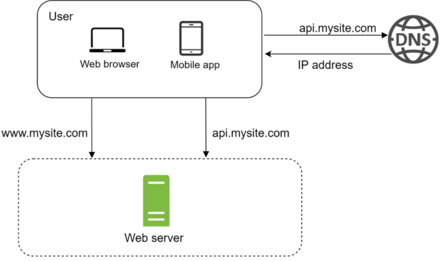

Hình 1-1

Để hiểu rõ thiết lập này, việc khảo sát luồng xử lý yêu cầu (request flow) và nguồn lưu lượng (traffic source) là rất hữu ích. Trước tiên, hãy cùng xem xét luồng yêu cầu (Hình 1-2).


Hình 1-2

1. Người dùng truy cập các trang web thông qua tên miền (domain name), chẳng hạn như `api.mysite.com`. Thông thường, Hệ thống phân giải tên miền (DNS - Domain Name System) là một dịch vụ trả phí do bên thứ ba cung cấp và không do máy chủ của chúng ta tự lưu trữ (host).
2. Địa chỉ Giao thức Internet (IP - Internet Protocol) được trả về cho trình duyệt hoặc ứng dụng di động. Trong ví dụ này, địa chỉ IP nhận được là `15.125.23.214`.
3. Sau khi nhận được địa chỉ IP, các yêu cầu theo Giao thức truyền tải siêu văn bản (HTTP - Hypertext Transfer Protocol) [1] sẽ được gửi trực tiếp đến máy chủ web (web server) của bạn.
4. Web server trả về các trang HTML (Hypertext Markup Language - Ngôn ngữ đánh dấu siêu văn bản) hoặc phản hồi JSON để hiển thị giao diện (rendering).

Tiếp theo, hãy cùng xem xét nguồn lưu lượng. Lưu lượng truy cập vào web server của bạn đến từ hai nguồn chính: ứng dụng web và ứng dụng di động.

 * Ứng dụng web: kết hợp các ngôn ngữ phía máy chủ (Java, Python, v.v.) để xử lý logic nghiệp vụ, lưu trữ, v.v., cùng các ngôn ngữ phía máy khách (HTML và JavaScript) để hiển thị giao diện.
 * Ứng dụng di động: Giao thức HTTP là giao thức giao tiếp giữa ứng dụng di động và web server. JSON (JavaScript Object Notation - định dạng trao đổi dữ liệu dạng chuỗi ký tự) là định dạng phản hồi API (Application Programming Interface - Giao diện lập trình ứng dụng) phổ biến dùng để truyền dữ liệu nhờ tính đơn giản của nó. Một ví dụ về phản hồi API ở định dạng JSON được hiển thị dưới đây:

```
GET /users/12 - Lấy đối tượng user cho id = 12
{
  "id": 12,
  "firstName": "John",
  "lastName": "Smith",
  "address": {
    "streetAddress": "21 2nd Street",
    "city": "New York",
    "state": "NY",
    "postalCode": 10021
  },
  "phoneNumbers": [
    "212 555-1234",
    "646555-4567"
  ]
}
```

# Database (Cơ sở dữ liệu)

Cùng với sự gia tăng của lượng người dùng, một máy chủ sẽ không còn đủ sức gánh vác, và chúng ta cần nhiều máy chủ: một máy chủ dành cho lưu lượng web/di động, máy chủ còn lại dành cho cơ sở dữ liệu (Hình 1-3). Việc tách biệt máy chủ lưu lượng web/di động (tầng web - web tier) và máy chủ cơ sở dữ liệu (tầng dữ liệu - data tier) cho phép chúng có thể mở rộng quy mô một cách độc lập.


Hình 1-3

## Which databases to use? (Nên sử dụng cơ sở dữ liệu nào?)

Bạn có thể lựa chọn giữa cơ sở dữ liệu quan hệ truyền thống và cơ sở dữ liệu phi quan hệ. Hãy cùng phân tích sự khác biệt giữa chúng.

Cơ sở dữ liệu quan hệ còn được gọi là hệ quản trị cơ sở dữ liệu quan hệ (RDBMS - Relational Database Management System) hoặc cơ sở dữ liệu SQL. Những cái tên phổ biến nhất bao gồm MySQL, Oracle Database, PostgreSQL, v.v. Cơ sở dữ liệu quan hệ biểu diễn và lưu trữ dữ liệu dưới dạng các bảng (tables) và hàng (rows). Bạn có thể thực hiện các thao tác kết hợp dữ liệu (join operations) bằng SQL qua các bảng dữ liệu khác nhau.

Cơ sở dữ liệu phi quan hệ còn được gọi là cơ sở dữ liệu NoSQL. Những cái tên phổ biến bao gồm CouchDB, Neo4j, Cassandra, HBase, Amazon DynamoDB, v.v. [2]. Các cơ sở dữ liệu này được phân thành bốn nhóm: kho lưu trữ khóa - giá trị (key-value stores), kho lưu trữ đồ thị (graph stores), kho lưu trữ dạng cột (column stores), và kho lưu trữ tài liệu (document stores). Các thao tác join nhìn chung không được hỗ trợ trong cơ sở dữ liệu phi quan hệ.

Đối với phần lớn các lập trình viên, cơ sở dữ liệu quan hệ là lựa chọn tối ưu vì chúng đã tồn tại và phát triển hơn 40 năm qua, đồng thời đã chứng minh được hiệu quả vững chắc trong lịch sử. Tuy nhiên, nếu cơ sở dữ liệu quan hệ không phù hợp với các kịch bản sử dụng cụ thể của bạn, việc tìm hiểu và mở rộng sang cơ sở dữ liệu phi quan hệ là điều vô cùng cấp thiết. Cơ sở dữ liệu phi quan hệ có thể là sự lựa chọn đúng đắn nếu:
 * Ứng dụng của bạn đòi hỏi độ trễ cực thấp (super-low latency).
 * Dữ liệu của bạn là phi cấu trúc, hoặc bạn hoàn toàn không có dữ liệu mang tính quan hệ.
 * Bạn chỉ cần tuần tự hóa và giải tuần tự hóa dữ liệu (serialize và deserialize dữ liệu sang JSON, XML, YAML, v.v.).
 * Bạn cần lưu trữ một khối lượng dữ liệu khổng lồ.

# Vertical scaling vs horizontal scaling (Mở rộng theo chiều dọc so với Mở rộng theo chiều ngang)

Mở rộng theo chiều dọc (Vertical scaling), hay còn gọi là "scale up", là quá trình bổ sung thêm năng lực tính toán (CPU, RAM, v.v.) vào các máy chủ hiện tại của bạn. Mở rộng theo chiều ngang (Horizontal scaling), hay còn gọi là "scale-out", cho phép bạn mở rộng bằng cách bổ sung thêm nhiều máy chủ vào nhóm tài nguyên (resource pool) của mình.

Khi lưu lượng truy cập còn thấp, mở rộng theo chiều dọc là một lựa chọn tuyệt vời, và tính đơn giản chính là ưu điểm lớn nhất của nó. Đáng tiếc là giải pháp này lại đi kèm với những hạn chế nghiêm trọng.
 * Mở rộng theo chiều dọc có một giới hạn cứng (hard limit). Việc bổ sung CPU và bộ nhớ không giới hạn vào một máy chủ đơn lẻ là điều bất khả thi.
 * Mở rộng theo chiều dọc không có cơ chế chuyển đổi dự phòng khi gặp sự cố (failover) cũng như tính dự phòng (redundancy). Nếu một máy chủ bị sập, toàn bộ trang web/ứng dụng sẽ tê liệt hoàn toàn theo nó.

Mở rộng theo chiều ngang được ưu tiên hơn cho các ứng dụng quy mô lớn chính vì những hạn chế của mở rộng theo chiều dọc. Trong thiết kế trước đó, người dùng kết nối trực tiếp đến web server. Người dùng sẽ không thể truy cập trang web nếu web server ngoại tuyến. Trong một kịch bản khác, nếu có quá nhiều người dùng truy cập web server đồng thời và chạm tới giới hạn tải của máy chủ, người dùng thường sẽ gặp phải tình trạng phản hồi chậm hoặc không thể kết nối tới máy chủ. Bộ cân bằng tải (load balancer) chính là kỹ thuật tốt nhất để giải quyết các vấn đề này.

# Load balancer (Bộ cân bằng tải)

Một bộ cân bằng tải sẽ phân phối đồng đều lưu lượng truy cập đến các web server được định nghĩa trong một nhóm cân bằng tải (load-balanced set). Hình 1-4 minh họa cách thức hoạt động của một bộ cân bằng tải.


Hình 1-4

Như minh họa trong Hình 1-4, người dùng kết nối trực tiếp đến địa chỉ IP công khai (public IP) của bộ cân bằng tải. Với thiết lập này, các máy khách không còn khả năng tiếp cận trực tiếp vào các web server nữa. Để nâng cao tính bảo mật, các địa chỉ IP nội bộ (private IP) được sử dụng để giao tiếp giữa các máy chủ. Private IP là địa chỉ IP chỉ có thể liên lạc được giữa các máy chủ trong cùng một mạng nội bộ; tuy nhiên, các thiết bị ngoài internet hoàn toàn không thể tiếp cận được địa chỉ này. Bộ cân bằng tải giao tiếp với các web server thông qua các private IP.

Trong Hình 1-4, sau khi bổ sung bộ cân bằng tải và một web server thứ hai, chúng ta đã giải quyết thành công vấn đề thiếu hụt cơ chế failover, đồng thời nâng cao tính sẵn sàng (availability) cho tầng web. Chi tiết được giải thích như sau:
 * Nếu máy chủ 1 ngoại tuyến, toàn bộ lưu lượng sẽ được điều hướng sang máy chủ 2. Điều này ngăn chặn việc trang web bị sập. Chúng ta cũng sẽ bổ sung một web server mới khỏe mạnh vào nhóm máy chủ để cân bằng tải.
 * Nếu lưu lượng truy cập trang web tăng trưởng nhanh chóng và hai máy chủ không còn đủ sức xử lý, bộ cân bằng tải có thể xử lý vấn đề này một cách mượt mà. Bạn chỉ cần bổ sung thêm máy chủ vào nhóm web server, và bộ cân bằng tải sẽ tự động bắt đầu gửi các yêu cầu đến các máy chủ mới đó.

Hiện tại tầng web trông đã rất ổn, vậy còn tầng dữ liệu thì sao? Thiết kế hiện tại chỉ có một cơ sở dữ liệu duy nhất, do đó nó không hỗ trợ cơ chế failover và tính dự phòng. Nhân bản cơ sở dữ liệu (Database replication) là một kỹ thuật phổ biến để giải quyết các vấn đề này. Hãy cùng tìm hiểu.

# Database replication (Nhân bản cơ sở dữ liệu)

Trích dẫn từ Wikipedia: "Nhân bản cơ sở dữ liệu có thể được sử dụng trong nhiều hệ quản trị cơ sở dữ liệu, thường hoạt động theo mối quan hệ chính/phụ (master/slave) giữa bản gốc (master) và các bản sao (slaves)" [3].

Một cơ sở dữ liệu master thông thường chỉ hỗ trợ các thao tác ghi (write operations). Một cơ sở dữ liệu slave nhận các bản sao dữ liệu từ cơ sở dữ liệu master và chỉ hỗ trợ các thao tác đọc (read operations). Tất cả các câu lệnh làm biến đổi dữ liệu như chèn (insert), xóa (delete) hoặc cập nhật (update) bắt buộc phải được gửi đến cơ sở dữ liệu master. Phần lớn các ứng dụng đều có tỷ lệ đọc trên ghi (read-to-write ratio) cao hơn rất nhiều; do đó, số lượng cơ sở dữ liệu slave trong một hệ thống thường nhiều hơn số lượng cơ sở dữ liệu master. Hình 1-5 minh họa một cơ sở dữ liệu master đi kèm với nhiều cơ sở dữ liệu slave.


Hình 1-5

Các ưu điểm của nhân bản cơ sở dữ liệu:
 * Hiệu năng tốt hơn (Better performance): Trong mô hình master-slave, tất cả các lệnh ghi và cập nhật đều diễn ra tại các nút master; trong khi các thao tác đọc được phân phối đều cho các nút slave. Mô hình này cải thiện hiệu năng vì nó cho phép xử lý song song nhiều truy vấn hơn.
 * Độ tin cậy (Reliability): Nếu một trong các máy chủ cơ sở dữ liệu của bạn bị phá hủy bởi thiên tai, chẳng hạn như bão lớn hay động đất, dữ liệu vẫn được bảo tồn. Bạn không cần phải lo lắng về việc mất mát dữ liệu vì dữ liệu đã được sao chép qua nhiều vị trí địa lý khác nhau.
 * Tính sẵn sàng cao (High availability): Bằng cách nhân bản dữ liệu qua nhiều địa điểm khác nhau, trang web của bạn vẫn duy trì hoạt động ngay cả khi một cơ sở dữ liệu bị ngoại tuyến, bởi bạn hoàn toàn có thể truy cập dữ liệu được lưu trữ tại một máy chủ cơ sở dữ liệu khác.

Trong phần trước, chúng ta đã thảo luận về cách bộ cân bằng tải giúp cải thiện tính sẵn sàng của hệ thống. Ở đây chúng ta cũng đặt ra một câu hỏi tương tự: điều gì sẽ xảy ra nếu một trong các cơ sở dữ liệu bị ngoại tuyến? Thiết kế kiến trúc được thảo luận trong Hình 1-5 có thể xử lý trường hợp này:
 * Nếu chỉ có một cơ sở dữ liệu slave khả dụng và nó bị ngoại tuyến, các thao tác đọc sẽ tạm thời được chuyển hướng trực tiếp đến cơ sở dữ liệu master. Ngay khi sự cố được phát hiện, một cơ sở dữ liệu slave mới sẽ thay thế vị trí của nút cũ. Trong trường hợp có sẵn nhiều cơ sở dữ liệu slave, các thao tác đọc sẽ được chuyển hướng sang các slave khỏe mạnh khác. Một máy chủ cơ sở dữ liệu mới sẽ thay thế máy chủ cũ bị hỏng.
 * Nếu cơ sở dữ liệu master bị ngoại tuyến, một cơ sở dữ liệu slave sẽ được thăng cấp (promoted) trở thành master mới. Mọi thao tác cơ sở dữ liệu sẽ tạm thời được thực thi trên cơ sở dữ liệu master mới này. Một cơ sở dữ liệu slave mới sẽ lập tức thay thế vị trí của nút cũ để tiếp tục quá trình nhân bản dữ liệu. Trong các hệ thống production (môi trường vận hành thực tế), việc thăng cấp một master mới phức tạp hơn nhiều vì dữ liệu trên slave có thể chưa được cập nhật hoàn toàn tới thời điểm mới nhất. Dữ liệu thiếu hụt cần phải được đồng bộ lại bằng cách chạy các tập lệnh phục hồi dữ liệu (data recovery scripts). Mặc dù một số phương pháp nhân bản khác như đa master (multi-masters) và nhân bản vòng tròn (circular replication) có thể hỗ trợ, những thiết lập này phức tạp hơn đáng kể; và việc thảo luận về chúng nằm ngoài phạm vi của cuốn sách này. Độc giả quan tâm có thể tham khảo thêm các tài liệu được liệt kê [4] [5].

Hình 1-6 minh họa thiết kế hệ thống sau khi bổ sung bộ cân bằng tải và cơ chế nhân bản cơ sở dữ liệu.


Hình 1-6

Hãy cùng điểm qua luồng hoạt động của thiết kế này:
 * Người dùng nhận địa chỉ IP của bộ cân bằng tải từ hệ thống DNS.
 * Người dùng kết nối với bộ cân bằng tải bằng địa chỉ IP này.
 * Yêu cầu HTTP được điều hướng đến Máy chủ 1 hoặc Máy chủ 2.
 * Web server đọc dữ liệu người dùng từ một cơ sở dữ liệu slave.
 * Web server định tuyến bất kỳ thao tác làm biến đổi dữ liệu nào đến cơ sở dữ liệu master. Điều này bao gồm các thao tác ghi, cập nhật và xóa.

Giờ đây, khi bạn đã có hiểu biết vững chắc về tầng web và tầng dữ liệu, đã đến lúc chúng ta cải thiện thời gian tải/phản hồi (load/response time). Điều này có thể đạt được bằng cách bổ sung một tầng bộ nhớ đệm (cache layer) và chuyển các nội dung tĩnh (tệp JavaScript/CSS/hình ảnh/video) sang mạng phân phối nội dung (CDN - Content Delivery Network).

# Cache (Bộ nhớ đệm)

Bộ nhớ đệm là một vùng lưu trữ tạm thời lưu giữ kết quả của các phản hồi tốn kém chi phí tính toán hoặc dữ liệu thường xuyên được truy cập ngay trong bộ nhớ (memory) để các yêu cầu tiếp theo được phục vụ nhanh hơn. Như minh họa trong Hình 1-6, mỗi khi một trang web mới được tải, một hoặc nhiều lệnh gọi cơ sở dữ liệu sẽ được thực thi để lấy dữ liệu. Hiệu năng ứng dụng bị ảnh hưởng nghiêm trọng do việc gọi cơ sở dữ liệu liên tục. Bộ nhớ đệm có thể giảm nhẹ vấn đề này.

## Cache tier (Tầng bộ nhớ đệm)

Tầng bộ nhớ đệm là một lớp lưu trữ dữ liệu tạm thời, có tốc độ nhanh hơn cơ sở dữ liệu rất nhiều. Những lợi ích của việc sở hữu một tầng bộ nhớ đệm riêng biệt bao gồm nâng cao hiệu năng hệ thống, khả năng giảm tải công việc cho cơ sở dữ liệu, và khả năng mở rộng quy mô tầng cache một cách độc lập. Hình 1-7 minh họa một thiết lập khả dĩ của máy chủ bộ nhớ đệm:


Sau khi nhận được yêu cầu, web server trước tiên sẽ kiểm tra xem cache có sẵn dữ liệu phản hồi hay không. Nếu có, nó gửi dữ liệu về cho client. Nếu không, nó sẽ truy vấn cơ sở dữ liệu, lưu phản hồi vào cache, và gửi lại cho client. Chiến lược lưu trữ đệm này được gọi là read-through cache (chiến lược đọc qua bộ nhớ đệm). Ngoài ra còn có các chiến lược caching khác tùy thuộc vào loại dữ liệu, kích thước và mô hình truy cập (access pattern). Một nghiên cứu trước đây đã giải thích chi tiết cách thức hoạt động của các chiến lược caching khác nhau [6].

Việc tương tác với các máy chủ cache rất đơn giản vì hầu hết các máy chủ cache đều cung cấp API cho các ngôn ngữ lập trình phổ biến. Đoạn mã dưới đây minh họa các API tiêu biểu của Memcached:

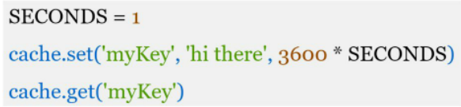

## Considerations for using cache (Những lưu ý khi sử dụng bộ nhớ đệm)

Dưới đây là một số cân nhắc khi sử dụng một hệ thống bộ nhớ đệm:

 * Quyết định thời điểm sử dụng cache. Cân nhắc sử dụng cache khi dữ liệu được đọc thường xuyên nhưng hiếm khi bị sửa đổi. Vì dữ liệu đệm được lưu trong bộ nhớ khả biến (volatile memory - bộ nhớ tạm thời mất dữ liệu khi mất nguồn điện), máy chủ cache không phải là nơi lý tưởng để lưu trữ dữ liệu bền vững (persist data). Ví dụ, nếu một máy chủ cache khởi động lại, toàn bộ dữ liệu trong bộ nhớ sẽ bị mất. Do đó, các dữ liệu quan trọng nên được lưu trong các kho dữ liệu bền vững (persistent data stores).
 * Chính sách hết hạn (Expiration policy). Việc triển khai một chính sách hết hạn là một thực hành tốt. Khi dữ liệu đệm hết hạn, nó sẽ bị xóa khỏi cache. Nếu không có chính sách hết hạn, dữ liệu đệm sẽ được lưu vĩnh viễn trong bộ nhớ. Bạn không nên đặt thời hạn quá ngắn vì điều này khiến hệ thống phải nạp lại dữ liệu từ cơ sở dữ liệu quá thường xuyên. Đồng thời, cũng không nên đặt thời hạn quá dài vì dữ liệu có thể trở nên lỗi thời (stale data).
 * Tính nhất quán (Consistency): Điều này liên quan đến việc giữ cho kho lưu trữ dữ liệu và bộ nhớ đệm luôn đồng bộ với nhau. Tình trạng không nhất quán có thể xảy ra do các thao tác làm biến đổi dữ liệu trên kho lưu trữ và trên cache không nằm trong cùng một giao dịch (single transaction). Khi mở rộng quy mô trên nhiều vùng địa lý (multi-region), việc duy trì tính nhất quán giữa kho dữ liệu và cache là một thách thức lớn. Để biết thêm chi tiết, hãy tham khảo bài báo khoa học có tiêu đề "Scaling Memcache at Facebook" do Facebook xuất bản [7].
 * Giảm thiểu lỗi (Mitigating failures): Một máy chủ cache đơn lẻ tiềm ẩn nguy cơ trở thành điểm lỗi đơn lẻ (SPOF - Single Point of Failure), được định nghĩa trên Wikipedia như sau: "Điểm lỗi đơn lẻ (SPOF) là một phần của hệ thống mà nếu nó gặp sự cố, toàn bộ hệ thống sẽ ngừng hoạt động" [8]. Do đó, việc sử dụng nhiều máy chủ cache trên các trung tâm dữ liệu khác nhau được khuyến nghị nhằm tránh SPOF. Một phương pháp được khuyến nghị khác là cấp phát dư dung lượng bộ nhớ yêu cầu theo một tỷ lệ phần trăm nhất định (overprovisioning). Điều này tạo ra một vùng đệm an toàn khi mức sử dụng bộ nhớ tăng lên.

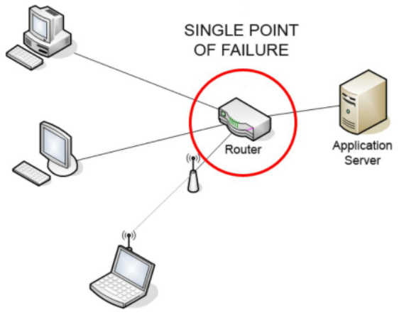

Hình 1-8 (nguồn: https://bit.ly/3eGsnyH)

 * Chính sách giải phóng bộ nhớ (Eviction Policy): Một khi cache đã đầy, bất kỳ yêu cầu thêm phần tử mới nào vào cache cũng có thể khiến các phần tử hiện có bị loại bỏ. Quá trình này được gọi là giải phóng bộ nhớ đệm (cache eviction). Ít được sử dụng gần đây nhất (LRU - Least-recently-used) là chính sách giải phóng bộ nhớ đệm phổ biến nhất. Các chính sách khác, chẳng hạn như Ít được sử dụng nhất (LFU - Least Frequently Used) hoặc Vào trước ra trước (FIFO - First in First Out), có thể được áp dụng để đáp ứng các kịch bản sử dụng khác nhau.

# Content delivery network (CDN) (Mạng phân phối nội dung)

CDN là một mạng lưới gồm các máy chủ phân tán theo vị trí địa lý được sử dụng để phân phối nội dung tĩnh. Các máy chủ CDN lưu trữ đệm các nội dung tĩnh như hình ảnh, video, tệp CSS, JavaScript, v.v.

Lưu trữ đệm nội dung động (Dynamic content caching) là một khái niệm tương đối mới và nằm ngoài phạm vi cuốn sách này. Nó cho phép lưu cache các trang HTML dựa trên đường dẫn yêu cầu (request path), chuỗi truy vấn (query strings), cookie và tiêu đề yêu cầu (request headers). Tham khảo bài viết được đề cập trong tài liệu tham khảo [9] để biết thêm chi tiết. Cuốn sách này tập trung vào cách thức sử dụng CDN để lưu trữ đệm nội dung tĩnh.

Dưới đây là cách thức CDN hoạt động ở mức tổng quan: khi một người dùng truy cập trang web, một máy chủ CDN gần người dùng nhất về mặt địa lý sẽ phân phối nội dung tĩnh. Một cách trực quan, người dùng càng ở xa máy chủ CDN thì tốc độ tải trang web càng chậm. Ví dụ, nếu các máy chủ CDN đặt tại San Francisco, người dùng ở Los Angeles sẽ nhận được nội dung nhanh hơn người dùng ở châu Âu. Hình 1-9 là một ví dụ tuyệt vời minh họa cách CDN cải thiện thời gian tải trang.

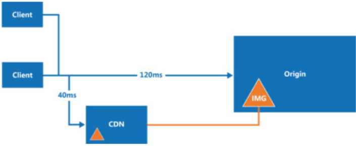

Hình 1-9 (nguồn: https://bit.ly/2yv7DJK)

Hình 1-10 minh họa quy trình làm việc (workflow) của CDN.

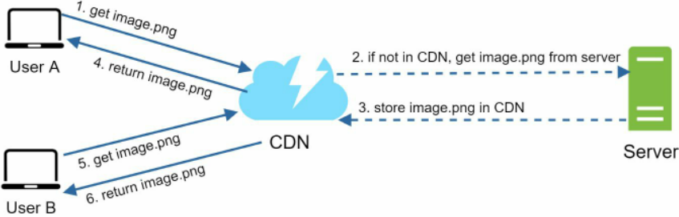

Hình 1-10

1. Người dùng A cố gắng lấy tệp `image.png` bằng cách sử dụng một URL hình ảnh. Tên miền của URL do nhà cung cấp CDN phân bổ. Hai URL hình ảnh dưới đây là các mẫu được sử dụng để minh họa định dạng URL hình ảnh trên CDN của Amazon và Akamai:
 * https://mysite.cloudfront.net/logo.jpg
 * https://mysite.akamai.com/image-manager/img/logo.jpg
2. Nếu máy chủ CDN không có tệp `image.png` trong bộ nhớ đệm, máy chủ CDN sẽ yêu cầu tệp từ máy chủ gốc (origin), có thể là một web server hoặc dịch vụ lưu trữ trực tuyến như Amazon S3.
3. Máy chủ gốc trả về tệp `image.png` cho máy chủ CDN, trong đó có chứa tiêu đề HTTP tùy chọn Time-to-Live (TTL - Thời gian sống của dữ liệu) mô tả hình ảnh này được lưu cache trong bao lâu.
4. CDN lưu hình ảnh vào bộ nhớ đệm và trả lại cho Người dùng A. Hình ảnh vẫn được lưu cache trong CDN cho đến khi TTL hết hạn.
5. Người dùng B gửi yêu cầu lấy cùng hình ảnh đó.
6. Hình ảnh được trả về từ bộ nhớ đệm chừng nào TTL vẫn chưa hết hạn.

## Considerations of using a CDN (Những lưu ý khi sử dụng CDN)

 * Chi phí (Cost): CDN được vận hành bởi các nhà cung cấp bên thứ ba, và bạn sẽ bị tính phí cho việc truyền dữ liệu vào và ra khỏi CDN. Việc lưu cache các tài nguyên hiếm khi được truy cập không mang lại lợi ích rõ rệt, do đó bạn nên cân nhắc đưa chúng ra khỏi CDN.
 * Thiết lập thời hạn hết hạn cache phù hợp (Setting an appropriate cache expiry): Đối với các nội dung nhạy cảm về thời gian, việc thiết lập thời gian hết hạn cache là rất quan trọng. Thời gian hết hạn cache không nên quá dài cũng không nên quá ngắn. Nếu quá dài, nội dung có thể không còn tươi mới. Nếu quá ngắn, nó có thể gây ra việc phải nạp lại nội dung liên tục từ các máy chủ gốc sang CDN.
 * Cơ chế dự phòng sự cố CDN (CDN fallback): Bạn nên cân nhắc cách trang web/ứng dụng của mình đối phó khi hệ thống CDN gặp sự cố. Nếu xảy ra sự cố ngừng hoạt động tạm thời của CDN, các máy khách phải có khả năng phát hiện vấn đề và yêu cầu tài nguyên trực tiếp từ máy chủ gốc.
 * Hủy hiệu lực tệp (Invalidating files): Bạn có thể xóa một tệp khỏi CDN trước khi nó hết hạn bằng cách thực hiện một trong các thao tác sau:
 * Hủy hiệu lực đối tượng CDN bằng cách sử dụng các API do nhà cung cấp CDN cung cấp.
 * Sử dụng cơ chế tạo phiên bản đối tượng (object versioning) để phục vụ một phiên bản khác của đối tượng. Để tạo phiên bản cho một đối tượng, bạn có thể thêm một tham số vào URL, chẳng hạn như số phiên bản. Ví dụ: phiên bản số 2 được thêm vào chuỗi truy vấn: `image.png?v=2`.

Hình 1-11 minh họa thiết kế sau khi bổ sung thêm CDN và bộ nhớ đệm.


1. Các tài nguyên tĩnh (JS, CSS, hình ảnh, v.v.) không còn do web server phục vụ nữa. Chúng được lấy trực tiếp từ CDN để có hiệu năng tốt hơn.
2. Tải trên cơ sở dữ liệu được giảm nhẹ nhờ lưu trữ đệm dữ liệu.

# Stateless web tier (Tầng web phi trạng thái)

Bây giờ là lúc chúng ta cân nhắc việc mở rộng tầng web theo chiều ngang. Để làm được điều này, chúng ta cần đưa trạng thái (ví dụ như dữ liệu phiên làm việc của người dùng - user session data) ra khỏi tầng web. Một thực hành tốt là lưu trữ dữ liệu session trong các hệ thống lưu trữ bền vững như cơ sở dữ liệu quan hệ hoặc NoSQL. Mỗi máy chủ web trong cụm (cluster) đều có thể truy cập dữ liệu trạng thái từ các cơ sở dữ liệu. Đây được gọi là tầng web phi trạng thái (stateless web tier).

## Stateful architecture (Kiến trúc có lưu trạng thái)

Máy chủ có lưu trạng thái (stateful server) và máy chủ phi trạng thái (stateless server) có một số khác biệt cốt lõi. Một máy chủ stateful ghi nhớ dữ liệu của máy khách (trạng thái) từ yêu cầu này sang yêu cầu tiếp theo. Ngược lại, một máy chủ stateless không lưu giữ bất kỳ thông tin trạng thái nào.

Hình 1-12 minh họa một ví dụ về kiến trúc có lưu trạng thái.

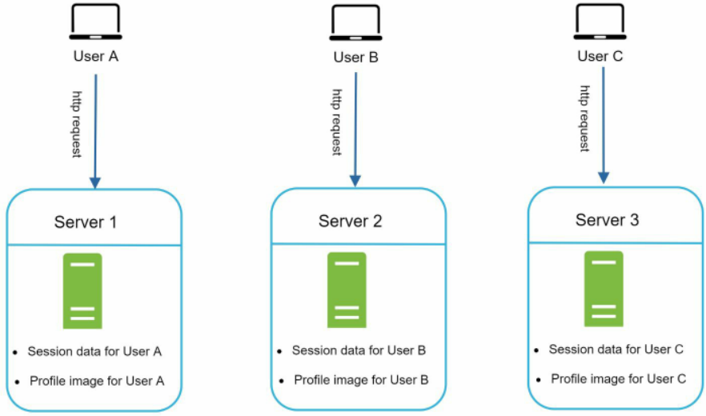

Hình 1-12

Trong Hình 1-12, dữ liệu session và hình ảnh đại diện của Người dùng A được lưu tại Máy chủ 1. Để xác thực Người dùng A, các yêu cầu HTTP bắt buộc phải được điều hướng đến Máy chủ 1. Nếu một yêu cầu bị gửi sang các máy chủ khác như Máy chủ 2, quá trình xác thực sẽ thất bại vì Máy chủ 2 không chứa dữ liệu session của Người dùng A. Tương tự, tất cả các yêu cầu HTTP từ Người dùng B phải được định tuyến đến Máy chủ 2; tất cả các yêu cầu từ Người dùng C phải được gửi đến Máy chủ 3.

Vấn đề ở đây là mọi yêu cầu từ cùng một máy khách bắt buộc phải được định tuyến đến cùng một máy chủ. Điều này có thể được thực hiện thông qua cơ chế phiên dính (sticky sessions) trên hầu hết các bộ cân bằng tải [10]; tuy nhiên, điều này lại làm phát sinh thêm chi phí quản lý vận hành (overhead). Việc bổ sung thêm hoặc loại bỏ bớt các máy chủ trở nên khó khăn hơn rất nhiều với cách tiếp cận này. Việc xử lý các sự cố máy chủ cũng là một thách thức lớn.

## Stateless architecture (Kiến trúc phi trạng thái)

Hình 1-13 minh họa kiến trúc phi trạng thái.


Hình 1-13

Trong kiến trúc phi trạng thái này, các yêu cầu HTTP từ người dùng có thể được gửi đến bất kỳ máy chủ web nào, và các máy chủ này sẽ lấy dữ liệu trạng thái từ một kho dữ liệu dùng chung (shared data store). Dữ liệu trạng thái được lưu trữ trong một kho dữ liệu dùng chung và được giữ tách biệt hoàn toàn khỏi các máy chủ web. Một hệ thống phi trạng thái sẽ đơn giản hơn, mạnh mẽ hơn và dễ mở rộng quy mô hơn.

Hình 1-14 minh họa thiết kế cập nhật với một tầng web phi trạng thái.


Hình 1-14

Trong Hình 1-14, chúng ta chuyển dữ liệu session ra khỏi tầng web và lưu trữ chúng trong kho dữ liệu bền vững. Kho dữ liệu dùng chung có thể là cơ sở dữ liệu quan hệ, Memcached/Redis, NoSQL, v.v. Kho lưu trữ NoSQL được lựa chọn vì nó rất dễ mở rộng quy mô. Cơ chế tự động co giãn (Autoscaling) có nghĩa là việc tự động bổ sung hoặc loại bỏ các máy chủ web dựa trên tải lưu lượng thực tế. Sau khi dữ liệu trạng thái được đưa ra khỏi các máy chủ web, việc tự động co giãn của tầng web có thể dễ dàng đạt được bằng cách bổ sung hoặc bớt máy chủ dựa trên lưu lượng truy cập.

Trang web của bạn tăng trưởng nhanh chóng và thu hút một lượng người dùng đáng kể trên quy mô quốc tế. Để cải thiện tính sẵn sàng và mang lại trải nghiệm người dùng tốt hơn trên các khu vực địa lý rộng lớn hơn, việc hỗ trợ nhiều trung tâm dữ liệu (data centers) là điều tối quan trọng.

# Data centers (Các trung tâm dữ liệu)

Hình 1-15 minh họa một ví dụ thiết lập với hai trung tâm dữ liệu. Trong điều kiện hoạt động bình thường, người dùng được định tuyến theo vị trí địa lý thông qua DNS (geoDNS-routed, hay còn gọi là geo-routed) tới trung tâm dữ liệu gần nhất, với tỷ lệ phân chia lưu lượng là x% tại US-East (Miền Đông nước Mỹ) và (100 - x)% tại US-West (Miền Tây nước Mỹ). geoDNS là một dịch vụ DNS cho phép phân giải tên miền thành các địa chỉ IP dựa trên vị trí địa lý của người dùng.

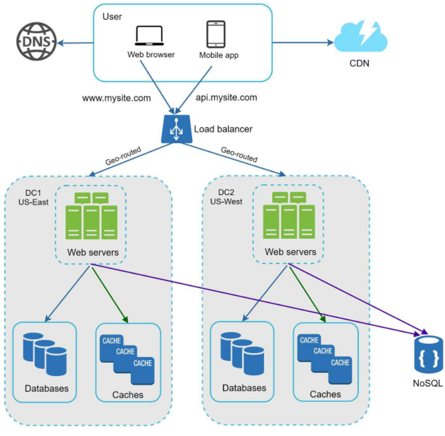

Hình 1-15

Trong trường hợp xảy ra sự cố nghiêm trọng khiến một trung tâm dữ liệu ngừng hoạt động, chúng ta sẽ điều hướng toàn bộ lưu lượng đến một trung tâm dữ liệu khỏe mạnh. Trong Hình 1-16, trung tâm dữ liệu 2 (US-West) bị ngoại tuyến, và 100% lưu lượng truy cập được định tuyến đến trung tâm dữ liệu 1 (US-East).

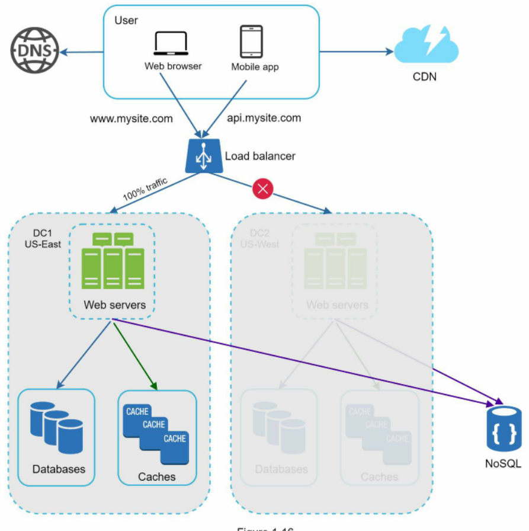

Hình 1-16

Một số thách thức kỹ thuật cần phải được giải quyết để hiện thực hóa thiết lập đa trung tâm dữ liệu:
 * Chuyển hướng lưu lượng (Traffic redirection): Cần có các công cụ hiệu quả để điều hướng lưu lượng đến đúng trung tâm dữ liệu. GeoDNS có thể được sử dụng để dẫn hướng lưu lượng tới trung tâm dữ liệu gần nhất tùy thuộc vào nơi người dùng đang ở.
 * Đồng bộ hóa dữ liệu (Data synchronization): Người dùng từ các khu vực khác nhau có thể sử dụng các cơ sở dữ liệu hoặc bộ nhớ đệm cục bộ khác nhau. Trong các trường hợp chuyển đổi dự phòng (failover), lưu lượng có thể bị định tuyến đến một trung tâm dữ liệu chưa có sẵn dữ liệu đó. Một chiến lược phổ biến là nhân bản dữ liệu qua nhiều trung tâm dữ liệu. Một nghiên cứu trước đây đã chỉ ra cách Netflix triển khai nhân bản bất đồng bộ giữa nhiều trung tâm dữ liệu [11].
 * Kiểm thử và triển khai (Test and deployment): Với thiết lập đa trung tâm dữ liệu, việc kiểm thử trang web/ứng dụng của bạn tại các vị trí địa lý khác nhau là rất quan trọng. Các công cụ triển khai tự động đóng vai trò sống còn để duy trì tính nhất quán của các dịch vụ xuyên suốt tất cả các trung tâm dữ liệu [11].

Để mở rộng quy mô hệ thống xa hơn nữa, chúng ta cần phân tách (decouple - khử ghép nối) các thành phần khác nhau của hệ thống để chúng có thể được mở rộng một cách độc lập. Hàng đợi thông điệp (Message queue) là một chiến lược then chốt được nhiều hệ thống phân tán trong thế giới thực sử dụng để giải quyết vấn đề này.

# Message queue (Hàng đợi thông điệp)

Một hàng đợi thông điệp là một thành phần có tính bền vững (durable), được lưu trữ trong bộ nhớ, hỗ trợ giao tiếp bất đồng bộ (asynchronous communication). Nó đóng vai trò như một bộ đệm và phân phối các yêu cầu bất đồng bộ. Kiến trúc cơ bản của một hàng đợi thông điệp rất đơn giản. Các dịch vụ đầu vào, được gọi là bên sản xuất/bên xuất bản (producers/publishers), tạo ra các thông điệp và gửi chúng vào một hàng đợi thông điệp. Các dịch vụ hoặc máy chủ khác, được gọi là bên tiêu thụ/bên đăng ký (consumers/subscribers), kết nối tới hàng đợi và thực hiện các hành động được định nghĩa bởi các thông điệp đó. Mô hình này được thể hiện trong Hình 1-17.

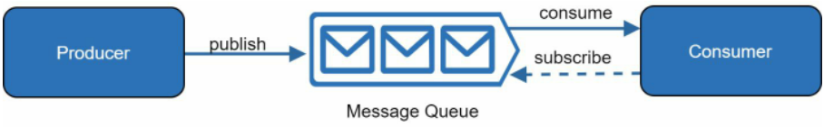

Hình 1-17

Việc khử ghép nối biến hàng đợi thông điệp thành một kiến trúc được ưu tiên lựa chọn để xây dựng một ứng dụng có khả năng mở rộng và độ tin cậy cao. Với hàng đợi thông điệp, producer có thể đẩy một thông điệp vào hàng đợi ngay cả khi consumer chưa sẵn sàng để xử lý nó. Consumer có thể đọc các thông điệp từ hàng đợi ngay cả khi producer đang ngoại tuyến.

Hãy xem xét kịch bản sau: ứng dụng của bạn hỗ trợ tính năng tùy chỉnh hình ảnh, bao gồm cắt xén (cropping), làm nét (sharpening), làm mờ (blurring), v.v. Những tác vụ tùy chỉnh này cần thời gian để hoàn thành. Trong Hình 1-18, các máy chủ web đẩy các công việc xử lý ảnh vào hàng đợi thông điệp. Các tiến trình xử lý ảnh (photo processing workers) nhận việc từ hàng đợi thông điệp và thực hiện các tác vụ chỉnh sửa ảnh một cách bất đồng bộ. Producer và consumer có thể được mở rộng quy mô hoàn toàn độc lập. Khi kích thước của hàng đợi tăng lên, nhiều worker hơn sẽ được bổ sung để rút ngắn thời gian xử lý. Tuy nhiên, nếu hàng đợi hầu như luôn trống, số lượng worker có thể được cắt giảm bớt.

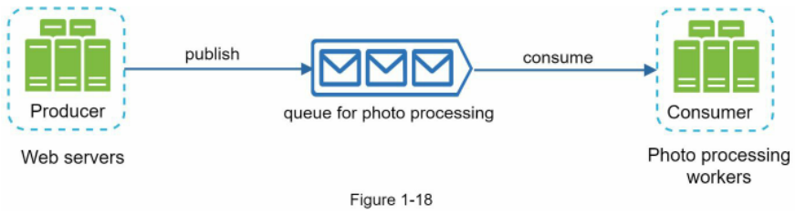

# Logging, metrics, automation (Ghi log, chỉ số đo lường, tự động hóa)

Khi làm việc với một trang web quy mô nhỏ hoạt động trên một vài máy chủ, việc hỗ trợ ghi log, chỉ số đo lường và tự động hóa là những thực hành tốt nhưng chưa phải là điều bắt buộc. Tuy nhiên, giờ đây khi trang web của bạn đã phát triển để phục vụ một quy mô kinh doanh lớn, việc đầu tư vào các công cụ này là điều thiết yếu.

Ghi log (Logging): Việc theo dõi log lỗi là rất quan trọng vì nó giúp xác định các lỗi và sự cố trong hệ thống. Bạn có thể theo dõi log lỗi ở cấp độ từng máy chủ hoặc sử dụng các công cụ để tổng hợp chúng về một dịch vụ tập trung nhằm phục vụ việc tìm kiếm và xem xét dễ dàng.

Chỉ số đo lường (Metrics): Việc thu thập các loại chỉ số khác nhau giúp chúng ta có được cái nhìn sâu sắc về mặt kinh doanh và nắm bắt được trạng thái sức khỏe của hệ thống. Một số chỉ số sau đây rất hữu ích:
 * Các chỉ số cấp máy chủ (Host level metrics): CPU, Bộ nhớ, I/O đĩa (disk I/O), v.v.
 * Các chỉ số cấp tổng hợp (Aggregated level metrics): ví dụ: hiệu năng của toàn bộ tầng cơ sở dữ liệu, tầng bộ nhớ đệm, v.v.
 * Các chỉ số kinh doanh cốt lõi (Key business metrics): số người dùng hoạt động hàng ngày (daily active users), tỷ lệ giữ chân (retention), doanh thu, v.v.

Tự động hóa (Automation): Khi một hệ thống trở nên lớn và phức tạp, chúng ta cần xây dựng hoặc tận dụng các công cụ tự động hóa để nâng cao năng suất. Tích hợp liên tục (Continuous Integration - CI) là một thực hành tốt, trong đó mỗi lần bàn giao mã nguồn (code check-in) đều được kiểm tra thông qua tự động hóa, cho phép các nhóm phát hiện vấn đề từ sớm. Bên cạnh đó, việc tự động hóa quy trình xây dựng (build), kiểm thử (test), triển khai (deploy), v.v. có thể nâng cao đáng kể năng suất của lập trình viên.

## Adding message queues and different tools (Bổ sung hàng đợi thông điệp và các công cụ khác nhau)

Hình 1-19 minh họa thiết kế sau khi cập nhật. Do giới hạn về không gian hiển thị, chỉ có một trung tâm dữ liệu được trình bày trong hình.
1. Thiết kế bao gồm một hàng đợi thông điệp, giúp hệ thống trở nên lỏng lẻo hơn về mặt liên kết (loosely coupled) và có khả năng phục hồi lỗi cao hơn.
2. Các công cụ ghi log, giám sát, đo lường và tự động hóa đã được bổ sung đầy đủ.


Hình 1-19

Khi dữ liệu tăng lên từng ngày, cơ sở dữ liệu của bạn sẽ ngày càng quá tải. Đã đến lúc chúng ta phải mở rộng tầng dữ liệu.

# Database scaling (Mở rộng quy mô cơ sở dữ liệu)

Có hai hướng tiếp cận rộng rãi để mở rộng quy mô cơ sở dữ liệu: mở rộng theo chiều dọc (vertical scaling) và mở rộng theo chiều ngang (horizontal scaling).

## Vertical scaling (Mở rộng theo chiều dọc)

Mở rộng theo chiều dọc, hay còn được gọi là scaling up, là việc mở rộng bằng cách bổ sung thêm sức mạnh phần cứng (CPU, RAM, ĐĨA, v.v.) cho một cỗ máy hiện có. Có những máy chủ cơ sở dữ liệu sở hữu cấu hình cực kỳ mạnh mẽ. Theo thông tin từ Dịch vụ Cơ sở dữ liệu Quan hệ của Amazon (Amazon RDS - Relational Database Service) [12], bạn có thể sở hữu một máy chủ cơ sở dữ liệu với 24 TB RAM. Loại máy chủ cơ sở dữ liệu mạnh mẽ này có thể lưu trữ và xử lý một khối lượng dữ liệu khổng lồ. Ví dụ, trang `stackoverflow.com` vào năm 2013 có hơn 10 triệu lượt khách truy cập duy nhất mỗi tháng, nhưng họ chỉ có 1 cơ sở dữ liệu master duy nhất [13]. Tuy nhiên, việc mở rộng theo chiều dọc đi kèm với một số nhược điểm nghiêm trọng:
 * Bạn có thể bổ sung thêm CPU, RAM, v.v. cho máy chủ cơ sở dữ liệu của mình, nhưng giới hạn phần cứng là có thật. Nếu bạn sở hữu một lượng người dùng lớn, một máy chủ đơn lẻ sẽ không bao giờ là đủ.
 * Nguy cơ cao hơn về các điểm lỗi đơn lẻ (single point of failures).
 * Tổng chi phí của việc mở rộng theo chiều dọc là rất tốn kém. Những cỗ máy chủ cấu hình mạnh có giá đắt hơn rất nhiều.

## Horizontal scaling (Mở rộng theo chiều ngang)

Mở rộng theo chiều ngang, hay còn được gọi là phân mảnh dữ liệu (sharding), là việc bổ sung thêm nhiều máy chủ hơn. Hình 1-20 so sánh giữa mở rộng theo chiều dọc và mở rộng theo chiều ngang.

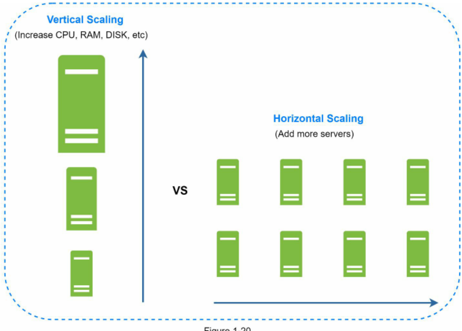

Hình 1-20

Sharding chia tách các cơ sở dữ liệu lớn thành các phần nhỏ hơn, dễ quản lý hơn gọi là các mảnh (shards). Mỗi shard dùng chung một cấu trúc lược đồ (schema), mặc dù dữ liệu thực tế trên mỗi shard là duy nhất đối với shard đó.

Hình 1-21 minh họa một ví dụ về các cơ sở dữ liệu được phân mảnh. Dữ liệu người dùng được phân bổ vào một máy chủ cơ sở dữ liệu dựa trên mã định danh người dùng (user IDs). Bất cứ khi nào bạn truy cập dữ liệu, một hàm băm (hash function) sẽ được sử dụng để tìm ra shard tương ứng. Trong ví dụ của chúng ta, phép toán `user_id % 4` được sử dụng làm hàm băm. Nếu kết quả bằng 0, shard 0 được sử dụng để lưu trữ và truy xuất dữ liệu. Nếu kết quả bằng 1, shard 1 sẽ được sử dụng. Logic tương tự được áp dụng cho các shard còn lại.

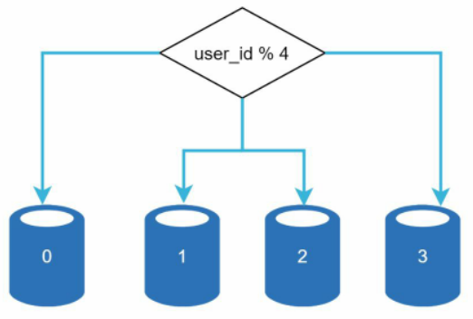

Hình 1-21

Hình 1-22 minh họa cấu trúc bảng người dùng trong các cơ sở dữ liệu đã được phân mảnh.


Hình 1-22

Yếu tố quan trọng nhất cần cân nhắc khi triển khai chiến lược sharding là việc lựa chọn khóa phân mảnh (sharding key). Khóa phân mảnh (được gọi là khóa phân vùng - partition key) bao gồm một hoặc nhiều cột xác định cách thức dữ liệu được phân bổ. Như minh họa trong Hình 1-22, "user_id" chính là sharding key. Một sharding key cho phép bạn truy xuất và sửa đổi dữ liệu một cách hiệu quả bằng cách định tuyến các truy vấn cơ sở dữ liệu đến chính xác cơ sở dữ liệu đích. Khi lựa chọn một sharding key, một trong những tiêu chí quan trọng nhất là chọn một khóa có khả năng phân bổ dữ liệu một cách đồng đều.

Sharding là một kỹ thuật tuyệt vời để mở rộng cơ sở dữ liệu nhưng nó còn lâu mới là một giải pháp hoàn hảo. Nó mang lại sự phức tạp và những thách thức mới cho hệ thống:

Tái phân mảnh dữ liệu (Resharding data): Việc tái phân mảnh dữ liệu là cần thiết khi: 1) một shard đơn lẻ không còn khả năng chứa thêm dữ liệu do sự tăng trưởng quá nhanh; 2) Một số shard nhất định có thể bị cạn kiệt dung lượng nhanh hơn các shard khác do sự phân bổ dữ liệu không đồng đều. Khi hiện tượng cạn kiệt shard xảy ra, nó đòi hỏi phải cập nhật lại hàm phân mảnh và di chuyển dữ liệu qua lại. Kỹ thuật băm nhất quán (Consistent hashing), sẽ được thảo luận chi tiết trong Chương 5, là một kỹ thuật thường được sử dụng để giải quyết vấn đề này.

Vấn đề người nổi tiếng (Celebrity problem): Vấn đề này còn được gọi là bài toán khóa điểm nóng (hotspot key problem). Việc truy cập quá mức vào một shard cụ thể có thể khiến máy chủ đó bị quá tải. Hãy tưởng tượng dữ liệu của Katy Perry, Justin Bieber và Lady Gaga đều nằm trên cùng một shard. Đối với các ứng dụng mạng xã hội, shard đó sẽ bị quá tải hoàn toàn bởi các thao tác đọc. Để giải quyết vấn đề này, chúng ta có thể phải phân bổ một shard riêng cho từng người nổi tiếng. Mỗi shard thậm chí có thể đòi hỏi phải tiếp tục chia nhỏ hơn nữa.

> 💡 **Giải thích thêm:** "Celebrity problem" (vấn đề người nổi tiếng) hay "Hotspot key problem" (bài toán khóa điểm nóng) là hiện tượng một khóa dữ liệu có mức độ phổ biến quá cao (ví dụ: tài khoản mạng xã hội của người nổi tiếng) dẫn đến lưu lượng truy cập (đặc biệt là thao tác đọc) tập trung áp đảo vào một shard duy nhất. Điều này phá vỡ giả định phân bổ tải đồng đều của hệ thống sharding, gây nghẽn cổ chai cục bộ và có thể làm sập nút lưu trữ đó.  
> Nguồn tham khảo: (Không có nguồn trích dẫn xác thực — cần tự kiểm chứng thêm)

Thao tác Join và bỏ chuẩn hóa (Join and de-normalization): Một khi cơ sở dữ liệu đã được phân mảnh trên nhiều máy chủ, rất khó để thực hiện các thao tác kết hợp dữ liệu (join) giữa các shard của cơ sở dữ liệu. Một cách giải quyết phổ biến là bỏ chuẩn hóa cơ sở dữ liệu (denormalize) để các truy vấn có thể được thực hiện chỉ trong một bảng duy nhất.

Trong Hình 1-23, chúng ta phân mảnh các cơ sở dữ liệu để hỗ trợ lưu lượng dữ liệu đang gia tăng nhanh chóng. Đồng thời, một số chức năng phi quan hệ được chuyển sang kho lưu trữ dữ liệu NoSQL để giảm tải cho cơ sở dữ liệu. Dưới đây là một bài viết đề cập đến nhiều trường hợp sử dụng của NoSQL [14].


# Millions of users and beyond (Hàng triệu người dùng và xa hơn nữa)

Mở rộng quy mô hệ thống là một quá trình lặp đi lặp lại. Việc áp dụng liên tục những gì chúng ta đã học trong chương này có thể đưa chúng ta tiến rất xa. Chúng ta sẽ cần thêm nhiều sự tinh chỉnh và các chiến lược mới để mở rộng quy mô vượt xa hàng triệu người dùng. Ví dụ, bạn có thể cần tối ưu hóa hệ thống và phân tách hệ thống thành các dịch vụ thậm chí còn nhỏ hơn nữa. Tất cả các kỹ thuật được học trong chương này sẽ cung cấp một nền tảng tốt để bạn giải quyết những thách thức mới. Để kết thúc chương này, chúng tôi cung cấp bản tóm tắt về cách chúng ta mở rộng hệ thống để hỗ trợ hàng triệu người dùng:
 * Giữ cho tầng web luôn phi trạng thái (stateless)
 * Xây dựng tính dự phòng (redundancy) ở mọi tầng
 * Lưu trữ bộ nhớ đệm (cache) dữ liệu nhiều nhất có thể
 * Hỗ trợ đa trung tâm dữ liệu
 * Lưu trữ các tài nguyên tĩnh trên CDN
 * Mở rộng quy mô tầng dữ liệu bằng kỹ thuật phân mảnh (sharding)
 * Chia tách các tầng thành các dịch vụ riêng lẻ
 * Giám sát hệ thống của bạn và sử dụng các công cụ tự động hóa

Xin chúc mừng bạn đã đi được một chặng đường dài đến đây! Bây giờ hãy tự thưởng cho bản thân một cái vỗ vai khích lệ. Bạn đã làm rất tốt!

# Reference materials (Tài liệu tham khảo)

[1] Hypertext Transfer Protocol: https://en.wikipedia.org/wiki/Hypertext_Transfer_Protocol  
[2] Should you go Beyond Relational Databases?: https://blog.teamtreehouse.com/should-you-go-beyond-relational-databases  
[3] Replication: https://en.wikipedia.org/wiki/Replication_(computing)  
[4] Multi-master replication: https://en.wikipedia.org/wiki/Multi-master_replication  
[5] NDB Cluster Replication: Multi-Master and Circular Replication: https://dev.mysql.com/doc/refman/5.7/en/mysql-cluster-replication-multi-master.html  
[6] Caching Strategies and How to Choose the Right One: https://codeahoy.com/2017/08/11/caching-strategies-and-how-to-choose-the-right-one/  
[7] R. Nishtala, "Facebook, Scaling Memcache at," 10th USENIX Symposium on Networked Systems Design and Implementation (NSDI '13).  
[8] Single point of failure: https://en.wikipedia.org/wiki/Single_point_of_failure  
[9] Amazon CloudFront Dynamic Content Delivery: https://aws.amazon.com/cloudfront/dynamic-content/  
[10] Configure Sticky Sessions for Your Classic Load Balancer: https://docs.aws.amazon.com/elasticloadbalancing/latest/classic/elb-sticky-sessions.html  
[11] Active-Active for Multi-Regional Resiliency: https://netflixtechblog.com/active-active-for-multi-regional-resiliency-c47719f6685b  
[12] Amazon EC2 High Memory Instances: https://aws.amazon.com/ec2/instance-types/high-memory/  
[13] What it takes to run Stack Overflow: http://nickcraver.com/blog/2013/11/22/what-it-takes-to-run-stack-overflow  
[14] What The Heck Are You Actually Using NoSQL For: http://highscalability.com/blog/2010/12/6/what-the-heck-are-you-actually-using-nosql-for.html

# CHAPTER 2: BACK-OF-THE-ENVELOPE ESTIMATION (CHƯƠNG 2: ƯỚC TÍNH SƠ BỘ)

Trong một buổi phỏng vấn thiết kế hệ thống, đôi khi bạn được yêu cầu ước tính dung lượng hệ thống hoặc các yêu cầu về hiệu năng bằng cách sử dụng phương pháp ước tính sơ bộ (back-of-the-envelope estimation). Theo Jeff Dean, Google Senior Fellow (Chuyên viên nghiên cứu cao cấp tại Google): "Các phép tính nháp trên phong bì là những ước tính bạn tạo ra bằng cách kết hợp giữa các thí nghiệm tưởng tượng và các con số hiệu năng thông dụng để có được cảm nhận rõ ràng về phương án thiết kế nào sẽ đáp ứng được các yêu cầu của bạn" [1].

> 💡 **Giải thích thêm:** "Back-of-the-envelope estimation" (ước tính trên phong bì thư) là một thành ngữ tiếng Anh chỉ việc thực hiện các phép tính toán nhanh, phác thảo sơ bộ bằng các con số làm tròn và những giả định hợp lý (như thể ghi nhanh trên mặt sau của chiếc phong bì thư) nhằm đánh giá nhanh tính khả thi trước khi đào sâu vào thiết kế chi tiết.  
> Nguồn tham khảo: https://en.wikipedia.org/wiki/Back-of-the-envelope_calculation

Bạn cần có cảm nhận tốt về các nguyên lý cơ bản của khả năng mở rộng để thực hiện ước tính sơ bộ một cách hiệu quả. Những khái niệm sau đây cần phải được hiểu thật rõ: lũy thừa của 2 [2], các con số về độ trễ mà mọi lập trình viên nên biết, và các con số về tính sẵn sàng.

# Power of two (Lũy thừa của 2)

Mặc dù khối lượng dữ liệu có thể trở nên khổng lồ khi xử lý các hệ thống phân tán, mọi phép tính toán suy cho cùng đều bắt nguồn từ những điều cơ bản nhất. Để có được các phép tính chính xác, điều cốt lõi là bạn phải nắm rõ đơn vị dung lượng dữ liệu bằng cách sử dụng lũy thừa của 2. Một byte là một chuỗi gồm 8 bit. Một ký tự ASCII sử dụng một byte bộ nhớ (8 bit). Dưới đây là bảng giải thích đơn vị dung lượng dữ liệu (Bảng 2-1).

Table 2-1

| Power (Lũy thừa) | Approximate value (Giá trị xấp xỉ) | Full name (Tên đầy đủ) | Short name (Tên viết tắt) |
| ---------------- | ---------------------------------- | ---------------------- | ------------------------- |
| 10               | 1 Thousand (1 Nghìn)               | 1 Kilobyte             | 1KB                       |
| 20               | 1 Million (1 Triệu)                | 1 Megabyte             | 1 MB                      |
| 30               | 1 Billion (1 Tỷ)                   | 1 Gigabyte             | 1 GB                      |
| 40               | 1 Trillion (1 Nghìn tỷ)            | 1 Terabyte             | 1 TB                      |
| 50               | 1 Quadrillion (1 Triệu tỷ)         | 1 Petabyte             | 1 PB                      |

# Latency numbers every programmer should know (Các con số độ trễ mà mọi lập trình viên nên biết)

Tiến sĩ Dean từ Google đã công bố thời lượng của các thao tác máy tính điển hình vào năm 2010 [1]. Một số con số hiện đã cũ do máy tính ngày càng trở nên nhanh hơn và mạnh mẽ hơn. Tuy nhiên, những con số đó vẫn có thể cho chúng ta một khái niệm về tốc độ nhanh và chậm của các thao tác máy tính khác nhau.

| Tên thao tác (Operation name)                                                    | Thời gian (Time)        |
| -------------------------------------------------------------------------------- | ----------------------- |
| Truy xuất L1 cache (L1 cache reference)                                          | 0.5 ns                  |
| Đoán sai nhánh (Branch mispredict)                                               | 5 ns                    |
| Truy xuất L2 cache (L2 cache reference)                                          | 7 ns                    |
| Khóa/mở khóa Mutex (Mutex lock/unlock)                                           | 100 ns                  |
| Truy xuất bộ nhớ chính (Main memory reference)                                   | 100 ns                  |
| Nén 1K bytes bằng Zippy (Compress 1K bytes with Zippy)                           | 10,000 ns = 10 μs       |
| Gửi 2K bytes qua mạng 1 Gbps (Send 2K bytes over1 Gbps network)                  | 20,000 ns = 20 μs       |
| Đọc 1 MB tuần tự từ bộ nhớ (Read 1 MB sequentially from memory)                  | 250,000 ns = 250 μs     |
| Khứ hồi trong cùng một trung tâm dữ liệu (Round trip within the same datacenter) | 500,000 ns = 500 μs     |
| Tìm kiếm vị trí trên đĩa (Disk seek)                                             | 10,000,000 ns = 10 ms   |
| Đọc 1 MB tuần tự từ mạng (Read 1 MB sequentially from the network)               | 10,000,000 ns = 10 ms   |
| Đọc 1 MB tuần tự từ đĩa (Read 1 MB sequentiallyfrom disk)                        | 30,000,000 ns = 30 ms   |
| Gửi gói tin CA (California) -> Hà Lan -> CA                                      | 150,000,000 ns = 150 ms |

Table 2-2

Ghi chú ----------- ns = nanosecond (nano-giây), µs = microsecond (micro-giây), ms = millisecond (mili-giây)  
1 ns = 10^-9 giây  
1 µs = 10^-6 giây = 1,000 ns  
1 ms = 10^-3 giây = 1,000 µs = 1,000,000 ns  

Một kỹ sư phần mềm của Google đã xây dựng một công cụ để trực quan hóa các con số của Tiến sĩ Dean. Công cụ này cũng đưa yếu tố thời gian vào tính toán. Hình 2-1 thể hiện các con số độ trễ được trực quan hóa tính đến năm 2020 (nguồn của các hình: tài liệu tham khảo [3]).


Hình 2-1

Thông qua việc phân tích các con số trong Hình 2-1, chúng ta rút ra được các kết luận sau:
 * Bộ nhớ (RAM) thì nhanh nhưng đĩa cứng thì chậm.
 * Tránh các thao tác tìm kiếm trên đĩa (disk seeks) nếu có thể.
 * Các thuật toán nén đơn giản thường chạy rất nhanh.
 * Nén dữ liệu trước khi gửi qua internet nếu có thể.
 * Các trung tâm dữ liệu thường nằm ở các khu vực khác nhau, và việc truyền dữ liệu giữa chúng luôn mất thời gian.

# Availability numbers (Các con số về tính sẵn sàng)

Tính sẵn sàng cao (High availability) là khả năng của một hệ thống có thể hoạt động liên tục trong một khoảng thời gian dài mong muốn. Tính sẵn sàng cao được đo bằng tỷ lệ phần trăm, với 100% đồng nghĩa với một dịch vụ có thời gian chết (downtime) bằng 0. Hầu hết các dịch vụ nằm trong khoảng từ 99% đến 100%. Thỏa thuận mức dịch vụ (SLA - Service Level Agreement) là một thuật ngữ thường dùng cho các nhà cung cấp dịch vụ. Đây là một thỏa thuận giữa bạn (nhà cung cấp dịch vụ) và khách hàng của bạn, và thỏa thuận này xác định một cách chính thức mức độ thời gian hoạt động (uptime) mà dịch vụ của bạn sẽ cung cấp. Các nhà cung cấp dịch vụ đám mây như Amazon [4], Google [5] và Microsoft [6] đặt mức SLA của họ từ 99.9% trở lên. Thời gian hoạt động theo truyền thống được đo bằng "các chữ số 9" (nines). Càng nhiều số 9 thì càng tốt. Như minh họa trong Bảng 2-3, số lượng các chữ số 9 tương ứng trực tiếp với thời gian gián đoạn dự kiến của hệ thống.

> 💡 **Giải thích thêm:** Khái niệm "đo bằng các chữ số 9" (nines) là thang đo chuẩn trong kỹ thuật hệ thống để định lượng tính sẵn sàng. Ví dụ: "three nines" (3 số 9 - 99.9%) cho phép hệ thống ngừng hoạt động tối đa 8.77 giờ/năm; "five nines" (5 số 9 - 99.999%) chỉ cho phép hệ thống gián đoạn tối đa khoảng 5.26 phút trong suốt cả một năm.  
> Nguồn tham khảo: https://en.wikipedia.org/wiki/High_availability

| Availability % (Độ sẵn sàng %)                                          | Downtime per day (Thời gian gián đoạn mỗi ngày) | Downtime per year (Thời gian gián đoạn mỗi năm) |
| ----------------------------------------------------------------------- | ----------------------------------------------- | ----------------------------------------------- |
| %66 [CẦN KIỂM CHỨNG: câu gốc ghi %66, nhiều khả năng là lỗi in của 99%] | 14.40minutes (14.40 phút)                       | 3.65 days (3.65 ngày)                           |
| 99.9%                                                                   | 1.44 minutes (1.44 phút)                        | 8.77 hours (8.77 giờ)                           |
| 99.99%                                                                  | 8.64 seconds (8.64 giây)                        | 52.60minutes (52.60 phút)                       |
| 99.999%                                                                 | 864.00 milliseconds (864.00 mili-giây)          | 5.26 minutes (5.26 phút)                        |
| 99.9999%                                                                | 86.40 milliseconds (86.40 mili-giây)            | 31.56 seconds (31.56 giây)                      |

Table 2-3

# Example: Estimate Twitter QPS and storage requirements (Ví dụ: Ước tính QPS và nhu cầu lưu trữ của Twitter)

Xin lưu ý rằng các con số dưới đây chỉ phục vụ cho bài tập thực hành này và không phải là số liệu thực tế từ Twitter.

Giả định:
 * 300 triệu người dùng hoạt động hàng tháng (MAU - Monthly Active Users).
 * 50% người dùng sử dụng Twitter hàng ngày.
 * Người dùng đăng trung bình 2 tweet mỗi ngày.
 * 10% tweet có chứa phương tiện truyền thông (media: ảnh, video).
 * Dữ liệu được lưu trữ trong 5 năm.

Ước tính:

Ước tính số truy vấn mỗi giây (QPS - Query Per Second):
 * Người dùng hoạt động hàng ngày (DAU - Daily Active Users) = 300 triệu * 50% = 150 triệu
 * QPS đăng tweet = 150 triệu * 2 tweet / 24 giờ / 3600 giây = ~3500
 * QPS thời điểm đỉnh điểm (Peak QPS) = 2 * QPS = ~7000

Ở đây chúng ta sẽ chỉ ước tính dung lượng lưu trữ cho tệp đa phương tiện:
 * Kích thước tweet trung bình:
 * `tweet_id`: 64 bytes
 * văn bản (text): 140 bytes
 * tệp đa phương tiện (media): 1 MB
 * Dung lượng lưu trữ phương tiện truyền thông: 150 triệu * 2 * 10% * 1 MB = 30 TB mỗi ngày
 * Dung lượng lưu trữ phương tiện truyền thông trong 5 năm: 30 TB * 365 * 5 = ~55 PB

# Tips (Mẹo hữu ích)

Ước tính sơ bộ cốt lõi nằm ở quy trình thực hiện. Việc giải quyết vấn đề quan trọng hơn nhiều so với việc chỉ đạt được kết quả con số. Người phỏng vấn muốn kiểm tra kỹ năng giải quyết vấn đề của bạn. Dưới đây là một số mẹo cần lưu ý:
 * Làm tròn và Xấp xỉ (Rounding and Approximation). Rất khó để thực hiện các phép toán phức tạp trong buổi phỏng vấn. Ví dụ, kết quả của "99987 / 9.1" là bao nhiêu? Không cần thiết phải lãng phí thời gian quý báu để giải các bài toán phức tạp. Độ chính xác tuyệt đối không phải là điều người ta mong đợi. Hãy tận dụng các con số làm tròn và phép tính xấp xỉ để tạo lợi thế cho mình. Phép toán chia trên có thể được đơn giản hóa như sau: "100,000 / 10".
 * Ghi lại các giả định của bạn. Việc ghi lại các giả định lên bảng để tham chiếu lại sau này là một ý kiến hay.
 * Gắn nhãn các đơn vị của bạn. Khi bạn viết "5", con số đó có nghĩa là 5 KB hay 5 MB? Bạn có thể tự làm mình bối rối với điều này. Hãy viết rõ các đơn vị vì "5 MB" giúp loại bỏ sự mơ hồ.
 * Các bài toán ước tính sơ bộ thường gặp: QPS, QPS đỉnh điểm, dung lượng lưu trữ, bộ nhớ đệm, số lượng máy chủ, v.v. Bạn có thể luyện tập các phép tính này khi chuẩn bị cho một cuộc phỏng vấn. Rèn luyện tạo nên sự hoàn hảo.

Xin chúc mừng bạn đã đi được một chặng đường dài đến đây! Bây giờ hãy tự thưởng cho bản thân một cái vỗ vai khích lệ. Bạn đã làm rất tốt!

# Reference materials (Tài liệu tham khảo)

[1] J. Dean.Google Pro Tip: Use Back-Of-The-Envelope-Calculations To Choose The Best Design: http://highscalability.com/blog/2011/1/26/google-pro-tip-use-back-of-the-envelopecalculations-to-choo.html  
[2] System design primer: https://github.com/donnemartin/system-design-primer  
[3] Latency Numbers Every Programmer Should Know: https://colin-scott.github.io/personal_website/research/interactive_latency.html  
[4] Amazon Compute Service Level Agreement: https://aws.amazon.com/compute/sla/  
[5] Compute Engine Service Level Agreement (SLA): https://cloud.google.com/compute/sla  
[6] SLA summary for Azure services: https://azure.microsoft.com/enus/support/legal/sla/summary/

# CHAPTER 3: A FRAMEWORK FOR SYSTEM DESIGN INTERVIEWS (CHƯƠNG 3: KHUNG PHƯƠNG PHÁP LUẬN CHO PHỎNG VẤN THIẾT KẾ HỆ THỐNG)

Bạn vừa nhận được lời mời phỏng vấn trực tiếp (on-site) mà bấy lâu hằng mơ ước tại công ty mục tiêu. Người điều phối tuyển dụng gửi cho bạn lịch trình của ngày hôm đó. Đọc lướt qua danh sách, bạn cảm thấy khá ổn cho đến khi mắt bạn dừng lại ở phiên phỏng vấn này - Phỏng vấn Thiết kế Hệ thống (System Design Interview).

Các buổi phỏng vấn thiết kế hệ thống thường gây cảm giác e ngại. Đề bài có thể rất mơ hồ kiểu như "hãy thiết kế một sản phẩm X nổi tiếng nào đó?". Các câu hỏi thường không rõ ràng và có phạm vi rộng đến mức vô lý. Nỗi lo lắng của bạn là hoàn toàn dễ hiểu. Rốt cuộc, làm sao một người có thể thiết kế chỉ trong vòng một giờ một sản phẩm nổi tiếng mà ngoài đời thực phải mất hàng trăm, thậm chí hàng nghìn kỹ sư xây dựng nên?

Tin tốt là không ai kỳ vọng bạn phải làm được điều đó. Thiết kế hệ thống trong thế giới thực vô cùng phức tạp. Ví dụ, công cụ tìm kiếm của Google thoạt nhìn có vẻ đơn giản đến bất ngờ; tuy nhiên, khối lượng công nghệ làm nền tảng cho sự đơn giản đó thực sự đáng kinh ngạc. Nếu không ai kỳ vọng bạn phải thiết kế một hệ thống thực tế trong vòng một giờ, vậy mục đích của buổi phỏng vấn thiết kế hệ thống là gì?

Phỏng vấn thiết kế hệ thống mô phỏng lại quá trình giải quyết vấn đề trong đời thực, nơi hai người đồng nghiệp cùng cộng tác trên một bài toán còn mơ hồ và cùng đưa ra một giải pháp đáp ứng các mục tiêu đề ra. Vấn đề mang tính mở, và không có một câu trả lời hoàn hảo duy nhất. Thiết kế cuối cùng ít quan trọng hơn so với nỗ lực và quá trình bạn đầu tư vào việc thiết kế. Điều này cho phép bạn thể hiện kỹ năng thiết kế của mình, bảo vệ các lựa chọn thiết kế, và phản hồi lại các ý kiến đóng góp một cách mang tính xây dựng.

Hãy đảo ngược góc nhìn và xem điều gì đang diễn ra trong đầu người phỏng vấn khi cô ấy bước vào phòng họp để gặp bạn. Mục tiêu hàng đầu của người phỏng vấn là đánh giá chính xác năng lực của bạn. Điều cuối cùng mà cô ấy mong muốn là phải đưa ra một đánh giá không dứt khoát vì buổi phỏng vấn diễn ra mờ nhạt và không thu thập đủ các tín hiệu đánh giá.

Người phỏng vấn tìm kiếm điều gì trong một buổi phỏng vấn thiết kế hệ thống? Nhiều người nghĩ rằng phỏng vấn thiết kế hệ thống chỉ đơn thuần là về kỹ năng thiết kế kỹ thuật của một cá nhân. Nó bao hàm nhiều hơn thế rất nhiều. Một buổi phỏng vấn thiết kế hệ thống hiệu quả sẽ cung cấp những tín hiệu mạnh mẽ về khả năng cộng tác, khả năng làm việc dưới áp lực, và năng lực giải quyết sự mơ hồ một cách mang tính xây dựng. Khả năng đặt câu hỏi hay cũng là một kỹ năng thiết yếu, và nhiều người phỏng vấn đặc biệt tìm kiếm kỹ năng này.

Một người phỏng vấn giỏi cũng sẽ chú ý tìm kiếm các dấu hiệu cảnh báo (red flags). Thiết kế quá mức cần thiết (Over-engineering) là một "căn bệnh" thực sự của nhiều kỹ sư khi họ say mê sự hoàn hảo thuần túy trong thiết kế mà bỏ qua các đánh đổi thực tế (tradeoffs). Họ thường không nhận thức được chi phí cộng dồn khổng lồ của các hệ thống bị thiết kế quá phức tạp, và nhiều công ty đã phải trả giá đắt cho sự thiếu hiểu biết đó. Bạn chắc chắn không muốn thể hiện xu hướng này trong một buổi phỏng vấn thiết kế hệ thống. Các dấu hiệu cảnh báo khác bao gồm tư duy hạn hẹp, bảo thủ, v.v.

Trong chương này, chúng ta sẽ điểm qua một số mẹo hữu ích và giới thiệu một khung phương pháp luận đơn giản nhưng hiệu quả để giải quyết các bài toán phỏng vấn thiết kế hệ thống.

# A 4-step process for effective system design interview (Quy trình 4 bước cho buổi phỏng vấn thiết kế hệ thống hiệu quả)

Mỗi buổi phỏng vấn thiết kế hệ thống đều có sự khác biệt. Một buổi phỏng vấn thiết kế hệ thống hay luôn có tính chất mở và không có một giải pháp khuôn mẫu duy nhất nào phù hợp cho mọi trường hợp. Tuy nhiên, luôn có những bước đi và những điểm cốt lõi chung cần phải bao quát trong mọi buổi phỏng vấn thiết kế hệ thống.

## Step 1 - Understand the problem and establish design scope (Bước 1 - Thấu hiểu vấn đề và xác lập phạm vi thiết kế)

"Tại sao con hổ lại gầm?" Một cánh tay giơ lên ở cuối lớp học. "Ừ, Jimmy?", cô giáo gọi. "Thưa cô, vì nó ĐÓI ạ". "Rất tốt Jimmy." Suốt thời thơ ấu, Jimmy luôn là người đầu tiên trả lời các câu hỏi trong lớp. Bất cứ khi nào giáo viên đặt câu hỏi, trong lớp luôn có một đứa trẻ thích xông xáo thử sức với câu hỏi đó, bất kể cậu bé có biết câu trả lời hay không. Đó chính là Jimmy. Jimmy là một học sinh xuất sắc. Cậu bé tự hào vì luôn biết tất cả các câu trả lời một cách nhanh chóng. Trong các kỳ thi, cậu thường là người đầu tiên hoàn thành bài thi. Cậu là lựa chọn hàng đầu của giáo viên cho mọi cuộc thi học thuật.

ĐỪNG giống như Jimmy. Trong một buổi phỏng vấn thiết kế hệ thống, việc vội vàng đưa ra câu trả lời ngay lập tức mà không suy nghĩ sẽ không mang lại cho bạn bất kỳ điểm cộng nào. Trả lời khi chưa hiểu thấu đáo các yêu cầu là một dấu hiệu cảnh báo tiêu cực lớn vì buổi phỏng vấn không phải là một cuộc thi đố vui nhanh. Ở đây không có một đáp án duy nhất đúng.

Vì vậy, đừng vội vàng lao ngay vào việc đưa ra giải pháp. Hãy chậm lại. Suy nghĩ thật sâu và đặt các câu hỏi để làm rõ các yêu cầu và các giả định. Điều này cực kỳ quan trọng. Là kỹ sư, chúng ta thường thích giải quyết các bài toán khó và muốn nhảy ngay vào bản thiết kế cuối cùng; tuy nhiên, cách tiếp cận này rất dễ khiến bạn thiết kế sai hệ thống. Một trong những kỹ năng quan trọng nhất của một kỹ sư là biết đặt câu hỏi đúng, đưa ra các giả định hợp lý, và thu thập tất cả các thông tin cần thiết để xây dựng một hệ thống. Vì vậy, đừng ngại đặt câu hỏi.

Khi bạn đặt câu hỏi, người phỏng vấn sẽ trả lời trực tiếp câu hỏi của bạn hoặc yêu cầu bạn tự đưa ra các giả định. Nếu rơi vào trường hợp sau, hãy viết các giả định của bạn lên bảng trắng hoặc giấy nháp. Bạn có thể sẽ cần đến chúng sau này.

Nên đặt những loại câu hỏi nào? Hãy hỏi các câu hỏi giúp thấu hiểu chính xác các yêu cầu. Dưới đây là danh sách các câu hỏi giúp bạn bắt đầu:
 * Chúng ta sẽ xây dựng những tính năng cụ thể nào?
 * Sản phẩm có bao nhiêu người dùng?
 * Công ty dự kiến tốc độ mở rộng quy mô nhanh đến mức nào? Quy mô dự kiến trong 3 tháng, 6 tháng, và 1 năm tới là bao nhiêu?
 * Ngăn xếp công nghệ (technology stack) hiện tại của công ty là gì? Chúng ta có thể tận dụng những dịch vụ sẵn có nào để đơn giản hóa thiết kế?

Ví dụ (Example)

Nếu bạn được yêu cầu thiết kế một hệ thống bảng tin (news feed system), bạn sẽ muốn hỏi những câu hỏi giúp làm rõ các yêu cầu. Cuộc hội thoại giữa bạn và người phỏng vấn có thể diễn ra như sau:

Ứng viên: Đây là ứng dụng di động, ứng dụng web, hay cả hai?  
Người phỏng vấn: Cả hai.  
Ứng viên: Các tính năng quan trọng nhất của sản phẩm là gì?  
Người phỏng vấn: Khả năng đăng bài viết và xem bảng tin của bạn bè.  
Ứng viên: Bảng tin được sắp xếp theo thứ tự thời gian đảo ngược (mới nhất lên đầu) hay theo một thứ tự đặc biệt? Thứ tự đặc biệt ở đây có nghĩa là mỗi bài viết được gán một trọng số khác nhau. Chẳng hạn, bài viết từ bạn thân sẽ quan trọng hơn bài viết từ một nhóm.  
Người phỏng vấn: Để giữ cho mọi thứ đơn giản, chúng ta giả định bảng tin được sắp xếp theo thứ tự thời gian đảo ngược.  
Ứng viên: Một người dùng có thể có tối đa bao nhiêu bạn bè?  
Người phỏng vấn: 5000.  
Ứng viên: Khối lượng lưu lượng truy cập là bao nhiêu?  
Người phỏng vấn: 10 triệu người dùng hoạt động hàng ngày (DAU).  
Ứng viên: Bảng tin có thể chứa hình ảnh, video, hay chỉ có văn bản thuần túy?  
Người phỏng vấn: Nó có thể chứa các tệp đa phương tiện, bao gồm cả hình ảnh và video.

Trên đây là một số câu hỏi mẫu mà bạn có thể hỏi người phỏng vấn. Việc thấu hiểu các yêu cầu và làm sáng tỏ các điểm mơ hồ là vô cùng quan trọng.

## Step 2 - Propose high-level design and get buy-in (Bước 2 - Đề xuất thiết kế cấp cao và đạt được sự đồng thuận)

Trong bước này, mục tiêu của chúng ta là phát triển một bản thiết kế cấp cao và đạt được sự đồng thuận với người phỏng vấn về thiết kế đó. Việc cộng tác chặt chẽ với người phỏng vấn trong suốt quá trình này là một ý tưởng tuyệt vời.
 * Đưa ra một bản thiết kế phác thảo ban đầu (blueprint). Lắng nghe phản hồi. Hãy coi người phỏng vấn như một đồng đội và làm việc cùng nhau. Nhiều người phỏng vấn giỏi rất thích trò chuyện và tham gia vào quá trình này.
 * Vẽ các sơ đồ khối với các thành phần chính lên bảng trắng hoặc giấy. Sơ đồ này có thể bao gồm các máy khách (di động/web), các API, máy chủ web, kho lưu trữ dữ liệu, bộ nhớ đệm, CDN, hàng đợi thông điệp, v.v.
 * Thực hiện các phép tính nhẩm sơ bộ để đánh giá xem bản thiết kế phác thảo của bạn có phù hợp với các ràng buộc về quy mô hay không. Hãy suy nghĩ thành tiếng (think out loud). Hãy trao đổi với người phỏng vấn xem việc tính toán sơ bộ có cần thiết hay không trước khi đi sâu vào tính toán.

Nếu có thể, hãy đi qua một vài kịch bản sử dụng (use cases) cụ thể. Điều này sẽ giúp bạn định hình bản thiết kế cấp cao rõ ràng hơn. Các kịch bản sử dụng cũng rất có thể sẽ giúp bạn phát hiện ra các trường hợp biên (edge cases) mà bạn chưa từng nghĩ tới.

Chúng ta có nên đưa các điểm cuối API (API endpoints) và lược đồ cơ sở dữ liệu (database schema) vào đây không? Điều này phụ thuộc vào bài toán. Đối với các bài toán thiết kế quy mô lớn như "Thiết kế công cụ tìm kiếm Google", việc này có phần đi quá sâu vào chi tiết cấp thấp. Đối với một bài toán như thiết kế backend cho một trò chơi poker nhiều người chơi, đây lại là một chủ đề hoàn toàn phù hợp để thảo luận. Hãy trao đổi trực tiếp với người phỏng vấn của bạn.

### Example (Ví dụ)

Hãy sử dụng bài toán "Thiết kế hệ thống bảng tin" để minh họa cách tiếp cận bản thiết kế cấp cao. Ở đây bạn chưa cần phải hiểu sâu về cách hệ thống thực sự vận hành bên dưới. Tất cả các chi tiết sẽ được giải thích trong Chương 11.

Ở mức độ cấp cao, thiết kế được chia thành hai luồng chính: đăng bảng tin (feed publishing) và xây dựng bảng tin (news feed building).
 * Đăng bảng tin: khi một người dùng đăng một bài viết, dữ liệu tương ứng sẽ được ghi vào bộ nhớ đệm/cơ sở dữ liệu, và bài viết đó sẽ được phân phối vào bảng tin của bạn bè.
 * Xây dựng bảng tin: bảng tin được xây dựng bằng cách tổng hợp các bài viết của bạn bè theo thứ tự thời gian đảo ngược.

Hình 3-1 và Hình 3-2 lần lượt trình bày các bản thiết kế cấp cao cho luồng đăng bài và luồng xây dựng bảng tin.

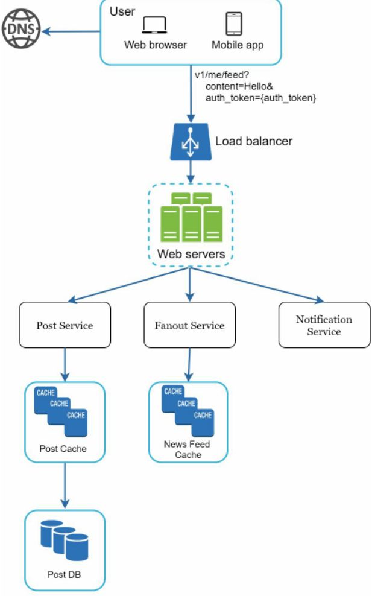

Hình 3-1


Hình 3-2

## Step 3 - Design deep dive (Bước 3 - Đào sâu vào chi tiết thiết kế)

Tại bước này, bạn và người phỏng vấn đáng lẽ đã phải đạt được các mục tiêu sau:
 * Thống nhất về các mục tiêu tổng thể và phạm vi tính năng
 * Phác thảo ra một bản thiết kế cấp cao cho toàn bộ hệ thống
 * Nhận được phản hồi từ người phỏng vấn về bản thiết kế cấp cao
 * Có được một số ý tưởng ban đầu về các khu vực cần tập trung đào sâu dựa trên phản hồi của cô ấy

Bạn cần làm việc cùng với người phỏng vấn để xác định và ưu tiên các thành phần trong kiến trúc. Cần nhấn mạnh rằng mỗi cuộc phỏng vấn đều có sự khác biệt. Đôi khi, người phỏng vấn có thể gợi ý rằng cô ấy thích tập trung vào thiết kế cấp cao. Đôi khi, đối với một cuộc phỏng vấn ứng viên cấp cao (senior), cuộc thảo luận có thể xoay quanh các đặc tính hiệu năng của hệ thống, nhiều khả năng tập trung vào các điểm nghẽn cổ chai và ước tính tài nguyên. Trong hầu hết các trường hợp, người phỏng vấn có thể muốn bạn đào sâu vào chi tiết của một số thành phần hệ thống.

Đối với dịch vụ rút gọn URL, việc đào sâu vào thiết kế hàm băm để chuyển đổi một URL dài thành một URL ngắn là một chủ đề rất thú vị. Đối với một hệ thống trò chuyện, làm thế nào để giảm độ trễ và làm thế nào để hỗ trợ trạng thái trực tuyến/ngoại tuyến là hai chủ đề hấp dẫn. Quản lý thời gian là điều thiết yếu vì bạn rất dễ bị cuốn vào những chi tiết vụn vặt không thể hiện được năng lực của mình. Bạn phải luôn chuẩn bị sẵn các tín hiệu rõ ràng để chứng minh cho người phỏng vấn thấy. Cố gắng đừng đi vào các chi tiết không cần thiết. Ví dụ, việc nói chi tiết về thuật toán EdgeRank dùng để xếp hạng bảng tin của Facebook là không lý tưởng trong một buổi phỏng vấn thiết kế hệ thống, vì điều này tiêu tốn rất nhiều thời gian quý báu mà lại không chứng minh được khả năng thiết kế một hệ thống có khả năng mở rộng của bạn.

### Example (Ví dụ)

Đến thời điểm này, chúng ta đã thảo luận xong bản thiết kế cấp cao cho hệ thống bảng tin, và người phỏng vấn cảm thấy hài lòng với đề xuất của bạn. Tiếp theo, chúng ta sẽ khảo sát hai trong số các kịch bản sử dụng quan trọng nhất:

1. Đăng bài viết lên bảng tin (Feed publishing)
2. Truy xuất bảng tin (News feed retrieval)

Hình 3-3 và Hình 3-4 thể hiện bản thiết kế chi tiết cho hai trường hợp sử dụng này, và chúng sẽ được giải thích cặn kẽ trong Chương 11.

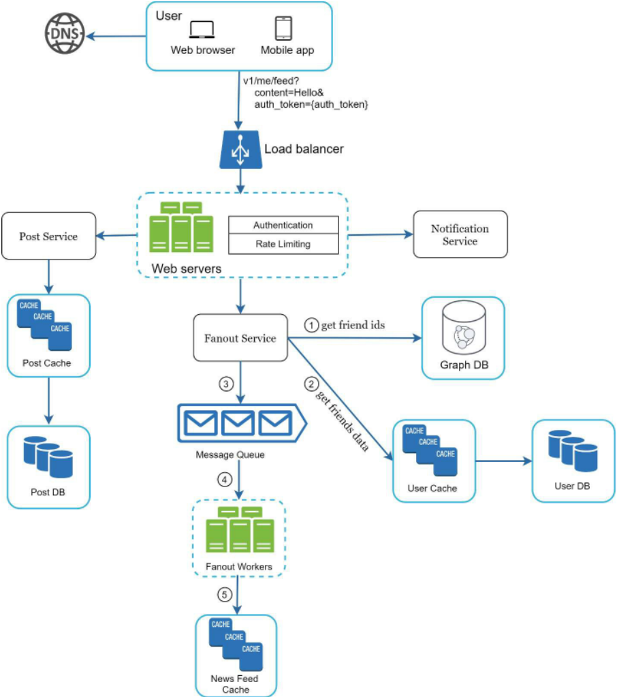

Hình 3-3

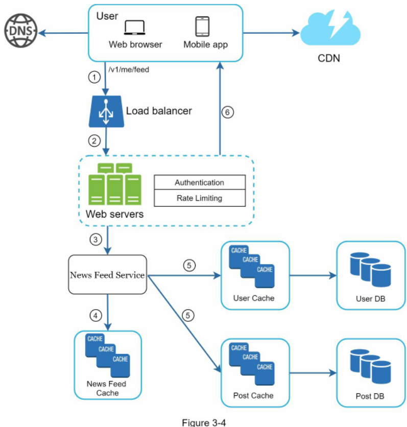

## Step 4 - Wrap up (Bước 4 - Tổng kết)

Trong bước cuối cùng này, người phỏng vấn có thể hỏi bạn một vài câu hỏi tiếp nối hoặc cho bạn sự tự do để thảo luận về các điểm bổ sung khác. Dưới đây là một vài hướng đi cần theo dõi:
 * Người phỏng vấn có thể muốn bạn chỉ ra các điểm nghẽn cổ chai của hệ thống và thảo luận về các cải tiến tiềm năng. Đừng bao giờ nói rằng thiết kế của bạn đã hoàn hảo và không còn gì để cải thiện. Luôn luôn có điều gì đó có thể làm tốt hơn. Đây là một cơ hội tuyệt vời để thể hiện tư duy phản biện của bạn và để lại ấn tượng tốt đẹp cuối cùng.
 * Việc tóm tắt lại bản thiết kế cho người phỏng vấn có thể rất hữu ích. Điều này đặc biệt quan trọng nếu bạn đã đề xuất nhiều giải pháp khác nhau. Việc làm mới lại trí nhớ của người phỏng vấn sẽ rất có giá trị sau một phiên làm việc dài căng thẳng.
 * Các trường hợp lỗi (sự cố máy chủ, mất kết nối mạng, v.v.) là những chủ đề thú vị để bàn luận.
 * Các vấn đề vận hành là điều rất đáng đề cập. Bạn giám sát các chỉ số đo lường và log lỗi như thế nào? Làm thế nào để triển khai hệ thống ra thực tế?
 * Làm thế nào để xử lý đường cong tăng trưởng quy mô tiếp theo cũng là một chủ đề hấp dẫn. Ví dụ, nếu thiết kế hiện tại của bạn hỗ trợ 1 triệu người dùng, bạn cần thực hiện những thay đổi gì để hỗ trợ 10 triệu người dùng?
 * Đề xuất các tinh chỉnh khác mà bạn sẽ thực hiện nếu bạn có thêm thời gian.

Để tổng kết, chúng tôi tóm tắt lại danh sách những điều Nên làm (Dos) và Không nên làm (Don'ts).

### Dos (Những điều nên làm)

 * Luôn luôn yêu cầu làm rõ vấn đề. Đừng vội mặc định rằng giả định của bạn là đúng.
 * Thấu hiểu tường tận các yêu cầu của bài toán.
 * Không có câu trả lời đúng duy nhất cũng như không có câu trả lời tốt nhất tuyệt đối. Một giải pháp được thiết kế để giải quyết bài toán của một công ty khởi nghiệp non trẻ sẽ khác hoàn toàn với giải pháp của một công ty đã thành danh với hàng triệu người dùng. Hãy chắc chắn rằng bạn hiểu rõ các yêu cầu.
 * Cho người phỏng vấn biết bạn đang suy nghĩ điều gì. Luôn giao tiếp với người phỏng vấn.
 * Đề xuất nhiều hướng tiếp cận khác nhau nếu có thể.
 * Một khi bạn đã đạt được sự đồng thuận với người phỏng vấn về bản thiết kế phác thảo, hãy đi sâu vào chi tiết của từng thành phần. Thiết kế các thành phần quan trọng nhất trước tiên.
 * Trao đổi và thử nghiệm ý tưởng với người phỏng vấn. Một người phỏng vấn tốt sẽ làm việc cùng bạn như một người đồng đội.
 * Không bao giờ bỏ cuộc.

### Don'ts (Những điều không nên làm)

 * Đừng bước vào phỏng vấn mà không chuẩn bị trước cho các dạng câu hỏi phỏng vấn điển hình.
 * Đừng vội vàng lao vào đưa ra giải pháp khi chưa làm rõ các yêu cầu và các giả định.
 * Đừng đi quá sâu vào chi tiết của một thành phần đơn lẻ ngay từ đầu. Hãy đưa ra thiết kế cấp cao trước rồi mới đào sâu chi tiết.
 * Nếu bạn bị tắc ý tưởng, đừng ngần ngại yêu cầu gợi ý.
 * Một lần nữa, hãy luôn giao tiếp. Đừng suy nghĩ trong im lặng.
 * Đừng nghĩ rằng buổi phỏng vấn đã kết thúc một khi bạn đưa ra bản thiết kế. Buổi phỏng vấn chưa kết thúc cho đến khi người phỏng vấn tuyên bố kết thúc. Hãy xin phản hồi sớm và thường xuyên.

## Time allocation on each step (Phân bổ thời gian cho từng bước)

Các câu hỏi phỏng vấn thiết kế hệ thống thường rất rộng, và 45 phút hoặc một giờ là không đủ để bao quát toàn bộ thiết kế. Quản lý thời gian là điều tối quan trọng. Bạn nên dành bao nhiêu thời gian cho mỗi bước? Dưới đây là hướng dẫn mang tính ước lượng sơ bộ về cách phân bổ thời gian của bạn trong một buổi phỏng vấn kéo dài 45 phút. Xin lưu ý rằng đây chỉ là ước tính sơ lược, và việc phân bổ thời gian thực tế sẽ phụ thuộc vào phạm vi của bài toán cũng như các yêu cầu từ phía người phỏng vấn.

Bước 1 Thấu hiểu vấn đề và xác lập phạm vi thiết kế: 3 - 10 phút  
Bước 2 Đề xuất thiết kế cấp cao và đạt được sự đồng thuận: 10 - 15 phút  
Bước 3 Đào sâu vào chi tiết thiết kế: 10 - 25 phút  
Bước 4 Tổng kết: 3 - 5 phút

# CHAPTER 4: DESIGN A RATE LIMITER (CHƯƠNG 4: THIẾT KẾ BỘ GIỚI HẠN TẦN SUẤT TRUY CẬP)

Trong một hệ thống mạng, bộ giới hạn tần suất truy cập (rate limiter) được sử dụng để kiểm soát tốc độ lưu lượng truy cập được gửi bởi một máy khách hoặc một dịch vụ. Trong thế giới HTTP, một rate limiter sẽ giới hạn số lượng yêu cầu của máy khách được phép gửi trong một khoảng thời gian xác định. Nếu số lượng yêu cầu API vượt quá ngưỡng được định nghĩa bởi rate limiter, tất cả các lệnh gọi vượt ngưỡng sẽ bị chặn lại. Dưới đây là một vài ví dụ:
 * Một người dùng không thể viết quá 2 bài đăng mỗi giây.
 * Bạn có thể tạo tối đa 10 tài khoản mỗi ngày từ cùng một địa chỉ IP.
 * Bạn không thể nhận phần thưởng quá 5 lần mỗi tuần từ cùng một thiết bị.

Trong chương này, bạn được yêu cầu thiết kế một rate limiter. Trước khi bắt đầu thiết kế, trước tiên chúng ta cùng xem xét những lợi ích của việc sử dụng một API rate limiter:
 * Ngăn chặn tình trạng cạn kiệt tài nguyên do các cuộc tấn công Từ chối Dịch vụ (DoS - Denial of Service) [1]. Hầu như tất cả các API do các công ty công nghệ lớn phát hành đều áp dụng một hình thức giới hạn tần suất nào đó. Ví dụ, Twitter giới hạn số lượng tweet ở mức 300 tweet trong mỗi 3 giờ [2]. Google Docs API áp dụng mức giới hạn mặc định sau: 300 yêu cầu đọc cho mỗi người dùng trong mỗi 60 giây [3]. Một rate limiter ngăn chặn các cuộc tấn công DoS, dù là cố ý hay vô tình, bằng cách chặn các lệnh gọi vượt quá giới hạn.
 * Giảm thiểu chi phí. Việc giới hạn các yêu cầu dư thừa đồng nghĩa với việc cần ít máy chủ hơn và phân bổ được nhiều tài nguyên hơn cho các API có mức độ ưu tiên cao. Giới hạn tần suất truy cập là cực kỳ quan trọng đối với các công ty sử dụng các API trả phí của bên thứ ba. Ví dụ, bạn bị tính phí trên từng lượt gọi đối với các API bên ngoài sau: kiểm tra tín dụng, thực hiện thanh toán, truy xuất hồ sơ sức khỏe, v.v. Việc giới hạn số lượng cuộc gọi là điều thiết yếu để cắt giảm chi phí.
 * Ngăn chặn máy chủ bị quá tải. Để giảm tải cho máy chủ, một rate limiter được sử dụng để lọc bỏ các yêu cầu vượt ngưỡng gây ra bởi bot hoặc hành vi sai lệch của người dùng.

# Step 1 - Understand the problem and establish design scope (Bước 1 - Thấu hiểu vấn đề và xác lập phạm vi thiết kế)

Giới hạn tần suất truy cập có thể được triển khai bằng các thuật toán khác nhau, mỗi thuật toán đều có những ưu và nhược điểm riêng. Các tương tác giữa người phỏng vấn và ứng viên sẽ giúp làm rõ loại rate limiter mà chúng ta đang hướng tới xây dựng.

Ứng viên: Chúng ta sẽ thiết kế loại rate limiter nào? Đó là rate limiter phía máy khách (client-side) hay API rate limiter phía máy chủ (server-side)?  
Người phỏng vấn: Câu hỏi rất hay. Chúng ta tập trung vào API rate limiter phía máy chủ.  
Ứng viên: Rate limiter có điều tiết các yêu cầu API dựa trên IP, ID người dùng, hay các thuộc tính khác không?  
Người phỏng vấn: Rate limiter cần phải đủ linh hoạt để hỗ trợ các bộ quy tắc điều tiết khác nhau.  
Ứng viên: Quy mô của hệ thống là bao nhiêu? Hệ thống này được xây dựng cho một công ty khởi nghiệp hay một tập đoàn lớn với lượng người dùng khổng lồ?  
Người phỏng vấn: Hệ thống phải có khả năng xử lý một lượng lớn các yêu cầu.  
Ứng viên: Hệ thống có hoạt động trong môi trường phân tán không?  
Người phỏng vấn: Có.  
Ứng viên: Rate limiter là một dịch vụ độc lập hay nó nên được triển khai ngay bên trong mã nguồn ứng dụng?  
Người phỏng vấn: Đó là một quyết định thiết kế tùy thuộc vào bạn.  
Ứng viên: Chúng ta có cần thông báo cho những người dùng bị điều tiết giới hạn không?  
Người phỏng vấn: Có.

Dưới đây là bản tóm tắt các yêu cầu đối với hệ thống:
 * Giới hạn chính xác các yêu cầu vượt ngưỡng.
 * Độ trễ thấp. Rate limiter không được làm chậm thời gian phản hồi HTTP.
 * Sử dụng càng ít bộ nhớ càng tốt.
 * Giới hạn tần suất phân tán (Distributed rate limiting). Rate limiter có thể được chia sẻ qua nhiều máy chủ hoặc tiến trình khác nhau.
 * Xử lý ngoại lệ. Hiển thị các thông báo ngoại lệ rõ ràng cho người dùng khi các yêu cầu của họ bị điều tiết chặn lại.
 * Khả năng chịu lỗi cao. Nếu có bất kỳ sự cố nào xảy ra với rate limiter (ví dụ: một máy chủ cache bị ngoại tuyến), điều đó không được làm ảnh hưởng đến toàn bộ hệ thống.

# Step 2 - Propose high-level design and get buy-in (Bước 2 - Đề xuất thiết kế cấp cao và đạt được sự đồng thuận)

Hãy giữ cho mọi thứ đơn giản và sử dụng mô hình giao tiếp máy khách - máy chủ (client-server) cơ bản.

## Where to put the rate limiter? (Nên đặt rate limiter ở đâu?)

Một cách trực quan, bạn có thể triển khai rate limiter ở phía máy khách hoặc phía máy chủ.

 * Triển khai phía máy khách (Client-side implementation). Nhìn chung, máy khách là một nơi không đáng tin cậy để thực thi giới hạn tần suất vì các yêu cầu từ máy khách có thể dễ dàng bị giả mạo bởi các tác nhân độc hại. Hơn nữa, chúng ta có thể không có quyền kiểm soát đối với việc triển khai ứng dụng phía máy khách.
 * Triển khai phía máy chủ (Server-side implementation). Hình 4-1 minh họa một rate limiter được đặt ở phía máy chủ.

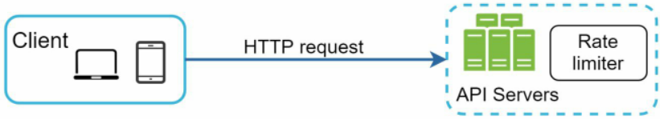

Hình 4-1

Bên cạnh cách triển khai phía máy khách và phía máy chủ, còn có một cách tiếp cận thay thế. Thay vì đặt rate limiter tại các máy chủ API, chúng ta tạo ra một phần mềm trung gian giới hạn tần suất (rate limiter middleware), có chức năng điều tiết các yêu cầu gửi đến API của bạn như được minh họa trong Hình 4-2.


Hình 4-2
