Hãy lấy ví dụ trong Hình 4-3 để minh họa cách thức hoạt động của rate limiting (giới hạn tốc độ truy cập) trong thiết kế này. Giả sử API (giao diện lập trình ứng dụng) của chúng ta cho phép 2 request (yêu cầu) mỗi giây và một client (máy khách) gửi 3 request đến máy chủ trong vòng một giây. Hai request đầu tiên được định tuyến đến các API server (máy chủ API). Tuy nhiên, rate limiter middleware (phần mềm trung gian giới hạn tốc độ truy cập) sẽ throttle (điều tiết / chặn bớt) request thứ ba và trả về HTTP status code 429 (mã trạng thái HTTP 429). Mã trạng thái phản hồi HTTP 429 biểu thị rằng người dùng đã gửi quá nhiều request.

Rate limiter Hình 4-3

Kiến trúc cloud microservices (vi dịch vụ đám mây) [4] đã trở nên vô cùng phổ biến và rate limiting thường được triển khai bên trong một thành phần gọi là API gateway (cổng API). API gateway là một dịch vụ được quản trị toàn diện (fully managed service) hỗ trợ rate limiting, SSL termination (chấm dứt kết nối SSL / giải mã SSL tại gateway), authentication (xác thực), IP whitelisting (thiết lập danh sách trắng địa chỉ IP), phục vụ static content (nội dung tĩnh), v.v. Tạm thời, chúng ta chỉ cần hiểu rằng API gateway là một middleware hỗ trợ rate limiting. Khi thiết kế một rate limiter, câu hỏi quan trọng cần tự đặt ra là: nên triển khai rate limiter ở đâu, ở phía server-side (phía máy chủ) hay trong gateway? Không có câu trả lời tuyệt đối. Điều này phụ thuộc vào technology stack (ngăn xếp công nghệ) hiện tại của công ty bạn, nguồn lực kỹ thuật, các mức độ ưu tiên, mục tiêu, v.v. Dưới đây là một vài chỉ dẫn chung: · Đánh giá technology stack hiện tại của bạn, chẳng hạn như ngôn ngữ lập trình, dịch vụ cache (bộ nhớ đệm), v.v. Hãy đảm bảo ngôn ngữ lập trình hiện tại đủ hiệu quả để triển khai rate limiting ở phía server-side. · Xác định thuật toán rate limiting phù hợp với nhu cầu nghiệp vụ của bạn. Khi tự triển khai toàn bộ ở phía server-side, bạn nắm toàn quyền kiểm soát thuật toán. Tuy nhiên, các lựa chọn có thể bị hạn chế nếu bạn dùng gateway của bên thứ ba. · Nếu bạn đã áp dụng kiến trúc microservice và đưa API gateway vào thiết kế để thực hiện authentication, IP whitelisting, v.v., bạn có thể tích hợp thêm rate limiter vào API gateway. · Tự xây dựng dịch vụ rate limiting riêng sẽ tốn thời gian. Nếu bạn không có đủ nguồn lực kỹ thuật để tự triển khai rate limiter, thì việc lựa chọn một commercial API gateway (API gateway thương mại) sẽ là một

- giải pháp tối ưu hơn.

## Các thuật toán rate limiting (Algorithms for rate limiting)

Rate limiting có thể được triển khai bằng nhiều thuật toán khác nhau, và mỗi thuật toán đều có những ưu, nhược điểm riêng biệt. Mặc dù chương này không đi sâu vào chi tiết thuật toán, nhưng việc hiểu chúng ở mức tổng quan (high-level) sẽ giúp ta chọn đúng thuật toán hoặc kết hợp các thuật toán sao cho phù hợp với từng use case (trường hợp sử dụng cụ thể). Dưới đây là danh sách các thuật toán phổ biến:

- Token bucket
- Leaking bucket
- Fixed window counter
- Sliding window log
- Sliding window counter

## Thuật toán Token bucket (Token bucket algorithm)

Thuật toán token bucket (thùng thẻ bài) được sử dụng rất rộng rãi cho rate limiting. Thuật toán này đơn giản, dễ hiểu và được áp dụng phổ biến tại các công ty internet. Cả Amazon [5] lẫn Stripe [6] đều sử dụng thuật toán này để throttle các API request.

Thuật toán token bucket hoạt động như sau:

- Một token bucket là một thùng chứa có dung lượng định trước (capacity). Các token được nạp vào bucket định kỳ theo các tốc độ đặt trước. Khi bucket đã đầy, sẽ không có thêm token nào được bổ sung. Như minh họa trong Hình 4-4, dung lượng của token bucket là 4. Bộ nạp (refiller) đưa 2 token vào bucket mỗi giây. Một khi bucket đầy, các token dư thừa sẽ bị tràn ra ngoài (overflow).
- Mỗi request sẽ tiêu thụ một token. Khi một request đến, hệ thống sẽ kiểm tra xem trong bucket có đủ token hay không. Hình 4-5 giải thích quy trình hoạt động này.
- Nếu có đủ token, chúng ta lấy ra một token cho mỗi request và request đó sẽ được xử lý bình thường (go through).
- Nếu không có đủ token, request sẽ bị loại bỏ (dropped).
- Bắt đầu với 4 token
- Bắt đầu với 3 token
- Request sẽ được xử lý
- Cả ba request đều sẽ được xử lý
- 1 token bị tiêu thụ
- 3 token bị tiêu thụ

Hình 4-4

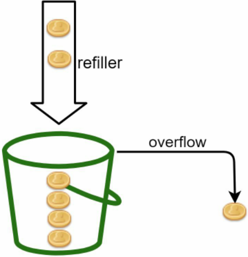

Hình 4-6 minh họa cách thức hoạt động của quá trình tiêu thụ token, nạp lại token (refill) và logic của rate limiting. Trong ví dụ này, kích thước của token bucket là 4 và tốc độ nạp lại là 4 token mỗi 1 phút.

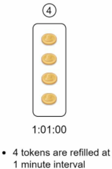

Hình 4-6

Thuật toán token bucket tiếp nhận hai tham số: · Bucket size (kích thước thùng): số lượng token tối đa được phép chứa trong bucket · Refill rate (tốc độ nạp): số lượng token được đưa vào bucket mỗi giây. Chúng ta cần bao nhiêu bucket? Điều này thay đổi linh hoạt tùy thuộc vào các quy tắc rate limiting. Dưới đây là một vài ví dụ: · Thường cần duy trì các bucket khác nhau cho từng API endpoint (điểm cuối API). Chẳng hạn, nếu một người dùng được phép đăng 1 bài viết mỗi giây, thêm 150 bạn bè mỗi ngày và like 5 bài viết mỗi giây, thì cần 3 bucket cho mỗi người dùng. · Nếu cần throttle request dựa trên địa chỉ IP, mỗi địa chỉ IP sẽ cần một bucket riêng. · Nếu hệ thống cho phép tối đa 10.000 request mỗi giây, việc sử dụng một global bucket (thùng dùng chung toàn cục) cho tất cả request là phương án hợp lý. Ưu điểm (Pros): · Thuật toán dễ triển khai. · Tiết kiệm bộ nhớ (memory efficient). · Token bucket cho phép xử lý một đợt tăng vọt lưu lượng truy cập (burst of traffic) trong các khoảng thời gian ngắn. Một request có thể được thông qua miễn là trong bucket vẫn còn token. Nhược điểm (Cons):

- Hai tham số trong thuật toán là bucket size và tốc độ refill token. Tuy nhiên, việc

cân chỉnh (tune) chúng một cách chuẩn xác có thể gặp nhiều khó khăn.

## Thuật toán Leaking bucket (Leaking bucket algorithm)

Thuật toán leaking bucket (thùng rò rỉ) tương tự như token bucket, ngoại trừ việc các request được xử lý với tốc độ cố định. Thuật toán này thường được triển khai bằng hàng đợi FIFO (first-in-first-out - vào trước ra trước). Cơ chế hoạt động như sau:

- Khi một request đến, hệ thống kiểm tra xem queue (hàng đợi) đã đầy chưa. Nếu chưa đầy, request sẽ được thêm vào queue.
- Ngược lại, request sẽ bị loại bỏ.
- Các request được lấy ra khỏi queue và xử lý theo các khoảng thời gian đều đặn.

Hình 4-7 giải thích cách thức hoạt động của thuật toán.

Hình 4-7

Thuật toán leaking bucket tiếp nhận hai tham số sau:

- Bucket size: bằng với kích thước hàng đợi. Hàng đợi lưu giữ các request chờ được xử lý ở tốc độ cố định.
- Outflow rate (tốc độ xử lý đầu ra): xác định số lượng request có thể được xử lý ở tốc độ cố định, thường tính theo đơn vị giây.

Shopify, một nền tảng thương mại điện tử, sử dụng leaky bucket cho rate limiting [7].

## Ưu điểm (Pros):

- Tiết kiệm bộ nhớ nhờ kích thước queue giới hạn.
- Các request được xử lý ở tốc độ cố định, do đó thuật toán rất phù hợp cho các use case đòi hỏi tốc độ đầu ra (outflow rate) ổn định.

## Nhược điểm (Cons):

- Một đợt burst traffic có thể làm đầy queue bằng các request cũ; nếu chúng không được xử lý kịp thời, các request mới gửi đến sau sẽ bị rate limit.
- Thuật toán có hai tham số, và việc điều chỉnh chúng một cách tối ưu có thể không hề đơn giản.

## Thuật toán Fixed window counter (Fixed window counter algorithm)

Thuật toán fixed window counter (bộ đếm cửa sổ cố định) hoạt động như sau:

- Thuật toán chia dòng thời gian thành các time window (cửa sổ thời gian) có kích thước cố định và gán một counter (bộ đếm) cho mỗi window.
- Mỗi request đến sẽ tăng counter lên một đơn vị.
- Khi counter đạt đến ngưỡng (threshold) định trước, các request mới sẽ bị loại bỏ cho đến khi một time window mới bắt đầu.

Hãy xem một ví dụ cụ thể để hiểu cách thức hoạt động. Trong Hình 4-8, đơn vị thời gian là 1 giây và hệ thống cho phép tối đa 3 request mỗi giây. Trong mỗi window 1 giây, nếu nhận nhiều hơn 3 request, các request vượt mức sẽ bị loại bỏ như trong Hình 4-8.

Hình 4-8

Một vấn đề lớn của thuật toán này là lưu lượng truy cập tăng vọt tại các ranh giới (edges) giữa các time window có thể khiến số lượng request vượt qua hạn ngạch (quota) cho phép. Hãy xem xét trường hợp sau:

Trong Hình 4-9, hệ thống cho phép tối đa 5 request mỗi phút, và hạn ngạch khả dụng sẽ được đặt lại (reset) vào đầu mỗi phút chẵn theo đồng hồ. Như có thể thấy, có 5 request trong khoảng từ 2:00:00 đến 2:01:00 và thêm 5 request nữa trong khoảng từ 2:01:00 đến 2:02:00. Trong khoảng thời gian 1 phút nằm giữa 2:00:30 và 2:01:30, đã có tới 10 request được thông qua. Con số này cao gấp đôi so với lượng request được phép.

## Ưu điểm (Pros):

- Tiết kiệm bộ nhớ.
- Dễ hiểu. · Việc đặt lại hạn ngạch khả dụng vào cuối mỗi đơn vị time window rất phù hợp với một số use case nhất định. Nhược điểm (Cons): · Đột biến lưu lượng truy cập (spike in traffic) tại ranh giới của các window có thể khiến số lượng request vượt quá hạn ngạch cho phép.

## Thuật toán Sliding window log (Sliding window log algorithm)

Như đã phân tích trước đó, thuật toán fixed window counter gặp phải một lỗi nghiêm trọng: nó cho phép lượng request vượt quá hạn ngạch lọt qua tại các ranh giới của window. Thuật toán sliding window log (nhật ký cửa sổ trượt) giải quyết triệt để vấn đề này. Thuật toán hoạt động như sau:

- Thuật toán theo dõi timestamp (dấu thời gian) của các request. Dữ liệu timestamp thường được lưu trong cache, chẳng hạn như cấu trúc sorted sets (tập hợp được sắp xếp) của Redis [8].
- Khi một request mới đến, thuật toán xóa toàn bộ các timestamp đã lỗi thời (outdated). Timestamp lỗi thời được định nghĩa là những mốc thời gian diễn ra trước thời điểm bắt đầu của time window hiện tại.
- Thêm timestamp của request mới vào log (nhật ký).
- Nếu kích thước của log nhỏ hơn hoặc bằng số lượng cho phép, request sẽ được chấp nhận. Ngược lại, request sẽ bị từ chối.

Chúng ta sẽ giải thích thuật toán bằng ví dụ thể hiện trong Hình 4-10.

## Cho phép 2 request mỗi phút (Allow 2 requests per minute)

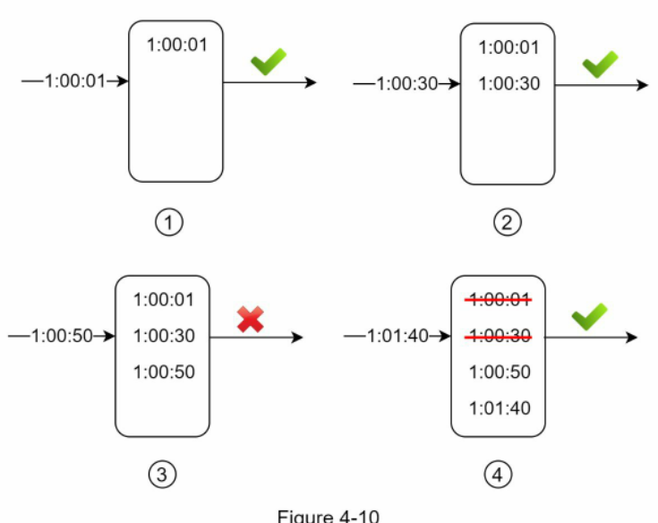

Hình 4-10

Trong ví dụ này, rate limiter cho phép 2 request mỗi phút. Thông thường, các Linux timestamp (dấu thời gian Unix/Linux) sẽ được lưu trữ trong log. Tuy nhiên, định dạng thời gian trực quan cho con người được sử dụng trong ví dụ này nhằm

giúp người đọc dễ theo dõi hơn.

- Log đang trống khi một request mới đến vào lúc 1:00:01. Do đó, request được cho phép.
- Một request mới đến vào lúc 1:00:30, timestamp 1:00:30 được chèn vào log. Sau khi chèn, kích thước log là 2, không vượt quá số lượng cho phép. Vì vậy, request được chấp nhận.
- Một request mới đến vào lúc 1:00:50, và timestamp được chèn vào log. Sau khi chèn, kích thước log là 3, lớn hơn kích thước cho phép là 2. Do đó, request này bị từ chối mặc dù timestamp của nó vẫn được ghi lại trong log.
- Một request mới đến vào lúc 1:01:40. Các request trong khoảng [1:00:40, 1:01:40) nằm trong khung thời gian gần nhất, nhưng các request gửi trước 1:00:40 đã bị lỗi thời. Hai timestamp lỗi thời, 1:00:01 và 1:00:30, được xóa khỏi log. Sau thao tác xóa, kích thước log trở thành 2; do đó, request được chấp nhận.

## Ưu điểm (Pros):

- Rate limiting triển khai bằng thuật toán này có độ chính xác rất cao. Trong bất kỳ rolling window (cửa sổ trượt / cuốn chiếu) nào, số lượng request cũng không vượt quá giới hạn tốc độ.

## Nhược điểm (Cons):

- Thuật toán tiêu tốn rất nhiều bộ nhớ vì ngay cả khi một request bị từ chối, timestamp của nó vẫn có thể được giữ lại trong bộ nhớ.

## Thuật toán Sliding window counter (Sliding window counter algorithm)

Thuật toán sliding window counter (bộ đếm cửa sổ trượt) là một phương pháp tiếp cận lai (hybrid) kết hợp giữa fixed window counter và sliding window log. Thuật toán có thể được triển khai theo hai phương pháp khác nhau. Chúng tôi sẽ giải thích một cách triển khai trong phần này và cung cấp tài liệu tham khảo cho cách triển khai còn lại ở cuối phần. Hình 4-11 minh họa cơ chế hoạt động của thuật toán này.

Giả sử rate limiter cho phép tối đa 7 request mỗi phút, và có 5 request trong phút trước đó cùng 3 request trong phút hiện tại. Đối với một request mới đến tại vị trí 30% của phút hiện tại, số lượng request trong rolling window được tính toán theo công thức sau:

- Số request trong window hiện tại + số request trong window trước đó * phần trăm chồng lấn (overlap percentage) của rolling window với window trước đó

· Áp dụng công thức này, ta có 3 + 5 * 70% = 6,5 request (nguyên văn: 3 + 5 * 0.7% = 6.5 request). Tùy thuộc vào use case, con số này có thể được làm tròn lên hoặc làm tròn xuống. Trong ví dụ này, nó được làm tròn xuống thành 6. Vì rate limiter cho phép tối đa 7 request mỗi phút, request hiện tại có thể được thông qua. Tuy nhiên, giới hạn sẽ chạm ngưỡng ngay sau khi nhận thêm một request nữa. Do giới hạn về độ dài, chúng tôi sẽ không thảo luận về cách triển khai còn lại ở đây. Bạn đọc quan tâm có thể tham khảo tài liệu [9]. Thuật toán này không hoàn hảo, nó có cả ưu và nhược điểm. Ưu điểm (Pros): · Làm mượt các đợt tăng vọt lưu lượng (spikes in traffic) vì tốc độ dựa trên tốc độ trung bình của window trước đó. · Tiết kiệm bộ nhớ. Nhược điểm (Cons): · Chỉ hoạt động hiệu quả với look back window (cửa sổ xem xét ngược) không quá khắt khe. Đây là một giá trị xấp xỉ của tốc độ thực tế vì nó giả định rằng các request trong window trước đó được phân bổ đồng đều. Tuy nhiên, vấn đề này có thể không nghiêm trọng như chúng ta tưởng. Theo các thử nghiệm do Cloudflare [10] thực hiện, chỉ có 0,003% request bị cho phép sai hoặc bị rate limit nhầm trong số 400 triệu request. Kiến trúc mức cao (High-level architecture)

Ý tưởng cơ bản của các thuật toán rate limiting rất đơn giản. Ở mức tổng quan (high-level), chúng ta cần một counter để theo dõi số lượng request được gửi từ cùng một người dùng, địa chỉ IP, v.v. Nếu counter lớn hơn giới hạn, request sẽ bị từ chối. Chúng ta nên lưu trữ các counter ở đâu? Sử dụng database (cơ sở dữ liệu) không phải là ý tưởng hay do tốc độ truy xuất đĩa cứng chậm chạp. In-memory cache (bộ nhớ đệm trong RAM) được lựa chọn vì nó có tốc độ cao và hỗ trợ cơ chế hết hạn theo thời gian (time-based expiration strategy). Chẳng hạn, Redis [11] là một lựa chọn phổ biến để triển khai rate limiting. Đây là một in-memory store cung cấp hai lệnh chính: INCR và EXPIRE. · INCR: Tăng giá trị counter được lưu trữ lên 1. · EXPIRE: Thiết lập thời gian timeout cho counter. Khi hết thời gian timeout, counter sẽ tự động bị xóa.

Hình 4-12 thể hiện kiến trúc tổng quan cho rate limiting, và quy trình hoạt động như sau:

· Client gửi request đến rate limiting middleware. · Rate limiting middleware lấy counter từ bucket tương ứng trong Redis và Hình 4-12

kiểm tra xem đã chạm giới hạn hay chưa. · Nếu đã đạt giới hạn, request sẽ bị từ chối.

- Nếu chưa đạt giới hạn, request sẽ được gửi tiếp tới các API server. Đồng thời, hệ thống tăng counter lên 1 và lưu ngược lại vào Redis.

## Bước 3 - Đi sâu vào thiết kế (Step 3 - Design deep dive)

Thiết kế mức cao trong Hình 4-12 chưa giải đáp được các câu hỏi sau: · Các quy tắc rate limiting được tạo ra như thế nào? Chúng được lưu trữ ở đâu? · Xử lý các request bị rate limit như thế nào? Trong phần này, trước tiên chúng ta sẽ trả lời các câu hỏi liên quan đến quy tắc rate limiting, sau đó điểm qua các chiến lược xử lý request bị rate limit. Cuối cùng, chúng ta sẽ thảo luận về rate limiting trong

môi trường phân tán (distributed environment), một thiết kế chi tiết, tối ưu hóa hiệu năng (performance optimization) và việc giám sát (monitoring). Quy tắc rate limiting (Rate limiting rules) Lyft đã mở mã nguồn thành phần rate limiting của họ [12]. Chúng ta sẽ cùng xem xét bên trong thành phần này qua một vài ví dụ về quy tắc rate limiting: domain: messaging descriptors: - key: message\_type Value: marketing rate\_limit: unit: day requests\_per\_unit: 5 Trong ví dụ trên, hệ thống được cấu hình để cho phép tối đa 5 tin nhắn marketing mỗi ngày. Dưới đây là một ví dụ khác: domain: auth descriptors: - key: auth\_type Value: login rate\_limit: unit: minute requests\_per\_unit: 5 Quy tắc này chỉ ra rằng các client không được phép đăng nhập quá 5 lần trong 1 phút. Các quy tắc thường được viết trong các configuration file (tệp cấu hình) và lưu trữ trên đĩa cứng. Vượt quá giới hạn tốc độ (Exceeding the rate limit) Trong trường hợp một request bị rate limit, các API sẽ trả về HTTP response code 429 (too many requests - quá nhiều yêu cầu) cho client. Tùy thuộc vào từng use case, chúng ta có thể đưa các request bị rate limit vào hàng đợi (enqueue) để xử lý sau. Ví dụ, nếu một số đơn hàng bị rate limit do hệ thống quá tải, chúng ta có thể giữ các đơn hàng đó lại để xử lý sau. Tiêu đề của rate limiter (Rate limiter headers)

Làm thế nào để một client biết được liệu nó có đang bị throttle hay không? Và làm sao để client biết được số lượng request còn lại được phép gửi trước khi bị throttle? Câu trả lời nằm ở các HTTP response header (tiêu đề phản hồi HTTP). Rate limiter trả về các HTTP header sau cho client: X-Ratelimit-Remaining: Số lượng request còn lại được phép gửi trong window. X-Ratelimit-Limit: Cho biết số lượng lệnh gọi (calls) mà client có thể thực hiện trên mỗi time window. X-Ratelimit-Retry-After: Số giây cần chờ cho đến khi bạn có thể gửi lại request mà không bị throttle. Khi người dùng gửi quá nhiều request, lỗi 429 too many requests kèm theo header X-Ratelimit-Retry-After sẽ được trả về cho client.

## Thiết kế chi tiết (Detailed design)

Hình 4-13 trình bày thiết kế chi tiết của hệ thống.

Hình 4-13

- Các quy tắc được lưu trữ trên đĩa. Các worker (tiến trình nền) thường xuyên kéo các quy tắc từ đĩa và lưu chúng

vào cache. · Khi client gửi một request đến máy chủ, request đó sẽ được gửi tới rate limiter middleware trước tiên. · Rate limiter middleware nạp các quy tắc từ cache. Nó lấy các counter và timestamp của request gần nhất từ Redis cache. Dựa trên phản hồi, rate limiter quyết định: · nếu request không bị rate limit, nó sẽ được chuyển tiếp tới các API server. · nếu request bị rate limit, rate limiter sẽ trả về lỗi 429 too many requests cho

- client. Đồng thời, request đó sẽ bị loại bỏ hoặc được chuyển tiếp vào queue.

## Rate limiter trong môi trường phân tán (Rate limiter in a distributed environment)

Xây dựng một rate limiter hoạt động trong môi trường một máy chủ đơn lẻ (single server) không phải là điều phức tạp. Tuy nhiên, việc mở rộng hệ thống (scaling) để hỗ trợ nhiều máy chủ và các luồng đồng thời (concurrent threads) lại là một câu chuyện hoàn toàn khác.

Có hai thách thức lớn: · Tình trạng tương tranh (Race condition) · Vấn đề đồng bộ hóa (Synchronization issue)

## Race condition (Tình trạng tương tranh)

Như đã đề cập trước đó, ở mức tổng quan (high-level), một rate limiter (bộ giới hạn tốc độ truy cập) sẽ vận hành theo các bước cơ bản: · Đọc giá trị của counter (bộ đếm) hiện tại từ Redis. · Kiểm tra xem giá trị `counter + 1` có vượt qua ngưỡng quy định hay không. · Nếu chưa vượt ngưỡng, tăng giá trị counter thêm 1 và ghi lại vào Redis.

Tình trạng race condition (tương tranh dữ liệu giữa các luồng xử lý đồng thời) hoàn toàn có thể xảy ra trong môi trường có lưu lượng đồng thời cao, như minh họa tại Hình 4-14.

Giả sử giá trị counter hiện tại trong Redis là 3. Nếu hai request đồng thời đọc giá trị counter trước khi một trong hai kịp ghi đè giá trị mới, mỗi bên sẽ tự tăng giá trị lên thêm 1 rồi ghi lại vào Redis mà không hề hay biết về tiến trình còn lại. Cả hai request (hoặc thread - luồng xử lý) đều nhận định rằng giá trị counter của mình là 4, trong khi giá trị đúng thực tế phải là 5. Sử dụng lock (khóa đồng bộ) là giải pháp hiển nhiên nhất để xử lý race condition; tuy nhiên, lock sẽ làm suy giảm nghiêm trọng hiệu năng của hệ thống. Thay vào đó, hai chiến lược phổ biến thường được áp dụng là: dùng Lua script (kịch bản viết bằng ngôn ngữ Lua) [13] hoặc tận dụng cấu trúc dữ liệu sorted sets (tập hợp có thứ tự) của Redis [8]. Bạn đọc quan tâm đến các kỹ thuật này có thể tham khảo thêm tài liệu tương ứng [8] [13]. Hình 4-14

## Synchronization issue (Vấn đề đồng bộ hóa)

Đồng bộ hóa (synchronization) là một yếu tố trọng yếu khác cần cân nhắc trong môi trường phân tán (distributed environment). Nhằm phục vụ hàng triệu người dùng, một máy chủ rate limiter đơn lẻ khó có thể đáp ứng nổi toàn bộ lưu lượng. Khi triển khai cụm nhiều máy chủ rate limiter, việc đồng bộ dữ liệu giữa chúng là bắt buộc. Lấy ví dụ ở nửa bên trái của Hình 4-15, client 1 gửi request đến rate limiter 1, còn client 2 gửi request đến rate limiter 2. Do tầng web hoạt động theo cơ chế stateless (phi trạng thái - không lưu phiên làm việc cục bộ), client hoàn toàn có thể chuyển hướng gửi request tiếp theo sang một máy chủ rate limiter khác như minh họa ở nửa bên phải Hình 4-15. Nếu không có cơ chế đồng bộ, rate limiter 1 sẽ không nắm được bất kỳ dữ liệu nào về client 2, dẫn đến việc kiểm soát tốc độ bị sai lệch.

Hình 4-15

Một hướng giải quyết là áp dụng sticky sessions (phiên làm việc cố định - ràng buộc client luôn kết nối tới duy nhất một máy chủ cụ thể). Tuy nhiên, phương án này không được khuyến khích vì thiếu tính linh hoạt và rất khó mở rộng quy mô (scale). Hướng tiếp cận tối ưu hơn là dùng một centralized data store (kho lưu trữ dữ liệu tập trung) như Redis. Kiến trúc này được mô tả chi tiết trong Hình 4-16.

## Performance optimization (Tối ưu hóa hiệu năng)

Tối ưu hóa hiệu năng là chủ đề rất quen thuộc trong các buổi phỏng vấn thiết kế hệ thống (system design). Chúng ta sẽ xem xét hai khía cạnh chính để cải thiện. Thứ nhất, thiết lập cụm máy chủ trên nhiều trung tâm dữ liệu (multi-data center) là yếu tố sống còn đối với rate limiter, bởi người dùng ở khoảng cách địa lý xa trung tâm dữ liệu sẽ phải chịu latency (độ trễ mạng) rất lớn. Hầu hết các nhà cung cấp dịch vụ đám mây đều triển khai mạng lưới edge server (máy chủ biên đặt gần người dùng) trên toàn cầu. Đơn cử, tính đến ngày 20/05/2020, Cloudflare đã sở hữu 194 cụm edge server phân bố khắp thế giới [14]. Lưu lượng truy cập sẽ tự động được điều hướng đến edge server gần nhất nhằm giảm thiểu tối đa độ trễ.

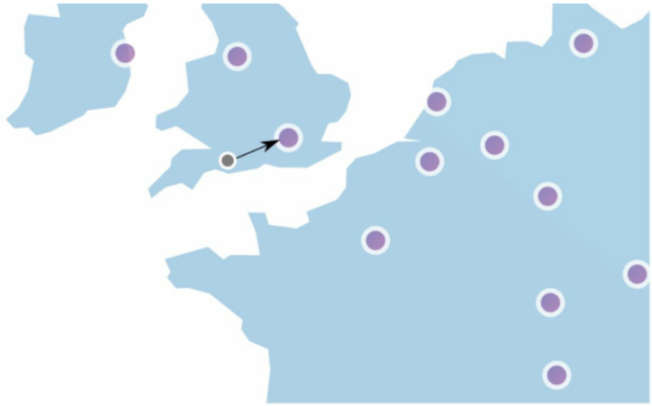

Hình 4-17 (nguồn: [10])

Thứ hai, thực hiện đồng bộ hóa dữ liệu thông qua mô hình eventual consistency (nhất quán cuối cùng - đảm bảo sau một khoảng thời gian nhất định, mọi bản sao dữ liệu sẽ đồng nhất). Nếu bạn chưa rõ về mô hình này, vui lòng xem mục "Tính nhất quán" (Consistency) trong "Chương 6: Thiết kế kho lưu trữ Key-Value." Giám sát (Monitoring)

Khi rate limiter đã đi vào vận hành, việc thu thập dữ liệu phân tích (analytics) để đánh giá tính hiệu quả là vô cùng cần thiết. Trọng tâm cốt lõi là kiểm chứng: · Thuật toán rate limiting có đang hoạt động hiệu quả hay không. · Các quy tắc (rules) giới hạn tốc độ có thực sự tối ưu hay không.

Chẳng hạn, nếu quy tắc rate limiting thiết lập quá khắt khe, nhiều request hợp lệ sẽ bị chặn nhầm; khi đó ta cần nới lỏng các giới hạn. Mặt khác, nếu nhận thấy rate limiter bị quá tải hoặc hoạt động kém trước các đợt tăng vọt lưu lượng đột ngột (như sự kiện flash sale), hệ thống có thể cân nhắc chuyển đổi sang thuật toán hỗ trợ tốt lưu lượng đột biến (burst traffic) — trong đó token bucket là một lựa chọn lý tưởng.

## Bước 4 - Tổng kết (Step 4 - Wrap up)

Trong chương này, chúng ta đã nghiên cứu các thuật toán rate limiting khác nhau kèm ưu, nhược điểm của từng loại. Các thuật toán bao gồm: · Token bucket · Leaking bucket · Fixed window · Sliding window log · Sliding window counter Tiếp đó, chúng ta đã đi sâu vào kiến trúc tổng thể của hệ thống, bài toán rate limiter trong môi trường phân tán, các giải pháp tối ưu hóa hiệu năng cũng như công tác giám sát. Tương tự như bất kỳ câu hỏi phỏng vấn thiết kế hệ thống nào, bạn có thể chủ động mở rộng thêm các khía cạnh chuyên sâu nếu còn thời gian: · Hard rate limiting (giới hạn cứng - chặn tuyệt đối mọi request vượt ngưỡng) so với Soft rate limiting (giới hạn mềm - cho phép vượt ngưỡng tạm thời trong một khoảng ngắn). · Giới hạn tốc độ ở các tầng khác nhau trong mô hình mạng: Chương này tập trung vào tầng ứng dụng (Application layer - HTTP tầng 7). Tuy nhiên, bạn hoàn toàn có thể áp dụng rate limiting ở các tầng thấp hơn, ví dụ như lọc theo địa chỉ IP thông qua Iptables [15] (tầng mạng IP - tầng 3). Lưu ý: Mô hình kết nối các hệ thống mở OSI (Open Systems Interconnection model) gồm 7 tầng [16]: Tầng 1: Vật lý (Physical layer), Tầng 2: Liên kết dữ liệu (Data link layer), Tầng 3: Mạng (Network layer), Tầng 4: Giao vận (Transport layer), Tầng 5: Phiên (Session layer), Tầng 6: Trình diễn (Presentation layer), Tầng 7: Ứng dụng (Application layer). · Các best practice (thực tiễn tối ưu) phía client để hạn chế bị rate limit: · Triển khai bộ nhớ đệm (client cache) để tránh gọi API với tần suất quá dày. · Nắm rõ hạn mức của hệ thống và tránh dồn quá nhiều request trong thời gian ngắn. · Xây dựng cơ chế bắt ngoại lệ (catch exceptions/errors) để ứng dụng phục hồi mượt mà khi gặp lỗi. · Thiết lập khoảng thời gian chờ tăng dần (exponential backoff) trong logic gửi lại yêu cầu (retry).

Chúc mừng bạn đã hoàn thành trọn vẹn chương này! Hãy tự dành cho mình một lời khen ngợi. Bạn đã làm rất tốt!

## Tài liệu tham khảo (Reference materials)

[1] Rate-limiting strategies and techniques: https://cloud.google.com/solutions/rate-limitingstrategies-techniques [2] Twitter rate limits: https://developer.twitter.com/en/docs/basics/rate-limits [3] Google docs usage limits: https://developers.google.com/docs/api/limits [4] IBM microservices: https://www.ibm.com/cloud/learn/microservices [5] Throttle API requests for better throughput: https://docs.aws.amazon.com/apigateway/latest/developerguide/api-gateway-requestthrottling.html [6] Stripe rate limiters: https://stripe.com/blog/rate-limiters [7] Shopify REST Admin API rate limits: https://help.shopify.com/en/api/reference/restadmin-api-rate-limits [8] Better Rate Limiting With Redis Sorted Sets: https://engineering.classdojo.com/blog/2015/02/06/rolling-rate-limiter/ [9] System Design - Rate limiter and Data modelling: https://medium.com/@saisandeepmopuri/system-design-rate-limiter-and-data-modelling9304b0d18250 [10] How we built rate limiting capable of scaling to millions of domains: https://blog.cloudflare.com/counting-things-a-lot-of-different-things/ [11] Redis website: https://redis.io/ [12] Lyft rate limiting: https://github.com/lyft/ratelimit [13] Scaling your API with rate limiters: https://gist.github.com/ptarjan/e38f45f2dfe601419ca3af937fff574d#request-rate-limiter [14] What is edge computing: https://www.cloudflare.com/learning/serverless/glossary/whatis-edge-computing/ [15] Rate Limit Requests with Iptables: https://blog.programster.org/rate-limit-requests-withiptables [16] OSI model: https://en.wikipedia.org/wiki/OSI\_model#Layer\_architecture

## CHƯƠNG 5: THIẾT KẾ BĂM NHẤT QUÁN (CHAPTER 5: DESIGN CONSISTENT HASHING)

Để đạt được khả năng mở rộng theo chiều ngang (horizontal scaling), việc phân phối các request/dữ liệu một cách hiệu quả và đồng đều trên các máy chủ là điều tối quan trọng. Consistent hashing (băm nhất quán) là một giải thuật kinh điển được ứng dụng rộng rãi nhằm đạt được mục tiêu này. Trước hết, hãy cùng xem xét kỹ lưỡng nguồn gốc của vấn đề.

## Vấn đề băm lại (The rehashing problem)

Nếu sở hữu n máy chủ bộ nhớ đệm (cache server), cách cân bằng tải phổ biến là sử dụng hàm băm lấy modulo như sau: `serverIndex = hash(key) % N`, trong đó N là tổng số lượng máy chủ trong nhóm (server pool). Hãy quan sát ví dụ dưới đây để nắm được cơ chế. Bảng 5-1 mô tả 4 máy chủ cùng 8 chuỗi key và giá trị hash tương ứng của chúng.

| key  | hash     | hash % 4 |
| ---- | -------- | -------- |
| key0 | 18358617 | 1        |
| key1 | 26143584 | 0        |
| key2 | 18131146 | 2        |
| key3 | 35863496 | 0        |
| key4 | 34085809 | 1        |
| key5 | 27581703 | 3        |
| key6 | 38164978 | 2        |
| key7 | 22530351 | 3        |

## Bảng 5-1 (Table 5-1)

Để xác định máy chủ đang lưu trữ key, chúng ta thực hiện phép toán modulo `f(key) % 4`. Chẳng hạn, `hash(key0) % 4 = 1` đồng nghĩa với việc client phải kết nối đến máy chủ 1 (server 1) để lấy dữ liệu cache. Hình 5-1 minh họa sự phân bổ của các key dựa trên Bảng 5-1.

## serverIndex hash % 4

Hình 5-1

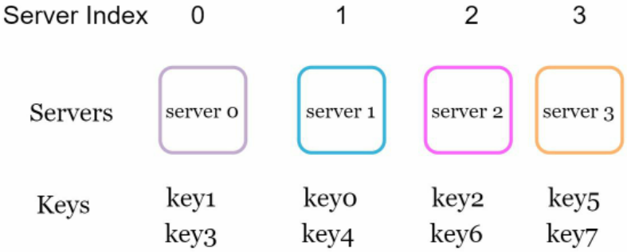

Phương pháp này vận hành rất tốt khi số lượng máy chủ cố định và dữ liệu được phân bố đồng đều. Tuy nhiên, rắc rối sẽ nảy sinh khi bổ sung thêm máy chủ mới hoặc khi có máy chủ hiện có bị gỡ bỏ/gặp sự cố. Giả sử máy chủ 1 bị mất kết nối (offline), quy mô của cụm máy chủ giảm xuống còn 3. Khi áp dụng cùng một hàm hash, giá trị băm của key không đổi, nhưng kết quả phép toán modulo sẽ hoàn toàn lệch do mẫu số N đã giảm đi 1 đơn vị. Kết quả tính toán với `hash % 3` được thể hiện trong Bảng 5-2:

Bảng 5-2 (Table 5-2)

| key  | Hash     | hash % 3 |
| ---- | -------- | -------- |
| key0 | 18358617 | 0        |
| key1 | 26143584 | 0        |
| key2 | 18131146 | 1        |
| key3 | 35863496 | 2        |
| key4 | 34085809 | 1        |
| key5 | 27581703 | 0        |
| key6 | 38164978 | 1        |
| key7 | 22530351 | 0        |

Hình 5-2 minh họa sự tái phân bổ của các key dựa theo Bảng 5-2.

## serverIndex hash 1% = 3

Hình 5-2

Như có thể thấy ở Hình 5-2, phần lớn các key đều bị phân bổ lại vị trí, chứ không riêng gì các key ban đầu thuộc về máy chủ bị hỏng (server 1). Điều này dẫn đến hậu quả: khi server 1 ngừng hoạt động, hầu hết các cache client sẽ truy xuất nhầm máy chủ, gây ra tình trạng storm of cache misses (cơn bão trượt bộ nhớ đệm). Consistent hashing chính là giải pháp hữu hiệu để khắc phục triệt để vấn đề này.

> 💡 **Giải thích thêm:** "Storm of cache misses" (thường gọi là cache stampede) là hiện tượng khi một lượng lớn request đồng thời không tìm thấy dữ liệu trong cache (do cache bị lỗi hoặc key bị chuyển hướng sai server), dẫn đến việc toàn bộ các request này đổ dồn về cơ sở dữ liệu gốc phía sau, có thể làm sập hệ thống cơ sở dữ liệu.
> Nguồn tham khảo: https://en.wikipedia.org/wiki/Cache_stampede

## Băm nhất quán (Consistent hashing)

Trích dẫn từ Wikipedia: "Băm nhất quán (consistent hashing) là một dạng thuật toán băm đặc thù, trong đó khi bảng băm thay đổi kích thước, trung bình chỉ có $k/n$ key cần phải ánh xạ lại vị trí, với $k$ là số lượng key và $n$ là số lượng vị trí (slot). Ngược lại, ở hầu hết các bảng băm truyền thống, việc thay đổi số lượng vị trí trong mảng sẽ khiến gần như toàn bộ các key đều bị ánh xạ lại [1]".

## Không gian băm và vòng băm (Hash space and hash ring)

Sau khi đã nắm vững định nghĩa, hãy cùng tìm hiểu nguyên lý hoạt động của thuật toán. Giả sử hàm băm SHA-1 được sử dụng làm hàm băm $f$, với miền giá trị đầu ra lần lượt là: $x_0, x_1, x_2, x_3, \dots, x_n$. Trong mật mã học, không gian băm của SHA-1 trải dài từ $0$ đến $2^{160} - 1$. Điều đó có nghĩa là $x_0$ tương ứng với $0$, $x_n$ tương ứng với $2^{160} - 1$, và toàn bộ các giá trị băm còn lại sẽ nằm xen giữa dải giá trị này. Hình 5-3 mô tả không gian băm nói trên.

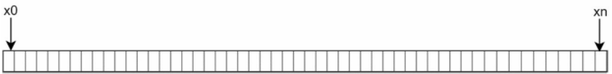

Bằng cách uốn cong và nối liền hai đầu mút lại với nhau, chúng ta thu được một hash ring (vòng băm) như trong Hình 5-4: Hình 5-3

xn XO

Hình 5-4

## Băm máy chủ lên vòng (Hash servers)

Sử dụng cùng một hàm băm $f$, chúng ta ánh xạ các máy chủ lên vòng băm dựa theo địa chỉ IP hoặc hostname (tên máy chủ). Hình 5-5 minh họa 4 máy chủ đã được định vị trên vòng băm.

## Băm các khóa (Hash keys)

Điểm quan trọng cần lưu ý là hàm băm sử dụng ở đây hoàn toàn khác với hàm băm dùng trong "Vấn đề băm lại" và tuyệt đối không dùng phép toán modulo. Như biểu diễn trong Hình 5-6, 4 khóa bộ nhớ đệm (key0, key1, key2 và key3) được băm trực tiếp lên vòng băm. Để xác định máy chủ nào lưu giữ một key nhất định, ta duyệt theo chiều kim đồng hồ bắt đầu từ vị trí của key đó trên vòng cho đến khi gặp máy chủ đầu tiên. Hình 5-7 diễn giải quy trình này: Đi theo chiều kim đồng hồ, key0 thuộc về server 0; key1 thuộc về server 1; key2 thuộc về server 2 và key3 thuộc về server 3.

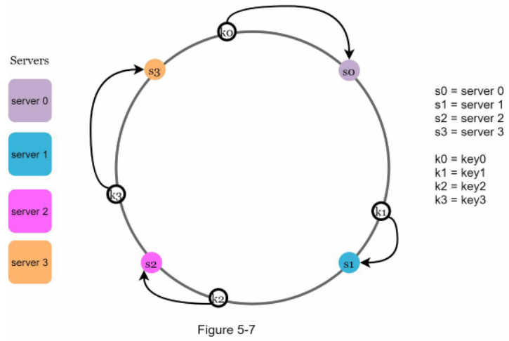

## Thêm máy chủ (Add a server)

Áp dụng quy tắc nêu trên, việc bổ sung thêm một máy chủ mới sẽ chỉ đòi hỏi tái phân bổ lại một lượng nhỏ các key. Trong Hình 5-8, sau khi thêm server 4, chỉ duy nhất key0 cần được chuyển giao vị trí; các key k1, k2 và k3 vẫn nằm nguyên vẹn trên các máy chủ cũ. Hãy phân tích chi tiết logic: Trước khi có server 4, key0 được lưu trữ ở server 0. Sau khi thêm server 4, key0 sẽ chuyển sang server 4 vì khi di chuyển theo chiều kim đồng hồ từ vị trí của key0, server 4 là máy chủ đầu tiên xuất hiện. Toàn bộ các key còn lại không bị phân bổ lại vị trí.

Hình 5-8

## Gỡ bỏ máy chủ (Remove a server)

Tương tự, khi một máy chủ bị gỡ bỏ, chỉ một tỷ lệ nhỏ key cần phải tái phân bổ. Ở Hình 5-9, khi server 1 bị loại bỏ, chỉ có key1 cần phải chuyển sang server 2. Toàn bộ các key còn lại không hề bị ảnh hưởng.

## Hai vấn đề tồn tại trong phương pháp cơ bản (Two issues in the basic approach)

Thuật toán consistent hashing nguyên bản được đề xuất bởi Karger cùng các cộng sự tại MIT [1]. Các bước cơ bản

- gồm: · Ánh xạ máy chủ và các key lên vòng băm bằng một hàm băm phân phối đều. · Để tìm máy chủ lưu trữ key, duyệt theo chiều kim đồng hồ từ vị trí của key cho đến khi gặp máy chủ đầu tiên trên vòng băm. 

Hai nhược điểm lớn được chỉ ra đối với phương pháp này. Thứ nhất, rất khó duy trì kích thước các partition (phân vùng - khoảng không gian băm giữa hai máy chủ liền kề) đồng đều nhau khi các máy chủ liên tục được thêm vào hoặc loại bỏ. Kích thước phân vùng giao cho mỗi máy chủ có thể trở nên cực kỳ nhỏ hoặc quá lớn. Ở Hình 5-10, nếu s1 bị gỡ bỏ, phân vùng của s2 (khoanh vùng bằng mũi tên hai chiều) sẽ có kích thước gấp đôi phân vùng của s0 và s3.

Thứ hai, việc phân bố key trên vòng băm có thể bị mất cân bằng nghiêm trọng (non-uniform key distribution). Chẳng hạn, nếu các máy chủ được ánh xạ vào các vị trí như trong Hình 5-11, hầu hết dữ liệu key sẽ dồn hết về server 2, trong khi server 1 và server 3 hầu như không chứa dữ liệu.

Kỹ thuật sử dụng virtual nodes (nút ảo) hay replicas (bản sao đại diện) được đưa ra để khắc phục triệt để các hạn chế này.

## Nút ảo (Virtual nodes)

Một nút ảo (virtual node) đại diện cho một nút thực tế, và mỗi máy chủ vật lý sẽ được biểu diễn bởi nhiều nút ảo rải rác trên vòng băm. Trong Hình 5-12, cả server 0 và server 1 đều sở hữu 3 nút ảo. Con số 3 ở đây chỉ mang tính chất minh họa; trong các hệ thống thực tế, số lượng nút ảo lớn hơn rất nhiều. Thay vì chỉ dùng nhãn s0 duy nhất, ta dùng s0_0, s0_1 và s0_2 để đại diện cho server 0 trên vòng băm. Tương tự, s1_0, s1_1 và s1_2 đại diện cho server 1. Nhờ các nút ảo, mỗi máy chủ thực tế sẽ phụ trách quản lý nhiều phân vùng khác nhau. Các phân vùng có nhãn s0 do server 0 quản lý, trong khi các phân vùng có nhãn s1 do server 1 quản lý.

Hình 5-12

Để tìm máy chủ lưu trữ cho một key, chúng ta duyệt theo chiều kim đồng hồ từ vị trí của key và chọn nút ảo đầu tiên bắt gặp trên vòng băm. Trong Hình 5-13, để xác định nơi lưu k0, ta duyệt theo chiều kim đồng hồ từ vị trí của k0 và gặp nút ảo s1_1, vốn là đại diện của server 1.

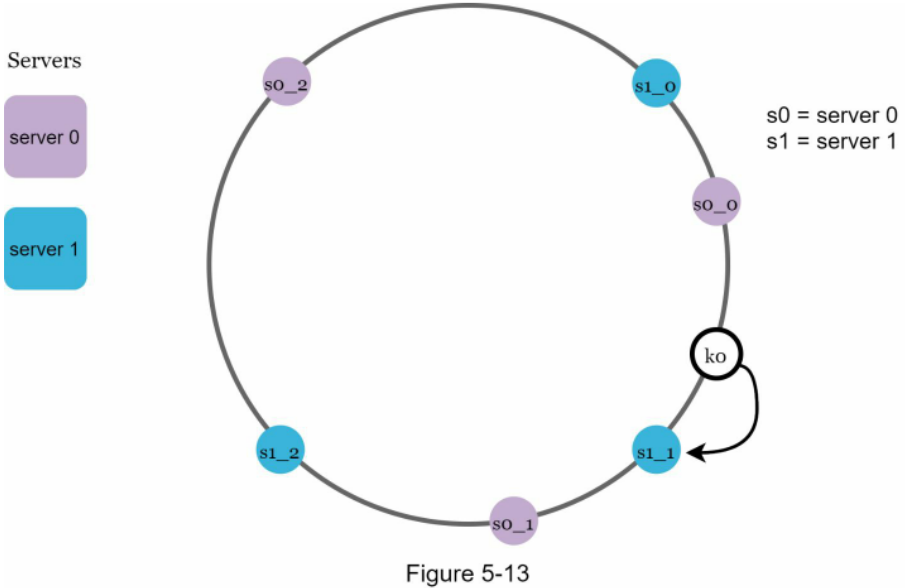

Khi gia tăng số lượng nút ảo, sự phân bổ dữ liệu giữa các key sẽ ngày càng trở nên đồng đều và cân bằng hơn. Điều này bắt nguồn từ việc độ lệch chuẩn (standard deviation - thước đo mức độ phân tán của dữ liệu) sẽ thu hẹp lại khi có nhiều nút ảo hơn. Kết quả từ một nghiên cứu thực nghiệm trực tuyến [2] chứng minh rằng: với 100 đến 200 nút ảo, độ lệch chuẩn chỉ còn dao động trong khoảng từ 5% (với 200 nút ảo) đến 10% (với 100 nút ảo) so với giá trị trung bình (mean). Độ lệch chuẩn sẽ tiếp tục giảm nếu ta tiếp tục tăng số lượng nút ảo. Tuy nhiên, cái giá phải trả (trade-off) là hệ thống sẽ tốn thêm dung lượng bộ nhớ để lưu trữ thông tin metadata của các nút ảo này. Chúng ta có thể cân chỉnh số lượng nút ảo sao cho phù hợp với yêu cầu thực tế của từng hệ thống.

## Xác định các khóa bị ảnh hưởng (Find affected keys)

Mỗi khi một máy chủ được thêm vào hoặc loại bỏ, một phần dữ liệu cần được phân bổ lại. Làm thế nào để xác định chính xác phạm vi bị ảnh hưởng để di dời các key? Trong Hình 5-14, server 4 được bổ sung vào vòng băm. Phạm vi chịu ảnh hưởng sẽ bắt đầu từ s4 (nút mới thêm) và di chuyển ngược chiều kim đồng hồ dọc theo vòng băm cho đến khi chạm vào máy chủ đầu tiên (s3). Theo đó, toàn bộ các key nằm trong đoạn giữa s3 và s4 sẽ cần được chuyển sang cho s4 quản lý.

Hình 5-14

Khi một máy chủ (s1) bị gỡ bỏ như trong Hình 5-15, phạm vi ảnh hưởng sẽ tính từ s1 (nút bị loại bỏ) và duyệt ngược chiều kim đồng hồ cho đến khi gặp máy chủ tiếp theo (s0). Do đó, các key nằm giữa s0 và s1 bắt buộc phải được chuyển giao sang cho s2.

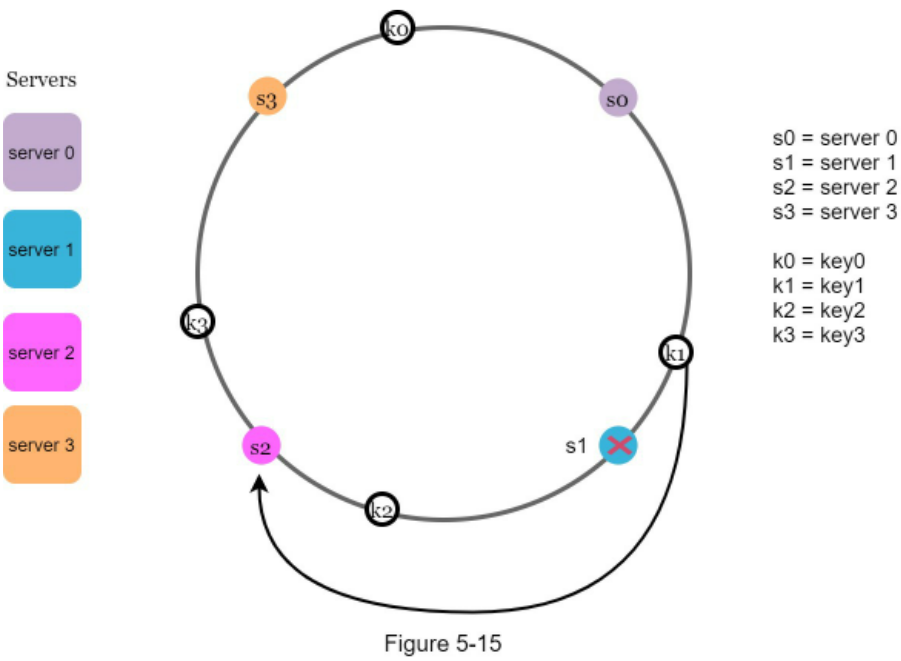

## Tổng kết (Wrap up)

Trong chương này, chúng ta đã thảo luận chuyên sâu về thuật toán consistent hashing, lý do vì sao cần sử dụng và cách thức hoạt động của nó. Những lợi ích cốt lõi của consistent hashing bao gồm: · Giảm thiểu tối đa số lượng key phải di dời khi máy chủ được thêm mới hoặc gỡ bỏ. · Dễ dàng mở rộng hệ thống theo chiều ngang nhờ dữ liệu được phân bố đồng đều. · Giảm thiểu vấn đề hotspot key (khóa điểm nóng chịu lượng tải quá lớn). Lượng truy cập đột biến đổ vào một shard (phân mảnh dữ liệu) nhất định có thể gây quá tải máy chủ. Hãy tưởng tượng nếu dữ liệu của những người nổi tiếng như Katy Perry, Justin Bieber và Lady Gaga đều cùng rơi vào một shard. Consistent hashing sẽ hạn chế tình trạng này nhờ cơ chế phân tán dữ liệu đồng đều hơn. Consistent hashing được ứng dụng rộng rãi trong các hệ thống quy mô lớn thực tế, tiêu biểu gồm: · Thành phần phân vùng dữ liệu của cơ sở dữ liệu Dynamo từ Amazon [3] · Cơ chế phân vùng dữ liệu trên toàn cụm trong Apache Cassandra [4] · Ứng dụng chat của Discord [5] · Mạng phân phối nội dung Akamai CDN [6] · Bộ cân bằng tải mạng Maglev [7]

> 💡 **Giải thích thêm:** "Hotspot key" xảy ra khi một khóa nhận được lưu lượng đọc/ghi vượt trội so với các khóa khác (ví dụ tài khoản mạng xã hội của người nổi tiếng). Khi tất cả request truy cập vào cùng một shard/máy chủ chứa khóa đó, máy chủ này sẽ bị quá tải trong khi các máy chủ khác vẫn rỗi.
> Nguồn tham khảo: https://aws.amazon.com/blogs/database/choosing-the-right-dynamodb-partition-key/

Chúc mừng bạn đã hoàn thành nội dung này! Bạn đã làm rất tốt!

## Tài liệu tham khảo (Reference materials)

[1] Consistent hashing: https://en.wikipedia.org/wiki/Consistent\_hashing [2] Consistent Hashing: https://tom-e-white.com/2007/11/consistent-hashing.html [3] Dynamo: Amazon's Highly Available Key-value Store: https://www.allthingsdistributed.com/files/amazon-dynamo-sosp2007.pdf [4] Cassandra - A Decentralized Structured Storage System: http://www.cs.cornell.edu/Projects/ladis2009/papers/Lakshman-ladis2009.PDF [5] How Discord Scaled Elixir to 5,000,000 Concurrent Users: https://blog.discord.com/scaling-elixir-f9b8e1e7c29b [6] CS168: The Modern Algorithmic Toolbox Lecture #1: Introduction and Consistent Hashing: http://theory.stanford.edu/~tim/s16/l/l1.pdf [7] Maglev: A Fast and Reliable Software Network Load Balancer:

[https://static.googleusercontent.com/media/research.google.com/en//pubs/archive/44824.pdf](https://static.googleusercontent.com/media/research.google.com/en//pubs/archive/44824.pdf)

## CHƯƠNG 6: THIẾT KẾ CƠ SỞ DỮ LIỆU KEY-VALUE (CHAPTER 6: DESIGN A KEY-VALUE STORE)

Một key-value store (kho lưu trữ khóa - giá trị), hay còn gọi là cơ sở dữ liệu key-value, là một loại cơ sở dữ liệu phi quan hệ (non-relational database). Mỗi định danh duy nhất (unique identifier) được lưu dưới dạng một "khóa" (key) gắn liền với "giá trị" (value) tương ứng của nó. Cặp dữ liệu này được gọi là một cặp "key-value". Trong một cặp key-value, khóa bắt buộc phải là duy nhất, và giá trị liên kết với khóa có thể được truy xuất thông qua chính khóa đó. Khóa có thể ở dạng chuỗi văn bản thuần (plain text) hoặc giá trị băm (hashed value). Xét về mặt hiệu năng,

sử dụng khóa ngắn sẽ mang lại tốc độ xử lý tốt hơn. Vậy cấu trúc của một khóa trông như thế nào? Dưới đây là một vài ví dụ: · Khóa dạng văn bản thuần: "last_logged_in_at" · Khóa dạng băm: 253DDEC4

Giá trị trong cặp key-value có thể là chuỗi ký tự, danh sách (list), đối tượng (object), v.v. Thông thường, giá trị được xử lý như một opaque object (đối tượng dữ liệu không trong suốt - hệ thống lưu trữ dưới dạng chuỗi byte nhị phân mà không phân tích sâu vào cấu trúc bên trong) trong các hệ thống lưu trữ key-value như Amazon Dynamo [1], Memcached [2], Redis [3], v.v.

Dưới đây là một đoạn trích dữ liệu mẫu trong một key-value store:

| Key | value |
| --- | ----- |
| 145 | john  |
| 147 | bob   |
| 160 | Julia |

## Bảng 6-1 (Table 6-1)

Trong chương này, bạn được yêu cầu thiết kế một key-value store (hệ thống lưu trữ khóa - giá trị) hỗ trợ các thao tác sau:
- put(key, value) // chèn "value" gắn liền với "key"
- get(key) // lấy "value" gắn liền với "key"

## Understand the problem and establish design scope (Hiểu bài toán và xác định phạm vi thiết kế)

Không có thiết kế nào là hoàn hảo tuyệt đối. Mỗi thiết kế đều phải đạt được một sự cân bằng cụ thể giữa các tradeoff (sự đánh đổi) về thao tác read (đọc), write (ghi) và mức độ sử dụng memory (bộ nhớ trong). Một sự đánh đổi quan trọng khác cần cân nhắc là giữa consistency (tính nhất quán) và availability (tính sẵn sàng). Trong chương này, chúng ta sẽ thiết kế một key-value store đáp ứng các đặc điểm sau:
· Kích thước của mỗi cặp key-value nhỏ: dưới 10 KB.
· Khả năng lưu trữ dữ liệu lớn (big data).
· High availability (Độ sẵn sàng cao): Hệ thống phản hồi nhanh chóng, ngay cả khi xảy ra sự cố.
· High scalability (Khả năng mở rộng cao): Hệ thống có thể mở rộng quy mô để hỗ trợ các tập dữ liệu khổng lồ.
· Automatic scaling (Tự động mở rộng quy mô): Việc thêm/bớt máy chủ diễn ra hoàn toàn tự động dựa trên lưu lượng truy cập.
· Tunable consistency (Tính nhất quán có thể tùy chỉnh cấu hình).
· Low latency (Độ trễ thấp).

## Single server key-value store (Key-value store trên một máy chủ đơn lẻ)

Việc phát triển một key-value store vận hành trên một máy chủ đơn lẻ là tương đối dễ dàng. Một cách tiếp cận trực quan là lưu trữ các cặp key-value trong một hash table (bảng băm), vốn lưu giữ toàn bộ dữ liệu trong bộ nhớ. Mặc dù tốc độ truy cập bộ nhớ rất nhanh, nhưng việc nạp toàn bộ dữ liệu vào bộ nhớ có thể là bất khả thi do giới hạn về không gian lưu trữ. Hai phương pháp tối ưu hóa có thể thực hiện để chứa được nhiều dữ liệu hơn trên một máy chủ đơn lẻ bao gồm:
· Data compression (Nén dữ liệu).
· Chỉ lưu trữ dữ liệu thường xuyên truy cập trong bộ nhớ, phần còn lại lưu trên disk (ổ đĩa cứng).

Dù đã áp dụng những phương pháp tối ưu hóa này, một máy chủ đơn lẻ vẫn có thể chạm ngưỡng dung lượng rất nhanh chóng. Do đó, một distributed key-value store (hệ thống lưu trữ key-value phân tán) là yêu cầu bắt buộc để hỗ trợ dữ liệu quy mô lớn.

## Distributed key-value store (Hệ thống lưu trữ key-value phân tán)

Hệ thống lưu trữ key-value phân tán còn được gọi là distributed hash table (bảng băm phân tán), có nhiệm vụ phân phối các cặp key-value trên nhiều máy chủ khác nhau. Khi thiết kế một hệ thống phân tán, việc nắm vững định lý CAP (Consistency - Tính nhất quán, Availability - Tính sẵn sàng, Partition Tolerance - Khả năng chịu lỗi phân vùng mạng) là điều tối quan trọng.

## CAP theorem (Định lý CAP)

Định lý CAP khẳng định rằng một hệ thống phân tán không thể đồng thời đảm bảo nhiều hơn hai trong ba yếu tố sau: consistency, availability và partition tolerance. Trước tiên, chúng ta hãy cùng thiết lập một vài định nghĩa:

Consistency (Tính nhất quán): nghĩa là tất cả các client (máy khách) đều nhìn thấy cùng một dữ liệu tại cùng một thời điểm, bất kể họ kết nối tới node (nút mạng / máy chủ) nào.

Availability (Tính sẵn sàng): nghĩa là bất kỳ client nào yêu cầu dữ liệu đều nhận được phản hồi, ngay cả khi một số node trong hệ thống bị sập.

Partition Tolerance (Khả năng chịu lỗi phân vùng mạng): một "partition" biểu thị sự gián đoạn kết nối giao tiếp giữa hai node. Partition tolerance nghĩa là hệ thống vẫn tiếp tục vận hành bình thường bất chấp sự cố network partition (phân vùng mạng / đứt gãy kết nối mạng).

Định lý CAP chỉ ra rằng bắt buộc phải hy sinh một trong ba đặc tính để hỗ trợ 2 đặc tính còn lại, như minh họa trong Hình 6-1.

Hình 6-1

Ngày nay, các key-value store thường được phân loại dựa trên hai đặc tính CAP mà chúng hỗ trợ:

Hệ thống CP (Consistency và Partition Tolerance): một key-value store chuẩn CP hỗ trợ tính nhất quán và khả năng chịu lỗi phân vùng mạng, nhưng hy sinh tính sẵn sàng.

Hệ thống AP (Availability và Partition Tolerance): một key-value store chuẩn AP hỗ trợ tính sẵn sàng và khả năng chịu lỗi phân vùng mạng, nhưng hy sinh tính nhất quán.

Hệ thống CA (Consistency và Availability): một key-value store chuẩn CA hỗ trợ tính nhất quán và tính sẵn sàng, nhưng hy sinh khả năng chịu lỗi phân vùng mạng. Vì sự cố mạng là điều không thể tránh khỏi trong thực tế, nên mọi hệ thống phân tán bắt buộc phải có khả năng chịu đựng phân vùng mạng. Do đó, một hệ thống CA thuần túy không thể tồn tại trong các ứng dụng thế giới thực.

Những nội dung trên phần lớn là các định nghĩa lý thuyết. Để dễ hiểu hơn, chúng ta hãy cùng xem xét một số ví dụ cụ thể. Trong hệ thống phân tán, dữ liệu thường được replicated (sao chép / nhân bản) nhiều lần. Giả sử dữ liệu được sao chép trên ba replica nodes (các nút bản sao) là n1, n2 và n3 như minh họa trong Hình 6-2.

## Ideal situation (Tình huống lý tưởng)

Trong thế giới lý tưởng, sự cố phân vùng mạng không bao giờ xảy ra. Dữ liệu khi được ghi vào n1 sẽ tự động được sao chép sang n2 và n3. Cả tính nhất quán lẫn tính sẵn sàng đều đạt được trọn vẹn.

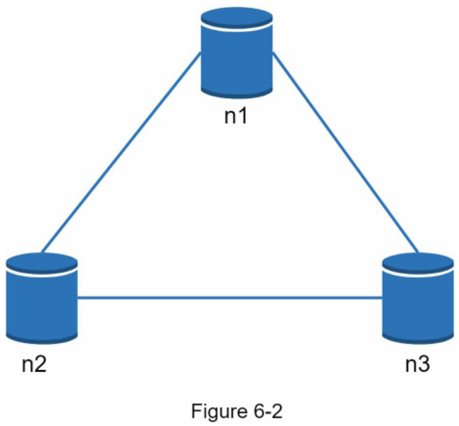

## Real-world distributed systems (Hệ thống phân tán trong thực tế)

Trong một hệ thống phân tán thực tế, hiện tượng phân vùng mạng là không thể tránh khỏi, và khi phân vùng xảy ra, chúng ta buộc phải lựa chọn giữa tính nhất quán hoặc tính sẵn sàng. Trong Hình 6-3, node n3 bị sập và không thể liên lạc với n1 và n2. Nếu client ghi dữ liệu vào n1 hoặc n2, dữ liệu đó không thể được propagated (lan truyền / đồng bộ) sang n3. Ngược lại, nếu dữ liệu được ghi vào n3 nhưng chưa kịp lan truyền sang n1 và n2, thì n1 và n2 sẽ chứa stale data (dữ liệu cũ / lỗi thời).

## Figure 6-3 (Hình 6-3)

Nếu chúng ta chọn tính nhất quán thay vì tính sẵn sàng (hệ thống CP), chúng ta phải chặn toàn bộ các thao tác ghi tới n1 và n2 nhằm tránh tình trạng bất nhất dữ liệu giữa ba máy chủ này, điều này sẽ khiến hệ thống mất đi tính sẵn sàng (unavailable). Các hệ thống ngân hàng thường có yêu cầu cực kỳ khắt khe về tính nhất quán. Ví dụ, đối với hệ thống ngân hàng, việc hiển thị thông tin số dư tài khoản mới nhất là yếu tố mang tính sống còn. Nếu xảy ra tình trạng bất nhất do phân vùng mạng, hệ thống ngân hàng sẽ trả về lỗi cho đến khi vấn đề bất nhất được giải quyết triệt để.

Tuy nhiên, nếu chúng ta chọn tính sẵn sàng thay vì tính nhất quán (hệ thống AP), hệ thống vẫn tiếp tục chấp nhận các thao tác đọc, cho dù nó có thể trả về dữ liệu cũ. Đối với thao tác ghi, n1 và n2 vẫn tiếp tục tiếp nhận ghi, và dữ liệu sẽ được đồng bộ hóa sang n3 sau khi sự cố phân vùng mạng được khắc phục.

Việc lựa chọn đúng các bảo đảm CAP phù hợp với từng bài toán sử dụng là một bước vô cùng quan trọng khi xây dựng một distributed key-value store. Bạn có thể thảo luận trực tiếp vấn đề này với người phỏng vấn để đưa ra thiết kế hệ thống tương ứng.

## System components (Các thành phần hệ thống)

Trong phần này, chúng ta sẽ thảo luận về các thành phần cốt lõi và kỹ thuật được sử dụng để xây dựng một key-value store:

- Data partition (Phân vùng dữ liệu)
- Data replication (Sao chép dữ liệu)
- Consistency (Tính nhất quán)
- Inconsistency resolution (Giải quyết bất nhất dữ liệu)
- Handling failures (Xử lý sự cố)
- System architecture diagram (Sơ đồ kiến trúc hệ thống)
- Write path (Luồng xử lý ghi dữ liệu)
- Read path (Luồng xử lý đọc dữ liệu)

Nội dung dưới đây phần lớn dựa trên ba hệ thống key-value store phổ biến: Dynamo [4], Cassandra [5], và BigTable [6].

## Data partition (Phân vùng dữ liệu)

Đối với các ứng dụng quy mô lớn, việc lưu trữ toàn bộ tập dữ liệu trên một máy chủ duy nhất là điều bất khả thi. Cách đơn giản nhất để thực hiện điều này là chia nhỏ dữ liệu thành các phân vùng (partition) nhỏ hơn và lưu trữ chúng trên nhiều máy chủ. Quá trình phân vùng dữ liệu đặt ra hai thách thức:
· Phân phối dữ liệu đồng đều giữa nhiều máy chủ.
· Giảm thiểu việc dịch chuyển dữ liệu khi các node được thêm vào hoặc loại bỏ.

Consistent hashing (băm nhất quán) đã được thảo luận ở Chương 5 là một kỹ thuật tuyệt vời để giải quyết các vấn đề này. Hãy cùng điểm lại cách thức hoạt động tổng quan của consistent hashing:
· Đầu tiên, các máy chủ được đặt lên một hash ring (vòng băm). Trong Hình 6-4, tám máy chủ, đại diện bởi s0, s1, …, s7, được sắp xếp trên vòng băm.
· Tiếp theo, một khóa (key) được băm lên cùng vòng băm đó, và nó sẽ được lưu trữ trên máy chủ đầu tiên bắt gặp khi di chuyển theo chiều kim đồng hồ. Ví dụ, theo logic này, key0 sẽ được lưu trữ tại máy chủ s1.

Việc sử dụng consistent hashing để phân vùng dữ liệu mang lại các lợi thế sau:
Automatic scaling (Tự động mở rộng quy mô): các máy chủ có thể được thêm vào hoặc loại bỏ một cách tự động tùy thuộc vào tải hệ thống.

Heterogeneity (Tính không đồng nhất): số lượng virtual nodes (nút ảo) của một máy chủ sẽ tỷ lệ thuận với năng lực phần cứng của máy chủ đó. Ví dụ, các máy chủ có cấu hình mạnh hơn sẽ được phân bổ nhiều nút ảo hơn.

## Data replication (Sao chép dữ liệu)

Để đạt được độ sẵn sàng và độ tin cậy cao, dữ liệu phải được sao chép bất đồng bộ qua N máy chủ, trong đó N là một tham số có thể cấu hình. N máy chủ này được lựa chọn theo logic sau: sau khi một key được ánh xạ vào một vị trí trên hash ring, ta duyệt theo chiều kim đồng hồ từ vị trí đó và chọn N máy chủ đầu tiên trên vòng băm để lưu trữ các bản sao dữ liệu. Trong Hình 6-5 (với N = 3), key0 được sao chép tại s1, s2 và s3.

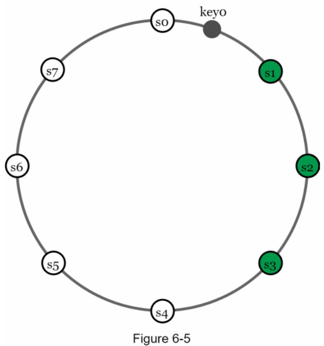

Khi sử dụng virtual nodes, N nút đầu tiên trên vòng băm có thể thuộc về ít hơn N máy chủ vật lý thực tế. Để tránh tình trạng này, chúng ta chỉ chọn các máy chủ vật lý duy nhất trong quá trình duyệt theo chiều kim đồng hồ. Bên cạnh đó, các node nằm trong cùng một data center (trung tâm dữ liệu) thường có nguy cơ gặp sự cố đồng thời do mất điện, lỗi mạng, thiên tai, v.v. Để nâng cao độ tin cậy, các bản sao nên được đặt tại các data center riêng biệt, và các data center này được kết nối với nhau thông qua mạng tốc độ cao.

## Consistency (Tính nhất quán)

Vì dữ liệu được sao chép trên nhiều node, nó bắt buộc phải được đồng bộ hóa giữa các bản sao. Quorum consensus (cơ chế đồng thuận túc số / quorum) có thể đảm bảo tính nhất quán cho cả thao tác đọc và ghi. Trước hết, hãy cùng thiết lập một số định nghĩa:
N = Số lượng node bản sao.
W = Một write quorum (túc số ghi) có kích thước W. Để một thao tác ghi được coi là thành công, thao tác ghi đó phải nhận được xác nhận (acknowledged) từ ít nhất W bản sao.
R = Một read quorum (túc số đọc) có kích thước R. Để một thao tác đọc được coi là thành công, thao tác đọc đó phải chờ phản hồi từ ít nhất R bản sao.
Hãy xem xét ví dụ minh họa trong Hình 6-6 với N = 3.

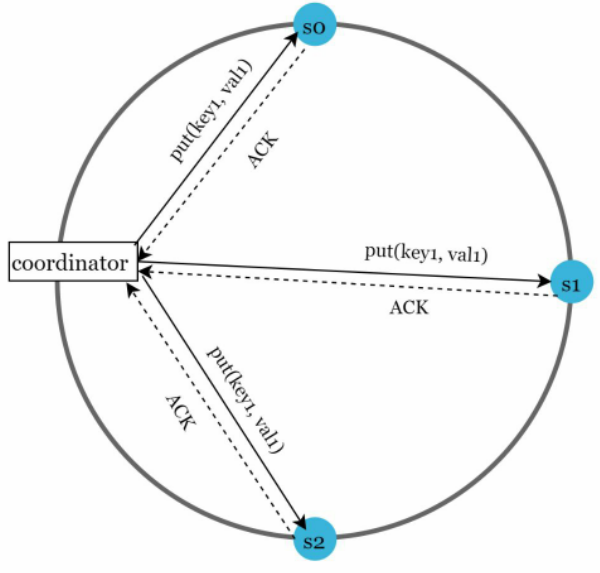

Hình 6-6 (ACK = acknowledgement / xác nhận)

W = 1 không có nghĩa là dữ liệu chỉ được ghi trên một máy chủ duy nhất. Ví dụ, với cấu hình trong Hình 6-6, dữ liệu vẫn được sao chép trên cả s0, s1 và s2. W = 1 có nghĩa là coordinator (nút điều phối) phải nhận được ít nhất một xác nhận thành công trước khi thao tác ghi được coi là hoàn tất. Chẳng hạn, nếu chúng ta nhận được xác nhận từ s1, chúng ta không cần phải tiếp tục chờ đợi xác nhận từ s0 và s2 nữa. Một coordinator đóng vai trò như một proxy (máy chủ ủy nhiệm) trung gian giữa client và các node lưu trữ.

Cấu hình của W, R và N là một sự đánh đổi kinh điển giữa độ trễ (latency) và tính nhất quán (consistency). Nếu W = 1 hoặc R = 1, thao tác sẽ trả về kết quả rất nhanh chóng vì coordinator chỉ cần đợi phản hồi từ bất kỳ một bản sao nào. Nếu W hoặc R > 1, hệ thống sẽ đảm bảo tính nhất quán tốt hơn; tuy nhiên, truy vấn sẽ phản hồi chậm hơn vì coordinator phải đợi phản hồi từ bản sao chậm nhất. Nếu W + R > N, tính nhất quán mạnh (strong consistency) được đảm bảo tuyệt đối vì chắc chắn có ít nhất một node giao thoa nắm giữ dữ liệu mới nhất.

Làm thế nào để cấu hình N, W và R phù hợp với bài toán của chúng ta? Dưới đây là một số cấu hình khả dĩ:
Nếu R = 1 và W = N: hệ thống được tối ưu hóa cho thao tác đọc nhanh.
Nếu W = 1 và R = N: hệ thống được tối ưu hóa cho thao tác ghi nhanh.
Nếu W + R > N: tính nhất quán mạnh được đảm bảo (thông thường chọn N = 3, W = R = 2).
Nếu W + R <= N: tính nhất quán mạnh không được đảm bảo.
Tùy thuộc vào yêu cầu, chúng ta có thể tinh chỉnh các giá trị W, R, N để đạt được mức độ nhất quán mong muốn.

> 💡 **Giải thích thêm:** **Nguyên lý Quorum Consensus (Túc số đồng thuận):** Điều kiện $W + R > N$ xuất phát từ nguyên lý Dirichlet (nguyên lý chuồng bồ câu). Khi tổng số node xác nhận ghi ($W$) và số node đọc ($R$) lớn hơn tổng số node bản sao ($N$), tập hợp các node ghi và tập hợp các node đọc bắt buộc phải giao nhau ở ít nhất một node. Node giao nhau này chắc chắn nắm giữ dữ liệu ghi mới nhất, nhờ đó client luôn nhận diện và đọc được phiên bản cập nhật nhất.
> Nguồn tham khảo: https://en.wikipedia.org/wiki/Quorum_(distributed_computing)

## Consistency models (Mô hình nhất quán)

Mô hình nhất quán (consistency model) là một yếu tố quan trọng khác cần cân nhắc khi thiết kế một key-value store. Một mô hình nhất quán sẽ định nghĩa mức độ nhất quán của dữ liệu, và tồn tại một dải rộng các mô hình nhất quán khác nhau:
· Strong consistency (Tính nhất quán mạnh): bất kỳ thao tác đọc nào cũng đều trả về giá trị tương ứng với kết quả của thao tác ghi dữ liệu mới nhất. Client không bao giờ nhìn thấy dữ liệu lỗi thời.
· Weak consistency (Tính nhất quán yếu): các thao tác đọc tiếp theo có thể không nhìn thấy giá trị mới nhất.
· Eventual consistency (Tính nhất quán cuối cùng): đây là một dạng đặc thù của tính nhất quán yếu. Nếu có đủ thời gian, tất cả các cập nhật sẽ được lan truyền đầy đủ và mọi bản sao đều sẽ đạt trạng thái nhất quán.

Tính nhất quán mạnh thường đạt được bằng cách buộc một bản sao không được tiếp nhận các thao tác đọc/ghi mới cho đến khi tất cả các bản sao đều đã đồng thuận về thao tác ghi hiện tại. Cách tiếp cận này không lý tưởng cho các hệ thống đòi hỏi độ sẵn sàng cao vì nó có thể làm nghẽn (block) các thao tác mới. Dynamo và Cassandra áp dụng eventual consistency, và đây cũng là mô hình nhất quán được khuyến nghị cho key-value store của chúng ta. Khi có các thao tác ghi đồng thời (concurrent writes), eventual consistency cho phép các giá trị không nhất quán tạm thời đi vào hệ thống và buộc client phải đọc các giá trị này để tiến hành reconcile (hòa giải / giải quyết xung đột). Phần tiếp theo sẽ giải thích cách cơ chế hòa giải xung đột hoạt động kết hợp với versioning.

## Inconsistency resolution: versioning (Giải quyết bất nhất dữ liệu: versioning)

Cơ chế sao chép (replication) mang lại độ sẵn sàng cao nhưng lại gây ra tình trạng bất nhất giữa các bản sao. Versioning (đánh số phiên bản) và vector clock (đồng hồ vector [nguyên văn ghi nhầm: vector locks]) được sử dụng để giải quyết các vấn đề bất nhất này. Versioning có nghĩa là xem mỗi lần sửa đổi dữ liệu như một phiên bản bất biến (immutable version) mới của dữ liệu đó. Trước khi thảo luận sâu về versioning, hãy cùng xem một ví dụ để giải thích cách tình trạng bất nhất diễn ra:
Như thể hiện trong Hình 6-7, cả hai replica node n1 và n2 đều đang chứa cùng một giá trị. Hãy gọi giá trị này là giá trị ban đầu. Server 1 và Server 2 nhận được cùng một giá trị khi thực hiện thao tác get("name").

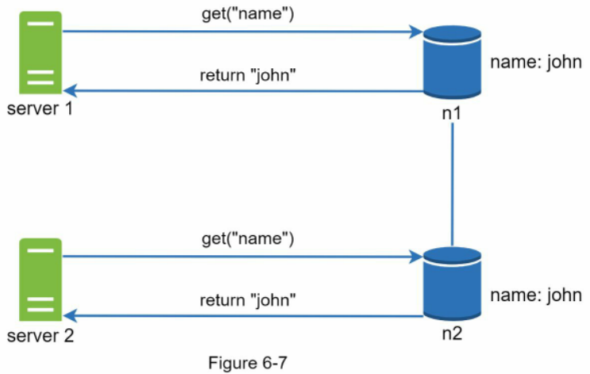

Tiếp theo, Server 1 đổi tên thành "johnSanFrancisco", còn Server 2 đổi tên thành "johnNewYork" như mô tả trong Hình 6-8. Hai thay đổi này được thực hiện đồng thời. Giờ đây, chúng ta có các giá trị xung đột nhau, gọi là phiên bản v1 và v2.

Hình 6-8

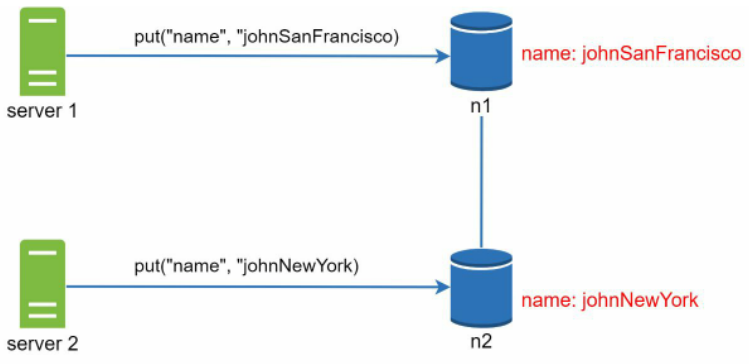

Trong ví dụ này, giá trị ban đầu có thể bỏ qua vì các sửa đổi đều dựa trên nó. Tuy nhiên, không có cách nào rõ ràng để tự động giải quyết xung đột giữa hai phiên bản cuối cùng này. Để xử lý vấn đề, chúng ta cần một hệ thống versioning có khả năng phát hiện xung đột và hòa giải xung đột. Vector clock là một kỹ thuật phổ biến để giải quyết bài toán này. Hãy cùng kiểm tra cách hoạt động của vector clock.

Một vector clock là một cặp [server, version] gắn liền với một mục dữ liệu. Nó có thể được sử dụng để kiểm tra xem một phiên bản là tiền nhiệm (precedes), kế nhiệm (succeeds), hay đang xung đột (in conflict) với các phiên bản khác. Giả sử một vector clock được biểu diễn bởi $D([S_1, v_1], [S_2, v_2], \dots, [S_n, v_n])$, trong đó $D$ là mục dữ liệu, $v_1$ là bộ đếm phiên bản, và $S_1$ là định danh máy chủ, v.v. Nếu mục dữ liệu $D$ được ghi vào máy chủ $S_i$, hệ thống phải thực hiện một trong các tác vụ sau:
· Tăng $v_i$ lên 1 nếu $[S_i, v_i]$ đã tồn tại.
· Nếu chưa tồn tại, tạo một mục mới $[S_i, 1]$.

Logic trừu tượng trên được giải thích bằng một ví dụ cụ thể như minh họa trong Hình 6-9.

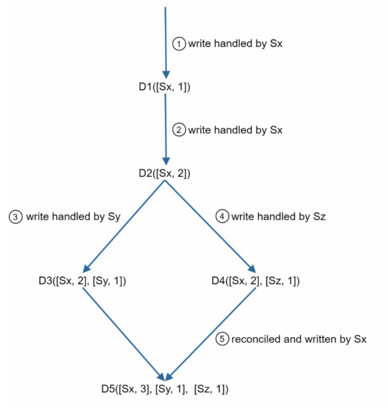

Hình 6-9 (nguồn: [4])

1. Một client ghi mục dữ liệu D1 vào hệ thống, và thao tác ghi được xử lý bởi máy chủ Sx; máy chủ này hiện có vector clock là D1[(Sx, 1)].
2. Một client khác đọc D1 mới nhất, cập nhật thành D2 và ghi ngược lại. D2 kế thừa từ D1 nên nó sẽ ghi đè D1. Giả sử thao tác ghi được xử lý bởi cùng máy chủ Sx, khi đó máy chủ này có vector clock là D2([Sx, 2]).
3. Một client khác đọc D2 mới nhất, cập nhật thành D3 và ghi lại. Giả sử thao tác ghi được xử lý bởi máy chủ Sy, khi đó máy chủ này có vector clock là D3([Sx, 2], [Sy, 1]).
4. Một client khác đọc D2 mới nhất, cập nhật thành D4 và ghi lại. Giả sử thao tác ghi được xử lý bởi máy chủ Sz, khi đó máy chủ này có D4([Sx, 2], [Sz, 1]).
5. Khi một client khác đọc D3 và D4, nó phát hiện ra một xung đột, vốn gây ra bởi việc mục dữ liệu D2 bị sửa đổi đồng thời bởi cả Sy và Sz. Xung đột này được hòa giải bởi phía client và dữ liệu đã cập nhật được gửi lại máy chủ. Giả sử thao tác ghi được xử lý bởi Sx, máy chủ này hiện có D5([Sx, 3], [Sy, 1], [Sz, 1]). Chúng ta sẽ giải thích cách phát hiện xung đột ngay sau đây.

Khi sử dụng vector clock, rất dễ để xác định một phiên bản X có phải là tổ tiên (ancestor - tức không có xung đột) của phiên bản Y hay không: nếu các bộ đếm phiên bản cho từng bên tham gia trong vector clock của Y đều lớn hơn hoặc bằng các bộ đếm tương ứng trong phiên bản X. Ví dụ, vector clock D([s0, 1], [s1, 1]) là tổ tiên của D([s0, 1], [s1, 2]). Do đó, không có xung đột nào được ghi nhận.

Tương tự, bạn có thể nhận biết phiên bản X là phiên bản song song / anh em (sibling - tức tồn tại xung đột) với Y nếu có bất kỳ bên tham gia nào trong vector clock của Y có bộ đếm nhỏ hơn bộ đếm tương ứng trong X. Ví dụ, hai vector clock sau đây thể hiện sự xung đột: D([s0, 1], [s1, 2]) và D([s0, 2], [s1, 1]).

Mặc dù vector clock có thể giải quyết xung đột, nhưng nó tồn tại hai nhược điểm đáng lưu ý. Thứ nhất, vector clock làm tăng độ phức tạp cho phía client vì nó đòi hỏi client phải tự triển khai logic giải quyết xung đột. Thứ hai, các cặp [server: version] trong vector clock có thể tăng trưởng rất nhanh chóng. Để khắc phục vấn đề này, chúng ta đặt ra một ngưỡng giới hạn độ dài, và nếu vượt quá giới hạn, các cặp cũ nhất sẽ bị xóa bỏ. Điều này có thể dẫn đến việc giảm hiệu quả trong quá trình hòa giải vì mối quan hệ kế thừa không thể xác định chính xác tuyệt đối. Tuy nhiên, theo bài báo khoa học về Dynamo [4], Amazon chưa từng gặp phải vấn đề này trong môi trường production thực tế; do đó, đây có lẽ là một giải pháp hoàn toàn chấp nhận được đối với đa số các công ty.

> 💡 **Giải thích thêm:** **Vector Clock (Đồng hồ vector):** Trong hệ thống phân tán không có đồng hồ vật lý tập trung (do hiện tượng lệch đồng hồ vật lý - clock drift), vector clock đóng vai trò như một bộ tem thời gian logic (logical timestamp) theo dõi mối quan hệ nhân quả (causality). Mỗi node tự quản lý một mảng các bộ đếm phiên bản. Khi hai bản ghi diễn ra độc lập mà không biết về nhau, vector clock của chúng sẽ không thể so sánh thứ tự lớn hơn/nhỏ hơn một cách trực tiếp (không vector nào bao trùm vector kia), báo hiệu hệ thống đã xuất hiện nhánh phân kỳ (fork) và cần client thực hiện ghép (merge/reconcile).
> Nguồn tham khảo: https://en.wikipedia.org/wiki/Vector_clock

## Handling failures (Xử lý sự cố)

Cũng như bất kỳ hệ thống quy mô lớn nào, các sự cố không chỉ là điều khó tránh khỏi mà còn xảy ra rất thường xuyên. Việc xử lý các kịch bản sự cố là vô cùng quan trọng. Trong phần này, trước tiên chúng ta sẽ giới thiệu các kỹ thuật phát hiện sự cố. Sau đó, chúng ta sẽ xem xét các chiến lược giải quyết sự cố phổ biến.

## Failure detection (Phát hiện sự cố)

Trong một hệ thống phân tán, việc chỉ tin rằng một máy chủ bị sập vì một máy chủ khác tuyên bố như vậy là chưa đủ tin cậy. Thông thường, hệ thống yêu cầu ít nhất hai nguồn thông tin độc lập để đánh dấu một máy chủ là đã sập. Như minh họa trong Hình 6-10, giải pháp all-to-all multicasting (truyền thông đa hướng toàn thể / tất cả-đến-tất cả) là một cách tiếp cận trực tiếp. Tuy nhiên, phương pháp này trở nên kém hiệu quả khi có nhiều máy chủ trong hệ thống.

Mã thành viên (Member ID)

Danh sách thành viên của s0 (s0's membership list)

Bộ đếm nhịp tim (Heartbeat counter) Thời gian (Time)

0

10232

12:00:01

1

10224

12:00:10

2

9908

11:58:02

3

10237

12:00:20

4

10234

12:00:34

Như thể hiện trong Hình 6-11: Hình 6-11

Hình 6-10

Một giải pháp tốt hơn là sử dụng các phương pháp phát hiện sự cố phi tập trung như gossip protocol (giao thức đồn đại / gossip). Gossip protocol hoạt động như sau:
· Mỗi node duy trì một node membership list (danh sách thành viên node), bao gồm mã thành viên (member ID) và heartbeat counter (bộ đếm nhịp tim / tín hiệu báo sống).
· Mỗi node định kỳ tăng bộ đếm heartbeat của chính mình.
· Mỗi node định kỳ gửi các heartbeat tới một tập hợp các node ngẫu nhiên, các node này sau đó lại tiếp tục lan truyền tới một tập hợp các node ngẫu nhiên khác.
· Khi các node nhận được heartbeat, danh sách thành viên sẽ được cập nhật thông tin mới nhất.
· Nếu heartbeat của một node không tăng trong khoảng thời gian dài hơn ngưỡng quy định sẵn, thành viên đó sẽ bị coi là đã ngoại tuyến (offline).

s0 phát hiện s2 đã sập s1

s5

s2

X

s4

s3

· Node s0 duy trì một danh sách thành viên node được hiển thị ở phía bên trái.
· Node s0 nhận thấy bộ đếm heartbeat của node s2 (member ID = 2) đã không tăng trong một thời gian dài.
· Node s0 gửi các heartbeat chứa thông tin của s2 tới một nhóm các node ngẫu nhiên. Khi các node khác xác nhận rằng bộ đếm heartbeat của s2 đã lâu không được cập nhật, node s2 sẽ chính thức bị đánh dấu là đã sập, và thông tin này được lan truyền rộng rãi tới các node khác.

> 💡 **Giải thích thêm:** **Gossip Protocol (Giao thức truyền tin kiểu tin đồn):** Lấy cảm hứng từ cách thức tin đồn lan truyền trong xã hội. Thay vì dồn tải lên một node trung tâm hoặc bắt mọi node phải liên tục ping lẫn nhau (gây tắc nghẽn mạng $O(N^2)$), mỗi node chỉ cần định kỳ bắt liên lạc ngẫu nhiên với một vài node xung quanh để trao đổi trạng thái. Nhờ cơ chế lan truyền theo hàm mũ, thông tin về lỗi node sẽ bao phủ toàn bộ cụm máy chủ cực kỳ nhanh chóng ($O(\log N)$) mà tốn rất ít băng thông mạng.
> Nguồn tham khảo: https://en.wikipedia.org/wiki/Gossip_protocol

## Xử lý sự cố tạm thời (Handling temporary failures)

Sau khi các sự cố được phát hiện thông qua gossip protocol (giao thức lan truyền thông tin kiểu tin đồn giữa các node), hệ thống cần triển khai một số cơ chế nhất định để đảm bảo tính sẵn sàng (availability). Với phương pháp strict quorum (túc số nghiêm ngặt), các thao tác đọc và ghi có thể bị chặn như đã được minh họa trong phần đồng thuận theo túc số (quorum consensus). Một kỹ thuật được gọi là "sloppy quorum" (túc số lỏng lẻo - cơ chế nới lỏng điều kiện túc số) [4] được sử dụng để cải thiện tính sẵn sàng. Thay vì bắt buộc tuân thủ nghiêm ngặt điều kiện túc số, hệ thống sẽ chọn ra W máy chủ hoạt động bình thường đầu tiên cho thao tác ghi và R máy chủ hoạt động bình thường đầu tiên cho thao tác đọc trên hash ring (vòng băm phân tán). Các máy chủ ngoại tuyến (offline) sẽ bị bỏ qua. Nếu một máy chủ không thể truy cập do sự cố mạng hoặc lỗi máy chủ, một máy chủ khác sẽ tạm thời xử lý các yêu cầu thay thế. Khi máy chủ gặp sự cố hoạt động trở lại, các thay đổi sẽ được đẩy ngược về máy chủ này để đạt được tính nhất quán dữ liệu (data consistency). Quy trình này được gọi là hinted handoff (cơ chế bàn giao kèm gợi ý / chuyển giao dữ liệu tạm thời). Do s2 không khả dụng trong Hình 6-12 (trong nguyên bản ghi là Figure 612), các thao tác đọc và ghi sẽ tạm thời do s3 xử lý. Khi s2 trực tuyến trở lại, s3 sẽ bàn giao lại dữ liệu cho s2.

> 💡 **Giải thích thêm:** **Sloppy Quorum** và **Hinted Handoff** là hai kỹ thuật giúp hệ thống ưu tiên tính sẵn sàng (Availability) thay vì tính nhất quán nghiêm ngặt (Consistency), bám sát định lý CAP. Thay vì từ chối yêu cầu của người dùng khi một node gặp sự cố khiến không đủ số lượng phản hồi tối thiểu (strict quorum), hệ thống mượn tạm node kế tiếp còn sống trên vòng băm để nhận dữ liệu và lưu kèm một "gợi ý" (hint). Khi node chính phục hồi, dữ liệu tạm này sẽ được bàn giao trả lại.
> Nguồn tham khảo: https://www.allthingsdistributed.com/files/amazon-dynamo-sosp2007.pdf

## Xử lý sự cố vĩnh viễn (Handling permanent failures)

Hinted handoff được sử dụng để xử lý các sự cố tạm thời. Vậy điều gì sẽ xảy ra nếu một replica (bản sao dữ liệu) bị ngừng hoạt động vĩnh viễn? Để xử lý tình huống như vậy, chúng ta triển khai một anti-entropy protocol (giao thức chống phân rã nhằm phát hiện sai lệch dữ liệu) để giữ cho các bản sao luôn đồng bộ với nhau. Anti-entropy bao gồm việc so sánh từng phần dữ liệu trên các bản sao và cập nhật từng bản sao lên phiên bản mới nhất. Merkle tree (cây Merkle hay cây băm) được sử dụng để phát hiện sự không nhất quán và giảm thiểu tối đa lượng dữ liệu phải truyền tải qua mạng. Trích dẫn từ Wikipedia [7]: "Cây băm hay cây Merkle là một cây mà trong đó mỗi node không phải lá (non-leaf node) được gắn nhãn bằng mã băm (hash) của các nhãn hoặc giá trị (trong trường hợp là node lá) từ các node con của nó. Cây băm cho phép xác minh nội dung của các cấu trúc dữ liệu lớn một cách hiệu quả và an toàn". Giả sử không gian khóa (key space) có giá trị từ 1 đến 12, các bước sau đây sẽ minh họa cách xây dựng một cây Merkle. Các ô được làm nổi bật thể hiện sự không nhất quán. Bước 1: Chia không gian khóa thành các bucket (nhóm/ngăn chứa phân vùng dữ liệu - gồm 4 bucket trong ví dụ của chúng ta) như hiển thị trong Hình 6-13. Một bucket được sử dụng làm node cấp gốc (root-level node) cho cây con để giới hạn độ sâu của cây.

> 💡 **Giải thích thêm:** **Merkle Tree** giải quyết bài toán so sánh lượng dữ liệu khổng lồ giữa hai máy chủ mà không cần truyền toàn bộ dữ liệu qua đường truyền mạng. Bằng cách so sánh từ mã băm gốc (root hash) đi xuống: nếu root hash trùng khớp, hai bản sao giống hệt nhau 100%; nếu root hash khác nhau, hệ thống chỉ cần duyệt theo các nhánh con có hash khác biệt để khoanh vùng chính xác bucket bị sai lệch và chỉ đồng bộ duy nhất phần đó.
> Nguồn tham khảo: https://en.wikipedia.org/wiki/Merkle_tree

server1 server 2

Hình 6-13 (Figure 6-13)

Bước 2: Sau khi các bucket được tạo, tiến hành băm từng khóa trong một bucket bằng phương pháp băm đồng nhất (uniform hashing) (Hình 6-14).

server1

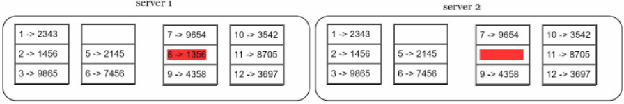

Hình 6-14 (Figure 6-14)

Bước 3: Tạo một node băm đơn lẻ cho mỗi bucket (Hình 6-15).

server 1

server 2

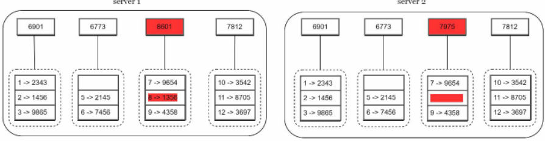

Bước 4: Xây dựng cây hướng lên trên cho đến node gốc bằng cách tính toán các mã băm của các node con (Hình 6-16). Hình 6-15 (Figure 6-15)

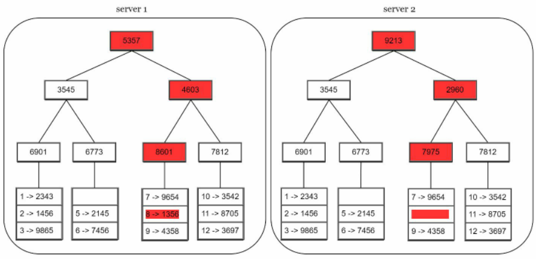

Để so sánh hai cây Merkle, bắt đầu bằng việc so sánh các mã băm gốc. Nếu các mã băm gốc khớp nhau, cả hai máy chủ đều có cùng dữ liệu. Nếu các mã băm gốc không khớp, mã băm của node con bên trái sẽ được so sánh, tiếp theo là so sánh mã băm của các node con bên phải. Bạn có thể duyệt cây để tìm ra chính xác những bucket nào chưa được đồng bộ và chỉ đồng bộ riêng các bucket đó. Nhờ sử dụng cây Merkle, lượng dữ liệu cần đồng bộ sẽ tỷ lệ thuận với sự khác biệt giữa hai bản sao, chứ không phụ thuộc vào tổng lượng dữ liệu mà chúng đang chứa. Trong các hệ thống thực tế, kích thước bucket thường khá lớn. Ví dụ, một cấu hình khả thi là 1 triệu bucket cho mỗi 1 tỷ khóa, như vậy mỗi bucket chỉ chứa 1.000 khóa. Hình 6-16 (Figure 6-16)

## Xử lý sự cố ngừng hoạt động của trung tâm dữ liệu (Handling data center outage)

Sự cố ngừng hoạt động của trung tâm dữ liệu (data center outage) có thể xảy ra do mất điện, mất kết nối mạng, thiên tai, v.v. Để xây dựng một hệ thống có khả năng xử lý sự cố ngừng hoạt động của trung tâm dữ liệu, việc nhân bản (replicate) dữ liệu trên nhiều trung tâm dữ liệu là vô cùng quan trọng. Ngay cả khi một trung tâm dữ liệu hoàn toàn ngoại tuyến, người dùng vẫn có thể truy cập dữ liệu thông qua các trung tâm dữ liệu khác.

## Sơ đồ kiến trúc hệ thống (System architecture diagram)

Sau khi đã thảo luận về các cân nhắc kỹ thuật khác nhau trong việc thiết kế kho lưu trữ khóa-giá trị (key-value store), chúng ta có thể chuyển sự chú ý sang sơ đồ kiến trúc được minh họa trong Hình 6-17.

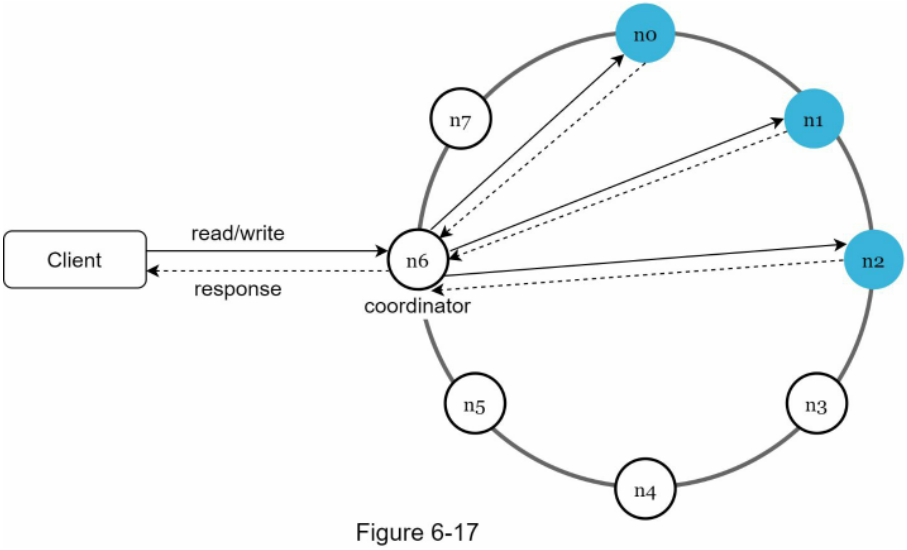

Các đặc điểm chính của kiến trúc được liệt kê như sau:
· Client (phía máy khách) giao tiếp với key-value store thông qua các API đơn giản: `get(key)` và `put(key, value)`.
· Coordinator (node điều phối) là một node đóng vai trò như một proxy (máy chủ ủy quyền/đại diện) giữa client và key-value store.
· Các node được phân bổ trên một vòng tròn bằng cách sử dụng consistent hashing (kỹ thuật băm nhất quán).
· Hệ thống hoàn toàn phi tập trung (decentralized), do đó việc thêm mới và di chuyển các node có thể diễn ra tự động.
· Dữ liệu được nhân bản tại nhiều node.
· Không có single point of failure (SPOF - điểm lỗi đơn lẻ có thể làm sập toàn bộ hệ thống) vì mỗi node đều đảm nhiệm cùng một tập hợp các trách nhiệm như nhau.

Do thiết kế mang tính phi tập trung, mỗi node sẽ thực hiện nhiều tác vụ như được trình bày trong Hình 6-18.

## Luồng ghi (Write path)

Hình 6-19 giải thích những gì diễn ra sau khi một yêu cầu ghi được chuyển hướng đến một node cụ thể. Xin lưu ý rằng các thiết kế được đề xuất cho luồng ghi/đọc chủ yếu dựa trên kiến trúc của Cassandra [8].

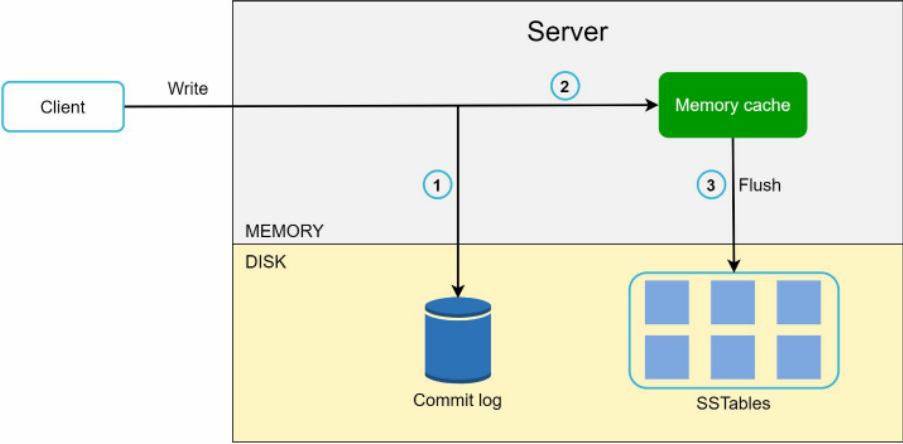

Hình 6-19 (Figure 6-19)

1. Yêu cầu ghi được lưu kiên cố (persist) vào một tệp commit log (nhật ký ghi lại thao tác trước khi lưu để phục hồi sự cố).
2. Dữ liệu được lưu vào memory cache (bộ nhớ đệm trên RAM).

Hình 6-18 (Figure 6-18)

3. Khi memory cache bị đầy hoặc đạt đến một ngưỡng định trước, dữ liệu sẽ được đẩy (flush) xuống SSTable (Sorted String Table - bảng chuỗi đã sắp xếp lưu trữ cặp khóa-giá trị trên đĩa) [9] trên đĩa cứng. Lưu ý: Sorted String Table (SSTable) là một danh sách đã được sắp xếp của các cặp <key, value>. Dành cho những độc giả quan tâm muốn tìm hiểu thêm về SSTable, hãy tham khảo tài liệu tham khảo [9].

## Luồng đọc (Read path)

Sau khi một yêu cầu đọc được chuyển hướng đến một node cụ thể, trước tiên hệ thống sẽ kiểm tra xem dữ liệu có nằm trong memory cache hay không. Nếu có, dữ liệu sẽ được trả về ngay cho client như hiển thị trong Hình 6-20.

Hình 6-20 (Figure 6-20)

Nếu dữ liệu không có trong bộ nhớ, nó sẽ được truy xuất từ đĩa thay thế. Chúng ta cần một phương pháp hiệu quả để tìm ra SSTable nào đang chứa khóa cần tìm. Bloom filter (bộ lọc Bloom - cấu trúc dữ liệu xác suất kiểm tra nhanh một phần tử có chắc chắn không tồn tại trong tập hợp hay không) [10] thường được dùng để giải quyết bài toán này. Luồng đọc khi dữ liệu không có trong bộ nhớ được mô tả trong Hình 6-21.

Hình 6-21 (Figure 6-21)

1. Đầu tiên, hệ thống kiểm tra xem dữ liệu có nằm trong bộ nhớ hay không. Nếu không, chuyển sang bước 2.
2. Nếu dữ liệu không có trong bộ nhớ, hệ thống sẽ kiểm tra Bloom filter.
3. Bloom filter được sử dụng để xác định những SSTable nào có thể chứa khóa đó.
4. Các SSTable trả về kết quả của tập dữ liệu.
5. Kết quả của tập dữ liệu được trả về cho client.

## Tóm tắt (Summary)

Chương này đã bao quát rất nhiều khái niệm và kỹ thuật. Để giúp bạn ôn lại kiến thức, bảng sau đây tóm tắt các tính năng cùng những kỹ thuật tương ứng được sử dụng cho một distributed key-value store (kho lưu trữ khóa-giá trị phân tán).

Bảng 6-2 (Table 6-2)

| Mục tiêu / Vấn đề (Goal/Problems)                                           | Kỹ thuật (Technique)                                                                                  |
| --------------------------------------------------------------------------- | ----------------------------------------------------------------------------------------------------- |
| Khả năng lưu trữ dữ liệu lớn (Ability to store big data)                    | Sử dụng consistent hashing để phân bổ tải đồng đều trên các máy chủ                                   |
| Thao tác đọc có độ sẵn sàng cao (High availability reads)                   | Nhân bản dữ liệu (Data replication), Thiết lập trên nhiều trung tâm dữ liệu (Multi-data center setup) |
| Thao tác ghi có độ sẵn sàng cao (Highly available writes)                   | Quản lý phiên bản và giải quyết xung đột bằng vector clocks (đồng hồ vector)                          |
| Phân vùng tập dữ liệu (Dataset partition)                                   | Consistent Hashing                                                                                    |
| Khả năng mở rộng gia tăng (Incremental scalability)                         | Consistent Hashing                                                                                    |
| Tính dị thể phần cứng (Heterogeneity)                                       | Consistent Hashing                                                                                    |
| Tính nhất quán có thể tinh chỉnh (Tunable consistency)                      | Quorum consensus                                                                                      |
| Xử lý sự cố tạm thời (Handling temporary failures)                          | Sloppy quorum và hinted handoff                                                                       |
| Xử lý sự cố vĩnh viễn (Handling permanent failures)                         | Merkle tree                                                                                           |
| Xử lý sự cố ngừng hoạt động trung tâm dữ liệu (Handling data center outage) | Nhân bản chéo giữa các trung tâm dữ liệu (Cross-data center replication)                              |

## Tài liệu tham khảo (Reference materials)

[1] Amazon DynamoDB: https://aws.amazon.com/dynamodb/  
[2] memcached: https://memcached.org/  
[3] Redis: https://redis.io/  
[4] Dynamo: Amazon's Highly Available Key-value Store: https://www.allthingsdistributed.com/files/amazon-dynamo-sosp2007.pdf  
[5] Cassandra: https://cassandra.apache.org/  
[6] Bigtable: A Distributed Storage System for Structured Data: https://static.googleusercontent.com/media/research.google.com/en//archive/bigtableosdi06.pdf  
[7] Merkle tree: https://en.wikipedia.org/wiki/Merkle_tree  
[8] Cassandra architecture: https://cassandra.apache.org/doc/latest/architecture/  
[9] SStable: https://www.igvita.com/2012/02/06/sstable-and-log-structured-storage-leveldb/  
[10] Bloom filter: https://en.wikipedia.org/wiki/Bloom_filter  

## CHƯƠNG 7: THIẾT KẾ BỘ TẠO ID DUY NHẤT TRONG HỆ THỐNG PHÂN TÁN (CHAPTER 7: DESIGN A UNIQUE ID GENERATOR IN DISTRIBUTED SYSTEMS)

Trong chương này, bạn được yêu cầu thiết kế một unique ID generator (bộ tạo định danh duy nhất) trong các hệ thống phân tán. Suy nghĩ đầu tiên của bạn có thể là sử dụng một khóa chính (primary key) với thuộc tính `auto_increment` (tự động tăng giá trị) trong cơ sở dữ liệu truyền thống. Tuy nhiên, `auto_increment` không hoạt động hiệu quả trong môi trường phân tán vì một máy chủ cơ sở dữ liệu đơn lẻ không đủ lớn và việc tạo ra các ID duy nhất trên nhiều cơ sở dữ liệu với độ trễ tối thiểu là một thách thức rất lớn. Dưới đây là một số ví dụ về các ID duy nhất:

Hình 7-1 (Figure 7-1)

## Bước 1 - Hiểu rõ bài toán và xác định phạm vi thiết kế (Step 1 - Understand the problem and establish design scope)