Đặt các câu hỏi làm rõ là bước đầu tiên để tiếp cận bất kỳ bài toán phỏng vấn thiết kế hệ thống nào. Dưới đây là một cuộc hội thoại mẫu giữa ứng viên và người phỏng vấn:

**Ứng viên:** Các đặc điểm của unique ID (mã định danh duy nhất) này là gì?  
**Người phỏng vấn:** ID phải là duy nhất và có thể sắp xếp theo thứ tự (sortable).  
**Ứng viên:** Với mỗi bản ghi mới, ID có tự động tăng thêm 1 không?  
**Người phỏng vấn:** ID tăng dần theo thời gian, nhưng không nhất thiết chỉ tăng đúng 1 đơn vị. Các ID được tạo vào buổi tối sẽ lớn hơn các ID được tạo vào buổi sáng trong cùng một ngày.  
**Ứng viên:** ID có chỉ chứa các giá trị số không?  
**Người phỏng vấn:** Đúng vậy.  
**Ứng viên:** Yêu cầu về độ dài của ID là bao nhiêu?  
**Người phỏng vấn:** ID phải nằm vừa trong 64-bit.  
**Ứng viên:** Quy mô của hệ thống cần đạt mức nào?  
**Người phỏng vấn:** Hệ thống phải có khả năng tạo ra 10.000 ID mỗi giây.  

Trên đây là một số câu hỏi mẫu mà bạn có thể đặt cho người phỏng vấn. Việc thấu hiểu trọn vẹn yêu cầu và làm sáng tỏ những điểm mơ hồ là điều tối quan trọng. Đối với bài toán phỏng vấn này, các yêu cầu kỹ thuật được tóm tắt như sau:
 * ID phải là duy nhất.
 * ID chỉ bao gồm các giá trị số.
 * ID có độ dài tối đa 64-bit.
 * ID được sắp xếp theo thời gian tạo.
 * Hệ thống có khả năng tạo hơn 10.000 unique ID mỗi giây.

# Step 2 - Propose high-level design and get buy-in (Bước 2 - Đề xuất thiết kế tổng quan và thống nhất phương án)

Có nhiều phương án khác nhau để tạo unique ID trong distributed systems (hệ thống phân tán). Các giải pháp được chúng tôi cân nhắc gồm có:
 * Multi-master replication (sao chép đa máy chủ chính)
 * UUID (Universally Unique Identifier - mã định danh duy nhất toàn cầu)
 * Ticket server (máy chủ cấp vé chuyên dụng)
 * Phương pháp Snowflake của Twitter (Twitter snowflake approach)

Hãy cùng xem xét chi tiết từng phương án, cơ chế hoạt động, cũng như ưu và nhược điểm của chúng.

## Multi-master replication

Như minh họa trong Hình 7-2, hướng tiếp cận đầu tiên là multi-master replication.

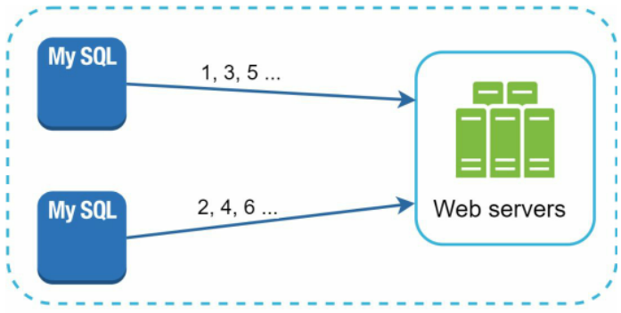

Hình 7-2

Cách tiếp cận này tận dụng tính năng auto_increment sẵn có của cơ sở dữ liệu. Thay vì tăng ID tiếp theo thêm 1 đơn vị, chúng ta tăng nó thêm $k$ đơn vị, trong đó $k$ là số lượng máy chủ cơ sở dữ liệu đang hoạt động. Như minh họa ở Hình 7-2, ID tiếp theo được tạo trên cùng một máy chủ sẽ bằng ID trước đó cộng thêm 2. Giải pháp này xử lý được một phần bài toán scalability (khả năng mở rộng) vì năng lực sinh ID tăng theo số lượng máy chủ cơ sở dữ liệu. Tuy nhiên, chiến lược này tồn tại một số nhược điểm lớn:
 * Khó mở rộng trên nhiều data center (trung tâm dữ liệu).
 * Giá trị ID không tăng đều đặn theo thời gian khi xét trên toàn bộ hệ thống nhiều máy chủ.
 * Khó mở rộng linh hoạt khi thêm mới hoặc gỡ bỏ một máy chủ.

## UUID

UUID là một giải pháp đơn giản khác để thu được các unique ID. UUID là một số 128-bit dùng để định danh thông tin trong các hệ thống máy tính. Khả năng xảy ra xung đột (collision) của UUID là cực kỳ thấp. Trích dẫn từ Wikipedia: "sau khi tạo 1 tỷ UUID mỗi giây liên tục trong khoảng 100 năm, xác suất tạo ra một bản trùng lặp duy nhất mới chạm mốc 50%" [1]. Dưới đây là một ví dụ về chuỗi UUID: `09c93e62-50b4-468d-bf8a-c07e1040bfb2`. UUID có thể được tạo độc lập tại từng máy chủ mà không cần cơ chế điều phối trung gian. Hình 7-3 trình bày thiết kế kiến trúc tạo UUID.

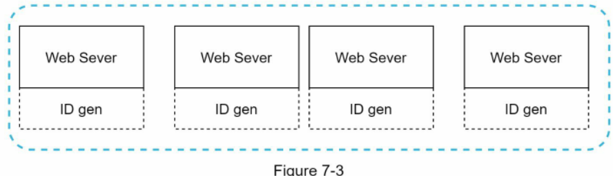

Hình 7-3

Trong thiết kế này, mỗi web server tích hợp sẵn một bộ sinh ID và chịu trách nhiệm tạo ID hoàn toàn độc lập.

**Ưu điểm:**
 * Tạo UUID rất đơn giản. Không cần điều phối giữa các máy chủ, do đó triệt tiêu hoàn toàn các vấn đề về đồng bộ hóa.
 * Hệ thống mở rộng rất dễ dàng vì mỗi web server tự sinh ID phục vụ cho chính nó. Bộ sinh ID mở rộng tuyến tính theo số lượng web server.

**Nhược điểm:**
 * ID dài 128 bits, trong khi yêu cầu đặt ra là 64 bits.
 * ID không tăng tịnh tiến theo thời gian.
 * ID có chứa ký tự chữ (hệ thập lục phân), không thuần số.

## Ticket Server

Ticket server là một giải pháp thú vị khác để tạo unique ID. Flickr đã phát triển ticket server nhằm sinh distributed primary keys (khóa chính phân tán) [2]. Cơ chế vận hành của hệ thống này rất đáng để nghiên cứu.


Hình 7-4

Ý tưởng cốt lõi là sử dụng tính năng auto_increment tập trung trên một máy chủ cơ sở dữ liệu duy nhất (Ticket Server). Để tìm hiểu sâu hơn, bạn có thể tham khảo bài viết trên blog kỹ thuật của Flickr [2].

**Ưu điểm:**
 * Sinh ra các ID thuần số.
 * Dễ triển khai và vận hành hiệu quả đối với các ứng dụng quy mô vừa và nhỏ.

**Nhược điểm:**
 * SPOF (Single Point of Failure - điểm lỗi đơn lẻ). Chỉ có duy nhất một ticket server đồng nghĩa với việc nếu máy chủ này gặp sự cố, toàn bộ các hệ thống phụ thuộc sẽ ngưng trệ. Để triệt tiêu SPOF, chúng ta có thể dựng nhiều ticket server song song, nhưng điều này sẽ kéo theo bài toán phức tạp mới về đồng bộ dữ liệu.

## Twitter snowflake approach (Phương pháp Snowflake của Twitter)

Những giải pháp nêu trên đã phác họa cơ chế hoạt động của các hệ thống sinh ID khác nhau. Tuy nhiên, chưa có phương án nào đáp ứng trọn vẹn các yêu cầu kỹ thuật đã đặt ra; vì vậy, chúng ta cần một hướng đi khác. Hệ thống sinh unique ID mang tên "Snowflake" của Twitter [3] là một mô hình xuất sắc và hoàn toàn thỏa mãn các tiêu chí này.

Chiến lược chia để trị (divide and conquer) là chìa khóa ở đây. Thay vì tạo trực tiếp một chuỗi ID nguyên khối, chúng ta chia cấu trúc ID thành nhiều phần khác nhau. Hình 7-5 minh họa bố cục cấu tạo của một ID 64-bit.

1 bit | 41 bits | 5 bits | 5 bits | 12 bits

| 0   | timestamp | datacenter ID | machine ID | sequence number |
| --- | --------- | ------------- | ---------- | --------------- |

Hình 7-5

Ý nghĩa của từng phần được giải thích chi tiết dưới đây:
 * **Sign bit (bit dấu):** 1 bit. Luôn được cố định là 0, dành riêng cho các mục đích mở rộng trong tương lai (ví dụ: phân biệt giữa số có dấu và không dấu).
 * **Timestamp (dấu thời gian):** 41 bits. Lưu số mili-giây trôi qua kể từ mốc thời gian gốc (epoch) mặc định hoặc epoch tùy chỉnh. Chúng tôi sử dụng epoch mặc định của Twitter Snowflake là 1288834974657, tương đương với ngày 04/11/2010 lúc 01:42:54 UTC.
 * **Datacenter ID (mã trung tâm dữ liệu):** 5 bits, tương ứng với $2^5 = 32$ data center.
 * **Machine ID (mã máy chủ):** 5 bits, tương ứng với $2^5 = 32$ máy chủ trên mỗi data center.
 * **Sequence number (số thứ tự):** 12 bits. Với mỗi ID được sinh ra trên máy chủ/tiến trình đó, số thứ tự sẽ tự động tăng thêm 1. Giá trị này được reset về 0 sau mỗi mili-giây.

# Step 3 - Design deep dive (Bước 3 - Đi sâu vào chi tiết thiết kế)

Trong phần thiết kế tổng quan, chúng ta đã thảo luận nhiều phương án thiết kế bộ sinh unique ID trong hệ thống phân tán. Chúng ta quyết định chọn phương án xây dựng dựa trên kiến trúc Snowflake của Twitter. Bây giờ, hãy đi sâu vào chi tiết kỹ thuật. Để tiện theo dõi, sơ đồ thiết kế được trình bày lại dưới đây:

Hình 7-6

| 1 bit | 41 bits   | 5 bits        | 5 bits     | 12 bits         |
| ----- | --------- | ------------- | ---------- | --------------- |
| 0     | timestamp | datacenter ID | machine ID | sequence number |

Datacenter ID và machine ID được cấu hình tĩnh khi khởi động dịch vụ, thường sẽ cố định trong suốt quá trình hệ thống vận hành. Bất kỳ sự thay đổi nào đối với datacenter ID và machine ID đều phải được kiểm soát nghiêm ngặt, vì việc cấu hình sai lệch có thể dẫn đến xung đột ID giữa các node. Trong khi đó, timestamp và sequence number được sinh động trong quá trình bộ sinh ID hoạt động.

## Timestamp

41 bits quan trọng nhất tạo nên phần timestamp. Khi timestamp tịnh tiến theo dòng thời gian, các ID sẽ tự nhiên có khả năng sắp xếp theo thời gian. Hình 7-7 minh họa ví dụ về cách chuyển đổi giá trị nhị phân sang định dạng giờ chuẩn UTC. Bạn cũng có thể chuyển đổi ngược lại từ UTC sang biểu diễn nhị phân bằng phương pháp tương tự.

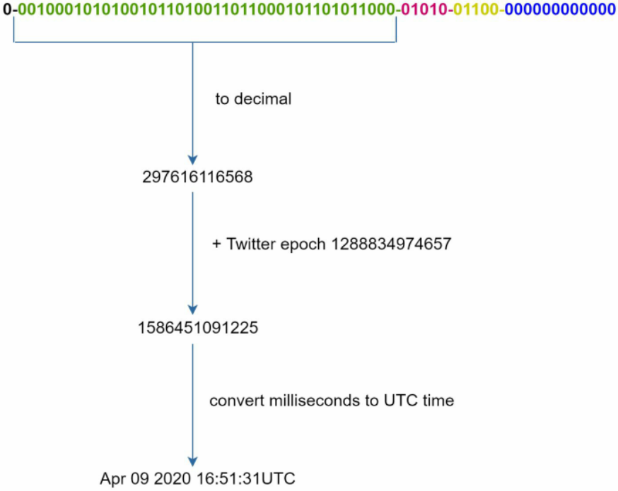

Hình 7-7

Giá trị timestamp tối đa có thể biểu diễn trong 41 bits là $2^{41} - 1 = 2.199.023.255.551$ mili-giây (ms), tương đương:

$$\sim 69\text{ năm} = \frac{2.199.023.255.551\text{ ms}}{1000\text{ giây} \times 365\text{ ngày} \times 24\text{ giờ} \times 3600\text{ giây}}$$

Điều này có nghĩa là bộ sinh ID sẽ hoạt động trơn tru trong vòng 69 năm; việc chọn epoch tùy chỉnh gần với thời điểm hiện tại sẽ giúp trì hoãn thời điểm bị tràn số (overflow). Sau 69 năm, chúng ta sẽ cần đặt lại một mốc epoch mới hoặc áp dụng các kỹ thuật chuyển đổi ID khác.

## Sequence number

Sequence number có độ dài 12 bits, cung cấp $2^{12} = 4096$ tổ hợp giá trị. Trường này luôn bằng 0 trừ khi có nhiều hơn 1 ID được sinh ra trong cùng một mili-giây trên cùng một máy chủ. Về mặt lý thuyết, một máy chủ có thể đáp ứng tối đa 4.096 ID mới mỗi mili-giây.

# Step 4 - Wrap up (Bước 4 - Tổng kết)

Trong chương này, chúng ta đã thảo luận các hướng tiếp cận khác nhau để thiết kế bộ sinh unique ID: multi-master replication, UUID, ticket server, và bộ sinh ID theo mô hình Snowflake của Twitter. Chúng ta lựa chọn Snowflake vì nó đáp ứng đầy đủ mọi trường hợp nghiệp vụ và có khả năng mở rộng tuyệt vời trong môi trường phân tán.

Nếu còn thời gian vào cuối buổi phỏng vấn, dưới đây là một số chủ đề mở rộng bạn có thể thảo luận thêm:
 * **Đồng bộ hóa đồng hồ (Clock synchronization):** Trong thiết kế trên, chúng ta giả định các máy chủ sinh ID đều có đồng hồ thời gian hoàn toàn đồng nhất. Giả định này có thể không đúng khi máy chủ chạy trên kiến trúc đa lõi hoặc trên nhiều máy chủ vật lý khác nhau. Giải pháp cho bài toán đồng bộ đồng hồ nằm ngoài phạm vi cuốn sách này; tuy nhiên, việc nhận thức được sự tồn tại của vấn đề là vô cùng quan trọng. NTP (Network Time Protocol - giao thức đồng bộ thời gian mạng) là giải pháp phổ biến nhất hiện nay [4].
 * **Tinh chỉnh độ dài từng phần (Section length tuning):** Ví dụ, phân bổ ít bit hơn cho sequence number và dành nhiều bit hơn cho timestamp sẽ rất hiệu quả đối với các ứng dụng có độ tương tranh thấp nhưng cần vòng đời hoạt động lâu dài.
 * **High availability (tính sẵn sàng cao):** Bộ sinh ID là hệ thống mission-critical (tối quan trọng), do đó nó bắt buộc phải đạt độ sẵn sàng cao nhất.

Chúc mừng bạn đã hoàn thành phần nội dung này! Hãy tự hào về nỗ lực của mình. Làm tốt lắm!

# Reference materials (Tài liệu tham khảo)

[1] Universally unique identifier: https://en.wikipedia.org/wiki/Universally_unique_identifier  
[2] Ticket Servers: Distributed Unique Primary Keys on the Cheap: https://code.flickr.net/2010/02/08/ticket-servers-distributed-unique-primary-keys-on-thecheap/  
[3] Announcing Snowflake: https://blog.twitter.com/engineering/en_us/a/2010/announcingsnowflake.html  
[4] Network time protocol: https://en.wikipedia.org/wiki/Network_Time_Protocol  

# CHAPTER 8: DESIGN A URL SHORTENER (CHƯƠNG 8: THIẾT KẾ DỊCH VỤ RÚT GỌN URL)

Trong chương này, chúng ta sẽ cùng giải quyết một bài toán thiết kế hệ thống kinh điển và rất thú vị: thiết kế dịch vụ rút gọn URL tương tự như TinyURL.

# Step 1 - Understand the problem and establish design scope (Bước 1 - Hiểu rõ bài toán và xác định phạm vi thiết kế)

Các câu hỏi phỏng vấn thiết kế hệ thống thường cố ý được để mở. Để đưa ra một thiết kế chuẩn xác, việc đặt các câu hỏi làm rõ là yếu tố then chốt.

**Ứng viên:** Người phỏng vấn có thể cho một ví dụ về cách dịch vụ rút gọn URL hoạt động được không?  
**Người phỏng vấn:** Giả sử URL `https://www.systeminterview.com/q=chatsystem&c=loggedin&v=v3&l=long` là URL gốc. Dịch vụ của bạn sẽ tạo ra một bí danh (alias) ngắn hơn: `https://tinyurl.com/y7keocwj`. Khi nhấp vào bí danh này, người dùng sẽ được chuyển hướng về URL gốc.  
**Ứng viên:** Lưu lượng truy cập dự kiến là bao nhiêu?  
**Người phỏng vấn:** Có 100 triệu URL được tạo ra mỗi ngày.  
**Ứng viên:** Độ dài của URL rút gọn cần ngắn như thế nào?  
**Người phỏng vấn:** Càng ngắn càng tốt.  
**Ứng viên:** Những ký tự nào được phép xuất hiện trong URL rút gọn?  
**Người phỏng vấn:** URL rút gọn có thể là sự kết hợp của chữ số (0-9) và chữ cái (a-z, A-Z).  
**Ứng viên:** URL rút gọn có thể bị xóa hoặc cập nhật không?  
**Người phỏng vấn:** Để đơn giản hóa bài toán, hãy giả định rằng URL rút gọn không thể bị xóa hay cập nhật.  

Dưới đây là các ca sử dụng (use case) cơ bản:
1. Rút gọn URL: nhận vào một URL dài => trả về một URL ngắn hơn nhiều.
2. Chuyển hướng URL: nhận vào một URL ngắn => chuyển hướng về URL gốc.
3. Đảm bảo các tiêu chí về tính sẵn sàng cao, khả năng mở rộng và chịu lỗi (fault tolerance).

# Back of the envelope estimation

> 💡 **Giải thích thêm:** "Back of the envelope estimation" là thuật ngữ kỹ thuật chỉ việc ước tính nhanh độ lớn (scale), dung lượng lưu trữ, băng thông mạng bằng các phép tính nhẩm hoặc tính toán cơ bản dựa trên một số giả định sơ bộ, thường được thực hiện ngay trên một mảnh giấy nhỏ hoặc mặt sau của phong bì thư trong các buổi phỏng vấn thiết kế hệ thống.  
> Nguồn tham khảo: https://en.wikipedia.org/wiki/Back-of-the-envelope_calculation

 * **Tác vụ ghi (Write operation):** 100 triệu URL được tạo mỗi ngày.
 * **Số tác vụ ghi mỗi giây:** $100.000.000 / 24 / 3600 = 1160$
 * **Tác vụ đọc (Read operation):** Giả định tỷ lệ giữa tác vụ đọc và tác vụ ghi là 10:1, số tác vụ đọc mỗi giây là: $1160 \times 10 = 11.600$
 * Giả sử dịch vụ rút gọn URL sẽ hoạt động trong 10 năm, điều này đồng nghĩa chúng ta phải lưu trữ: $100.000.000 \times 365 \times 10 = 365\text{ tỷ bản ghi}$.
 * Giả định độ dài trung bình của mỗi URL là 100 ký tự (100 bytes).
 * **Dung lượng lưu trữ yêu cầu trong 10 năm:** $365\text{ tỷ} \times 100\text{ bytes} \times 10\text{ năm} = 365\text{ TB}$.

Điều quan trọng là bạn phải trình bày rõ ràng các giả định và phép tính này với người phỏng vấn để cả hai bên đều thống nhất về số liệu.

# Step 2 - Propose high-level design and get buy-in (Bước 2 - Đề xuất thiết kế tổng quan và thống nhất phương án)

Trong phần này, chúng ta sẽ thảo luận về các API endpoint (điểm cuối API), luồng chuyển hướng URL và luồng rút gọn URL.

## API Endpoints

Các API endpoint tạo điều kiện thuận lợi cho việc giao tiếp giữa client và server. Chúng ta sẽ thiết kế các API theo phong cách RESTful (kiến trúc dịch vụ web dựa trên REST). Nếu bạn chưa quen thuộc với RESTful API, bạn có thể tham khảo thêm các tài liệu bên ngoài như nguồn [1]. Một dịch vụ rút gọn URL về cơ bản cần hai API endpoint chính:

1. Rút gọn URL. Để tạo một URL ngắn mới, client gửi một HTTP POST request chứa một tham số duy nhất: URL dài ban đầu. API có cấu trúc như sau:

```
POST api/v1/data/shorten
```

 * Tham số request: `{longUrl: longURLString}`
 * Dữ liệu trả về: `shortURL`

2. Chuyển hướng URL. Để chuyển hướng một URL ngắn về URL dài tương ứng, client gửi một HTTP GET request. API có cấu trúc như sau:

```
GET api/v1/shortUrl
```

 * Trả về: `longURL` để thực hiện HTTP redirection (chuyển hướng HTTP).

## URL redirecting

Hình 8-1 minh họa điều gì sẽ xảy ra khi bạn nhập một URL rút gọn vào trình duyệt. Khi server nhận được request chứa URL rút gọn, nó sẽ chuyển đổi URL ngắn thành URL dài thông qua mã chuyển hướng 301 redirect.

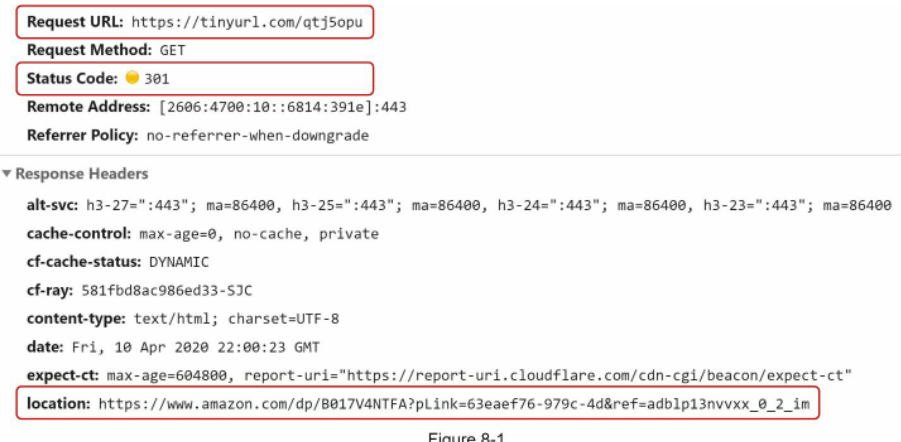

Hình 8-1

Chi tiết quy trình trao đổi dữ liệu giữa client và server được thể hiện trong Hình 8-2.

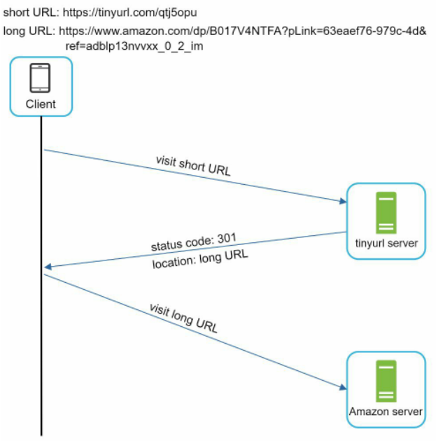

Hình 8-2

Một điểm rất đáng bàn ở đây là sự khác biệt giữa 301 redirect và 302 redirect:
 * **301 redirect:** Mã 301 biểu thị rằng URL yêu cầu đã được chuyển hướng "vĩnh viễn" (permanently moved) sang URL dài. Vì là chuyển hướng vĩnh viễn, trình duyệt sẽ lưu cache phản hồi này, và các request tiếp theo tới cùng URL ngắn sẽ không được gửi tới dịch vụ rút gọn URL nữa. Thay vào đó, request sẽ được trình duyệt tự động chuyển thẳng tới server của URL dài.
 * **302 redirect:** Mã 302 biểu thị rằng URL được di chuyển "tạm thời" (temporarily moved) sang URL dài, nghĩa là các request tiếp theo cho cùng URL ngắn vẫn sẽ được gửi tới dịch vụ rút gọn URL trước, sau đó server mới thực hiện chuyển hướng tới server của URL dài.

Mỗi phương thức chuyển hướng đều có ưu và nhược điểm riêng. Nếu ưu tiên hàng đầu là giảm tải cho server, việc sử dụng 301 redirect là tối ưu vì chỉ có request đầu tiên được gửi tới máy chủ rút gọn URL. Tuy nhiên, nếu nghiệp vụ phân tích dữ liệu (analytics) là trọng tâm, 302 redirect lại là lựa chọn tốt hơn vì nó cho phép theo dõi tỷ lệ nhấp chuột (click-through rate) và nguồn gốc truy cập một cách chính xác.

Cách trực quan nhất để hiện thực hóa tính năng chuyển hướng URL là sử dụng hash table (bảng băm). Giả sử hash table lưu trữ các cặp `<shortURL, longURL>`, logic chuyển hướng có thể được thực hiện như sau:
 * Lấy URL dài: `longURL = hashTable.get(shortURL)`
 * Khi đã có `longURL`, tiến hành chuyển hướng trình duyệt.

## URL shortening

Giả sử URL ngắn có cấu trúc như sau: `www.tinyurl.com/{hashValue}`. Để đáp ứng tính năng rút gọn URL, chúng ta phải tìm một hash function (hàm băm) $f(x)$ ánh xạ một URL dài thành một `hashValue`, như mô tả trong Hình 8-3.


Hàm băm này phải thỏa mãn các yêu cầu bắt buộc sau:
 * Mỗi `longURL` phải được băm thành đúng một `hashValue`.
 * Mỗi `hashValue` phải có khả năng ánh xạ ngược lại chính xác `longURL` ban đầu.

Chi tiết thiết kế cho hàm băm sẽ được trình bày sâu hơn ở phần tiếp theo.

# Step 3 - Design deep dive (Bước 3 - Đi sâu vào chi tiết thiết kế)

Cho đến lúc này, chúng ta đã thảo luận về thiết kế tổng quan của việc rút gọn và chuyển hướng URL. Trong phần này, chúng ta sẽ đi sâu vào: mô hình dữ liệu (data model), hàm băm, cũng như luồng thực thi chi tiết của việc rút gọn và chuyển hướng URL.

## Data model

Trong bản thiết kế sơ bộ, mọi thứ được lưu trữ trong một hash table. Đây là điểm khởi đầu tốt; tuy nhiên, phương án này bất khả thi với các hệ thống thực tế vì tài nguyên bộ nhớ RAM có hạn và chi phí rất đắt đỏ. Lựa chọn khả dĩ hơn là lưu trữ bảng ánh xạ `<shortURL, longURL>` trong một relational database (cơ sở dữ liệu quan hệ). Hình 8-4 minh họa thiết kế bảng cơ sở dữ liệu đơn giản gồm 3 cột: `id`, `shortURL`, `longURL`.

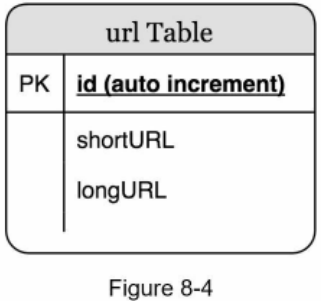

## Hash function

Hàm băm được sử dụng để chuyển đổi một URL dài thành một URL ngắn, còn gọi là `hashValue`.

### Hash value length (Độ dài của hash value)

Giá trị `hashValue` bao gồm các ký tự thuộc tập hợp `[0-9, a-z, A-Z]`, tổng cộng có $10 + 26 + 26 = 62$ ký tự khả dụng. Để xác định độ dài của `hashValue`, chúng ta cần tìm số nguyên dương $n$ nhỏ nhất sao cho $62^n \ge 365\text{ tỷ}$. Hệ thống phải hỗ trợ tới 365 tỷ URL theo phép ước tính sơ bộ ban đầu. Bảng 8-1 thể hiện độ dài của `hashValue` và số lượng URL tối đa tương ứng mà nó có thể đại diện:

| N   | Số lượng URL tối đa có thể hỗ trợ                      |
| --- | ------------------------------------------------------ |
| 1   | $62^1 = 62$                                            |
| 2   | $62^2 = 3.844$                                         |
| 3   | $62^3 = 238.328$                                       |
| 4   | $62^4 = 14.776.336$                                    |
| 5   | $62^5 = 916.132.832$                                   |
| 6   | $62^6 = 56.800.235.584$                                |
| 7   | $62^7 = 3.521.614.606.208 \approx 3,5\text{ nghìn tỷ}$ |

Bảng 8-1

Khi $n = 7$, $62^7 \approx 3,5\text{ nghìn tỷ}$. Con số 3,5 nghìn tỷ là quá đủ để chứa 365 tỷ URL, vì vậy độ dài của `hashValue` sẽ là 7 ký tự.

Chúng ta sẽ tìm hiểu hai phương pháp xây dựng hàm băm cho dịch vụ rút gọn URL: phương pháp thứ nhất là "băm kết hợp xử lý xung đột" (hash + collision resolution), và phương pháp thứ hai là "chuyển đổi cơ số 62" (base 62 conversion). Hãy cùng phân tích từng giải pháp.

### Hash + collision resolution (Băm kết hợp xử lý xung đột)

Để rút gọn một URL dài, chúng ta cần triển khai một hàm băm có khả năng băm URL dài thành một chuỗi 7 ký tự. Giải pháp trực diện là sử dụng các thuật toán băm nổi tiếng như CRC32, MD5 hoặc SHA-1. Bảng dưới đây so sánh kết quả băm sau khi áp dụng các hàm băm khác nhau lên URL: `https://en.wikipedia.org/wiki/Systems_design`.

| Hàm băm | Giá trị băm (Thập lục phân - Hexadecimal) |
| ------- | ----------------------------------------- |
| CRC32   | 5cb54054                                  |
| MD5     | 5a62509a84df9ee03fe1230b9df8b84e          |
| SHA-1   | 0eeae7916c06853901d9ccbefbfcaf4de57ed85b  |

Bảng 8-2

Như thể hiện trong Bảng 8-2, ngay cả giá trị băm ngắn nhất (từ CRC32) cũng quá dài (nhiều hơn 7 ký tự). Làm thế nào để làm cho nó ngắn hơn?

Cách tiếp cận đầu tiên là cắt lấy 7 ký tự đầu tiên của chuỗi băm; tuy nhiên, phương pháp này rất dễ dẫn đến hiện tượng hash collision (xung đột giá trị băm). Để giải quyết xung đột băm, chúng ta có thể nối thêm vào URL gốc một chuỗi tiền định (predefined string) rồi băm lại một cách đệ quy cho đến khi không còn xung đột. Quy trình này được mô tả trong Hình 8-5.

Phương pháp này có thể loại trừ xung đột; tuy nhiên, việc phải liên tục truy vấn cơ sở dữ liệu để kiểm tra xem `shortURL` đã tồn tại hay chưa cho mỗi request là một thao tác rất tốn kém chi phí. Một kỹ thuật gọi là bloom filter (bộ lọc Bloom - cấu trúc dữ liệu xác suất kiểm tra phần tử có thuộc tập hợp hay không) [2] có thể cải thiện đáng kể hiệu năng. Bloom filter là một giải pháp xác suất cực kỳ tối ưu về bộ nhớ. Hãy tham khảo thêm tài liệu [2] để biết chi tiết.


Hình 8-5

### Base 62 conversion (Chuyển đổi cơ số 62)

Chuyển đổi cơ số là một hướng tiếp cận phổ biến khác đối với các dịch vụ rút gọn URL. Việc chuyển đổi cơ số giúp biểu diễn cùng một con số nguyên dưới các hệ thống chữ số khác nhau. Hệ cơ số 62 được lựa chọn vì có đúng 62 ký tự hợp lệ để tạo nên `hashValue`.

Hãy xem xét một ví dụ để hiểu rõ cách chuyển đổi: chuyển đổi số $11157_{10}$ sang hệ cơ số 62 ($11157_{10}$ biểu thị số 11157 trong hệ thập phân):
 * Đúng như tên gọi, hệ cơ số 62 sử dụng 62 ký tự để mã hóa. Bảng ánh xạ quy ước như sau: `0-0, ..., 9-9, 10-a, 11-b, ..., 35-z, 36-A, ..., 61-Z`, trong đó `'a'` đại diện cho 10, `'Z'` đại diện cho 61.
 * Phân tích: $11157_{10} = 2 \times 62^2 + 55 \times 62^1 + 59 \times 62^0 = [2, 55, 59] \rightarrow [2, T, X]$ trong hệ cơ số 62. Hình 8-6 thể hiện các bước tính toán.

Hình 8-6

| Phép chia    | Thương số | Số dư | Biểu diễn trong hệ cơ số 62 |
| ------------ | --------- | ----- | --------------------------- |
| $11157 / 62$ | 179       | 59    | X                           |
| $179 / 62$   | 2         | 55    | T                           |
| $2 / 62$     | 0         | 2     | 2                           |

 * Như vậy, URL rút gọn tương ứng sẽ là: `https://tinyurl.com/2TX`

### Comparison of the two approaches (So sánh hai phương pháp)

Bảng 8-3 tóm tắt các điểm khác biệt giữa hai phương pháp:

Bảng 8-3

| Băm kết hợp xử lý xung đột (Hash + collision resolution)                                      | Chuyển đổi cơ số 62 (Base 62 conversion)                                                                                     |
| --------------------------------------------------------------------------------------------- | ---------------------------------------------------------------------------------------------------------------------------- |
| Độ dài URL rút gọn được cố định.                                                              | Độ dài URL rút gọn không cố định mà tăng dần theo giá trị của ID.                                                            |
| Không bắt buộc phải có bộ sinh unique ID tập trung.                                           | Phụ thuộc hoàn toàn vào một bộ sinh unique ID.                                                                               |
| Có khả năng xảy ra xung đột và bắt buộc phải có cơ chế xử lý xung đột.                        | Hoàn toàn không xảy ra xung đột vì ID sinh ra luôn là duy nhất.                                                              |
| Không thể đoán biết được URL rút gọn khả dụng tiếp theo vì nó không phụ thuộc vào ID tuần tự. | Rất dễ đoán biết được URL rút gọn tiếp theo nếu ID tăng dần 1 đơn vị cho mỗi bản ghi mới. Đây có thể là một lỗ hổng bảo mật. |

# URL shortening deep dive (Đi sâu vào luồng rút gọn URL)

Là một trong những thành phần trọng tâm của hệ thống, chúng ta mong muốn luồng rút gọn URL phải có logic rõ ràng và hoạt động ổn định. Cơ chế chuyển đổi cơ số 62 được lựa chọn trong thiết kế này. Chúng tôi xây dựng sơ đồ sau (Hình 8-7) để minh họa toàn bộ luồng xử lý:


Hình 8-7

1. `longURL` là dữ liệu đầu vào.
2. Hệ thống kiểm tra xem `longURL` đã tồn tại trong cơ sở dữ liệu chưa.
3. Nếu đã tồn tại, điều đó có nghĩa là `longURL` này đã từng được rút gọn trước đây. Khi đó, hệ thống chỉ cần lấy `shortURL` tương ứng từ cơ sở dữ liệu và trả về cho client.
4. Nếu chưa tồn tại, đây là một `longURL` mới. Một unique ID mới (đóng vai trò khóa chính) sẽ được tạo ra bởi bộ sinh unique ID.
5. Chuyển đổi ID này thành `shortURL` bằng thuật toán chuyển đổi cơ số 62.
6. Thêm một bản ghi mới vào cơ sở dữ liệu với các thông tin: ID, `shortURL` và `longURL`.

Để luồng xử lý dễ hình dung hơn, hãy xem một ví dụ thực tế:
 * Giả sử `longURL` đầu vào là: `https://en.wikipedia.org/wiki/Systems_design`
 * Bộ sinh unique ID tạo ra ID: `2009215674938`.
 * Chuyển đổi ID sang `shortURL` bằng thuật toán cơ số 62: ID `2009215674938` được chuyển thành chuỗi `"zn9edcu"`.
 * Lưu trữ ID, `shortURL`, và `longURL` vào cơ sở dữ liệu như trình bày trong Bảng 8-4.

Bảng 8-4

| id            | shortURL | longURL                                      |
| ------------- | -------- | -------------------------------------------- |
| 2009215674938 | zn9edcu  | https://en.wikipedia.org/wiki/Systems_design |

Bộ sinh distributed unique ID đóng vai trò rất quan trọng. Chức năng chính của nó là cung cấp các ID duy nhất trên quy mô toàn cục (globally unique IDs) để làm nguyên liệu tạo URL rút gọn. Trong môi trường phân tán cao độ, việc hiện thực hóa bộ sinh unique ID là bài toán không hề đơn giản. May mắn thay, chúng ta đã thảo luận chi tiết các giải pháp trong "Chương 7: Thiết kế bộ sinh unique ID trong hệ thống phân tán". Bạn có thể tham khảo lại chương này để nắm vững kiến thức.

# URL redirecting deep dive (Đi sâu vào luồng chuyển hướng URL)

Hình 8-8 thể hiện thiết kế chi tiết của quy trình chuyển hướng URL. Vì lượng truy vấn đọc (read) luôn áp đảo lượng truy vấn ghi (write), bảng ánh xạ `<shortURL, longURL>` được lưu trong cache để tăng tốc độ phản hồi.


Hình 8-8

Luồng chuyển hướng URL được tóm lược qua các bước sau:
1. Người dùng nhấp vào một liên kết URL ngắn: `https://tinyurl.com/zn9edcu`
2. Load balancer (bộ cân bằng tải) điều phối request tới các web server.
3. Nếu `shortURL` đã có sẵn trong cache, trả về trực tiếp `longURL`.
4. Nếu `shortURL` chưa có trong cache, server sẽ truy vấn `longURL` từ cơ sở dữ liệu. Nếu không tìm thấy trong cơ sở dữ liệu, rất có thể người dùng đã nhập một URL rút gọn không hợp lệ.
5. `longURL` hợp lệ được trả về để trình duyệt tiến hành chuyển hướng người dùng.

# Step 4 - Wrap up (Bước 4 - Tổng kết)

Trong chương này, chúng ta đã nghiên cứu về thiết kế API, mô hình dữ liệu, hàm băm, luồng rút gọn URL và luồng chuyển hướng URL. Nếu vẫn còn thời gian vào cuối buổi phỏng vấn, dưới đây là một số chủ đề mở rộng bạn có thể đề cập:
 * **Rate limiter (bộ giới hạn tần suất truy cập):** Một rủi ro bảo mật tiềm ẩn là kẻ tấn công có thể gửi ồ ạt các yêu cầu rút gọn URL nhằm làm tê liệt hệ thống. Bộ giới hạn tần suất giúp sàng lọc và chặn các request dựa trên địa chỉ IP hoặc các bộ lọc tùy biến. Để ôn lại kiến thức này, hãy xem lại "Chương 4: Thiết kế bộ giới hạn tần suất".
 * **Mở rộng tầng Web (Web server scaling):** Vì tầng web là stateless (không lưu trạng thái), việc mở rộng quy mô rất dễ dàng bằng cách thêm hoặc bớt các web server.
 * **Mở rộng cơ sở dữ liệu (Database scaling):** Kỹ thuật database replication (nhân bản cơ sở dữ liệu) và sharding (phân mảnh dữ liệu) là những phương pháp phổ biến.
 * **Phân tích dữ liệu (Analytics):** Dữ liệu là yếu tố then chốt cho sự thành công của doanh nghiệp. Tích hợp giải pháp phân tích dữ liệu vào dịch vụ rút gọn URL sẽ giúp trả lời các câu hỏi quan trọng như: Có bao nhiêu người nhấp vào liên kết? Họ nhấp vào thời điểm nào? Nguồn truy cập từ đâu?
 * **Tính sẵn sàng, tính nhất quán và độ tin cậy (Availability, consistency, and reliability):** Đây là những nguyên lý cốt lõi quyết định sự thành bại của bất kỳ hệ thống lớn nào. Chúng ta đã bàn kỹ về chúng trong Chương 1, hãy xem lại để củng cố nền tảng.

Chúc mừng bạn đã hoàn thành chương này! Bạn đã làm rất tốt!

# Reference materials (Tài liệu tham khảo)

[1] A RESTful Tutorial: https://www.restapitutorial.com/index.html  
[2] Bloom filter: https://en.wikipedia.org/wiki/Bloom_filter  

# CHAPTER 9: DESIGN A WEB CRAWLER (CHƯƠNG 9: THIẾT KẾ TRÌNH THU THẬP DỮ LIỆU WEB)

Trong chương này, chúng ta sẽ tập trung vào việc thiết kế một web crawler (trình thu thập dữ liệu web): một câu hỏi phỏng vấn thiết kế hệ thống kinh điển và vô cùng hấp dẫn.

Web crawler còn được gọi là robot hoặc spider. Nó được các công cụ tìm kiếm sử dụng rộng rãi để phát hiện các nội dung mới hoặc nội dung vừa được cập nhật trên internet. Nội dung ở đây có thể là trang web, hình ảnh, video, tệp PDF, v.v. Một crawler bắt đầu bằng việc tải về một vài trang web khởi đầu, sau đó lần theo các siêu liên kết (hyperlinks) trên các trang đó để tiếp tục thu thập nội dung mới. Hình 9-1 minh họa trực quan quy trình thu thập dữ liệu này.

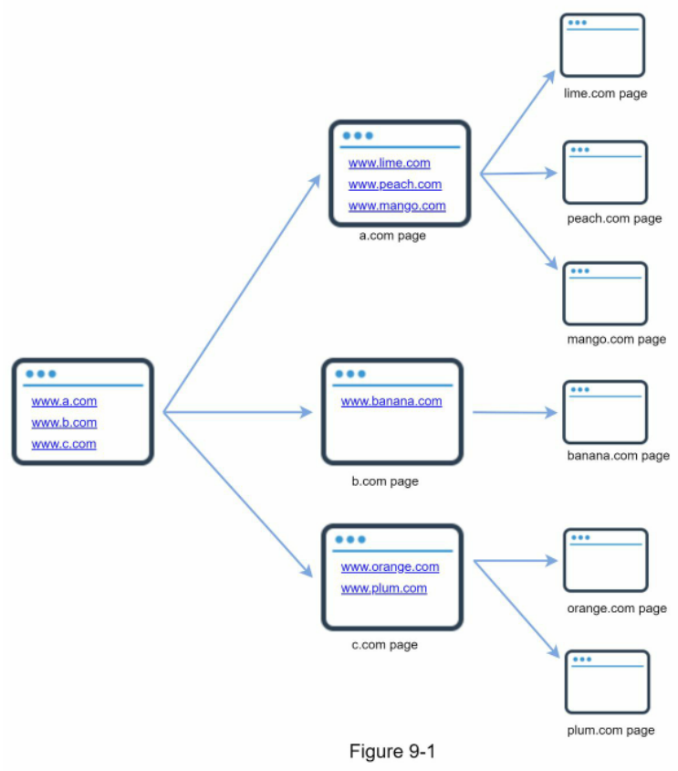

Crawler được sử dụng cho nhiều mục đích đa dạng:
 * **Đánh chỉ mục cho công cụ tìm kiếm (Search engine indexing):** Đây là trường hợp sử dụng phổ biến nhất. Crawler thu thập các trang web để xây dựng kho chỉ mục cục bộ phục vụ việc tìm kiếm. Ví dụ, Googlebot chính là trình thu thập dữ liệu đứng sau công cụ tìm kiếm Google.
 * **Lưu trữ dữ liệu web (Web archiving):** Đây là quá trình thu thập thông tin từ web nhằm mục đích bảo tồn dữ liệu cho tương lai. Chẳng hạn, nhiều thư viện quốc gia vận hành các crawler để lưu trữ các trang web. Các ví dụ tiêu biểu gồm Thư viện Quốc hội Hoa Kỳ [1] và Kho lưu trữ web của Liên minh Châu Âu [2].
 * **Khai phá dữ liệu web (Web mining):** Sự bùng nổ của web mở ra cơ hội chưa từng có cho việc khai phá dữ liệu (data mining), giúp khám phá các tri thức hữu ích từ internet. Ví dụ, các tổ chức tài chính hàng đầu sử dụng crawler để tải về biên bản họp cổ đông và báo cáo thường niên nhằm nắm bắt các chiến lược kinh doanh trọng yếu của doanh nghiệp.
 * **Giám sát web (Web monitoring):** Crawler giúp theo dõi các hành vi vi phạm bản quyền và thương hiệu trên internet. Điển hình như Digimarc [3] sử dụng crawler để phát hiện các nội dung và báo cáo bị sao chép trái phép.

Độ phức tạp khi phát triển một web crawler hoàn toàn phụ thuộc vào quy mô mà hệ thống hướng tới. Nó có thể chỉ là một bài tập nhỏ ở trường đại học tốn vài giờ để hoàn thành, nhưng cũng có thể là một đại dự án đòi hỏi sự cải tiến liên tục từ một đội ngũ kỹ sư chuyên trách. Vì vậy, chúng ta sẽ cùng khảo sát quy mô và các tính năng cần đáp ứng dưới đây.

# Step 1 - Understand the problem and establish design scope (Bước 1 - Hiểu rõ bài toán và xác định phạm vi thiết kế)

Thuật toán cơ bản của một web crawler rất mạch lạc:
1. Cho trước một danh sách URL, tải về tất cả các trang web ứng với các URL đó.
2. Trích xuất các liên kết (URLs) nằm bên trong những trang web vừa tải.
3. Thêm các URL mới trích xuất được vào danh sách các URL cần tải tiếp. Lặp lại 3 bước này.

Liệu một crawler trong thực tế có thực sự vận hành đơn giản như thuật toán cơ bản trên? Chắc chắn là không. Thiết kế một hệ thống crawler có khả năng mở rộng quy mô cực lớn là một bài toán cực kỳ phức tạp. Không ai có thể thiết kế trọn vẹn một hệ thống crawler khổng lồ trong thời lượng của một buổi phỏng vấn. Do đó, trước khi bắt tay vào thiết kế, việc đặt câu hỏi để nắm rõ yêu cầu và khoanh vùng phạm vi là bắt buộc:

**Ứng viên:** Mục đích chính của crawler là gì? Dùng để đánh chỉ mục công cụ tìm kiếm, khai phá dữ liệu hay cho mục đích nào khác?  
**Người phỏng vấn:** Phục vụ đánh chỉ mục cho công cụ tìm kiếm.  
**Ứng viên:** Trình thu thập dữ liệu cần thu thập bao nhiêu trang web mỗi tháng?  
**Người phỏng vấn:** 1 tỷ trang web.  
**Ứng viên:** Hệ thống cần xử lý những định dạng nội dung nào? Chỉ trang HTML hay cả các định dạng khác như PDF và hình ảnh?  
**Người phỏng vấn:** Chỉ các trang HTML.  
**Ứng viên:** Chúng ta có cần quan tâm đến các trang web mới được thêm vào hoặc vừa chỉnh sửa không?  
**Người phỏng vấn:** Có, chúng ta cần cập nhật các trang web mới hoặc vừa được chỉnh sửa.  
**Ứng viên:** Chúng ta có cần lưu trữ các trang HTML đã thu thập từ web không?  
**Người phỏng vấn:** Có, thời gian lưu trữ tối đa lên tới 5 năm.  
**Ứng viên:** Chúng ta xử lý các trang web có nội dung trùng lặp như thế nào?  
**Người phỏng vấn:** Những trang có nội dung trùng lặp cần được bỏ qua.  

Trên đây là các câu hỏi mẫu bạn có thể trao đổi với người phỏng vấn. Nắm bắt chính xác yêu cầu và làm sáng tỏ các điểm mù là tối quan trọng. Ngay cả khi được yêu cầu thiết kế một sản phẩm quen thuộc như crawler, các giả định của bạn và người phỏng vấn có thể hoàn toàn khác nhau.

Bên cạnh các tính năng nghiệp vụ, một web crawler đạt chuẩn cần đảm bảo các đặc tính kỹ thuật sau:
 * **Scalability (Khả năng mở rộng):** Internet vô cùng rộng lớn với hàng tỷ trang web. Quá trình thu thập phải đạt hiệu suất cực cao thông qua cơ chế xử lý song song (parallelization).
 * **Robustness (Tính bền vững):** Môi trường web chứa đầy cạm bẫy: mã HTML lỗi, máy chủ không phản hồi, sự cố sập kết nối, liên kết độc hại, v.v. Crawler phải xử lý linh hoạt mọi tình huống ngoại lệ này.
 * **Politeness (Tính lịch sự):** Crawler không được gửi quá nhiều yêu cầu dồn dập đến cùng một website trong khoảng thời gian ngắn để tránh làm sập máy chủ của họ.
 * **Extensibility (Khả năng mở rộng linh hoạt):** Hệ thống cần linh hoạt để có thể hỗ trợ các định dạng nội dung mới mà chỉ cần sửa đổi tối thiểu. Ví dụ: nếu sau này cần thu thập thêm hình ảnh, chúng ta không cần phải đập đi xây lại toàn bộ hệ thống.

## Back of the envelope estimation

Các phép tính ước lượng dưới đây dựa trên một số giả định, và điều quan trọng là phải trao đổi trực tiếp với người phỏng vấn để thống nhất:
 * Giả sử có 1 tỷ trang web được tải về mỗi tháng.
 * **QPS (Queries Per Second - số lượt truy vấn mỗi giây):**

$$1.000.000.000 / 30\text{ ngày} / 24\text{ giờ} / 3600\text{ giây} \approx 400\text{ trang/giây}.$$
 * **Peak QPS (QPS lúc cao điểm):** $2 \times \text{QPS} = 800\text{ trang/giây}$.
 * Giả định kích thước trung bình của một trang web là 500 KB.
 * Dung lượng lưu trữ mỗi tháng: $1\text{ tỷ trang} \times 500\text{ KB} = 500\text{ TB/tháng}$.
 * Giả sử dữ liệu được lưu trữ trong 5 năm:

$$500\text{ TB} \times 12\text{ tháng} \times 5\text{ năm} = 30\text{ PB}.$$

Chúng ta cần một hệ thống lưu trữ có dung lượng 30 PB để chứa nội dung thu thập trong 5 năm.

# Step 2 - Propose high-level design and get buy-in (Bước 2 - Đề xuất thiết kế tổng quan và thống nhất phương án)

Sau khi các yêu cầu đã rõ ràng, chúng ta tiến hành thiết kế kiến trúc tổng quan. Kế thừa từ các nghiên cứu kinh điển về web crawler [4] [5], chúng tôi đề xuất thiết kế tổng quan như trong Hình 9-2.


Hình 9-2

Trước hết, chúng ta sẽ tìm hiểu chức năng của từng thành phần trong thiết kế, sau đó sẽ đi qua từng bước trong luồng xử lý của crawler.

## Seed URLs

Web crawler sử dụng các seed URLs (URL hạt giống / điểm xuất phát) làm điểm khởi đầu cho toàn bộ tiến trình thu thập. Chẳng hạn, để thu thập toàn bộ các trang của một trường đại học, cách trực quan nhất là chọn tên miền chính của trường đó làm seed URL.

Để thu thập toàn bộ mạng internet, chúng ta cần sáng tạo trong việc chọn seed URLs. Một seed URL tốt đóng vai trò như điểm xuất phát thuận lợi để crawler có thể duyệt qua càng nhiều liên kết càng tốt. Chiến lược thông thường là phân chia không gian URL thành các tập nhỏ hơn. Cách thứ nhất là chia theo vị trí địa lý, vì mỗi quốc gia lại có các trang web phổ biến riêng biệt. Cách khác là phân loại seed URLs theo chủ đề: mua sắm, thể thao, y tế, v.v. Việc lựa chọn seed URL là một câu hỏi mở, người phỏng vấn không kỳ vọng một câu trả lời hoàn hảo tuyệt đối, mà muốn thấy tư duy phân tích của bạn.

## URL Frontier

Hầu hết các web crawler hiện đại đều chia trạng thái thu thập thành hai nhóm: các URL chờ tải và các URL đã tải xong. Thành phần lưu trữ các URL chờ tải được gọi là URL Frontier (hàng đợi URL cần thu thập). Bạn có thể hình dung đây là một hàng đợi FIFO queue (First-In-First-Out - vào trước ra trước). Chi tiết về URL Frontier sẽ được bàn sâu trong phần deep dive.

## HTML Downloader

HTML Downloader chịu trách nhiệm tải các trang web từ internet dựa trên danh sách URL do URL Frontier cung cấp.

## DNS Resolver

Để tải một trang web, URL bắt buộc phải được chuyển đổi thành địa chỉ IP. HTML Downloader sẽ gọi DNS Resolver (hệ thống phân giải tên miền) để lấy địa chỉ IP tương ứng. Ví dụ: URL `www.wikipedia.org` được phân giải thành địa chỉ IP `198.35.26.96` (số liệu ghi nhận ngày 05/03/2019).

## Content Parser

Sau khi một trang web được tải về, nó phải được phân tích cú pháp (parse) và kiểm tra tính hợp lệ, bởi vì các trang web bị lỗi cấu trúc có thể gây ra sự cố và làm lãng phí không gian lưu trữ. Nếu nhúng bộ phân tích cú pháp trực tiếp vào máy chủ crawler, tốc độ thu thập sẽ bị kéo chậm đáng kể. Vì vậy, Content Parser được tách thành một thành phần độc lập.

## Content Seen?

Nghiên cứu trực tuyến [6] chỉ ra rằng có tới 29% trang web chứa nội dung trùng lặp, điều này dễ dẫn đến việc một nội dung bị lưu lại nhiều lần. Chúng tôi đưa vào cấu trúc dữ liệu "Content Seen?" để loại bỏ dữ liệu dư thừa và rút ngắn thời gian xử lý. Nó giúp phát hiện xem nội dung mới thu thập đã từng được lưu trữ trong hệ thống trước đó hay chưa.

Để so sánh hai tài liệu HTML, chúng ta có thể so sánh từng ký tự một. Tuy nhiên, cách này cực kỳ chậm và tốn kém thời gian, nhất là khi phải đối chiếu giữa hàng tỷ trang web. Một giải pháp tối ưu hơn nhiều là so sánh giá trị băm (hash values) của hai trang web đó [7].

## Content Storage

Đây là hệ thống lưu trữ nội dung HTML. Việc lựa chọn công nghệ lưu trữ phụ thuộc vào nhiều yếu tố: định dạng dữ liệu, kích thước dữ liệu, tần suất truy cập, vòng đời lưu trữ, v.v. Cả ổ cứng (disk) và bộ nhớ RAM (memory) đều được sử dụng:
 * Phần lớn nội dung được lưu trữ trên disk vì dung lượng tập dữ liệu quá lớn, không thể chứa hết trong memory.
 * Các nội dung phổ biến, truy cập thường xuyên sẽ được cache trong memory để giảm độ trễ (latency).

## URL Extractor

URL Extractor có nhiệm vụ phân tích và trích xuất các siêu liên kết từ các trang HTML. Hình 9-3 minh họa ví dụ về quy trình trích xuất liên kết. Các đường dẫn tương đối (relative paths) sẽ được chuyển đổi thành URL tuyệt đối (absolute URLs) bằng cách thêm tiền tố `"https://en.wikipedia.org"`.


Hình 9-3

## URL Filter

URL Filter đóng vai trò lọc và loại bỏ các định dạng nội dung không mong muốn, các phần mở rộng tệp không cần thiết, các liên kết lỗi, và các URL nằm trong danh sách đen (blacklist).

## URL Seen?

"URL Seen?" là cấu trúc dữ liệu giúp theo dõi các URL đã được thu thập trước đó hoặc hiện đã nằm sẵn trong Frontier. "URL Seen?" giúp tránh việc thêm cùng một URL nhiều lần, ngăn chặn việc gia tăng tải không cần thiết lên máy chủ và loại trừ nguy cơ rơi vào vòng lặp vô tận.

Bloom filter và hash table là hai kỹ thuật phổ biến nhất để hiện thực hóa thành phần "URL Seen?". Chi tiết triển khai bloom filter và hash table sẽ không đi sâu tại đây; bạn có thể tham khảo thêm các tài liệu [4] [8].

## URL Storage

URL Storage là nơi lưu trữ thông tin về các URL đã được xử lý xong.

Chúng ta đã điểm qua toàn bộ các khối chức năng. Bây giờ, hãy ghép chúng lại với nhau để giải thích luồng hoạt động tổng thể.

## Web crawler workflow (Luồng hoạt động của Web Crawler)

Để giải thích rõ quy trình từng bước, các con số thứ tự đã được đánh dấu trực tiếp trên sơ đồ thiết kế trong Hình 9-4.


Hình 9-4

 * **Bước 1:** Đưa các Seed URLs vào URL Frontier.
 * **Bước 2:** HTML Downloader lấy danh sách các URL từ URL Frontier.
 * **Bước 3:** HTML Downloader gửi yêu cầu tới DNS Resolver để lấy địa chỉ IP của các URL và bắt đầu tải nội dung trang web.
 * **Bước 4:** Content Parser phân tích cú pháp các trang HTML và xác thực tính hợp lệ của trang.
 * **Bước 5:** Sau khi nội dung được phân tích và xác thực, nó được chuyển tiếp tới thành phần "Content Seen?".
 * **Bước 6:** Thành phần "Content Seen?" kiểm tra xem nội dung trang HTML này đã tồn tại trong bộ lưu trữ chưa:
    * Nếu đã có trong bộ lưu trữ, nghĩa là nội dung tương tự (dù từ URL khác) đã được xử lý; trang HTML này sẽ bị hủy bỏ.  
    * Nếu chưa có, nội dung này là hoàn toàn mới; nó được chuyển tới Link Extractor.  
 * **Bước 7:** Link Extractor trích xuất các liên kết tiềm năng từ trang HTML.
 * **Bước 8:** Các liên kết được trích xuất sẽ được chuyển qua URL Filter.
 * **Bước 9:** Sau khi được lọc sạch, các URL được chuyển tiếp tới thành phần "URL Seen?".
 * **Bước 10:** Thành phần "URL Seen?" kiểm tra xem URL đã từng được xử lý hay chưa. Nếu đã có, hệ thống sẽ bỏ qua.
 * **Bước 11:** Nếu URL chưa từng được xử lý, nó sẽ được ghi danh vào URL Frontier để chờ tải.

# Step 3 - Design deep dive (Bước 3 - Đi sâu vào chi tiết thiết kế)

Cho đến lúc này, chúng ta đã nắm bắt được bức tranh kiến trúc tổng quan. Tiếp theo, chúng ta sẽ đi sâu vào các thành phần cấu tạo và các kỹ thuật trọng yếu nhất:
 * DFS (Depth-First Search - tìm kiếm theo chiều sâu) so với BFS (Breadth-First Search - tìm kiếm theo chiều rộng)
 * URL Frontier
 * HTML Downloader
 * Robustness (Tính bền vững)
 * Extensibility (Khả năng mở rộng)
 * Phát hiện và ngăn chặn nội dung có vấn đề

## DFS vs BFS (DFS so với BFS)

Bạn có thể hình dung mạng internet như một directed graph (đồ thị có hướng), trong đó các trang web là các đỉnh (nodes) và các hyperlink (URLs) là các cạnh (edges). Quá trình thu thập dữ liệu web thực chất là việc duyệt trên đồ thị có hướng từ trang web này sang trang web khác.

Hai thuật toán duyệt đồ thị phổ biến nhất là DFS và BFS. Tuy nhiên, DFS thường không phải là lựa chọn thích hợp vì độ sâu của đồ thị web có thể là vô hạn. BFS là thuật toán được sử dụng chủ đạo bởi các web crawler, thường được cài đặt thông qua một FIFO queue. Trong hàng đợi FIFO, các URL được lấy ra theo đúng thứ tự mà chúng được đưa vào. Dẫu vậy, cách triển khai BFS cơ bản gặp phải hai vấn đề lớn:

 * Phần lớn các liên kết trong cùng một trang web thường trỏ ngược lại chính domain (host) đó. Trong Hình 9-5, hầu hết liên kết trên trang `wikipedia.com` đều là internal links (liên kết nội bộ), khiến crawler liên tục gửi yêu cầu dồn dập đến cùng một máy chủ `wikipedia.com`. Khi crawler tải các trang web này song song, máy chủ của Wikipedia sẽ bị quá tải request. Hành vi này bị coi là "impolite" (bất lịch sự / thiếu văn minh).


Hình 9-5

 * Thuật toán BFS tiêu chuẩn không tính đến độ ưu tiên (priority) của các URL. Không gian mạng vô cùng rộng lớn và không phải trang web nào cũng có chất lượng cũng như tầm quan trọng như nhau. Do đó, chúng ta cần phân loại và ưu tiên các URL dựa trên PageRank, lưu lượng truy cập (traffic), tần suất cập nhật, v.v.

## URL frontier

URL frontier giúp giải quyết triệt để những vấn đề này. URL frontier là cấu trúc dữ liệu lưu trữ các URL chờ được tải. Đây là thành phần mang tính quyết định để bảo đảm tính lịch sự (politeness), độ ưu tiên của URL (URL prioritization), và độ tươi mới của dữ liệu (freshness). Một số bài báo khoa học giá trị về URL frontier được dẫn tại tài liệu tham khảo [5] [9]. Các đúc kết chính gồm có:

### Politeness (Tính lịch sự)

Nhìn chung, một web crawler cần tránh gửi quá nhiều yêu cầu tới cùng một máy chủ lưu trữ trong khoảng thời gian ngắn. Việc dội quá nhiều request có thể bị xem là hành vi bất lịch sự, thậm chí bị hệ thống tường lửa coi như một cuộc tấn công từ chối dịch vụ (DoS - Denial of Service). Ví dụ, nếu không có cơ chế hãm, crawler có thể bắn hàng nghìn request mỗi giây tới cùng một website, đánh sập hoàn toàn web server đó.

Ý tưởng cốt lõi để đảm bảo tính lịch sự là: **chỉ tải từng trang một từ cùng một host tại một thời điểm**. Một khoảng thời gian chờ (delay) có thể được chèn vào giữa hai tác vụ tải liên tiếp. Ràng buộc lịch sự này được thực thi bằng cách duy trì bảng ánh xạ từ hostname của website tới các downloader thread (luồng xử lý tải dữ liệu). Mỗi worker thread sẽ sở hữu một FIFO queue riêng biệt và chỉ lấy URL từ chính hàng đợi đó để tải. Hình 9-6 minh họa thiết kế quản lý tính lịch sự.

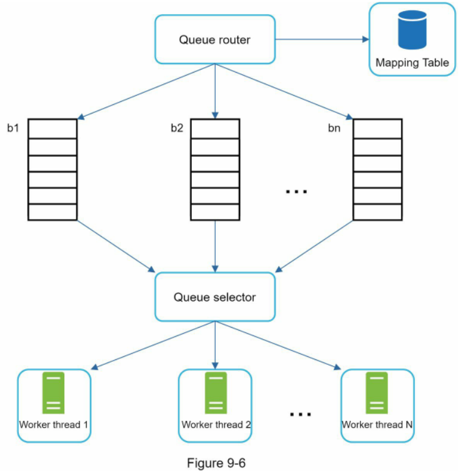

 * **Queue router (bộ định tuyến hàng đợi):** Đảm bảo mỗi hàng đợi ($b_1, b_2, \dots, b_n$) chỉ chứa các URL đến từ cùng một host duy nhất.
 * **Mapping table (bảng ánh xạ):** Ánh xạ mỗi host vào một hàng đợi tương ứng.

| Host          | Queue |
| ------------- | ----- |
| wikipedia.com | b1    |
| apple.com     | b2    |
| nike.com      | bn    |

Bảng 9-1

 * **FIFO queues $b_1, b_2$ đến $b_n$:** Mỗi hàng đợi chỉ chứa các URL xuất phát từ cùng một host.
 * **Queue selector (bộ chọn hàng đợi):** Mỗi worker thread được gán với một FIFO queue cố định và chỉ lấy URL từ hàng đợi đó. Logic chọn hàng đợi do Queue selector điều phối.
 * **Worker thread 1 đến N:** Mỗi worker thread tải tuần tự từng trang web từ cùng một host. Có thể chèn khoảng trễ giữa các lần tải.

### Priority (Độ ưu tiên)

Một bài đăng ngẫu nhiên trên diễn đàn thảo luận về sản phẩm Apple có giá trị thông tin rất khác biệt so với một bài viết trên trang chủ của Apple. Dù cả hai đều chứa từ khóa "Apple", việc crawler ưu tiên quét trang chủ Apple trước là điều hoàn toàn hợp lý.

Chúng ta phân cấp ưu tiên các URL dựa trên mức độ hữu ích, có thể đo lường qua PageRank [10], lưu lượng truy cập website, tần suất cập nhật nội dung, v.v. Thành phần "Prioritizer" sẽ đảm nhiệm việc tính toán và phân loại độ ưu tiên cho các URL. Vui lòng xem tài liệu [5] [10] để tìm hiểu sâu hơn. Hình 9-7 minh họa kiến trúc quản lý độ ưu tiên của URL.


 * **Prioritizer:** Nhận đầu vào là các URL và tính toán độ ưu tiên tương ứng.
 * **Queue $f_1$ đến $f_n$:** Mỗi hàng đợi đại diện cho một mức độ ưu tiên xác định. Các hàng đợi có độ ưu tiên cao sẽ có xác suất được chọn lớn hơn.
 * **Queue selector:** Lựa chọn ngẫu nhiên một hàng đợi, với trọng số thiên vị về phía các hàng đợi có độ ưu tiên cao hơn.

Hình 9-8 biểu diễn thiết kế hoàn chỉnh của URL frontier, tích hợp cả hai module:
 * **Front queues:** Điều phối và quản lý mức độ ưu tiên.
 * **Back queues:** Quản lý và đảm bảo tính lịch sự.

### Freshness (Độ tươi mới của dữ liệu)

Các trang web liên tục được bổ sung, xóa bỏ hoặc chỉnh sửa nội dung. Một web crawler bắt buộc phải định kỳ thu thập lại (recrawl) các trang đã tải để giữ cho tập dữ liệu luôn được cập nhật mới nhất. Tuy nhiên, việc thu thập lại toàn bộ tất cả URL là điều bất khả thi, cực kỳ tốn thời gian và lãng phí tài nguyên.

Dưới đây là một số chiến lược tối ưu hóa độ tươi mới của dữ liệu:

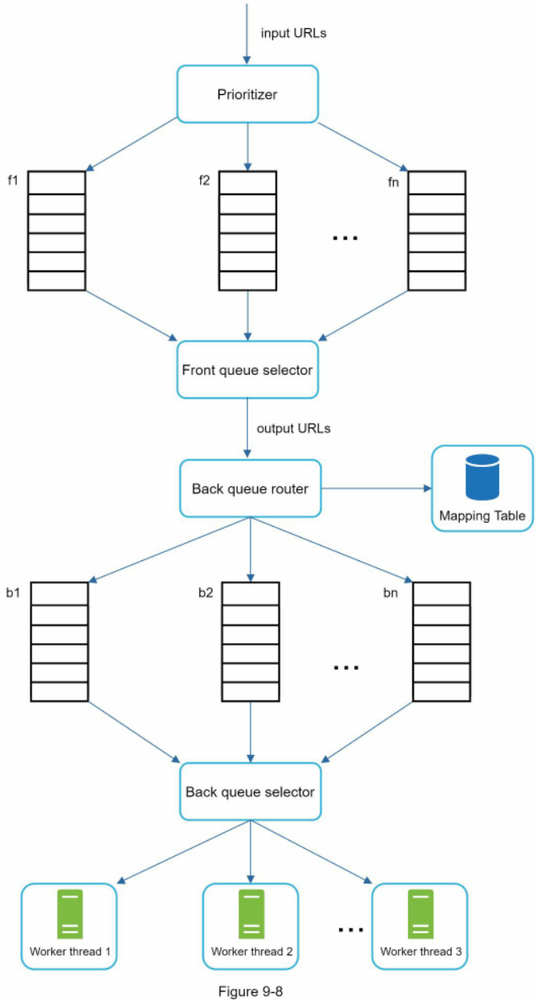

 * Thu thập lại dựa trên lịch sử cập nhật của từng trang web cụ thể.
 * Phân loại độ ưu tiên của URL và tiến hành thu thập lại các trang quan trọng trước với tần suất dày đặc hơn.

### Storage for URL Frontier (Lưu trữ cho URL Frontier)

Trong các hệ thống tìm kiếm thực tế, số lượng URL nằm trong frontier có thể lên đến hàng trăm triệu bản ghi [4]. Việc giữ toàn bộ trong bộ nhớ RAM là phương án không bền vững và không thể mở rộng. Ngược lại, lưu toàn bộ xuống ổ đĩa cũng không khả thi vì tốc độ đọc/ghi của ổ đĩa rất chậm, sẽ nhanh chóng trở thành điểm nghẽn cổ chai (bottleneck) cho toàn bộ tiến trình crawl.

Chúng tôi áp dụng giải pháp lai (hybrid approach). Phần lớn URL được lưu trên ổ đĩa để đảm bảo dung lượng lưu trữ không bao giờ là rào cản. Đồng thời, để giảm thiểu chi phí đọc/ghi ổ đĩa, chúng tôi duy trì các bộ đệm (buffers) trong bộ nhớ RAM cho các thao tác enqueue/dequeue. Dữ liệu trong bộ đệm sẽ được ghi đồng bộ định kỳ xuống ổ cứng.

## HTML Downloader

HTML Downloader tải các trang web từ internet thông qua giao thức HTTP. Trước khi tìm hiểu chi tiết về HTML Downloader, chúng ta cần nắm rõ giao thức Robots Exclusion Protocol.

### Robots.txt

Tệp `robots.txt`, hay còn gọi là Robots Exclusion Protocol (giao thức loại trừ robot), là chuẩn giao tiếp chung được các website sử dụng để tương tác với các crawler. Tệp này quy định rõ những trang hoặc thư mục nào crawler được phép hoặc không được phép tải về. Trước khi tiến hành quét một website, crawler phải kiểm tra tệp `robots.txt` tương ứng và tuân thủ các quy tắc trong đó.

Để tránh việc phải tải lại tệp `robots.txt` lặp đi lặp lại nhiều lần, chúng tôi lưu cache nội dung của tệp này. Tệp sẽ được định kỳ tải về và cập nhật vào cache. Dưới đây là một đoạn trích từ tệp `robots.txt` của `https://www.amazon.com/robots.txt`. Có thể thấy một số thư mục như `creatorhub` bị cấm đối với Googlebot:

```
User-agent: Googlebot
Disallow: /creatorhub/*
Disallow: /rss/people/*/reviews
Disallow: /gp/pdp/rss/*/reviews
Disallow: /gp/cdp/member-reviews/
Disallow: /gp/aw/cr/
```

Bên cạnh `robots.txt`, tối ưu hóa hiệu năng là một khía cạnh quan trọng khác cần được xử lý đối với HTML downloader.

### Performance optimization (Tối ưu hóa hiệu năng)

Dưới đây là danh sách các kỹ thuật tối ưu hóa hiệu năng cho HTML downloader:

**1. Distributed crawl (Thu thập dữ liệu phân tán)**

Để đạt hiệu năng vượt trội, các tác vụ thu thập được phân bổ đồng thời trên nhiều máy chủ, và mỗi máy chủ lại vận hành nhiều luồng (threads) song song. Không gian URL được phân chia thành nhiều phần nhỏ; mỗi downloader sẽ chịu trách nhiệm xử lý một tập con URL nhất định. Hình 9-9 mô tả ví dụ về mô hình thu thập phân tán.


**2. Cache DNS Resolver (Lưu cache DNS Resolver)**

DNS Resolver là một điểm nghẽn lớn đối với các crawler vì việc phân giải DNS thường tốn thời gian do tính chất đồng bộ (synchronous) của nhiều giao diện DNS. Thời gian phản hồi DNS dao động từ 10ms đến 200ms. Khi một luồng của crawler thực hiện request tới DNS, các luồng khác có thể bị chặn (blocked) cho tới khi request đầu tiên hoàn tất. Việc duy trì một bộ đệm DNS cache cục bộ để tránh truy vấn DNS liên tục là kỹ thuật tối ưu hóa tốc độ cực kỳ hiệu quả. DNS cache của chúng tôi lưu trữ bảng ánh xạ từ domain name sang địa chỉ IP và được cập nhật định kỳ thông qua các cron job.

**3. Locality (Tính cục bộ theo địa lý)**

Phân bổ các máy chủ crawl theo từng khu vực địa lý. Khi các crawl server đặt gần với máy chủ lưu trữ website mục tiêu hơn, crawler sẽ đạt tốc độ tải trang nhanh hơn đáng kể. Nguyên lý phân bổ cục bộ này áp dụng cho hầu hết các thành phần trong hệ thống: crawl servers, cache, queue, storage, v.v.

**4. Short timeout (Thiết lập thời gian chờ ngắn)**

Một số web server phản hồi rất chậm chạp hoặc thậm chí treo hoàn toàn. Để tránh việc crawler phải chờ đợi vô ích, chúng ta thiết lập một ngưỡng thời gian chờ tối đa (maximal wait time). Nếu máy chủ đích không phản hồi trong khoảng thời gian định trước này, crawler sẽ lập tức hủy bỏ tác vụ và chuyển sang thu thập các trang khác.

## Robustness (Tính bền vững)

Ngoài tối ưu hóa hiệu năng, tính bền vững cũng là yếu tố sống còn. Chúng tôi đề xuất một số giải pháp để nâng cao tính bền vững cho hệ thống:
 * **Consistent hashing (băm nhất quán):** Giúp cân bằng tải đồng đều giữa các downloader. Việc thêm mới hoặc loại bỏ một máy chủ download có thể được thực hiện trơn tru bằng thuật toán consistent hashing. Xem chi tiết tại "Chương 5: Thiết kế băm nhất quán".
 * **Lưu trữ trạng thái và dữ liệu thu thập:** Để phòng ngừa sự cố sập nguồn hay lỗi phần cứng, trạng thái tiến trình và dữ liệu thu thập được ghi liên tục vào hệ thống lưu trữ. Khi có sự cố xảy ra, tiến trình thu thập bị gián đoạn có thể dễ dàng phục hồi bằng cách tải lại các trạng thái đã lưu.
 * **Exception handling (xử lý ngoại lệ):** Lỗi là điều không thể tránh khỏi và diễn ra thường nhật trong một hệ thống quy mô lớn. Crawler phải bắt và xử lý các ngoại lệ một cách mềm dẻo (gracefully) để tránh làm sập toàn bộ hệ thống.
 * **Data validation (kiểm thực dữ liệu):** Đây là biện pháp phòng ngừa hữu hiệu để ngăn chặn các lỗi phát sinh do dữ liệu bất thường.

## Extensibility (Khả năng mở rộng)

Hầu hết mọi hệ thống đều phát triển theo thời gian, do đó một trong những mục tiêu thiết kế là làm cho hệ thống đủ linh hoạt để hỗ trợ các định dạng nội dung mới. Crawler có thể dễ dàng mở rộng bằng cách cắm thêm các module xử lý chuyên biệt. Hình 9-10 minh họa cách tích hợp các module mới.

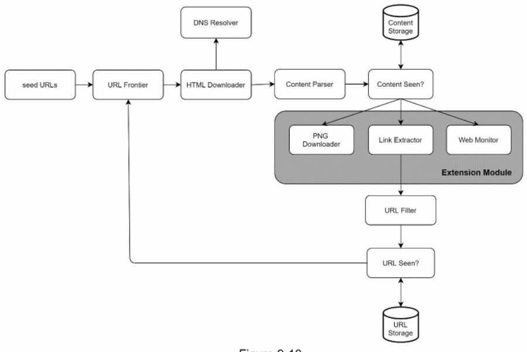

Hình 9-10

 * Module PNG Downloader được gắn thêm vào để tải các tệp định dạng PNG.
 * Module Web Monitor được bổ sung nhằm giám sát môi trường web, phát hiện các hành vi xâm phạm bản quyền và nhãn hiệu thương mại.

## Detect and avoid problematic content (Phát hiện và phòng tránh nội dung có vấn đề)

Phần này thảo luận về các kỹ thuật phát hiện và ngăn chặn nội dung trùng lặp, vô nghĩa hoặc độc hại.

**1. Redundant content (Nội dung trùng lặp)**

Như đã đề cập trước đó, có tới gần 30% các trang web là bản sao trùng lặp. Việc sử dụng các hàm băm hoặc mã checksum giúp phát hiện nhanh chóng hiện tượng trùng lặp nội dung [11].

**2. Spider traps (Bẫy nhện)**

Spider trap là một trang web cố tình dẫn dụ crawler rơi vào một vòng lặp vô tận. Chẳng hạn, một cấu trúc thư mục lồng nhau vô hạn như sau:  
`www.spidertrapexample.com/foo/bar/foo/bar/foo/bar/…`  

Những bẫy nhện dạng này có thể được phòng tránh bằng cách thiết lập giới hạn độ dài tối đa cho URL. Tuy nhiên, không có một giải pháp vạn năng duy nhất nào có thể phát hiện được mọi loại spider trap. Những website chứa spider trap thường khá dễ nhận diện bởi số lượng trang web phát hiện được từ chúng tăng vọt một cách bất thường. Rất khó để xây dựng các thuật toán tự động hoàn toàn nhằm né tránh bẫy nhện; thay vào đó, kỹ sư vận hành có thể xác minh thủ công, sau đó đưa các website này vào danh sách loại trừ hoặc áp dụng các bộ lọc URL tùy chỉnh.

**3. Data noise (Nhiễu dữ liệu)**

Một số nội dung hầu như không có giá trị khai thác như quảng cáo, các đoạn mã nguồn, URL rác (spam URLs), v.v. Những nội dung này hoàn toàn không hữu ích đối với crawler và cần được loại bỏ tối đa ngay từ đầu.

# Step 4 - Wrap up (Bước 4 - Tổng kết)

Trong chương này, đầu tiên chúng ta đã xem xét các đặc tính của một crawler tốt: khả năng mở rộng, tính lịch sự, khả năng mở rộng chức năng và tính bền vững. Tiếp đó, chúng ta đã đề xuất kiến trúc thiết kế và phân tích sâu các thành phần trọng yếu. Việc xây dựng một web crawler có khả năng mở rộng quy mô lớn không phải là nhiệm vụ đơn giản, bởi không gian mạng internet cực kỳ khổng lồ và chứa đầy cạm bẫy.

Dù đã bao quát nhiều khía cạnh, vẫn còn một số chủ đề thảo luận mở rộng giá trị mà bạn có thể đề cập:
 * **Server-side rendering (kết xuất phía máy chủ):** Rất nhiều website hiện nay sử dụng JavaScript, AJAX, v.v. để sinh các liên kết động (dynamically generated links). Nếu chúng ta tải và bóc tách mã nguồn HTML tĩnh trực tiếp, chúng ta sẽ bỏ sót các liên kết động này. Để giải quyết, chúng ta cần thực hiện server-side rendering (hay còn gọi là dynamic rendering) trước khi tiến hành phân tích trang web [12].
 * **Lọc các trang rác không mong muốn (Filter out unwanted pages):** Với dung lượng lưu trữ và tài nguyên crawl hữu hạn, việc tích hợp một thành phần chống spam (anti-spam) là cực kỳ hữu ích để sàng lọc các trang chất lượng thấp và trang rác [13] [14].
 * **Replication và sharding cho cơ sở dữ liệu:** Các kỹ thuật nhân bản (replication) và phân mảnh (sharding) dữ liệu được áp dụng để tăng cường tính sẵn sàng, khả năng mở rộng và độ tin cậy cho tầng lưu trữ.
 * **Horizontal scaling (mở rộng theo chiều ngang):** Đối với các tác vụ thu thập quy mô lớn, hàng trăm hoặc thậm chí hàng nghìn máy chủ được huy động để thực thi việc tải trang. Yếu tố then chốt là phải giữ cho các máy chủ ở trạng thái stateless.
 * **Tính sẵn sàng, tính nhất quán và độ tin cậy:** Các nguyên lý này là kim chỉ nam cho sự thành công của mọi hệ thống lớn. Chúng ta đã bàn luận chi tiết tại Chương 1.
 * **Phân tích dữ liệu (Analytics):** Thu thập và phân tích dữ liệu vận hành là mắt xích không thể thiếu trong bất kỳ hệ thống nào, vì dữ liệu chính là nguyên liệu đầu vào để tinh chỉnh hệ thống ngày một tốt hơn.

Chúc mừng bạn đã hoàn thành chương này! Bạn đã làm rất xuất sắc!

# Reference materials (Tài liệu tham khảo)

[1] US Library of Congress: https://www.loc.gov/websites/  
[2] EU Web Archive: http://data.europa.eu/webarchive  
[3] Digimarc: https://www.digimarc.com/products/digimarc-services/piracy-intelligence  
[4] Heydon A., Najork M. Mercator: A scalable, extensible web crawler World Wide Web, 2 (4) (1999), pp. 219-229  
[5] By Christopher Olston, Marc Najork: Web Crawling. http://infolab.stanford.edu/~olston/publications/crawling_survey.pdf  
[6] 29% Of Sites Face Duplicate Content Issues: https://tinyurl.com/y6tmh55y  
[7] Rabin M.O., et al. Fingerprinting by random polynomials Center for Research in Computing Techn., Aiken Computation Laboratory, Univ. (1981)  
[8] B. H. Bloom, "Space/time trade-offs in hash coding with allowable errors," Communications of the ACM, vol. 13, no. 7, pp. 422-426, 1970.  
[9] Donald J. Patterson, Web Crawling: https://www.ics.uci.edu/~lopes/teaching/cs221W12/slides/Lecture05.pdf  
[10] L. Page, S. Brin, R. Motwani, and T. Winograd, "The PageRank citation ranking: Bringing order to the web," Technical Report, Stanford University, 1998.  
[11] Burton Bloom. Space/time trade-offs in hash coding with allowable errors. Communications of the ACM, 13(7), pages 422--426, July 1970.  
[12] Google Dynamic Rendering: https://developers.google.com/search/docs/guides/dynamic-rendering  
[13] T. Urvoy, T. Lavergne, and P. Filoche, "Tracking web spam with hidden style similarity," in Proceedings of the 2nd International Workshop on Adversarial Information Retrieval on the Web, 2006.  
[14] H.-T. Lee, D. Leonard, X. Wang, and D. Loguinov, "IRLbot: Scaling to 6 billion pages and beyond," in Proceedings of the 17th International World Wide Web Conference, 2008.  

# CHAPTER 10: DESIGN A NOTIFICATION SYSTEM (CHƯƠNG 10: THIẾT KẾ HỆ THỐNG THÔNG BÁO)

Hệ thống thông báo (notification system) đã trở thành một tính năng vô cùng phổ biến trên hầu hết các ứng dụng những năm gần đây. Thông báo giúp cảnh báo người dùng những thông tin quan trọng như tin tức nóng, cập nhật sản phẩm, sự kiện, chương trình ưu đãi, v.v. Nó đã trở thành một phần không thể thiếu trong đời sống số thường nhật. Trong chương này, bạn được yêu cầu thiết kế một hệ thống thông báo quy mô lớn.

Một hệ thống thông báo không chỉ đơn thuần là gửi mobile push notification (thông báo đẩy trên thiết bị di động). Ba định dạng thông báo chủ đạo gồm có: mobile push notification, tin nhắn SMS, và Email. Hình 10-1 minh họa ví dụ về từng loại thông báo này.

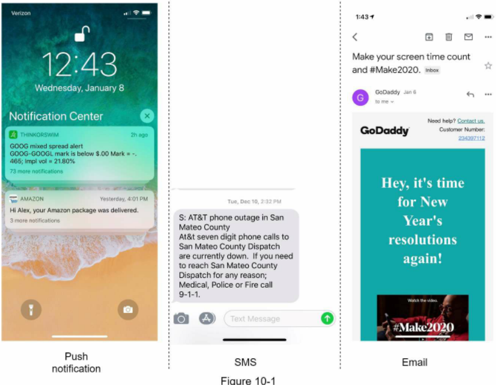

Hình 10-1

# Step 1 - Understand the problem and establish design scope (Bước 1 - Hiểu rõ bài toán và xác định phạm vi thiết kế)

Xây dựng một hệ thống có khả năng mở rộng để gửi hàng triệu thông báo mỗi ngày là một bài toán không hề dễ dàng. Nó đòi hỏi sự am hiểu sâu sắc về hệ sinh thái thông báo. Đề bài phỏng vấn thường được thiết kế mở và có nhiều điểm chưa rõ ràng; trách nhiệm của bạn là đặt câu hỏi để làm sáng tỏ các yêu cầu kỹ thuật:

**Ứng viên:** Hệ thống cần hỗ trợ những loại hình thông báo nào?  
**Người phỏng vấn:** Push notification, tin nhắn SMS, và email.  
**Ứng viên:** Đây có phải là hệ thống thời gian thực (real-time system) khắt khe không?  
**Người phỏng vấn:** Có thể coi đây là một hệ thống soft real-time (thời gian thực mềm). Chúng tôi mong muốn người dùng nhận được thông báo càng sớm càng tốt. Tuy nhiên, khi hệ thống chịu tải cao, việc trễ một chút vẫn hoàn toàn chấp nhận được.  
**Ứng viên:** Những loại thiết bị nào cần được hỗ trợ?  
**Người phỏng vấn:** Thiết bị iOS, thiết bị Android, và máy tính cá nhân (laptop/desktop).  
**Ứng viên:** Yếu tố nào kích hoạt (trigger) việc gửi thông báo?  
**Người phỏng vấn:** Thông báo có thể được kích hoạt bởi các ứng dụng client, hoặc được lên lịch từ phía máy chủ (server-side).  
**Ứng viên:** Người dùng có quyền từ chối nhận thông báo (opt-out) không?  
**Người phỏng vấn:** Có, những người dùng đã chọn opt-out sẽ không nhận thông báo nữa.  
**Ứng viên:** Số lượng thông báo gửi đi mỗi ngày là bao nhiêu?  
**Người phỏng vấn:** 10 triệu push notification cho di động, 1 triệu tin nhắn SMS, và 5 triệu email.  

# Step 2 - Propose high-level design and get buy-in (Bước 2 - Đề xuất thiết kế tổng quan và thống nhất phương án)

Phần này trình bày thiết kế tổng quan hỗ trợ đa dạng các loại thông báo: iOS push notification, Android push notification, tin nhắn SMS, và Email. Nội dung được cấu trúc như sau:
 * Các loại hình thông báo khác nhau
 * Luồng thu thập thông tin liên hệ của người dùng
 * Luồng gửi và nhận thông báo

## Different types of notifications (Các loại hình thông báo khác nhau)

Đầu tiên, chúng ta hãy xem xét cơ chế hoạt động ở mức tổng quan của từng loại thông báo.

### iOS push notification


Hình 10-2

Về cơ bản, chúng ta cần ba thành phần chính để gửi một thông báo đẩy trên iOS:
 * **Provider (Nguồn phát thông báo):** Provider đóng gói và gửi yêu cầu thông báo tới APNS (Apple Push Notification service - dịch vụ thông báo đẩy của Apple). Để tạo một push notification, provider cần cung cấp các dữ liệu sau:
    * **Device token (mã định danh thiết bị):** Đây là chuỗi định danh duy nhất dùng để chỉ định thiết bị nhận thông báo đẩy.
    * **Payload (phần tải dữ liệu):** Đây là một từ điển JSON chứa nội dung chi tiết của thông báo. Dưới đây là một ví dụ:
```json
{
  "aps": {
    "alert": {
      "title": "Game Request",
      "body": "Bob wants to play chess",
      "action-loc-key": "PLAY"
    },
    "badge": 5
  }
}
```
 * **APNS:** Đây là dịch vụ từ xa do Apple cung cấp nhằm chuyển tiếp thông báo đẩy tới các thiết bị iOS đích.
 * **iOS Device:** Thiết bị đầu cuối của người dùng nhận thông báo đẩy.

### Android push notification

Android áp dụng một quy trình thông báo tương tự. Thay vì sử dụng APNS, nền tảng FCM (Firebase Cloud Messaging - dịch vụ nhắn tin đám mây của Google) thường được sử dụng để gửi thông báo đẩy tới các thiết bị Android.

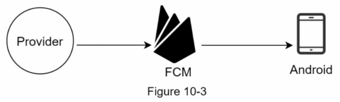

### SMS message (Tin nhắn SMS)

Đối với tin nhắn SMS, các dịch vụ SMS bên thứ ba như Twilio [1], Nexmo [2] và nhiều nhà cung cấp thương mại khác thường được tích hợp sử dụng.

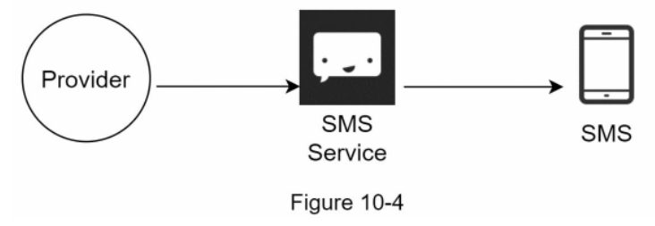

### Email

Mặc dù các doanh nghiệp hoàn toàn có thể tự dựng mail server riêng, nhiều công ty lựa chọn sử dụng các dịch vụ email thương mại chuyên nghiệp. SendGrid [3] và Mailchimp [4] là những dịch vụ email hàng đầu, cung cấp tỷ lệ gửi thành công (delivery rate) cao hơn cùng hệ thống phân tích dữ liệu chuyên sâu.


Hình 10-6 mô tả kiến trúc thiết kế tổng thể sau khi tích hợp toàn bộ các dịch vụ của bên thứ ba.


## Contact info gathering flow (Luồng thu thập thông tin liên hệ)

Để gửi được thông báo, chúng ta cần thu thập device token, số điện thoại, hoặc địa chỉ email của người dùng. Như minh họa trong Hình 10-7, khi người dùng cài đặt ứng dụng hoặc đăng ký tài khoản lần đầu, các API server sẽ thu thập thông tin liên hệ và lưu trữ vào cơ sở dữ liệu.

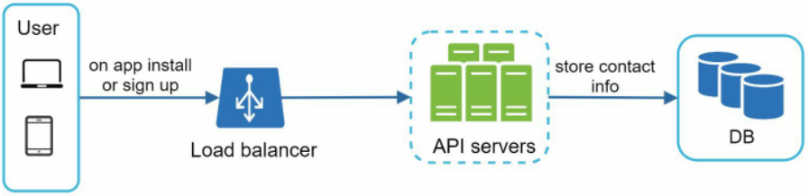

Hình 10-7

Hình 10-8 minh họa thiết kế các bảng cơ sở dữ liệu giản lược để lưu trữ thông tin liên hệ. Địa chỉ email và số điện thoại được lưu trong bảng `user`, trong khi device token được lưu trong bảng `device`. Một người dùng có thể sở hữu nhiều thiết bị, đồng nghĩa với việc một thông báo đẩy có thể được phát tới tất cả các thiết bị thuộc sở hữu của người dùng đó.

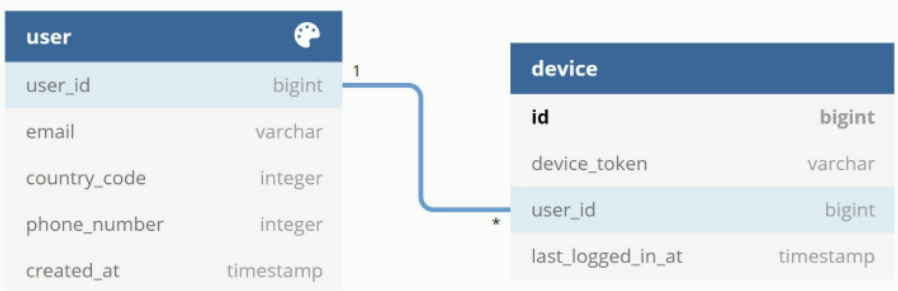

Hình 10-8

## Notification sending/receiving flow (Luồng gửi và nhận thông báo)

Đầu tiên, chúng tôi sẽ trình bày thiết kế sơ khởi ban đầu; sau đó, chúng tôi sẽ đề xuất các phương án tối ưu hóa.

## High-level design (Thiết kế tổng quan sơ khởi)

Hình 10-9 thể hiện thiết kế sơ khởi, ý nghĩa của từng thành phần được giải thích dưới đây.


Hình 10-9

 * **Service 1 đến N:** Một service có thể là một micro-service, một cron job, hoặc một hệ thống phân tán phát sinh sự kiện gửi thông báo. Ví dụ, dịch vụ thanh toán gửi email nhắc nhở khách hàng về hóa đơn đến hạn, hoặc một website thương mại điện tử thông báo cho khách hàng qua SMS rằng kiện hàng sẽ được giao vào ngày mai.
 * **Notification system (Hệ thống thông báo):** Đây là trung tâm điều phối việc gửi/nhận thông báo. Bắt đầu từ mô hình đơn giản nhất, chỉ có một notification server duy nhất được sử dụng. Máy chủ này cung cấp các API cho Service 1 đến N, đồng thời xây dựng notification payload gửi tới các dịch vụ bên thứ ba.
 * **Dịch vụ bên thứ ba:** Chịu trách nhiệm chuyển phát thông báo tới người dùng cuối. Trong quá trình tích hợp với các dịch vụ bên thứ ba, chúng ta cần đặc biệt chú ý đến tính mở rộng linh hoạt (extensibility). Một hệ thống có tính mở rộng tốt phải cho phép cắm vào (plugging) hoặc tháo gỡ (unplugging) một dịch vụ bên thứ ba một cách dễ dàng. Một lưu ý quan trọng khác là dịch vụ bên thứ ba có thể không khả dụng tại một số thị trường mới hoặc trong tương lai. Ví dụ, FCM không hoạt động tại Trung Quốc, do đó các dịch vụ thay thế như JPush, PushY, v.v. được sử dụng tại đây.
 * **iOS, Android, SMS, Email:** Người dùng nhận thông báo trên thiết bị của họ.

Ba vấn đề lớn tồn tại trong thiết kế sơ khởi này:
 * **Điểm lỗi đơn lẻ (SPOF):** Chỉ có một notification server duy nhất đồng nghĩa với rủi ro SPOF nghiêm trọng.
 * **Khó mở rộng quy mô (Hard to scale):** Hệ thống thông báo dồn tất cả tác vụ xử lý thông báo vào một máy chủ duy nhất. Rất khó để mở rộng độc lập cơ sở dữ liệu, bộ nhớ cache, và các thành phần xử lý các kênh thông báo khác nhau.
 * **Nghẽn cổ chai hiệu năng (Performance bottleneck):** Việc xử lý và gửi thông báo tiêu tốn nhiều tài nguyên. Ví dụ, tạo trang HTML và chờ đợi phản hồi mạng từ các dịch vụ bên thứ ba có thể tốn nhiều thời gian. Xử lý tập trung tất cả trong một máy chủ có thể khiến hệ thống rơi vào tình trạng quá tải, đặc biệt là trong giờ cao điểm.

## High-level design (improved) (Thiết kế tổng quan cải tiến)

Sau khi nhận diện các hạn chế trong thiết kế ban đầu, chúng tôi cải tiến kiến trúc như sau:
 * Tách cơ sở dữ liệu và cache ra khỏi notification server.
 * Bổ sung thêm nhiều notification server và thiết lập cơ chế tự động mở rộng theo chiều ngang (horizontal scaling).
 * Đưa vào message queue (hàng đợi tin nhắn) để giảm sự phụ thuộc lẫn nhau (decouple) giữa các thành phần trong hệ thống.

Hình 10-10 minh họa kiến trúc tổng quan cải tiến.

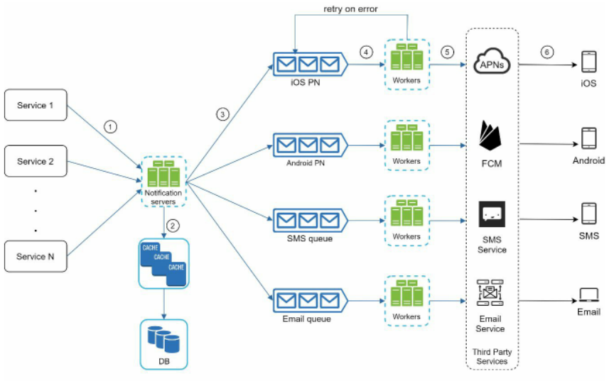

Hình 10-10

Cách tốt nhất để theo dõi sơ đồ trên là quan sát từ trái sang phải:
 * **Service 1 đến N:** Đại diện cho các dịch vụ nghiệp vụ khác nhau gửi yêu cầu thông báo thông qua các API do notification server cung cấp.
 * **Notification servers:** Đảm nhiệm các chức năng sau:
    * Cung cấp API để các service gửi thông báo. Các API này chỉ cho phép truy cập nội bộ hoặc bởi các client đã được xác thực nhằm ngăn chặn spam.
    * Thực hiện các bước kiểm tra hợp lệ cơ bản đối với email, số điện thoại, v.v.
    * Truy vấn cơ sở dữ liệu hoặc cache để lấy dữ liệu cần thiết phục vụ việc dựng (render) thông báo.
    * Đẩy dữ liệu thông báo vào các message queue tương ứng để xử lý song song.

Dưới đây là một ví dụ về API gửi tin nhắn:  
`POST https://api.example.com/v/sms/send`

**Request body**

```json
{
  "to": [
    {
      "user_id": 123456
    }
  ],
  "from": {
    "email": "from_address@example.com"
  },
  "subject": "Hello, World!",
  "content": [
    {
      "type": "text/plain",
      "value": "Hello, World!"
    }
  ]
}
```

 * **Cache:** Lưu trữ thông tin người dùng, thông tin thiết bị và các mẫu thông báo (notification templates).
 * **DB:** Lưu trữ dữ liệu về người dùng, thông báo, cài đặt người dùng, v.v.
 * **Message queues:** Loại bỏ sự phụ thuộc trực tiếp giữa các thành phần. Hàng đợi tin nhắn đóng vai trò như các bộ đệm khi có lượng lớn thông báo được gửi đi đồng thời. Mỗi loại thông báo được phân bổ một hàng đợi tin nhắn riêng biệt, do đó sự cố gián đoạn tại một dịch vụ bên thứ ba sẽ không làm ảnh hưởng đến các kênh thông báo khác.
 * **Workers:** Là một cụm các máy chủ chuyên trách lấy các sự kiện thông báo từ message queues và gửi chúng tới các dịch vụ bên thứ ba tương ứng.
 * **Dịch vụ bên thứ ba:** Đã được giải thích trong phần thiết kế ban đầu.
 * **iOS, Android, SMS, Email:** Đã được giải thích trong phần thiết kế ban đầu.

Tiếp theo, hãy cùng xem cách các thành phần phối hợp nhịp nhàng để gửi đi một thông báo:
1. Một service gọi API do notification server cung cấp để gửi thông báo.
2. Notification server lấy metadata (siêu dữ liệu) như thông tin người dùng, device token và cấu hình cài đặt thông báo từ cache hoặc cơ sở dữ liệu.
3. Sự kiện thông báo được gửi vào message queue tương ứng để chờ xử lý. Ví dụ, một sự kiện thông báo đẩy iOS được đưa vào hàng đợi iOS PN queue.
4. Các worker chủ động lấy (pull) sự kiện thông báo từ message queue.
5. Worker gửi thông báo tới các dịch vụ bên thứ ba tương ứng.
6. Dịch vụ bên thứ ba chuyển tiếp thông báo tới thiết bị của người dùng cuối.

# Step 3 - Design deep dive (Bước 3 - Đi sâu vào chi tiết thiết kế)

Trong phần thiết kế tổng quan, chúng ta đã xem xét các định dạng thông báo, luồng thu thập thông tin liên hệ, và luồng gửi/nhận thông báo. Phần đi sâu vào chi tiết này sẽ làm rõ:
 * Tính tin cậy (Reliability).
 * Các thành phần bổ sung và lưu ý thiết kế: notification template, cài đặt thông báo, giới hạn tần suất (rate limiting), cơ chế thử lại (retry mechanism), bảo mật trong push notification, giám sát hàng đợi thông báo và theo dõi sự kiện (event tracking).
 * Bản thiết kế cập nhật hoàn chỉnh.

## Reliability (Tính tin cậy)

Chúng ta phải trả lời một số câu hỏi cốt lõi về độ tin cậy khi thiết kế hệ thống thông báo trong môi trường phân tán.

### How to prevent data loss? (Làm thế nào để ngăn ngừa mất mát dữ liệu?)

Một trong những yêu cầu tối quan trọng của hệ thống thông báo là **không được phép làm mất dữ liệu**. Thông báo có thể bị trễ hoặc bị xáo trộn thứ tự, nhưng tuyệt đối không được để thất lạc. Để đáp ứng yêu cầu này, hệ thống thông báo lưu trữ bền vững (persist) dữ liệu thông báo vào cơ sở dữ liệu và triển khai cơ chế thử lại (retry mechanism). Một cơ sở dữ liệu ghi nhật ký thông báo (notification log database) được tích hợp để lưu vết bền vững dữ liệu, như minh họa trong Hình 10-11.

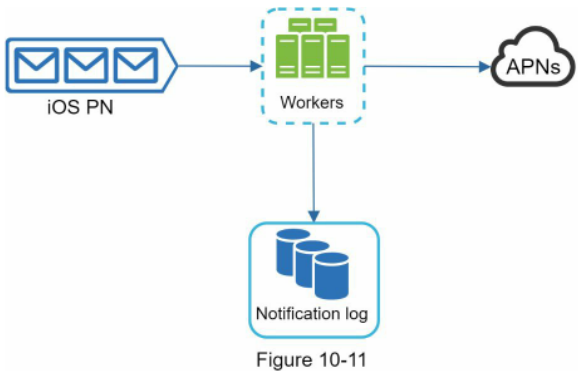

### Will recipients receive a notification exactly once? (Liệu người nhận có nhận được thông báo chính xác một lần duy nhất?)

Câu trả lời ngắn gọn là không. Mặc dù phần lớn thời gian thông báo được gửi chính xác một lần, bản chất phân tán của hệ thống có thể dẫn đến hiện tượng trùng lặp thông báo. Để giảm thiểu tối đa tình trạng này, chúng tôi đưa vào cơ chế dedupe (khử trùng lặp) và xử lý cẩn trọng từng kịch bản lỗi.

Dưới đây là logic khử trùng lặp cơ bản:  
Khi một sự kiện thông báo vừa đến, hệ thống sẽ đối chiếu `eventId` để xem nó đã từng xuất hiện trước đó hay chưa. Nếu đã xuất hiện, sự kiện đó sẽ bị loại bỏ ngay lập tức. Ngược lại, thông báo sẽ được xử lý và gửi đi bình thường. Những bạn đọc muốn tìm hiểu sâu lý do tại sao không thể đạt được cơ chế chuyển phát exactly-once tuyệt đối có thể tham khảo tài liệu [5].

## Additional components and considerations (Các thành phần bổ sung và lưu ý thiết kế)

Chúng ta đã nghiên cứu cách thu thập thông tin liên hệ, gửi và nhận thông báo. Một hệ thống thông báo hoàn chỉnh còn đòi hỏi nhiều hơn thế. Sau đây, chúng ta sẽ xem xét các thành phần bổ sung bao gồm tái sử dụng mẫu thông báo, cấu hình cài đặt thông báo, theo dõi sự kiện, giám sát hệ thống, giới hạn tần suất, v.v.

### Notification template (Mẫu thông báo)

Một hệ thống thông báo quy mô lớn phát đi hàng triệu thông báo mỗi ngày, và rất nhiều trong số đó có cấu trúc tương tự nhau. Notification template được đưa vào nhằm tránh việc phải xây dựng từng thông báo từ đầu. Notification template là một thông báo được định dạng khung sẵn, cho phép bạn tạo ra thông báo cụ thể bằng cách tùy biến các tham số, phong cách giao diện, liên kết theo dõi, v.v.

Dưới đây là một mẫu ví dụ cho push notification:
```
BODY: Bạn hằng mơ ước về điều đó. Chúng tôi đã biến nó thành hiện thực. [TÊN SẢN PHẨM] đã quay trở lại - duy nhất đến hết ngày [NGÀY].
CTA: Đặt Mua Ngay. Hoặc, Lưu Lại [TÊN SẢN PHẨM] Của Tôi
```

Lợi ích của việc áp dụng notification template bao gồm việc chuẩn hóa định dạng thông báo nhất quán, giảm thiểu sai sót do con người, và tiết kiệm đáng kể thời gian phát triển.

### Notification setting (Cài đặt thông báo)

Người dùng thường nhận quá nhiều thông báo mỗi ngày và rất dễ cảm thấy bị làm phiền. Vì thế, nhiều website và ứng dụng cung cấp cho người dùng quyền kiểm soát chi tiết đối với các thiết lập thông báo. Thông tin này được lưu trữ trong bảng `notification_setting` với các trường dữ liệu sau:

```
user_id: kiểu bigInt
channel: kiểu varchar (push notification, email hoặc SMS)
opt_in: kiểu boolean (chủ động đồng ý nhận thông báo)
```

Trước khi bất kỳ thông báo nào được phát tới người dùng, hệ thống sẽ kiểm tra xem người dùng đó đã kích hoạt (opt-in) để nhận loại thông báo này hay chưa.

### Rate limiting (Giới hạn tần suất)

Để tránh làm người dùng choáng ngợp với quá nhiều thông báo dồn dập, chúng ta có thể giới hạn số lượng thông báo mà một người dùng có thể nhận trong một đơn vị thời gian. Điều này rất quan trọng vì người nhận có xu hướng tắt hoàn toàn thông báo nếu chúng ta gửi quá thường xuyên.

### Retry mechanism (Cơ chế thử lại)

Khi một dịch vụ bên thứ ba gặp sự cố không thể gửi thông báo, sự kiện thông báo đó sẽ được đẩy ngược lại vào message queue để tiến hành gửi lại (retry). Nếu lỗi vẫn tiếp diễn liên tục sau nhiều lần thử, hệ thống sẽ kích hoạt cảnh báo gửi tới đội ngũ kỹ sư vận hành.

### Security in push notifications (Bảo mật trong push notification)

Đối với các ứng dụng iOS hoặc Android, `appKey` và `appSecret` được sử dụng để xác thực và bảo mật các API gửi thông báo đẩy [6]. Chỉ những client đã được xác thực danh tính hợp lệ mới được cấp quyền gọi API để gửi thông báo. Độc giả quan tâm vui lòng tham khảo tài liệu [6].

### Monitor queued notifications (Giám sát hàng đợi thông báo)

Một chỉ số giám sát mang tính sống còn là tổng số lượng thông báo đang chờ xử lý trong hàng đợi (queued notifications). Nếu con số này tăng cao bất thường, điều đó chứng tỏ các sự kiện thông báo đang không được xử lý đủ nhanh bởi các worker. Nhằm ngăn ngừa tình trạng trễ thông báo, hệ thống cần lập tức bổ sung thêm các worker. Hình 10-12 (trích từ [7]) minh họa một ví dụ trực quan về việc theo dõi các message đang chờ xử lý trong hàng đợi.

### Events tracking (Theo dõi sự kiện)
