Các chỉ số đo lường thông báo (notification metrics), chẳng hạn như open rate (tỷ lệ mở), click rate (tỷ lệ nhấp chuột) và engagement (mức độ tương tác), đóng vai trò rất quan trọng trong việc thấu hiểu hành vi của khách hàng. Analytics service (dịch vụ phân tích dữ liệu) chịu trách nhiệm triển khai việc events tracking (theo dõi sự kiện). Thông thường, chúng ta luôn cần tích hợp hệ thống thông báo với dịch vụ phân tích dữ liệu. Hình 10-13 minh họa một ví dụ về các sự kiện có thể được theo dõi nhằm phục vụ mục đích phân tích.

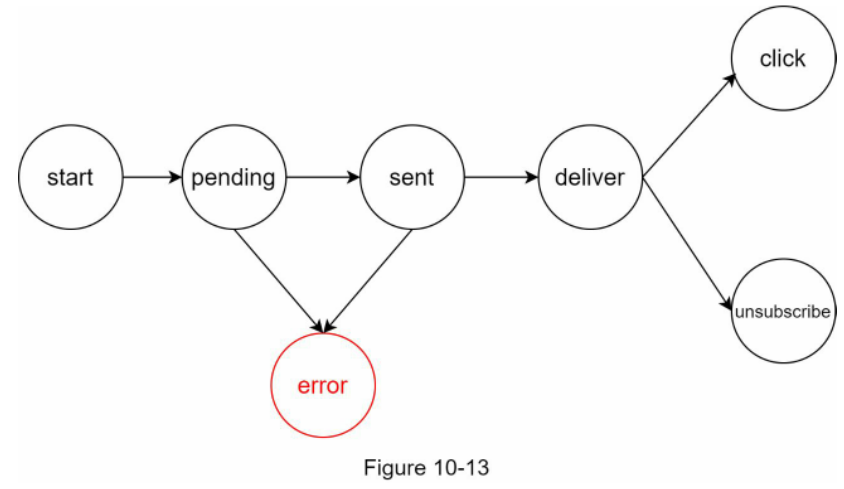

## Updated design (Thiết kế cập nhật)

Tổng hợp tất cả các thành phần lại với nhau, Hình 10-14 thể hiện thiết kế hoàn chỉnh đã được cập nhật của hệ thống thông báo.

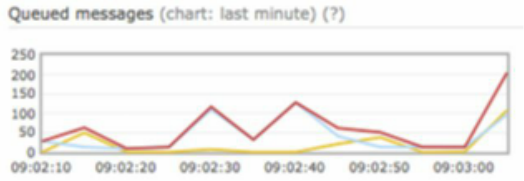

Hình 10-12

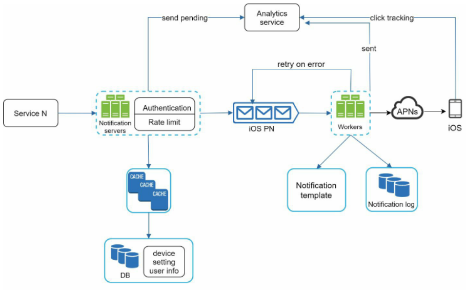

Hình 10-14

Trong thiết kế này, nhiều thành phần mới đã được bổ sung so với phiên bản trước đó:
 * Các máy chủ thông báo (notification servers) được trang bị thêm hai tính năng cốt lõi: authentication (xác thực) và rate-limiting (giới hạn tốc độ truy cập / số lượng yêu cầu).
 * Chúng ta cũng bổ sung retry mechanism (cơ chế thử lại) để xử lý các trường hợp gửi thông báo thất bại. Nếu hệ thống không gửi được thông báo, chúng sẽ được đẩy ngược trở lại messaging queue (hàng đợi thông điệp) và các workers (tiến trình / máy chủ xử lý tác vụ nền) sẽ thử gửi lại theo số lần đã định trước.
 * Ngoài ra, notification templates (mẫu thông báo) giúp quy trình tạo nội dung thông báo trở nên nhất quán và hiệu quả hơn.
 * Cuối cùng, các hệ thống monitoring (giám sát) và tracking (theo dõi) được tích hợp nhằm phục vụ việc kiểm tra tình trạng sức khỏe hệ thống (health check) và cải tiến sau này.

# Step 4 - Wrap up (Bước 4 - Tổng kết)

Thông báo là một phần không thể thiếu vì chúng giúp cập nhật liên tục các thông tin quan trọng tới người dùng. Đó có thể là một push notification (thông báo đẩy) về bộ phim bạn yêu thích trên Netflix, một email thông báo giảm giá cho các sản phẩm mới, hay một tin nhắn xác nhận thanh toán khi mua sắm trực tuyến. Trong chương này, chúng ta đã trình bày bản thiết kế của một hệ thống thông báo có khả năng mở rộng quy mô (scalable), hỗ trợ đa dạng các định dạng: push notification, tin nhắn SMS (dịch vụ tin nhắn ngắn) và email. Chúng ta đã ứng dụng message queues (hàng đợi thông điệp) để decouple (tách rời, giảm sự phụ thuộc giữa) các thành phần hệ thống. Bên cạnh thiết kế tổng thể mức cao, chúng ta cũng đã đi sâu vào nhiều thành phần chi tiết và các kỹ thuật tối ưu hóa:
 * Tính tin cậy (Reliability): Đề xuất cơ chế thử lại mạnh mẽ nhằm giảm thiểu tối đa tỷ lệ thất bại.
 * Bảo mật (Security): Sử dụng cặp khóa AppKey/appSecret (cặp khóa định danh ứng dụng và khóa bí mật) để đảm bảo chỉ các client (ứng dụng khách) đã được xác minh mới có quyền gửi thông báo.
 * Theo dõi và giám sát (Tracking and monitoring): Được triển khai ở mọi giai đoạn của luồng xử lý thông báo nhằm thu thập các chỉ số thống kê quan trọng.
 * Tôn trọng cài đặt của người dùng (Respect user settings): Người dùng có thể opt-out (tùy chọn từ chối nhận thông báo). Hệ thống luôn kiểm tra cài đặt của người dùng trước khi tiến hành gửi thông báo.
 * Giới hạn tốc độ (Rate limiting): Người dùng sẽ đánh giá cao việc hệ thống áp dụng frequency capping (giới hạn tần suất nhận thông báo) đối với số lượng thông báo họ nhận được.

Chúc mừng bạn đã đi được một chặng đường dài đến đây! Hãy tự thưởng cho bản thân một lời khen ngợi. Bạn đã làm rất tốt!

# Reference materials (Tài liệu tham khảo)

[1] Twilio SMS: https://www.twilio.com/sms  
[2] Nexmo SMS: https://www.nexmo.com/products/sms  
[3] Sendgrid: https://sendgrid.com/  
[4] Mailchimp: https://mailchimp.com/  
[5] You Cannot Have Exactly-Once Delivery: https://bravenewgeek.com/you-cannot-haveexactly-once-delivery/  
[6] Security in Push Notifications: https://cloud.ibm.com/docs/services/mobilepush? topic=mobile-pushnotification-security-in-push-notifications  
[7] RadditMQ: https://bit.ly/2sotIa6

# CHAPTER 11: DESIGN A NEWS FEED SYSTEM (CHƯƠNG 11: THIẾT KẾ HỆ THỐNG NEWS FEED (BẢNG TIN))

Trong chương này, bạn được yêu cầu thiết kế một hệ thống news feed (bảng tin mạng xã hội). News feed là gì? Theo trang trợ giúp của Facebook: "News feed là danh sách các câu chuyện được cập nhật liên tục ở chính giữa trang chủ của bạn. News Feed bao gồm các cập nhật trạng thái, hình ảnh, video, liên kết, hoạt động ứng dụng và lượt thích từ những người, trang và nhóm mà bạn theo dõi trên Facebook" [1]. Đây là một câu hỏi phỏng vấn rất phổ biến. Các câu hỏi tương tự thường gặp là: thiết kế Facebook news feed, Instagram feed, Twitter timeline (dòng thời gian Twitter)...


Hình 11-1 (nguồn: https://bit.ly/2Vv9JCm)

# Step 1 - Understand the problem and establish design scope (Bước 1 - Hiểu rõ bài toán và xác định phạm vi thiết kế)

Nhóm câu hỏi làm rõ đầu tiên nhằm mục đích hiểu chính xác người phỏng vấn mong muốn điều gì khi đưa ra yêu cầu thiết kế hệ thống news feed. Tối thiểu, bạn cần xác định rõ các tính năng hệ thống phải hỗ trợ. Dưới đây là ví dụ về cuộc đối thoại giữa ứng viên và người phỏng vấn:

Ứng viên: Đây là ứng dụng di động, ứng dụng web, hay hỗ trợ cả hai?

Người phỏng vấn: Cả hai.

Ứng viên: Những tính năng quan trọng nhất cần có là gì?

Người phỏng vấn: Người dùng có thể đăng bài viết và xem bài viết của bạn bè trên trang news feed.

Ứng viên: News feed được sắp xếp theo reverse chronological order (thứ tự thời gian đảo ngược, bài mới nhất xếp trước) hay theo một thứ tự cụ thể nào khác như tính điểm chủ đề (topic scores)? Chẳng hạn, bài viết từ bạn thân sẽ có điểm số cao hơn.

Người phỏng vấn: Để đơn giản hóa bài toán, hãy giả định feed được sắp xếp theo thứ tự thời gian đảo ngược.

Ứng viên: Một người dùng có thể có tối đa bao nhiêu bạn bè?

Người phỏng vấn: 5.000 người.

Ứng viên: Lưu lượng truy cập của hệ thống là bao nhiêu?

Người phỏng vấn: 10 triệu DAU (Daily Active Users - lượng người dùng hoạt động hàng ngày).

Ứng viên: Feed có thể chứa hình ảnh, video hay chỉ có văn bản thuần túy?

Người phỏng vấn: Có thể chứa các tệp đa phương tiện (media files), bao gồm cả hình ảnh và video.

Giờ đây, khi đã thu thập đầy đủ các yêu cầu, chúng ta sẽ tập trung vào việc thiết kế hệ thống.

# Step 2 - Propose high-level design and get buy-in (Bước 2 - Đề xuất thiết kế tổng thể mức cao và thống nhất phương án)

Bản thiết kế được chia thành hai luồng xử lý: feed publishing (luồng đăng tin) và news feed building (luồng tạo/tổng hợp bảng tin).
 * Feed publishing: Khi người dùng đăng một bài viết, dữ liệu tương ứng sẽ được ghi vào bộ nhớ đệm (cache) và cơ sở dữ liệu (database). Bài viết sau đó được phân phối tới news feed của bạn bè họ.
 * News feed building: Để đơn giản hóa, hãy giả định rằng news feed được xây dựng bằng cách tổng hợp bài viết của bạn bè theo thứ tự thời gian đảo ngược.

## Newsfeed APIs (Các API của News feed)

News feed API là phương thức giao tiếp chính giữa client và server. Các API này hoạt động dựa trên giao thức HTTP, cho phép client thực hiện các hành động như đăng trạng thái, lấy dữ liệu bảng tin, kết bạn... Chúng ta sẽ thảo luận về hai API quan trọng nhất: API đăng tin (feed publishing API) và API lấy bảng tin (news feed retrieval API).

**Feed publishing API**

Để đăng một bài viết, client gửi một yêu cầu HTTP POST tới server. Cú pháp API như sau:

```
POST /v1/me/feed
```

Tham số (Params):
 * content: Nội dung văn bản của bài viết.
 * auth_token: Được sử dụng để xác thực các yêu cầu API.

**News feed retrieval API**

API để lấy dữ liệu news feed có dạng như sau:

```
GET /v1/me/feed
```

Tham số (Params):
 * auth_token: Được sử dụng để xác thực các yêu cầu API.

## Feed publishing (Đăng bài viết)

Hình 11-2 minh họa thiết kế tổng thể của luồng feed publishing.


Hình 11-2

 * User: Người dùng có thể xem news feed trên trình duyệt hoặc ứng dụng di động. Người dùng đăng bài viết với nội dung "Hello" thông qua API: `/v1/me/feed?content=Hello&auth_token={auth_token}`.
 * Load balancer (bộ cân bằng tải): Phân phối lưu lượng truy cập tới các web server.
 * Web servers: Các máy chủ web định tuyến lưu lượng truy cập tới các dịch vụ nội bộ (internal services) khác nhau.
 * Post service: Lưu trữ lâu dài (persist) bài viết vào cơ sở dữ liệu và bộ nhớ đệm.
 * Fanout service (dịch vụ phân phối nội dung): Đẩy nội dung mới vào news feed của bạn bè. Dữ liệu news feed được lưu trong bộ nhớ đệm để truy xuất nhanh chóng.
 * Notification service: Thông báo cho bạn bè biết có nội dung mới và gửi các thông báo đẩy.

## Newsfeed building (Xây dựng bảng tin)

Trong phần này, chúng ta sẽ tìm hiểu cách news feed được xây dựng phía sau hậu trường. Hình 11-3 thể hiện thiết kế tổng thể:

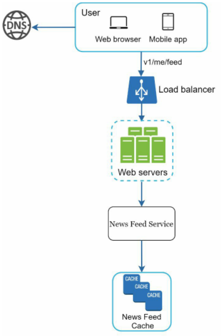

Hình 11-3

 * User: Người dùng gửi yêu cầu lấy dữ liệu news feed của mình. Yêu cầu có định dạng: `/v1/me/feed`.
 * Load balancer: Điều hướng lưu lượng truy cập tới các web server.
 * Web servers: Định tuyến yêu cầu tới newsfeed service.
 * Newsfeed service: Dịch vụ news feed lấy dữ liệu bảng tin từ bộ nhớ đệm.
 * Newsfeed cache: Lưu trữ danh sách các ID của bài viết cần thiết để hiển thị lên news feed.

# Step 3 - Design deep dive (Bước 3 - Đi sâu vào thiết kế chi tiết)

Bản thiết kế mức cao đã khái quát ngắn gọn hai luồng xử lý: feed publishing và news feed building. Tại đây, chúng ta sẽ đi sâu thảo luận chi tiết hơn về các chủ đề đó.

## Feed publishing deep dive (Đi sâu vào luồng đăng tin)

Hình 11-4 phác thảo thiết kế chi tiết cho luồng feed publishing. Chúng ta đã bàn luận về hầu hết các thành phần trong thiết kế mức cao, và giờ sẽ tập trung vào hai thành phần cốt lõi: web servers và fanout service.

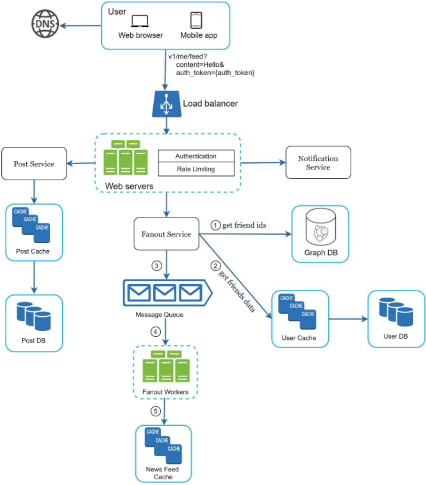

Hình 11-4

### Web servers (Máy chủ Web)

Bên cạnh nhiệm vụ giao tiếp với client, các web server còn thực thi việc authentication và rate-limiting.

Chỉ những người dùng đã đăng nhập với auth_token hợp lệ mới được phép đăng bài viết. Hệ thống cũng giới hạn số lượng bài viết mà một người dùng có thể tạo trong một khoảng thời gian nhất định, điều này mang tính sống còn để ngăn chặn thư rác (spam) và các hành vi lạm dụng nội dung.

### Fanout service (Dịch vụ phân phối)

Fanout là quá trình phân phối một bài viết tới toàn bộ bạn bè của người đăng. Có hai mô hình fanout chính: fanout on write (phân phối tại thời điểm ghi, còn gọi là push model - mô hình đẩy) và fanout on read (phân phối tại thời điểm đọc, còn gọi là pull model - mô hình kéo). Cả hai mô hình đều có ưu và nhược điểm riêng. Chúng ta sẽ cùng phân tích quy trình làm việc của từng mô hình và khám phá giải pháp tối ưu nhất cho hệ thống.

**Fanout on write (Mô hình đẩy):**

Với cách tiếp cận này, news feed được pre-computed (tính toán trước) ngay trong quá trình ghi dữ liệu. Một bài viết mới sẽ được phân phối ngay lập tức tới bộ nhớ đệm của bạn bè sau khi được xuất bản.

*Ưu điểm:*
 * News feed được tạo theo thời gian thực (real-time) và có thể đẩy ngay tới bạn bè.
 * Quá trình truy xuất news feed rất nhanh vì dữ liệu đã được tính toán sẵn từ trước.

*Nhược điểm:*
 * Nếu người dùng có quá nhiều bạn bè, việc lấy danh sách bạn bè và tạo news feed cho toàn bộ số người đó sẽ rất chậm và tốn thời gian. Vấn đề này được gọi là hotkey problem (vấn đề điểm nóng dữ liệu / khóa quá tải).
 * Đối với những người dùng không hoạt động (inactive) hoặc hiếm khi đăng nhập, việc tính toán sẵn news feed sẽ gây lãng phí tài nguyên tính toán.

> 💡 **Giải thích thêm:** "Hotkey problem" (vấn đề điểm nóng dữ liệu) trong kiến trúc phân tán xảy ra khi một khóa dữ liệu cụ thể (chẳng hạn tài khoản của người nổi tiếng có hàng triệu người theo dõi) phải gánh lượng đọc/ghi khổng lồ tức thời, khiến máy chủ hoặc phân vùng lưu trữ khóa đó bị nghẽn cục bộ.
> Nguồn tham khảo: (Không có nguồn trích dẫn xác thực — cần tự kiểm chứng thêm)

**Fanout on read (Mô hình kéo):**

News feed được tạo ra ngay tại thời điểm người dùng đọc. Đây là mô hình theo yêu cầu (on-demand). Các bài viết gần đây sẽ được kéo về khi người dùng tải trang chủ của họ.

*Ưu điểm:*
 * Đối với người dùng không hoạt động hoặc hiếm khi đăng nhập, fanout on read hoạt động hiệu quả hơn vì không lãng phí tài nguyên xử lý cho họ.
 * Dữ liệu không bị đẩy đồng loạt tới bạn bè nên hoàn toàn tránh được hiện tượng hotkey problem.

*Nhược điểm:*
 * Việc truy xuất news feed sẽ chậm hơn do dữ liệu không được tính toán từ trước.

Chúng ta sẽ áp dụng phương pháp lai (hybrid approach) nhằm kết hợp ưu điểm của cả hai mô hình và loại bỏ các cạm bẫy tiềm ẩn. Do yêu cầu truy xuất news feed nhanh chóng là tối quan trọng, chúng ta sử dụng mô hình đẩy (push model) cho phần lớn người dùng. Riêng với người nổi tiếng hoặc những người dùng sở hữu lượng bạn bè/người theo dõi khổng lồ, chúng ta để người theo dõi chủ động kéo nội dung về theo yêu cầu để tránh quá tải hệ thống. Kỹ thuật consistent hashing (băm nhất quán) là một giải pháp hữu hiệu để giảm thiểu vấn đề hotkey problem, vì nó giúp phân bổ các yêu cầu và dữ liệu đồng đều hơn.

Hãy cùng xem xét kỹ hơn cấu trúc của fanout service như được mô tả trong Hình 11-5.


Hình 11-5

Quy trình hoạt động của fanout service như sau:

1. Lấy danh sách ID bạn bè từ graph database (cơ sở dữ liệu đồ thị). Cơ sở dữ liệu đồ thị đặc biệt phù hợp cho việc quản lý các mối quan hệ bạn bè và đưa ra gợi ý kết bạn. Độc giả quan tâm có thể tìm hiểu thêm khái niệm này trong tài liệu tham khảo [2].
2. Lấy thông tin bạn bè từ bộ nhớ đệm người dùng (user cache). Sau đó hệ thống sẽ lọc bạn bè dựa trên thiết lập của người dùng. Ví dụ: nếu bạn tắt tiếng (mute) ai đó, bài viết của họ sẽ không xuất hiện trên news feed của bạn dù hai người vẫn là bạn bè. Một lý do khác khiến bài viết không hiển thị là người dùng có thể chủ động chia sẻ có chọn lọc với một số bạn bè nhất định hoặc ẩn bài viết với những người khác.
3. Đưa danh sách bạn bè và ID bài viết mới vào message queue.
4. Các fanout workers lấy dữ liệu từ message queue và lưu trữ dữ liệu news feed vào news feed cache. Bạn có thể hình dung news feed cache giống như một bảng ánh xạ `<post_id, user_id>`. Bất cứ khi nào có bài viết mới được tạo, nó sẽ được thêm vào cuối bảng news feed như minh họa ở Hình 11-6. Dung lượng bộ nhớ tiêu thụ sẽ trở nên cực kỳ lớn nếu chúng ta lưu trữ toàn bộ đối tượng user và post vào bộ nhớ đệm. Do đó, chỉ có các ID được lưu lại. Nhằm giữ cho kích thước bộ nhớ ở mức nhỏ gọn, chúng ta thiết lập một giới hạn có thể định cấu hình. Xác suất người dùng cuộn xem hàng nghìn bài viết trên news feed là rất thấp. Đa số người dùng chỉ quan tâm đến các nội dung mới nhất, vì vậy cache miss rate (tỷ lệ trượt bộ nhớ đệm) sẽ rất thấp.
5. Lưu trữ cặp `<post_id, user_id>` vào news feed cache. Hình 11-6 minh họa một ví dụ về cấu trúc của news feed trong bộ nhớ đệm.

| post_id | user_id |
| ------- | ------- |
| post_id | uirerd  |
| post_id | ui rerd |
| p! tsod | u!red   |
| pi tsd  | uirerd  |
| post_id | uirerd  |
| pi tsod | user_id |
| pi tsod |         |

Hình 11-6

## Newsfeed retrieval deep dive (Đi sâu vào luồng lấy dữ liệu bảng tin)

Hình 11-7 minh họa thiết kế chi tiết cho luồng truy xuất news feed.


Hình 11-7

Như được thể hiện trong Hình 11-7, các nội dung đa phương tiện (hình ảnh, video...) được lưu trữ trên CDN (Content Delivery Network - mạng phân phối nội dung) để phục vụ việc truy xuất nhanh chóng. Hãy cùng xem các bước một client lấy dữ liệu news feed:

1. Người dùng gửi yêu cầu lấy news feed của mình. Yêu cầu có định dạng: `/v1/me/feed`.
2. Load balancer phân bổ lại các yêu cầu tới các web server.
3. Web server gọi news feed service để lấy dữ liệu bảng tin.
4. News feed service lấy danh sách các post ID từ news feed cache.
5. News feed của một người dùng không chỉ đơn thuần là danh sách các ID. Nó còn bao gồm tên người dùng (username), ảnh đại diện (profile picture), nội dung bài viết, hình ảnh đi kèm... Do đó, news feed service sẽ truy xuất toàn bộ đối tượng user và post từ các bộ nhớ đệm (user cache và post cache) để tái tạo bản tin hoàn chỉnh (fully hydrated news feed).
6. Bản tin hoàn chỉnh này được trả về cho client dưới định dạng JSON để tiến hành render (kết xuất giao diện).

## Cache architecture (Kiến trúc bộ nhớ đệm)

Bộ nhớ đệm đóng vai trò tối quan trọng đối với một hệ thống news feed. Chúng ta phân chia tầng cache thành 5 lớp như minh họa ở Hình 11-8:


 * News Feed: Lưu trữ danh sách các ID của news feed.
 * Content: Lưu trữ dữ liệu chi tiết của từng bài viết. Các nội dung phổ biến sẽ được lưu trữ trong hot cache (bộ nhớ đệm cho dữ liệu truy cập thường xuyên).
 * Social Graph (Đồ thị mạng xã hội): Lưu trữ dữ liệu về mối quan hệ giữa những người dùng.
 * Action (Hành động): Lưu trữ thông tin về việc người dùng đã thích (like), phản hồi (reply), hoặc thực hiện các hành động khác trên bài viết.
 * Counters (Bộ đếm): Lưu trữ số lượng like, reply, follower (người theo dõi), following (người đang theo dõi)...

# Step 4 - Wrap up (Bước 4 - Tổng kết)

Trong chương này, chúng ta đã thiết kế một hệ thống news feed hoàn chỉnh. Thiết kế bao gồm hai luồng chính: feed publishing và news feed retrieval. Tương tự như bất kỳ câu hỏi phỏng vấn thiết kế hệ thống nào, không có một giải pháp thiết kế nào là hoàn hảo tuyệt đối. Mỗi công ty đều có những ràng buộc riêng biệt, và bạn phải thiết kế hệ thống sao cho phù hợp với những ràng buộc đó. Việc thấu hiểu các điểm đánh đổi (tradeoffs) trong thiết kế và trong các lựa chọn công nghệ là vô cùng cần thiết. Nếu còn lại vài phút cuối buổi phỏng vấn, bạn có thể đề cập đến các vấn đề về khả năng mở rộng quy mô (scalability). Để tránh bàn luận trùng lặp, dưới đây là các chủ đề thảo luận chính ở mức cao:

Mở rộng cơ sở dữ liệu:
 * Mở rộng theo chiều dọc (Vertical scaling) so với mở rộng theo chiều ngang (Horizontal scaling)
 * SQL so với NoSQL
 * Mô hình sao chép Master-slave (Master-slave replication)
 * Bản sao chỉ đọc (Read replicas)
 * Các mô hình nhất quán dữ liệu (Consistency models)
 * Phân mảnh cơ sở dữ liệu (Database sharding)

Các chủ đề thảo luận khác:
 * Giữ cho tầng web không lưu trạng thái (stateless)
 * Bộ nhớ đệm dữ liệu càng nhiều càng tốt (caching)
 * Hỗ trợ đa trung tâm dữ liệu (multiple data centers)
 * Giảm độ liên kết giữa các thành phần bằng message queues
 * Giám sát các chỉ số quan trọng. Chẳng hạn, theo dõi QPS (Queries Per Second - số lượng truy vấn mỗi giây) vào giờ cao điểm và độ trễ (latency) khi người dùng làm mới news feed là những số liệu rất đáng chú ý.

Chúc mừng bạn đã đi được một chặng đường dài đến đây! Hãy tự thưởng cho bản thân một lời khen ngợi. Bạn đã làm rất tốt!

# Reference materials (Tài liệu tham khảo)

[1] How News Feed Works: https://www.facebook.com/help/327131014036297/  
[2] Friend of Friend recommendations Neo4j and SQL Sever: http://geekswithblogs.net/brendonpage/archive/2015/10/26/friend-of-friend-

[recommendations-with-neo4j.aspx](http://geekswithblogs.net/brendonpage/archive/2015/10/26/friend-of-friend-recommendations-with-neo4j.aspx)

# CHAPTER 12: DESIGN A CHAT SYSTEM (CHƯƠNG 12: THIẾT KẾ HỆ THỐNG TRÒ CHUYỆN)

Trong chương này, chúng ta sẽ tìm hiểu về thiết kế của một hệ thống chat. Hầu như mọi người đều sử dụng các ứng dụng trò chuyện. Hình 12-1 minh họa một số ứng dụng phổ biến nhất trên thị trường hiện nay.


Hình 12-1

Một ứng dụng chat phục vụ nhiều chức năng khác nhau cho từng đối tượng người dùng. Do đó, việc xác định chính xác các yêu cầu là cực kỳ quan trọng. Ví dụ, bạn chắc chắn không muốn thiết kế một hệ thống tập trung vào tính năng chat nhóm khi người phỏng vấn lại đang hướng tới mô hình chat 1-1. Việc khám phá cặn kẽ các yêu cầu về tính năng là điều tối cần thiết.

# Step 1 - Understand the problem and establish design scope (Bước 1 - Hiểu rõ bài toán và xác định phạm vi thiết kế)

Thống nhất loại hình ứng dụng chat cần thiết kế là điều mang tính sống còn. Trên thị trường có các ứng dụng chat 1-1 như Facebook Messenger, WeChat và WhatsApp; các ứng dụng chat công sở tập trung vào chat nhóm như Slack; hay các ứng dụng chat chơi game như Discord vốn chú trọng vào sự tương tác giữa các nhóm lớn và độ trễ voice chat cực thấp. Nhóm câu hỏi làm rõ đầu tiên phải xác định chính xác mục tiêu của người phỏng vấn. Tối thiểu, hãy làm rõ liệu bạn nên tập trung vào ứng dụng chat 1-1 hay ứng dụng chat nhóm. Dưới đây là một số câu hỏi bạn có thể đặt ra:

Ứng viên: Chúng ta nên thiết kế loại ứng dụng chat nào? Chat 1-1 hay chat theo nhóm?

Người phỏng vấn: Hệ thống cần hỗ trợ cả chat 1-1 và chat nhóm.

Ứng viên: Đây là ứng dụng di động, ứng dụng web, hay cả hai?

Người phỏng vấn: Cả hai.

Ứng viên: Quy mô của ứng dụng này như thế nào? Quy mô cho một công ty khởi nghiệp (startup) hay quy mô khổng lồ?

Người phỏng vấn: Hệ thống cần hỗ trợ 50 triệu người dùng hoạt động hàng ngày (50 million DAU).

Ứng viên: Với tính năng chat nhóm, số lượng thành viên tối đa trong một nhóm là bao nhiêu?

Người phỏng vấn: Tối đa 100 người.

Ứng viên: Những tính năng nào là quan trọng đối với ứng dụng chat này? Có cần hỗ trợ tệp đính kèm không?

Người phỏng vấn: Chat 1-1, chat nhóm và hiển thị trạng thái trực tuyến (online indicator). Hệ thống chỉ hỗ trợ tin nhắn văn bản.

Ứng viên: Có giới hạn về kích thước tin nhắn không?

Người phỏng vấn: Có, độ dài văn bản phải dưới 100.000 ký tự.

Ứng viên: Hệ thống có yêu cầu mã hóa đầu cuối (end-to-end encryption) không?

Người phỏng vấn: Hiện tại chưa bắt buộc, nhưng chúng ta sẽ thảo luận nếu còn thời gian.

Ứng viên: Chúng ta cần lưu trữ lịch sử trò chuyện trong bao lâu?

Người phỏng vấn: Vĩnh viễn.

Trong chương này, chúng ta sẽ tập trung thiết kế một ứng dụng chat tương tự như Facebook Messenger, với trọng tâm là các tính năng sau:
 * Chat 1-1 với độ trễ truyền tải tin nhắn thấp
 * Chat nhóm quy mô nhỏ (tối đa 100 người)
 * Trạng thái hiện diện trực tuyến (online presence)
 * Hỗ trợ đa thiết bị: Một tài khoản có thể đăng nhập đồng thời trên nhiều thiết bị
 * Thông báo đẩy (push notifications)

Việc thống nhất về quy mô thiết kế cũng rất quan trọng. Chúng ta sẽ thiết kế một hệ thống hỗ trợ 50 triệu DAU.

# Step 2 - Propose high-level design and get buy-in (Bước 2 - Đề xuất thiết kế tổng thể mức cao và thống nhất phương án)

Để xây dựng một bản thiết kế chất lượng cao, chúng ta cần nắm vững kiến thức cơ bản về cách client và server giao tiếp với nhau. Trong hệ thống chat, client có thể là ứng dụng di động hoặc ứng dụng web. Các client không giao tiếp trực tiếp với nhau. Thay vào đó, mỗi client kết nối tới một dịch vụ chat (chat service) hỗ trợ tất cả các tính năng đã nêu ở trên. Hãy cùng tập trung vào các thao tác nền tảng. Dịch vụ chat phải hỗ trợ các chức năng sau:
 * Nhận tin nhắn từ các client khác.
 * Xác định đúng người nhận cho từng tin nhắn và chuyển tiếp tin nhắn tới người nhận đó.
 * Nếu người nhận không trực tuyến, lưu giữ tin nhắn trên server cho tới khi người đó trực tuyến trở lại.

Hình 12-2 thể hiện mối quan hệ giữa các client (người gửi và người nhận) với dịch vụ chat.


Hình 12-2

Khi một client muốn bắt đầu trò chuyện, nó kết nối tới dịch vụ chat bằng một hoặc nhiều giao thức mạng. Đối với dịch vụ chat, việc lựa chọn giao thức mạng là rất quan trọng. Hãy cùng thảo luận điều này với người phỏng vấn.

Các yêu cầu thường do client chủ động khởi tạo trong hầu hết các ứng dụng dạng client/server. Điều này cũng đúng với phía người gửi trong một ứng dụng chat. Trong Hình 12-2, khi người gửi gửi tin nhắn tới người nhận qua dịch vụ chat, nó sử dụng giao thức HTTP đã được kiểm chứng qua thời gian - giao thức web phổ biến nhất. Trong kịch bản này, client mở một kết nối HTTP với dịch vụ chat và gửi tin nhắn, yêu cầu dịch vụ chuyển tiếp tin nhắn tới người nhận. Cơ chế keep-alive (duy trì kết nối) hoạt động rất hiệu quả ở đây vì tiêu đề (header) keep-alive cho phép client duy trì một kết nối ổn định lâu dài với dịch vụ chat, đồng thời làm giảm số lần bắt tay TCP (TCP handshakes). HTTP là một lựa chọn tốt cho phía người gửi, và nhiều ứng dụng chat phổ biến như Facebook [1] ban đầu cũng sử dụng HTTP để gửi tin nhắn.

Tuy nhiên, phía người nhận lại phức tạp hơn một chút. Vì HTTP là giao thức do client khởi tạo, nên việc gửi tin nhắn chủ động từ server tới client không hề đơn giản. Qua nhiều năm, nhiều kỹ thuật đã được sử dụng để mô phỏng một kết nối do server khởi tạo: polling (thăm dò định kỳ), long polling (thăm dò kéo dài) và WebSocket. Đây là những kỹ thuật quan trọng thường được hỏi trong các buổi phỏng vấn thiết kế hệ thống, vì vậy chúng ta hãy lần lượt xem xét từng kỹ thuật.

## Polling (Thăm dò định kỳ)

Như minh họa ở Hình 12-3, polling là kỹ thuật mà client định kỳ gửi yêu cầu hỏi server xem có tin nhắn mới nào không. Tùy thuộc vào tần suất thăm dò, polling có thể rất tốn kém chi phí. Nó có thể tiêu tốn tài nguyên máy chủ quý giá chỉ để nhận lại câu trả lời "không có tin nhắn" trong phần lớn trường hợp.


## Long polling (Thăm dò kéo dài)

Bởi vì kỹ thuật polling có thể không hiệu quả, bước phát triển tiếp theo chính là long polling (Hình 12-4).


Hình 12-4

Trong cơ chế long polling, client giữ cho kết nối luôn mở cho tới khi thực sự có tin nhắn mới hoặc đạt ngưỡng thời gian chờ (timeout). Ngay khi nhận được tin nhắn mới, client sẽ lập tức gửi một yêu cầu khác tới server, bắt đầu lại chu trình. Long polling có một vài nhược điểm sau:
 * Người gửi và người nhận có thể không kết nối tới cùng một chat server. Các máy chủ chạy giao thức HTTP thường không lưu trạng thái (stateless). Nếu bạn sử dụng thuật toán round-robin (xoay vòng) để cân bằng tải, máy chủ nhận tin nhắn có thể không có kết nối long-polling với client nhận tin nhắn đó.
 * Server không có phương thức đáng tin cậy nào để biết liệu client đã ngắt kết nối hay chưa.
 * Kém hiệu quả: Nếu người dùng ít khi trò chuyện, long polling vẫn liên tục tạo các kết nối định kỳ sau mỗi lần hết thời gian chờ (timeout).

## WebSocket

WebSocket là giải pháp phổ biến nhất để gửi các bản cập nhật bất đồng bộ (asynchronous updates) từ server tới client. Hình 12-5 mô tả cách thức hoạt động của giao thức này.

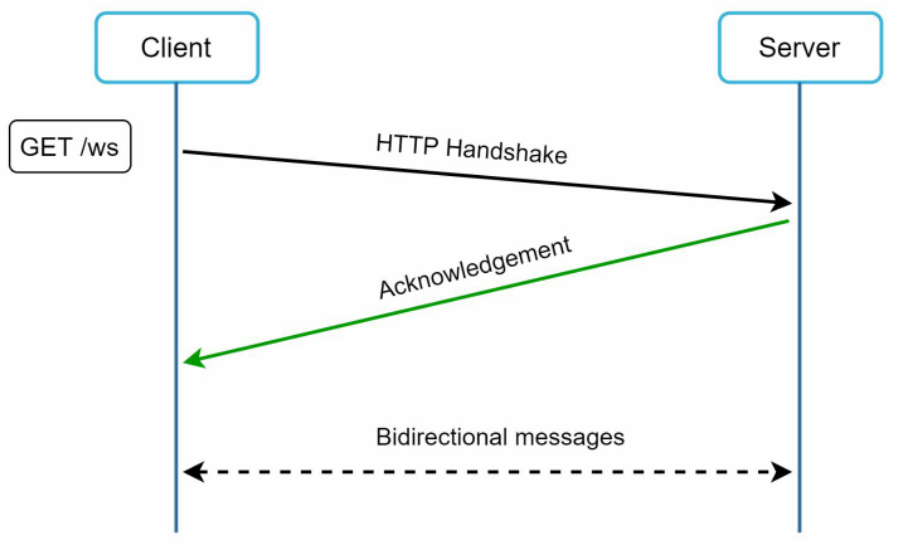

Hình 12-5

Kết nối WebSocket được khởi tạo bởi client. Đây là kết nối hai chiều (bi-directional) và bền vững (persistent). Nó khởi đầu như một kết nối HTTP thông thường, sau đó được "nâng cấp" (upgrade) thông qua một quy trình bắt tay (handshake) rõ ràng thành một kết nối WebSocket. Qua kết nối bền vững này, server có thể chủ động gửi các thông tin cập nhật tới client. Các kết nối WebSocket thường hoạt động thông suốt ngay cả khi có tường lửa (firewall), bởi vì chúng sử dụng cổng 80 hoặc 443 - các cổng mặc định của kết nối HTTP/HTTPS.

Trước đó chúng ta đã đề cập rằng ở phía người gửi, HTTP là một giao thức đủ tốt. Tuy nhiên, vì WebSocket là giao thức hai chiều, không có lý do kỹ thuật nào ngăn cản chúng ta sử dụng luôn WebSocket cho cả chiều gửi tin nhắn. Hình 12-6 minh họa cách thức WebSocket (ws) được ứng dụng đồng thời cho cả phía người gửi lẫn người nhận.


Hình 12-6

Bằng cách sử dụng WebSocket cho cả gửi và nhận, thiết kế hệ thống trở nên tinh giản hơn, đồng thời giúp việc triển khai mã nguồn trên cả client và server trở nên trực quan, mạch lạc hơn. Do các kết nối WebSocket là kết nối bền vững, việc quản lý kết nối hiệu quả phía server đóng vai trò cực kỳ then chốt.

## High-level design (Thiết kế tổng thể mức cao)

Chúng ta vừa thống nhất chọn WebSocket làm giao thức giao tiếp chính giữa client và server nhờ khả năng truyền thông hai chiều. Tuy nhiên, điều quan trọng cần lưu ý là không phải mọi tính năng khác đều bắt buộc phải dùng WebSocket. Trên thực tế, phần lớn các tính năng (đăng ký, đăng nhập, thông tin người dùng...) của một ứng dụng chat hoàn toàn có thể sử dụng phương thức request/response truyền thống qua HTTP.

Hãy cùng phân tích sâu hơn các thành phần mức cao của hệ thống. Như minh họa ở Hình 12-7, hệ thống chat được chia thành ba nhóm dịch vụ chính: các dịch vụ không lưu trạng thái (stateless services), các dịch vụ có lưu trạng thái (stateful services), và các dịch vụ tích hợp bên thứ ba (third-party integration).

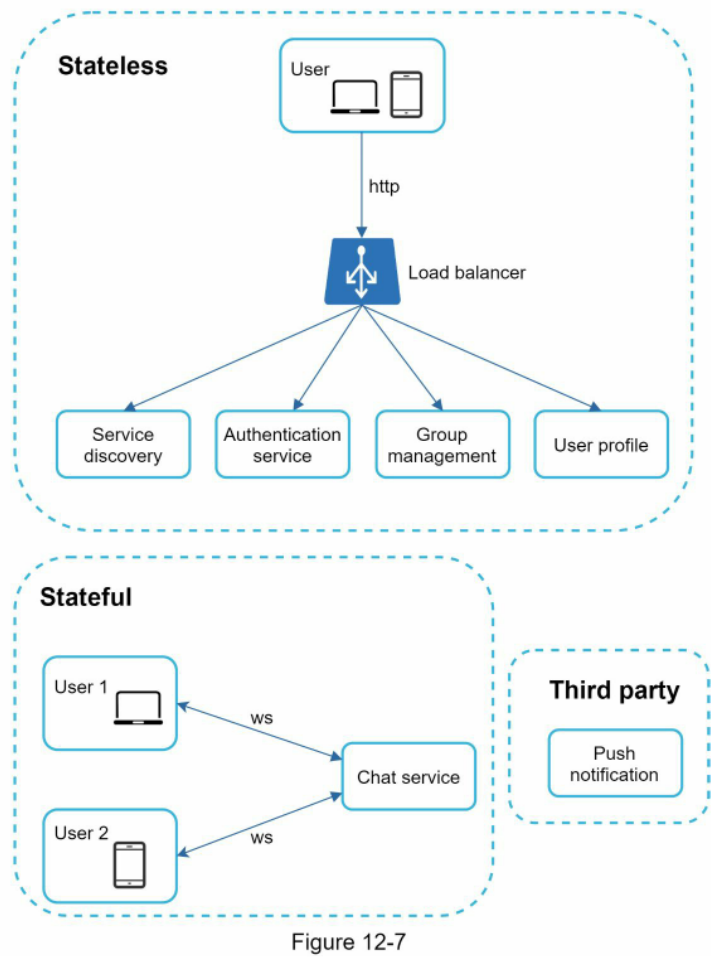

### Stateless Services (Các dịch vụ không lưu trạng thái)

Stateless services là các dịch vụ request/response truyền thống tiếp nhận tương tác trực tiếp từ phía người dùng, được sử dụng để quản lý việc đăng nhập, đăng ký, hồ sơ người dùng... Đây là các tính năng phổ biến trên hầu hết các website và ứng dụng. Các stateless services nằm phía sau một load balancer với nhiệm vụ định tuyến yêu cầu tới đúng dịch vụ dựa trên đường dẫn yêu cầu (request paths). Những dịch vụ này có thể được xây dựng theo kiểu kiến trúc nguyên khối (monolithic) hoặc chia thành các vi dịch vụ (microservices) độc lập. Chúng ta không cần phải tự mình xây dựng mới toàn bộ các dịch vụ không lưu trạng thái này, vì trên thị trường đã có sẵn các giải pháp có thể tích hợp một cách dễ dàng. Một dịch vụ đặc thù mà chúng ta sẽ phân tích kỹ hơn ở phần đi sâu là service discovery (cơ chế tự động phát hiện dịch vụ). Nhiệm vụ chính của nó là cung cấp cho client danh sách các tên máy chủ DNS (DNS host names) của những chat server mà client có thể kết nối tới.

### Stateful Service (Dịch vụ có lưu trạng thái)

Dịch vụ duy nhất có lưu trạng thái trong hệ thống là chat service. Dịch vụ này mang tính stateful vì mỗi client phải duy trì một kết nối mạng bền vững tới một máy chủ chat server cụ thể. Trong dịch vụ này, thông thường client sẽ không chuyển đổi sang một chat server khác chừng nào máy chủ hiện tại vẫn còn hoạt động bình thường. Service discovery sẽ phối hợp chặt chẽ với chat service để hạn chế tình trạng quá tải server. Chúng ta sẽ phân tích chi tiết điều này trong phần đi sâu thiết kế.

### Third-party integration (Tích hợp bên thứ ba)

Đối với một ứng dụng chat, push notification là thành phần tích hợp bên thứ ba quan trọng nhất. Đây là phương thức thông báo cho người dùng khi có tin nhắn mới đến, ngay cả khi ứng dụng đang không chạy. Việc tích hợp chính xác dịch vụ push notification là yếu tố mang tính quyết định. Hãy tham khảo thêm Chương 10: Thiết kế hệ thống thông báo để biết thêm chi tiết.

### Scalability (Khả năng mở rộng)

Ở quy mô nhỏ, toàn bộ các dịch vụ nêu trên hoàn toàn có thể đặt vừa vặn trên một máy chủ duy nhất. Ngay cả ở quy mô mà chúng ta đang thiết kế, về mặt lý thuyết, một máy chủ đám mây hiện đại vẫn có khả năng chứa toàn bộ các kết nối của người dùng. Số lượng kết nối đồng thời (concurrent connections) mà một máy chủ có thể xử lý thường sẽ là yếu tố giới hạn chính. Trong kịch bản của chúng ta, với 1 triệu người dùng đồng thời, giả định mỗi kết nối người dùng tiêu tốn khoảng 10KB bộ nhớ trên máy chủ (đây là con số ước tính sơ bộ và phụ thuộc rất lớn vào ngôn ngữ lập trình được lựa chọn), thì chỉ cần khoảng 10GB RAM là đủ để duy trì toàn bộ các kết nối trên một máy chủ.

Tuy nhiên, nếu chúng ta đề xuất một bản thiết kế gom toàn bộ hệ thống vào một máy chủ duy nhất, điều này sẽ tạo ra một điểm trừ rất lớn (big red flag) trong mắt người phỏng vấn. Không một kỹ sư công nghệ nào lại đi thiết kế một hệ thống quy mô lớn như vậy trên một máy chủ đơn lẻ. Thiết kế đơn máy chủ là điều tối kỵ bởi nhiều lý do, mà lớn nhất trong số đó là sự cố điểm nghẽn đơn lẻ (single point of failure - SPOF). Dẫu vậy, việc bắt đầu trình bày từ thiết kế một máy chủ là hoàn toàn chấp nhận được, miễn là bạn làm rõ với người phỏng vấn rằng đây chỉ là bước khởi đầu để phát triển tiếp.

Tổng hợp lại toàn bộ những gì đã bàn luận, Hình 12-8 thể hiện bản thiết kế tổng thể đã được tinh chỉnh.


Hình 12-8

Trong Hình 12-8, client duy trì một kết nối WebSocket bền vững tới máy chủ chat server để trao đổi tin nhắn theo thời gian thực.
 * Chat servers hỗ trợ việc gửi và nhận tin nhắn.
 * Presence servers quản lý trạng thái trực tuyến / ngoại tuyến (online/offline status).
 * API servers xử lý mọi tác vụ nghiệp vụ gồm đăng nhập, đăng ký, chỉnh sửa hồ sơ người dùng...
 * Notification servers gửi các thông báo đẩy.
 * Cuối cùng, key-value store (kho lưu trữ khóa - giá trị) được sử dụng để lưu trữ lịch sử trò chuyện. Khi một người dùng ngoại tuyến quay trở lại trực tuyến, họ sẽ xem được toàn bộ lịch sử tin nhắn trước đó.

### Storage (Lưu trữ)

Đến thời điểm này, chúng ta đã chuẩn bị sẵn sàng các máy chủ, các dịch vụ đã đi vào vận hành và việc tích hợp bên thứ ba đã hoàn tất. Nằm sâu dưới ngăn xếp công nghệ (technical stack) là tầng dữ liệu (data layer). Tầng dữ liệu đòi hỏi khá nhiều công sức để thiết kế chuẩn xác. Một quyết định quan trọng mà chúng ta phải đưa ra là: nên sử dụng loại cơ sở dữ liệu nào, cơ sở dữ liệu quan hệ (relational databases) hay cơ sở dữ liệu NoSQL? Để đưa ra lựa chọn sáng suốt, chúng ta cần xem xét kỹ các kiểu dữ liệu và mô hình truy cập đọc/ghi (read/write patterns).

Có hai loại dữ liệu tồn tại trong một hệ thống chat điển hình:

Loại thứ nhất là dữ liệu thông thường, chẳng hạn như thông tin người dùng, cài đặt, danh sách bạn bè. Loại dữ liệu này được lưu trữ trong các cơ sở dữ liệu quan hệ mạnh mẽ và đáng tin cậy. Các kỹ thuật sao chép (replication) và phân mảnh (sharding) thường được áp dụng để đáp ứng các yêu cầu về tính sẵn sàng (availability) và khả năng mở rộng (scalability).

Loại thứ hai là dữ liệu đặc thù của hệ thống chat: dữ liệu lịch sử trò chuyện. Việc thấu hiểu mô hình đọc/ghi của loại dữ liệu này là tối quan trọng:
 * Lượng dữ liệu tích lũy là cực kỳ khổng lồ. Một nghiên cứu trước đây [2] cho thấy Facebook Messenger và WhatsApp xử lý tới 60 tỷ tin nhắn mỗi ngày.
 * Chỉ có các tin nhắn gần đây mới được truy cập thường xuyên. Người dùng hiếm khi tìm đọc lại các đoạn chat cũ.
 * Dù phần lớn các trường hợp chỉ xem lịch sử trò chuyện gần nhất, người dùng vẫn có thể sử dụng các tính năng đòi hỏi truy cập dữ liệu ngẫu nhiên (random access), chẳng hạn như tìm kiếm, xem lại các lượt nhắc tên (@mention), nhảy tới tin nhắn cụ thể... Tầng truy xuất dữ liệu bắt buộc phải hỗ trợ tốt các trường hợp này.
 * Tỷ lệ đọc/ghi xấp xỉ 1:1 đối với các ứng dụng chat 1-1.

Việc lựa chọn hệ thống lưu trữ chuẩn xác đáp ứng toàn bộ các trường hợp sử dụng trên là cực kỳ cấp thiết. Chúng tôi khuyến nghị sử dụng key-value stores vì các lý do sau:
 * Key-value store cho phép mở rộng quy mô theo chiều ngang một cách dễ dàng.
 * Key-value store mang lại độ trễ truy xuất dữ liệu cực kỳ thấp.
 * Cơ sở dữ liệu quan hệ xử lý phần đuôi dài (long tail) [3] của dữ liệu không tốt. Khi các bảng chỉ mục (index) phình to, việc truy xuất ngẫu nhiên trở nên rất tốn kém tài nguyên.
 * Key-value store đã được chứng minh hiệu quả và áp dụng rộng rãi bởi nhiều ứng dụng chat uy tín khác. Ví dụ, cả Facebook Messenger và Discord đều sử dụng key-value store; trong đó Facebook Messenger dùng HBase [4], còn Discord lựa chọn Cassandra [5].

> 💡 **Giải thích thêm:** "Long tail" (phần đuôi dài) trong lưu trữ dữ liệu chỉ phần lớn dữ liệu cũ, ít khi được truy cập nhưng tổng dung lượng lại chiếm tỷ trọng áp đảo. Cơ sở dữ liệu quan hệ khi chỉ mục (index) phình to theo đuôi dài này sẽ khiến chi phí truy xuất ngẫu nhiên trên đĩa tăng vọt.
> Nguồn tham khảo: https://en.wikipedia.org/wiki/Long_tail

## Data models (Mô hình dữ liệu)

Chúng ta vừa thống nhất sử dụng key-value store cho tầng lưu trữ. Dữ liệu quan trọng nhất chính là dữ liệu tin nhắn. Hãy cùng phân tích chi tiết.

### Message table for 1 on 1 chat (Bảng tin nhắn cho chat 1-1)

Hình 12-9 minh họa bảng tin nhắn cho cuộc trò chuyện 1-1. Khóa chính (primary key) là `message_id`, đóng vai trò xác định thứ tự của các tin nhắn. Chúng ta không thể chỉ dựa vào trường thời gian `created_at` để xác định thứ tự tin nhắn, vì hai tin nhắn hoàn toàn có thể được tạo ra vào cùng một thời điểm.

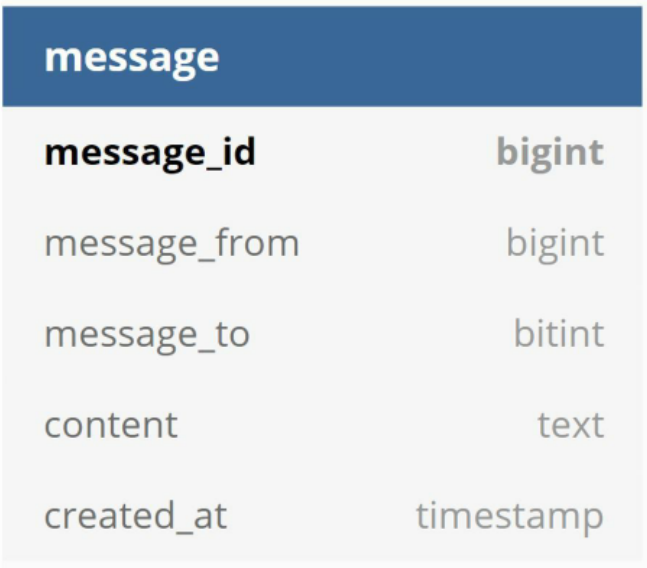

Hình 12-9

### Message table for group chat (Bảng tin nhắn cho chat nhóm)

Hình 12-10 thể hiện bảng tin nhắn dành cho chat nhóm. Khóa chính kết hợp (composite primary key) ở đây là `(channel_id, message_id)`. Kênh (channel) và nhóm (group) mang cùng một ý nghĩa trong ngữ cảnh này. `channel_id` đóng vai trò là partition key (khóa phân vùng) vì mọi truy vấn trong một nhóm chat đều vận hành trong phạm vi một kênh cụ thể.

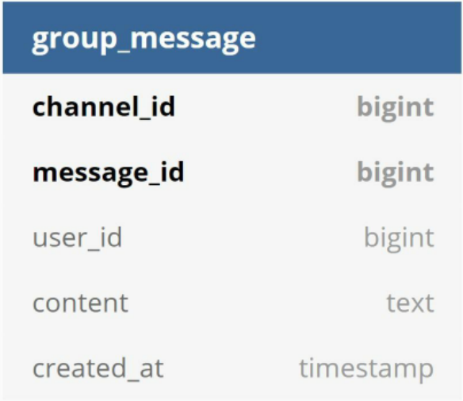

Hình 12-10

Cách thức sinh `message_id` là một chủ đề thú vị rất đáng đào sâu. `message_id` gánh vác trách nhiệm đảm bảo thứ tự của các tin nhắn. Để xác lập chính xác thứ tự này, `message_id` phải đáp ứng hai yêu cầu bắt buộc sau:
 * Các ID phải là duy nhất (unique).
 * Các ID phải có khả năng sắp xếp theo thời gian, nghĩa là các bản ghi mới hơn phải có ID lớn hơn các bản ghi cũ.

Làm thế nào để đạt được hai cam kết này? Ý tưởng đầu tiên xuất hiện là sử dụng từ khóa `auto_increment` trong MySQL. Tuy nhiên, các cơ sở dữ liệu NoSQL thường không cung cấp tính năng này. Hướng tiếp cận thứ hai là sử dụng một bộ sinh số thứ tự 64-bit toàn cục như Snowflake của Twitter [6]. Vấn đề này đã được phân tích kỹ trong "Chương 7: Thiết kế bộ sinh ID duy nhất trong hệ thống phân tán". Hướng tiếp cận cuối cùng là sử dụng bộ sinh chuỗi số cục bộ (local sequence number generator). "Cục bộ" ở đây có nghĩa là ID chỉ cần đảm bảo duy nhất trong phạm vi một nhóm. Lý do giải pháp ID cục bộ khả thi là vì việc duy trì thứ tự tin nhắn trong một kênh 1-1 hoặc một kênh nhóm cụ thể đã là hoàn toàn đủ. Hướng tiếp cận này dễ triển khai hơn nhiều so với việc xây dựng một bộ sinh ID toàn cục.

# Step 3 - Design deep dive (Bước 3 - Đi sâu vào thiết kế chi tiết)

Trong một buổi phỏng vấn thiết kế hệ thống, thông thường bạn sẽ được yêu cầu đào sâu vào một số thành phần cụ thể trong bản thiết kế tổng thể. Đối với hệ thống chat, các thành phần như service discovery, luồng gửi nhận tin nhắn, và hiển thị trạng thái online/offline rất đáng để tìm hiểu kỹ.

## Service discovery (Khám phá dịch vụ)

Vai trò chính của service discovery là gợi ý máy chủ chat server tối ưu nhất cho một client dựa trên các tiêu chí như vị trí địa lý, dung lượng chịu tải của server... Apache ZooKeeper [7] là một giải pháp mã nguồn mở phổ biến cho tính năng service discovery. Nó đăng ký toàn bộ các chat server đang sẵn sàng và lựa chọn máy chủ phù hợp nhất cho client dựa trên các tiêu chí được định sẵn.

Hình 12-11 mô tả cách thức hoạt động của cơ chế service discovery (với ZooKeeper).

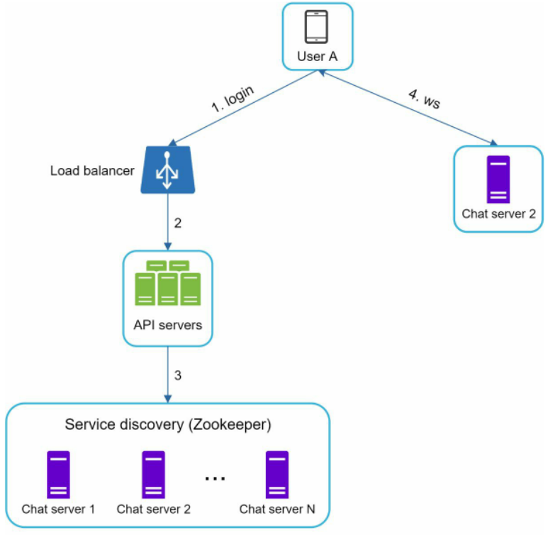

Hình 12-11

1. Người dùng A cố gắng đăng nhập vào ứng dụng.
2. Load balancer chuyển tiếp yêu cầu đăng nhập tới API servers.
3. Sau khi backend xác thực thành công người dùng, service discovery sẽ tìm chat server tốt nhất cho Người dùng A. Trong ví dụ này, Server 2 được chọn và thông tin máy chủ sẽ được gửi trả về cho Người dùng A.
4. Người dùng A kết nối tới chat server 2 thông qua giao thức WebSocket.

## Message flows (Các luồng tin nhắn)

Việc nắm bắt luồng vận hành đầu-cuối (end-to-end flow) của một hệ thống chat là điều rất thú vị. Trong phần này, chúng ta sẽ lần lượt phân tích: luồng chat 1-1, đồng bộ tin nhắn qua nhiều thiết bị và luồng chat nhóm.

### 1 on 1 chat flow (Luồng chat 1-1)

Hình 12-12 giải thích chi tiết điều gì xảy ra khi Người dùng A gửi một tin nhắn tới Người dùng B.

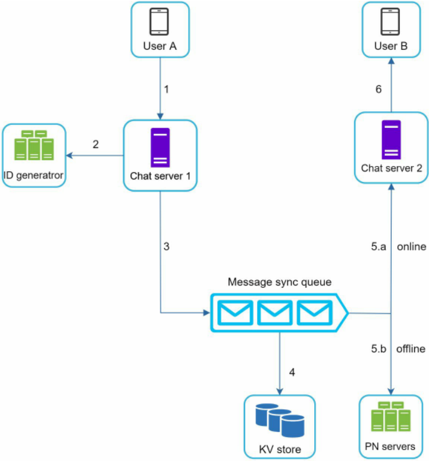

Hình 12-12

1. Người dùng A gửi tin nhắn tới Chat server 1.
2. Chat server 1 lấy một ID tin nhắn mới từ bộ sinh ID (ID generator).
3. Chat server 1 đẩy tin nhắn vào hàng đợi đồng bộ tin nhắn (message sync queue).
4. Tin nhắn được lưu vào kho dữ liệu key-value store.
 * 5.a. Nếu Người dùng B đang trực tuyến, tin nhắn được chuyển tiếp tới Chat server 2 (nơi Người dùng B đang duy trì kết nối).
 * 5.b. Nếu Người dùng B đang ngoại tuyến, một thông báo đẩy sẽ được gửi đi từ các máy chủ push notification (PN).
6. Chat server 2 chuyển tiếp tin nhắn tới Người dùng B thông qua kết nối WebSocket bền vững đang được duy trì giữa hai bên.

### Message synchronization across multiple devices (Đồng bộ tin nhắn trên nhiều thiết bị)

Nhiều người dùng sở hữu đồng thời nhiều thiết bị. Chúng ta sẽ cùng tìm hiểu cách đồng bộ tin nhắn qua các thiết bị này. Hình 12-13 minh họa một ví dụ về quy trình đồng bộ tin nhắn.


Hình 12-13

Trong Hình 12-13, Người dùng A có hai thiết bị: điện thoại và máy tính xách tay. Khi Người dùng A đăng nhập vào ứng dụng chat bằng điện thoại, máy sẽ thiết lập một kết nối WebSocket với Chat server 1. Tương tự, máy tính xách tay cũng duy trì một kết nối tới Chat server 1.

Mỗi thiết bị quản lý một biến có tên `cur_max_message_id`, biến này lưu giữ ID của tin nhắn mới nhất hiện có trên thiết bị đó. Những tin nhắn thỏa mãn hai điều kiện sau sẽ được coi là tin nhắn mới:
 * ID người nhận trùng khớp với ID người dùng đang đăng nhập.
 * ID tin nhắn trong key-value store lớn hơn `cur_max_message_id`.

Nhờ vào giá trị `cur_max_message_id` riêng biệt trên từng thiết bị, việc đồng bộ tin nhắn trở nên rất đơn giản khi mỗi thiết bị chỉ cần lấy các tin nhắn mới tương ứng từ KV store.

### Small group chat flow (Luồng chat nhóm nhỏ)

So với chat 1-1, logic xử lý của chat nhóm phức tạp hơn đáng kể. Hình 12-14 và 12-15 giải thích chi tiết luồng xử lý này.


Hình 12-14

Hình 12-14 giải thích những gì xảy ra khi Người dùng A gửi tin nhắn trong một nhóm chat. Giả sử nhóm có 3 thành viên (Người dùng A, Người dùng B và Người dùng C). Đầu tiên, tin nhắn từ Người dùng A được sao chép vào message sync queue của từng thành viên: một bản cho Người dùng B và một bản cho Người dùng C. Bạn có thể xem message sync queue như một hộp thư đến (inbox) của người nhận. Lựa chọn thiết kế này rất tối ưu cho các nhóm chat nhỏ vì:
 * Giúp đơn giản hóa luồng đồng bộ tin nhắn, do mỗi client chỉ cần kiểm tra hộp thư đến của chính mình để nhận tin nhắn mới.
 * Khi số lượng thành viên trong nhóm ít, việc sao chép tin nhắn vào hộp thư của từng người không gây tốn kém quá nhiều tài nguyên. WeChat cũng áp dụng giải pháp tương tự và giới hạn mỗi nhóm tối đa 500 thành viên [8]. Tuy nhiên, đối với các nhóm có lượng người dùng rất lớn, việc nhân bản tin nhắn cho mọi thành viên là điều không thể chấp nhận được.

Ở phía người nhận, một người dùng có thể nhận tin nhắn từ nhiều người gửi khác nhau. Mỗi người nhận đều sở hữu một hộp thư đến (message sync queue) chứa tin nhắn từ nhiều người gửi. Hình 12-15 minh họa thiết kế này.

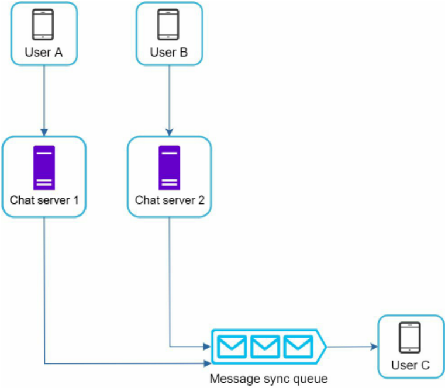

Hình 12-15

## Online presence (Trạng thái hiện diện trực tuyến)

Chỉ báo trạng thái trực tuyến là một tính năng thiết yếu trên nhiều ứng dụng chat. Thông thường, bạn sẽ nhìn thấy một chấm màu xanh lá cây bên cạnh ảnh đại diện hoặc tên người dùng. Phần này sẽ giải thích cơ chế vận hành ngầm phía sau tính năng đó.

Trong thiết kế mức cao, các presence servers chịu trách nhiệm quản lý trạng thái online và giao tiếp với client qua WebSocket. Có một số luồng sự kiện sẽ kích hoạt việc thay đổi trạng thái trực tuyến. Hãy cùng xem xét từng luồng.

### User login (Người dùng đăng nhập)

Luồng đăng nhập của người dùng đã được giải thích trong phần "Khám phá dịch vụ (Service Discovery)". Sau khi kết nối WebSocket được thiết lập thành công giữa client và dịch vụ thời gian thực, trạng thái online của Người dùng A cùng mốc thời gian `last_active_at` sẽ được lưu vào KV store. Chỉ báo hiện diện sẽ hiển thị người dùng đang ở trạng thái trực tuyến ngay sau khi đăng nhập thành công.

Người dùng A: {status: online, last_active_at: timestamp}

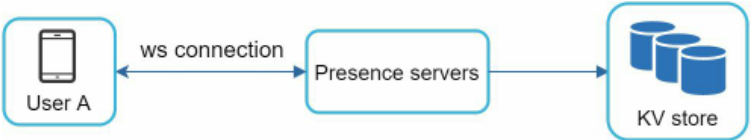

Hình 12-16

### User logout (Người dùng đăng xuất)

Khi người dùng đăng xuất, quy trình xử lý sẽ diễn ra như mô tả ở Hình 12-17. Trạng thái online sẽ được cập nhật thành offline trong KV store. Chỉ báo hiện diện sẽ hiển thị người dùng đang ngoại tuyến.


Hình 12-17

Người dùng A: {status: offline}

### User disconnection (Người dùng ngắt kết nối)

Tất cả chúng ta đều mong muốn đường truyền Internet luôn ổn định và đáng tin cậy. Tuy nhiên thực tế không phải lúc nào cũng lý tưởng như vậy; do đó chúng ta phải tính toán kỹ vấn đề này trong bản thiết kế. Khi người dùng bị mất kết nối mạng, kết nối bền vững giữa client và server sẽ bị đứt. Một cách xử lý ngây thơ là đánh dấu người dùng chuyển sang trạng thái offline ngay lập tức và chuyển lại online khi kết nối được khôi phục. Thế nhưng cách làm này bộc lộ một khuyết điểm rất lớn: người dùng thường xuyên bị mất kết nối và kết nối lại mạng liên tục trong khoảng thời gian ngắn. Ví dụ, mạng có thể chập chờn bật/tắt liên tục khi người dùng đi qua đường hầm. Việc cập nhật lại trạng thái sau mỗi lần ngắt/kết nối lại sẽ khiến chỉ báo trạng thái nhấp nháy thay đổi liên tục, mang lại trải nghiệm người dùng rất tồi tệ.

Chúng ta giới thiệu heartbeat mechanism (cơ chế nhịp tim) để giải quyết triệt để vấn đề này. Theo định kỳ, một client đang trực tuyến sẽ gửi một sự kiện heartbeat tới presence servers. Nếu presence servers nhận được sự kiện heartbeat trong một khoảng thời gian nhất định từ client (giả sử x giây), người dùng vẫn được coi là đang online. Ngược lại, họ sẽ bị coi là offline.

Trong Hình 12-18, client gửi sự kiện heartbeat tới server mỗi 5 giây một lần. Sau khi gửi 3 sự kiện heartbeat, client bị mất kết nối và không kết nối lại trong vòng x = 30 giây (con số này được chọn ngẫu nhiên để minh họa logic xử lý). Khi đó, trạng thái online mới chính thức được chuyển sang offline.

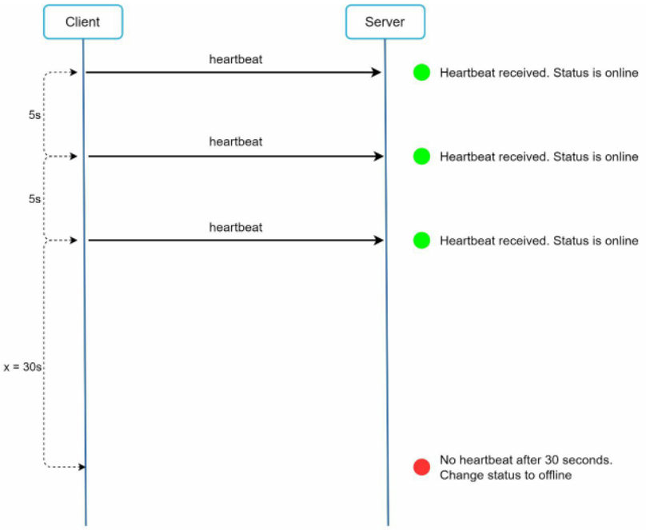

Hình 12-18

### Online status fanout (Phân phối trạng thái trực tuyến)

Làm sao để bạn bè của Người dùng A biết được trạng thái của họ vừa thay đổi? Hình 12-19 giải thích cơ chế này. Presence servers sử dụng publish-subscribe model (mô hình xuất bản - đăng ký nhận tin), trong đó mỗi cặp bạn bè duy trì một kênh riêng biệt. Khi trạng thái online của Người dùng A thay đổi, hệ thống sẽ xuất bản sự kiện tới ba kênh: kênh A-B, A-C và A-D. Ba kênh này lần lượt được đăng ký bởi Người dùng B, C và D. Nhờ đó, bạn bè có thể dễ dàng nhận được cập nhật trạng thái mới nhất. Việc giao tiếp giữa client và server diễn ra thông qua WebSocket theo thời gian thực.


Hình 12-19

Thiết kế trên rất hiệu quả đối với các nhóm người dùng quy mô nhỏ. Ví dụ, WeChat sử dụng giải pháp tương tự vì mỗi nhóm của họ bị giới hạn tối đa 500 người. Đối với các nhóm lớn hơn, việc thông báo trạng thái online tới toàn bộ thành viên sẽ rất tốn kém và mất nhiều thời gian. Giả sử một nhóm có 100.000 thành viên, mỗi lần thay đổi trạng thái sẽ phát sinh tới 100.000 sự kiện. Để khắc phục điểm nghẽn hiệu năng này, một giải pháp khả thi là chỉ tải thông tin trạng thái online khi người dùng thực sự bước vào phòng chat hoặc khi họ chủ động làm mới danh sách bạn bè thủ công.

# Step 4 - Wrap up (Bước 4 - Tổng kết)

Trong chương này, chúng ta đã trình bày kiến trúc của một hệ thống chat hỗ trợ cả trò chuyện 1-1 lẫn chat nhóm nhỏ. WebSocket được sử dụng cho việc truyền thông thời gian thực giữa client và server. Hệ thống chat bao gồm các thành phần cốt lõi: chat servers phục vụ nhắn tin thời gian thực, presence servers quản lý trạng thái trực tuyến, push notification servers gửi thông báo đẩy, key-value stores để lưu trữ lâu dài lịch sử trò chuyện và API servers phục vụ các chức năng nghiệp vụ khác.

Nếu bạn còn thời gian ở phần cuối buổi phỏng vấn, dưới đây là các chủ đề thảo luận mở rộng:
 * Mở rộng ứng dụng chat để hỗ trợ các tệp đa phương tiện như ảnh và video. Kích thước tệp media lớn hơn đáng kể so với văn bản thuần túy. Việc nén tệp (compression), lưu trữ đám mây (cloud storage) và tạo ảnh thu nhỏ (thumbnails) là những chủ đề rất đáng bàn luận.
 * Mã hóa đầu cuối (End-to-end encryption): WhatsApp hỗ trợ mã hóa đầu cuối cho tin nhắn, đảm bảo chỉ người gửi và người nhận mới có thể đọc được nội dung. Độc giả quan tâm có thể tham khảo bài viết trong tài liệu tham khảo [9].
 * Lưu bộ nhớ đệm tin nhắn ở phía client (Client-side caching): Kỹ thuật này giúp giảm tải đáng kể lưu lượng truyền tải dữ liệu giữa client và server.
 * Cải thiện thời gian tải (Improve load time): Slack đã xây dựng mạng lưới phân tán theo vị trí địa lý để lưu đệm dữ liệu người dùng, danh sách kênh... nhằm tối ưu hóa thời gian tải trang [10].
 * Xử lý lỗi (Error handling):
 * Sự cố chat server gặp lỗi: Một chat server có thể đang gánh hàng trăm nghìn hoặc thậm chí nhiều hơn các kết nối bền vững. Nếu server đó gặp sự cố ngoại tuyến, service discovery (ZooKeeper) sẽ cung cấp một chat server thay thế để các client thiết lập lại kết nối mới.
 * Cơ chế gửi lại tin nhắn (Message resent mechanism): Kỹ thuật thử lại (retry) và xếp hàng đợi (queueing) là những phương pháp phổ biến để gửi lại các tin nhắn bị lỗi.

Chúc mừng bạn đã đi được một chặng đường dài đến đây! Hãy tự thưởng cho bản thân một lời khen ngợi. Bạn đã làm rất tốt!

# Reference materials (Tài liệu tham khảo)

[1] Erlang at Facebook: https://www.erlangfactory.com/upload/presentations/31/EugeneLetuchy-ErlangatFacebook.pdf  
[2] Messenger and WhatsApp process 60 billion messages a day: https://www.theverge.com/2016/4/12/11415198/facebook-messenger-whatsapp-numbermessages-vs-sms-f8-2016  
[3] Long tail: https://en.wikipedia.org/wiki/Long\_tail  
[4] The Underlying Technology of Messages: https://www.facebook.com/notes/facebookengineering/the-underlying-technology-of-messages/454991608919/  
[5] How Discord Stores Billions of Messages: https://blog.discordapp.com/how-discordstores-billions-of-messages-7fa6ec7ee4c7  
[6] Announcing Snowflake: https://blog.twitter.com/engineering/en\_us/a/2010/announcingsnowflake.html  
[7] Apache ZooKeeper: https://zookeeper.apache.org/  
[8] From nothing: the evolution of WeChat background system (Bài viết tiếng Trung): https://www.infoq.cn/article/the-road-of-the-growth-weixin-background  
[9] End-to-end encryption: https://faq.whatsapp.com/en/android/28030015/  
[10] Flannel: An Application-Level Edge Cache to Make Slack Scale: https://slack.engineering/flannel-an-application-level-edge-cache-to-make-slack-scaleb8a6400e2f6b

# CHAPTER 13: DESIGN A SEARCH AUTOCOMPLETE SYSTEM (CHƯƠNG 13: THIẾT KẾ HỆ THỐNG TỰ ĐỘNG HOÀN THÀNH TÌM KIẾM)

Khi tìm kiếm trên Google hoặc mua sắm trên Amazon, ngay khi bạn gõ vào ô tìm kiếm, một hoặc nhiều kết quả phù hợp với từ khóa sẽ lập tức hiển thị. Tính năng này thường được gọi là autocomplete (tự động hoàn thành), typeahead (gợi ý khi nhập), search-as-you-type (tìm kiếm khi gõ) hoặc incremental search (tìm kiếm tăng dần). Hình 13-1 minh họa một ví dụ về tìm kiếm trên Google hiển thị danh sách các kết quả gợi ý tự động khi gõ từ "dinner" vào ô tìm kiếm. Tính năng tự động hoàn thành tìm kiếm là một chức năng quan trọng của nhiều sản phẩm. Điều này dẫn chúng ta tới câu hỏi phỏng vấn: Thiết kế một hệ thống tự động hoàn thành tìm kiếm, hay còn gọi là "thiết kế top k" hoặc "thiết kế top k truy vấn được tìm kiếm nhiều nhất".


Google


Hình 13-1

# Step 1 - Understand the problem and establish design scope (Bước 1 - Hiểu rõ bài toán và xác định phạm vi thiết kế)

Bước đầu tiên để giải quyết bất kỳ câu hỏi phỏng vấn thiết kế hệ thống nào là đặt đủ câu hỏi để làm rõ các yêu cầu. Dưới đây là ví dụ về cuộc đối thoại giữa ứng viên và người phỏng vấn:

Ứng viên: Hệ thống chỉ hỗ trợ khớp từ khóa ở phần đầu hay hỗ trợ cả ở giữa chuỗi tìm kiếm?

Người phỏng vấn: Chỉ hỗ trợ khớp ở phần đầu của chuỗi truy vấn tìm kiếm.

Ứng viên: Hệ thống cần trả về bao nhiêu gợi ý tự động hoàn thành?

Người phỏng vấn: 5 gợi ý.

Ứng viên: Làm thế nào hệ thống xác định được 5 gợi ý nào cần trả về?

Người phỏng vấn: Điều này được quyết định bởi mức độ phổ biến, dựa trên tần suất tìm kiếm trong lịch sử.

Ứng viên: Hệ thống có hỗ trợ kiểm tra lỗi chính tả không?

Người phỏng vấn: Không, hệ thống không hỗ trợ kiểm tra chính tả hay tự động sửa lỗi.

Ứng viên: Các truy vấn tìm kiếm có phải bằng tiếng Anh không?

Người phỏng vấn: Đúng. Nếu cuối buổi còn thời gian, chúng ta có thể thảo luận thêm về hỗ trợ đa ngôn ngữ.

Ứng viên: Chúng ta có cho phép chữ in hoa và các ký tự đặc biệt không?

Người phỏng vấn: Không, chúng ta giả định toàn bộ các truy vấn tìm kiếm đều là chữ cái viết thường.

Ứng viên: Có bao nhiêu người dùng sử dụng sản phẩm?

Người phỏng vấn: 10 triệu DAU.

**Yêu cầu hệ thống (Requirements)**

Dưới đây là tóm tắt các yêu cầu:
 * Thời gian phản hồi nhanh: Khi người dùng gõ từ khóa, các gợi ý autocomplete phải xuất hiện đủ nhanh. Một bài viết về hệ thống autocomplete của Facebook [1] chỉ ra rằng hệ thống cần trả kết quả trong vòng 100 mili-giây; nếu lâu hơn sẽ gây hiện tượng giật cục (stuttering).
 * Độ phù hợp (Relevant): Các gợi ý tự động hoàn thành phải có độ liên quan chặt chẽ tới từ khóa tìm kiếm.
 * Đã được sắp xếp (Sorted): Các kết quả trả về phải được sắp xếp theo mức độ phổ biến hoặc theo các mô hình xếp hạng khác.
 * Khả năng mở rộng (Scalable): Hệ thống có thể xử lý lưu lượng truy cập lớn.
 * Tính sẵn sàng cao (Highly available): Hệ thống phải luôn sẵn sàng và truy cập được ngay cả khi một phần hệ thống gặp sự cố ngoại tuyến, chạy chậm, hoặc gặp lỗi mạng đột xuất.

# Back of the envelope estimation (Ước tính sơ bộ)

 * Giả định có 10 triệu người dùng hoạt động hàng ngày (10 million DAU).
 * Trung bình một người thực hiện 10 lượt tìm kiếm mỗi ngày.
 * Mỗi chuỗi truy vấn có kích thước 20 bytes dữ liệu:
    * Giả định chúng ta dùng bảng mã ký tự ASCII: 1 ký tự = 1 byte.
    * Giả định một truy vấn gồm 4 từ, mỗi từ trung bình có 5 ký tự.
    * Như vậy kích thước là 4 x 5 = 20 bytes cho mỗi truy vấn.
 * Với mỗi ký tự được nhập vào ô tìm kiếm, client sẽ gửi một yêu cầu tới backend để lấy gợi ý. Trung bình có 20 yêu cầu được gửi đi cho mỗi truy vấn hoàn chỉnh. Ví dụ, 6 yêu cầu sau sẽ lần lượt được gửi tới backend cho tới khi bạn gõ xong chữ "dinner":

   ```
   search?q=d
   search?q=di
   search?q=din
   search?q=dinn
   search?q=dinne
   search?q=dinner
   ```

 * ~24.000 truy vấn mỗi giây (QPS) = 10.000.000 người dùng * 10 truy vấn/ngày * 20 ký tự / 24 giờ / 3600 giây.
 * QPS đỉnh (Peak QPS) = QPS * 2 = ~48.000.
 * Giả định 20% các truy vấn hàng ngày là từ khóa mới: 10 triệu * 10 truy vấn/ngày * 20 bytes/truy vấn * 20% = 0,4 GB. Điều này đồng nghĩa có thêm 0,4 GB dữ liệu mới được ghi vào bộ lưu trữ mỗi ngày.

# Step 2 - Propose high-level design and get buy-in (Bước 2 - Đề xuất thiết kế tổng thể mức cao và thống nhất phương án)

Ở mức tổng quan, hệ thống được chia thành hai dịch vụ chính:
 * Data gathering service (Dịch vụ thu thập dữ liệu): Thu thập các chuỗi truy vấn do người dùng nhập và tổng hợp chúng theo thời gian thực. Việc xử lý thời gian thực không khả thi đối với các tập dữ liệu khổng lồ; tuy nhiên, đây là một điểm khởi đầu tốt. Chúng ta sẽ tìm hiểu giải pháp thực tế hơn trong phần phân tích sâu.
 * Query service (Dịch vụ truy vấn): Tiếp nhận một chuỗi tìm kiếm hoặc tiền tố (prefix) và trả về 5 từ khóa được tìm kiếm nhiều nhất.

## Data gathering service (Dịch vụ thu thập dữ liệu)

Chúng ta hãy xem một ví dụ đơn giản hóa để hiểu cách thức hoạt động của data gathering service. Giả sử chúng ta có một bảng tần suất (frequency table) lưu trữ chuỗi truy vấn và số lần xuất hiện của nó như ở Hình 13-2. Ban đầu, bảng tần suất hoàn toàn trống. Sau đó, người dùng lần lượt nhập các từ khóa "twitch", "twitter", "twitter" và "twillo". Hình 13-2 minh họa quá trình cập nhật của bảng tần suất.

query: twitch query: twitter query: twitter query: twillo

Query Frequency Query Frequency Query Frequency

## Query service (Dịch vụ truy vấn)

Giả sử chúng ta có một bảng tần suất như trong Bảng 13-1. Bảng này gồm hai trường dữ liệu:
 * Query: Lưu chuỗi từ khóa tìm kiếm.
 * Frequency: Thể hiện số lần từ khóa đó đã được tìm kiếm.

twitch

1

twitch

1

twitter

1

Hình 13-2

Query Frequency Query Frequency

twitch

1

twitter

2

twitch

1

twitter

2

twillo

1

| Query          | Frequency |
| -------------- | --------- |
| Twitter        | 35        |
| twitch         | 29        |
| twilight       | 25        |
| twin peak      | 21        |
| twitch prime   | 18        |
| twitter search | 14        |
| twillo         | 10        |
| twin peak sf   | 8         |

Bảng 13-1

Khi người dùng gõ chữ "tw" vào ô tìm kiếm, top 5 truy vấn được tìm kiếm nhiều nhất sau đây sẽ được hiển thị (Hình 13-3), căn cứ trên bảng tần suất ở Bảng 13-1.


Hình 13-3

Để lấy ra top 5 từ khóa được tìm kiếm nhiều nhất, hệ thống thực thi câu truy vấn SQL sau:

```sql
SELECT * FROM frequency_table
WHERE query Like `prefix%`
ORDER BY frequency DESC
LIMIT 5
```

Hình 13-4

Đây là giải pháp chấp nhận được khi tập dữ liệu có quy mô nhỏ. Khi dữ liệu phình to, việc truy vấn trực tiếp vào cơ sở dữ liệu sẽ trở thành điểm nghẽn cổ chai. Chúng ta sẽ khám phá các phương án tối ưu hóa trong phần đi sâu thiết kế.

# Step 3 - Design deep dive (Bước 3 - Đi sâu vào thiết kế chi tiết)

Trong thiết kế mức cao, chúng ta đã thảo luận về data gathering service và query service. Bản thiết kế mức cao ban đầu chưa phải là tối ưu, nhưng đóng vai trò là một điểm khởi đầu tốt. Trong phần này, chúng ta sẽ đi sâu vào một số thành phần và khám phá các cải tiến tối ưu hóa:
 * Cấu trúc dữ liệu Trie
 * Dịch vụ thu thập dữ liệu (Data gathering service)
 * Dịch vụ truy vấn (Query service)
 * Mở rộng quy mô lưu trữ (Scale the storage)
 * Các thao tác trên cây Trie (Trie operations)

## Trie data structure (Cấu trúc dữ liệu Trie)

Cơ sở dữ liệu quan hệ được sử dụng cho việc lưu trữ trong bản thiết kế mức cao. Tuy nhiên, việc truy vấn top 5 từ khóa tìm kiếm từ cơ sở dữ liệu quan hệ là rất kém hiệu quả. Cấu trúc dữ liệu trie (cây tiền tố - prefix tree) được đưa vào để giải quyết triệt để vấn đề này. Vì cấu trúc dữ liệu trie đóng vai trò sống còn đối với hệ thống, chúng ta sẽ dành nhiều thời gian để thiết kế một cây trie chuyên biệt. Xin lưu ý rằng một số ý tưởng xuất phát từ các tài liệu tham khảo [2] và [3].

Hiểu rõ cấu trúc dữ liệu trie cơ bản là điều cần thiết đối với câu hỏi phỏng vấn này. Tuy nhiên, đây thuần túy là câu hỏi về cấu trúc dữ liệu hơn là thiết kế hệ thống. Ngoài ra, trên mạng cũng có rất nhiều tài liệu giải thích khái niệm này. Vì vậy trong chương này, chúng ta sẽ chỉ thảo luận tổng quan về cấu trúc trie và tập trung vào cách tối ưu hóa trie cơ bản để cải thiện thời gian phản hồi.

Trie (phát âm là "try") là một cấu trúc dữ liệu dạng cây có khả năng lưu trữ các chuỗi ký tự một cách cô đọng. Tên gọi này bắt nguồn từ từ "retrieval" (truy xuất), cho thấy nó được thiết kế tối ưu cho các thao tác tìm kiếm chuỗi. Ý tưởng cốt lõi của trie bao gồm:
 * Trie là một cấu trúc dữ liệu dạng cây.
 * Nút gốc (root) đại diện cho một chuỗi rỗng.
 * Mỗi nút lưu trữ một ký tự và có tối đa 26 nút con, mỗi nút con tương ứng với một ký tự bảng chữ cái. Nhằm tiết kiệm không gian, chúng ta không vẽ các liên kết rỗng.
 * Mỗi nút cây đại diện cho một từ hoàn chỉnh hoặc một chuỗi tiền tố (prefix string).

Hình 13-5 minh họa một cây trie chứa các truy vấn tìm kiếm "tree", "try", "true", "toy", "wish", "win". Các truy vấn tìm kiếm hoàn chỉnh được làm nổi bật bằng đường viền đậm hơn.


Hình 13-5

Cấu trúc trie cơ bản chỉ lưu ký tự ở các nút. Để hỗ trợ sắp xếp theo mức độ phổ biến, thông tin tần suất cần được bổ sung vào từng nút. Giả sử chúng ta có bảng tần suất sau:

Bảng 13-2

| Query | Frequency |
| ----- | --------- |
| tree  | 10        |
| try   | 29        |
| true  | 35        |
| toy   | 14        |
| wish  | 25        |
| win   | 50        |

Sau khi bổ sung thông tin tần suất vào các nút, cấu trúc cây trie cập nhật được minh họa ở Hình 13-6.

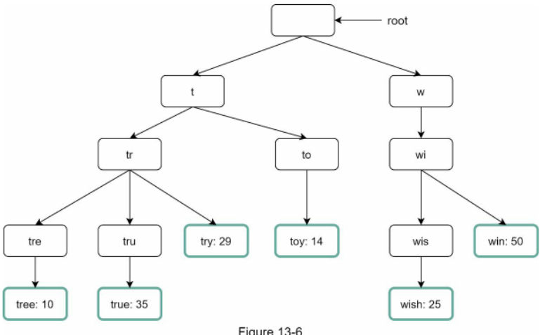

Hình 13-6

Tính năng autocomplete hoạt động như thế nào với trie? Trước khi đi sâu vào thuật toán, chúng ta hãy cùng định nghĩa một số thuật ngữ:
 * p: Độ dài của chuỗi tiền tố (prefix)
 * n: Tổng số nút trên cây trie
 * c: Số lượng nút con của một nút nhất định

Các bước để lấy ra top k truy vấn được tìm kiếm nhiều nhất gồm có:
1. Tìm nút tiền tố (prefix node). Độ phức tạp thời gian: O(p).
2. Duyệt cây con xuất phát từ nút tiền tố để lấy tất cả các nút con hợp lệ. Một nút con được coi là hợp lệ nếu nó tạo thành một chuỗi truy vấn hoàn chỉnh. Độ phức tạp thời gian: O(c).
3. Sắp xếp các nút con và lấy ra top k kết quả. Độ phức tạp thời gian: O(c log c).

Hãy cùng theo dõi một ví dụ như minh họa ở Hình 13-7 để hiểu rõ thuật toán. Giả sử k = 2 và người dùng gõ chữ "tr" vào ô tìm kiếm. Thuật toán hoạt động như sau:
 * Bước 1: Tìm nút tiền tố "tr".
 * Bước 2: Duyệt cây con để lấy toàn bộ các nút con hợp lệ. Trong trường hợp này, các nút [tree: 10], [true: 35], [try: 29] là hợp lệ.
 * Bước 3: Sắp xếp các nút con và chọn ra top 2. Kết quả là [true: 35] và [try: 29] là 2 truy vấn hàng đầu ứng với tiền tố "tr".


Độ phức tạp thời gian của thuật toán này là tổng thời gian thực thi của từng bước kể trên:

`O(p) + O(c) + O(c log c)`

Thuật toán trên rất trực quan và dễ hiểu. Tuy nhiên, nó quá chậm vì trong trường hợp xấu nhất, chúng ta buộc phải duyệt qua toàn bộ cây con của trie để thu thập top k kết quả. Dưới đây là hai kỹ thuật tối ưu hóa:
1. Giới hạn độ dài tối đa của tiền tố
2. Lưu bộ nhớ đệm (cache) top truy vấn tìm kiếm tại mỗi nút

Chúng ta hãy lần lượt phân tích từng kỹ thuật tối ưu hóa này.

### Limit the max length of a prefix (Giới hạn độ dài tối đa của tiền tố)

Người dùng hiếm khi gõ một chuỗi tìm kiếm quá dài vào ô tìm kiếm. Vì vậy, chúng ta hoàn toàn có thể giả định p là một số nguyên nhỏ, ví dụ bằng 50. Nếu chúng ta giới hạn độ dài của tiền tố, độ phức tạp thời gian cho thao tác "Tìm tiền tố" có thể được rút giảm từ O(p) xuống O(hằng số nhỏ), tức là O(1).

### Cache top search queries at each node (Lưu bộ nhớ đệm top truy vấn tại mỗi nút)

Để tránh phải duyệt qua toàn bộ cây con của trie, chúng ta lưu sẵn top k truy vấn được sử dụng thường xuyên nhất tại từng nút. Vì 5 đến 10 gợi ý autocomplete là đã đủ đối với người dùng, k là một số tương đối nhỏ. Trong trường hợp cụ thể của chúng ta, chỉ có top 5 truy vấn tìm kiếm được đưa vào bộ nhớ đệm.

Bằng việc lưu đệm top các truy vấn tại mọi nút, chúng ta giảm thiểu đáng kể độ phức tạp thời gian để lấy ra 5 truy vấn hàng đầu. Tuy nhiên, thiết kế này đòi hỏi tiêu tốn nhiều dung lượng bộ nhớ để lưu trữ các truy vấn này tại từng nút. Việc đánh đổi không gian lưu trữ lấy thời gian phản hồi (trading space for time) là hoàn toàn xứng đáng, bởi vì yêu cầu phản hồi nhanh chóng là tối quan trọng.

Hình 13-8 minh họa cấu trúc dữ liệu trie sau khi cập nhật. Top 5 truy vấn được lưu sẵn ở mỗi nút. Ví dụ, nút có tiền tố "be" sẽ lưu trữ thông tin: [best: 35, bet: 29, bee: 20, be: 15, beer: 10].

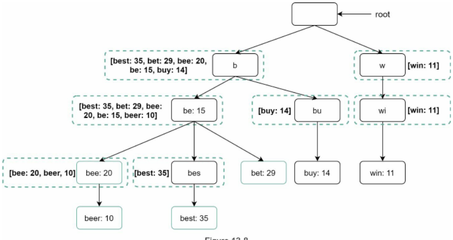

Hình 13-8

Hãy cùng xem lại độ phức tạp thời gian của thuật toán sau khi áp dụng hai kỹ thuật tối ưu hóa trên:
1. Tìm nút tiền tố: Độ phức tạp thời gian là O(1).
2. Trả về top k: Vì top k truy vấn đã được lưu đệm sẵn, độ phức tạp thời gian cho bước này là O(1).

Nhờ độ phức tạp của mỗi bước đều giảm về O(1), toàn bộ thuật toán của chúng ta chỉ mất O(1) thời gian để lấy ra top k truy vấn.

## Data gathering service (Dịch vụ thu thập dữ liệu)

Trong bản thiết kế trước, mỗi khi người dùng nhập một truy vấn, dữ liệu sẽ được cập nhật ngay lập tức theo thời gian thực. Phương pháp này hoàn toàn không khả thi vì hai lý do sau:
 * Người dùng có thể thực hiện hàng tỷ truy vấn mỗi ngày. Việc cập nhật trie trên từng truy vấn sẽ khiến dịch vụ truy vấn (query service) bị chậm đi đáng kể.
 * Các gợi ý hàng đầu thường không thay đổi quá nhiều sau khi cây trie đã được xây dựng. Do đó, việc cập nhật trie liên tục là điều không cần thiết.

Để thiết kế một data gathering service có khả năng mở rộng quy mô lớn, chúng ta cần phân tích dữ liệu đến từ đâu và được sử dụng như thế nào. Các ứng dụng thời gian thực như Twitter đòi hỏi các gợi ý autocomplete phải luôn mới nhất. Tuy nhiên, các gợi ý tìm kiếm cho nhiều từ khóa trên Google lại không biến động nhiều theo từng ngày. Bất chấp sự khác biệt về trường hợp sử dụng, nền tảng cốt lõi của data gathering service vẫn giữ nguyên, bởi vì dữ liệu dùng để xây dựng trie thường được trích xuất từ các dịch vụ phân tích (analytics) hoặc dịch vụ ghi log (logging services).

Hình 13-9 minh họa kiến trúc dịch vụ thu thập dữ liệu đã được tái thiết kế. Từng thành phần sẽ được phân tích chi tiết lần lượt.


Hình 13-9

**Analytics Logs (Nhật ký phân tích):** Nơi lưu trữ dữ liệu thô về các truy vấn tìm kiếm. File log hoạt động theo cơ chế chỉ nối thêm (append-only) và không được đánh chỉ mục. Bảng 13-3 minh họa một ví dụ về tệp nhật ký.

| query | time               |
| ----- | ------------------ |
| tree  | 2019-10-0122:01:01 |
| try   | 2019-10-0122:01:05 |
| tree  | 2019-10-0122:01:30 |
| toy   | 2019-10-0122:02:22 |
| tree  | 2019-10-0222:02:42 |
| try   | 2019-10-0322:03:03 |

Bảng 13-3

**Aggregators (Bộ tổng hợp dữ liệu):** Dung lượng của analytics logs thường rất lớn và dữ liệu không ở định dạng phù hợp. Chúng ta cần tổng hợp dữ liệu để hệ thống có thể xử lý dễ dàng. Tùy thuộc vào trường hợp sử dụng cụ thể, chúng ta có thể tổng hợp dữ liệu theo các chu kỳ khác nhau. Đối với các ứng dụng thời gian thực như Twitter, dữ liệu được tổng hợp theo khoảng thời gian ngắn hơn vì kết quả tức thời là rất quan trọng. Mặt khác, việc tổng hợp dữ liệu với tần suất thấp hơn, chẳng hạn mỗi tuần một lần, là đủ tốt cho phần lớn các trường hợp sử dụng khác. Trong một buổi phỏng vấn, hãy xác nhận xem kết quả thời gian thực có phải là yếu tố bắt buộc hay không. Ở đây, chúng ta giả định cây trie được xây dựng lại hàng tuần.

### Aggregated Data. (Dữ liệu tổng hợp)

Bảng 13-4 minh họa một ví dụ về dữ liệu đã được tổng hợp hàng tuần. Trường "time" thể hiện thời điểm bắt đầu của một tuần. Trường "frequency" là tổng số lần xuất hiện của truy vấn tương ứng trong tuần đó.

| query | Time       | frequency |
| ----- | ---------- | --------- |
| tree  | 2019-10-01 | 12000     |
| tree  | 2019-10-08 | 15000     |
| tree  | 2019-10-15 | 9000      |
| toy   | 2019-10-01 | 8500      |
| toy   | 2019-10-08 | 6256      |
| toy   | 2019-10-15 | 8866      |

Bảng 13-4

**Workers (Các máy chủ xử lý tác vụ):** Workers là tập hợp các máy chủ thực thi các tác vụ bất đồng bộ theo chu kỳ định sẵn. Chúng chịu trách nhiệm xây dựng cấu trúc dữ liệu trie và lưu trữ vào Trie DB.

**Trie Cache:** Trie Cache là một hệ thống bộ nhớ đệm phân tán lưu giữ cây trie trên bộ nhớ RAM để phục vụ các truy vấn đọc cực nhanh. Nó chụp bản sao snapshot của database hàng tuần.

**Trie DB:** Trie DB là kho lưu trữ bền vững (persistent storage). Có hai lựa chọn khả dĩ để lưu trữ dữ liệu:
1. Document store (Cơ sở dữ liệu dạng tài liệu): Do cây trie mới được xây dựng hàng tuần, chúng ta có thể định kỳ chụp snapshot của nó, tiến hành tuần tự hóa (serialize) và lưu trữ dữ liệu đã tuần tự hóa vào cơ sở dữ liệu. Các cơ sở dữ liệu tài liệu như MongoDB [4] rất phù hợp cho việc lưu trữ loại dữ liệu tuần tự hóa này.
2. Key-value store: Một cây trie có thể được biểu diễn dưới dạng bảng băm (hash table) [4] bằng cách áp dụng logic sau:
 * Mọi tiền tố trong trie được ánh xạ thành một khóa (key) trong bảng băm.
 * Dữ liệu tại mỗi nút trie được ánh xạ thành một giá trị (value) tương ứng trong bảng băm.

Hình 13-10 minh họa mối quan hệ ánh xạ giữa cây trie và bảng băm.


Hình 13-10

Trong Hình 13-10, mỗi nút trie ở phía bên trái được ánh xạ trực tiếp thành cặp `<key, value>` ở phía bên phải. Nếu bạn chưa rõ cách thức hoạt động của key-value store, hãy tham khảo Chương 6: Thiết kế kho lưu trữ khóa - giá trị.

## Query service (Dịch vụ truy vấn)

Trong bản thiết kế mức cao, query service gọi trực tiếp tới cơ sở dữ liệu để lấy top 5 kết quả. Hình 13-11 minh họa bản thiết kế cải tiến, khắc phục sự kém hiệu quả của thiết kế trước.


Hình 13-11

1. Truy vấn tìm kiếm được gửi tới load balancer.
2. Load balancer định tuyến yêu cầu tới các API servers.
3. API servers lấy dữ liệu trie từ Trie Cache và tổng hợp các gợi ý tự động hoàn thành cho client.
4. Trong trường hợp dữ liệu không có sẵn trong Trie Cache (cache miss), chúng ta sẽ nạp bổ sung dữ liệu ngược trở lại cache. Nhờ đó, tất cả các yêu cầu tiếp theo cho cùng một tiền tố sẽ được phục vụ trực tiếp từ cache. Hiện tượng cache miss có thể xảy ra khi máy chủ cache bị đầy bộ nhớ hoặc gặp sự cố ngoại tuyến.

Dịch vụ truy vấn đòi hỏi tốc độ phản hồi nhanh như chớp. Chúng tôi đề xuất các giải pháp tối ưu hóa sau:
 * Yêu cầu AJAX (AJAX request): Đối với các ứng dụng web, trình duyệt thường gửi các yêu cầu AJAX để lấy kết quả autocomplete. Lợi ích lớn nhất của AJAX là việc gửi yêu cầu và nhận phản hồi không làm tải lại toàn bộ trang web.
 * Lưu bộ nhớ đệm trên trình duyệt (Browser caching): Đối với nhiều ứng dụng, các gợi ý tìm kiếm autocomplete không thay đổi nhiều trong một khoảng thời gian ngắn. Do đó, các gợi ý này có thể được lưu trữ trực tiếp trong bộ nhớ đệm của trình duyệt để các yêu cầu tiếp theo lấy kết quả từ cache ngay lập tức. Công cụ tìm kiếm Google cũng sử dụng chính cơ chế bộ nhớ đệm này. Hình 13-12 minh họa response header khi bạn gõ cụm từ "system design interview" trên công cụ tìm kiếm Google. Có thể thấy, Google lưu đệm kết quả trên trình duyệt trong vòng 1 giờ. Lưu ý: chỉ thị "private" trong `cache-control` nghĩa là kết quả chỉ dành riêng cho một người dùng duy nhất và không được phép lưu trên các shared cache (bộ nhớ đệm dùng chung). Chỉ thị "max-age=3600" có nghĩa là bộ nhớ đệm có hiệu lực trong 3600 giây, tương đương 1 giờ.

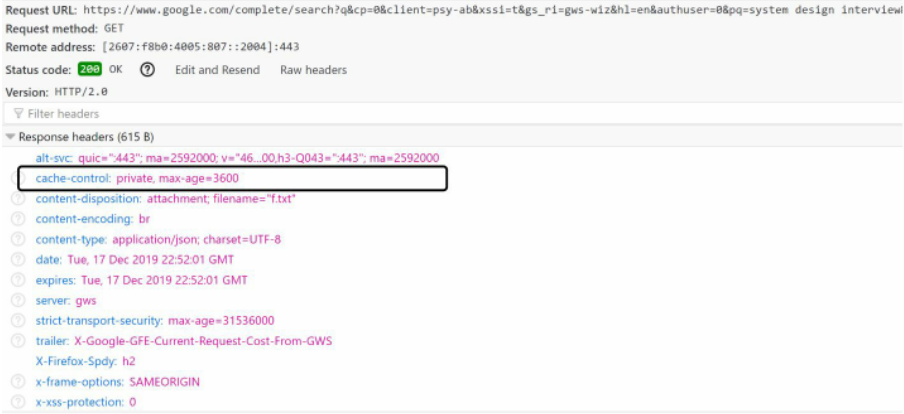

Hình 13-12

 * Lấy mẫu dữ liệu (Data sampling): Đối với một hệ thống quy mô lớn, việc ghi log toàn bộ mọi truy vấn tìm kiếm đòi hỏi năng lực xử lý và dung lượng lưu trữ cực kỳ tốn kém. Kỹ thuật lấy mẫu dữ liệu đóng vai trò rất quan trọng. Ví dụ: hệ thống chỉ ghi nhận log cho 1 trong mỗi N yêu cầu gửi lên.

## Trie operations (Các thao tác trên cây Trie)

Trie là thành phần cốt lõi của hệ thống tự động hoàn thành. Chúng ta hãy cùng phân tích cách thức vận hành của các thao tác trên trie: tạo mới (create), cập nhật (update) và xóa (delete).

### Create (Tạo mới)

Cây trie được tạo bởi các workers sử dụng dữ liệu đã tổng hợp. Nguồn dữ liệu xuất phát từ Analytics Log/DB.

### Update (Cập nhật)

Có hai phương pháp để cập nhật trie:

Lựa chọn 1: Cập nhật trie hàng tuần. Ngay khi một cây trie mới được xây dựng xong, nó sẽ thay thế hoàn toàn cây trie cũ.

Lựa chọn 2: Cập nhật trực tiếp từng nút trie riêng lẻ. Chúng ta cố gắng hạn chế thao tác này vì nó diễn ra rất chậm. Tuy nhiên, nếu kích thước của trie nhỏ, đây là một giải pháp chấp nhận được. Khi cập nhật một nút trie, toàn bộ các nút tổ tiên của nó ngược lên tận nút gốc đều phải được cập nhật lại, vì các nút tổ tiên lưu trữ danh sách top truy vấn của các nút con. Hình 13-13 minh họa một ví dụ về thao tác cập nhật. Ở phía bên trái, truy vấn tìm kiếm "beer" có giá trị ban đầu là 10. Ở phía bên phải, giá trị này được cập nhật lên 30. Như bạn thấy, nút đó và tất cả các nút tổ tiên đều được cập nhật giá trị của "beer" thành 30.


### Delete (Xóa)

Chúng ta bắt buộc phải loại bỏ các gợi ý tự động hoàn thành mang nội dung thù địch, bạo lực, khiêu dâm hoặc nguy hiểm. Chúng ta bổ sung một tầng lọc (filter layer) đặt phía trước Trie Cache (Hình 13-14) để lọc bỏ các gợi ý không mong muốn. Sự hiện diện của tầng lọc mang lại sự linh hoạt trong việc loại bỏ kết quả dựa trên các quy tắc lọc khác nhau. Các gợi ý không mong muốn sẽ được xóa vật lý khỏi cơ sở dữ liệu một cách bất đồng bộ để tập dữ liệu chuẩn xác được sử dụng cho lần xây dựng trie ở chu kỳ tiếp theo.

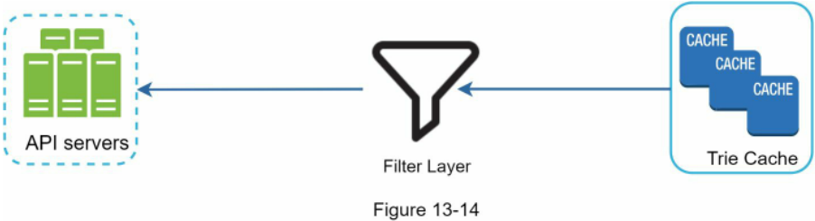

## Scale the storage (Mở rộng quy mô lưu trữ)

Bây giờ khi đã phát triển hoàn chỉnh một hệ thống cung cấp các truy vấn autocomplete cho người dùng, đã đến lúc giải quyết bài toán mở rộng quy mô khi cây trie phình to vượt quá khả năng lưu trữ của một máy chủ đơn lẻ.

Vì tiếng Anh là ngôn ngữ duy nhất được hỗ trợ, một cách phân mảnh (shard) trực quan là dựa trên ký tự đầu tiên. Dưới đây là một số ví dụ:
 * Nếu chúng ta cần hai máy chủ lưu trữ, chúng ta có thể lưu các truy vấn bắt đầu từ 'a' đến 'm' trên máy chủ thứ nhất, và từ 'n' đến 'z' trên máy chủ thứ hai.
 * Nếu chúng ta cần ba máy chủ, chúng ta có thể chia các truy vấn thành các nhóm: từ 'a' đến 'i', từ 'j' đến 'r', và từ 's' đến 'z'.

Theo logic này, chúng ta có thể phân mảnh tối đa lên tới 26 máy chủ tương ứng với 26 chữ cái trong bảng chữ cái tiếng Anh. Chúng ta định nghĩa việc phân mảnh dựa trên ký tự đầu tiên là phân mảnh cấp độ một (first level sharding). Để mở rộng vượt quá 26 máy chủ, chúng ta có thể tiếp tục phân mảnh ở cấp độ hai hoặc thậm chí cấp độ ba. Ví dụ, các truy vấn bắt đầu bằng chữ cái 'a' có thể được chia tiếp sang 4 máy chủ: 'aa-ag', 'ah-an', 'ao-au' và 'av-az'.

Thoạt nhìn, cách tiếp cận này có vẻ hợp lý cho đến khi bạn nhận ra rằng số lượng từ bắt đầu bằng chữ cái 'c' nhiều hơn rất nhiều so với các từ bắt đầu bằng chữ cái 'x'. Điều này dẫn đến sự mất cân bằng nghiêm trọng trong việc phân bổ dữ liệu.

Để giảm thiểu sự mất cân bằng dữ liệu, chúng ta phân tích mô hình phân bổ dữ liệu lịch sử và áp dụng logic phân mảnh thông minh hơn như minh họa ở Hình 13-15. Bộ quản lý bản đồ phân mảnh (shard map manager) duy trì một cơ sở dữ liệu tra cứu để xác định chính xác mỗi bản ghi nên được lưu trữ ở đâu. Ví dụ, nếu số lượng truy vấn trong lịch sử cho chữ cái 's' tương đương với tổng số lượng truy vấn của các chữ cái 'u', 'v', 'w', 'x', 'y' và 'z' gộp lại, chúng ta có thể duy trì hai phân mảnh: một phân mảnh dành riêng cho 's' và một phân mảnh chứa các truy vấn từ 'u' đến 'z'.

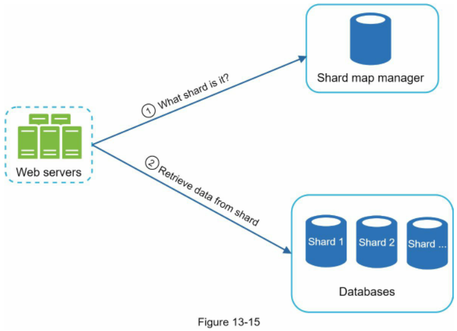

Hình 13-13

# Step 4 - Wrap up (Bước 4 - Tổng kết)

Sau khi hoàn thành phần phân tích sâu, người phỏng vấn có thể đặt thêm một số câu hỏi tiếp nối (follow-up questions).

Người phỏng vấn: Bạn mở rộng thiết kế như thế nào để hỗ trợ đa ngôn ngữ?

Để hỗ trợ các truy vấn không phải tiếng Anh, chúng ta lưu các ký tự Unicode vào các nút trie. Nếu bạn chưa quen thuộc với Unicode, đây là định nghĩa: "một tiêu chuẩn mã hóa bao quát toàn bộ các ký tự cho mọi hệ thống chữ viết trên thế giới, cả hiện đại lẫn cổ đại" [5].

Người phỏng vấn: Điều gì sẽ xảy ra nếu các truy vấn tìm kiếm hàng đầu ở một quốc gia khác biệt hoàn toàn so với các quốc gia khác?

Trong trường hợp này, chúng ta có thể xây dựng các cây trie riêng biệt cho từng quốc gia khác nhau. Để cải thiện thời gian phản hồi, chúng ta có thể lưu các cây trie này trên các CDN.

Người phỏng vấn: Làm thế nào chúng ta có thể hỗ trợ các truy vấn tìm kiếm theo xu hướng thời gian thực (trending)?

Giả sử có một sự kiện thời sự bùng nổ, một từ khóa tìm kiếm đột nhiên trở nên cực kỳ phổ biến. Bản thiết kế ban đầu của chúng ta sẽ không hoạt động hiệu quả vì:
 * Các offline workers chưa được lên lịch chạy để cập nhật trie, bởi tác vụ này chỉ được cấu hình chạy hàng tuần.
 * Ngay cả khi được lên lịch, việc xây dựng lại toàn bộ cây trie cũng mất quá nhiều thời gian.

Việc xây dựng một hệ thống autocomplete thời gian thực là bài toán phức tạp và nằm ngoài phạm vi cuốn sách này, do đó chúng tôi chỉ đưa ra một vài ý tưởng gợi mở:
 * Thu nhỏ tập dữ liệu làm việc (working data set) thông qua kỹ thuật phân mảnh (sharding).
 * Thay đổi mô hình xếp hạng (ranking model) và gán trọng số cao hơn cho các truy vấn tìm kiếm gần đây.
 * Dữ liệu có thể đến dưới dạng các luồng (streams), do đó chúng ta không thể truy cập toàn bộ dữ liệu cùng một lúc. Dữ liệu dạng luồng (streaming data) nghĩa là dữ liệu được sinh ra liên tục. Việc xử lý luồng đòi hỏi một tập hợp các hệ thống chuyên biệt khác: Apache Hadoop MapReduce [6], Apache Spark Streaming [7], Apache Storm [8], Apache Kafka [9]... Do tất cả các chủ đề này đều đòi hỏi kiến thức chuyên ngành sâu, chúng tôi sẽ không đi sâu vào chi tiết tại đây.

Chúc mừng bạn đã đi được một chặng đường dài đến đây! Hãy tự thưởng cho bản thân một lời khen ngợi. Bạn đã làm rất tốt!

# Reference materials (Tài liệu tham khảo)
