[1] Vòng đời của một truy vấn gợi ý tìm kiếm (The Life of a Typeahead Query): https://www.facebook.com/notes/facebookengineering/the-life-of-a-typeahead-query/389105248919/  
[2] Cách chúng tôi xây dựng Prefixy: Dịch vụ tìm kiếm tiền tố có khả năng mở rộng quy mô phục vụ tính năng tự động hoàn thành (How We Built Prefixy: A Scalable Prefix Search Service for Powering Autocomplete): https://medium.com/@prefixyteam/how-we-built-prefixy-a-scalable-prefix-search-servicefor-powering-autocomplete-c20f98e2eff1  
[3] Cây băm tiền tố - Cấu trúc dữ liệu đánh chỉ mục trên bảng băm phân tán (Prefix Hash Tree An Indexing Data Structure over Distributed Hash Tables): https://people.eecs.berkeley.edu/~sylvia/papers/pht.pdf  
[4] Wikipedia về MongoDB: https://en.wikipedia.org/wiki/MongoDB  
[5] Các câu hỏi thường gặp về Unicode (Unicode frequently asked questions): https://www.unicode.org/faq/basic\_q.html  
[6] Apache Hadoop: https://hadoop.apache.org/  
[7] Spark Streaming: https://spark.apache.org/streaming/  
[8] Apache Storm: https://storm.apache.org/  
[9] Apache Kafka: https://kafka.apache.org/documentation/

# CHAPTER 14: DESIGN YOUTUBE (CHƯƠNG 14: THIẾT KẾ YOUTUBE)

Trong chương này, bạn được yêu cầu thiết kế YouTube. Lời giải cho bài toán này cũng có thể áp dụng cho các câu hỏi phỏng vấn thiết kế nền tảng chia sẻ video khác như Netflix hay Hulu. Hình 14-1 minh họa trang chủ của YouTube.


Hình 14-1

Thoạt nhìn, YouTube có vẻ rất đơn giản: người sáng tạo nội dung tải lên video và người xem chỉ việc nhấn phát (play). Nhưng liệu nó có thực sự đơn giản như vậy? Hoàn toàn không. Ẩn sau sự đơn giản đó là vô số công nghệ phức tạp. Hãy cùng điểm qua một số thống kê ấn tượng, số liệu nhân khẩu học và các sự thật thú vị về YouTube vào năm 2020 [1] [2]:

 * Tổng số người dùng hoạt động hàng tháng (Monthly Active Users - MAU): 2 tỷ.
 * Số lượng video được xem mỗi ngày: 5 tỷ.
 * 73% người trưởng thành tại Mỹ sử dụng YouTube.
 * 50 triệu người sáng tạo nội dung trên YouTube.
 * Doanh thu quảng cáo của YouTube đạt 15,1 tỷ USD cho cả năm 2019, tăng 36% so với năm 2018.
 * YouTube chiếm tới 37% tổng lưu lượng truy cập Internet trên thiết bị di động.
 * YouTube hỗ trợ 80 ngôn ngữ khác nhau.

Từ những số liệu thống kê này, chúng ta có thể thấy YouTube là một hệ thống khổng lồ, mang tính toàn cầu và tạo ra nguồn doanh thu rất lớn.

# Step 1 - Understand the problem and establish design scope (Bước 1 - Hiểu bài toán và xác định phạm vi thiết kế)

Như được thể hiện trong Hình 14-1, bên cạnh việc xem video, bạn còn có thể làm được nhiều tác vụ khác trên YouTube. Ví dụ như bình luận, chia sẻ, thích video, lưu video vào danh sách phát, đăng ký theo dõi kênh, v.v. Việc thiết kế toàn bộ các tính năng này trong một buổi phỏng vấn kéo dài từ 45 đến 60 phút là bất khả thi. Do đó, việc đặt câu hỏi để thu hẹp phạm vi bài toán là cực kỳ quan trọng.

 * **Ứng viên:** Những tính năng nào là quan trọng nhất?
 * **Người phỏng vấn:** Khả năng tải video lên (upload) và xem video (stream).
 * **Ứng viên:** Hệ thống cần hỗ trợ những loại client (ứng dụng phía người dùng) nào?
 * **Người phỏng vấn:** Ứng dụng di động, trình duyệt web và smart TV.
 * **Ứng viên:** Hệ thống có bao nhiêu người dùng hoạt động hàng ngày (Daily Active Users - DAU)?
 * **Người phỏng vấn:** 5 triệu DAU.
 * **Ứng viên:** Thời gian trung bình mỗi ngày người dùng sử dụng sản phẩm là bao lâu?
 * **Người phỏng vấn:** 30 phút.
 * **Ứng viên:** Chúng ta có cần hỗ trợ người dùng quốc tế không?
 * **Người phỏng vấn:** Có, tỷ lệ người dùng quốc tế chiếm phần rất lớn.
 * **Ứng viên:** Các độ phân giải video nào cần được hỗ trợ?
 * **Người phỏng vấn:** Hệ thống chấp nhận hầu hết các độ phân giải và định dạng video phổ biến.
 * **Ứng viên:** Có yêu cầu mã hóa (encryption) không?
 * **Người phỏng vấn:** Có.
 * **Ứng viên:** Kích thước tệp video có giới hạn gì không?
 * **Người phỏng vấn:** Nền tảng của chúng ta tập trung vào các video cỡ vừa và nhỏ. Kích thước video tối đa cho phép là 1GB.
 * **Ứng viên:** Chúng ta có thể tận dụng một số dịch vụ hạ tầng đám mây hiện có của Amazon, Google hoặc Microsoft không?
 * **Người phỏng vấn:** Câu hỏi rất hay. Với phần lớn các công ty, việc xây dựng mọi thứ từ đầu là không thực tế, vì vậy bạn nên tận dụng các dịch vụ đám mây có sẵn.

Trong chương này, chúng ta sẽ tập trung vào việc thiết kế một dịch vụ phát video trực tuyến (video streaming service) với các tính năng sau:
 * Khả năng tải video lên nhanh chóng.
 * Phát video trực tuyến mượt mà.
 * Khả năng chuyển đổi linh hoạt chất lượng video.
 * Chi phí hạ tầng thấp.
 * Đáp ứng các yêu cầu cao về tính sẵn sàng (high availability), khả năng mở rộng (scalability) và độ tin cậy (reliability).
 * Hỗ trợ các client: ứng dụng di động, trình duyệt web và smart TV.

## Back-of-the-envelope estimation (Ước lượng sơ bộ)

> 💡 **Giải thích thêm:** "Back-of-the-envelope estimation" (ước tính nhanh trên phong bì) là thuật ngữ chỉ các phép tính nhẩm phác thảo dựa trên các giả định hợp lý nhằm nhanh chóng định cỡ quy mô hệ thống (dung lượng lưu trữ, băng thông, QPS, chi phí) trước khi đi vào thiết kế chi tiết.
> Nguồn tham khảo: https://en.wikipedia.org/wiki/Back-of-the-envelope_calculation

Các ước tính dưới đây dựa trên nhiều giả định, vì vậy bạn cần trao đổi kỹ với người phỏng vấn để đảm bảo hai bên thống nhất quan điểm:
 * Giả định sản phẩm có 5 triệu người dùng hoạt động hàng ngày (DAU).
 * Mỗi người dùng xem 5 video mỗi ngày.
 * 10% người dùng tải lên 1 video mỗi ngày.
 * Giả định kích thước trung bình của một video là 300 MB.
 * Tổng dung lượng lưu trữ cần thiết mỗi ngày: 5 triệu * 10% * 300 MB = 150 TB.

 * Chi phí CDN (Content Delivery Network - Mạng phân phối nội dung):
 * Khi CDN đám mây phân phối một video, bạn sẽ bị tính phí dựa trên lượng dữ liệu truyền ra ngoài (data egress) từ CDN.
 * Hãy lấy dịch vụ CDN CloudFront của Amazon để ước tính chi phí (Hình 14-2) [3]. Giả định 100% lưu lượng truy cập được phục vụ tại Hoa Kỳ. Chi phí trung bình cho mỗi GB là $0,02. Để đơn giản hóa, chúng ta chỉ tính riêng chi phí phát video trực tuyến.
 * 5 triệu * 5 video * 0,3 GB * $0,02 = 150.000 USD mỗi ngày.

Từ phép tính chi phí sơ bộ này, chúng ta nhận thấy việc phân phối video qua CDN tiêu tốn một khoản kinh phí rất lớn. Mặc dù các nhà cung cấp dịch vụ đám mây luôn sẵn sàng giảm giá CDN đáng kể cho các khách hàng lớn, con số này vẫn vô cùng đáng kể. Chúng ta sẽ cùng thảo luận các phương án cắt giảm chi phí CDN trong phần đi sâu vào chi tiết thiết kế.

Hình 14-2 Bảng giá theo nhu cầu (On-demand pricing) cho dữ liệu truyền ra Internet (tính trên mỗi GB).

| Mỗi tháng       | Hoa Kỳ & Canada | Châu Âu & Israel | Nam Phi & Trung Đông | Nam Mỹ | Nhật Bản | Úc     | Singapore, Hàn Quốc, Đài Loan, Hồng Kông & Philippines | Ấn Độ  |
| --------------- | --------------- | ---------------- | -------------------- | ------ | -------- | ------ | ------------------------------------------------------ | ------ |
| 10TB đầu tiên   | $0.085          | $0.085           | $0.110               | $0.110 | $0.114   | $0.114 | $0.140                                                 | $0.170 |
| 40TB tiếp theo  | $0.080          | $0.080           | $0.105               | $0.105 | $0.089   | $0.098 | $0.135                                                 | $0.130 |
| 100TB tiếp theo | $0.060          | $0.060           | $0.090               | $0.090 | $0.086   | $0.094 | $0.120                                                 | $0.110 |
| 350TB tiếp theo | $0.040          | $0.040           | $0.080               | $0.080 | $0.084   | $0.092 | $0.100                                                 | $0.100 |
| 524TB tiếp theo | $0.030          | $0.030           | $0.060               | $0.060 | $0.080   | $0.090 | $0.080                                                 | $0.100 |
| 4PB tiếp theo   | $0.025          | $0.025           | $0.050               | $0.050 | $0.070   | $0.085 | $0.070                                                 | $0.100 |
| Trên 5PB        | $0.020          | $0.020           | $0.040               | $0.040 | $0.060   | $0.080 | $0.060                                                 | $0.100 |

# Step 2 - Propose high-level design and get buy-in (Bước 2 - Đề xuất thiết kế cấp cao và thống nhất phương án)

Như đã thống nhất trước đó, người phỏng vấn khuyến nghị nên tận dụng các dịch vụ đám mây hiện có thay vì tự xây dựng toàn bộ từ đầu. CDN và lưu trữ blob (Blob storage - Binary Large Object storage, dịch vụ lưu trữ đối tượng nhị phân lớn) là các dịch vụ đám mây mà chúng ta sẽ sử dụng. Một số độc giả có thể thắc mắc: tại sao chúng ta không tự xây dựng mọi thứ? Các lý do được liệt kê dưới đây:
 * Phỏng vấn thiết kế hệ thống không nhằm mục đích tự phát minh lại bánh xe từ con số không. Trong khoảng thời gian giới hạn, việc chọn đúng công nghệ để giải quyết tốt bài toán quan trọng hơn nhiều so với việc giải thích cặn kẽ cơ chế hoạt động chi tiết của công nghệ đó. Ví dụ, việc đề xuất sử dụng blob storage để lưu trữ các video gốc là đã đủ cho buổi phỏng vấn. Việc sa đà vào thiết kế chi tiết một hệ thống blob storage sẽ là quá tải và không cần thiết (overkill).
 * Tự xây dựng một hệ sinh thái blob storage hay CDN có khả năng mở rộng là việc cực kỳ phức tạp và tốn kém. Ngay cả các tập đoàn công nghệ lớn như Netflix hay Facebook cũng không tự xây dựng tất cả mọi thứ. Netflix tận dụng dịch vụ đám mây của Amazon [4], còn Facebook sử dụng CDN của Akamai [5].

Ở mức tổng quan cấp cao, hệ thống gồm ba thành phần chính (Hình 14-3).

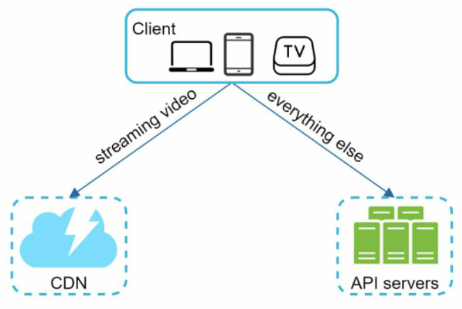

Hình 14-3

Client: Bạn có thể xem YouTube trên máy tính, điện thoại di động và smart TV.

CDN: Các video được lưu trữ tại CDN. Khi bạn nhấn phát, video sẽ được truyền trực tiếp (stream) từ CDN.

API servers: Tất cả mọi tác vụ khác ngoài việc phát video trực tuyến đều đi qua các máy chủ API. Điều này bao gồm thuật toán đề xuất bảng tin (feed recommendation), tạo URL để tải video lên, cập nhật cơ sở dữ liệu và bộ nhớ đệm siêu dữ liệu (metadata cache), đăng ký tài khoản người dùng, v.v.

Trong phần hỏi đáp, người phỏng vấn thể hiện sự quan tâm đặc biệt tới hai luồng xử lý chính:
 * Luồng tải lên video (Video uploading flow)
 * Luồng phát video trực tuyến (Video streaming flow)

Chúng ta sẽ cùng tìm hiểu thiết kế cấp cao cho từng luồng này.

## Video uploading flow (Luồng tải lên video)

Hình 14-4 thể hiện thiết kế cấp cao cho việc tải lên video.

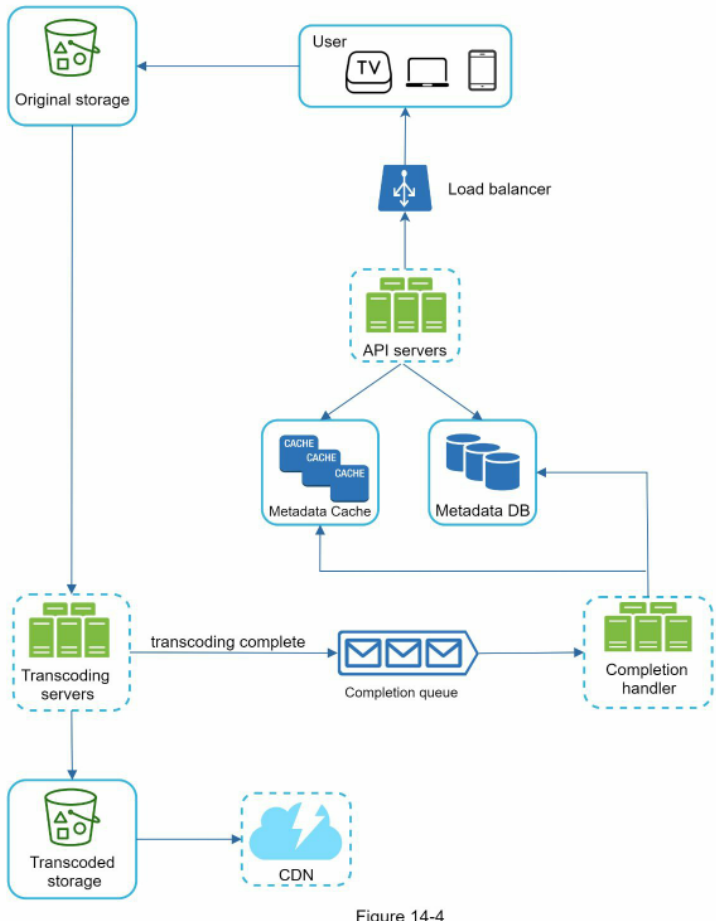

Hình 14-4

Luồng này bao gồm các thành phần sau:
 * User (Người dùng): Người dùng sử dụng YouTube trên các thiết bị như máy tính, điện thoại di động hoặc smart TV.
 * Load balancer (Bộ cân bằng tải): Phân phối đều các yêu cầu từ phía người dùng đến các máy chủ API.
 * API servers: Tiếp nhận và xử lý toàn bộ các yêu cầu của người dùng, ngoại trừ tác vụ phát video trực tuyến.
 * Metadata DB (Cơ sở dữ liệu siêu dữ liệu): Lưu trữ thông tin siêu dữ liệu của video. Cơ sở dữ liệu này được phân mảnh (sharded) và sao chép nhân bản (replicated) nhằm đáp ứng các yêu cầu về hiệu năng và tính sẵn sàng cao.
 * Metadata cache: Để tối ưu hóa hiệu năng truy xuất, siêu dữ liệu của video và các đối tượng người dùng được lưu tạm trên bộ nhớ đệm.
 * Original storage (Lưu trữ gốc): Hệ thống blob storage dùng để lưu các tệp video gốc ban đầu. Một trích dẫn trên Wikipedia về blob storage định nghĩa: "Một đối tượng nhị phân lớn (Binary Large Object - BLOB) là một tập hợp dữ liệu nhị phân được lưu trữ dưới dạng một thực thể đơn lẻ trong hệ quản trị cơ sở dữ liệu" [6].
 * Transcoding servers (Máy chủ chuyển mã): Chuyển mã video (video transcoding) còn được gọi là mã hóa video (video encoding). Đây là quá trình chuyển đổi một định dạng video sang các định dạng khác (MPEG, HLS, v.v.), nhằm cung cấp các luồng video tối ưu nhất cho nhiều loại thiết bị và các mức băng thông mạng khác nhau.
 * Transcoded storage (Lưu trữ đã chuyển mã): Là hệ thống blob storage lưu trữ các tệp video đã hoàn tất quá trình chuyển mã.
 * CDN: Các video được lưu tạm trên CDN. Khi bạn nhấp vào nút phát, video sẽ được truyền trực tiếp từ máy chủ CDN.
 * Completion queue (Hàng đợi hoàn tất): Là một hàng đợi thông điệp (message queue) lưu trữ thông tin về các sự kiện hoàn tất chuyển mã video.
 * Completion handler (Bộ xử lý hoàn tất): Bao gồm một tập hợp các tiến trình xử lý (worker) liên tục lấy dữ liệu sự kiện từ hàng đợi hoàn tất để cập nhật vào bộ nhớ đệm và cơ sở dữ liệu siêu dữ liệu.

Sau khi đã nắm rõ từng thành phần đơn lẻ, chúng ta hãy cùng xem luồng tải lên video hoạt động ra sao. Toàn bộ luồng được chia thành hai tiến trình chạy song song:

a. Tải lên tệp video thực tế.

b. Cập nhật siêu dữ liệu của video. Siêu dữ liệu bao gồm thông tin về URL video, kích thước, độ phân giải, định dạng, thông tin người dùng, v.v.

### Flow a: upload the actual video (Luồng a: tải lên video thực tế)

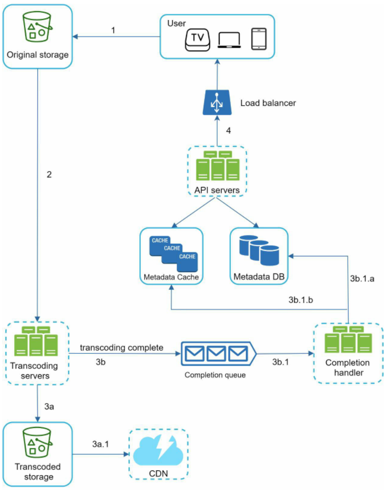

Hình 14-5

Hình 14-5 mô tả quy trình tải lên tệp video thực tế. Các bước diễn ra như sau:
1. Video được tải trực tiếp lên bộ lưu trữ gốc.
2. Các máy chủ chuyển mã lấy video từ bộ lưu trữ gốc và bắt đầu tiến trình chuyển mã.
3. Ngay khi quá trình chuyển mã hoàn tất, hai bước sau được thực thi song song:

   3a. Các video đã chuyển mã được chuyển tới bộ lưu trữ đã chuyển mã.

   3b. Các sự kiện thông báo chuyển mã thành công được đẩy vào hàng đợi hoàn tất.

   3a.1. Video đã chuyển mã được phân phối tới mạng lưới CDN.

   3b.1. Bộ xử lý hoàn tất bao gồm một nhóm các worker liên tục rút dữ liệu sự kiện từ hàng đợi.

   3b.1.a và 3b.1.b. Bộ xử lý hoàn tất cập nhật cơ sở dữ liệu và bộ nhớ đệm siêu dữ liệu ngay khi tác vụ chuyển mã video hoàn thành.
4. Các máy chủ API gửi phản hồi thông báo cho client rằng video đã tải lên thành công và sẵn sàng để phát trực tuyến.

### Flow b: update the metadata (Luồng b: cập nhật siêu dữ liệu)

Trong khi tệp video đang được tải lên bộ lưu trữ gốc, client đồng thời gửi một yêu cầu song song để cập nhật siêu dữ liệu của video như minh họa trong Hình 14-6. Yêu cầu này chứa các thông tin siêu dữ liệu như tên tệp, kích thước, định dạng, v.v. Các máy chủ API sẽ tiếp nhận và cập nhật vào bộ nhớ đệm cùng cơ sở dữ liệu siêu dữ liệu.

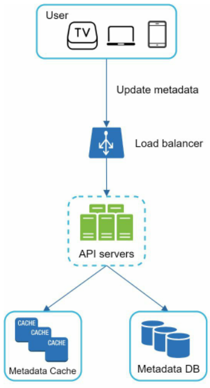

Hình 14-6

## Video streaming flow (Luồng phát video trực tuyến)

Bất cứ khi nào bạn xem một video trên YouTube, video đó thường bắt đầu phát ngay lập tức mà bạn không cần phải đợi tải toàn bộ tệp về máy. Tải xuống (downloading) có nghĩa là toàn bộ tệp video được sao chép về thiết bị của bạn, trong khi phát trực tuyến (streaming) có nghĩa là thiết bị của bạn liên tục nhận các luồng dữ liệu video từ nguồn video máy chủ từ xa. Khi xem video trực tuyến, client chỉ tải một lượng nhỏ dữ liệu tại mỗi thời điểm, cho phép bạn thưởng thức video liên tục và tức thì.

Trước khi đi sâu vào luồng phát trực tuyến, hãy cùng xem xét một khái niệm quan trọng: giao thức phát trực tuyến (streaming protocol). Đây là phương thức chuẩn hóa để kiểm soát việc truyền dữ liệu phục vụ phát video. Một số giao thức phát trực tuyến phổ biến gồm có:
 * MPEG-DASH: MPEG là viết tắt của "Moving Picture Experts Group" và DASH là viết tắt của "Dynamic Adaptive Streaming over HTTP".
 * Apple HLS: HLS là viết tắt của "HTTP Live Streaming".
 * Microsoft Smooth Streaming.
 * Adobe HTTP Dynamic Streaming (HDS).

Bạn không nhất thiết phải hiểu tường tận hay học thuộc tên của các giao thức phát trực tuyến này, bởi chúng là các chi tiết cấp thấp đòi hỏi kiến thức chuyên môn sâu. Điều quan trọng cốt lõi ở đây là cần hiểu rằng các giao thức phát trực tuyến khác nhau sẽ hỗ trợ các chuẩn mã hóa video và trình phát (playback player) khác nhau. Khi thiết kế dịch vụ phát trực tuyến, chúng ta cần chọn giao thức phù hợp nhất với trường hợp sử dụng của mình. Bạn có thể tham khảo thêm một bài viết rất hay về các giao thức streaming tại [7].

Video được phát trực tiếp từ CDN. Máy chủ biên (edge server) ở gần bạn nhất sẽ đảm nhận việc truyền dữ liệu video, nhờ đó độ trễ là cực kỳ thấp. Hình 14-7 thể hiện thiết kế cấp cao cho luồng phát video trực tuyến.


Hình 14-7

# Step 3 - Design deep dive (Bước 3 - Đi sâu vào chi tiết thiết kế)

Trong phần thiết kế cấp cao, toàn bộ hệ thống đã được phân tách thành hai phần: luồng tải lên video và luồng phát video trực tuyến. Trong mục này, chúng ta sẽ tối ưu hóa cả hai luồng bằng các cải tiến quan trọng và bổ sung cơ chế xử lý lỗi hoàn chỉnh.

## Video transcoding (Chuyển mã video)

Khi bạn quay một video, thiết bị (thường là điện thoại hoặc máy quay) sẽ tạo ra tệp video theo một định dạng nhất định. Nếu muốn video phát mượt mà trên các thiết bị khác, video đó cần được mã hóa sang các định dạng và tốc độ bit (bitrate - số bit được xử lý trong một đơn vị thời gian) tương thích. Tốc độ bit cao hơn nhìn chung mang lại chất lượng video tốt hơn, nhưng các luồng dữ liệu bitrate cao cũng đòi hỏi năng lực xử lý mạnh mẽ hơn và tốc độ đường truyền Internet nhanh hơn.

Chuyển mã video đóng vai trò cực kỳ quan trọng vì những lý do sau:
 * Tệp video thô (raw video) tiêu tốn dung lượng lưu trữ khổng lồ. Một đoạn video độ nét cao dài 1 giờ được quay ở tốc độ 60 khung hình/giây có thể chiếm tới vài trăm GB dung lượng.
 * Nhiều thiết bị và trình duyệt chỉ hỗ trợ một số định dạng video nhất định. Do đó, việc mã hóa video sang nhiều định dạng là bắt buộc để đảm bảo tính tương thích.
 * Nhằm đảm bảo người xem có trải nghiệm chất lượng cao trong khi vẫn duy trì phát mượt mà, hệ thống nên phân phối video độ phân giải cao cho người dùng có đường truyền mạng mạnh và video độ phân giải thấp hơn cho người dùng có băng thông yếu.
 * Điều kiện kết nối mạng có thể biến đổi liên tục, đặc biệt là trên các thiết bị di động. Để video không bị gián đoạn, việc chuyển đổi chất lượng video tự động hoặc thủ công dựa trên tình trạng mạng thực tế là yếu tố sống còn cho trải nghiệm người dùng.

Hiện có rất nhiều định dạng mã hóa khác nhau, tuy nhiên phần lớn đều cấu thành từ hai phần chính:
 * Vỏ chứa (Container): Có vai trò như chiếc giỏ chứa tệp video, âm thanh và siêu dữ liệu. Bạn có thể nhận biết định dạng container qua phần mở rộng tệp, chẳng hạn như .avi, .mov hoặc .mp4.
 * Bộ mã hóa/giải mã (Codecs): Đây là các thuật toán nén và giải nén nhằm giảm kích thước tệp video trong khi vẫn bảo toàn tối đa chất lượng hình ảnh. Các codec video được sử dụng phổ biến nhất hiện nay là H.264, VP9 và HEVC.

## Directed acyclic graph (DAG) model (Mô hình đồ thị có hướng không chu trình)

Quá trình chuyển mã video đòi hỏi năng lực tính toán rất lớn và tốn nhiều thời gian. Thêm vào đó, mỗi người sáng tạo nội dung lại có những yêu cầu xử lý video khác nhau. Ví dụ, một số người muốn chèn hình mờ (watermark) lên video, một số tự tải ảnh thu nhỏ (thumbnail) của riêng họ, và có những người tải lên video độ nét cao trong khi những người khác thì không.

Để hỗ trợ các quy trình xử lý video đa dạng đồng thời duy trì khả năng xử lý song song cao, hệ thống cần bổ sung một tầng trừu tượng hóa cho phép các lập trình viên phía client định nghĩa những tác vụ nào cần thực thi. Chẳng hạn, công cụ xử lý luồng video của Facebook sử dụng mô hình lập trình đồ thị có hướng không chu trình (Directed Acyclic Graph - DAG), định nghĩa các tác vụ theo từng giai đoạn để chúng có thể được thực thi tuần tự hoặc song song [8]. Trong thiết kế của chúng ta, mô hình DAG tương tự cũng được áp dụng để đạt được tính linh hoạt và khả năng song song hóa cao. Hình 14-8 minh họa một DAG cho việc chuyển mã video.

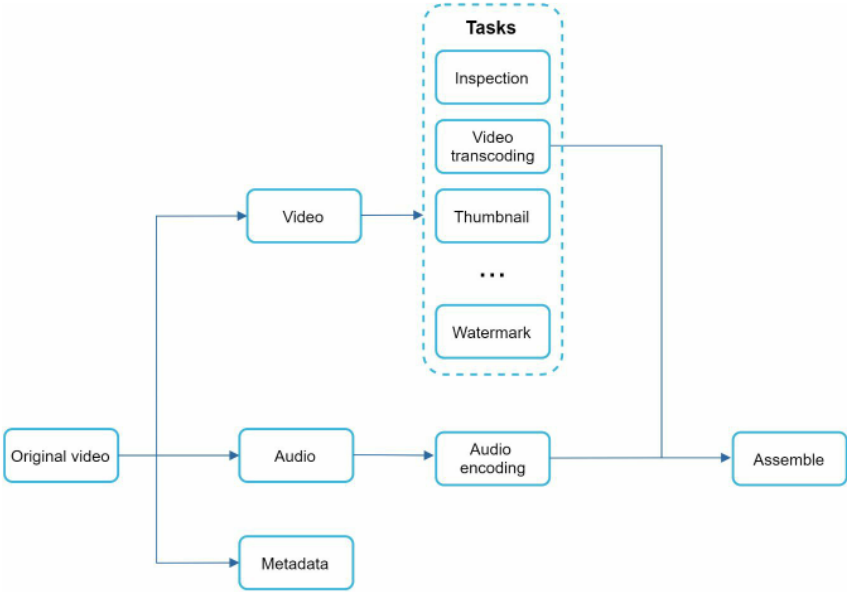

Hình 14-8

Trong Hình 14-8, tệp video gốc được bóc tách thành luồng hình ảnh (video), luồng âm thanh (audio) và siêu dữ liệu (metadata). Dưới đây là một số tác vụ điển hình có thể áp dụng lên tệp video:
 * Kiểm tra tính hợp lệ (Inspection): Đảm bảo video có chất lượng tốt và tệp không bị lỗi/hỏng cấu trúc.
 * Mã hóa video (Video encodings): Video được chuyển đổi để hỗ trợ nhiều độ phân giải, codec, tốc độ bit khác nhau. Hình 14-9 minh họa ví dụ về các tệp video sau khi mã hóa.
 * Tạo ảnh thu nhỏ (Thumbnail): Ảnh thu nhỏ có thể do người dùng chủ động tải lên hoặc do hệ thống tự động trích xuất.
 * Chèn hình mờ (Watermark): Một lớp ảnh phủ lên trên video chứa thông tin nhận diện bản quyền của video.

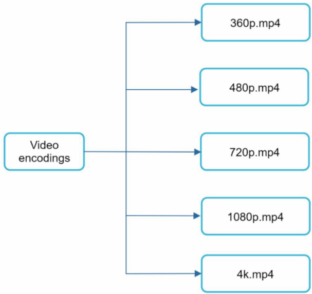

Hình 14-9

## Video transcoding architecture (Kiến trúc chuyển mã video)

Kiến trúc chuyển mã video đề xuất có tận dụng các dịch vụ đám mây được thể hiện trong Hình 14-10.


Kiến trúc gồm sáu thành phần chính: bộ tiền xử lý (preprocessor), bộ lập lịch DAG (DAG scheduler), bộ quản lý tài nguyên (resource manager), các tiến trình thực thi tác vụ (task workers), bộ lưu trữ tạm thời (temporary storage), và đầu ra là video đã mã hóa. Chúng ta hãy cùng phân tích chi tiết từng thành phần.

### Preprocessor (Bộ tiền xử lý)


Bộ tiền xử lý đảm nhận 4 nhiệm vụ chính:
1. Chia nhỏ video: Luồng video được phân tách hoặc chia nhỏ hơn nữa theo cấu trúc nhóm khung hình (Group of Pictures - GOP). GOP là một nhóm các khung hình được sắp xếp theo thứ tự cụ thể. Mỗi nhóm khung hình là một đơn vị có thể phát độc lập, thường có độ dài vài giây.
2. Một số thiết bị di động hoặc trình duyệt cũ có thể không hỗ trợ việc chia nhỏ video. Bộ tiền xử lý sẽ chia nhỏ video theo định dạng GOP tương thích cho các client cũ này.
3. Tạo DAG: Bộ xử lý sẽ sinh ra cấu trúc đồ thị DAG dựa trên các tệp cấu hình do lập trình viên phía client thiết lập. Hình 14-12 là một biểu diễn DAG đơn giản hóa gồm 2 nút và 1 cạnh:


Hình 14-12

Biểu diễn DAG này được sinh ra từ hai tệp cấu hình dưới đây (Hình 14-13):


Hình 14-13 (nguồn: [9])

4. Lưu đệm dữ liệu (Cache data): Bộ tiền xử lý hoạt động như một bộ nhớ đệm cho các phân đoạn video. Để tăng cường độ tin cậy, bộ tiền xử lý lưu các phân đoạn GOP và siêu dữ liệu vào bộ lưu trữ tạm thời. Nếu tiến trình mã hóa video gặp sự cố, hệ thống có thể tận dụng dữ liệu đã bền vững này để thực hiện cơ chế thử lại (retry).

### DAG scheduler (Bộ lập lịch DAG)


Bộ lập lịch DAG chia đồ thị DAG thành các giai đoạn tác vụ (stages) và đưa chúng vào hàng đợi tác vụ bên trong bộ quản lý tài nguyên. Hình 14-15 minh họa một ví dụ về cách thức hoạt động của bộ lập lịch DAG.

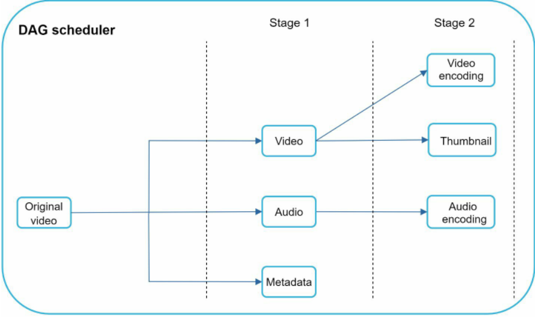

Hình 14-15

Như thể hiện trong Hình 14-15, tệp video gốc được chia thành ba giai đoạn: Giai đoạn 1: bóc tách video, âm thanh và siêu dữ liệu. Tệp video tiếp tục được chia thành hai tác vụ trong giai đoạn 2: mã hóa video và tạo ảnh thu nhỏ. Tệp âm thanh cần thực hiện tác vụ mã hóa âm thanh như một phần của giai đoạn 2.

### Resource manager (Bộ quản lý tài nguyên)


Bộ quản lý tài nguyên chịu trách nhiệm tối ưu hóa hiệu quả phân bổ tài nguyên hệ thống. Nó bao gồm 3 hàng đợi và một bộ lập lịch tác vụ như trong Hình 14-17:
 * Task queue (Hàng đợi tác vụ): Là một hàng đợi ưu tiên (priority queue) chứa danh sách các tác vụ đang chờ được thực thi.
 * Worker queue (Hàng đợi worker): Là hàng đợi ưu tiên lưu trữ thông tin mức độ sử dụng tài nguyên của các tiến trình worker.
 * Running queue (Hàng đợi đang chạy): Chứa thông tin về các tác vụ đang chạy và các worker đang xử lý những tác vụ đó.
 * Task scheduler (Bộ điều phối tác vụ): Lựa chọn tác vụ và worker tối ưu nhất, sau đó chỉ định worker được chọn tiến hành xử lý công việc.

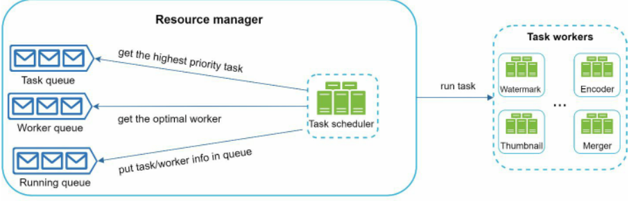

Hình 14-17

Quy trình hoạt động của bộ quản lý tài nguyên như sau:
 * Bộ điều phối tác vụ lấy tác vụ có độ ưu tiên cao nhất từ hàng đợi tác vụ.
 * Bộ điều phối tác vụ tìm kiếm worker tối ưu nhất để thực thi tác vụ từ hàng đợi worker.
 * Bộ điều phối ra lệnh cho worker được chọn tiến hành xử lý công việc.
 * Bộ điều phối liên kết thông tin tác vụ/worker và đưa vào hàng đợi đang chạy.
 * Bộ điều phối gỡ bỏ tác vụ khỏi hàng đợi đang chạy ngay khi công việc hoàn tất.

### Task workers (Các tiến trình thực thi tác vụ)


Hình 14-19

Các task worker thực thi các tác vụ đã được định nghĩa trong mô hình DAG. Mỗi loại task worker có thể đảm nhận các tác vụ khác nhau như minh họa trong Hình 14-19.


Hình 14-20

### Temporary storage (Bộ lưu trữ tạm thời)

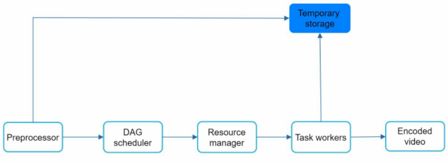

Nhiều hệ thống lưu trữ khác nhau được phối hợp sử dụng tại đây. Việc lựa chọn giải pháp lưu trữ phụ thuộc vào các yếu tố như loại dữ liệu, kích thước dữ liệu, tần suất truy cập, vòng đời của dữ liệu, v.v. Ví dụ, siêu dữ liệu được các worker truy xuất rất thường xuyên và kích thước thường nhỏ, do đó việc lưu đệm siêu dữ liệu vào bộ nhớ RAM là giải pháp tối ưu. Đối với dữ liệu âm thanh hoặc hình ảnh video, chúng ta đưa vào hệ thống blob storage. Dữ liệu trong bộ lưu trữ tạm thời sẽ được giải phóng ngay khi quá trình xử lý video tương ứng kết thúc.

### Encoded video (Video đã mã hóa)


Video đã mã hóa là sản phẩm đầu ra cuối cùng của chuỗi xử lý mã hóa. Dưới đây là một ví dụ về tệp đầu ra: funny\_720p.mp4.

## System optimizations (Các tối ưu hóa hệ thống)

Tới bước này, bạn đã nắm vững quy trình tải lên video, luồng phát trực tuyến cũng như kiến trúc chuyển mã video. Tiếp theo, chúng ta sẽ tinh chỉnh hệ thống thông qua các giải pháp tối ưu hóa về tốc độ, độ an toàn và tiết kiệm chi phí.

### Speed optimization: parallelize video uploading (Tối ưu tốc độ: song song hóa việc tải lên video)

Việc tải lên một video dưới dạng một khối tệp nguyên vẹn là không hiệu quả. Chúng ta có thể chia video thành các đoạn nhỏ hơn dựa trên việc căn chỉnh nhóm khung hình (GOP) như minh họa trong Hình 14-22.

Chia theo GOP


Hình 14-22

Cơ chế này cho phép tiếp tục tải lên nhanh chóng (resumable upload) nếu lần tải trước đó bị gián đoạn. Công việc chia tách tệp video theo GOP có thể được thực hiện ngay phía client để cải thiện tốc độ tải lên như mô tả trong Hình 14-23.

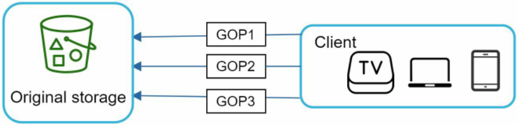

Hình 14-23

### Speed optimization: place upload centers close to users (Tối ưu tốc độ: đặt các trung tâm tải lên gần người dùng)

Một giải pháp khác để nâng cao tốc độ tải lên là thiết lập nhiều trung tâm tiếp nhận trên khắp thế giới (Hình 14-24). Người dùng tại Hoa Kỳ có thể tải video lên trung tâm Bắc Mỹ, còn người dùng tại Trung Quốc có thể tải lên trung tâm Châu Á. Để đạt được điều này, chúng ta sử dụng các điểm hiện diện của mạng lưới CDN làm các trung tâm tiếp nhận tải lên.

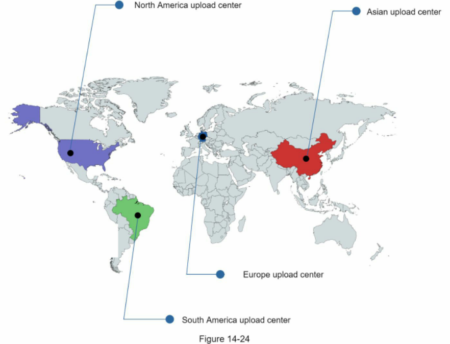

### Speed optimization: parallelism everywhere (Tối ưu tốc độ: song song hóa ở mọi nơi)

Việc đạt được độ trễ thấp đòi hỏi rất nhiều nỗ lực kỹ thuật. Một giải pháp tối ưu hóa quan trọng là xây dựng hệ thống có tính liên kết lỏng (loosely coupled system) nhằm hỗ trợ khả năng song song hóa cao độ.

Thiết kế ban đầu cần một số sửa đổi để có thể đạt được độ song song cao. Hãy cùng xem xét kỹ luồng dữ liệu khi một video được chuyển từ bộ lưu trữ gốc sang CDN. Quy trình trong Hình 14-25 cho thấy đầu ra của bước trước là điều kiện bắt buộc để làm đầu vào cho bước sau. Sự phụ thuộc tuần tự này khiến việc xử lý song song gặp nhiều khó khăn.

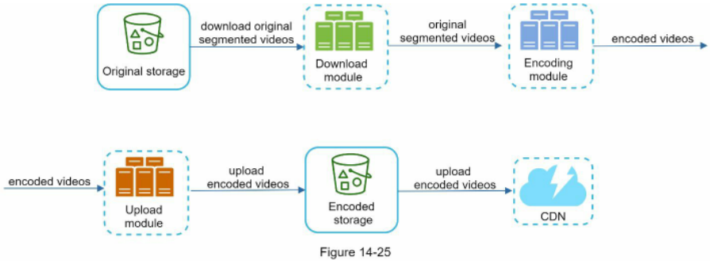

Để hệ thống trở nên lỏng hơn, chúng ta đưa vào các hàng đợi thông điệp (message queues) như thể hiện trong Hình 14-26. Hãy cùng xem ví dụ sau để hiểu cách message queue giúp hệ thống giảm bớt sự phụ thuộc chặt chẽ:
 * Trước khi có hàng đợi thông điệp, mô-đun mã hóa phải đứng đợi tệp đầu ra từ mô-đun tải xuống.
 * Sau khi bổ sung hàng đợi thông điệp, mô-đun mã hóa không cần chờ mô-đun tải xuống nữa. Miễn là có sự kiện xuất hiện trong hàng đợi, mô-đun mã hóa có thể tiếp nhận và xử lý song song ngay lập tức.


### Safety optimization: pre-signed upload URL (Tối ưu độ an toàn: URL tải lên được ký trước)

An toàn bảo mật là một trong những khía cạnh trọng yếu nhất của bất kỳ sản phẩm nào. Để đảm bảo chỉ những người dùng được ủy quyền hợp lệ mới có thể tải video lên đúng vị trí quy định, chúng ta sử dụng pre-signed URL (URL được cấp quyền truy cập trước bằng chữ ký số) như minh họa trong Hình 14-27.


Hình 14-27

Luồng tải lên được cập nhật lại như sau:
1. Client gửi yêu cầu HTTP tới các máy chủ API để xin cấp một pre-signed URL. URL này mang theo quyền truy cập được cấp riêng cho đối tượng được chỉ định. Thuật ngữ pre-signed URL thường được dùng khi tải tệp lên Amazon S3. Các nhà cung cấp dịch vụ đám mây khác có thể dùng tên gọi khác; ví dụ, dịch vụ lưu trữ blob của Microsoft Azure hỗ trợ tính năng tương đương nhưng gọi là "Shared Access Signature" [10].
2. Các máy chủ API phản hồi lại client kèm theo pre-signed URL.
3. Khi nhận được phản hồi, client sẽ tiến hành tải trực tiếp video lên bằng chính pre-signed URL này.

### Safety optimization: protect your videos (Tối ưu độ an toàn: bảo vệ video của bạn)

Nhiều nhà sáng tạo nội dung ngần ngại chia sẻ video trực tuyến vì lo sợ video gốc của mình bị đánh cắp bản quyền. Để bảo vệ các video có bản quyền, chúng ta có thể áp dụng một trong ba giải pháp an toàn sau:
 * Hệ thống quản lý quyền kỹ thuật số (Digital Rights Management - DRM): Ba giải pháp DRM hàng đầu hiện nay là Apple FairPlay, Google Widevine và Microsoft PlayReady.
 * Mã hóa AES: Bạn có thể mã hóa video và thiết lập chính sách phân quyền truy cập. Video được mã hóa sẽ chỉ được giải mã khi phát. Điều này đảm bảo rằng chỉ những người dùng hợp lệ mới có thể xem được nội dung.
 * Đóng dấu bản quyền hình ảnh (Visual watermarking): Chèn một lớp hình ảnh mờ đè lên bề mặt video chứa thông tin nhận diện bản quyền, chẳng hạn như logo hoặc tên thương hiệu của bạn.

### Cost-saving optimization (Tối ưu hóa tiết kiệm chi phí)

CDN là một thành phần trọng yếu trong hệ thống của chúng ta. Nó đảm bảo việc truyền tải video diễn ra nhanh chóng trên quy mô toàn cầu. Tuy nhiên, qua phép tính nhẩm sơ bộ ban đầu, chúng ta đều biết chi phí CDN rất đắt đỏ, đặc biệt là khi dung lượng dữ liệu quá lớn. Làm cách nào để chúng ta cắt giảm chi phí này?

Các nghiên cứu trước đây chỉ ra rằng các luồng xem video trên YouTube tuân theo quy luật phân phối đuôi dài (long-tail distribution) [11] [12]. Điều này có nghĩa là chỉ có một số lượng nhỏ các video thịnh hành là được truy cập với tần suất rất cao, trong khi phần lớn các video còn lại có rất ít hoặc thậm chí không có người xem. Dựa trên quan sát thực tế này, chúng ta áp dụng một số phương án tối ưu sau:

1. Chỉ phân phối những video phổ biến nhất từ CDN, các video còn lại được phục vụ trực tiếp từ các máy chủ lưu trữ video dung lượng cao nội bộ của chúng ta (Hình 14-28).

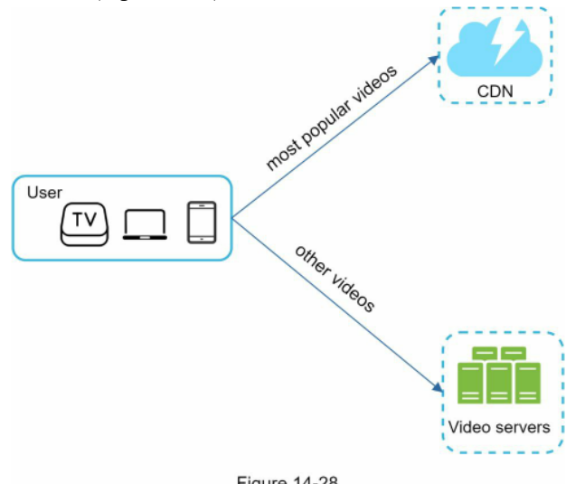

Hình 14-28

2. Đối với các nội dung ít người xem, chúng ta có thể không cần phải lưu trữ quá nhiều phiên bản mã hóa sẵn. Các video ngắn có thể được mã hóa theo yêu cầu phát sinh thực tế (on-demand).
3. Một số video chỉ thịnh hành ở một số khu vực địa lý nhất định. Do đó không cần thiết phải phân phối các video này tới các khu vực khác.
4. Tự xây dựng mạng lưới CDN riêng tương tự như Netflix và hợp tác trực tiếp với các nhà cung cấp dịch vụ Internet (Internet Service Providers - ISPs). Xây dựng một mạng CDN riêng là một dự án quy mô đồ sộ; tuy nhiên, điều này rất có lợi ích kinh tế đối với các công ty phát trực tuyến quy mô lớn. Các ISP có thể là Comcast, AT&T, Verizon hoặc các nhà mạng viễn thông khác. Các ISP phân bổ khắp nơi trên thế giới và ở rất gần người dùng cuối. Bằng cách hợp tác trực tiếp với các ISP, bạn vừa có thể nâng cao trải nghiệm xem video vừa giảm đáng kể chi phí băng thông mạng.

Tất cả các giải pháp tối ưu hóa trên đều dựa trên mức độ thịnh hành của nội dung, thói quen truy cập của người dùng, kích thước video, v.v. Việc phân tích số liệu lịch sử xem là điều kiện tiên quyết trước khi tiến hành bất kỳ đợt tối ưu nào. Bạn có thể tham khảo thêm một số bài viết nghiên cứu sâu về chủ đề này tại [12] [13].

## Error handling (Xử lý lỗi)

Đối với một hệ thống quy mô lớn, lỗi hệ thống là điều không thể tránh khỏi. Để xây dựng một hệ thống có khả năng chịu lỗi cao (fault-tolerant), chúng ta phải xử lý các lỗi một cách khéo léo (gracefully) và nhanh chóng phục hồi. Có hai nhóm lỗi chính:
 * Lỗi có thể phục hồi (Recoverable error): Với các lỗi có thể khắc phục được, ví dụ như lỗi khi chuyển mã một phân đoạn video, giải pháp chung là thử lại thao tác đó một vài lần. Nếu tác vụ vẫn liên tục thất bại và hệ thống xác định không thể khắc phục được nữa, nó sẽ trả mã lỗi phù hợp về cho client.
 * Lỗi không thể phục hồi (Non-recoverable error): Với các lỗi không thể khắc phục, ví dụ như định dạng video bị lỗi cấu trúc không thể đọc được, hệ thống sẽ dừng ngay lập tức các tác vụ đang chạy liên quan đến video đó và trả mã lỗi thích hợp về cho client.

Sổ tay hướng dẫn xử lý các lỗi thường gặp cho từng thành phần hệ thống gồm có:
 * Lỗi tải lên: Thử lại một vài lần.
 * Lỗi chia nhỏ video: Nếu các phiên bản client cũ không thể tự chia nhỏ video theo chuẩn GOP, toàn bộ tệp video sẽ được gửi thẳng lên máy chủ. Công việc chia tách video sẽ do máy chủ xử lý.
 * Lỗi chuyển mã: Thử lại (retry).
 * Lỗi bộ tiền xử lý: Tạo lại sơ đồ DAG.
 * Lỗi bộ lập lịch DAG: Lập lịch lại cho tác vụ.
 * Hàng đợi của bộ quản lý tài nguyên gặp sự cố: Chuyển sang sử dụng bản sao dự phòng (replica).
 * Task worker bị sập: Điều phối lại tác vụ cho một worker mới.
 * Máy chủ API bị sập: Các máy chủ API hoạt động phi trạng thái (stateless), do đó lưu lượng yêu cầu sẽ được bộ cân bằng tải điều hướng sang một máy chủ API khác đang hoạt động bình thường.
 * Máy chủ bộ nhớ đệm siêu dữ liệu bị sập: Dữ liệu được nhân bản nhiều lần. Nếu một node bị hỏng, bạn vẫn có thể truy cập các node khác để lấy dữ liệu. Chúng ta có thể khởi tạo một máy chủ cache mới để thay thế máy chủ đã hỏng.
 * Máy chủ cơ sở dữ liệu siêu dữ liệu (Metadata DB) bị sập:
    * Máy chủ chính (Master) bị sập: Bầu chọn một trong các máy chủ phụ (slave) lên làm master mới.
    * Máy chủ phụ (Slave) bị sập: Bạn có thể điều hướng các truy vấn đọc sang một slave khác và bổ sung một máy chủ cơ sở dữ liệu mới để thay thế node đã hỏng.

# Step 4 - Wrap up (Bước 4 - Tổng kết)

Trong chương này, chúng ta đã trình bày bản thiết kế kiến trúc cho một dịch vụ phát video trực tuyến tương tự như YouTube. Nếu còn thời gian vào cuối buổi phỏng vấn, bạn có thể thảo luận thêm một số điểm sau:
 * Mở rộng tầng API: Do các máy chủ API đều là phi trạng thái (stateless), chúng ta có thể dễ dàng mở rộng tầng API theo chiều ngang (scale horizontally).
 * Mở rộng cơ sở dữ liệu: Bạn có thể trình bày về cơ chế nhân bản (replication) và phân mảnh cơ sở dữ liệu (database sharding).
 * Phát video trực tiếp (Live streaming): Khái niệm này đề cập đến quá trình quay và phát sóng video theo thời gian thực. Mặc dù hệ thống của chúng ta không được thiết kế chuyên biệt cho việc live streaming, nhưng giữa phát trực tiếp và phát video thông thường có nhiều nét tương đồng: cả hai đều đòi hỏi quy trình tải lên, mã hóa và truyền phát dữ liệu. Một số khác biệt đáng chú ý gồm có:
    * Phát trực tiếp có yêu cầu khắt khe hơn nhiều về độ trễ, do đó có thể cần dùng một giao thức streaming khác.
    * Phát trực tiếp có yêu cầu thấp hơn về tính song song vì các khối dữ liệu nhỏ đã được xử lý ngay lập tức theo thời gian thực.
    * Phát trực tiếp yêu cầu tập hợp các quy trình xử lý lỗi khác biệt. Bất kỳ cơ chế xử lý lỗi nào tiêu tốn quá nhiều thời gian đều không thể chấp nhận được.
 * Gỡ bỏ video vi phạm (Video takedowns): Các video vi phạm bản quyền, nội dung khiêu dâm hoặc các hành vi trái pháp luật khác cần phải được loại bỏ. Một số có thể được hệ thống chủ động phát hiện ngay trong quá trình tải lên, số khác có thể được phát hiện thông qua báo cáo vi phạm (flagging) từ phía cộng đồng người dùng.

Chúc mừng bạn đã hoàn thành một chặng đường dài! Hãy tự thưởng cho bản thân một tràng pháo tay. Làm rất tốt!

# Reference materials (Tài liệu tham khảo)

[1] Số liệu thống kê về YouTube: https://www.omnicoreagency.com/youtube-statistics/  
[2] Nhân khẩu học YouTube năm 2019: https://blog.hubspot.com/marketing/youtube-demographics  
[3] Bảng giá dịch vụ CloudFront: https://aws.amazon.com/cloudfront/pricing/  
[4] Nghiên cứu trường hợp Netflix trên AWS: https://aws.amazon.com/solutions/case-studies/netflix/  
[5] Trang chủ Akamai: https://www.akamai.com/  
[6] Đối tượng nhị phân lớn (Binary large object): https://en.wikipedia.org/wiki/Binary\_large\_object  
[7] Những điều bạn cần biết về các giao thức streaming: https://www.dacast.com/blog/streaming-protocols/  
[8] SVE: Xử lý video phân tán ở quy mô Facebook: https://www.cs.princeton.edu/~wlloyd/papers/sve-sosp17.pdf  
[9] Kiến trúc xử lý video của Weibo (tiếng Trung): https://www.upyun.com/opentalk/399.html  
[10] Ủy quyền truy cập với Shared Access Signature: https://docs.microsoft.com/en-us/rest/api/storageservices/delegate-access-with-shared-accesssignature  
[11] Buổi nói chuyện về khả năng mở rộng YouTube của cựu kỹ sư YouTube: https://www.youtube.com/watch? v=w5WVu624fY8  
[12] Tìm hiểu đặc tính của việc chia sẻ video ngắn trên Internet - Nghiên cứu đo lường dựa trên YouTube: https://arxiv.org/pdf/0707.3670.pdf  
[13] Mức độ phổ biến của nội dung đối với Open Connect: [https://netflixtechblog.com/content-popularity-for-open-connect-b86d56f613b](https://netflixtechblog.com/content-popularity-for-open-connect-b86d56f613b)

# CHAPTER 15: DESIGN GOOGLE DRIVE (CHƯƠNG 15: THIẾT KẾ GOOGLE DRIVE)

Trong những năm gần đây, các dịch vụ lưu trữ đám mây như Google Drive, Dropbox, Microsoft OneDrive và Apple iCloud đã trở nên cực kỳ phổ biến. Trong chương này, bạn được yêu cầu thiết kế Google Drive. Trước khi bắt tay vào thiết kế, hãy dành chút thời gian để tìm hiểu tổng quan về dịch vụ này. Google Drive là một dịch vụ lưu trữ và đồng bộ hóa tệp tin, giúp bạn lưu trữ tài liệu, ảnh, video và các loại tệp khác trên đám mây. Bạn có thể truy cập các tệp của mình từ bất kỳ máy tính, điện thoại thông minh hay máy tính bảng nào, đồng thời dễ dàng chia sẻ những tệp đó với bạn bè, người thân và đồng nghiệp [1]. Hình 15-1 và Hình 15-2 lần lượt minh họa giao diện Google Drive trên trình duyệt web và trên ứng dụng di động.

V


Hình 15-1

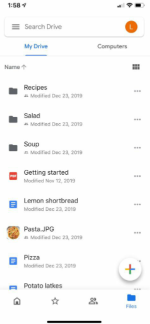

Hình 15-2

# Step 1 - Understand the problem and establish design scope (Bước 1 - Hiểu bài toán và xác định phạm vi thiết kế)

Thiết kế một hệ thống như Google Drive là một bài toán rất lớn, vì vậy điều cốt yếu là phải đặt ra các câu hỏi để thu hẹp phạm vi thiết kế.

 * **Ứng viên:** Những tính năng quan trọng nhất là gì?
 * **Người phỏng vấn:** Tải lên và tải xuống tệp tin, đồng bộ hóa tệp tin và gửi thông báo.
 * **Ứng viên:** Đây là ứng dụng di động, ứng dụng web hay cả hai?
 * **Người phỏng vấn:** Cả hai.
 * **Ứng viên:** Hệ thống cần hỗ trợ những định dạng tệp nào?
 * **Người phỏng vấn:** Bất kỳ loại tệp nào.
 * **Ứng viên:** Các tệp có cần được mã hóa không?
 * **Người phỏng vấn:** Có, các tệp lưu trữ trong hệ thống bắt buộc phải được mã hóa.
 * **Ứng viên:** Có giới hạn kích thước tệp tải lên không?
 * **Người phỏng vấn:** Có, dung lượng tệp tối đa cho phép là 10 GB.
 * **Ứng viên:** Sản phẩm phục vụ bao nhiêu người dùng?
 * **Người phỏng vấn:** 10 triệu DAU.

Trong chương này, chúng ta sẽ tập trung vào các tính năng chính sau:
 * Thêm tệp tin: Cách đơn giản nhất để thêm một tệp là kéo và thả tệp đó vào Google Drive.
 * Tải tệp tin xuống.
 * Đồng bộ hóa tệp tin giữa nhiều thiết bị: Khi một tệp được thêm hoặc sửa trên một thiết bị, nó sẽ tự động đồng bộ sang các thiết bị khác.
 * Xem lịch sử các phiên bản sửa đổi của tệp (file revisions).
 * Chia sẻ tệp với bạn bè, gia đình và đồng nghiệp.
 * Gửi thông báo khi một tệp được chỉnh sửa, xóa hoặc chia sẻ với bạn.

Các tính năng không thuộc phạm vi thảo luận trong chương này gồm có:
 * Tính năng cộng tác và chỉnh sửa Google Docs theo thời gian thực: Google Docs cho phép nhiều người cùng chỉnh sửa một tài liệu đồng thời. Điều này nằm ngoài phạm vi thiết kế của chúng ta.

Bên cạnh việc làm rõ các yêu cầu chức năng, việc nắm bắt các yêu cầu phi chức năng (non-functional requirements) cũng rất quan trọng:
 * Độ tin cậy (Reliability): Độ tin cậy là yếu tố sống còn đối với một hệ thống lưu trữ. Mất mát dữ liệu là điều tuyệt đối không thể chấp nhận.
 * Tốc độ đồng bộ nhanh: Nếu việc đồng bộ tệp mất quá nhiều thời gian, người dùng sẽ mất kiên nhẫn và từ bỏ sản phẩm.
 * Mức tiêu thụ băng thông: Nếu sản phẩm ngốn quá nhiều lưu lượng mạng không cần thiết, người dùng sẽ rất khó chịu, đặc biệt là khi họ đang sử dụng các gói cước dữ liệu di động.
 * Khả năng mở rộng (Scalability): Hệ thống phải có khả năng xử lý lượng lưu lượng truy cập rất lớn.
 * Tính sẵn sàng cao (High availability): Người dùng vẫn phải truy cập và sử dụng được hệ thống ngay cả khi một số máy chủ bị ngoại tuyến (offline), chạy chậm hoặc gặp sự cố mạng đột xuất.

## Back of the envelope estimation (Ước lượng sơ bộ)

 * Giả định ứng dụng có 50 triệu người dùng đăng ký và 10 triệu người dùng hoạt động hàng ngày (DAU).
 * Mỗi người dùng được cấp 10 GB dung lượng miễn phí.
 * Giả định người dùng tải lên trung bình 2 tệp mỗi ngày. Kích thước trung bình của mỗi tệp là 500 KB.
 * Tỷ lệ giữa thao tác đọc và ghi là 1:1.
 * Tổng dung lượng lưu trữ phân bổ: 50 triệu * 10 GB = 500 Petabyte.
 * QPS (Queries Per Second - Số lượng truy vấn mỗi giây) cho API tải lên: 10 triệu * 2 lượt tải / 24 giờ / 3600 giây = ~ 240 QPS.
 * QPS đỉnh điểm (Peak QPS) = QPS * 2 = 480 QPS.

# Step 2 - Propose high-level design and get buy-in (Bước 2 - Đề xuất thiết kế cấp cao và thống nhất phương án)

Thay vì đưa ra sơ đồ thiết kế cấp cao ngay từ đầu, chúng ta sẽ áp dụng một cách tiếp cận hơi khác một chút. Chúng ta sẽ bắt đầu từ mô hình đơn giản nhất: triển khai toàn bộ hệ thống trên một máy chủ đơn lẻ (single server). Sau đó, từng bước mở rộng quy mô để đáp ứng hàng triệu người dùng. Bài tập thực hành này sẽ giúp bạn ôn lại một số chủ đề kiến trúc cốt lõi đã được đề cập trong cuốn sách.

Hãy bắt đầu với thiết lập máy chủ đơn lẻ như sau:
 * Một web server để phục vụ các yêu cầu tải lên và tải xuống tệp.
 * Một cơ sở dữ liệu để quản lý các siêu dữ liệu như thông tin người dùng, dữ liệu đăng nhập, thông tin tệp tin, v.v.
 * Một hệ thống lưu trữ để lưu tệp tin thực tế. Chúng ta phân bổ 1TB không gian đĩa cứng để lưu tệp.

Chúng ta dành vài giờ để cài đặt một máy chủ web Apache, một cơ sở dữ liệu MySQL và tạo thư mục có tên `drive/` làm thư mục gốc chứa các tệp tải lên. Bên dưới thư mục `drive/`, có danh sách các thư mục con được gọi là các không gian tên (namespaces). Mỗi namespace sẽ chứa tất cả các tệp tải lên của một người dùng cụ thể. Tên tệp trên máy chủ được giữ nguyên như tên tệp gốc ban đầu. Mỗi tệp hoặc thư mục có thể được định danh duy nhất bằng cách kết hợp namespace với đường dẫn tương đối của nó. Hình 15-3 minh họa ví dụ về cấu trúc thư mục `/drive` ở khung bên trái và chế độ xem mở rộng ở khung bên phải.

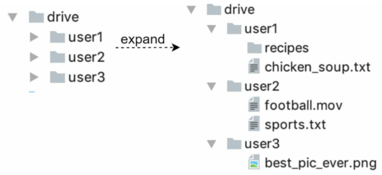

Hình 15-3

## APIs (Các giao diện lập trình ứng dụng)

Các API của hệ thống sẽ trông như thế nào? Về cơ bản chúng ta cần 3 API chính: tải lên tệp, tải xuống tệp và lấy lịch sử phiên bản tệp.

**1. Upload a file to Google Drive (Tải tệp lên Google Drive)**

Hệ thống hỗ trợ hai hình thức tải lên:
 * Tải lên thông thường (Simple upload): Sử dụng hình thức này khi kích thước tệp nhỏ.
 * Tải lên tiếp tục được (Resumable upload): Sử dụng hình thức này khi kích thước tệp lớn và có nguy cơ cao xảy ra gián đoạn đường truyền mạng.

Dưới đây là một ví dụ về API tải lên tiếp tục được:

```
https://api.example.com/files/upload?uploadType=resumable
```

Tham số (Params):
 * uploadType=resumable
 * data: Tệp cục bộ cần tải lên.

Quy trình tải lên tiếp tục được hoàn thành qua 3 bước sau [2]:
 * Gửi yêu cầu khởi tạo để nhận về một URL tiếp tục (resumable URL).
 * Tải dữ liệu lên và giám sát trạng thái truyền tải.
 * Nếu quá trình tải bị gián đoạn, tiếp tục tải lại từ điểm bị ngắt.

**2. Download a file from Google Drive (Tải tệp xuống từ Google Drive)**

API ví dụ:

```
https://api.example.com/files/download
```

**Tham số (Params):**

 * path: Đường dẫn tệp cần tải xuống.

```
Example params: { "path": "/recipes/soup/best_soup.txt" }
```

**3. Get file revisions (Lấy lịch sử phiên bản tệp)**

API ví dụ:

```
https://api.example.com/files/list_revisions
```

**Tham số (Params):**

 * path: Đường dẫn đến tệp bạn muốn lấy lịch sử phiên bản.
 * limit: Số lượng phiên bản tối đa cần trả về.

```
Example params: { "path": "/recipes/soup/best_soup.txt", "limit": 20 }
```

Tất cả các API này đều yêu cầu xác thực người dùng và bắt buộc sử dụng giao thức bảo mật HTTPS. Giao thức Secure Sockets Layer (SSL) bảo vệ dữ liệu truyền tải giữa client và các máy chủ backend.

## Move away from single server (Chuyển đổi khỏi mô hình máy chủ đơn lẻ)

Khi lượng tệp tải lên ngày càng nhiều, đến một lúc nào đó bạn sẽ nhận được cảnh báo hết dung lượng đĩa cứng như trong Hình 15-4.

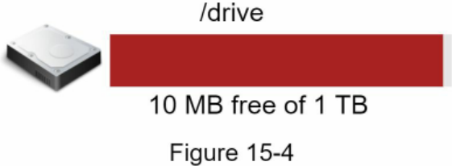

Dung lượng lưu trữ chỉ còn vỏn vẹn 10 MB! Đây là tình huống khẩn cấp vì người dùng không thể tải thêm bất kỳ tệp nào lên được nữa. Giải pháp đầu tiên xuất hiện trong đầu là tiến hành phân mảnh dữ liệu (sharding), để dữ liệu có thể được phân bổ trên nhiều máy chủ lưu trữ khác nhau. Hình 15-5 minh họa một ví dụ về sharding dựa trên `user_id`.


Bạn thức trắng cả đêm để thiết lập cơ chế sharding cho cơ sở dữ liệu và giám sát hệ thống một cách sát sao. Mọi thứ lại vận hành trơn tru. Bạn đã tạm thời dập tắt được đám cháy (giải quyết xong sự cố cấp bách), nhưng trong lòng vẫn canh cánh nỗi lo về nguy cơ mất mát dữ liệu nếu một máy chủ lưu trữ nào đó gặp sự cố phần cứng. Đi hỏi khắp nơi, một người bạn chuyên gia backend tên Frank chia sẻ với bạn rằng nhiều công ty công nghệ đầu ngành như Netflix và Airbnb đều tin dùng Amazon S3 để lưu trữ. "Amazon Simple Storage Service (Amazon S3) là một dịch vụ lưu trữ đối tượng cung cấp khả năng mở rộng quy mô, tính sẵn sàng của dữ liệu, bảo mật và hiệu năng hàng đầu trong ngành" [3]. Bạn quyết định nghiên cứu xem S3 có thực sự phù hợp với bài toán của mình hay không. Sau khi đọc kỹ tài liệu, bạn đã hiểu rõ kiến trúc của hệ thống lưu trữ S3 và quyết định chuyển toàn bộ tệp sang lưu trữ trên S3. Amazon S3 hỗ trợ cơ chế sao chép nhân bản trong cùng một khu vực (same-region replication) và giữa các khu vực địa lý khác nhau (cross-region replication). Một region (khu vực) là một phạm vi địa lý nơi Amazon Web Services (AWS) đặt các trung tâm dữ liệu. Như trong Hình 15-6, dữ liệu có thể được nhân bản nội bộ trong cùng một vùng (bên trái) hoặc nhân bản sang vùng địa lý khác (bên phải). Các tệp dư thừa được lưu trữ phân tán ở nhiều vùng địa lý để phòng ngừa mất mát dữ liệu và đảm bảo tính sẵn sàng tối đa. Một bucket (thùng chứa) trong S3 có vai trò tương đương như một thư mục trong hệ thống tệp tin.

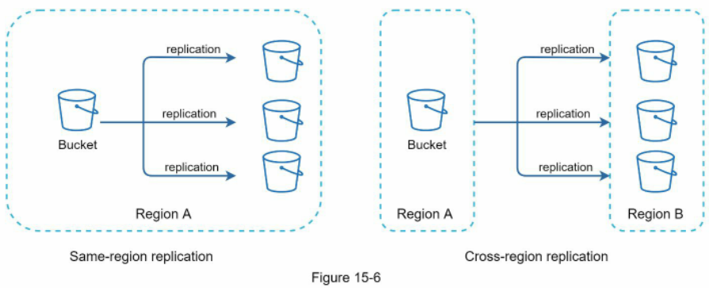

Sau khi chuyển các tệp lên S3, cuối cùng bạn cũng có thể ngủ một giấc thật ngon mà không còn phải nơm nớp lo mất dữ liệu. Để ngăn chặn các sự cố tương tự phát sinh trong tương lai, bạn quyết định nghiên cứu sâu hơn về các điểm có thể tiếp tục cải tiến trong hệ thống. Dưới đây là một số khía cạnh bạn đã tìm ra:
 * Bộ cân bằng tải (Load balancer): Bổ sung một load balancer để điều phối lưu lượng mạng. Bộ cân bằng tải đảm bảo lưu lượng được phân bổ đồng đều, và nếu một máy chủ web bị sập, nó sẽ tự động phân phối lại lưu lượng sang các máy chủ khác.
 * Các máy chủ web (Web servers): Sau khi đã có bộ cân bằng tải, việc bổ sung thêm hoặc giảm bớt số lượng máy chủ web trở nên rất dễ dàng tùy thuộc vào tải của hệ thống.
 * Cơ sở dữ liệu siêu dữ liệu (Metadata database): Tách cơ sở dữ liệu ra khỏi máy chủ web để loại bỏ điểm lỗi đơn lẻ (Single Point of Failure - SPOF). Đồng thời, cấu hình cơ chế nhân bản (replication) và phân mảnh (sharding) cho cơ sở dữ liệu để đáp ứng các yêu cầu về tính sẵn sàng và khả năng mở rộng.
 * Hệ thống lưu trữ tệp (File storage): Sử dụng Amazon S3 làm nơi lưu trữ tệp tin. Để đảm bảo tính sẵn sàng và độ bền vững (durability) của dữ liệu, các tệp được nhân bản trên hai vùng địa lý tách biệt.

Sau khi áp dụng những cải tiến trên, bạn đã tách rời thành công các máy chủ web, cơ sở dữ liệu siêu dữ liệu và hệ thống lưu trữ tệp khỏi chiếc máy chủ đơn lẻ ban đầu. Bản thiết kế cập nhật được thể hiện trong Hình 15-7.


Hình 15-7

## Sync conflicts (Xung đột đồng bộ)

Đối với một hệ thống lưu trữ quy mô lớn như Google Drive, xung đột trong quá trình đồng bộ là điều thường xuyên xảy ra. Khi hai người dùng cùng chỉnh sửa một tệp tin hoặc thư mục tại cùng một thời điểm, sự cố xung đột sẽ phát sinh. Làm cách nào để chúng ta giải quyết tình huống xung đột này? Chiến lược của chúng ta là: phiên bản nào được hệ thống tiếp nhận và xử lý trước sẽ giành phần thắng (first-in wins), còn phiên bản được gửi đến xử lý sau sẽ bị đánh dấu là phát sinh xung đột. Hình 15-8 minh họa một ví dụ về xung đột đồng bộ.

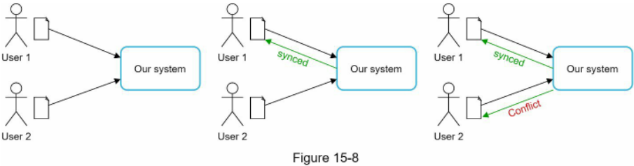

Trong Hình 15-8, người dùng 1 và người dùng 2 cùng cố gắng cập nhật đồng thời một tệp, nhưng tệp của người dùng 1 được hệ thống xử lý trước. Thao tác cập nhật của người dùng 1 thành công, trong khi thao tác của người dùng 2 gặp phải xung đột đồng bộ. Chúng ta giải quyết xung đột này cho người dùng 2 như thế nào? Hệ thống sẽ hiển thị đồng thời cả hai bản sao của tệp: bản sao cục bộ hiện tại của người dùng 2 và phiên bản mới nhất vừa được cập nhật trên máy chủ (Hình 15-9). Người dùng 2 có toàn quyền lựa chọn hợp nhất (merge) nội dung của cả hai tệp hoặc ghi đè một phiên bản lên phiên bản kia.


Việc giữ đồng bộ một tài liệu khi có nhiều người dùng cùng tham gia chỉnh sửa tại cùng một thời điểm là một bài toán vô cùng phức tạp và đầy thách thức. Bạn đọc quan tâm có thể tìm hiểu thêm trong các tài liệu tham khảo [4] [5].

## High-level design (Thiết kế cấp cao)

Hình 15-10 phác thảo kiến trúc thiết kế cấp cao được đề xuất. Hãy cùng đi vào tìm hiểu từng thành phần của hệ thống.

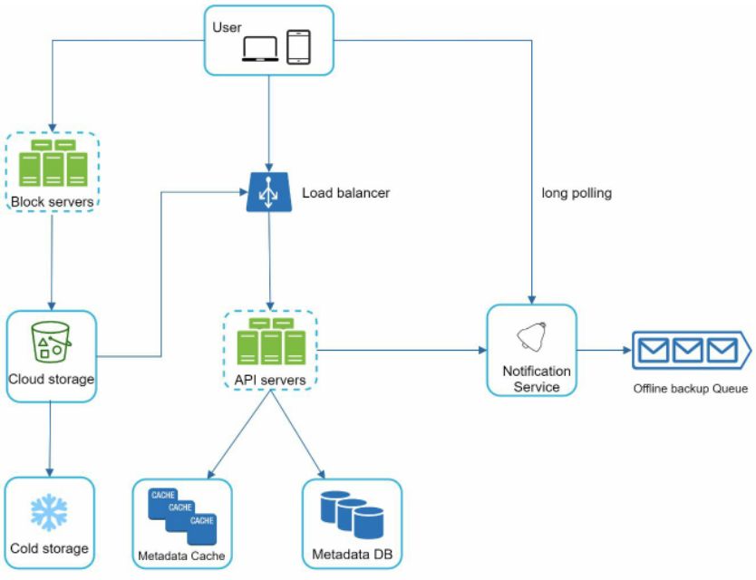

Hình 15-10

User: Người dùng tương tác với ứng dụng thông qua trình duyệt web hoặc ứng dụng di động.

Block servers (Các máy chủ khối dữ liệu): Đảm nhận nhiệm vụ tải các khối dữ liệu (blocks) lên bộ lưu trữ đám mây. Lưu trữ theo khối (Block storage), hay còn gọi là lưu trữ cấp khối (block-level storage), là công nghệ lưu trữ các tệp dữ liệu trên môi trường điện toán đám mây. Một tệp có thể được chia thành nhiều khối nhỏ, mỗi khối được gắn một mã băm (hash value) duy nhất và mã này được lưu trong cơ sở dữ liệu siêu dữ liệu của chúng ta. Mỗi block được xem như một đối tượng độc lập và lưu trữ an toàn trong hệ thống S3. Để tái tạo lại tệp ban đầu, các khối này sẽ được ghép nối lại theo đúng thứ tự. Về kích thước của một khối, chúng ta tham khảo kinh nghiệm từ Dropbox: họ quy định kích thước tối đa của mỗi khối là 4MB [6].

Cloud storage (Lưu trữ đám mây): Tệp được chia thành các khối nhỏ và lưu trữ trên hệ thống lưu trữ đám mây.

Cold storage (Lưu trữ lạnh): Là hệ thống máy tính được thiết kế chuyên biệt để lưu trữ các dữ liệu ít hoạt động (inactive data), tức là những tệp đã lâu không được truy cập tới.

Load balancer (Bộ cân bằng tải): Điều phối đồng đều các yêu cầu từ phía client đến các máy chủ API.

API servers (Các máy chủ API): Chịu trách nhiệm cho hầu hết mọi tác vụ ngoại trừ luồng tải lên dữ liệu tệp. Máy chủ API đảm nhiệm việc xác thực người dùng, quản lý hồ sơ tài khoản, cập nhật siêu dữ liệu tệp tin, v.v.

Metadata database (Cơ sở dữ liệu siêu dữ liệu): Lưu trữ siêu dữ liệu về người dùng, tệp tin, các khối dữ liệu, các phiên bản, v.v. Lưu ý rằng nội dung các tệp thực tế được lưu trên đám mây, còn cơ sở dữ liệu siêu dữ liệu chỉ thuần túy lưu trữ thông tin chỉ mục và siêu dữ liệu.

Metadata cache (Bộ nhớ đệm siêu dữ liệu): Một phần siêu dữ liệu được lưu tạm trên bộ nhớ cache để phục vụ truy xuất tốc độ cao.

Notification service (Dịch vụ thông báo): Là hệ thống hoạt động theo mô hình xuất bản/đăng ký (publisher/subscriber), cho phép đẩy dữ liệu từ dịch vụ thông báo tới các client khi có các sự kiện nhất định xảy ra. Trong trường hợp cụ thể của chúng ta, dịch vụ thông báo sẽ gửi tin báo cho các client liên quan khi một tệp được thêm/sửa/xóa ở nơi khác để chúng chủ động kéo về các thay đổi mới nhất.

Offline backup queue (Hàng đợi sao lưu ngoại tuyến): Nếu một client đang ngoại tuyến (offline) và không thể kéo các thay đổi mới nhất về tệp, hàng đợi này sẽ lưu trữ thông tin đó để khi client trực tuyến (online) trở lại, các thay đổi sẽ lập tức được đồng bộ đầy đủ.

Chúng ta đã vừa điểm qua bản thiết kế cấp cao của Google Drive. Một số thành phần có cấu trúc khá phức tạp và rất đáng để xem xét kỹ lưỡng; chúng ta sẽ cùng mổ xẻ chi tiết chúng trong phần phân tích chuyên sâu tiếp theo.

# Step 3 - Design deep dive (Bước 3 - Đi sâu vào chi tiết thiết kế)

Trong mục này, chúng ta sẽ xem xét kỹ các khía cạnh sau: các máy chủ khối dữ liệu (block servers), cơ sở dữ liệu siêu dữ liệu, luồng tải lên, luồng tải xuống, dịch vụ thông báo, phương pháp tiết kiệm dung lượng lưu trữ và xử lý sự cố.

## Block servers (Các máy chủ khối dữ liệu)

Đối với các tệp dung lượng lớn được cập nhật thường xuyên, việc gửi lại toàn bộ tệp sau mỗi lần chỉnh sửa sẽ ngốn một lượng băng thông khổng lồ. Hai giải pháp tối ưu hóa được đưa ra nhằm giảm thiểu tối đa lượng lưu lượng mạng truyền tải:
 * Đồng bộ hóa phần sai khác (Delta sync): Khi một tệp bị sửa đổi, thay vì đồng bộ toàn bộ tệp, hệ thống sử dụng thuật toán đồng bộ [7] [8] để chỉ truyền tải duy nhất các khối dữ liệu bị biến đổi.
 * Nén dữ liệu (Compression): Việc nén các khối dữ liệu giúp giảm đáng kể kích thước tệp. Do đó, các khối được nén bằng các thuật toán phù hợp tùy theo định dạng tệp. Ví dụ, `gzip` và `bzip2` thường được dùng để nén các tệp văn bản. Các định dạng hình ảnh và video sẽ cần các thuật toán nén chuyên dụng khác.

Trong hệ thống của chúng ta, các máy chủ khối dữ liệu đảm đương công việc nặng nhọc nhất trong tiến trình tải tệp lên. Block servers tiếp nhận các tệp gửi từ client, chia nhỏ tệp thành các khối, nén từng khối và tiến hành mã hóa chúng. Thay vì tải toàn bộ tệp lên hệ thống lưu trữ, chỉ có các khối dữ liệu bị sửa đổi mới được gửi đi. Hình 15-11 minh họa quy trình làm việc của block server khi có một tệp mới được thêm vào.

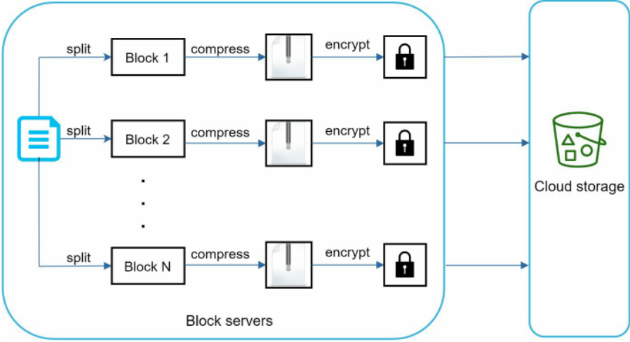

Hình 15-11

 * Tệp được chia thành các khối nhỏ hơn.
 * Mỗi khối được nén bằng các thuật toán nén phù hợp.
 * Để đảm bảo an toàn bảo mật, mỗi khối đều được mã hóa trước khi gửi lên dịch vụ lưu trữ đám mây.
 * Các khối sau đó được tải lên hệ thống lưu trữ đám mây.

Hình 15-12 minh họa cơ chế delta sync, tức là chỉ các khối bị thay đổi mới được truyền tải lên đám mây. Các khối được đánh dấu nổi bật gồm "block 2" và "block 5" đại diện cho những khối có nội dung bị chỉnh sửa. Nhờ áp dụng delta sync, hệ thống chỉ cần tải lên duy nhất hai khối này lên kho lưu trữ đám mây.


Hình 15-12

Các máy chủ khối dữ liệu giúp chúng ta tiết kiệm đáng kể lưu lượng băng thông mạng nhờ kết hợp giữa kỹ thuật delta sync và nén dữ liệu.

## High consistency requirement (Yêu cầu tính nhất quán cao)

Hệ thống của chúng ta mặc định đòi hỏi tính nhất quán mạnh (strong consistency). Việc một tệp tin hiển thị nội dung khác nhau trên các client khác nhau tại cùng một thời điểm là điều hoàn toàn không thể chấp nhận được. Hệ thống bắt buộc phải duy trì tính nhất quán mạnh cho cả tầng bộ nhớ đệm siêu dữ liệu và tầng cơ sở dữ liệu.

Các hệ thống bộ nhớ đệm (cache) trong RAM thường áp dụng mô hình nhất quán cuối cùng (eventual consistency) theo mặc định, nghĩa là các node nhân bản (replicas) khác nhau có thể tạm thời lưu giữ dữ liệu khác nhau. Để đạt được tính nhất quán mạnh, chúng ta phải đảm bảo các nguyên tắc sau:
 * Dữ liệu giữa các node cache bản sao và node chính (master) phải luôn đồng nhất.
 * Hủy bỏ tính hợp lệ của cache (invalidate cache) ngay khi có thao tác ghi vào cơ sở dữ liệu để đảm bảo cache và cơ sở dữ liệu luôn giữ cùng một giá trị chính xác.

Việc đạt được tính nhất quán mạnh trong cơ sở dữ liệu quan hệ (RDBMS) là rất thuận lợi vì nó luôn tuân thủ các thuộc tính ACID (Atomicity, Consistency, Isolation, Durability - Tính nguyên tử, Nhất quán, Cô lập, Bền vững) [9]. Ngược lại, các cơ sở dữ liệu NoSQL không hỗ trợ sẵn các thuộc tính ACID theo mặc định. Nếu dùng NoSQL, các thuộc tính ACID bắt buộc phải được lập trình thủ công bên trong logic đồng bộ của ứng dụng. Trong thiết kế này, chúng ta quyết định lựa chọn cơ sở dữ liệu quan hệ vì nó hỗ trợ sẵn ACID ở mức gốc.

## Metadata database (Cơ sở dữ liệu siêu dữ liệu)

Hình 15-13 minh họa lược đồ thiết kế cơ sở dữ liệu (schema design). Xin lưu ý rằng đây là phiên bản đã được tối giản hóa rất nhiều, chỉ bao gồm các bảng trọng yếu và các trường thông tin tiêu biểu nhất.


Hình 15-13

User: Bảng `user` lưu trữ thông tin cơ bản về người dùng như tên tài khoản, email, ảnh đại diện, v.v.

Device: Bảng `device` lưu trữ thông tin thiết bị. Trường `push_id` được dùng để gửi và nhận thông báo đẩy (push notifications) trên thiết bị di động. Cần lưu ý rằng một người dùng có thể sở hữu nhiều thiết bị khác nhau.

Namespace: Một `namespace` là thư mục gốc tương ứng với một người dùng.

File: Bảng `file` lưu giữ toàn bộ thông tin liên quan đến tệp tin mới nhất.

File\_version: Bảng này lưu trữ lịch sử các phiên bản của tệp. Các hàng dữ liệu hiện có đều là dạng chỉ đọc (read-only) nhằm đảm bảo tính toàn vẹn của lịch sử sửa đổi tệp.

Block: Bảng này lưu trữ toàn bộ các thông tin liên quan đến từng khối dữ liệu của tệp. Một tệp thuộc bất kỳ phiên bản nào đều có thể được tái tạo đầy đủ bằng cách ghép nối tất cả các khối tương ứng theo đúng thứ tự quy định.

## Upload flow (Luồng tải tệp lên)

Hãy cùng thảo luận điều gì sẽ diễn ra khi một client tải lên một tệp tin. Để dễ hình dung toàn bộ luồng xử lý, chúng ta vẽ biểu đồ tuần tự (sequence diagram) như trong Hình 15-14.


Hình 15-14

Trong Hình 15-14, có hai luồng yêu cầu được gửi song song: thêm siêu dữ liệu của tệp và tải nội dung tệp lên bộ lưu trữ đám mây. Cả hai yêu cầu đều bắt nguồn từ client 1.

 * Thêm siêu dữ liệu tệp:
1. Client 1 gửi yêu cầu thêm thông tin siêu dữ liệu của tệp mới.
2. Lưu siêu dữ liệu tệp mới vào cơ sở dữ liệu siêu dữ liệu (Metadata DB) và chuyển trạng thái tải tệp thành "pending" (đang chờ xử lý).
3. Gửi thông báo tới dịch vụ thông báo (notification service) rằng một tệp mới đang được tải lên.
4. Dịch vụ thông báo chuyển tiếp thông báo tới các client liên quan (client 2) rằng một tệp đang được tải lên hệ thống.

 * Tải tệp lên bộ lưu trữ đám mây:
    * 2.1 Client 1 tải nội dung tệp lên các máy chủ khối dữ liệu (block servers).
    * 2.2 Các máy chủ khối dữ liệu chia nhỏ tệp thành các khối, nén lại, mã hóa từng khối rồi tải chúng lên hệ thống lưu trữ đám mây.
    * 2.3 Khi tệp đã được tải lên hoàn tất, kho lưu trữ đám mây kích hoạt một hàm gọi lại (upload completion callback). Yêu cầu này được chuyển tiếp tới các máy chủ API.
    * 2.4 Trạng thái tệp được chuyển thành "uploaded" (đã tải lên) trong Cơ sở dữ liệu siêu dữ liệu.
    * 2.5 Báo cho dịch vụ thông báo rằng trạng thái tệp đã chuyển thành "uploaded".
    * 2.6 Dịch vụ thông báo gửi tin báo cho các client liên quan (client 2) rằng tệp đã được tải lên hoàn tất.

Khi một tệp bị chỉnh sửa, quy trình diễn ra hoàn toàn tương tự nên chúng ta sẽ không nhắc lại tại đây.

## Download flow (Luồng tải tệp xuống)

Luồng tải xuống được kích hoạt khi một tệp tin được thêm mới hoặc chỉnh sửa ở một nơi nào đó. Làm sao một client biết được một tệp đã bị thêm mới hoặc sửa đổi bởi một client khác? Có hai phương thức để client nắm bắt thông tin này:
 * Nếu client A đang online trong lúc một tệp bị thay đổi bởi client khác, dịch vụ thông báo sẽ báo cho client A biết rằng vừa có chỉnh sửa phát sinh ở nơi khác và nó cần phải kéo dữ liệu mới nhất về.
 * Nếu client A đang offline trong lúc tệp bị sửa đổi, thông tin thay đổi sẽ được lưu tạm vào bộ nhớ đệm. Ngay khi client ngoại tuyến này kết nối mạng trở lại, nó sẽ tự động kéo các thay đổi mới nhất về.

Khi client nhận biết được một tệp đã có sự thay đổi, trước tiên nó sẽ gửi yêu cầu lấy siêu dữ liệu thông qua các máy chủ API, sau đó tải các khối dữ liệu tương ứng về để tái cấu trúc lại tệp tin hoàn chỉnh. Hình 15-15 mô tả luồng chi tiết. Xin lưu ý rằng do giới hạn về diện tích khung hình, sơ đồ chỉ thể hiện những thành phần quan trọng nhất.


Hình 15-15

1. Dịch vụ thông báo báo cho client 2 biết một tệp đã bị thay đổi ở nơi khác.
2. Khi client 2 biết có bản cập nhật mới, nó gửi một yêu cầu để lấy siêu dữ liệu.
3. Các máy chủ API truy vấn cơ sở dữ liệu siêu dữ liệu để lấy thông tin các thay đổi.
4. Siêu dữ liệu được trả về cho các máy chủ API.
5. Client 2 nhận được siêu dữ liệu này.
6. Khi nhận được siêu dữ liệu, client 2 gửi các yêu cầu tới block servers để tải về các khối dữ liệu tương ứng.
7. Các block server sẽ tải các khối đó từ hệ thống lưu trữ đám mây về trước.
8. Kho lưu trữ đám mây trả các khối dữ liệu về cho block servers.
9. Client 2 tải toàn bộ các khối mới này về máy để ghép nối lại thành tệp tin hoàn chỉnh ban đầu.

## Notification service (Dịch vụ thông báo)

Để duy trì tính nhất quán của tệp tin, bất kỳ thao tác biến đổi tệp nào diễn ra ở cục bộ đều cần được thông báo kịp thời cho các client khác nhằm hạn chế tối đa nguy cơ xung đột. Dịch vụ thông báo được xây dựng chính là để phục vụ mục tiêu này. Ở góc độ cấp cao, dịch vụ thông báo cho phép truyền dữ liệu tới các client ngay khi các sự kiện phát sinh. Có một số phương án công nghệ sau:
 * Long polling (kỹ thuật giữ kết nối dài hạn để nhận dữ liệu thời gian thực): Dropbox sử dụng kỹ thuật long polling [10].
 * WebSocket (giao thức truyền thông hai chiều thời gian thực): WebSocket cung cấp một kết nối bền vững duy nhất giữa client và máy chủ. Luồng giao tiếp diễn ra theo cả hai chiều.

Mặc dù cả hai phương án đều hoạt động tốt, chúng ta lựa chọn long polling vì hai lý do sau:
 * Luồng giao tiếp của dịch vụ thông báo không đòi hỏi tính hai chiều. Máy chủ chỉ cần gửi thông tin thay đổi của tệp tới client, chứ client không cần gửi chiều ngược lại qua kênh này.
 * WebSocket rất phù hợp cho các nhu cầu giao tiếp hai chiều thời gian thực như ứng dụng trò chuyện (chat app). Đối với Google Drive, các thông báo phát sinh với tần suất khá thưa thớt, không có các đợt bùng nổ dữ liệu liên tục.

Với kỹ thuật long polling, mỗi client sẽ thiết lập một kết nối giữ lâu tới dịch vụ thông báo. Nếu phát hiện có sự thay đổi trên tệp, client sẽ chủ động đóng kết nối long poll này. Việc đóng kết nối đồng nghĩa với việc client phải kết nối tới máy chủ siêu dữ liệu để tải về các thay đổi mới nhất. Sau khi nhận được phản hồi hoặc kết nối chạm ngưỡng hết thời gian chờ (timeout), client sẽ lập tức gửi một yêu cầu mới để duy trì kết nối luôn mở.

## Save storage space (Tiết kiệm không gian lưu trữ)

Để hỗ trợ tính năng lưu lịch sử phiên bản tệp và đảm bảo độ tin cậy của dữ liệu, nhiều phiên bản của cùng một tệp sẽ được lưu trữ phân tán trên nhiều trung tâm dữ liệu khác nhau. Dung lượng lưu trữ có thể bị lấp đầy rất nhanh nếu liên tục sao lưu toàn bộ các phiên bản sửa đổi. Ba kỹ thuật sau được đề xuất để cắt giảm chi phí lưu trữ:
 * Loại bỏ trùng lặp các khối dữ liệu (De-duplicate data blocks): Loại bỏ các khối dư thừa ở cấp tài khoản là một cách rất đơn giản để tiết kiệm không gian. Hai khối được coi là giống hệt nhau nếu chúng có cùng một mã băm (hash value).
 * Áp dụng chiến lược sao lưu dữ liệu thông minh. Hai chiến lược tối ưu hóa có thể được áp dụng:
    * Đặt giới hạn: Chúng ta có thể thiết lập một hạn mức tối đa cho số lượng phiên bản cần lưu trữ. Nếu chạm ngưỡng giới hạn, phiên bản cũ nhất sẽ bị thay thế bằng phiên bản mới.
    * Chỉ lưu các phiên bản có giá trị: Một số tệp có thể bị chỉnh sửa liên tục trong thời gian ngắn. Ví dụ, việc lưu lại mọi phiên bản sửa đổi của một tài liệu đang được gõ có thể khiến tệp đó được lưu tới hơn 1.000 lần trong một khoảng thời gian rất ngắn. Để tránh tạo ra các bản sao không cần thiết, chúng ta có thể giới hạn số lượng phiên bản được lưu, đồng thời ưu tiên trọng số cho các phiên bản gần nhất. Việc thực nghiệm sẽ giúp tìm ra số lượng phiên bản tối ưu cần lưu trữ.
 * Chuyển dữ liệu ít truy cập sang hệ thống lưu trữ lạnh (cold storage): Dữ liệu lạnh là dữ liệu đã không còn hoạt động trong nhiều tháng hoặc nhiều năm. Các giải pháp lưu trữ lạnh như Amazon S3 Glacier [11] có chi phí rẻ hơn rất nhiều so với S3 tiêu chuẩn.

## Failure Handling (Xử lý sự cố)

Các sự cố hỏng hóc hoàn toàn có thể xảy ra trong một hệ thống quy mô lớn và chúng ta bắt buộc phải áp dụng các chiến lược thiết kế để ứng phó với những tình huống này. Người phỏng vấn có thể sẽ rất muốn lắng nghe bạn trình bày cách xử lý các sự cố hệ thống sau:
 * Sự cố bộ cân bằng tải (Load balancer failure): Nếu một load balancer bị sập, máy chủ dự phòng (secondary) sẽ lập tức chuyển sang trạng thái hoạt động (active) và tiếp quản toàn bộ lưu lượng. Các bộ cân bằng tải thường giám sát lẫn nhau thông qua tín hiệu nhịp tim (heartbeat - tín hiệu định kỳ gửi qua lại giữa các máy chủ). Một load balancer sẽ bị coi là đã sập nếu nó không gửi tín hiệu heartbeat sau một khoảng thời gian nhất định.
 * Sự cố máy chủ khối dữ liệu (Block server failure): Nếu một block server bị sập, các máy chủ khác sẽ tiếp quản các tác vụ còn dang dở hoặc đang chờ xử lý.
 * Sự cố hệ thống lưu trữ đám mây (Cloud storage failure): Các thùng chứa S3 được nhân bản nhiều lần tại các vùng địa lý khác nhau. Nếu tệp không khả dụng ở vùng này, chúng có thể được lấy từ các vùng khác.
 * Sự cố máy chủ API (API server failure): Đây là dịch vụ phi trạng thái (stateless). Nếu một máy chủ API bị sập, lưu lượng sẽ được bộ cân bằng tải tự động chuyển hướng sang các máy chủ API khác.
 * Sự cố bộ nhớ đệm siêu dữ liệu (Metadata cache failure): Các máy chủ cache siêu dữ liệu được nhân bản nhiều lần. Nếu một node bị hỏng, bạn vẫn có thể truy cập các node khác để lấy dữ liệu. Chúng ta sẽ khởi tạo một máy chủ cache mới để thay thế cho node đã chết.
 * Sự cố cơ sở dữ liệu siêu dữ liệu (Metadata DB failure):
    * Máy chủ chính (Master) bị sập: Nếu master bị sập, chuyển một trong các máy chủ phụ (slave) lên làm master mới và khởi tạo một node slave mới.
    * Máy chủ phụ (Slave) bị sập: Nếu một slave bị sập, bạn có thể điều hướng các thao tác đọc sang một slave khác và bổ sung một máy chủ cơ sở dữ liệu khác để thay thế node bị hỏng.
 * Sự cố dịch vụ thông báo (Notification service failure): Mỗi người dùng đang online đều duy trì một kết nối long poll với máy chủ thông báo. Do đó, mỗi máy chủ thông báo phải kết nối với rất nhiều người dùng. Theo bài thuyết trình của Dropbox vào năm 2012 [6], mỗi máy chủ của họ phải duy trì hơn 1 triệu kết nối mở. Nếu một máy chủ bị sập, toàn bộ các kết nối long poll đó sẽ bị mất, buộc các client phải kết nối lại sang một máy chủ khác. Mặc dù một máy chủ có thể duy trì nhiều kết nối mở cùng lúc, nhưng nó không thể tái lập lại toàn bộ hàng triệu kết nối bị đứt đó ngay trong một tích tắc. Tái kết nối với tất cả các client bị ngắt là một quá trình tương đối chậm chạp.
 * Sự cố hàng đợi sao lưu ngoại tuyến (Offline backup queue failure): Các hàng đợi được nhân bản nhiều lần. Nếu một hàng đợi gặp sự cố, các đối tượng tiêu thụ thông điệp (consumers) của hàng đợi đó có thể cần đăng ký lại sang hàng đợi dự phòng.

# Step 4 - Wrap up (Bước 4 - Tổng kết)

Trong chương này, chúng ta đã đề xuất bản thiết kế hệ thống hỗ trợ dịch vụ Google Drive. Sự kết hợp giữa tính nhất quán mạnh, tối ưu băng thông mạng và tốc độ đồng bộ nhanh đã tạo nên nét hấp dẫn đặc biệt cho bản thiết kế này. Hệ thống của chúng ta bao gồm hai luồng chính: quản lý siêu dữ liệu tệp và đồng bộ hóa tệp tin. Dịch vụ thông báo cũng là một thành phần thiết yếu của hệ thống; nó sử dụng kỹ thuật long polling để giúp các client luôn được cập nhật kịp thời các thay đổi của tệp.

Giống như bất kỳ câu hỏi phỏng vấn thiết kế hệ thống nào, không bao giờ có một giải pháp hoàn hảo tuyệt đối. Mỗi công ty đều có những ràng buộc kỹ thuật và kinh doanh riêng, và nhiệm vụ của bạn là phải thiết kế một hệ thống phù hợp nhất với những ràng buộc đó. Hiểu rõ các điểm đánh đổi (tradeoffs) trong thiết kế và việc lựa chọn công nghệ là điều tối quan trọng. Nếu còn dư một vài phút cuối buổi phỏng vấn, bạn có thể trao đổi thêm về các phương án thiết kế thay thế khác nhau.

Ví dụ, chúng ta hoàn toàn có thể cho phép client tải tệp trực tiếp lên bộ lưu trữ đám mây thay vì phải đi vòng qua các máy chủ khối dữ liệu (block servers). Ưu điểm của cách tiếp cận này là giúp quá trình tải tệp lên nhanh hơn, vì tệp chỉ cần truyền tải một lần duy nhất lên thẳng cloud storage. Trong khi đó, ở thiết kế hiện tại của chúng ta, tệp phải được truyền tới block servers trước rồi mới tải tiếp lên cloud storage. Tuy nhiên, hướng tiếp cận mới này lại có một vài nhược điểm lớn:
 * Thứ nhất, logic chia khối (chunking), nén và mã hóa tệp sẽ phải cài đặt lặp lại trên nhiều nền tảng client khác nhau (iOS, Android, Web). Điều này rất dễ phát sinh lỗi và đòi hỏi nguồn lực kỹ thuật rất lớn để duy trì. Trong thiết kế của chúng ta, toàn bộ các logic phức tạp đó được tập trung xử lý tại một nơi duy nhất: các máy chủ khối dữ liệu.
 * Thứ hai, do ứng dụng phía client rất dễ bị can thiệp hoặc tấn công xâm nhập (hacked), việc triển khai logic mã hóa hoàn toàn ở phía client là không thực sự an toàn và lý tưởng.

Một hướng cải tiến thú vị khác cho hệ thống là tách biệt toàn bộ logic quản lý trạng thái online/offline của người dùng ra thành một dịch vụ độc lập. Chúng ta có thể gọi đó là dịch vụ hiện diện (presence service). Bằng việc đưa presence service ra khỏi các máy chủ thông báo, chức năng nhận biết trạng thái online/offline có thể dễ dàng được tái sử dụng và tích hợp bởi nhiều dịch vụ khác trong toàn hệ thống.

Chúc mừng bạn đã đi được một chặng đường rất dài! Giờ là lúc bạn có thể tự hào về những gì mình đã tiếp thu. Làm rất tốt!

# Reference materials (Tài liệu tham khảo)

[1] Google Drive: https://www.google.com/drive/  
[2] Tải lên dữ liệu tệp: https://developers.google.com/drive/api/v2/manage-uploads  
[3] Amazon S3: https://aws.amazon.com/s3  
[4] Đồng bộ hóa vi sai (Differential Synchronization): https://neil.fraser.name/writing/sync/  
[5] Bài nói chuyện trên YouTube về đồng bộ hóa vi sai: https://www.youtube.com/watch? v=S2Hp\_1jqpY8  
[6] Cách chúng tôi mở rộng quy mô Dropbox: https://youtu.be/PE4gwstWhmc  
[7] Tridgell, A., & Mackerras, P. (1996). Thuật toán rsync (The rsync algorithm).  
[8] Thư viện Librsync. (n.d.). Truy cập ngày 18 tháng 4 năm 2015, từ https://github.com/librsync/librsync  
[9] Thuộc tính ACID: https://en.wikipedia.org/wiki/ACID  
[10] Sách trắng bảo mật Dropbox: https://www.dropbox.com/static/business/resources/Security\_Whitepaper.pdf  
[11] Các câu hỏi thường gặp về Amazon S3 Glacier: https://aws.amazon.com/glacier/faqs/

# CHAPTER 16: THE LEARNING CONTINUES (CHƯƠNG 16: HÀNH TRÌNH HỌC TẬP VẪN TIẾP TỤC)

Thiết kế các hệ thống tối ưu đòi hỏi sự tích lũy kiến thức qua nhiều năm tháng. Một trong những con đường tắt hiệu quả nhất là đào sâu nghiên cứu kiến trúc của các hệ thống lớn trong thế giới thực. Dưới đây là danh mục tổng hợp các tài liệu đọc vô cùng giá trị. Chúng tôi đặc biệt khuyến khích bạn chú ý đến cả các nguyên lý thiết kế chung lẫn các công nghệ cốt lõi bên dưới. Tìm hiểu kỹ từng công nghệ và thấu hiểu bài toán thực tế mà nó giải quyết là phương pháp tuyệt vời để củng cố nền tảng kiến thức và mài sắc tư duy thiết kế của bạn.

## Real-world systems (Các hệ thống trong thực tế)

Các tài liệu sau đây sẽ giúp bạn hiểu rõ các ý tưởng thiết kế tổng quát đằng sau kiến trúc hệ thống thực tế của nhiều công ty lớn:
 * Facebook Timeline: Mang đến cho bạn nhờ sức mạnh của phi chuẩn hóa dữ liệu (Denormalization): https://goo.gl/FCNrbm
 * Mở rộng quy mô tại Facebook (Scale at Facebook): https://goo.gl/NGTdCs
 * Xây dựng Timeline: Mở rộng quy mô để lưu giữ câu chuyện cuộc đời bạn: https://goo.gl/8p5wDV
 * Ứng dụng Erlang tại Facebook (Facebook chat): https://goo.gl/zSLHrj
 * Hệ thống Facebook Chat: https://goo.gl/qzSiWC
 * Tìm kim đáy bể trong Haystack: Hệ thống lưu trữ ảnh của Facebook: https://goo.gl/edj4FL
 * Phục vụ Facebook Multifeed: Đạt hiệu quả và hiệu năng vượt trội qua việc tái thiết kế: https://goo.gl/adFVMQ
 * Mở rộng Memcache tại Facebook: https://goo.gl/rZiAhX
 * TAO: Kho lưu trữ dữ liệu phân tán cho đồ thị xã hội của Facebook: https://goo.gl/Tk1DyH
 * Kiến trúc Amazon (Amazon Architecture): https://goo.gl/k4feoW
 * Dynamo: Kho lưu trữ khóa - giá trị tính sẵn sàng cao của Amazon: https://goo.gl/C7zxDL
 * Toàn cảnh 360 độ về toàn bộ ngăn xếp công nghệ của Netflix: https://goo.gl/rYSDTz
 * Tất cả đều là thử nghiệm A/B: Nền tảng thực nghiệm của Netflix: https://goo.gl/agbA4K
 * Đề xuất của Netflix: Vượt xa tiêu chuẩn 5 sao (Phần 1): https://goo.gl/A4FkYi
 * Đề xuất của Netflix: Vượt xa tiêu chuẩn 5 sao (Phần 2): https://goo.gl/XNPMXm
 * Kiến trúc Google (Google Architecture): https://goo.gl/dvkDiY
 * Hệ thống tệp Google (The Google File System - Google Docs): https://goo.gl/xj5n9R
 * Đồng bộ hóa vi sai (Differential Synchronization - Google Docs): https://goo.gl/9zqG7x
 * Kiến trúc YouTube (YouTube Architecture): https://goo.gl/mCPRUF
 * Hội nghị Seattle về khả năng mở rộng quy mô: Khả năng mở rộng của YouTube: https://goo.gl/dH3zYq
 * Bigtable: Hệ thống lưu trữ phân tán cho dữ liệu có cấu trúc: https://goo.gl/6NaZca
 * Kiến trúc Instagram: 14 triệu người dùng, hàng Terabyte ảnh, hàng trăm máy chủ, hàng tá công nghệ: https://goo.gl/s1VcW5
 * Kiến trúc Twitter sử dụng để phục vụ 150 triệu người dùng hoạt động: https://goo.gl/EwvfRd
 * Mở rộng Twitter: Giúp Twitter nhanh hơn 10.000 phần trăm: https://goo.gl/nYGC1k
 * Giới thiệu Snowflake (Dịch vụ mạng giúp tạo ID duy nhất ở quy mô lớn với các đảm bảo đơn giản): https://goo.gl/GzVWYm
 * Xử lý Timeline ở quy mô lớn: https://goo.gl/8KbqTy
 * Cách Uber mở rộng nền tảng thị trường theo thời gian thực: https://goo.gl/kGZuVy
 * Mở rộng quy mô Pinterest: https://goo.gl/KtmjW3
 * Cập nhật kiến trúc Pinterest: https://goo.gl/w6rRsf
 * Lược sử về hành trình mở rộng quy mô của LinkedIn: https://goo.gl/8A1Pi8
 * Kiến trúc Flickr: https://goo.gl/dWtgYa
 * Cách chúng tôi đã mở rộng Dropbox: https://goo.gl/NjBDtC
 * Kiến trúc WhatsApp được Facebook mua lại với giá 19 tỷ USD: https://bit.ly/2AHJnFn

## Company engineering blogs (Blog kỹ thuật của các công ty)

Nếu bạn chuẩn bị bước vào cuộc phỏng vấn với một công ty công nghệ, việc tìm đọc blog kỹ thuật của họ là một ý tưởng tuyệt vời để làm quen với các công nghệ và hệ thống đang được triển khai thực tế tại đó. Bên cạnh đó, các blog kỹ thuật cũng mang lại những góc nhìn chuyên sâu vô giá về từng lĩnh vực cụ thể. Đọc chúng thường xuyên sẽ giúp chúng ta ngày một hoàn thiện và trở thành những kỹ sư giỏi hơn. Dưới đây là danh sách blog kỹ thuật của các công ty công nghệ lớn và startup danh tiếng:
 * Airbnb: https://medium.com/airbnb-engineering
 * Amazon: https://developer.amazon.com/blogs
 * Asana: https://blog.asana.com/category/eng
 * Atlassian: https://developer.atlassian.com/blog
 * Bittorrent: http://engineering.bittorrent.com
 * Cloudera: https://blog.cloudera.com
 * Docker: https://blog.docker.com
 * Dropbox: https://blogs.dropbox.com/tech
 * eBay: http://www.ebaytechblog.com
 * Facebook: https://code.facebook.com/posts
 * GitHub: https://githubengineering.com
 * Google: https://developers.googleblog.com
 * Groupon: https://engineering.groupon.com
 * Highscalability: http://highscalability.com
 * Instacart: https://tech.instacart.com
 * Instagram: https://engineering.instagram.com
 * Linkedin: https://engineering.linkedin.com/blog
 * Mixpanel: https://mixpanel.com/blog
 * Netflix: https://medium.com/netflix-techblog
 * Nextdoor: https://engblog.nextdoor.com
 * PayPal: https://www.paypal-engineering.com
 * Pinterest: https://engineering.pinterest.com
 * Quora: https://engineering.quora.com
 * Reddit: https://redditblog.com
 * Salesforce: https://developer.salesforce.com/blogs/engineering
 * Shopify: https://engineering.shopify.com
 * Slack: https://slack.engineering
 * Soundcloud: https://developers.soundcloud.com/blog
 * Spotify: https://labs.spotify.com
 * Stripe: https://stripe.com/blog/engineering
 * Cẩm nang thiết kế hệ thống (System design primer): https://github.com/donnemartin/system-design-primer
 * Twitter: https://blog.twitter.com/engineering/en\_us.html
 * Thumbtack: https://www.thumbtack.com/engineering
 * Uber: http://eng.uber.com
 * Yahoo: https://yahooeng.tumblr.com
 * Yelp: https://engineeringblog.yelp.com
 * Zoom: https://medium.com/zoom-developer-blog

# AFTERWORD (LỜI KẾT)
